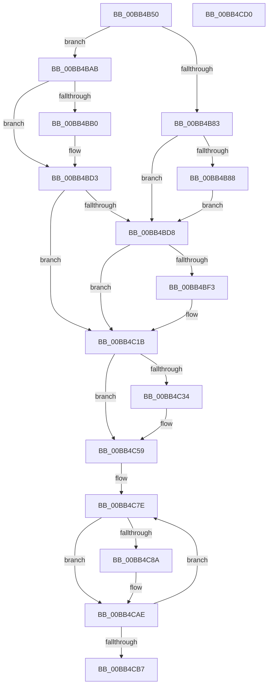

# ViSpMmMapLockedPagesSanityChecks

- RVA: `0x00BB4B50`–`0x00BB4CD1` (길이 `385` bytes)
- VA: `0x0000000140BB4B50`
- 실행 섹션: `PAGEVRFY`
- PDB 이름 있음: `예`; PDB Function 태그: `아니요`
- unwind 정보 RVA: `0x000BC898`
- 디코드: `106`개 명령, `385/385` bytes 표시
- 미해석 바이트: `0` (있으면 어셈블리에 `.byte`로 보존)

> 이 문서는 커널 이미지의 기계어와 PDB 기호를 분석해 생성했습니다. 4번과 5번은 함수 원형과 자료형을 바이너리 사용 방식에서 추정한 C 해석이며 원본 소스 복구 결과는 아닙니다.

## 1. Dependencies

- 직접 호출 지점: **6**; 고유 호출 대상: **2**
- 직접 호출자로 확인된 함수: **2**
- RIP 상대 이미지 참조: **1**

### Outgoing calls
- `0x00BB4BA4` → [CarReportRuleViolationFromNt](../B9/CarReportRuleViolationFromNt_function_00B9D904.md) (function, `0x00B9D904`)
- `0x00BB4BCE` → [CarReportRuleViolationFromNt](../B9/CarReportRuleViolationFromNt_function_00B9D904.md) (function, `0x00B9D904`)
- `0x00BB4C16` → [CarReportRuleViolationFromNt](../B9/CarReportRuleViolationFromNt_function_00B9D904.md) (function, `0x00B9D904`)
- `0x00BB4C54` → [CarReportRuleViolationFromNt](../B9/CarReportRuleViolationFromNt_function_00B9D904.md) (function, `0x00B9D904`)
- `0x00BB4C81` → [MmIsMdlPageLocked](MmIsMdlPageLocked_function_00BB46E8.md) (function, `0x00BB46E8`)
- `0x00BB4CA9` → [CarReportRuleViolationFromNt](../B9/CarReportRuleViolationFromNt_function_00B9D904.md) (function, `0x00B9D904`)

### Direct callers
- [ViSpMmMapLockedPages_Entry](../../text/6A/ViSpMmMapLockedPages_Entry_function_006AA9D0.md) at `0x006AA9DE`
- [ViSpMmMapLockedPagesSpecifyCache_Entry](ViSpMmMapLockedPagesSpecifyCache_Entry_function_00BB4CE0.md) at `0x00BB4CEE`

### Static image references
- `0x00BB4BD8` → RVA `0x00E681A0` (`.data`; read)

## 2. Other-region calls and transfers

- 다른 실행 섹션으로 향하는 call: **0**
- 별도 외부 분기/꼬리 이동을 확인하지 못했습니다.

## 3. Assembly (complete function range)

```asm
00BB4B50  48 8B C4                        mov rax, rsp
00BB4B53  48 89 58 08                     mov qword ptr [rax + 8], rbx
00BB4B57  48 89 68 10                     mov qword ptr [rax + 0x10], rbp
00BB4B5B  48 89 70 18                     mov qword ptr [rax + 0x18], rsi
00BB4B5F  57                              push rdi
00BB4B60  41 54                           push r12
00BB4B62  41 56                           push r14
00BB4B64  48 83 EC 40                     sub rsp, 0x40
00BB4B68  49 8B E8                        mov rbp, r8
00BB4B6B  48 0F BE FA                     movsx rdi, dl
00BB4B6F  48 8B D9                        mov rbx, rcx
00BB4B72  44 0F 20 C1                     mov rcx, cr8
00BB4B76  41 BC C4 00 00 00               mov r12d, 0xc4
00BB4B7C  40 B6 01                        mov sil, 1
00BB4B7F  84 D2                           test dl, dl
00BB4B81  75 28                           jne 0x140bb4bab
00BB4B83  80 F9 02                        cmp cl, 2
00BB4B86  76 50                           jbe 0x140bb4bd8
00BB4B88  48 89 68 D8                     mov qword ptr [rax - 0x28], rbp
00BB4B8C  41 8D 54 24 B0                  lea edx, [r12 - 0x50]
00BB4B91  83 60 D0 00                     and dword ptr [rax - 0x30], 0
00BB4B95  4C 8B CB                        mov r9, rbx
00BB4B98  48 83 60 C8 00                  and qword ptr [rax - 0x38], 0
00BB4B9D  44 0F B6 C1                     movzx r8d, cl
00BB4BA1  41 8B CC                        mov ecx, r12d
00BB4BA4  E8 5B 8D FE FF                  call 0x140b9d904
00BB4BA9  EB 2D                           jmp 0x140bb4bd8
00BB4BAB  40 3A CE                        cmp cl, sil
00BB4BAE  76 23                           jbe 0x140bb4bd3
00BB4BB0  44 0F B6 C1                     movzx r8d, cl
00BB4BB4  4C 8B CB                        mov r9, rbx
00BB4BB7  48 89 6C 24 30                  mov qword ptr [rsp + 0x30], rbp
00BB4BBC  41 8B CC                        mov ecx, r12d
00BB4BBF  83 64 24 28 00                  and dword ptr [rsp + 0x28], 0
00BB4BC4  BA 75 00 00 00                  mov edx, 0x75
00BB4BC9  48 89 7C 24 20                  mov qword ptr [rsp + 0x20], rdi
00BB4BCE  E8 31 8D FE FF                  call 0x140b9d904
00BB4BD3  40 3A FE                        cmp dil, sil
00BB4BD6  74 43                           je 0x140bb4c1b
00BB4BD8  8B 05 C2 35 2B 00               mov eax, dword ptr [rip + 0x2b35c2]
00BB4BDE  48 0F BF 4B 0A                  movsx rcx, word ptr [rbx + 0xa]
00BB4BE3  C1 E8 14                        shr eax, 0x14
00BB4BE6  66 83 E0 04                     and ax, 4
00BB4BEA  66 83 C8 21                     or ax, 0x21
00BB4BEE  66 85 C8                        test ax, cx
00BB4BF1  74 28                           je 0x140bb4c1b
00BB4BF3  0F B7 C0                        movzx eax, ax
00BB4BF6  4C 8B C9                        mov r9, rcx
00BB4BF9  48 23 C1                        and rax, rcx
00BB4BFC  48 89 6C 24 30                  mov qword ptr [rsp + 0x30], rbp
00BB4C01  83 64 24 28 00                  and dword ptr [rsp + 0x28], 0
00BB4C06  41 8B CC                        mov ecx, r12d
00BB4C09  4C 8B C3                        mov r8, rbx
00BB4C0C  48 89 44 24 20                  mov qword ptr [rsp + 0x20], rax
00BB4C11  BA B2 00 00 00                  mov edx, 0xb2
00BB4C16  E8 E9 8C FE FF                  call 0x140b9d904
00BB4C1B  B8 17 00 00 00                  mov eax, 0x17
00BB4C20  40 3A FE                        cmp dil, sil
00BB4C23  8D 48 FB                        lea ecx, [rax - 5]
00BB4C26  66 0F 45 C1                     cmovne ax, cx
00BB4C2A  48 0F BF 4B 0A                  movsx rcx, word ptr [rbx + 0xa]
00BB4C2F  66 85 C1                        test cx, ax
00BB4C32  75 25                           jne 0x140bb4c59
00BB4C34  0F B7 C0                        movzx eax, ax
00BB4C37  4C 8B C9                        mov r9, rcx
00BB4C3A  48 89 6C 24 30                  mov qword ptr [rsp + 0x30], rbp
00BB4C3F  41 8B CC                        mov ecx, r12d
00BB4C42  83 64 24 28 00                  and dword ptr [rsp + 0x28], 0
00BB4C47  4C 8B C3                        mov r8, rbx
00BB4C4A  BA B3 00 00 00                  mov edx, 0xb3
00BB4C4F  48 89 44 24 20                  mov qword ptr [rsp + 0x20], rax
00BB4C54  E8 AB 8C FE FF                  call 0x140b9d904
00BB4C59  8B 4B 2C                        mov ecx, dword ptr [rbx + 0x2c]
00BB4C5C  48 8D 7B 30                     lea rdi, [rbx + 0x30]
00BB4C60  03 4B 20                        add ecx, dword ptr [rbx + 0x20]
00BB4C63  8B 73 28                        mov esi, dword ptr [rbx + 0x28]
00BB4C66  81 E1 FF 0F 00 00               and ecx, 0xfff
00BB4C6C  48 81 C6 FF 0F 00 00            add rsi, 0xfff
00BB4C73  48 03 F1                        add rsi, rcx
00BB4C76  48 C1 EE 0C                     shr rsi, 0xc
00BB4C7A  4C 8D 34 F7                     lea r14, [rdi + rsi*8]
00BB4C7E  48 8B 0F                        mov rcx, qword ptr [rdi]
00BB4C81  E8 62 FA FF FF                  call 0x140bb46e8
00BB4C86  85 C0                           test eax, eax
00BB4C88  75 24                           jne 0x140bb4cae
00BB4C8A  48 89 6C 24 30                  mov qword ptr [rsp + 0x30], rbp
00BB4C8F  4C 8B CE                        mov r9, rsi
00BB4C92  21 44 24 28                     and dword ptr [rsp + 0x28], eax
00BB4C96  4C 8B C3                        mov r8, rbx
00BB4C99  48 8B 07                        mov rax, qword ptr [rdi]
00BB4C9C  BA 85 00 00 00                  mov edx, 0x85
00BB4CA1  41 8B CC                        mov ecx, r12d
00BB4CA4  48 89 44 24 20                  mov qword ptr [rsp + 0x20], rax
00BB4CA9  E8 56 8C FE FF                  call 0x140b9d904
00BB4CAE  48 83 C7 08                     add rdi, 8
00BB4CB2  49 3B FE                        cmp rdi, r14
00BB4CB5  72 C7                           jb 0x140bb4c7e
00BB4CB7  48 8B 5C 24 60                  mov rbx, qword ptr [rsp + 0x60]
00BB4CBC  48 8B 6C 24 68                  mov rbp, qword ptr [rsp + 0x68]
00BB4CC1  48 8B 74 24 70                  mov rsi, qword ptr [rsp + 0x70]
00BB4CC6  48 83 C4 40                     add rsp, 0x40
00BB4CCA  41 5E                           pop r14
00BB4CCC  41 5C                           pop r12
00BB4CCE  5F                              pop rdi
00BB4CCF  C3                              ret
00BB4CD0  CC                              int3
```

## 4. C-style interpretation (structured pseudocode)

```c
__int64 __fastcall ViSpMmMapLockedPagesSanityChecks(__int64 a1, unsigned __int8 a2, __int64 a3)
{
    __int64 result;
    __int64 v_rdi;
    __int64 v_rsi;
    __int64 v_rsp;
    unsigned __int64 v_stack_m28;
    unsigned int v_stack_m30;
    unsigned __int64 v_stack_m38;
    unsigned __int64 v_stack_p10;
    unsigned __int64 v_stack_p18;
    unsigned __int64 v_stack_p8;

    *(unsigned __int64 *)(v_rsp + 8) = v_rbx;
    *(unsigned __int64 *)(v_rsp + 16) = v_rbp;
    *(unsigned __int64 *)(v_rsp + 24) = v_rsi;
    v_rsp = (v_rsp) - (64);
    if (a2 != 0) goto loc_00BB4BAB;
    if (((unsigned __int8)(v_cr8)) <= 2) goto loc_00BB4BD8;
    *(unsigned __int64 *)(v_rsp - 40) = a3;
    result = CarReportRuleViolationFromNt(196, 196 - 80, (unsigned __int8)(v_cr8), a1);
    goto loc_00BB4BD8;
loc_00BB4BAB:
    if (196 >= = 1) {
        a3 = 196;
        a4 = a1;
        v_stack_m28 = a3;
        a1 = 196;
        a2 = 117;
        v_stack_m38 = (__int8)(a2);
        result = CarReportRuleViolationFromNt(a1, a2, a3, a4);
    }
    if (((unsigned __int8)((__int8)(a2))) == 1) goto loc_00BB4C1B;
loc_00BB4BD8:
    result = (unsigned int)(((unsigned int)(*(unsigned int *)(v_rip + 2831810))) >> (20));
    result = (unsigned __int16)((result) & (4));
    result = (unsigned __int16)((result) | (33));
    if ((((unsigned __int16)(result)) & ((unsigned __int16)((__int16)(*(unsigned __int16 *)(a1 + 10))))) != 0) {
        result = (unsigned __int16)(result);
        a4 = (__int16)(*(unsigned __int16 *)(a1 + 10));
        result = (result) & ((__int16)(*(unsigned __int16 *)(a1 + 10)));
        v_stack_m28 = a3;
        a1 = 196;
        a3 = a1;
        v_stack_m38 = result;
        a2 = 178;
        result = CarReportRuleViolationFromNt(a1, a2, a3, a4);
    }
    result = 23;
    if (((unsigned __int8)((__int8)(a2))) != 1) { result = (unsigned __int16)(23 - 5); }
    if ((((unsigned __int16)((__int16)(*(unsigned __int16 *)(a1 + 10)))) & ((unsigned __int16)(result))) == 0) {
        result = (unsigned __int16)(result);
        a4 = (__int16)(*(unsigned __int16 *)(a1 + 10));
        v_stack_m28 = a3;
        a1 = 196;
        a3 = a1;
        a2 = 179;
        v_stack_m38 = result;
        result = CarReportRuleViolationFromNt(a1, a2, a3, a4);
    }
    a1 = (unsigned int)(((unsigned int)(*(unsigned int *)(a1 + 44))) + (*(unsigned int *)(a1 + 32)));
    a1 = (unsigned int)((a1) & (0xFFFULL));
    v_rsi = ((unsigned int)(*(unsigned int *)(a1 + 40))) + (0xFFFULL);
    v_rsi = (v_rsi) + (a1);
    v_rsi = (v_rsi) >> (12);
loc_00BB4C7E:
    result = MmIsMdlPageLocked(*(unsigned __int64 *)(a1 + 48), a2, a3, a4);
    if ((unsigned int)(result) == 0) {
        v_stack_m28 = a3;
        a4 = v_rsi;
        a3 = a1;
        result = *(unsigned __int64 *)(a1 + 48);
        a2 = 133;
        a1 = 196;
        v_stack_m38 = result;
        result = CarReportRuleViolationFromNt(a1, a2, a3, a4);
    }
    v_rdi = (a1 + 48) + (8);
    if (v_rdi < (a1 + 48 + v_rsi * 8)) goto loc_00BB4C7E;
    v_rsp = (v_rsp) + (64);
    return result;
}
```

## 5. (Beta) C Style

```c
int64_t ViSpMmMapLockedPagesSanityChecks(void *Arg1, uint8_t Arg2, int64_t Arg3)
{
    uint8_t *arg1 = (uint8_t *)Arg1;

    int64_t result;
    int64_t local_rdi;
    int64_t local_rsi;
    int64_t local_rsp;
    uint64_t v_stack_m28;
    uint32_t v_stack_m30;
    uint64_t v_stack_m38;
    uint64_t v_stack_p10;
    uint64_t v_stack_p18;
    uint64_t v_stack_p8;

    *(uint64_t *)(local_rsp + 0x8) = local_rbx;
    *(uint64_t *)(local_rsp + 0x10) = local_rbp;
    *(uint64_t *)(local_rsp + 0x18) = local_rsi;
    local_rsp = (local_rsp) - (64);
    if (Arg2 != 0) goto loc_00BB4BAB;
    if (((uint8_t)(v_cr8)) <= 2) goto loc_00BB4BD8;
    *(uint64_t *)(local_rsp - 0x28) = Arg3;
    result = CarReportRuleViolationFromNt(196, 196 - 80, (uint8_t)(v_cr8), Arg1);
    goto loc_00BB4BD8;
loc_00BB4BAB:
    if (196 >= = 1) {
        Arg3 = 196;
        a4 = Arg1;
        v_stack_m28 = Arg3;
        Arg1 = 196;
        Arg2 = 117;
        v_stack_m38 = (int8_t)(Arg2);
        result = CarReportRuleViolationFromNt(Arg1, Arg2, Arg3, a4);
    }
    if (((uint8_t)((int8_t)(Arg2))) == 1) goto loc_00BB4C1B;
loc_00BB4BD8:
    result = (uint32_t)(((uint32_t)(*(uint32_t *)(v_rip + 0x2B35C2))) >> (20));
    result = (uint16_t)((result) & (4));
    result = (uint16_t)((result) | (33));
    if ((((uint16_t)(result)) & ((uint16_t)((int16_t)(*(uint16_t *)(arg1 + 0xA))))) != 0) {
        result = (uint16_t)(result);
        a4 = (int16_t)(*(uint16_t *)(arg1 + 0xA));
        result = (result) & ((int16_t)(*(uint16_t *)(arg1 + 0xA)));
        v_stack_m28 = Arg3;
        Arg1 = 196;
        Arg3 = Arg1;
        v_stack_m38 = result;
        Arg2 = 178;
        result = CarReportRuleViolationFromNt(Arg1, Arg2, Arg3, a4);
    }
    result = 23;
    if (((uint8_t)((int8_t)(Arg2))) != 1) { result = (uint16_t)(23 - 5); }
    if ((((uint16_t)((int16_t)(*(uint16_t *)(arg1 + 0xA)))) & ((uint16_t)(result))) == 0) {
        result = (uint16_t)(result);
        a4 = (int16_t)(*(uint16_t *)(arg1 + 0xA));
        v_stack_m28 = Arg3;
        Arg1 = 196;
        Arg3 = Arg1;
        Arg2 = 179;
        v_stack_m38 = result;
        result = CarReportRuleViolationFromNt(Arg1, Arg2, Arg3, a4);
    }
    Arg1 = (uint32_t)(((uint32_t)(*(uint32_t *)(arg1 + 0x2C))) + (*(uint32_t *)(arg1 + 0x20)));
    Arg1 = (uint32_t)((Arg1) & (0xFFFULL));
    local_rsi = ((uint32_t)(*(uint32_t *)(arg1 + 0x28))) + (0xFFFULL);
    local_rsi = (local_rsi) + (Arg1);
    local_rsi = (local_rsi) >> (12);
loc_00BB4C7E:
    result = MmIsMdlPageLocked(*(uint64_t *)(arg1 + 0x30), Arg2, Arg3, a4);
    if ((uint32_t)(result) == 0) {
        v_stack_m28 = Arg3;
        a4 = local_rsi;
        Arg3 = Arg1;
        result = *(uint64_t *)(arg1 + 0x30);
        Arg2 = 133;
        Arg1 = 196;
        v_stack_m38 = result;
        result = CarReportRuleViolationFromNt(Arg1, Arg2, Arg3, a4);
    }
    local_rdi = (Arg1 + 48) + (8);
    if (local_rdi < (Arg1 + 48 + local_rsi * 8)) goto loc_00BB4C7E;
    local_rsp = (local_rsp) + (64);
    return result;
}
```

### 관측된 메모리 오프셋

구조체 형식이 확인되지 않은 접근은 인자 기준의 오프셋으로만 기록했습니다.

| 기준 인자 | 오프셋 표현 | 폭 (bit) | 접근 |
|---|---:|---:|---|
| `Arg1` | `+ 0x0 + rsi*8` | `64` | `R` |
| `Arg1` | `+ 0xA` | `16` | `R` |
| `Arg1` | `+ 0x20` | `32` | `R` |
| `Arg1` | `+ 0x28` | `32` | `R` |
| `Arg1` | `+ 0x2C` | `32` | `R` |
| `Arg1` | `+ 0x30` | `64` | `R` |

## 6. Execution-region graph

[열기: 2D/3D 그래프와 함수 탐색 컨트롤 패널](../../../control-panel.html?section=pagevrfy&rva=0x00BB4B50&view=graph)

- 2D 그래프는 위에서 아래로 흐르고, 3D 그래프는 빈 공간을 드래그해 회전합니다. Shift+드래그는 이동, 휠은 확대·축소, 함수 노드 선택은 대상 보고서 이동입니다.

### Static fallback


