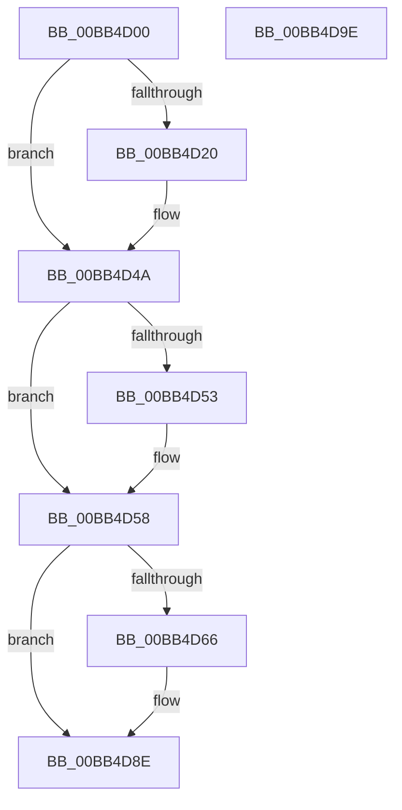

# ViSpMmProbeAndLockPages_Entry

- RVA: `0x00BB4D00`–`0x00BB4D9F` (길이 `159` bytes)
- VA: `0x0000000140BB4D00`
- 실행 섹션: `PAGEVRFY`
- PDB 이름 있음: `예`; PDB Function 태그: `아니요`
- unwind 정보 RVA: `0x000718AC`
- 디코드: `43`개 명령, `159/159` bytes 표시
- 미해석 바이트: `0` (있으면 어셈블리에 `.byte`로 보존)

> 이 문서는 커널 이미지의 기계어와 PDB 기호를 분석해 생성했습니다. 4번과 5번은 함수 원형과 자료형을 바이너리 사용 방식에서 추정한 C 해석이며 원본 소스 복구 결과는 아닙니다.

## 1. Dependencies

- 직접 호출 지점: **2**; 고유 호출 대상: **1**
- 직접 호출자로 확인된 함수: **0**
- RIP 상대 이미지 참조: **1**

### Outgoing calls
- `0x00BB4D45` → [CarReportRuleViolationFromNt](../B9/CarReportRuleViolationFromNt_function_00B9D904.md) (function, `0x00B9D904`)
- `0x00BB4D89` → [CarReportRuleViolationFromNt](../B9/CarReportRuleViolationFromNt_function_00B9D904.md) (function, `0x00B9D904`)

### Direct callers
- 이 함수 시작 RVA로 연결되는 직접 call은 확인되지 않았습니다. 간접 호출은 완전히 역산할 수 없습니다.

### Static image references
- `0x00BB4D4A` → RVA `0x00E0E944` (`.data`; read)

## 2. Other-region calls and transfers

- 다른 실행 섹션으로 향하는 call: **0**
- 별도 외부 분기/꼬리 이동을 확인하지 못했습니다.

## 3. Assembly (complete function range)

```asm
00BB4D00  4C 8B DC                        mov r11, rsp
00BB4D03  49 89 5B 08                     mov qword ptr [r11 + 8], rbx
00BB4D07  49 89 73 10                     mov qword ptr [r11 + 0x10], rsi
00BB4D0B  57                              push rdi
00BB4D0C  48 83 EC 40                     sub rsp, 0x40
00BB4D10  48 8B F1                        mov rsi, rcx
00BB4D13  BF 17 08 00 00                  mov edi, 0x817
00BB4D18  44 0F 20 C0                     mov rax, cr8
00BB4D1C  3C 02                           cmp al, 2
00BB4D1E  76 2A                           jbe 0x140bb4d4a
00BB4D20  48 0F BE 51 0C                  movsx rdx, byte ptr [rcx + 0xc]
00BB4D25  4C 8B 49 10                     mov r9, qword ptr [rcx + 0x10]
00BB4D29  44 0F B6 C0                     movzx r8d, al
00BB4D2D  48 8B 01                        mov rax, qword ptr [rcx]
00BB4D30  49 89 43 E8                     mov qword ptr [r11 - 0x18], rax
00BB4D34  83 64 24 28 00                  and dword ptr [rsp + 0x28], 0
00BB4D39  49 89 53 D8                     mov qword ptr [r11 - 0x28], rdx
00BB4D3D  BA 70 00 00 00                  mov edx, 0x70
00BB4D42  8D 4A 54                        lea ecx, [rdx + 0x54]
00BB4D45  E8 BA 8B FE FF                  call 0x140b9d904
00BB4D4A  83 3D F3 9B 25 00 03            cmp dword ptr [rip + 0x259bf3], 3
00BB4D51  73 05                           jae 0x140bb4d58
00BB4D53  BF 13 08 00 00                  mov edi, 0x813
00BB4D58  4C 8B 46 10                     mov r8, qword ptr [rsi + 0x10]
00BB4D5C  49 0F BF 40 0A                  movsx rax, word ptr [r8 + 0xa]
00BB4D61  66 85 C7                        test di, ax
00BB4D64  74 28                           je 0x140bb4d8e
00BB4D66  4C 8B C8                        mov r9, rax
00BB4D69  0F B7 D7                        movzx edx, di
00BB4D6C  48 23 D0                        and rdx, rax
00BB4D6F  48 8B 06                        mov rax, qword ptr [rsi]
00BB4D72  48 89 44 24 30                  mov qword ptr [rsp + 0x30], rax
00BB4D77  83 64 24 28 00                  and dword ptr [rsp + 0x28], 0
00BB4D7C  48 89 54 24 20                  mov qword ptr [rsp + 0x20], rdx
00BB4D81  BA B1 00 00 00                  mov edx, 0xb1
00BB4D86  8D 4A 13                        lea ecx, [rdx + 0x13]
00BB4D89  E8 76 8B FE FF                  call 0x140b9d904
00BB4D8E  48 8B 5C 24 50                  mov rbx, qword ptr [rsp + 0x50]
00BB4D93  48 8B 74 24 58                  mov rsi, qword ptr [rsp + 0x58]
00BB4D98  48 83 C4 40                     add rsp, 0x40
00BB4D9C  5F                              pop rdi
00BB4D9D  C3                              ret
00BB4D9E  CC                              int3
```

## 4. C-style interpretation (structured pseudocode)

```c
__int64 __fastcall ViSpMmProbeAndLockPages_Entry(__int64 a1)
{
    __int64 result;
    __int64 v_rdi;
    __int64 v_rsp;
    unsigned __int64 v_stack_m18;
    unsigned int v_stack_m20;
    unsigned __int64 v_stack_m28;
    unsigned __int64 v_stack_p10;
    unsigned __int64 v_stack_p8;

    *(unsigned __int64 *)(v_rsp + 8) = v_rbx;
    *(unsigned __int64 *)(v_rsp + 16) = v_rsi;
    v_rsp = (v_rsp) - (64);
    result = v_cr8;
    if (((unsigned __int8)(v_cr8)) >= = 2) {
        a2 = (__int8)(*(unsigned __int8 *)(a1 + 12));
        a4 = *(unsigned __int64 *)(a1 + 16);
        a3 = (unsigned __int8)(v_cr8);
        result = *(unsigned __int64 *)(a1);
        *(unsigned __int64 *)(v_rsp - 24) = result;
        *(unsigned __int64 *)(v_rsp - 40) = a2;
        a2 = 112;
        a1 = a2 + 84;
        result = CarReportRuleViolationFromNt(a1, a2, a3, a4);
    }
    v_rdi = (unsigned int)(0x817ULL);
    if ((*(unsigned int *)(v_rip + 2464755)) < 3) {
        v_rdi = 0x813ULL;
    }
    result = (__int16)(*(unsigned __int16 *)(*(unsigned __int64 *)(a1 + 16) + 10));
    if ((((unsigned __int16)(v_rdi)) & ((unsigned __int16)((__int16)(*(unsigned __int16 *)(*(unsigned __int64 *)(a1 + 16) + 10))))) != 0) {
        a4 = (__int16)(*(unsigned __int16 *)(*(unsigned __int64 *)(a1 + 16) + 10));
        a2 = (unsigned __int16)(v_rdi);
        a2 = (a2) & ((__int16)(*(unsigned __int16 *)(*(unsigned __int64 *)(a1 + 16) + 10)));
        result = *(unsigned __int64 *)(a1);
        v_stack_m18 = result;
        v_stack_m28 = a2;
        a2 = 177;
        a1 = a2 + 19;
        result = CarReportRuleViolationFromNt(a1, a2, *(unsigned __int64 *)(a1 + 16), a4);
    }
    v_rsp = (v_rsp) + (64);
    return result;
}
```

## 5. (Beta) C Style

```c
int64_t ViSpMmProbeAndLockPages_Entry(void *Arg1)
{
    uint8_t *arg1 = (uint8_t *)Arg1;

    int64_t result;
    int64_t local_rdi;
    int64_t local_rsp;
    uint64_t v_stack_m18;
    uint32_t v_stack_m20;
    uint64_t v_stack_m28;
    uint64_t v_stack_p10;
    uint64_t v_stack_p8;

    *(uint64_t *)(local_rsp + 0x8) = local_rbx;
    *(uint64_t *)(local_rsp + 0x10) = local_rsi;
    local_rsp = (local_rsp) - (64);
    result = v_cr8;
    if (((uint8_t)(v_cr8)) >= = 2) {
        a2 = (int8_t)(*(uint8_t *)(arg1 + 0xC));
        a4 = *(uint64_t *)(arg1 + 0x10);
        a3 = (uint8_t)(v_cr8);
        result = *(uint64_t *)(arg1);
        *(uint64_t *)(local_rsp - 0x18) = result;
        *(uint64_t *)(local_rsp - 0x28) = a2;
        a2 = 112;
        Arg1 = a2 + 84;
        result = CarReportRuleViolationFromNt(Arg1, a2, a3, a4);
    }
    local_rdi = (uint32_t)(0x817ULL);
    if ((*(uint32_t *)(v_rip + 0x259BF3)) < 3) {
        local_rdi = 0x813ULL;
    }
    result = (int16_t)(*(uint16_t *)(*(uint64_t *)(arg1 + 0x10) + 0xA));
    if ((((uint16_t)(local_rdi)) & ((uint16_t)((int16_t)(*(uint16_t *)(*(uint64_t *)(arg1 + 0x10) + 0xA))))) != 0) {
        a4 = (int16_t)(*(uint16_t *)(*(uint64_t *)(arg1 + 0x10) + 0xA));
        a2 = (uint16_t)(local_rdi);
        a2 = (a2) & ((int16_t)(*(uint16_t *)(*(uint64_t *)(arg1 + 0x10) + 0xA)));
        result = *(uint64_t *)(arg1);
        v_stack_m18 = result;
        v_stack_m28 = a2;
        a2 = 177;
        Arg1 = a2 + 19;
        result = CarReportRuleViolationFromNt(Arg1, a2, *(uint64_t *)(arg1 + 0x10), a4);
    }
    local_rsp = (local_rsp) + (64);
    return result;
}
```

### 관측된 메모리 오프셋

구조체 형식이 확인되지 않은 접근은 인자 기준의 오프셋으로만 기록했습니다.

| 기준 인자 | 오프셋 표현 | 폭 (bit) | 접근 |
|---|---:|---:|---|
| `Arg1` | `+ 0x0` | `64` | `R` |
| `Arg1` | `+ 0xC` | `8` | `R` |
| `Arg1` | `+ 0x10` | `64` | `R` |

## 6. Execution-region graph

[열기: 2D/3D 그래프와 함수 탐색 컨트롤 패널](../../../control-panel.html?section=pagevrfy&rva=0x00BB4D00&view=graph)

- 2D 그래프는 위에서 아래로 흐르고, 3D 그래프는 빈 공간을 드래그해 회전합니다. Shift+드래그는 이동, 휠은 확대·축소, 함수 노드 선택은 대상 보고서 이동입니다.

### Static fallback


