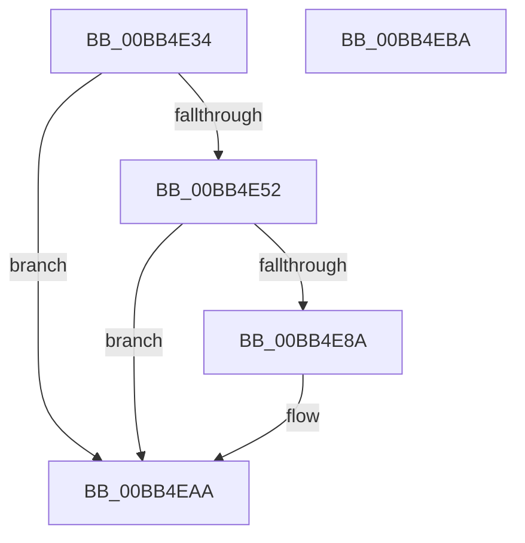

# ViSpRtlReplaceStringBuffer

- RVA: `0x00BB4E34`–`0x00BB4EBB` (길이 `135` bytes)
- VA: `0x0000000140BB4E34`
- 실행 섹션: `PAGEVRFY`
- PDB 이름 있음: `예`; PDB Function 태그: `아니요`
- unwind 정보 RVA: `0x000718AC`
- 디코드: `37`개 명령, `135/135` bytes 표시
- 미해석 바이트: `0` (있으면 어셈블리에 `.byte`로 보존)

> 이 문서는 커널 이미지의 기계어와 PDB 기호를 분석해 생성했습니다. 4번과 5번은 함수 원형과 자료형을 바이너리 사용 방식에서 추정한 C 해석이며 원본 소스 복구 결과는 아닙니다.

## 1. Dependencies

- 직접 호출 지점: **3**; 고유 호출 대상: **3**
- 직접 호출자로 확인된 함수: **3**
- RIP 상대 이미지 참조: **1**

### Outgoing calls
- `0x00BB4E7D` → [VfHandlePoolAlloc](VfHandlePoolAlloc_function_00BB8A90.md) (function, `0x00BB8A90`)
- `0x00BB4E96` → [memcpy](../../text/6C/memcpy_function_006C6840.md) (function, `0x006C6840`)
- `0x00BB4EA1` → [ExFreePoolWithTag](../../poolcode/B8/ExFreePoolWithTag_function_00B82870.md) (function, `0x00B82870`)

### Direct callers
- [ViSpRtlAnsiStringToUnicodeString_Exit](ViSpRtlAnsiStringToUnicodeString_Exit_function_00BB4DB0.md) at `0x00BB4DC7`
- [ViSpRtlCreateUnicodeString_Exit](ViSpRtlCreateUnicodeString_Exit_function_00BB4DE0.md) at `0x00BB4DF1`
- [ViSpRtlDuplicateUnicodeString_Exit](ViSpRtlDuplicateUnicodeString_Exit_function_00BB4E10.md) at `0x00BB4E21`

### Static image references
- `0x00BB4E59` → RVA `0x00E681B0` (`.data`; read)

## 2. Other-region calls and transfers

- 다른 실행 섹션으로 향하는 call: **2**
  - `0x00BB4E96` → [memcpy](../../text/6C/memcpy_function_006C6840.md) (`PAGEVRFY` → `.text`)
  - `0x00BB4EA1` → [ExFreePoolWithTag](../../poolcode/B8/ExFreePoolWithTag_function_00B82870.md) (`PAGEVRFY` → `POOLCODE`)
- 별도 외부 분기/꼬리 이동을 확인하지 못했습니다.

## 3. Assembly (complete function range)

```asm
00BB4E34  4C 8B DC                        mov r11, rsp
00BB4E37  49 89 5B 08                     mov qword ptr [r11 + 8], rbx
00BB4E3B  49 89 73 10                     mov qword ptr [r11 + 0x10], rsi
00BB4E3F  57                              push rdi
00BB4E40  48 83 EC 40                     sub rsp, 0x40
00BB4E44  0F B7 41 02                     movzx eax, word ptr [rcx + 2]
00BB4E48  33 F6                           xor esi, esi
00BB4E4A  48 8B D9                        mov rbx, rcx
00BB4E4D  66 85 C0                        test ax, ax
00BB4E50  74 58                           je 0x140bb4eaa
00BB4E52  49 89 53 F0                     mov qword ptr [r11 - 0x10], rdx
00BB4E56  44 8B C0                        mov r8d, eax
00BB4E59  48 8D 05 50 33 2B 00            lea rax, [rip + 0x2b3350]
00BB4E60  C7 44 24 30 01 00 00 00         mov dword ptr [rsp + 0x30], 1
00BB4E68  49 89 43 E0                     mov qword ptr [r11 - 0x20], rax
00BB4E6C  BA 00 03 00 00                  mov edx, 0x300
00BB4E71  33 C9                           xor ecx, ecx
00BB4E73  89 74 24 20                     mov dword ptr [rsp + 0x20], esi
00BB4E77  41 B9 56 53 74 72               mov r9d, 0x72745356
00BB4E7D  E8 0E 3C 00 00                  call 0x140bb8a90
00BB4E82  48 8B F8                        mov rdi, rax
00BB4E85  48 85 C0                        test rax, rax
00BB4E88  74 20                           je 0x140bb4eaa
00BB4E8A  44 0F B7 43 02                  movzx r8d, word ptr [rbx + 2]
00BB4E8F  48 8B C8                        mov rcx, rax
00BB4E92  48 8B 53 08                     mov rdx, qword ptr [rbx + 8]
00BB4E96  E8 A5 19 B1 FF                  call 0x1406c6840
00BB4E9B  48 8B 4B 08                     mov rcx, qword ptr [rbx + 8]
00BB4E9F  33 D2                           xor edx, edx
00BB4EA1  E8 CA D9 FC FF                  call 0x140b82870
00BB4EA6  48 89 7B 08                     mov qword ptr [rbx + 8], rdi
00BB4EAA  48 8B 5C 24 50                  mov rbx, qword ptr [rsp + 0x50]
00BB4EAF  48 8B 74 24 58                  mov rsi, qword ptr [rsp + 0x58]
00BB4EB4  48 83 C4 40                     add rsp, 0x40
00BB4EB8  5F                              pop rdi
00BB4EB9  C3                              ret
00BB4EBA  CC                              int3
```

## 4. C-style interpretation (structured pseudocode)

```c
__int64 __fastcall ViSpRtlReplaceStringBuffer(__int64 a1, __int64 a2)
{
    __int64 result;
    __int64 v_rsi;
    __int64 v_rsp;
    unsigned int v_stack_m18;
    unsigned int v_stack_m28;
    unsigned __int64 v_stack_p10;
    unsigned __int64 v_stack_p8;

    *(unsigned __int64 *)(v_rsp + 8) = v_rbx;
    *(unsigned __int64 *)(v_rsp + 16) = v_rsi;
    v_rsp = (v_rsp) - (64);
    v_rsi = 0;
    if ((unsigned __int16)(*(unsigned __int16 *)(a1 + 2)) == 0) goto loc_00BB4EAA;
    *(unsigned __int64 *)(v_rsp - 16) = a2;
    v_stack_m18 = 1;
    *(unsigned __int64 *)(v_rsp - 32) = v_rip + 2831184;
    a1 = 0;
    v_stack_m28 = 0;
    result = VfHandlePoolAlloc(a1, 768, (unsigned int)((unsigned int)(*(unsigned __int16 *)(a1 + 2))), (unsigned int)(0x72745356ULL));
    if (result != 0) {
        a3 = *(unsigned __int16 *)(a1 + 2);
        a1 = result;
        a2 = *(unsigned __int64 *)(a1 + 8);
        result = memcpy(a1, a2, a3, (unsigned int)(0x72745356ULL));
        a1 = *(unsigned __int64 *)(a1 + 8);
        a2 = 0;
        result = ExFreePoolWithTag(a1, a2, a3, (unsigned int)(0x72745356ULL));
        *(unsigned __int64 *)(a1 + 8) = result;
    }
    v_rsp = (v_rsp) + (64);
    return result;
}
```

## 5. (Beta) C Style

```c
int64_t ViSpRtlReplaceStringBuffer(void *Arg1, int64_t Arg2)
{
    uint8_t *arg1 = (uint8_t *)Arg1;

    int64_t result;
    int64_t local_rsi;
    int64_t local_rsp;
    uint32_t v_stack_m18;
    uint32_t v_stack_m28;
    uint64_t v_stack_p10;
    uint64_t v_stack_p8;

    *(uint64_t *)(local_rsp + 0x8) = local_rbx;
    *(uint64_t *)(local_rsp + 0x10) = local_rsi;
    local_rsp = (local_rsp) - (64);
    local_rsi = 0;
    if ((uint16_t)(*(uint16_t *)(arg1 + 0x2)) == 0) goto loc_00BB4EAA;
    *(uint64_t *)(local_rsp - 0x10) = Arg2;
    v_stack_m18 = 1;
    *(uint64_t *)(local_rsp - 0x20) = v_rip + 2831184;
    Arg1 = 0;
    v_stack_m28 = 0;
    result = VfHandlePoolAlloc(Arg1, 768, (uint32_t)((uint32_t)(*(uint16_t *)(arg1 + 0x2))), (uint32_t)(0x72745356ULL));
    if (result != 0) {
        a3 = *(uint16_t *)(arg1 + 0x2);
        Arg1 = result;
        Arg2 = *(uint64_t *)(arg1 + 0x8);
        result = memcpy(Arg1, Arg2, a3, (uint32_t)(0x72745356ULL));
        Arg1 = *(uint64_t *)(arg1 + 0x8);
        Arg2 = 0;
        result = ExFreePoolWithTag(Arg1, Arg2, a3, (uint32_t)(0x72745356ULL));
        *(uint64_t *)(arg1 + 0x8) = result;
    }
    local_rsp = (local_rsp) + (64);
    return result;
}
```

### 관측된 메모리 오프셋

구조체 형식이 확인되지 않은 접근은 인자 기준의 오프셋으로만 기록했습니다.

| 기준 인자 | 오프셋 표현 | 폭 (bit) | 접근 |
|---|---:|---:|---|
| `Arg1` | `+ 0x2` | `16` | `R` |
| `Arg1` | `+ 0x8` | `64` | `R` |
| `Arg1` | `+ 0x8` | `64` | `W` |

## 6. Execution-region graph

[열기: 2D/3D 그래프와 함수 탐색 컨트롤 패널](../../../control-panel.html?section=pagevrfy&rva=0x00BB4E34&view=graph)

- 2D 그래프는 위에서 아래로 흐르고, 3D 그래프는 빈 공간을 드래그해 회전합니다. Shift+드래그는 이동, 휠은 확대·축소, 함수 노드 선택은 대상 보고서 이동입니다.

### Static fallback


