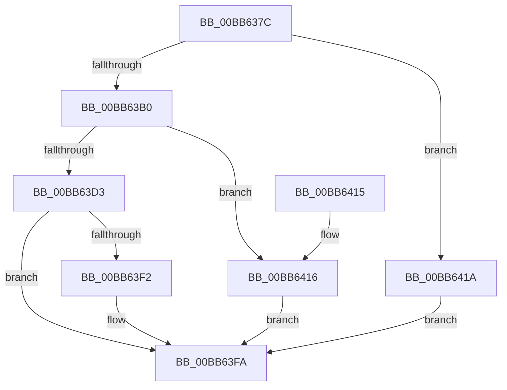

# ViThunkCreateSharedExportInformation

- RVA: `0x00BB637C`–`0x00BB6425` (길이 `169` bytes)
- VA: `0x0000000140BB637C`
- 실행 섹션: `PAGEVRFY`
- PDB 이름 있음: `예`; PDB Function 태그: `아니요`
- unwind 정보 RVA: `0x000ADC68`
- 디코드: `51`개 명령, `169/169` bytes 표시
- 미해석 바이트: `0` (있으면 어셈블리에 `.byte`로 보존)

> 이 문서는 커널 이미지의 기계어와 PDB 기호를 분석해 생성했습니다. 4번과 5번은 함수 원형과 자료형을 바이너리 사용 방식에서 추정한 C 해석이며 원본 소스 복구 결과는 아닙니다.

## 1. Dependencies

- 직접 호출 지점: **4**; 고유 호출 대상: **4**
- 직접 호출자로 확인된 함수: **1**
- RIP 상대 이미지 참조: **0**

### Outgoing calls
- `0x00BB63A5` → [RtlNumberOfClearBits](../../text/43/RtlNumberOfClearBits_function_00433F40.md) (function, `0x00433F40`)
- `0x00BB63C1` → [ExAllocatePool2](../../poolcode/B8/ExAllocatePool2_function_00B820F0.md) (function, `0x00B820F0`)
- `0x00BB63E9` → [ViThunkSnapSharedExports](ViThunkSnapSharedExports_function_00BB642C.md) (function, `0x00BB642C`)
- `0x00BB63F5` → [ViThunkFreeSharedThunksArray](ViThunkFreeSharedThunksArray_function_00BB6590.md) (function, `0x00BB6590`)

### Direct callers
- [VfThunkAddTargetNotify](VfThunkAddTargetNotify_function_00BB64E4.md) at `0x00BB650B`
- [VfThunkAddTargetNotify](VfThunkAddTargetNotify_function_00BB64E4.md) at `0x00BB6557`
- [VfThunkAddTargetNotify](VfThunkAddTargetNotify_function_00BB64E4.md) at `0x00BB657C`

### Static image references
- 디코드된 RIP-relative 메모리 참조가 없습니다.

## 2. Other-region calls and transfers

- 다른 실행 섹션으로 향하는 call: **2**
  - `0x00BB63A5` → [RtlNumberOfClearBits](../../text/43/RtlNumberOfClearBits_function_00433F40.md) (`PAGEVRFY` → `.text`)
  - `0x00BB63C1` → [ExAllocatePool2](../../poolcode/B8/ExAllocatePool2_function_00B820F0.md) (`PAGEVRFY` → `POOLCODE`)
- 별도 외부 분기/꼬리 이동을 확인하지 못했습니다.

## 3. Assembly (complete function range)

```asm
00BB637C  48 89 5C 24 08                  mov qword ptr [rsp + 8], rbx
00BB6381  48 89 6C 24 10                  mov qword ptr [rsp + 0x10], rbp
00BB6386  48 89 74 24 18                  mov qword ptr [rsp + 0x18], rsi
00BB638B  57                              push rdi
00BB638C  41 56                           push r14
00BB638E  41 57                           push r15
00BB6390  48 83 EC 30                     sub rsp, 0x30
00BB6394  4C 8B F9                        mov r15, rcx
00BB6397  49 8B E9                        mov rbp, r9
00BB639A  49 8B C9                        mov rcx, r9
00BB639D  4C 8B F2                        mov r14, rdx
00BB63A0  BB 01 00 00 00                  mov ebx, 1
00BB63A5  E8 96 DB 87 FF                  call 0x140433f40
00BB63AA  8B F0                           mov esi, eax
00BB63AC  85 C0                           test eax, eax
00BB63AE  74 6A                           je 0x140bb641a
00BB63B0  48 8D 14 76                     lea rdx, [rsi + rsi*2]
00BB63B4  41 B8 56 66 49 54               mov r8d, 0x54496656
00BB63BA  48 C1 E2 03                     shl rdx, 3
00BB63BE  8D 4B 3F                        lea ecx, [rbx + 0x3f]
00BB63C1  E8 2A BD FC FF                  call 0x140b820f0
00BB63C6  48 8B 7C 24 70                  mov rdi, qword ptr [rsp + 0x70]
00BB63CB  48 89 07                        mov qword ptr [rdi], rax
00BB63CE  48 85 C0                        test rax, rax
00BB63D1  74 43                           je 0x140bb6416
00BB63D3  48 89 44 24 28                  mov qword ptr [rsp + 0x28], rax
00BB63D8  44 8D 43 37                     lea r8d, [rbx + 0x37]
00BB63DC  4C 8B CD                        mov r9, rbp
00BB63DF  89 74 24 20                     mov dword ptr [rsp + 0x20], esi
00BB63E3  49 8B D6                        mov rdx, r14
00BB63E6  49 8B CF                        mov rcx, r15
00BB63E9  E8 3E 00 00 00                  call 0x140bb642c
00BB63EE  85 C0                           test eax, eax
00BB63F0  75 08                           jne 0x140bb63fa
00BB63F2  48 8B CF                        mov rcx, rdi
00BB63F5  E8 96 01 00 00                  call 0x140bb6590
00BB63FA  48 8B 6C 24 58                  mov rbp, qword ptr [rsp + 0x58]
00BB63FF  8B C3                           mov eax, ebx
00BB6401  48 8B 5C 24 50                  mov rbx, qword ptr [rsp + 0x50]
00BB6406  48 8B 74 24 60                  mov rsi, qword ptr [rsp + 0x60]
00BB640B  48 83 C4 30                     add rsp, 0x30
00BB640F  41 5F                           pop r15
00BB6411  41 5E                           pop r14
00BB6413  5F                              pop rdi
00BB6414  C3                              ret
00BB6415  CC                              int3
00BB6416  33 DB                           xor ebx, ebx
00BB6418  EB E0                           jmp 0x140bb63fa
00BB641A  48 8B 44 24 70                  mov rax, qword ptr [rsp + 0x70]
00BB641F  48 83 20 00                     and qword ptr [rax], 0
00BB6423  EB D5                           jmp 0x140bb63fa
```

## 4. C-style interpretation (structured pseudocode)

```c
__int64 __fastcall ViThunkCreateSharedExportInformation(__int64 a1, __int64 a2, __int64 a3, __int64 a4, __int64 a5)
{
    __int64 result;
    __int64 v_rbx;
    __int64 v_rsp;
    unsigned __int64 v_stack_m20;
    unsigned int v_stack_m28;
    unsigned __int64 v_stack_p10;
    unsigned __int64 v_stack_p18;
    unsigned __int64 v_stack_p8;

    v_stack_p8 = v_rbx;
    v_stack_p10 = v_rbp;
    v_stack_p18 = v_rsi;
    v_rsp = (v_rsp) - (48);
    result = RtlNumberOfClearBits(a4, a2, a3, a4);
    if ((unsigned int)(result) == 0) goto loc_00BB641A;
    a2 = ((unsigned int)((unsigned int)(result)) + (unsigned int)((unsigned int)(result)) * 2) << (3);
    result = ExAllocatePool2(1 + 63, a2, (unsigned int)(0x54496656ULL), a4);
    *(unsigned __int64 *)(a5) = result;
    if (result == 0) goto loc_00BB6416;
    v_stack_m20 = result;
    v_stack_m28 = (unsigned int)((unsigned int)((unsigned int)(result)));
    result = ViThunkSnapSharedExports(a1, a2, 1 + 55, a4);
    if ((unsigned int)(result) == 0) {
        a1 = a5;
        result = ViThunkFreeSharedThunksArray(a1, a2, 1 + 55, a4);
    }
    v_rsp = (v_rsp) + (48);
    return 1;
loc_00BB6416:
    v_rbx = 0;
    goto loc_00BB63FA;
loc_00BB641A:
    goto loc_00BB63FA;
}
```

## 5. (Beta) C Style

```c
int64_t ViThunkCreateSharedExportInformation(int64_t Arg1, int64_t Arg2, int64_t Arg3, int64_t Arg4, void *Arg5)
{
    uint8_t *arg5 = (uint8_t *)Arg5;

    int64_t result;
    int64_t local_rbx;
    int64_t local_rsp;
    uint64_t v_stack_m20;
    uint32_t v_stack_m28;
    uint64_t v_stack_p10;
    uint64_t v_stack_p18;
    uint64_t v_stack_p8;

    v_stack_p8 = local_rbx;
    v_stack_p10 = local_rbp;
    v_stack_p18 = local_rsi;
    local_rsp = (local_rsp) - (48);
    result = RtlNumberOfClearBits(Arg4, Arg2, Arg3, Arg4);
    if ((uint32_t)(result) == 0) goto loc_00BB641A;
    Arg2 = ((uint32_t)((uint32_t)(result)) + (uint32_t)((uint32_t)(result)) * 2) << (3);
    result = ExAllocatePool2(1 + 63, Arg2, (uint32_t)(0x54496656ULL), Arg4);
    *(uint64_t *)(arg5) = result;
    if (result == 0) goto loc_00BB6416;
    v_stack_m20 = result;
    v_stack_m28 = (uint32_t)((uint32_t)((uint32_t)(result)));
    result = ViThunkSnapSharedExports(Arg1, Arg2, 1 + 55, Arg4);
    if ((uint32_t)(result) == 0) {
        Arg1 = Arg5;
        result = ViThunkFreeSharedThunksArray(Arg1, Arg2, 1 + 55, Arg4);
    }
    local_rsp = (local_rsp) + (48);
    return 1;
loc_00BB6416:
    local_rbx = 0;
    goto loc_00BB63FA;
loc_00BB641A:
    goto loc_00BB63FA;
}
```

### 관측된 메모리 오프셋

구조체 형식이 확인되지 않은 접근은 인자 기준의 오프셋으로만 기록했습니다.

| 기준 인자 | 오프셋 표현 | 폭 (bit) | 접근 |
|---|---:|---:|---|
| `Arg5` | `+ 0x0` | `64` | `R/W` |
| `Arg5` | `+ 0x0` | `64` | `W` |

## 6. Execution-region graph

[열기: 2D/3D 그래프와 함수 탐색 컨트롤 패널](../../../control-panel.html?section=pagevrfy&rva=0x00BB637C&view=graph)

- 2D 그래프는 위에서 아래로 흐르고, 3D 그래프는 빈 공간을 드래그해 회전합니다. Shift+드래그는 이동, 휠은 확대·축소, 함수 노드 선택은 대상 보고서 이동입니다.

### Static fallback


