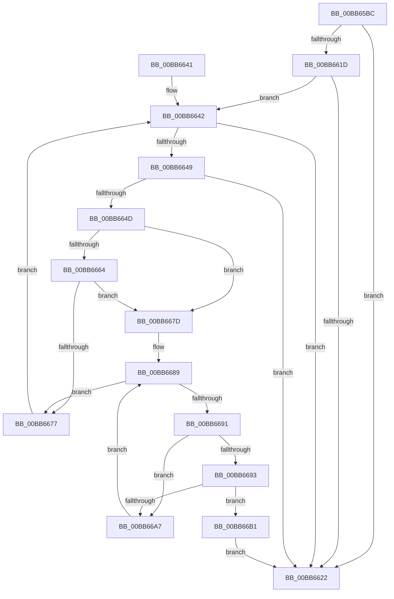

# ViThunkSnapSharedExportByName

- RVA: `0x00BB65BC`–`0x00BB66CD` (길이 `273` bytes)
- VA: `0x0000000140BB65BC`
- 실행 섹션: `PAGEVRFY`
- PDB 이름 있음: `예`; PDB Function 태그: `아니요`
- unwind 정보 RVA: `0x000ADCB0`
- 디코드: `86`개 명령, `273/273` bytes 표시
- 미해석 바이트: `0` (있으면 어셈블리에 `.byte`로 보존)

> 이 문서는 커널 이미지의 기계어와 PDB 기호를 분석해 생성했습니다. 4번과 5번은 함수 원형과 자료형을 바이너리 사용 방식에서 추정한 C 해석이며 원본 소스 복구 결과는 아닙니다.

## 1. Dependencies

- 직접 호출 지점: **5**; 고유 호출 대상: **2**
- 직접 호출자로 확인된 함수: **1**
- RIP 상대 이미지 참조: **2**

### Outgoing calls
- `0x00BB65FA` → [RtlImageDirectoryEntryToData](../../text/43/RtlImageDirectoryEntryToData_function_004328D0.md) (function, `0x004328D0`)
- `0x00BB6610` → [RtlImageDirectoryEntryToData](../../text/43/RtlImageDirectoryEntryToData_function_004328D0.md) (function, `0x004328D0`)
- `0x00BB665B` → [stricmp](../../text/4F/stricmp_function_004FFD80.md) (function, `0x004FFD80`)
- `0x00BB666E` → [stricmp](../../text/4F/stricmp_function_004FFD80.md) (function, `0x004FFD80`)
- `0x00BB669E` → [stricmp](../../text/4F/stricmp_function_004FFD80.md) (function, `0x004FFD80`)

### Direct callers
- [ViThunkSnapSharedExports](ViThunkSnapSharedExports_function_00BB642C.md) at `0x00BB649F`

### Static image references
- `0x00BB6654` → RVA `0x00BBA9F0` (` ?? ::JKADOLAD::`string'`; read)
- `0x00BB6664` → RVA `0x00BBAA00` (` ?? ::JKADOLAD::`string'`; read)

## 2. Other-region calls and transfers

- 다른 실행 섹션으로 향하는 call: **5**
  - `0x00BB65FA` → [RtlImageDirectoryEntryToData](../../text/43/RtlImageDirectoryEntryToData_function_004328D0.md) (`PAGEVRFY` → `.text`)
  - `0x00BB6610` → [RtlImageDirectoryEntryToData](../../text/43/RtlImageDirectoryEntryToData_function_004328D0.md) (`PAGEVRFY` → `.text`)
  - `0x00BB665B` → [stricmp](../../text/4F/stricmp_function_004FFD80.md) (`PAGEVRFY` → `.text`)
  - `0x00BB666E` → [stricmp](../../text/4F/stricmp_function_004FFD80.md) (`PAGEVRFY` → `.text`)
  - `0x00BB669E` → [stricmp](../../text/4F/stricmp_function_004FFD80.md) (`PAGEVRFY` → `.text`)
- 별도 외부 분기/꼬리 이동을 확인하지 못했습니다.

## 3. Assembly (complete function range)

```asm
00BB65BC  48 8B C4                        mov rax, rsp
00BB65BF  48 89 58 08                     mov qword ptr [rax + 8], rbx
00BB65C3  48 89 68 10                     mov qword ptr [rax + 0x10], rbp
00BB65C7  48 89 70 20                     mov qword ptr [rax + 0x20], rsi
00BB65CB  57                              push rdi
00BB65CC  41 54                           push r12
00BB65CE  41 55                           push r13
00BB65D0  41 56                           push r14
00BB65D2  41 57                           push r15
00BB65D4  48 83 EC 20                     sub rsp, 0x20
00BB65D8  41 83 48 08 FF                  or dword ptr [r8 + 8], 0xffffffff
00BB65DD  4C 8D 48 18                     lea r9, [rax + 0x18]
00BB65E1  33 FF                           xor edi, edi
00BB65E3  4D 8B F8                        mov r15, r8
00BB65E6  49 89 38                        mov qword ptr [r8], rdi
00BB65E9  4C 8B EA                        mov r13, rdx
00BB65EC  49 89 78 10                     mov qword ptr [r8 + 0x10], rdi
00BB65F0  48 8B E9                        mov rbp, rcx
00BB65F3  44 8D 47 01                     lea r8d, [rdi + 1]
00BB65F7  41 8A D0                        mov dl, r8b
00BB65FA  E8 D1 C2 87 FF                  call 0x1404328d0
00BB65FF  44 8D 47 0C                     lea r8d, [rdi + 0xc]
00BB6603  B2 01                           mov dl, 1
00BB6605  4C 8D 4C 24 60                  lea r9, [rsp + 0x60]
00BB660A  48 8B CD                        mov rcx, rbp
00BB660D  48 8B F0                        mov rsi, rax
00BB6610  E8 BB C2 87 FF                  call 0x1404328d0
00BB6615  4C 8B E0                        mov r12, rax
00BB6618  48 85 F6                        test rsi, rsi
00BB661B  74 05                           je 0x140bb6622
00BB661D  48 85 C0                        test rax, rax
00BB6620  75 20                           jne 0x140bb6642
00BB6622  48 8B 5C 24 50                  mov rbx, qword ptr [rsp + 0x50]
00BB6627  8B C7                           mov eax, edi
00BB6629  48 8B 6C 24 58                  mov rbp, qword ptr [rsp + 0x58]
00BB662E  48 8B 74 24 68                  mov rsi, qword ptr [rsp + 0x68]
00BB6633  48 83 C4 20                     add rsp, 0x20
00BB6637  41 5F                           pop r15
00BB6639  41 5E                           pop r14
00BB663B  41 5D                           pop r13
00BB663D  41 5C                           pop r12
00BB663F  5F                              pop rdi
00BB6640  C3                              ret
00BB6641  CC                              int3
00BB6642  8B 46 0C                        mov eax, dword ptr [rsi + 0xc]
00BB6645  85 C0                           test eax, eax
00BB6647  74 D9                           je 0x140bb6622
00BB6649  39 3E                           cmp dword ptr [rsi], edi
00BB664B  74 D5                           je 0x140bb6622
00BB664D  48 8D 1C 28                     lea rbx, [rax + rbp]
00BB6651  48 8B CB                        mov rcx, rbx
00BB6654  48 8D 15 95 43 00 00            lea rdx, [rip + 0x4395]
00BB665B  E8 20 97 94 FF                  call 0x1404ffd80
00BB6660  85 C0                           test eax, eax
00BB6662  74 19                           je 0x140bb667d
00BB6664  48 8D 15 95 43 00 00            lea rdx, [rip + 0x4395]
00BB666B  48 8B CB                        mov rcx, rbx
00BB666E  E8 0D 97 94 FF                  call 0x1404ffd80
00BB6673  85 C0                           test eax, eax
00BB6675  74 06                           je 0x140bb667d
00BB6677  48 83 C6 14                     add rsi, 0x14
00BB667B  EB C5                           jmp 0x140bb6642
00BB667D  44 8B 36                        mov r14d, dword ptr [rsi]
00BB6680  8B 5E 10                        mov ebx, dword ptr [rsi + 0x10]
00BB6683  4C 03 F5                        add r14, rbp
00BB6686  48 03 DD                        add rbx, rbp
00BB6689  49 8B 06                        mov rax, qword ptr [r14]
00BB668C  48 85 C0                        test rax, rax
00BB668F  74 E6                           je 0x140bb6677
00BB6691  78 14                           js 0x140bb66a7
00BB6693  49 8B 55 00                     mov rdx, qword ptr [r13]
00BB6697  48 8D 4D 02                     lea rcx, [rbp + 2]
00BB669B  48 03 C8                        add rcx, rax
00BB669E  E8 DD 96 94 FF                  call 0x1404ffd80
00BB66A3  85 C0                           test eax, eax
00BB66A5  74 0A                           je 0x140bb66b1
00BB66A7  49 83 C6 08                     add r14, 8
00BB66AB  48 83 C3 08                     add rbx, 8
00BB66AF  EB D8                           jmp 0x140bb6689
00BB66B1  49 89 1F                        mov qword ptr [r15], rbx
00BB66B4  BF 01 00 00 00                  mov edi, 1
00BB66B9  49 2B DC                        sub rbx, r12
00BB66BC  4D 89 6F 10                     mov qword ptr [r15 + 0x10], r13
00BB66C0  48 C1 EB 03                     shr rbx, 3
00BB66C4  41 89 5F 08                     mov dword ptr [r15 + 8], ebx
00BB66C8  E9 55 FF FF FF                  jmp 0x140bb6622
```

## 4. C-style interpretation (structured pseudocode)

```c
__int64 __fastcall ViThunkSnapSharedExportByName(__int64 a1, __int64 a2, __int64 a3)
{
    __int64 result;
    __int64 v_r14;
    __int64 v_rbx;
    __int64 v_rdi;
    __int64 v_rsi;
    __int64 v_rsp;
    unsigned __int64 v_stack_p10;
    unsigned __int64 v_stack_p18;
    unsigned __int64 v_stack_p20;
    unsigned __int64 v_stack_p8;

    *(unsigned __int64 *)(v_rsp + 8) = v_rbx;
    *(unsigned __int64 *)(v_rsp + 16) = v_rbp;
    *(unsigned __int64 *)(v_rsp + 32) = v_rsi;
    v_rsp = (v_rsp) - (32);
    v_rdi = 0;
    *(unsigned __int64 *)(a3) = 0;
    *(unsigned __int64 *)(a3 + 16) = 0;
    result = RtlImageDirectoryEntryToData(a1, (unsigned __int8)(v_rdi + 1), v_rdi + 1, v_rsp + 24);
    result = RtlImageDirectoryEntryToData(a1, 1, v_rdi + 12, v_stack_p18);
    if (result == 0) goto loc_00BB6622;
    if (result != 0) goto loc_00BB6642;
loc_00BB6622:
    v_rsp = (v_rsp) + (32);
    return 0;
loc_00BB6642:
    if ((unsigned int)((unsigned int)(*(unsigned int *)(v_stack_p20 + 12))) == 0) goto loc_00BB6622;
    if ((*(unsigned int *)(v_stack_p20)) == 0) goto loc_00BB6622;
    result = stricmp((unsigned int)(*(unsigned int *)(v_stack_p20 + 12)) + v_stack_p10 * 1, v_rip + 17301, v_rdi + 12, v_stack_p18);
    if ((unsigned int)(result) == 0) goto loc_00BB667D;
    result = stricmp((unsigned int)(*(unsigned int *)(v_stack_p20 + 12)) + v_stack_p10 * 1, v_rip + 17301, v_rdi + 12, v_stack_p18);
    if ((unsigned int)(result) == 0) goto loc_00BB667D;
loc_00BB6677:
    v_rsi = (v_stack_p20) + (20);
    goto loc_00BB6642;
loc_00BB667D:
    v_r14 = ((unsigned int)(*(unsigned int *)(v_rsi))) + (v_stack_p10);
    v_rbx = ((unsigned int)(*(unsigned int *)(v_rsi + 16))) + (v_stack_p10);
loc_00BB6689:
    if (*(unsigned __int64 *)(v_r14) == 0) goto loc_00BB6677;
    if (sign_flag) goto loc_00BB66A7;
    a1 = (v_stack_p10 + 2) + (*(unsigned __int64 *)(v_r14));
    result = stricmp(a1, *(unsigned __int64 *)(a2), v_rdi + 12, v_stack_p18);
    if ((unsigned int)(result) == 0) goto loc_00BB66B1;
loc_00BB66A7:
    v_r14 = (v_r14) + (8);
    v_rbx = (v_rbx) + (8);
    goto loc_00BB6689;
loc_00BB66B1:
    *(unsigned __int64 *)(a3) = v_rbx;
    v_rbx = (v_rbx) - (result);
    *(unsigned __int64 *)(a3 + 16) = a2;
    v_rbx = (v_rbx) >> (3);
    *(unsigned int *)(a3 + 8) = (unsigned int)(v_rbx);
    goto loc_00BB6622;
}
```

## 5. (Beta) C Style

```c
int64_t ViThunkSnapSharedExportByName(void *Arg1, void *Arg2, void *Arg3)
{
    uint8_t *arg1 = (uint8_t *)Arg1;
    uint8_t *arg2 = (uint8_t *)Arg2;
    uint8_t *arg3 = (uint8_t *)Arg3;

    int64_t result;
    int64_t local_r14;
    int64_t local_rbx;
    int64_t local_rdi;
    int64_t local_rsi;
    int64_t local_rsp;
    uint64_t v_stack_p10;
    uint64_t v_stack_p18;
    uint64_t v_stack_p20;
    uint64_t v_stack_p8;

    *(uint64_t *)(local_rsp + 0x8) = local_rbx;
    *(uint64_t *)(local_rsp + 0x10) = local_rbp;
    *(uint64_t *)(local_rsp + 0x20) = local_rsi;
    local_rsp = (local_rsp) - (32);
    local_rdi = 0;
    *(uint64_t *)(arg3) = 0;
    *(uint64_t *)(arg3 + 0x10) = 0;
    result = RtlImageDirectoryEntryToData(Arg1, (uint8_t)(local_rdi + 1), local_rdi + 1, local_rsp + 24);
    result = RtlImageDirectoryEntryToData(Arg1, 1, local_rdi + 12, v_stack_p18);
    if (result == 0) goto loc_00BB6622;
    if (result != 0) goto loc_00BB6642;
loc_00BB6622:
    local_rsp = (local_rsp) + (32);
    return 0;
loc_00BB6642:
    if ((uint32_t)((uint32_t)(*(uint32_t *)(v_stack_p20 + 0xC))) == 0) goto loc_00BB6622;
    if ((*(uint32_t *)(v_stack_p20)) == 0) goto loc_00BB6622;
    result = stricmp((uint32_t)(*(uint32_t *)(v_stack_p20 + 0xC)) + v_stack_p10 * 1, v_rip + 17301, local_rdi + 12, v_stack_p18);
    if ((uint32_t)(result) == 0) goto loc_00BB667D;
    result = stricmp((uint32_t)(*(uint32_t *)(v_stack_p20 + 0xC)) + v_stack_p10 * 1, v_rip + 17301, local_rdi + 12, v_stack_p18);
    if ((uint32_t)(result) == 0) goto loc_00BB667D;
loc_00BB6677:
    local_rsi = (v_stack_p20) + (20);
    goto loc_00BB6642;
loc_00BB667D:
    local_r14 = ((uint32_t)(*(uint32_t *)(local_rsi))) + (v_stack_p10);
    local_rbx = ((uint32_t)(*(uint32_t *)(local_rsi + 0x10))) + (v_stack_p10);
loc_00BB6689:
    if (*(uint64_t *)(local_r14) == 0) goto loc_00BB6677;
    if (sign_flag) goto loc_00BB66A7;
    Arg1 = (v_stack_p10 + 2) + (*(uint64_t *)(local_r14));
    result = stricmp(Arg1, *(uint64_t *)(arg2), local_rdi + 12, v_stack_p18);
    if ((uint32_t)(result) == 0) goto loc_00BB66B1;
loc_00BB66A7:
    local_r14 = (local_r14) + (8);
    local_rbx = (local_rbx) + (8);
    goto loc_00BB6689;
loc_00BB66B1:
    *(uint64_t *)(arg3) = local_rbx;
    local_rbx = (local_rbx) - (result);
    *(void **)(arg3 + 0x10) = Arg2;
    local_rbx = (local_rbx) >> (3);
    *(uint32_t *)(arg3 + 0x8) = (uint32_t)(local_rbx);
    goto loc_00BB6622;
}
```

### 관측된 메모리 오프셋

구조체 형식이 확인되지 않은 접근은 인자 기준의 오프셋으로만 기록했습니다.

| 기준 인자 | 오프셋 표현 | 폭 (bit) | 접근 |
|---|---:|---:|---|
| `Arg1` | `+ 0x2` | `64` | `R` |
| `Arg2` | `+ 0x0` | `64` | `R` |
| `Arg3` | `+ 0x0` | `64` | `W` |
| `Arg3` | `+ 0x8` | `32` | `R/W` |
| `Arg3` | `+ 0x8` | `32` | `W` |
| `Arg3` | `+ 0x10` | `64` | `W` |

## 6. Execution-region graph

[열기: 2D/3D 그래프와 함수 탐색 컨트롤 패널](../../../control-panel.html?section=pagevrfy&rva=0x00BB65BC&view=graph)

- 2D 그래프는 위에서 아래로 흐르고, 3D 그래프는 빈 공간을 드래그해 회전합니다. Shift+드래그는 이동, 휠은 확대·축소, 함수 노드 선택은 대상 보고서 이동입니다.

### Static fallback


