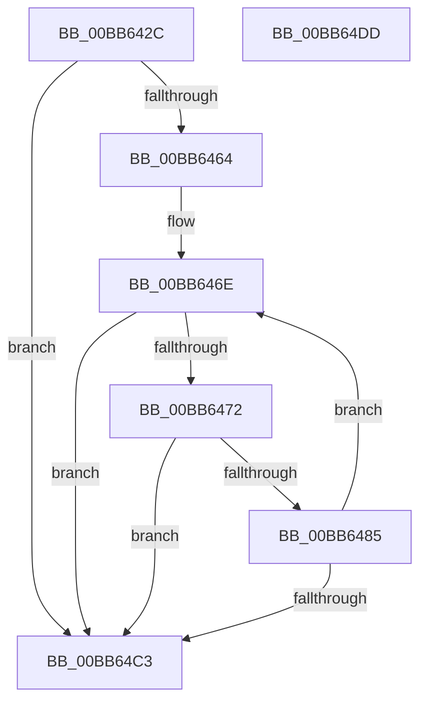

# ViThunkSnapSharedExports

- RVA: `0x00BB642C`–`0x00BB64DE` (길이 `178` bytes)
- VA: `0x0000000140BB642C`
- 실행 섹션: `PAGEVRFY`
- PDB 이름 있음: `예`; PDB Function 태그: `아니요`
- unwind 정보 RVA: `0x000ADC84`
- 디코드: `57`개 명령, `178/178` bytes 표시
- 미해석 바이트: `0` (있으면 어셈블리에 `.byte`로 보존)

> 이 문서는 커널 이미지의 기계어와 PDB 기호를 분석해 생성했습니다. 4번과 5번은 함수 원형과 자료형을 바이너리 사용 방식에서 추정한 C 해석이며 원본 소스 복구 결과는 아닙니다.

## 1. Dependencies

- 직접 호출 지점: **2**; 고유 호출 대상: **2**
- 직접 호출자로 확인된 함수: **1**
- RIP 상대 이미지 참조: **0**

### Outgoing calls
- `0x00BB647C` → [RtlFindNextForwardRunClear](../../text/3C/RtlFindNextForwardRunClear_function_003CF6A0.md) (function, `0x003CF6A0`)
- `0x00BB649F` → [ViThunkSnapSharedExportByName](ViThunkSnapSharedExportByName_function_00BB65BC.md) (function, `0x00BB65BC`)

### Direct callers
- [ViThunkCreateSharedExportInformation](ViThunkCreateSharedExportInformation_function_00BB637C.md) at `0x00BB63E9`

### Static image references
- 디코드된 RIP-relative 메모리 참조가 없습니다.

## 2. Other-region calls and transfers

- 다른 실행 섹션으로 향하는 call: **1**
  - `0x00BB647C` → [RtlFindNextForwardRunClear](../../text/3C/RtlFindNextForwardRunClear_function_003CF6A0.md) (`PAGEVRFY` → `.text`)
- 별도 외부 분기/꼬리 이동을 확인하지 못했습니다.

## 3. Assembly (complete function range)

```asm
00BB642C  48 8B C4                        mov rax, rsp
00BB642F  48 89 58 10                     mov qword ptr [rax + 0x10], rbx
00BB6433  48 89 70 18                     mov qword ptr [rax + 0x18], rsi
00BB6437  48 89 48 08                     mov qword ptr [rax + 8], rcx
00BB643B  57                              push rdi
00BB643C  41 54                           push r12
00BB643E  41 55                           push r13
00BB6440  41 56                           push r14
00BB6442  41 57                           push r15
00BB6444  48 83 EC 30                     sub rsp, 0x30
00BB6448  33 DB                           xor ebx, ebx
00BB644A  33 FF                           xor edi, edi
00BB644C  45 33 F6                        xor r14d, r14d
00BB644F  89 58 C8                        mov dword ptr [rax - 0x38], ebx
00BB6452  49 8B F1                        mov rsi, r9
00BB6455  4D 8B E0                        mov r12, r8
00BB6458  4C 8B EA                        mov r13, rdx
00BB645B  39 9C 24 80 00 00 00            cmp dword ptr [rsp + 0x80], ebx
00BB6462  76 5F                           jbe 0x140bb64c3
00BB6464  4C 8B BC 24 88 00 00 00         mov r15, qword ptr [rsp + 0x88]
00BB646C  33 C0                           xor eax, eax
00BB646E  3B 06                           cmp eax, dword ptr [rsi]
00BB6470  73 51                           jae 0x140bb64c3
00BB6472  4C 8D 44 24 20                  lea r8, [rsp + 0x20]
00BB6477  8B D3                           mov edx, ebx
00BB6479  48 8B CE                        mov rcx, rsi
00BB647C  E8 1F 92 81 FF                  call 0x1403cf6a0
00BB6481  85 C0                           test eax, eax
00BB6483  74 3E                           je 0x140bb64c3
00BB6485  8B 5C 24 20                     mov ebx, dword ptr [rsp + 0x20]
00BB6489  4B 8D 0C 76                     lea rcx, [r14 + r14*2]
00BB648D  4D 8D 04 CF                     lea r8, [r15 + rcx*8]
00BB6491  8B D3                           mov edx, ebx
00BB6493  48 8B 4C 24 60                  mov rcx, qword ptr [rsp + 0x60]
00BB6498  49 0F AF D4                     imul rdx, r12
00BB649C  49 03 D5                        add rdx, r13
00BB649F  E8 18 01 00 00                  call 0x140bb65bc
00BB64A4  85 C0                           test eax, eax
00BB64A6  B9 01 00 00 00                  mov ecx, 1
00BB64AB  0F 45 F9                        cmovne edi, ecx
00BB64AE  03 D9                           add ebx, ecx
00BB64B0  44 03 F1                        add r14d, ecx
00BB64B3  89 5C 24 20                     mov dword ptr [rsp + 0x20], ebx
00BB64B7  8B C3                           mov eax, ebx
00BB64B9  44 3B B4 24 80 00 00 00         cmp r14d, dword ptr [rsp + 0x80]
00BB64C1  72 AB                           jb 0x140bb646e
00BB64C3  48 8B 5C 24 68                  mov rbx, qword ptr [rsp + 0x68]
00BB64C8  8B C7                           mov eax, edi
00BB64CA  48 8B 74 24 70                  mov rsi, qword ptr [rsp + 0x70]
00BB64CF  48 83 C4 30                     add rsp, 0x30
00BB64D3  41 5F                           pop r15
00BB64D5  41 5E                           pop r14
00BB64D7  41 5D                           pop r13
00BB64D9  41 5C                           pop r12
00BB64DB  5F                              pop rdi
00BB64DC  C3                              ret
00BB64DD  CC                              int3
```

## 4. C-style interpretation (structured pseudocode)

```c
__int64 __fastcall ViThunkSnapSharedExports(__int64 a1, __int64 a2, __int64 a3, __int64 a4, unsigned int a5, __int64 a6)
{
    __int64 result;
    __int64 v_r14;
    __int64 v_rbx;
    __int64 v_rdi;
    __int64 v_rsp;
    unsigned __int64 v_stack_m38;
    unsigned __int64 v_stack_p10;
    unsigned __int64 v_stack_p18;
    unsigned __int64 v_stack_p8;

    *(unsigned __int64 *)(v_rsp + 16) = v_rbx;
    *(unsigned __int64 *)(v_rsp + 24) = v_rsi;
    *(unsigned __int64 *)(v_rsp + 8) = a1;
    v_rsp = (v_rsp) - (48);
    v_rbx = 0;
    v_rdi = 0;
    v_r14 = 0;
    *(unsigned int *)(v_rsp - 56) = 0;
    if (a5 <= 0) goto loc_00BB64C3;
    result = 0;
loc_00BB646E:
    if (0 >= (*(unsigned int *)(a4))) goto loc_00BB64C3;
    result = RtlFindNextForwardRunClear(a4, 0, v_stack_m38, a4);
    if ((unsigned int)(result) == 0) goto loc_00BB64C3;
    a2 = ((unsigned int)((unsigned int)((unsigned int)(v_stack_m38)))) * (a3);
    a2 = (a2) + (a2);
    result = ViThunkSnapSharedExportByName(v_stack_p8, a2, a6 + v_r14 + v_r14 * 2 * 8, a4);
    if ((unsigned int)(result) != 0) { v_rdi = 1; }
    v_rbx = (unsigned int)(((unsigned int)(v_stack_m38)) + (1));
    v_r14 = (unsigned int)((v_r14) + (1));
    v_stack_m38 = (unsigned int)(v_rbx);
    if (((unsigned int)(v_r14)) < a5) goto loc_00BB646E;
loc_00BB64C3:
    v_rsp = (v_rsp) + (48);
    return (unsigned int)((unsigned int)(v_rdi));
}
```

## 5. (Beta) C Style

```c
int64_t ViThunkSnapSharedExports(int64_t Arg1, int64_t Arg2, int64_t Arg3, void *Arg4, uint32_t Arg5, void *Arg6)
{
    uint8_t *arg4 = (uint8_t *)Arg4;
    uint8_t *arg6 = (uint8_t *)Arg6;

    int64_t result;
    int64_t local_r14;
    int64_t local_rbx;
    int64_t local_rdi;
    int64_t local_rsp;
    uint64_t v_stack_m38;
    uint64_t v_stack_p10;
    uint64_t v_stack_p18;
    uint64_t v_stack_p8;

    *(uint64_t *)(local_rsp + 0x10) = local_rbx;
    *(uint64_t *)(local_rsp + 0x18) = local_rsi;
    *(uint64_t *)(local_rsp + 0x8) = Arg1;
    local_rsp = (local_rsp) - (48);
    local_rbx = 0;
    local_rdi = 0;
    local_r14 = 0;
    *(uint32_t *)(local_rsp - 0x38) = 0;
    if (Arg5 <= 0) goto loc_00BB64C3;
    result = 0;
loc_00BB646E:
    if (0 >= (*(uint32_t *)(arg4))) goto loc_00BB64C3;
    result = RtlFindNextForwardRunClear(Arg4, 0, v_stack_m38, Arg4);
    if ((uint32_t)(result) == 0) goto loc_00BB64C3;
    Arg2 = ((uint32_t)((uint32_t)((uint32_t)(v_stack_m38)))) * (Arg3);
    Arg2 = (Arg2) + (Arg2);
    result = ViThunkSnapSharedExportByName(v_stack_p8, Arg2, Arg6 + local_r14 + local_r14 * 2 * 8, Arg4);
    if ((uint32_t)(result) != 0) { local_rdi = 1; }
    local_rbx = (uint32_t)(((uint32_t)(v_stack_m38)) + (1));
    local_r14 = (uint32_t)((local_r14) + (1));
    v_stack_m38 = (uint32_t)(local_rbx);
    if (((uint32_t)(local_r14)) < Arg5) goto loc_00BB646E;
loc_00BB64C3:
    local_rsp = (local_rsp) + (48);
    return (uint32_t)((uint32_t)(local_rdi));
}
```

### 관측된 메모리 오프셋

구조체 형식이 확인되지 않은 접근은 인자 기준의 오프셋으로만 기록했습니다.

| 기준 인자 | 오프셋 표현 | 폭 (bit) | 접근 |
|---|---:|---:|---|
| `Arg4` | `+ 0x0` | `32` | `R` |
| `Arg6` | `+ 0x0 + rcx*8` | `64` | `R` |

## 6. Execution-region graph

[열기: 2D/3D 그래프와 함수 탐색 컨트롤 패널](../../../control-panel.html?section=pagevrfy&rva=0x00BB642C&view=graph)

- 2D 그래프는 위에서 아래로 흐르고, 3D 그래프는 빈 공간을 드래그해 회전합니다. Shift+드래그는 이동, 휠은 확대·축소, 함수 노드 선택은 대상 보고서 이동입니다.

### Static fallback


