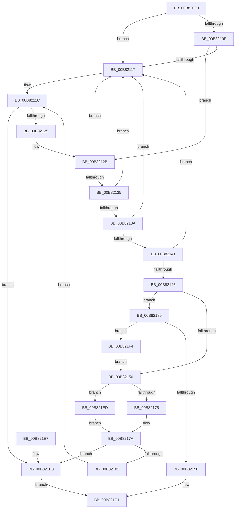

# ExAllocatePool2

- RVA: `0x00B820F0`–`0x00B821FE` (길이 `270` bytes)
- VA: `0x0000000140B820F0`
- 실행 섹션: `POOLCODE`
- PDB 이름 있음: `예`; PDB Function 태그: `아니요`
- unwind 정보 RVA: `0x0007BDA8`
- 디코드: `71`개 명령, `270/270` bytes 표시
- 미해석 바이트: `0` (있으면 어셈블리에 `.byte`로 보존)

> 이 문서는 커널 이미지의 기계어와 PDB 기호를 분석해 생성했습니다. 4번과 5번은 함수 원형과 자료형을 바이너리 사용 방식에서 추정한 C 해석이며 원본 소스 복구 결과는 아닙니다.

## 1. Dependencies

- 직접 호출 지점: **4**; 고유 호출 대상: **4**
- 직접 호출자로 확인된 함수: **2148**
- RIP 상대 이미지 참조: **1**

### Outgoing calls
- `0x00B82125` → [RtlRaiseStatus](../../text/2F/RtlRaiseStatus_function_002F6A50.md) (function, `0x002F6A50`)
- `0x00B82175` → [ExpAllocatePoolWithTagFromNode](../../text/35/ExpAllocatePoolWithTagFromNode_function_0035B970.md) (function, `0x0035B970`)
- `0x00B821DC` → [VfHandlePoolAlloc](../../pagevrfy/BB/VfHandlePoolAlloc_function_00BB8A90.md) (function, `0x00BB8A90`)
- `0x00B821ED` → [ExpAllocatePoolWithQuotaTag](ExpAllocatePoolWithQuotaTag_function_00B82210.md) (function, `0x00B82210`)

### Direct callers
- [EtwpPopFreeApcEntry](../../text/20/EtwpPopFreeApcEntry_function_00203DF8.md) at `0x00203E66`
- [IopBuildDeviceIoControlRequest](../../text/20/IopBuildDeviceIoControlRequest_function_00205B00.md) at `0x00205B9D`
- [IopBuildDeviceIoControlRequest](../../text/20/IopBuildDeviceIoControlRequest_function_00205B00.md) at `0x00205CD9`
- [IopAllocateIrpPrivate](../../text/20/IopAllocateIrpPrivate_function_00207770.md) at `0x002079BC`
- [ExpFreeOwnerEntry](../../text/20/ExpFreeOwnerEntry_function_0020F740.md) at `0x0020F8B7`
- [sub_00211D20](../../text/21/Unknown_function_00211D20.md) at `0x00211D2E`
- [ExpAcquireResourceSharedLite](../../text/21/ExpAcquireResourceSharedLite_function_00212040.md) at `0x00212316`
- [ExpAcquireResourceSharedLite](../../text/21/ExpAcquireResourceSharedLite_function_00212040.md) at `0x002126F1`
- [ExpAcquireResourceSharedLite](../../text/21/ExpAcquireResourceSharedLite_function_00212040.md) at `0x0021296F`
- [ExpAcquireResourceSharedLite](../../text/21/ExpAcquireResourceSharedLite_function_00212040.md) at `0x00212B4E`
- [ExpAcquireResourceSharedLite](../../text/21/ExpAcquireResourceSharedLite_function_00212040.md) at `0x00212F82`
- [ExpAcquireResourceSharedLite](../../text/21/ExpAcquireResourceSharedLite_function_00212040.md) at `0x00213352`
- [ExEnterPriorityRegionAndAcquireResourceShared](../../text/21/ExEnterPriorityRegionAndAcquireResourceShared_function_00213870.md) at `0x00213966`
- [ExpAllocateOwnerEntryForLegacyShim](../../text/21/ExpAllocateOwnerEntryForLegacyShim_function_00213B50.md) at `0x00213B62`
- [sub_002142F9](../../text/21/Unknown_function_002142F9.md) at `0x00214BBA`
- [sub_002142F9](../../text/21/Unknown_function_002142F9.md) at `0x00214C51`
- [EtwpGetTrackingLockSlotForThread](../../text/21/EtwpGetTrackingLockSlotForThread_function_00215B34.md) at `0x00215B8C`
- [IoBoostThreadIoPriority](../../text/21/IoBoostThreadIoPriority_function_00216110.md) at `0x002163C4`
- [IoRaiseHardError](../../text/22/IoRaiseHardError_function_002230D0.md) at `0x00223179`
- [SepAdtLogAuditRecord](../../text/22/SepAdtLogAuditRecord_function_00224B6C.md) at `0x00224BCE`
- [PopUmpoSendPowerRequestOverrideQuery](../../text/23/PopUmpoSendPowerRequestOverrideQuery_function_00230418.md) at `0x0023045A`
- [PopUmpoSendPowerMessage](../../text/23/PopUmpoSendPowerMessage_function_00230730.md) at `0x0023077C`
- [sub_0025D903](../../text/25/Unknown_function_0025D903.md) at `0x0025DE1F`
- [sub_0025D903](../../text/25/Unknown_function_0025D903.md) at `0x0025E3E7`
- [sub_0025EB5D](../../text/25/Unknown_function_0025EB5D.md) at `0x0025EC92`
- [sub_0025FB5C](../../text/25/Unknown_function_0025FB5C.md) at `0x0025FF57`
- [sub_00260366](../../text/26/Unknown_function_00260366.md) at `0x002606A4`
- [sub_00260D5A](../../text/26/Unknown_function_00260D5A.md) at `0x00260EDA`
- [sub_00260D5A](../../text/26/Unknown_function_00260D5A.md) at `0x00260F5C`
- [sub_0026515E](../../text/26/Unknown_function_0026515E.md) at `0x00265181`
- [B_TREE&lt;_SM_PAGE_KEY,SMKM_STORE_MGR&lt;SM_TRAITS&gt;::SMKM_FRONTEND_ENTRY,4096,B_TREE_DUMMY_NODE_POOL,B_TREE_KEY_COMPARATOR&lt;_SM_PAGE_KEY&gt; &gt;::BTreeNewNode](../../text/26/B_TREE__SM_PAGE_KEY_SMKM_STORE_MGR_SM_TRAITS_SMKM_FRONTEND_ENTRY_4096_B_TREE_DUMMY_NODE_POOL_B_TREE__function_0026788C.md) at `0x002678B0`
- [SmPrepareForFatalHeapCorruption](../../text/26/SmPrepareForFatalHeapCorruption_function_00267AC0.md) at `0x00267B0E`
- [SmHpBufferAlloc](../../text/26/SmHpBufferAlloc_function_00268F7C.md) at `0x00268FA1`
- [IoAllocateWorkItem](../../text/26/IoAllocateWorkItem_function_0026E900.md) at `0x0026E917`
- [IoDeleteDevice](../../text/26/IoDeleteDevice_function_0026FE90.md) at `0x0026FF8D`
- [sub_00273F95](../../text/27/Unknown_function_00273F95.md) at `0x0027439A`
- [sub_0027475D](../../text/27/Unknown_function_0027475D.md) at `0x00274AE2`
- [sub_0027475D](../../text/27/Unknown_function_0027475D.md) at `0x00275359`
- [sub_0027475D](../../text/27/Unknown_function_0027475D.md) at `0x002753E0`
- [FsRtlReleaseFileForModWrite](../../text/29/FsRtlReleaseFileForModWrite_function_00299100.md) at `0x00299364`
- [FsRtlAcquireFileForModWriteEx](../../text/29/FsRtlAcquireFileForModWriteEx_function_00299E5C.md) at `0x0029A0B0`
- [IoSynchronousPageWriteEx](../../text/29/IoSynchronousPageWriteEx_function_0029A860.md) at `0x0029AAA7`
- [IoSynchronousPageWriteEx](../../text/29/IoSynchronousPageWriteEx_function_0029A860.md) at `0x0029AB79`
- [IoPageReadEx](../../text/29/IoPageReadEx_function_0029ABF0.md) at `0x0029AE30`
- [IoPageReadEx](../../text/29/IoPageReadEx_function_0029ABF0.md) at `0x0029B06B`
- [IopSetDiskIoAttributionExtension](../../text/29/IopSetDiskIoAttributionExtension_function_0029C0E4.md) at `0x0029C16E`
- [IopSetDiskIoAttributionExtension](../../text/29/IopSetDiskIoAttributionExtension_function_0029C0E4.md) at `0x0029C1D6`
- [NtSetInformationFile](../../text/29/NtSetInformationFile_function_0029C5E0.md) at `0x0029CC0A`
- [NtSetInformationFile](../../text/29/NtSetInformationFile_function_0029C5E0.md) at `0x0029CFAB`
- [IoMakeAssociatedIrpPriv](../../text/29/IoMakeAssociatedIrpPriv_function_0029D818.md) at `0x0029DAD8`
- [IopSetDriverFlagsExtension](../../text/29/IopSetDriverFlagsExtension_function_0029DC14.md) at `0x0029DC83`
- [IopSetDriverFlagsExtension](../../text/29/IopSetDriverFlagsExtension_function_0029DC14.md) at `0x0029DCB5`
- [IopBuildAsynchronousFsdRequest](../../text/29/IopBuildAsynchronousFsdRequest_function_0029DD40.md) at `0x0029DECB`
- [VslpLockPagesForTransfer](../../text/29/VslpLockPagesForTransfer_function_0029E0FC.md) at `0x0029E19A`
- [IoAllocateMdl](../../text/29/IoAllocateMdl_function_0029EBF0.md) at `0x0029ED6D`
- [KeQueryLogicalProcessorRelationship](../../text/2C/KeQueryLogicalProcessorRelationship_function_002CEA60.md) at `0x002CED55`
- [KiIntSteerConnect](../../text/2D/KiIntSteerConnect_function_002D44F0.md) at `0x002D4564`
- [KiIntSteerConnect](../../text/2D/KiIntSteerConnect_function_002D44F0.md) at `0x002D4632`
- [sub_002D6BD6](../../text/2D/Unknown_function_002D6BD6.md) at `0x002D6BEB`
- [RtlpUpcaseUnicodeStringPrivate](../../text/2F/RtlpUpcaseUnicodeStringPrivate_function_002FE0B0.md) at `0x002FE0F1`
- [AuthzBasepMemAlloc](../../text/2F/AuthzBasepMemAlloc_function_002FFD90.md) at `0x002FFDA4`
- [AuthzBasepDuplicateSecurityAttributes](../../text/30/AuthzBasepDuplicateSecurityAttributes_function_003023C0.md) at `0x00302429`
- [AuthzBasepDuplicateSecurityAttributes](../../text/30/AuthzBasepDuplicateSecurityAttributes_function_003023C0.md) at `0x00302535`
- [AuthzBasepDuplicateSecurityAttributes](../../text/30/AuthzBasepDuplicateSecurityAttributes_function_003023C0.md) at `0x003027AC`
- [AuthzBasepAllocateSecurityAttributeValue](../../text/30/AuthzBasepAllocateSecurityAttributeValue_function_00302AE0.md) at `0x00302AFD`
- [AuthzBasepInitializeResourceClaimsFromSacl](../../text/30/AuthzBasepInitializeResourceClaimsFromSacl_function_00302E84.md) at `0x00302EFA`
- [PpmUpdateIdleVeto](../../text/30/PpmUpdateIdleVeto_function_00304930.md) at `0x00304A2C`
- [SmFpAllocate](../../text/31/SmFpAllocate_function_00317D10.md) at `0x00317D6E`
- [ExpAcquireSharedStarveExclusive](../../text/34/ExpAcquireSharedStarveExclusive_function_003411C0.md) at `0x00341334`
- [PfSnGetFileInformation](../../text/34/PfSnGetFileInformation_function_00343210.md) at `0x0034332E`
- [sub_0034A431](../../text/34/Unknown_function_0034A431.md) at `0x0034A452`
- [SMKM_STORE_MGR&lt;SM_TRAITS&gt;::SmPageRead](../../text/34/SMKM_STORE_MGR_SM_TRAITS_SmPageRead_function_0034C1D0.md) at `0x0034C3FD`
- [SmAllocEx](../../text/34/SmAllocEx_function_0034C794.md) at `0x0034C7A9`
- [sub_0034C8E9](../../text/34/Unknown_function_0034C8E9.md) at `0x0034C8FD`
- [sub_0034FEB1](../../text/34/Unknown_function_0034FEB1.md) at `0x0034FFE5`
- [IoWMIWriteEvent](../../text/38/IoWMIWriteEvent_function_00386480.md) at `0x00386511`
- [RtlInsertElementGenericTable](../../text/38/RtlInsertElementGenericTable_function_0038EDE0.md) at `0x0038EE67`
- [RtlInsertElementGenericTableFull](../../text/38/RtlInsertElementGenericTableFull_function_0038EF60.md) at `0x0038EFEB`
- [IoSetOplockPrivateFoExt](../../text/38/IoSetOplockPrivateFoExt_function_0038F5A4.md) at `0x0038F65C`
- [IoSetOplockKeyContext](../../text/38/IoSetOplockKeyContext_function_0038F7BC.md) at `0x0038F8B0`
- [PsLeavePriorityRegion](../../text/39/PsLeavePriorityRegion_function_00390F00.md) at `0x00390F75`
- [PsBoostThreadIo](../../text/39/PsBoostThreadIo_function_003927C0.md) at `0x00392904`
- [PsBoostThreadIoEx](../../text/39/PsBoostThreadIoEx_function_00392C00.md) at `0x00392D51`
- [NtWaitForWorkViaWorkerFactory](../../text/39/NtWaitForWorkViaWorkerFactory_function_00394270.md) at `0x00394E58`
- [ExAllocateTimerInternal2](../../text/3A/ExAllocateTimerInternal2_function_003A3110.md) at `0x003A3185`
- [AuthzBasepAllocateSecurityAttribute](../../text/3A/AuthzBasepAllocateSecurityAttribute_function_003A93A0.md) at `0x003A93CB`
- [SepVerifyDesktopAppxPackageName](../../text/3A/SepVerifyDesktopAppxPackageName_function_003A9728.md) at `0x003A991C`
- [ST_STORE&lt;SM_TRAITS&gt;::StAcquireReadContext](../../text/3A/ST_STORE_SM_TRAITS_StAcquireReadContext_function_003AA980.md) at `0x003AA9CD`
- [NP_CONTEXT::NpNodeAllocate](../../text/3A/NP_CONTEXT_NpNodeAllocate_function_003ABEEC.md) at `0x003ABF19`
- [SmArrayGrow](../../text/3A/SmArrayGrow_function_003AC6C8.md) at `0x003AC744`
- [B_TREE&lt;unsigned long,ST_STORE&lt;SM_TRAITS&gt;::_ST_REGION_ENTRY,4096,NP_CONTEXT,ST_STORE&lt;SM_TRAITS&gt;::ST_REGION_ENTRY_COMPARATOR&gt;::BTreeSearchKey](../../text/3A/B_TREE_unsigned_long_ST_STORE_SM_TRAITS__ST_REGION_ENTRY_4096_NP_CONTEXT_ST_STORE_SM_TRAITS_ST_REGIO_function_003ACD20.md) at `0x003AD071`
- [B_TREE&lt;unsigned long,ST_STORE&lt;SM_TRAITS&gt;::_ST_HASH_ENTRY,4096,NP_CONTEXT,ST_STORE&lt;SM_TRAITS&gt;::ST_HASH_ENTRY_COMPARATOR&gt;::BTreeSearchKey](../../text/3A/B_TREE_unsigned_long_ST_STORE_SM_TRAITS__ST_HASH_ENTRY_4096_NP_CONTEXT_ST_STORE_SM_TRAITS_ST_HASH_EN_function_003ADDB0.md) at `0x003AE12E`
- [SMKM_STORE&lt;SM_TRAITS&gt;::SmStStart](../../text/3B/SMKM_STORE_SM_TRAITS_SmStStart_function_003B14DC.md) at `0x003B17EE`
- [SMKM_STORE&lt;SM_TRAITS&gt;::SmStStart](../../text/3B/SMKM_STORE_SM_TRAITS_SmStStart_function_003B14DC.md) at `0x003B1857`
- [ST_STORE&lt;SM_TRAITS&gt;::StStart](../../text/3B/ST_STORE_SM_TRAITS_StStart_function_003B1BBC.md) at `0x003B1D52`
- [ST_STORE&lt;SM_TRAITS&gt;::StStart](../../text/3B/ST_STORE_SM_TRAITS_StStart_function_003B1BBC.md) at `0x003B1E07`
- [ST_STORE&lt;SM_TRAITS&gt;::StStart](../../text/3B/ST_STORE_SM_TRAITS_StStart_function_003B1BBC.md) at `0x003B1EA1`
- [ST_STORE&lt;SM_TRAITS&gt;::StDmStart](../../text/3B/ST_STORE_SM_TRAITS_StDmStart_function_003B25C8.md) at `0x003B26ED`
- [ST_STORE&lt;SM_TRAITS&gt;::StDmStart](../../text/3B/ST_STORE_SM_TRAITS_StDmStart_function_003B25C8.md) at `0x003B2735`
- [NP_CONTEXT::NpStart](../../text/3B/NP_CONTEXT_NpStart_function_003B28D4.md) at `0x003B297E`
- [ExpSaPageGroupDescriptorAllocate](../../text/3B/ExpSaPageGroupDescriptorAllocate_function_003B4224.md) at `0x003B42A9`
- [EtwTiLogInsertQueueUserApc](../../text/3B/EtwTiLogInsertQueueUserApc_function_003B8FC4.md) at `0x003B90E2`
- [EtwpTiAllocVadQueryEventWriteWorkItemContext](../../text/3B/EtwpTiAllocVadQueryEventWriteWorkItemContext_function_003B958C.md) at `0x003B963A`
- [EtwpLogMemNodeInfo](../../text/3B/EtwpLogMemNodeInfo_function_003B991C.md) at `0x003B9A9C`
- [EtwpQueuePerfMemInfoWorkItem](../../text/3B/EtwpQueuePerfMemInfoWorkItem_function_003B9C24.md) at `0x003B9C3B`
- [PpmEventHgsHardwareTable](../../text/3B/PpmEventHgsHardwareTable_function_003BF110.md) at `0x003BF1CA`
- [CmpAllocatePool](../../text/3C/CmpAllocatePool_function_003CD504.md) at `0x003CD508`
- [SePrivilegePolicyCheck](../../text/3D/SePrivilegePolicyCheck_function_003D1700.md) at `0x003D1848`
- [sub_003D1DE5](../../text/3D/Unknown_function_003D1DE5.md) at `0x003D1DF7`
- [ExpExpandResourceOwnerTable](../../text/3D/ExpExpandResourceOwnerTable_function_003D489C.md) at `0x003D48E9`
- [KeAllocateXStateContext](../../text/3D/KeAllocateXStateContext_function_003D9D60.md) at `0x003D9E58`
- [HalpBuildScatterGatherList](../../text/3D/HalpBuildScatterGatherList_function_003DBAF8.md) at `0x003DBD6E`
- [sub_003DD362](../../text/3D/Unknown_function_003DD362.md) at `0x003DD540`
- [sub_003DD362](../../text/3D/Unknown_function_003DD362.md) at `0x003DD56A`
- [HalpMmAllocCtxAllocBuffer](../../text/3E/HalpMmAllocCtxAllocBuffer_function_003E16B8.md) at `0x003E16EC`
- [HalpMmAllocCtxAllocBuffer](../../text/3E/HalpMmAllocCtxAllocBuffer_function_003E16B8.md) at `0x003E171D`
- [HalpAllocateCommonBufferEntry](../../text/3E/HalpAllocateCommonBufferEntry_function_003E99F4.md) at `0x003E9A26`
- [EtwpAllocateFreeBuffers](../../text/3E/EtwpAllocateFreeBuffers_function_003EAEA4.md) at `0x003EAF59`
- [EtwpAllocateTraceBuffer](../../text/3E/EtwpAllocateTraceBuffer_function_003EB070.md) at `0x003EB0BC`
- [sub_003EC713](../../text/3E/Unknown_function_003EC713.md) at `0x003EC71E`
- [VfAvlReserveNode](../../text/3E/VfAvlReserveNode_function_003EF760.md) at `0x003EF7C0`
- [EtwpTraceLostEvent](../../text/3F/EtwpTraceLostEvent_function_003F0D58.md) at `0x003F0E6F`
- [EtwpApplyEventNameFilter](../../text/3F/EtwpApplyEventNameFilter_function_003F10B8.md) at `0x003F1204`
- [FsRtlpAcknowledgeOplockBreakByCacheFlags](../../text/3F/FsRtlpAcknowledgeOplockBreakByCacheFlags_function_003F1988.md) at `0x003F1BB7`
- [FsRtlpOplockStoreKeyForDeleteOperation](../../text/3F/FsRtlpOplockStoreKeyForDeleteOperation_function_003F2A90.md) at `0x003F2B58`
- [IopLiveDumpAllocateDumpBuffers](../../text/3F/IopLiveDumpAllocateDumpBuffers_function_003F5AE8.md) at `0x003F5BF2`
- [IopLiveDumpAllocateDumpBuffers](../../text/3F/IopLiveDumpAllocateDumpBuffers_function_003F5AE8.md) at `0x003F5C1F`
- [IopLiveDumpAllocateDumpBuffers](../../text/3F/IopLiveDumpAllocateDumpBuffers_function_003F5AE8.md) at `0x003F5E07`
- [PsEnterPriorityRegion](../../text/3F/PsEnterPriorityRegion_function_003F8CD0.md) at `0x003F8D3E`
- [KiInsertNewDpcRuntime](../../text/3F/KiInsertNewDpcRuntime_function_003FE4CC.md) at `0x003FE51C`
- [IoQueryFullDriverPath](../../text/3F/IoQueryFullDriverPath_function_003FEDF0.md) at `0x003FEE15`
- [IopAllocateMdl](../../text/3F/IopAllocateMdl_function_003FF0B0.md) at `0x003FF230`
- [HalGetScatterGatherListDmaThin](../../text/3F/HalGetScatterGatherListDmaThin_function_003FF370.md) at `0x003FF427`
- [SepAppendAceToTokenDefaultDacl](../../text/40/SepAppendAceToTokenDefaultDacl_function_004002F8.md) at `0x004003BC`
- [sub_00400840](../../text/40/Unknown_function_00400840.md) at `0x00400877`
- [IopAllocateAndPopulateWriteIrp](../../text/40/IopAllocateAndPopulateWriteIrp_function_004011F4.md) at `0x0040136A`
- [AdtpBuildAccessReasonAuditString](../../text/40/AdtpBuildAccessReasonAuditString_function_0040EE04.md) at `0x0040F215`
- [AdtpBuildAccessReasonAuditStringInternal](../../text/40/AdtpBuildAccessReasonAuditStringInternal_function_0040F344.md) at `0x0040F6A4`
- [AdtpBuildAccessReasonAuditStringInternal](../../text/40/AdtpBuildAccessReasonAuditStringInternal_function_0040F344.md) at `0x0040F871`
- [IoSetShadowFileInformation](../../text/41/IoSetShadowFileInformation_function_00418EA0.md) at `0x00418ED8`
- [IopAllocateFileObjectExtension](../../text/41/IopAllocateFileObjectExtension_function_00418FB0.md) at `0x0041900F`
- [PopCaptureReasonContext](../../text/41/PopCaptureReasonContext_function_0041CE0C.md) at `0x0041CE86`
- [RtlExpandHashTable](../../text/41/RtlExpandHashTable_function_0041D3A0.md) at `0x0041D4FC`
- [VmpPrefetchVirtualAddresses](../../text/42/VmpPrefetchVirtualAddresses_function_00428844.md) at `0x004288B2`
- [IopAdjustFileObjectKeepAliveCount](../../text/42/IopAdjustFileObjectKeepAliveCount_function_0042EBE8.md) at `0x0042EC5C`
- [IopAdjustFileObjectKeepAliveCount](../../text/42/IopAdjustFileObjectKeepAliveCount_function_0042EBE8.md) at `0x0042ED4B`
- [IopGetSetStreamIdentifier](../../text/42/IopGetSetStreamIdentifier_function_0042ED7C.md) at `0x0042EE5B`
- [IopGetSetSpecificExtension](../../text/42/IopGetSetSpecificExtension_function_0042EE80.md) at `0x0042EEF5`
- [IopGetSetSpecificExtension](../../text/42/IopGetSetSpecificExtension_function_0042EE80.md) at `0x0042EF64`
- [ExAllocatePool](../../text/42/ExAllocatePool_function_0042F010.md) at `0x0042F09F`
- [PopTraceThermalRequestPassiveHistogram](../../text/42/PopTraceThermalRequestPassiveHistogram_function_0042FFB4.md) at `0x0043004C`
- [sub_00433495](../../text/43/Unknown_function_00433495.md) at `0x0043349D`
- [sub_00433766](../../text/43/Unknown_function_00433766.md) at `0x004337B4`
- [sub_00433766](../../text/43/Unknown_function_00433766.md) at `0x004337E6`
- [sub_004338BF](../../text/43/Unknown_function_004338BF.md) at `0x00433921`
- [SeCaptureObjectTypeList](../../text/43/SeCaptureObjectTypeList_function_00434320.md) at `0x004343CC`
- [PspInsertProperty](../../text/43/PspInsertProperty_function_00434B2C.md) at `0x00434B60`
- [FsFilterAllocateCompletionStack](../../text/43/FsFilterAllocateCompletionStack_function_00436538.md) at `0x0043656C`
- [AllocateOrValidateUnicodeStringBuffer](../../text/43/AllocateOrValidateUnicodeStringBuffer_function_00437A60.md) at `0x00437A88`
- [PpmEventTraceProcessorIdleAccounting](../../text/43/PpmEventTraceProcessorIdleAccounting_function_0043A6D0.md) at `0x0043A761`
- [PpmEventTraceProcessorIdleAccounting](../../text/43/PpmEventTraceProcessorIdleAccounting_function_0043A6D0.md) at `0x0043A841`
- [PpmQueryPlatformStateResidency](../../text/43/PpmQueryPlatformStateResidency_function_0043AEF4.md) at `0x0043AF45`
- [IopSetFileObjectExtensionFlag](../../text/43/IopSetFileObjectExtensionFlag_function_0043D710.md) at `0x0043D770`
- [IoSetCompletionRoutineEx](../../text/44/IoSetCompletionRoutineEx_function_004405F0.md) at `0x0044063B`
- [SeAccessCheckByType](../../text/44/SeAccessCheckByType_function_00440BC8.md) at `0x00441B6A`
- [SeAccessCheckByType](../../text/44/SeAccessCheckByType_function_00440BC8.md) at `0x00441CCE`
- [EmpEvaluateTargetRule](../../text/44/EmpEvaluateTargetRule_function_00442E50.md) at `0x00442EB0`
- [EmpEvaluateTargetRule](../../text/44/EmpEvaluateTargetRule_function_00442E50.md) at `0x00443092`
- [EmpEvaluateTargetRule](../../text/44/EmpEvaluateTargetRule_function_00442E50.md) at `0x004430F2`
- [EmpEvaluateNodeLink](../../text/44/EmpEvaluateNodeLink_function_0044313C.md) at `0x0044324D`
- [EmpEvaluateNodeLink](../../text/44/EmpEvaluateNodeLink_function_0044313C.md) at `0x0044357B`
- [EmpEvaluateNodeLink](../../text/44/EmpEvaluateNodeLink_function_0044313C.md) at `0x004435BA`
- [IopAllocateIrpExtension](../../text/44/IopAllocateIrpExtension_function_00444F30.md) at `0x00444F92`
- [IopAllocateIrpExtension](../../text/44/IopAllocateIrpExtension_function_00444F30.md) at `0x00444FD8`
- [PpmInstallNewIdleStates](../../text/44/PpmInstallNewIdleStates_function_00446E80.md) at `0x00446F7C`
- [AllocateOrValidateCharStringBuffer](../../text/44/AllocateOrValidateCharStringBuffer_function_00447F60.md) at `0x00447FAA`
- [RtlInsertDynamicUserFunctionTable](../../text/45/RtlInsertDynamicUserFunctionTable_function_004513C4.md) at `0x00451583`
- [LdrUnloadAlternateResourceModuleEx](../../text/45/LdrUnloadAlternateResourceModuleEx_function_00454AE4.md) at `0x00454BFB`
- [LdrpSetAlternateResourceModuleHandle](../../text/45/LdrpSetAlternateResourceModuleHandle_function_00455EBC.md) at `0x00455F9B`
- [LdrpSetAlternateResourceModuleHandle](../../text/45/LdrpSetAlternateResourceModuleHandle_function_00455EBC.md) at `0x00456156`
- [AdtpBuildMultiSzStringListString](../../text/45/AdtpBuildMultiSzStringListString_function_0045A388.md) at `0x0045A459`
- [IoSetActivityIdIrp](../../text/45/IoSetActivityIdIrp_function_0045B220.md) at `0x0045B293`
- [IoSetActivityIdIrp](../../text/45/IoSetActivityIdIrp_function_0045B220.md) at `0x0045B2C9`
- [PopSetWatchdog](../../text/46/PopSetWatchdog_function_00460CAC.md) at `0x00460EF3`
- [CmpAllocateTransientPoolWithQuota](../../text/46/CmpAllocateTransientPoolWithQuota_function_00461190.md) at `0x00461199`
- [CmpAllocatePoolWithQuota](../../text/46/CmpAllocatePoolWithQuota_function_00461D6C.md) at `0x00461D74`
- [FsRtlInsertPerFileContextWithReserve](../../text/46/FsRtlInsertPerFileContextWithReserve_function_004657F0.md) at `0x0046582E`
- [HalGetScatterGatherListDmarThin](../../text/46/HalGetScatterGatherListDmarThin_function_004679E0.md) at `0x00467A55`
- [HalpBuildScatterGatherListDmarThin](../../text/46/HalpBuildScatterGatherListDmarThin_function_00467B28.md) at `0x00467C86`
- [CmpValueEnumStackStartFromKeyNodeStack](../../text/46/CmpValueEnumStackStartFromKeyNodeStack_function_0046B2E0.md) at `0x0046B39E`
- [PnpRemoveLockedDeviceNode](../../text/47/PnpRemoveLockedDeviceNode_function_004702AC.md) at `0x00470530`
- [PnpRemoveLockedDeviceNode](../../text/47/PnpRemoveLockedDeviceNode_function_004702AC.md) at `0x0047054B`
- [SmKmAllocateMdlForLock](../../text/47/SmKmAllocateMdlForLock_function_00470E68.md) at `0x00470EB8`
- [IoReportTargetDeviceChangeAsynchronous](../../text/47/IoReportTargetDeviceChangeAsynchronous_function_00475DA0.md) at `0x00475EF1`
- [SepCommonAccessCheckEx](../../text/47/SepCommonAccessCheckEx_function_0047602C.md) at `0x004769C0`
- [PnpRequestDeviceAction](../../text/47/PnpRequestDeviceAction_function_00477FF8.md) at `0x00478051`
- [CmpAllocatePoolLookaside](../../text/47/CmpAllocatePoolLookaside_function_0047FD60.md) at `0x0047FD70`
- [PfFbBufferListAllocateTemporary](../../text/48/PfFbBufferListAllocateTemporary_function_00484100.md) at `0x00484140`
- [SepCaptureTokenSecurityOperations](../../text/48/SepCaptureTokenSecurityOperations_function_004883D4.md) at `0x0048849A`
- [SepGetTokenSessionMapEntry](../../text/48/SepGetTokenSessionMapEntry_function_00489654.md) at `0x004896BC`
- [RtlpCreateHashTable](../../text/48/RtlpCreateHashTable_function_0048C400.md) at `0x0048C44E`
- [RtlpCreateHashTable](../../text/48/RtlpCreateHashTable_function_0048C400.md) at `0x0048C4F1`
- [RtlpAllocateSecondLevelDir](../../text/48/RtlpAllocateSecondLevelDir_function_0048C520.md) at `0x0048C539`
- [CmSiAllocateMemory](../../text/49/CmSiAllocateMemory_function_00490C18.md) at `0x00490C27`
- [PpmEventTracePreVetoAccounting](../../text/49/PpmEventTracePreVetoAccounting_function_00490F88.md) at `0x0049101F`
- [HvpAllocateLogBuffers](../../text/49/HvpAllocateLogBuffers_function_00493A14.md) at `0x00493A49`
- [HvpAllocateLogBuffers](../../text/49/HvpAllocateLogBuffers_function_00493A14.md) at `0x00493A66`
- [WmipBuildTraceDeviceList](../../text/49/WmipBuildTraceDeviceList_function_00494050.md) at `0x004940BB`
- [SMKM_STORE&lt;SM_TRAITS&gt;::SmStOutSwapPrepareStore](../../text/49/SMKM_STORE_SM_TRAITS_SmStOutSwapPrepareStore_function_00496B0C.md) at `0x00496B53`
- [SMKM_STORE_MGR&lt;SM_TRAITS&gt;::SmPerformStoreMaintenance](../../text/49/SMKM_STORE_MGR_SM_TRAITS_SmPerformStoreMaintenance_function_00496FD8.md) at `0x0049700E`
- [WheapAllocErrorRecord](../../text/49/WheapAllocErrorRecord_function_004985C0.md) at `0x0049863D`
- [ExAllocatePoolWithQuotaTag](../../text/49/ExAllocatePoolWithQuotaTag_function_004987E0.md) at `0x00498815`
- [PopFxBuildDripsBlockingDeviceList](../../text/49/PopFxBuildDripsBlockingDeviceList_function_0049B5B0.md) at `0x0049B8EA`
- [RtlIsUntrustedObject](../../text/49/RtlIsUntrustedObject_function_0049BC50.md) at `0x0049BDA0`
- [IopQueueInvalidateBusRelationsRequest](../../text/49/IopQueueInvalidateBusRelationsRequest_function_0049E28C.md) at `0x0049E305`
- [PfSnTraceBufferAllocate](../../text/49/PfSnTraceBufferAllocate_function_0049E594.md) at `0x0049E5AA`
- [StEtaStart](../../text/4A/StEtaStart_function_004A025C.md) at `0x004A02DA`
- [SSHSupportAllocateNonPaged](../../text/4A/SSHSupportAllocateNonPaged_function_004A6134.md) at `0x004A6143`
- [HalpQueueMapBufferWorker](../../text/4A/HalpQueueMapBufferWorker_function_004A7B38.md) at `0x004A7B94`
- [HalpIumGetNextVariableName](../../text/4A/HalpIumGetNextVariableName_function_004A7DB0.md) at `0x004A7E0D`
- [KsepPoolAllocateNonPaged](../../text/4A/KsepPoolAllocateNonPaged_function_004A8254.md) at `0x004A826F`
- [SmBinaryArrayGrow](../../text/4A/SmBinaryArrayGrow_function_004A8EF8.md) at `0x004A8F6A`
- [KsepPoolAllocatePaged](../../text/4A/KsepPoolAllocatePaged_function_004A9EFC.md) at `0x004A9F17`
- [PopUpdateWakeSource](../../text/4A/PopUpdateWakeSource_function_004AA70C.md) at `0x004AA739`
- [HalpIumGetVariable](../../text/4A/HalpIumGetVariable_function_004AAA30.md) at `0x004AAAE3`
- [IopAllocateErrorLogEntry](../../text/4A/IopAllocateErrorLogEntry_function_004ABF5C.md) at `0x004ABFA9`
- [DbgUnicodeStringToAnsiString](../../text/4A/DbgUnicodeStringToAnsiString_function_004AE190.md) at `0x004AE1D4`
- [PiDevCfgPushCopyKeyEntry](../../text/4A/PiDevCfgPushCopyKeyEntry_function_004AFBA4.md) at `0x004AFBF3`
- [PopFxQueryBiosDeviceName](../../text/4B/PopFxQueryBiosDeviceName_function_004B035C.md) at `0x004B03E0`
- [PopIdleWakeNotifyModernStandbyEnter](../../text/4B/PopIdleWakeNotifyModernStandbyEnter_function_004B30A0.md) at `0x004B30CD`
- [KiDpcRuntimeHistoryHashTableAllocate](../../text/4B/KiDpcRuntimeHistoryHashTableAllocate_function_004B446C.md) at `0x004B447E`
- [SepCheckAndCopySelfRelativeSD](../../text/4B/SepCheckAndCopySelfRelativeSD_function_004B596C.md) at `0x004B59E6`
- [IoRaiseInformationalHardError](../../text/4B/IoRaiseInformationalHardError_function_004B82B0.md) at `0x004B832B`
- [IoRaiseInformationalHardError](../../text/4B/IoRaiseInformationalHardError_function_004B82B0.md) at `0x004B8377`
- [IoRaiseInformationalHardError](../../text/4B/IoRaiseInformationalHardError_function_004B82B0.md) at `0x004B8417`
- [IoAllocateDriverObjectExtension](../../text/4B/IoAllocateDriverObjectExtension_function_004B8650.md) at `0x004B8691`
- [RtlNormalizeSecurityDescriptor](../../text/4B/RtlNormalizeSecurityDescriptor_function_004BABA0.md) at `0x004BAC0F`
- [SleepstudyHelperCreateLibraryEx](../../text/4B/SleepstudyHelperCreateLibraryEx_function_004BAE50.md) at `0x004BAEA1`
- [VslAllocatePool](../../text/4B/VslAllocatePool_function_004BAF80.md) at `0x004BAFB8`
- [VslAllocatePool](../../text/4B/VslAllocatePool_function_004BAF80.md) at `0x004BAFD4`
- [ExRegisterCallback](../../text/4B/ExRegisterCallback_function_004BDFC0.md) at `0x004BDFF5`
- [SepExpandSingletonArrays](../../text/4B/SepExpandSingletonArrays_function_004BFCE0.md) at `0x004BFD0B`
- [SepExpandSingletonArrays](../../text/4B/SepExpandSingletonArrays_function_004BFCE0.md) at `0x004BFD51`
- [BiMapEfiDeviceForSpaces](../../text/4C/BiMapEfiDeviceForSpaces_function_004C06F4.md) at `0x004C075E`
- [BiMapEfiDeviceForSpaces](../../text/4C/BiMapEfiDeviceForSpaces_function_004C06F4.md) at `0x004C07DA`
- [SepMandatorySubProcessToken](../../text/4C/SepMandatorySubProcessToken_function_004C0B88.md) at `0x004C0C6A`
- [KasanDriverLoadImageInternal](../../text/4C/KasanDriverLoadImageInternal_function_004C2840.md) at `0x004C2A11`
- [sub_004C4874](../../text/4C/Unknown_function_004C4874.md) at `0x004C496C`
- [sub_004C4874](../../text/4C/Unknown_function_004C4874.md) at `0x004C4A77`
- [ExAllocateCacheAwarePushLock](../../text/4C/ExAllocateCacheAwarePushLock_function_004C68C0.md) at `0x004C6923`
- [ExAllocateCacheAwarePushLock](../../text/4C/ExAllocateCacheAwarePushLock_function_004C68C0.md) at `0x004C694E`
- [ExAllocateCacheAwarePushLock](../../text/4C/ExAllocateCacheAwarePushLock_function_004C68C0.md) at `0x004C6A36`
- [SeSetLearningModeObjectInformation](../../text/4C/SeSetLearningModeObjectInformation_function_004C7098.md) at `0x004C7193`
- [SeSetLearningModeObjectInformation](../../text/4C/SeSetLearningModeObjectInformation_function_004C7098.md) at `0x004C71D3`
- [SeSetLearningModeObjectInformation](../../text/4C/SeSetLearningModeObjectInformation_function_004C7098.md) at `0x004C722D`
- [PopGetCurrentWakeInfos](../../text/4C/PopGetCurrentWakeInfos_function_004C8840.md) at `0x004C8893`
- [PsGetProcessEnclaveModuleInfo](../../text/4C/PsGetProcessEnclaveModuleInfo_function_004CA2E0.md) at `0x004CA3F6`
- [RtlpMuiRegLoadLicInformation](../../text/4C/RtlpMuiRegLoadLicInformation_function_004CB26C.md) at `0x004CB36C`
- [RtlpMuiRegLoadLicInformation](../../text/4C/RtlpMuiRegLoadLicInformation_function_004CB26C.md) at `0x004CB494`
- [RtlpMuiRegLoadLicInformation](../../text/4C/RtlpMuiRegLoadLicInformation_function_004CB26C.md) at `0x004CB5C8`
- [PopGetDope](../../text/4C/PopGetDope_function_004CB77C.md) at `0x004CB7AA`
- [ExGetWakeTimerList](../../text/4C/ExGetWakeTimerList_function_004CB964.md) at `0x004CBA59`
- [PnpDuplicateUnicodeString](../../text/4C/PnpDuplicateUnicodeString_function_004CC044.md) at `0x004CC06A`
- [PpmEventHgsNormalizedTable](../../text/4C/PpmEventHgsNormalizedTable_function_004CC7BC.md) at `0x004CC83B`
- [PopRecordPoIrpBlackboxInformation](../../text/4C/PopRecordPoIrpBlackboxInformation_function_004CE14C.md) at `0x004CE27F`
- [BgpFwQueryBootGraphicsInformation](../../text/4C/BgpFwQueryBootGraphicsInformation_function_004CF524.md) at `0x004CF68B`
- [PopRecordPowerWatchdogBlackboxInformation](../../text/4D/PopRecordPowerWatchdogBlackboxInformation_function_004D3A18.md) at `0x004D3AA1`
- [KiIntRedirectAllocateObject](../../text/4D/KiIntRedirectAllocateObject_function_004D3EBC.md) at `0x004D3EDA`
- [PpmEventHgsHardwareTableResonChanged](../../text/4D/PpmEventHgsHardwareTableResonChanged_function_004D6D5C.md) at `0x004D6DD4`
- [HalpHvInitMcaPcrContext](../../text/4D/HalpHvInitMcaPcrContext_function_004D7D88.md) at `0x004D7E68`
- [CmpAllocateForNonPagedHive](../../text/4D/CmpAllocateForNonPagedHive_function_004D92F0.md) at `0x004D9327`
- [PopShutdownListenerInsertCallback](../../text/4D/PopShutdownListenerInsertCallback_function_004D94C4.md) at `0x004D94E4`
- [PsAllocateAffinityToken](../../text/4D/PsAllocateAffinityToken_function_004DA4E0.md) at `0x004DA507`
- [sub_004DD3C8](../../text/4D/Unknown_function_004DD3C8.md) at `0x004DD506`
- [sub_004DD3C8](../../text/4D/Unknown_function_004DD3C8.md) at `0x004DD61D`
- [SeRmReferenceFindCapName](../../text/4D/SeRmReferenceFindCapName_function_004DDBA4.md) at `0x004DDC5F`
- [IoCaptureLiveDump](../../text/4E/IoCaptureLiveDump_function_004E085C.md) at `0x004E0A8B`
- [KeStartProfile](../../text/4E/KeStartProfile_function_004E1120.md) at `0x004E11B5`
- [FsRtlpWaitOnIrp](../../text/4E/FsRtlpWaitOnIrp_function_004E7998.md) at `0x004E7AD0`
- [FsRtlCancelNotify](../../text/4E/FsRtlCancelNotify_function_004E7F90.md) at `0x004E81E7`
- [PopTraceThermalRequestActiveActivity](../../text/4E/PopTraceThermalRequestActiveActivity_function_004E9104.md) at `0x004E91A9`
- [SepCreateTokenEx](../../text/4E/SepCreateTokenEx_function_004E9CD0.md) at `0x004EA109`
- [SepCreateTokenEx](../../text/4E/SepCreateTokenEx_function_004E9CD0.md) at `0x004EA148`
- [SepCreateTokenEx](../../text/4E/SepCreateTokenEx_function_004E9CD0.md) at `0x004EA192`
- [SepCreateTokenEx](../../text/4E/SepCreateTokenEx_function_004E9CD0.md) at `0x004EA6F2`
- [WmipReceiveNotifications](../../text/4E/WmipReceiveNotifications_function_004EC280.md) at `0x004EC2F6`
- [EtwpInitializeCompression](../../text/4E/EtwpInitializeCompression_function_004EC774.md) at `0x004EC7F2`
- [EtwpInitializeCompression](../../text/4E/EtwpInitializeCompression_function_004EC774.md) at `0x004EC897`
- [SepValidateAndCopyGlobalEntry](../../text/4F/SepValidateAndCopyGlobalEntry_function_004F825C.md) at `0x004F82A4`
- [IopLoadDriverImage](../../text/4F/IopLoadDriverImage_function_004FA0FC.md) at `0x004FA1DA`
- [AllocateZeroMemory](../../text/4F/AllocateZeroMemory_function_004FC53C.md) at `0x004FC563`
- [KiSwInterruptDispatch](../../text/50/KiSwInterruptDispatch_function_0050A5C0.md) at `0x0050A64C`
- [sub_0050C0E0](../../text/50/Unknown_function_0050C0E0.md) at `0x0050C2DC`
- [HalInitializeBios](../../text/53/HalInitializeBios_function_0053D9A0.md) at `0x0053DA66`
- [HalpDmaInsertDeviceObjectByToken](../../text/53/HalpDmaInsertDeviceObjectByToken_function_0053FEAC.md) at `0x0053FF16`
- [HalpAcquireDrsPool](../../text/55/HalpAcquireDrsPool_function_00556538.md) at `0x00556554`
- [HalpErrorDeferredHandler](../../text/55/HalpErrorDeferredHandler_function_005565D0.md) at `0x005565F6`
- [HalpPmemErrorDeferredRecovery](../../text/55/HalpPmemErrorDeferredRecovery_function_00556B24.md) at `0x00556B76`
- [HalpCreateSecondaryIcEntry](../../text/55/HalpCreateSecondaryIcEntry_function_00556D4C.md) at `0x00556D75`
- [HalpMcEnumerateAndSetPatchConfig](../../text/55/HalpMcEnumerateAndSetPatchConfig_function_0055AB38.md) at `0x0055ABE7`
- [HalpMcEnumerateAndSetPatchConfig](../../text/55/HalpMcEnumerateAndSetPatchConfig_function_0055AB38.md) at `0x0055AC58`
- [HalpMcEnumerateAndSetPatchConfig](../../text/55/HalpMcEnumerateAndSetPatchConfig_function_0055AB38.md) at `0x0055ACAA`
- [HalpAllocateKInterrupt](../../text/55/HalpAllocateKInterrupt_function_0055B8F4.md) at `0x0055B9BF`
- [HalpIumSetVariable](../../text/56/HalpIumSetVariable_function_00562FC0.md) at `0x00563051`
- [DbgkpWerAllocateNonpagedPool](../../text/58/DbgkpWerAllocateNonpagedPool_function_0058063C.md) at `0x0058064E`
- [EmpQueueRuleUpdateState](../../text/58/EmpQueueRuleUpdateState_function_005809B0.md) at `0x00580A37`
- [EmpEvaluateUpdateRuleEvalState](../../text/58/EmpEvaluateUpdateRuleEvalState_function_00580DC8.md) at `0x00580E7D`
- [FsRtlRegisterFileSystemFilterCallbacks](../../text/58/FsRtlRegisterFileSystemFilterCallbacks_function_00581110.md) at `0x0058113D`
- [FsFilterInit](../../text/58/FsFilterInit_function_00582B2C.md) at `0x00582B42`
- [FsFilterInit](../../text/58/FsFilterInit_function_00582B2C.md) at `0x00582B61`
- [FsRtlpPostStackOverflow](../../text/58/FsRtlpPostStackOverflow_function_0058351C.md) at `0x0058354F`
- [HvlPhase2Initialize](../../text/58/HvlPhase2Initialize_function_00583EA0.md) at `0x005841B9`
- [HvlpInitializeHvCrashdump](../../text/58/HvlpInitializeHvCrashdump_function_0058BCCC.md) at `0x0058BDC2`
- [HvlpInitializeHvCrashdump](../../text/58/HvlpInitializeHvCrashdump_function_0058BCCC.md) at `0x0058BE61`
- [HvlpInitializeHvCrashdump](../../text/58/HvlpInitializeHvCrashdump_function_0058BCCC.md) at `0x0058BF83`
- [HvlpInitializeSvmIommuSupport](../../text/58/HvlpInitializeSvmIommuSupport_function_0058C188.md) at `0x0058C1D5`
- [VslGetEtwDebugId](../../text/58/VslGetEtwDebugId_function_0058E3B4.md) at `0x0058E4A1`
- [VslQueryActiveSecurePatches](../../text/58/VslQueryActiveSecurePatches_function_0058ED14.md) at `0x0058EDDD`
- [BgkDisplayString](../../text/59/BgkDisplayString_function_00590B50.md) at `0x00590B95`
- [IopGetPhysicalMemoryBlock](../../text/59/IopGetPhysicalMemoryBlock_function_00595690.md) at `0x00595712`
- [IopInitDumpCapsuleSupport](../../text/59/IopInitDumpCapsuleSupport_function_0059578C.md) at `0x005957B2`
- [IoRegisterPriorityCallback](../../text/59/IoRegisterPriorityCallback_function_00597BB0.md) at `0x00597BE3`
- [IopLiveDumpAddProcessFilter](../../text/59/IopLiveDumpAddProcessFilter_function_00599008.md) at `0x00599058`
- [IopLiveDumpAllocAndInitResources](../../text/59/IopLiveDumpAllocAndInitResources_function_005993B0.md) at `0x00599494`
- [IopLiveDumpAllocAndInitResources](../../text/59/IopLiveDumpAllocAndInitResources_function_005993B0.md) at `0x00599542`
- [IopLiveDumpAllocAndInitResources](../../text/59/IopLiveDumpAllocAndInitResources_function_005993B0.md) at `0x005995DE`
- [IopLiveDumpAllocAndInitResources](../../text/59/IopLiveDumpAllocAndInitResources_function_005993B0.md) at `0x005996C1`
- [IopLiveDumpAllocAndInitResources](../../text/59/IopLiveDumpAllocAndInitResources_function_005993B0.md) at `0x005997B5`
- [IopLiveDumpAllocAndInitResources](../../text/59/IopLiveDumpAllocAndInitResources_function_005993B0.md) at `0x00599807`
- [IopLiveDumpAllocAndInitResources](../../text/59/IopLiveDumpAllocAndInitResources_function_005993B0.md) at `0x00599837`
- [IopLiveDumpAllocAndInitResources](../../text/59/IopLiveDumpAllocAndInitResources_function_005993B0.md) at `0x0059985A`
- [IopLiveDumpAllocateFromIOSpace](../../text/59/IopLiveDumpAllocateFromIOSpace_function_00599DEC.md) at `0x0059A052`
- [IopLiveDumpAllocateIoSpaceRanges](../../text/59/IopLiveDumpAllocateIoSpaceRanges_function_0059A50C.md) at `0x0059A5F6`
- [IopLiveDumpAllocateMappingResources](../../text/59/IopLiveDumpAllocateMappingResources_function_0059A868.md) at `0x0059A89B`
- [IopLiveDumpFreeIoSpaceRanges](../../text/59/IopLiveDumpFreeIoSpaceRanges_function_0059BEE4.md) at `0x0059BF40`
- [IopLiveDumpValidateParameters](../../text/59/IopLiveDumpValidateParameters_function_0059F690.md) at `0x0059F6F3`
- [IopLiveDumpWriteDumpFileWithExtraPages](../../text/59/IopLiveDumpWriteDumpFileWithExtraPages_function_0059F910.md) at `0x0059FD80`
- [IopLiveDumpWriteDumpFileWithExtraPages](../../text/59/IopLiveDumpWriteDumpFileWithExtraPages_function_0059F910.md) at `0x005A00EC`
- [IopInitializeRemovePagesArray](../../text/5A/IopInitializeRemovePagesArray_function_005A1C4C.md) at `0x005A1C6A`
- [SecureDump_ConvertToRsaBlob](../../text/5A/SecureDump_ConvertToRsaBlob_function_005A26E0.md) at `0x005A273D`
- [SecureDump_EncryptSymmetricKeyWithPublicKey](../../text/5A/SecureDump_EncryptSymmetricKeyWithPublicKey_function_005A27A4.md) at `0x005A2837`
- [SecureDump_EncryptSymmetricKeyWithPublicKey](../../text/5A/SecureDump_EncryptSymmetricKeyWithPublicKey_function_005A27A4.md) at `0x005A296D`
- [SecureDump_LoadCertAndProvisionKey](../../text/5A/SecureDump_LoadCertAndProvisionKey_function_005A2E04.md) at `0x005A2F80`
- [SecureDump_LoadCertAndProvisionKey](../../text/5A/SecureDump_LoadCertAndProvisionKey_function_005A2E04.md) at `0x005A3000`
- [SecureDump_LoadCertAndProvisionKey](../../text/5A/SecureDump_LoadCertAndProvisionKey_function_005A2E04.md) at `0x005A3089`
- [SecureDump_ReadRegistry](../../text/5A/SecureDump_ReadRegistry_function_005A3668.md) at `0x005A3701`
- [SecureDump_SymmetricEncryptionSetup](../../text/5A/SecureDump_SymmetricEncryptionSetup_function_005A3774.md) at `0x005A37C9`
- [IopMcCreateBufferEntry](../../text/5A/IopMcCreateBufferEntry_function_005A3AEC.md) at `0x005A3B41`
- [PipUpdateDeviceProducts](../../text/5A/PipUpdateDeviceProducts_function_005A46C0.md) at `0x005A47C8`
- [PipUpdateDeviceProducts](../../text/5A/PipUpdateDeviceProducts_function_005A46C0.md) at `0x005A48A7`
- [PipUpdateDeviceProducts](../../text/5A/PipUpdateDeviceProducts_function_005A46C0.md) at `0x005A4A00`
- [PipUpdateDeviceProducts](../../text/5A/PipUpdateDeviceProducts_function_005A46C0.md) at `0x005A4B16`
- [PipEnumeratePersistedMemoryCallback](../../text/5A/PipEnumeratePersistedMemoryCallback_function_005A5300.md) at `0x005A5383`
- [PipCreateNewDependencyEdge](../../text/5A/PipCreateNewDependencyEdge_function_005A55BC.md) at `0x005A55E7`
- [IoRequestDeviceEjectEx](../../text/5A/IoRequestDeviceEjectEx_function_005A59D0.md) at `0x005A5A3F`
- [PnpAllocateGenericTableEntryNonPaged](../../text/5A/PnpAllocateGenericTableEntryNonPaged_function_005A6A10.md) at `0x005A6A21`
- [PiDevCfgPushDriverNodeEntry](../../text/5A/PiDevCfgPushDriverNodeEntry_function_005A7FA8.md) at `0x005A7FCD`
- [PiDevCfgQueryResolveValue](../../text/5A/PiDevCfgQueryResolveValue_function_005A801C.md) at `0x005A80FA`
- [KdRegisterPowerHandler](../../text/5B/KdRegisterPowerHandler_function_005B0720.md) at `0x005B074C`
- [KdSetDbgPrintBufferSize](../../text/5B/KdSetDbgPrintBufferSize_function_005B0F54.md) at `0x005B0FB6`
- [KeProcessorProfileControlArea](../../text/5B/KeProcessorProfileControlArea_function_005B184C.md) at `0x005B189A`
- [KeRegisterNmiCallback](../../text/5B/KeRegisterNmiCallback_function_005B1BE0.md) at `0x005B1C03`
- [KiAllocateProcessorLookupStructures](../../text/5B/KiAllocateProcessorLookupStructures_function_005B6C8C.md) at `0x005B6CB6`
- [KiAllocateProcessorLookupStructures](../../text/5B/KiAllocateProcessorLookupStructures_function_005B6C8C.md) at `0x005B6D3A`
- [KiAllocatePrcbThread](../../text/5B/KiAllocatePrcbThread_function_005B9130.md) at `0x005B92FF`
- [KiInitializeProcessorXSaveStructures](../../text/5B/KiInitializeProcessorXSaveStructures_function_005BA004.md) at `0x005BA048`
- [KiAdjustGroupConfiguration](../../text/5B/KiAdjustGroupConfiguration_function_005BBF84.md) at `0x005BC120`
- [KeAssignCpuPartitionsToProcess](../../text/5C/KeAssignCpuPartitionsToProcess_function_005C08D0.md) at `0x005C0931`
- [KeAssignCpuPartitionsToProcess](../../text/5C/KeAssignCpuPartitionsToProcess_function_005C08D0.md) at `0x005C094A`
- [KeAssignCpuPartitionsToProcess](../../text/5C/KeAssignCpuPartitionsToProcess_function_005C08D0.md) at `0x005C0961`
- [KeAssignCpuPartitionsToProcess](../../text/5C/KeAssignCpuPartitionsToProcess_function_005C08D0.md) at `0x005C0998`
- [KeCpuPartitionMoveCpus](../../text/5C/KeCpuPartitionMoveCpus_function_005C0B70.md) at `0x005C0BC4`
- [KeCpuPartitionMoveCpus](../../text/5C/KeCpuPartitionMoveCpus_function_005C0B70.md) at `0x005C0BD9`
- [KeCreateCpuPartition](../../text/5C/KeCreateCpuPartition_function_005C0E0C.md) at `0x005C0E48`
- [KiCpuPartitionCheckAffinitization](../../text/5C/KiCpuPartitionCheckAffinitization_function_005C1420.md) at `0x005C146E`
- [KiCpuPartitionCheckAffinitization](../../text/5C/KiCpuPartitionCheckAffinitization_function_005C1420.md) at `0x005C14B1`
- [KeSrcuAllocate](../../text/5C/KeSrcuAllocate_function_005C1C40.md) at `0x005C1D08`
- [KiSrcuInitializeTopology](../../text/5C/KiSrcuInitializeTopology_function_005C2408.md) at `0x005C245E`
- [KiPristineTriageDumpAllocationWorker](../../text/5C/KiPristineTriageDumpAllocationWorker_function_005C7A70.md) at `0x005C7A8B`
- [KiLogUserCetSetContextIpValidationFailure](../../text/5C/KiLogUserCetSetContextIpValidationFailure_function_005C830C.md) at `0x005C8378`
- [KiAltContextProcessMcheckAltReturn](../../text/5C/KiAltContextProcessMcheckAltReturn_function_005CAF50.md) at `0x005CAFC5`
- [KiMcheckAlternateReturn](../../text/5C/KiMcheckAlternateReturn_function_005CB180.md) at `0x005CB293`
- [PfpPartitionCreate](../../text/5C/PfpPartitionCreate_function_005CDE8C.md) at `0x005CDF33`
- [PfFbBufferListAllocate](../../text/5C/PfFbBufferListAllocate_function_005CE1EC.md) at `0x005CE23D`
- [PopRegisterEnergyEstimation](../../text/5C/PopRegisterEnergyEstimation_function_005CEFB0.md) at `0x005CEFE7`
- [PoFxAddComponentRelation](../../text/5D/PoFxAddComponentRelation_function_005D15E0.md) at `0x005D171D`
- [PoFxAddDeviceRelation](../../text/5D/PoFxAddDeviceRelation_function_005D1850.md) at `0x005D1970`
- [PopFxCreateDeviceCommon](../../text/5D/PopFxCreateDeviceCommon_function_005D2424.md) at `0x005D2461`
- [PopFxDuplicateUniqueId](../../text/5D/PopFxDuplicateUniqueId_function_005D29F0.md) at `0x005D2A3F`
- [PopFxRegisterPluginEx](../../text/5D/PopFxRegisterPluginEx_function_005D31B8.md) at `0x005D3290`
- [PoRegisterSstNotificationHandler](../../text/5D/PoRegisterSstNotificationHandler_function_005D4820.md) at `0x005D4880`
- [PopTracePowerLimitHistogram](../../text/5D/PopTracePowerLimitHistogram_function_005D7B10.md) at `0x005D7BA9`
- [PpmHeteroHgsRegisterContainmentGroups](../../text/5D/PpmHeteroHgsRegisterContainmentGroups_function_005D8D14.md) at `0x005D8D56`
- [PpmHeteroInitializeFeedbackClass](../../text/5D/PpmHeteroInitializeFeedbackClass_function_005D8FA4.md) at `0x005D8FEC`
- [PpmHeteroInitializeFeedbackClass](../../text/5D/PpmHeteroInitializeFeedbackClass_function_005D8FA4.md) at `0x005D9020`
- [PpmHeteroInitializeFeedbackClass](../../text/5D/PpmHeteroInitializeFeedbackClass_function_005D8FA4.md) at `0x005D9048`
- [PpmAllocWmiEvent](../../text/5D/PpmAllocWmiEvent_function_005D95DC.md) at `0x005D960F`
- [PpmWmiIdleAccountingProcedure](../../text/5D/PpmWmiIdleAccountingProcedure_function_005D97B0.md) at `0x005D97C2`
- [PpmEventHgsContainmentGroupInfo](../../text/5D/PpmEventHgsContainmentGroupInfo_function_005DA8DC.md) at `0x005DA967`
- [PpmParkRegisterParking](../../text/5D/PpmParkRegisterParking_function_005DB508.md) at `0x005DB6BB`
- [PpmParkRegisterParking](../../text/5D/PpmParkRegisterParking_function_005DB508.md) at `0x005DB6F3`
- [PpmParkRegisterParking](../../text/5D/PpmParkRegisterParking_function_005DB508.md) at `0x005DBB3D`
- [PpmParkRegisterRestriction](../../text/5D/PpmParkRegisterRestriction_function_005DBDE0.md) at `0x005DBE06`
- [PopRecordPepWorkorderBlackboxInformation](../../text/5D/PopRecordPepWorkorderBlackboxInformation_function_005DF8F8.md) at `0x005DF973`
- [PpmParkRegisterParkingEx](../../text/5E/PpmParkRegisterParkingEx_function_005E183C.md) at `0x005E19C1`
- [PpmParkRegisterParkingEx](../../text/5E/PpmParkRegisterParkingEx_function_005E183C.md) at `0x005E19F4`
- [PpmParkRegisterParkingEx](../../text/5E/PpmParkRegisterParkingEx_function_005E183C.md) at `0x005E1B53`
- [PspReadDfssConfigurationValues](../../text/5E/PspReadDfssConfigurationValues_function_005E2508.md) at `0x005E25F6`
- [PsSetCpuQuotaInformation](../../text/5E/PsSetCpuQuotaInformation_function_005E28F8.md) at `0x005E29C1`
- [PspIumAllocatePartitionState](../../text/5E/PspIumAllocatePartitionState_function_005E43A8.md) at `0x005E43D9`
- [PspIumAllocatePartitionState](../../text/5E/PspIumAllocatePartitionState_function_005E43A8.md) at `0x005E448D`
- [PspIumAllocateSecurePool](../../text/5E/PspIumAllocateSecurePool_function_005E4698.md) at `0x005E4761`
- [PsAdjustBasicEnclaveThreadList](../../text/5E/PsAdjustBasicEnclaveThreadList_function_005E4BD8.md) at `0x005E4C13`
- [PsLoadVsmEnclaveData](../../text/5E/PsLoadVsmEnclaveData_function_005E4D5C.md) at `0x005E4D9D`
- [DbgpInsertDebugPrintCallback](../../text/5E/DbgpInsertDebugPrintCallback_function_005E5908.md) at `0x005E5923`
- [RtlInitializeBootStatDataCache](../../text/5E/RtlInitializeBootStatDataCache_function_005E78F0.md) at `0x005E7991`
- [RtlpGetBootStatusPathFromRegistry](../../text/5E/RtlpGetBootStatusPathFromRegistry_function_005E7A68.md) at `0x005E7B43`
- [RtlpGetBootStatusPathFromRegistry](../../text/5E/RtlpGetBootStatusPathFromRegistry_function_005E7A68.md) at `0x005E7B8E`
- [RtlCompareExchangePointerMapping](../../text/5E/RtlCompareExchangePointerMapping_function_005E7E20.md) at `0x005E7E5E`
- [RtlCompareExchangePropertyStore](../../text/5E/RtlCompareExchangePropertyStore_function_005E7F70.md) at `0x005E804A`
- [RtlpIdnToUnicodeWorker](../../text/5E/RtlpIdnToUnicodeWorker_function_005ECB3C.md) at `0x005ECCF7`
- [RtlpEtcGetDwordFromPersistedState](../../text/5E/RtlpEtcGetDwordFromPersistedState_function_005ED38C.md) at `0x005ED3D5`
- [RtlpGetPersistedRegistryLocation](../../text/5E/RtlpGetPersistedRegistryLocation_function_005ED5BC.md) at `0x005ED62E`
- [RtlpTraceDatabaseAllocate](../../text/5E/RtlpTraceDatabaseAllocate_function_005EE978.md) at `0x005EE98E`
- [NormalizationListEntry_Alloc](../../text/5F/NormalizationListEntry_Alloc_function_005F1E28.md) at `0x005F1E3A`
- [SepInitProcessAuditSd](../../text/60/SepInitProcessAuditSd_function_00606230.md) at `0x0060628C`
- [SepInitProcessAuditSd](../../text/60/SepInitProcessAuditSd_function_00606230.md) at `0x0060639F`
- [SepCopyObjectTypeList](../../text/60/SepCopyObjectTypeList_function_00606CC0.md) at `0x00606CFB`
- [SeSetObjectTypePolicy](../../text/60/SeSetObjectTypePolicy_function_006078F0.md) at `0x00607939`
- [SepAllocateObjectAntiTamperEntry](../../text/60/SepAllocateObjectAntiTamperEntry_function_00607994.md) at `0x006079B8`
- [SepAppIdentityFromHash](../../text/60/SepAppIdentityFromHash_function_006079E4.md) at `0x00607A27`
- [SepAppIdentityFromImageHash](../../text/60/SepAppIdentityFromImageHash_function_00607AA4.md) at `0x00607C2B`
- [SepAppSuiteFromHash](../../text/60/SepAppSuiteFromHash_function_00607F3C.md) at `0x00607F78`
- [SepGetImageEa](../../text/60/SepGetImageEa_function_006081FC.md) at `0x00608293`
- [SepSetImageEa](../../text/60/SepSetImageEa_function_0060874C.md) at `0x006087A1`
- [SepVerifyDesktopAppxImage](../../text/60/SepVerifyDesktopAppxImage_function_0060885C.md) at `0x00608993`
- [SepFlattenAcl](../../text/60/SepFlattenAcl_function_00608E1C.md) at `0x00608EB3`
- [SepGetLearningModeObjectInformation](../../text/60/SepGetLearningModeObjectInformation_function_00608F74.md) at `0x00609162`
- [SepGetLearningModeObjectInformation](../../text/60/SepGetLearningModeObjectInformation_function_00608F74.md) at `0x0060919A`
- [SepGetLearningModeObjectInformation](../../text/60/SepGetLearningModeObjectInformation_function_00608F74.md) at `0x006091C6`
- [SepGetLearningModeObjectInformation](../../text/60/SepGetLearningModeObjectInformation_function_00608F74.md) at `0x006091EC`
- [SepGetLearningModeObjectInformation](../../text/60/SepGetLearningModeObjectInformation_function_00608F74.md) at `0x0060921D`
- [SepGetSidValuesDump](../../text/60/SepGetSidValuesDump_function_0060930C.md) at `0x0060934C`
- [SeSetTokenTamperProtection](../../text/60/SeSetTokenTamperProtection_function_00609644.md) at `0x00609772`
- [SeSetTokenTamperProtection](../../text/60/SeSetTokenTamperProtection_function_00609644.md) at `0x00609866`
- [SeSetTokenTamperProtection](../../text/60/SeSetTokenTamperProtection_function_00609644.md) at `0x006098C9`
- [SepSetSingletonEntry](../../text/60/SepSetSingletonEntry_function_00609DA0.md) at `0x00609DEF`
- [SeCaptureHandles](../../text/60/SeCaptureHandles_function_00609FEC.md) at `0x0060A02D`
- [SeConstructAntiTamperPolicy](../../text/60/SeConstructAntiTamperPolicy_function_0060A094.md) at `0x0060A12D`
- [SepAllocateInstanceSid](../../text/60/SepAllocateInstanceSid_function_0060A788.md) at `0x0060A7C0`
- [SepConstructAntiTamperBaselinePolicy](../../text/60/SepConstructAntiTamperBaselinePolicy_function_0060A83C.md) at `0x0060A8BB`
- [SepCopyAntiTamperDebugPolicy](../../text/60/SepCopyAntiTamperDebugPolicy_function_0060A924.md) at `0x0060A994`
- [SepCopyAntiTamperDebugPolicy](../../text/60/SepCopyAntiTamperDebugPolicy_function_0060A924.md) at `0x0060A9CF`
- [SepDuplicateAntiTamperPolicy](../../text/60/SepDuplicateAntiTamperPolicy_function_0060AD44.md) at `0x0060AD6F`
- [SepGetAntiTamperEntry](../../text/60/SepGetAntiTamperEntry_function_0060AEE4.md) at `0x0060AF59`
- [SepGetAntiTamperEntry](../../text/60/SepGetAntiTamperEntry_function_0060AEE4.md) at `0x0060AFEA`
- [SepGetTokenSessionAntiTamperMapEntry](../../text/60/SepGetTokenSessionAntiTamperMapEntry_function_0060B104.md) at `0x0060B13D`
- [SepGetTokenSessionAntiTamperMapEntry](../../text/60/SepGetTokenSessionAntiTamperMapEntry_function_0060B104.md) at `0x0060B189`
- [SepInitializeAntiTamperTable](../../text/60/SepInitializeAntiTamperTable_function_0060B1EC.md) at `0x0060B235`
- [SepBuildCapPolicyTable](../../text/60/SepBuildCapPolicyTable_function_0060B8F0.md) at `0x0060B9A0`
- [SepBuildDefaultCape](../../text/60/SepBuildDefaultCape_function_0060BA78.md) at `0x0060BA95`
- [SepRmCapPoolExpand](../../text/60/SepRmCapPoolExpand_function_0060BAE8.md) at `0x0060BB09`
- [VfAllocateDomainCommonBuffer](../../text/61/VfAllocateDomainCommonBuffer_function_00612B20.md) at `0x00612B6C`
- [VfTargetReplaceIoCallbacks](../../text/61/VfTargetReplaceIoCallbacks_function_00613260.md) at `0x006132ED`
- [MdlInvariantPreProcessing1](../../text/61/MdlInvariantPreProcessing1_function_00613CEC.md) at `0x00613E43`
- [ViGrowPoolAllocation](../../text/61/ViGrowPoolAllocation_function_00614290.md) at `0x006142B2`
- [VfGetVerifierInformation](../../text/61/VfGetVerifierInformation_function_006167C4.md) at `0x006167FD`
- [VfVolatileRemoveDifVerification](../../text/61/VfVolatileRemoveDifVerification_function_006169F0.md) at `0x00616A63`
- [VfVolatileSetDifRuleClass](../../text/61/VfVolatileSetDifRuleClass_function_00616AA4.md) at `0x00616B11`
- [VfVolatileSetDifRuleClass](../../text/61/VfVolatileSetDifRuleClass_function_00616AA4.md) at `0x00616BE1`
- [CarLoadImageHandler](../../text/61/CarLoadImageHandler_function_00618128.md) at `0x00618162`
- [CarCopyRuleViolationDetails](../../text/61/CarCopyRuleViolationDetails_function_00618590.md) at `0x0061862D`
- [CarCopyRuleViolationDetails](../../text/61/CarCopyRuleViolationDetails_function_00618590.md) at `0x0061867E`
- [CarCreateRuleOverrideEntry](../../text/61/CarCreateRuleOverrideEntry_function_0061870C.md) at `0x00618735`
- [CarCreateRuleViolationDetails](../../text/61/CarCreateRuleViolationDetails_function_00618770.md) at `0x00618797`
- [CarInit](../../text/61/CarInit_function_006189FC.md) at `0x00618A21`
- [CarInitializeTelemetryData](../../text/61/CarInitializeTelemetryData_function_00618BB0.md) at `0x00618D0D`
- [CarRegisterRuleClassConfiguration](../../text/61/CarRegisterRuleClassConfiguration_function_00618F50.md) at `0x00618F89`
- [CarReportDifPluginRuleViolation](../../text/61/CarReportDifPluginRuleViolation_function_00619250.md) at `0x0061937E`
- [DifPushThreadContextData](../../text/61/DifPushThreadContextData_function_00619760.md) at `0x006197D2`
- [DifPushThreadContextData](../../text/61/DifPushThreadContextData_function_00619760.md) at `0x0061980D`
- [DifPushThreadContextData](../../text/61/DifPushThreadContextData_function_00619760.md) at `0x0061982F`
- [DifAddPerDriverDataForPlugins](../../text/61/DifAddPerDriverDataForPlugins_function_006198CC.md) at `0x00619919`
- [DifAddPerDriverDataForPlugins](../../text/61/DifAddPerDriverDataForPlugins_function_006198CC.md) at `0x00619933`
- [DifObjTrkAllocNode](../../text/61/DifObjTrkAllocNode_function_00619C50.md) at `0x00619C61`
- [DifRegisterObjectTracking](../../text/61/DifRegisterObjectTracking_function_0061A360.md) at `0x0061A3FC`
- [DifRegisterObjectTracking](../../text/61/DifRegisterObjectTracking_function_0061A360.md) at `0x0061A426`
- [DifRegisterObjectTracking](../../text/61/DifRegisterObjectTracking_function_0061A360.md) at `0x0061A45D`
- [DifCreateAPIThunkContext](../../text/61/DifCreateAPIThunkContext_function_0061A65C.md) at `0x0061A681`
- [DifRegisterPlugin](../../text/61/DifRegisterPlugin_function_0061ABE0.md) at `0x0061ACC0`
- [DifRegisterPlugin](../../text/61/DifRegisterPlugin_function_0061ABE0.md) at `0x0061ACEC`
- [DifRegisterPlugin](../../text/61/DifRegisterPlugin_function_0061ABE0.md) at `0x0061AF1E`
- [CarAddUniqueViolation](../../text/61/CarAddUniqueViolation_function_0061B08C.md) at `0x0061B1B3`
- [CarAddUniqueViolation](../../text/61/CarAddUniqueViolation_function_0061B08C.md) at `0x0061B207`
- [CarAllocDbNode](../../text/61/CarAllocDbNode_function_0061B2C0.md) at `0x0061B2D1`
- [CarLiveDumpCallBack](../../text/61/CarLiveDumpCallBack_function_0061BC20.md) at `0x0061BC7D`
- [DifKeRegisterNmiCallbackWrapper](../../text/63/DifKeRegisterNmiCallbackWrapper_function_00630F30.md) at `0x0063100C`
- [WdipAccessCheck](../../text/64/WdipAccessCheck_function_0064E084.md) at `0x0064E0FF`
- [WdipAccessCheck](../../text/64/WdipAccessCheck_function_0064E084.md) at `0x0064E18C`
- [WmiVerifierCopyEvent](../../text/64/WmiVerifierCopyEvent_function_0064E448.md) at `0x0064E469`
- [EtwpGetPmcOwnership](../../text/64/EtwpGetPmcOwnership_function_0064E960.md) at `0x0064E9EB`
- [EtwpQueryPartitionRegistryInformation](../../text/64/EtwpQueryPartitionRegistryInformation_function_0064ECCC.md) at `0x0064EEB7`
- [EtwpQuerySiloRegistrySettings](../../text/64/EtwpQuerySiloRegistrySettings_function_0064EF78.md) at `0x0064F08C`
- [EtwpTraceContextRegisters](../../text/64/EtwpTraceContextRegisters_function_0064F108.md) at `0x0064F1C1`
- [EtwTraceCpuPartitionAffinityViolation](../../text/64/EtwTraceCpuPartitionAffinityViolation_function_0064F644.md) at `0x0064F6A7`
- [EtwTraceCpuPartitionAffinityViolation](../../text/64/EtwTraceCpuPartitionAffinityViolation_function_0064F644.md) at `0x0064F6BD`
- [EtwTraceWorkQueueHealthMetricsBucketUpperBounds](../../text/65/EtwTraceWorkQueueHealthMetricsBucketUpperBounds_function_0065060C.md) at `0x00650667`
- [EtwpStackInitializeProcessor](../../text/65/EtwpStackInitializeProcessor_function_00651DD8.md) at `0x00651E0E`
- [EtwpAllocateKeyNameEntry](../../text/65/EtwpAllocateKeyNameEntry_function_006527B0.md) at `0x006527C1`
- [EtwpRegisterPartitionPages](../../text/65/EtwpRegisterPartitionPages_function_00652960.md) at `0x00652993`
- [EtwpRegisterPartitionPages](../../text/65/EtwpRegisterPartitionPages_function_00652960.md) at `0x006529F1`
- [EtwpGetPlaceholderBuffer](../../text/65/EtwpGetPlaceholderBuffer_function_00653694.md) at `0x006536F5`
- [BapdpMarshallBootDataToRegistry](../../text/65/BapdpMarshallBootDataToRegistry_function_006548A8.md) at `0x00654975`
- [BapdpProcessEtwEvents](../../text/65/BapdpProcessEtwEvents_function_00654C74.md) at `0x00654D22`
- [BapdpProcessSpacesBootInformation](../../text/65/BapdpProcessSpacesBootInformation_function_00654DB0.md) at `0x00654E22`
- [ExpSetBootLoaderMetadata](../../text/65/ExpSetBootLoaderMetadata_function_00654F98.md) at `0x0065504E`
- [ExInitializeProcessor](../../text/65/ExInitializeProcessor_function_00655844.md) at `0x0065586C`
- [NtDrawText](../../text/65/NtDrawText_function_006559F0.md) at `0x00655AB4`
- [ExAllocatePoolWithQuota](../../text/65/ExAllocatePoolWithQuota_function_00655E00.md) at `0x00655E25`
- [ExPoolQueryLimits](../../text/65/ExPoolQueryLimits_function_006562A0.md) at `0x0065633F`
- [ExPoolSetLimit](../../text/65/ExPoolSetLimit_function_00656498.md) at `0x0065651D`
- [ExpPlGrowTableIfNeeded](../../text/65/ExpPlGrowTableIfNeeded_function_00656F14.md) at `0x00656F98`
- [ExpTrackTableInsertLimit](../../text/65/ExpTrackTableInsertLimit_function_006572D0.md) at `0x00657332`
- [ExpTrackTableInsertLimit](../../text/65/ExpTrackTableInsertLimit_function_006572D0.md) at `0x00657367`
- [sub_006578CC](../../text/65/Unknown_function_006578CC.md) at `0x00657908`
- [sub_006578CC](../../text/65/Unknown_function_006578CC.md) at `0x0065792F`
- [ExRegisterBootDevice](../../text/65/ExRegisterBootDevice_function_00657B90.md) at `0x00657CC6`
- [ExAllocateAutoExpandPushLock](../../text/65/ExAllocateAutoExpandPushLock_function_00657EB0.md) at `0x00657EDB`
- [ExCopyWakeTimerInfo](../../text/65/ExCopyWakeTimerInfo_function_006591F0.md) at `0x00659213`
- [ExCreateDpcEvent](../../text/65/ExCreateDpcEvent_function_00659520.md) at `0x0065954F`
- [ExpPrepareNewAtsDevice](../../text/65/ExpPrepareNewAtsDevice_function_00659FB0.md) at `0x0065A038`
- [ExpNodeHotAddProcessor](../../text/65/ExpNodeHotAddProcessor_function_0065A664.md) at `0x0065A6BC`
- [ExpAllocateAsid](../../text/65/ExpAllocateAsid_function_0065AF68.md) at `0x0065AFFA`
- [ExpPrepareNewSvmDevice](../../text/65/ExpPrepareNewSvmDevice_function_0065B288.md) at `0x0065B312`
- [ExpShareAddressSpaceWithDevice](../../text/65/ExpShareAddressSpaceWithDevice_function_0065B528.md) at `0x0065B836`
- [ExpSaInitialize](../../text/65/ExpSaInitialize_function_0065CADC.md) at `0x0065CB3C`
- [ExpSaInitialize](../../text/65/ExpSaInitialize_function_0065CADC.md) at `0x0065CB77`
- [ExpSaInitialize](../../text/65/ExpSaInitialize_function_0065CADC.md) at `0x0065CC4C`
- [ExpSaInitialize](../../text/65/ExpSaInitialize_function_0065CADC.md) at `0x0065CC71`
- [OpenGlobalizationUserSettingsKey_ForMua](../../text/65/OpenGlobalizationUserSettingsKey_ForMua_function_0065D0C8.md) at `0x0065D130`
- [OpenGlobalizationUserSettingsKey_ForMua](../../text/65/OpenGlobalizationUserSettingsKey_ForMua_function_0065D0C8.md) at `0x0065D212`
- [OpenGlobalizationUserSettingsKey_ForSingleUserModel](../../text/65/OpenGlobalizationUserSettingsKey_ForSingleUserModel_function_0065D368.md) at `0x0065D44C`
- [WheapReportPersistedErrorRecord](../../text/65/WheapReportPersistedErrorRecord_function_0065E010.md) at `0x0065E04F`
- [WheapInitErrorReportDeviceDriver](../../text/65/WheapInitErrorReportDeviceDriver_function_0065ED88.md) at `0x0065EE5D`
- [WheapInitErrorReportDeviceDriver](../../text/65/WheapInitErrorReportDeviceDriver_function_0065ED88.md) at `0x0065EE78`
- [WheaPersistBadPageToBcd](../../text/65/WheaPersistBadPageToBcd_function_0065F3D0.md) at `0x0065F49A`
- [WheaPersistBadPageToRegistry](../../text/65/WheaPersistBadPageToRegistry_function_0065F58C.md) at `0x0065F69C`
- [WheaPersistBadPageToRegistry](../../text/65/WheaPersistBadPageToRegistry_function_0065F58C.md) at `0x0065F6C3`
- [ApiSetComposeSchema](../../text/66/ApiSetComposeSchema_function_00662684.md) at `0x006628AA`
- [ApiSetComposeSchema_V7](../../text/66/ApiSetComposeSchema_V7_function_00663CCC.md) at `0x00663DE2`
- [MmKcsanGetIgnoredRangeList](../../text/67/MmKcsanGetIgnoredRangeList_function_0067FD68.md) at `0x0067FD93`
- [MiLockPatchIatForDV](../../text/68/MiLockPatchIatForDV_function_00682050.md) at `0x006820B7`
- [UcOnUnexpectedCodePath](../../text/69/UcOnUnexpectedCodePath_function_0069AED0.md) at `0x0069B01B`
- [UcpCreateTelemetryRecord](../../text/69/UcpCreateTelemetryRecord_function_0069B0D0.md) at `0x0069B0E7`
- [UcpRetrieveCurrentConfigSettings](../../text/69/UcpRetrieveCurrentConfigSettings_function_0069B484.md) at `0x0069B517`
- [AdtpBuildStagingReasonAuditStringInternal](../../text/69/AdtpBuildStagingReasonAuditStringInternal_function_0069DA44.md) at `0x0069DCB4`
- [AdtpBuildStagingReasonAuditStringInternal](../../text/69/AdtpBuildStagingReasonAuditStringInternal_function_0069DA44.md) at `0x0069DD37`
- [BiLogFileOwnerProcess](../../text/69/BiLogFileOwnerProcess_function_0069E404.md) at `0x0069E4E8`
- [BiLogFileOwnerProcess](../../text/69/BiLogFileOwnerProcess_function_0069E404.md) at `0x0069E5F5`
- [BiSpacesUpdatePhysicalDevicePath](../../text/69/BiSpacesUpdatePhysicalDevicePath_function_0069E6F8.md) at `0x0069E7A2`
- [BiSpacesUpdatePhysicalDevicePath](../../text/69/BiSpacesUpdatePhysicalDevicePath_function_0069E6F8.md) at `0x0069E7B1`
- [BiSpacesUpdatePhysicalDevicePath](../../text/69/BiSpacesUpdatePhysicalDevicePath_function_0069E6F8.md) at `0x0069E807`
- [BiSpacesUpdatePhysicalDevicePath](../../text/69/BiSpacesUpdatePhysicalDevicePath_function_0069E6F8.md) at `0x0069E8C4`
- [IntpAllocateGroupContext](../../text/6A/IntpAllocateGroupContext_function_006A2D04.md) at `0x006A2D22`
- [IpmiHwpReadSpmiConfiguration](../../text/6A/IpmiHwpReadSpmiConfiguration_function_006A672C.md) at `0x006A6776`
- [IpmiLibReadSmbiosRecord38](../../text/6A/IpmiLibReadSmbiosRecord38_function_006A67E4.md) at `0x006A6835`
- [FcPalAlloc](../../text/6A/FcPalAlloc_function_006A7824.md) at `0x006A7836`
- [RtlpMuiRegAddAlternateCodePage](../../text/6A/RtlpMuiRegAddAlternateCodePage_function_006A8EE4.md) at `0x006A8F86`
- [RtlpMuiRegCreateKernelRegistryInfo](../../text/6A/RtlpMuiRegCreateKernelRegistryInfo_function_006A908C.md) at `0x006A91D2`
- [_MuiRegAllocArray](../../text/6A/_MuiRegAllocArray_function_006A9418.md) at `0x006A943E`
- [_SafeAllocBlob](../../text/6A/_SafeAllocBlob_function_006A9800.md) at `0x006A9856`
- [_SafeReallocBlob](../../text/6A/_SafeReallocBlob_function_006A986C.md) at `0x006A98B7`
- [RtlUpdateImportRelocationsInImage](../../text/6A/RtlUpdateImportRelocationsInImage_function_006A9E1C.md) at `0x006A9F00`
- [sub_006D6740](../../text/6D/Unknown_function_006D6740.md) at `0x006D674E`
- [sub_006D678E](../../text/6D/Unknown_function_006D678E.md) at `0x006D67CC`
- [sub_006D6A04](../../text/6D/Unknown_function_006D6A04.md) at `0x006D6A12`
- [sub_006DFD60](../../text/6D/Unknown_function_006DFD60.md) at `0x006DFD94`
- [sub_006E72E8](../../text/6E/Unknown_function_006E72E8.md) at `0x006E72FD`
- [sub_006E7CBA](../../text/6E/Unknown_function_006E7CBA.md) at `0x006E7D10`
- [sub_006EA972](../../text/6E/Unknown_function_006EA972.md) at `0x006EA9CD`
- [sub_006EB65A](../../text/6E/Unknown_function_006EB65A.md) at `0x006EB845`
- [sub_006EBEFC](../../text/6E/Unknown_function_006EBEFC.md) at `0x006EBF17`
- [sub_006ECA3A](../../text/6E/Unknown_function_006ECA3A.md) at `0x006ECB0B`
- [sub_006ECA3A](../../text/6E/Unknown_function_006ECA3A.md) at `0x006ECC1F`
- [sub_006ECA3A](../../text/6E/Unknown_function_006ECA3A.md) at `0x006ECDF1`
- [sub_006ECA3A](../../text/6E/Unknown_function_006ECA3A.md) at `0x006ECE7C`
- [sub_006ECEEA](../../text/6E/Unknown_function_006ECEEA.md) at `0x006ECFA2`
- [sub_006EF3AA](../../text/6E/Unknown_function_006EF3AA.md) at `0x006EF3D4`
- [sub_006F033D](../../text/6F/Unknown_function_006F033D.md) at `0x006F054C`
- [sub_006F033D](../../text/6F/Unknown_function_006F033D.md) at `0x006F067D`
- [sub_006F23BA](../../text/6F/Unknown_function_006F23BA.md) at `0x006F23EF`
- [sub_006F5F88](../../text/6F/Unknown_function_006F5F88.md) at `0x006F5F98`
- [sub_006F71BC](../../text/6F/Unknown_function_006F71BC.md) at `0x006F71FA`
- [sub_006F71BC](../../text/6F/Unknown_function_006F71BC.md) at `0x006F723F`
- [sub_006F7680](../../text/6F/Unknown_function_006F7680.md) at `0x006F768E`
- [sub_006F7D0E](../../text/6F/Unknown_function_006F7D0E.md) at `0x006F7D53`
- [sub_006F88AE](../../text/6F/Unknown_function_006F88AE.md) at `0x006F8BF8`
- [sub_006F9C9A](../../text/6F/Unknown_function_006F9C9A.md) at `0x006F9CBF`
- [sub_006FBC78](../../text/6F/Unknown_function_006FBC78.md) at `0x006FBCBF`
- [sub_006FE2A8](../../page/6F/Unknown_function_006FE2A8.md) at `0x006FE368`
- [sub_006FEBA4](../../page/6F/Unknown_function_006FEBA4.md) at `0x006FEC98`
- [sub_006FEE40](../../page/6F/Unknown_function_006FEE40.md) at `0x006FEF31`
- [sub_006FEE40](../../page/6F/Unknown_function_006FEE40.md) at `0x006FEFC6`
- [sub_006FF210](../../page/6F/Unknown_function_006FF210.md) at `0x006FF301`
- [sub_006FF210](../../page/6F/Unknown_function_006FF210.md) at `0x006FF396`
- [BiGetSystemPartition](../../page/6F/BiGetSystemPartition_function_006FF724.md) at `0x006FF76B`
- [PsSessionCreate](../../page/70/PsSessionCreate_function_00700438.md) at `0x00700497`
- [PfpRpCHashGrow](../../page/70/PfpRpCHashGrow_function_0070189C.md) at `0x00701913`
- [RtlpFcNotifyFeatureUsageTarget](../../page/70/RtlpFcNotifyFeatureUsageTarget_function_00702268.md) at `0x007022A6`
- [PopNewWakeSource](../../page/70/PopNewWakeSource_function_007026A4.md) at `0x007026BA`
- [EtwpCoverageEnsureContext](../../page/70/EtwpCoverageEnsureContext_function_007028E4.md) at `0x0070298C`
- [EtwpCoverageEnsureContext](../../page/70/EtwpCoverageEnsureContext_function_007028E4.md) at `0x007029CE`
- [EtwpAllocateLevelKwFilter](../../page/70/EtwpAllocateLevelKwFilter_function_00702E64.md) at `0x00702E8D`
- [PnpReadDeviceConfiguration](../../page/70/PnpReadDeviceConfiguration_function_00703350.md) at `0x007033E8`
- [sub_00703688](../../page/70/Unknown_function_00703688.md) at `0x007037B9`
- [sub_00703B14](../../page/70/Unknown_function_00703B14.md) at `0x00703C8C`
- [RtlpGetWindowsPolicy](../../page/70/RtlpGetWindowsPolicy_function_00703DCC.md) at `0x00703E58`
- [sub_00703ECC](../../page/70/Unknown_function_00703ECC.md) at `0x00704016`
- [EtwpAllocateStringFilterData](../../page/70/EtwpAllocateStringFilterData_function_00704154.md) at `0x007041E8`
- [DbgkpWerAllocatePool](../../page/70/DbgkpWerAllocatePool_function_00704D00.md) at `0x00704D12`
- [HalpQueryIdFdo](../../page/70/HalpQueryIdFdo_function_00708514.md) at `0x0070857E`
- [HalpQueryIdPdo](../../page/70/HalpQueryIdPdo_function_007085D0.md) at `0x0070865F`
- [HalpQueryResources](../../page/70/HalpQueryResources_function_007086B0.md) at `0x00708739`
- [HalpIrtExtendApertureRange](../../page/70/HalpIrtExtendApertureRange_function_0070AC38.md) at `0x0070AC64`
- [HalpIrtExtendRemappingRange](../../page/70/HalpIrtExtendRemappingRange_function_0070AD40.md) at `0x0070AD92`
- [HalpLoadMicrocode](../../page/70/HalpLoadMicrocode_function_0070B200.md) at `0x0070B2EE`
- [HalpMcExportAndChargeNeededData](../../page/70/HalpMcExportAndChargeNeededData_function_0070B524.md) at `0x0070B578`
- [HalpMcExportAndChargeNeededData](../../page/70/HalpMcExportAndChargeNeededData_function_0070B524.md) at `0x0070B5C8`
- [HalpQueryAcpiResourceRequirements](../../page/70/HalpQueryAcpiResourceRequirements_function_0070BE28.md) at `0x0070BECF`
- [HalpDpReplaceBegin](../../page/70/HalpDpReplaceBegin_function_0070C130.md) at `0x0070C186`
- [HalpDpReplaceBegin](../../page/70/HalpDpReplaceBegin_function_0070C130.md) at `0x0070C272`
- [HalpRegisterPmuNotification](../../page/70/HalpRegisterPmuNotification_function_0070C38C.md) at `0x0070C3D2`
- [HalacpiIrqTranslateResourceRequirementsIsa](../../page/70/HalacpiIrqTranslateResourceRequirementsIsa_function_0070C6C0.md) at `0x0070C70A`
- [HalacpiIrqTranslateResourceRequirementsIsa](../../page/70/HalacpiIrqTranslateResourceRequirementsIsa_function_0070C6C0.md) at `0x0070C796`
- [HalacpiIrqTranslateResourceRequirementsIsa](../../page/70/HalacpiIrqTranslateResourceRequirementsIsa_function_0070C6C0.md) at `0x0070C92A`
- [ArbAddOrdering](../../page/70/ArbAddOrdering_function_0070E184.md) at `0x0070E1D7`
- [ArbInitializeArbiterInstance](../../page/70/ArbInitializeArbiterInstance_function_0070ECB4.md) at `0x0070ECF2`
- [ArbInitializeArbiterInstance](../../page/70/ArbInitializeArbiterInstance_function_0070ECB4.md) at `0x0070ED32`
- [ArbInitializeArbiterInstance](../../page/70/ArbInitializeArbiterInstance_function_0070ECB4.md) at `0x0070ED62`
- [ArbInitializeArbiterInstance](../../page/70/ArbInitializeArbiterInstance_function_0070ECB4.md) at `0x0070ED7E`
- [ArbInitializeArbiterInstance](../../page/70/ArbInitializeArbiterInstance_function_0070ECB4.md) at `0x0070EDC7`
- [ArbInitializeOrderingList](../../page/70/ArbInitializeOrderingList_function_0070F024.md) at `0x0070F03A`
- [ArbPruneOrdering](../../page/70/ArbPruneOrdering_function_0070F26C.md) at `0x0070F2B2`
- [ArbPruneOrdering](../../page/70/ArbPruneOrdering_function_0070F26C.md) at `0x0070F388`
- [ArbQueryConflict](../../page/70/ArbQueryConflict_function_0070F410.md) at `0x0070F59F`
- [ArbQueryConflict](../../page/70/ArbQueryConflict_function_0070F410.md) at `0x0070F643`
- [ArbRegReadMmConfigRanges](../../page/70/ArbRegReadMmConfigRanges_function_0070F7AC.md) at `0x0070F8D3`
- [ArbpBuildAllocationStack](../../page/70/ArbpBuildAllocationStack_function_0070FF10.md) at `0x0070FF86`
- [ArbpGetRegistryValue](../../page/71/ArbpGetRegistryValue_function_00710124.md) at `0x00710195`
- [DbgkpCreateNotificationEvent](../../page/71/DbgkpCreateNotificationEvent_function_00710480.md) at `0x0071056C`
- [DbgkQueueUserExceptionReport](../../page/71/DbgkQueueUserExceptionReport_function_00710B04.md) at `0x00710B9B`
- [DbgkWerAddSecondaryData](../../page/71/DbgkWerAddSecondaryData_function_00711E80.md) at `0x00711F3C`
- [DbgkWerAddSecondaryData](../../page/71/DbgkWerAddSecondaryData_function_00711E80.md) at `0x00711F6C`
- [DbgkpWerCaptureLiveTriageDump](../../page/71/DbgkpWerCaptureLiveTriageDump_function_00712000.md) at `0x00712069`
- [EmpClientRuleRegisterNotification](../../page/71/EmpClientRuleRegisterNotification_function_00712DE4.md) at `0x00712E80`
- [EmpClientRuleRegisterNotification](../../page/71/EmpClientRuleRegisterNotification_function_00712DE4.md) at `0x00712EA7`
- [EmProviderRegisterEntry](../../page/71/EmProviderRegisterEntry_function_00713300.md) at `0x00713402`
- [EmProviderRegisterEntry](../../page/71/EmProviderRegisterEntry_function_00713300.md) at `0x0071342B`
- [FsRtlGetTunnelParameterValue](../../page/71/FsRtlGetTunnelParameterValue_function_00713FA8.md) at `0x00714098`
- [FsRtlpRegisterProviderWithMUP](../../page/71/FsRtlpRegisterProviderWithMUP_function_007143D4.md) at `0x00714412`
- [FsRtlpOplockPerfPrepareToSendData](../../page/71/FsRtlpOplockPerfPrepareToSendData_function_0071532C.md) at `0x0071536E`
- [FsRtlpOplockPerfPrepareToSendData](../../page/71/FsRtlpOplockPerfPrepareToSendData_function_0071532C.md) at `0x00715389`
- [FsRtlpDedupChangeQueryValueKey](../../page/71/FsRtlpDedupChangeQueryValueKey_function_00715E34.md) at `0x00715F04`
- [FsRtlpDedupChangeRegisterVolume](../../page/71/FsRtlpDedupChangeRegisterVolume_function_00715F70.md) at `0x00715FF8`
- [FsRtlpHeatRegisterVolume](../../page/71/FsRtlpHeatRegisterVolume_function_0071696C.md) at `0x007169E4`
- [FsRtlpQueryValueKey](../../page/71/FsRtlpQueryValueKey_function_00716BA0.md) at `0x00716C70`
- [HvlAllocateHibernateResources](../../page/71/HvlAllocateHibernateResources_function_007186D4.md) at `0x00718753`
- [VslObtainHotPatchUndoTable](../../page/71/VslObtainHotPatchUndoTable_function_00718F50.md) at `0x00718FC6`
- [VslQueryRuntimeAttestationReport](../../page/71/VslQueryRuntimeAttestationReport_function_00719100.md) at `0x007191D5`
- [VslStartSecureProcessor](../../page/71/VslStartSecureProcessor_function_00719714.md) at `0x00719780`
- [VslTransformDumpKey](../../page/71/VslTransformDumpKey_function_00719A08.md) at `0x00719AD0`
- [IopInitializeTriageDumpData](../../page/71/IopInitializeTriageDumpData_function_0071A740.md) at `0x0071A766`
- [IoInitializeProcessor](../../page/71/IoInitializeProcessor_function_0071A91C.md) at `0x0071A978`
- [IopAllocateGenericTableEntry](../../page/71/IopAllocateGenericTableEntry_function_0071AD30.md) at `0x0071AD41`
- [IopGetRelatedFileName](../../page/71/IopGetRelatedFileName_function_0071B4A0.md) at `0x0071B4FF`
- [IopGetRelatedFileName](../../page/71/IopGetRelatedFileName_function_0071B4A0.md) at `0x0071B57E`
- [IopGetRelatedFileName](../../page/71/IopGetRelatedFileName_function_0071B4A0.md) at `0x0071B5F1`
- [IopInitializeBootLogging](../../page/71/IopInitializeBootLogging_function_0071B748.md) at `0x0071B789`
- [IopSetEaOrQuotaInformationFile](../../page/71/IopSetEaOrQuotaInformationFile_function_0071BD70.md) at `0x0071BEFC`
- [IopSetEaOrQuotaInformationFile](../../page/71/IopSetEaOrQuotaInformationFile_function_0071BD70.md) at `0x0071C027`
- [IopSetFileObjectIosbRange](../../page/71/IopSetFileObjectIosbRange_function_0071C1C8.md) at `0x0071C2E3`
- [IopSetFileObjectIosbRange](../../page/71/IopSetFileObjectIosbRange_function_0071C1C8.md) at `0x0071C482`
- [IopValidateJunctionTarget](../../page/71/IopValidateJunctionTarget_function_0071C808.md) at `0x0071C8FB`
- [IopValidateJunctionTarget](../../page/71/IopValidateJunctionTarget_function_0071C808.md) at `0x0071C917`
- [IopValidateJunctionTarget](../../page/71/IopValidateJunctionTarget_function_0071C808.md) at `0x0071CAD6`
- [IopValidateJunctionTarget](../../page/71/IopValidateJunctionTarget_function_0071C808.md) at `0x0071CBC7`
- [IoInitializeTimer](../../page/71/IoInitializeTimer_function_0071D5B0.md) at `0x0071D5DD`
- [IoRegisterDriverReinitialization](../../page/71/IoRegisterDriverReinitialization_function_0071D640.md) at `0x0071D66B`
- [IoRegisterFsRegistrationChangeMountAware](../../page/71/IoRegisterFsRegistrationChangeMountAware_function_0071D890.md) at `0x0071D998`
- [IoRegisterLastChanceShutdownNotification](../../page/71/IoRegisterLastChanceShutdownNotification_function_0071DAD0.md) at `0x0071DAEB`
- [IoRegisterShutdownNotification](../../page/71/IoRegisterShutdownNotification_function_0071DB50.md) at `0x0071DB6B`
- [IopCreateVpb](../../page/71/IopCreateVpb_function_0071E298.md) at `0x0071E2B3`
- [IopSetFileMemoryPartitionInformation](../../page/71/IopSetFileMemoryPartitionInformation_function_0071E414.md) at `0x0071E471`
- [IoRegisterContainerNotification](../../page/71/IoRegisterContainerNotification_function_0071E700.md) at `0x0071E7E7`
- [IoIsValidNameGraftingBuffer](../../page/71/IoIsValidNameGraftingBuffer_function_0071EBA0.md) at `0x0071ED61`
- [IoRegisterIoTracking](../../page/71/IoRegisterIoTracking_function_0071F600.md) at `0x0071F630`
- [IopIoRingDispatchRegisterBuffers](../../page/71/IopIoRingDispatchRegisterBuffers_function_0071FC18.md) at `0x0071FDC9`
- [IopIoRingDispatchRegisterFiles](../../page/71/IopIoRingDispatchRegisterFiles_function_0071FFD8.md) at `0x00720188`
- [NtQueryQuotaInformationFile](../../page/72/NtQueryQuotaInformationFile_function_00720FE0.md) at `0x007211AA`
- [NtQueryQuotaInformationFile](../../page/72/NtQueryQuotaInformationFile_function_00720FE0.md) at `0x007211E9`
- [NtQueryQuotaInformationFile](../../page/72/NtQueryQuotaInformationFile_function_00720FE0.md) at `0x0072140E`
- [NtQueryQuotaInformationFile](../../page/72/NtQueryQuotaInformationFile_function_00720FE0.md) at `0x00721547`
- [NtSetVolumeInformationFile](../../page/72/NtSetVolumeInformationFile_function_00721750.md) at `0x007219DD`
- [NtSetVolumeInformationFile](../../page/72/NtSetVolumeInformationFile_function_00721750.md) at `0x00721AF2`
- [IopEnumerateEnvironmentVariablesTrEE](../../page/72/IopEnumerateEnvironmentVariablesTrEE_function_007220A0.md) at `0x00722108`
- [IopEnumerateEnvironmentVariablesTrEE](../../page/72/IopEnumerateEnvironmentVariablesTrEE_function_007220A0.md) at `0x0072213A`
- [IopEnumerateEnvironmentVariablesTrEE](../../page/72/IopEnumerateEnvironmentVariablesTrEE_function_007220A0.md) at `0x00722169`
- [IopEnumerateEnvironmentVariablesTrEE](../../page/72/IopEnumerateEnvironmentVariablesTrEE_function_007220A0.md) at `0x00722188`
- [IopEnumerateEnvironmentVariablesTrEE](../../page/72/IopEnumerateEnvironmentVariablesTrEE_function_007220A0.md) at `0x0072233E`
- [IopGetEnvironmentVariableSysEnv](../../page/72/IopGetEnvironmentVariableSysEnv_function_00722540.md) at `0x00722592`
- [IopGetEnvironmentVariableSysEnv](../../page/72/IopGetEnvironmentVariableSysEnv_function_00722540.md) at `0x007225DE`
- [IopGetEnvironmentVariableTrEE](../../page/72/IopGetEnvironmentVariableTrEE_function_007226B0.md) at `0x00722704`
- [IopGetEnvironmentVariableTrEE](../../page/72/IopGetEnvironmentVariableTrEE_function_007226B0.md) at `0x00722750`
- [IopSetEnvironmentVariableSysEnv](../../page/72/IopSetEnvironmentVariableSysEnv_function_00722BC0.md) at `0x00722C1A`
- [IopSetEnvironmentVariableTrEE](../../page/72/IopSetEnvironmentVariableTrEE_function_00722CE0.md) at `0x00722D3E`
- [IopFindSystemDevice](../../page/72/IopFindSystemDevice_function_007230E8.md) at `0x0072313B`
- [PipUpdateSetupOobeCompleteWnfCallback](../../page/72/PipUpdateSetupOobeCompleteWnfCallback_function_007239C0.md) at `0x00723A0A`
- [PnpBootPhaseComplete](../../page/72/PnpBootPhaseComplete_function_00723A44.md) at `0x00723B46`
- [PnpHardwareConfigCreateBootDriverFlags](../../page/72/PnpHardwareConfigCreateBootDriverFlags_function_00723B88.md) at `0x00723D1F`
- [IoReserveKsrPersistentMemoryEx](../../page/72/IoReserveKsrPersistentMemoryEx_function_007248C0.md) at `0x00724C99`
- [IoReserveKsrPersistentMemoryEx](../../page/72/IoReserveKsrPersistentMemoryEx_function_007248C0.md) at `0x00724CE0`
- [IoReserveKsrPersistentMemoryEx](../../page/72/IoReserveKsrPersistentMemoryEx_function_007248C0.md) at `0x00724D4C`
- [PipGetDeviceObjectLocation](../../page/72/PipGetDeviceObjectLocation_function_00724EA4.md) at `0x00724F91`
- [PipGetPersistentMemory](../../page/72/PipGetPersistentMemory_function_00725290.md) at `0x007254C8`
- [PipGetPersistentMemory](../../page/72/PipGetPersistentMemory_function_00725290.md) at `0x0072556E`
- [PipGetPersistentMemory](../../page/72/PipGetPersistentMemory_function_00725290.md) at `0x007256AA`
- [PipGetPersistentMemory](../../page/72/PipGetPersistentMemory_function_00725290.md) at `0x0072572E`
- [PipGetPersistentMemory](../../page/72/PipGetPersistentMemory_function_00725290.md) at `0x0072588F`
- [IoReportDetectedDevice](../../page/72/IoReportDetectedDevice_function_00725CD0.md) at `0x00726163`
- [IoReportDetectedDevice](../../page/72/IoReportDetectedDevice_function_00725CD0.md) at `0x0072668C`
- [PipAddBindingId](../../page/72/PipAddBindingId_function_00727814.md) at `0x00727839`
- [PipAddRequestToEdge](../../page/72/PipAddRequestToEdge_function_00727898.md) at `0x00727937`
- [PipAddRequestToEdge](../../page/72/PipAddRequestToEdge_function_00727898.md) at `0x00727961`
- [PipCreateDependencyNode](../../page/72/PipCreateDependencyNode_function_00727B0C.md) at `0x00727B2C`
- [IopChangeInterfaceType](../../page/72/IopChangeInterfaceType_function_0072A4C0.md) at `0x0072A560`
- [IopTranslateAndAdjustReqDesc](../../page/72/IopTranslateAndAdjustReqDesc_function_0072B2AC.md) at `0x0072B311`
- [IopTranslateAndAdjustReqDesc](../../page/72/IopTranslateAndAdjustReqDesc_function_0072B2AC.md) at `0x0072B335`
- [IopTranslateAndAdjustReqDesc](../../page/72/IopTranslateAndAdjustReqDesc_function_0072B2AC.md) at `0x0072B41D`
- [IopTranslateAndAdjustReqDesc](../../page/72/IopTranslateAndAdjustReqDesc_function_0072B2AC.md) at `0x0072B43F`
- [PipApplyFunctionToServiceInstances](../../page/72/PipApplyFunctionToServiceInstances_function_0072BF40.md) at `0x0072BFF8`
- [PnpRegCopyKeySecurity](../../page/72/PnpRegCopyKeySecurity_function_0072CAC8.md) at `0x0072CB71`
- [PnpRegCopyKeySecurityTree](../../page/72/PnpRegCopyKeySecurityTree_function_0072CBF8.md) at `0x0072CCDB`
- [PnpDelayedRemoveWorkerContextCreate](../../page/72/PnpDelayedRemoveWorkerContextCreate_function_0072D038.md) at `0x0072D04F`
- [PnpAllocateDeviceInstancePath](../../page/72/PnpAllocateDeviceInstancePath_function_0072DC30.md) at `0x0072DC4E`
- [PnpSetInterruptInformation](../../page/72/PnpSetInterruptInformation_function_0072DC8C.md) at `0x0072DCB7`
- [PiNotifyCiDriverBlocked](../../page/72/PiNotifyCiDriverBlocked_function_0072E100.md) at `0x0072E135`
- [PpBootDDBHelper](../../page/72/PpBootDDBHelper_function_0072E1CC.md) at `0x0072E215`
- [IopCombineLegacyResources](../../page/72/IopCombineLegacyResources_function_0072E3D0.md) at `0x0072E42C`
- [IopCombineCmResourceList](../../page/72/IopCombineCmResourceList_function_0072E984.md) at `0x0072E9E3`
- [IopCreateCmResourceList](../../page/72/IopCreateCmResourceList_function_0072EA38.md) at `0x0072EB04`
- [IopCreateCmResourceList](../../page/72/IopCreateCmResourceList_function_0072EA38.md) at `0x0072EB28`
- [IopIsPciRootBus](../../page/72/IopIsPciRootBus_function_0072EF40.md) at `0x0072EF93`
- [PiPnpRtlGatherContainerRemoveInfo](../../page/72/PiPnpRtlGatherContainerRemoveInfo_function_0072FB58.md) at `0x0072FB80`
- [PiPnpRtlGatherDeviceDeleteInfo](../../page/72/PiPnpRtlGatherDeviceDeleteInfo_function_0072FC04.md) at `0x0072FC3F`
- [PiPnpRtlGatherInterfaceDeleteInfo](../../page/72/PiPnpRtlGatherInterfaceDeleteInfo_function_0072FD48.md) at `0x0072FD9D`
- [PiPnpRtlGatherPanelRemoveInfo](../../page/72/PiPnpRtlGatherPanelRemoveInfo_function_0072FFF8.md) at `0x00730020`
- [PiDmListInitEnumCallback](../../page/73/PiDmListInitEnumCallback_function_007302E0.md) at `0x0073034F`
- [PiDmObjectManagerPopulate](../../page/73/PiDmObjectManagerPopulate_function_00730598.md) at `0x007305DD`
- [PiDcAllocateGenericTableEntry](../../page/73/PiDcAllocateGenericTableEntry_function_00730AD0.md) at `0x00730AE1`
- [PiDcInitUpdateProperties](../../page/73/PiDcInitUpdateProperties_function_00730B3C.md) at `0x00730BA2`
- [PiDcResetChildDeviceContainerCallback](../../page/73/PiDcResetChildDeviceContainerCallback_function_00730DE0.md) at `0x00730EF8`
- [PiDcResetChildDeviceContainerCallback](../../page/73/PiDcResetChildDeviceContainerCallback_function_00730DE0.md) at `0x00730F91`
- [PiAuAllocateAndInitializeSid](../../page/73/PiAuAllocateAndInitializeSid_function_00731200.md) at `0x0073122D`
- [PiAuCheckClientInteractive](../../page/73/PiAuCheckClientInteractive_function_00731284.md) at `0x007312BF`
- [PiAuCheckTokenMembership](../../page/73/PiAuCheckTokenMembership_function_00731348.md) at `0x007313BB`
- [PiAuGetServiceStateSecurityObject](../../page/73/PiAuGetServiceStateSecurityObject_function_007314F0.md) at `0x00731563`
- [PiAuGetServiceStateSecurityObject](../../page/73/PiAuGetServiceStateSecurityObject_function_007314F0.md) at `0x007316CD`
- [PiAuGetStateDirectorySecurityObject](../../page/73/PiAuGetStateDirectorySecurityObject_function_00731738.md) at `0x007317AF`
- [PiAuGetStateDirectorySecurityObject](../../page/73/PiAuGetStateDirectorySecurityObject_function_00731738.md) at `0x007319AD`
- [PiDevCfgAppendMultiSz](../../page/73/PiDevCfgAppendMultiSz_function_00731B28.md) at `0x00731B91`
- [PiDevCfgAppendMultiSz](../../page/73/PiDevCfgAppendMultiSz_function_00731B28.md) at `0x00731C70`
- [PiDevCfgConvertPropertyFromValue](../../page/73/PiDevCfgConvertPropertyFromValue_function_00732530.md) at `0x00732615`
- [PiDevCfgConvertPropertyFromValue](../../page/73/PiDevCfgConvertPropertyFromValue_function_00732530.md) at `0x0073268B`
- [PiDevCfgConvertPropertyFromValue](../../page/73/PiDevCfgConvertPropertyFromValue_function_00732530.md) at `0x007326C9`
- [PiDevCfgConvertPropertyFromValue](../../page/73/PiDevCfgConvertPropertyFromValue_function_00732530.md) at `0x0073270A`
- [PiDevCfgConvertPropertyFromValue](../../page/73/PiDevCfgConvertPropertyFromValue_function_00732530.md) at `0x0073279B`
- [PiDevCfgCopyVariableData](../../page/73/PiDevCfgCopyVariableData_function_007327F8.md) at `0x0073286F`
- [PiDevCfgFindDeviceMigrationNode](../../page/73/PiDevCfgFindDeviceMigrationNode_function_00732920.md) at `0x00732A48`
- [PiDevCfgFindDeviceMigrationNode](../../page/73/PiDevCfgFindDeviceMigrationNode_function_00732920.md) at `0x00732AE9`
- [PiDevCfgInitDriverDatabaseCallback](../../page/73/PiDevCfgInitDriverDatabaseCallback_function_00733958.md) at `0x00733A16`
- [PiDevCfgProcessDeviceCallback](../../page/73/PiDevCfgProcessDeviceCallback_function_00734080.md) at `0x00734241`
- [PiDevCfgQueryDriverNode](../../page/73/PiDevCfgQueryDriverNode_function_0073435C.md) at `0x00734561`
- [PiDevCfgQueryIncludedDriverNode](../../page/73/PiDevCfgQueryIncludedDriverNode_function_00734D88.md) at `0x0073502E`
- [PiDevCfgQueryPolicyStringList](../../page/73/PiDevCfgQueryPolicyStringList_function_00735358.md) at `0x0073546D`
- [PiDevCfgQueryPolicyStringList](../../page/73/PiDevCfgQueryPolicyStringList_function_00735358.md) at `0x007354AA`
- [PiDevCfgQueryPolicyStringList](../../page/73/PiDevCfgQueryPolicyStringList_function_00735358.md) at `0x00735512`
- [PiDevCfgResolveVariableConstant](../../page/73/PiDevCfgResolveVariableConstant_function_007359E0.md) at `0x00735A4B`
- [PiDevCfgResolveVariableFormatString](../../page/73/PiDevCfgResolveVariableFormatString_function_00735AB0.md) at `0x00735BCB`
- [PiDevCfgResolveVariableFormatString](../../page/73/PiDevCfgResolveVariableFormatString_function_00735AB0.md) at `0x00735D92`
- [PiDevCfgResolveVariableGenerateGuid](../../page/73/PiDevCfgResolveVariableGenerateGuid_function_00735FD0.md) at `0x0073605E`
- [PiDevCfgResolveVariableKeyValue](../../page/73/PiDevCfgResolveVariableKeyValue_function_007361B0.md) at `0x00736300`
- [PiDevCfgSplitDriverConfigurationId](../../page/73/PiDevCfgSplitDriverConfigurationId_function_00736568.md) at `0x0073660A`
- [PiProfileUpdateDeviceTree](../../page/73/PiProfileUpdateDeviceTree_function_007375D8.md) at `0x007375EA`
- [PnpProfileUpdateHardwareProfile](../../page/73/PnpProfileUpdateHardwareProfile_function_0073773C.md) at `0x00737832`
- [IopTranslatorHandlerIo](../../page/73/IopTranslatorHandlerIo_function_00737DF0.md) at `0x00737E10`
- [PnpGetProcessCommandLine](../../page/73/PnpGetProcessCommandLine_function_00737FF4.md) at `0x00738035`
- [PnpReplacePartitionUnit](../../page/73/PnpReplacePartitionUnit_function_00738550.md) at `0x00738663`
- [PnprAddMemoryResources](../../page/73/PnprAddMemoryResources_function_007390C4.md) at `0x0073919D`
- [PnprAddProcessorResources](../../page/73/PnprAddProcessorResources_function_007392AC.md) at `0x00739301`
- [PnprAllocateMappingReserves](../../page/73/PnprAllocateMappingReserves_function_007393C4.md) at `0x007393FB`
- [PnprAllocateMappingReserves](../../page/73/PnprAllocateMappingReserves_function_007393C4.md) at `0x0073941B`
- [PnprCollectResources](../../page/73/PnprCollectResources_function_00739550.md) at `0x0073959B`
- [PnprCollectResources](../../page/73/PnprCollectResources_function_00739550.md) at `0x007395F3`
- [PnprCollectResources](../../page/73/PnprCollectResources_function_00739550.md) at `0x00739617`
- [PnprCollectResources](../../page/73/PnprCollectResources_function_00739550.md) at `0x0073964D`
- [PnprCollectResources](../../page/73/PnprCollectResources_function_00739550.md) at `0x0073966E`
- [PnprGetPluginDriverImagePath](../../page/73/PnprGetPluginDriverImagePath_function_007398E8.md) at `0x00739A01`
- [PnprGetPluginDriverImagePath](../../page/73/PnprGetPluginDriverImagePath_function_007398E8.md) at `0x00739A6A`
- [PnprMmAddRange](../../page/73/PnprMmAddRange_function_0073A63C.md) at `0x0073A6A1`
- [PiSwQueuedCreateInfoCreate](../../page/73/PiSwQueuedCreateInfoCreate_function_0073B1BC.md) at `0x0073B1E1`
- [PiSwQueuedCreateInfoCreate](../../page/73/PiSwQueuedCreateInfoCreate_function_0073B1BC.md) at `0x0073B257`
- [PiCMGenerateDeviceInstance](../../page/73/PiCMGenerateDeviceInstance_function_0073B69C.md) at `0x0073B7D2`
- [IopAppendLegacyVeto](../../page/73/IopAppendLegacyVeto_function_0073D310.md) at `0x0073D353`
- [IopCreateLegacyDeviceIds](../../page/73/IopCreateLegacyDeviceIds_function_0073D3E4.md) at `0x0073D485`
- [PnpCmResourcesToIoResources](../../page/73/PnpCmResourcesToIoResources_function_0073D584.md) at `0x0073D614`
- [PnpCopyResourceList](../../page/73/PnpCopyResourceList_function_0073D844.md) at `0x0073D86E`
- [PnpLogDeviceConflictingResource](../../page/73/PnpLogDeviceConflictingResource_function_0073D8A8.md) at `0x0073D900`
- [PnpMergeFilteredResourceRequirementsList](../../page/73/PnpMergeFilteredResourceRequirementsList_function_0073D950.md) at `0x0073D9B8`
- [PnpMergeFilteredResourceRequirementsList](../../page/73/PnpMergeFilteredResourceRequirementsList_function_0073D950.md) at `0x0073DA20`
- [IopQueryBusResourceUpdateInterface](../../page/73/IopQueryBusResourceUpdateInterface_function_0073DE44.md) at `0x0073DE69`
- [IopQueryDockRemovalInterface](../../page/73/IopQueryDockRemovalInterface_function_0073DED0.md) at `0x0073DF1E`
- [PiRegisterKernelSoftRestartNotification](../../page/73/PiRegisterKernelSoftRestartNotification_function_0073E28C.md) at `0x0073E2EF`
- [PiInitializeDevice](../../page/73/PiInitializeDevice_function_0073EC5C.md) at `0x0073ED70`
- [PnpRebalance](../../page/73/PnpRebalance_function_0073F508.md) at `0x0073F5B7`
- [PnpRecordBlackboxDelayedRemoveWorkerInformation](../../page/73/PnpRecordBlackboxDelayedRemoveWorkerInformation_function_0073F908.md) at `0x0073F943`
- [IopFileUtilWalkDirectoryTreeBottomUp](../../page/73/IopFileUtilWalkDirectoryTreeBottomUp_function_0073FB40.md) at `0x0073FBB1`
- [IopFileUtilWalkDirectoryTreeHelper](../../page/73/IopFileUtilWalkDirectoryTreeHelper_function_0073FD40.md) at `0x0073FE98`
- [PiIommuAllocateExtension](../../page/74/PiIommuAllocateExtension_function_00740004.md) at `0x00740038`
- [PipIommuRetrieveDeviceId](../../page/74/PipIommuRetrieveDeviceId_function_00740308.md) at `0x00740370`
- [PiDrvDbCreateNode](../../page/74/PiDrvDbCreateNode_function_00740AFC.md) at `0x00740B4E`
- [PiDrvDbCreateNode](../../page/74/PiDrvDbCreateNode_function_00740AFC.md) at `0x00740BE2`
- [PiDrvDbCreateNode](../../page/74/PiDrvDbCreateNode_function_00740AFC.md) at `0x00740C5A`
- [PiDrvDbEnumDriverStoreNodes](../../page/74/PiDrvDbEnumDriverStoreNodes_function_00740EF8.md) at `0x00740F8E`
- [PiDrvDbGetNodeSystemRoot](../../page/74/PiDrvDbGetNodeSystemRoot_function_007411A4.md) at `0x007411EF`
- [PiDrvDbOverlayCopyKeys](../../page/74/PiDrvDbOverlayCopyKeys_function_007413FC.md) at `0x00741588`
- [PiDrvDbOverlayCopyKeys](../../page/74/PiDrvDbOverlayCopyKeys_function_007413FC.md) at `0x007415AE`
- [PiDrvDbOverlayCopyKeys](../../page/74/PiDrvDbOverlayCopyKeys_function_007413FC.md) at `0x007415DE`
- [PiDrvDbOverlayCopyKeys](../../page/74/PiDrvDbOverlayCopyKeys_function_007413FC.md) at `0x0074164D`
- [PiDrvDbOverlayCopyKeys](../../page/74/PiDrvDbOverlayCopyKeys_function_007413FC.md) at `0x0074185A`
- [PiDrvDbOverlayCopyKeys](../../page/74/PiDrvDbOverlayCopyKeys_function_007413FC.md) at `0x00741894`
- [PiDrvDbOverlayNodeHive](../../page/74/PiDrvDbOverlayNodeHive_function_00741990.md) at `0x00741BB2`
- [PiDrvDbQueryHiveFileName](../../page/74/PiDrvDbQueryHiveFileName_function_00741DDC.md) at `0x00741ECF`
- [PiDrvDbQuerySyncNodesUpdated](../../page/74/PiDrvDbQuerySyncNodesUpdated_function_00741F70.md) at `0x00741FBF`
- [PiDrvDbQuerySystemPathWin32](../../page/74/PiDrvDbQuerySystemPathWin32_function_007421F4.md) at `0x007424A6`
- [PiDrvDbQuerySystemPathWin32](../../page/74/PiDrvDbQuerySystemPathWin32_function_007421F4.md) at `0x00742598`
- [PiDrvDbRegisterNode](../../page/74/PiDrvDbRegisterNode_function_00742658.md) at `0x00742721`
- [PiDrvDbRegisterNodeCallback](../../page/74/PiDrvDbRegisterNodeCallback_function_00742B00.md) at `0x00742B5D`
- [PiDrvDbResolveFilePathKeyValues](../../page/74/PiDrvDbResolveFilePathKeyValues_function_00742C00.md) at `0x00742E00`
- [PiDrvDbResolveFilePathKeyValues](../../page/74/PiDrvDbResolveFilePathKeyValues_function_00742C00.md) at `0x00742E2E`
- [PiDrvDbResolveFilePathKeyValues](../../page/74/PiDrvDbResolveFilePathKeyValues_function_00742C00.md) at `0x00742ECB`
- [PiDrvDbResolveFilePathKeyValues](../../page/74/PiDrvDbResolveFilePathKeyValues_function_00742C00.md) at `0x00742F0B`
- [PiDrvDbResolveNodeFilePaths](../../page/74/PiDrvDbResolveNodeFilePaths_function_007433A4.md) at `0x0074348C`
- [PiDrvDbResolveSystemFilePath](../../page/74/PiDrvDbResolveSystemFilePath_function_00743514.md) at `0x00743791`
- [PiDrvDbSetupNodeHive](../../page/74/PiDrvDbSetupNodeHive_function_00743884.md) at `0x00743988`
- [PiDrvDbSetupNodeHive](../../page/74/PiDrvDbSetupNodeHive_function_00743884.md) at `0x00743A54`
- [PiDrvDbSetupNodeHive](../../page/74/PiDrvDbSetupNodeHive_function_00743884.md) at `0x00743AE4`
- [IopExecuteHardwareProfileChange](../../page/74/IopExecuteHardwareProfileChange_function_00744024.md) at `0x0074405B`
- [IopExecuteHardwareProfileChange](../../page/74/IopExecuteHardwareProfileChange_function_00744024.md) at `0x00744137`
- [PiEventAllocatePendingEjectRelations](../../page/74/PiEventAllocatePendingEjectRelations_function_00744220.md) at `0x00744259`
- [PiDmaGuardQueueInsertEntry](../../page/74/PiDmaGuardQueueInsertEntry_function_007445F0.md) at `0x00744619`
- [KeRegisterAvailableCpusChangeNotification](../../page/74/KeRegisterAvailableCpusChangeNotification_function_00745D7C.md) at `0x00745DB5`
- [KeInitializeSecondaryInterruptServices](../../page/74/KeInitializeSecondaryInterruptServices_function_007467E0.md) at `0x00746804`
- [KiGetSystemServiceTraceTable](../../page/74/KiGetSystemServiceTraceTable_function_00747BE4.md) at `0x00747C1F`
- [KeSetTracepoint](../../page/74/KeSetTracepoint_function_00747F80.md) at `0x007481DD`
- [KeSetTracepoint](../../page/74/KeSetTracepoint_function_00747F80.md) at `0x00748260`
- [KeSetTracepoint](../../page/74/KeSetTracepoint_function_00747F80.md) at `0x00748293`
- [KiTpBuildExcludedKernelTracepointBitmap](../../page/74/KiTpBuildExcludedKernelTracepointBitmap_function_007485B0.md) at `0x00748605`
- [AlpcpAllocateMessageFromExtendedTables](../../page/74/AlpcpAllocateMessageFromExtendedTables_function_0074C500.md) at `0x0074C52B`
- [AlpcpGetPortNameInformation](../../page/74/AlpcpGetPortNameInformation_function_0074C6CC.md) at `0x0074C71F`
- [AlpcpInitSystem](../../page/74/AlpcpInitSystem_function_0074CB9C.md) at `0x0074CBF2`
- [AlpcRegisterLogRoutine](../../page/74/AlpcRegisterLogRoutine_function_0074CE5C.md) at `0x0074CE85`
- [AlpcpLogWaitForNewMessage](../../page/74/AlpcpLogWaitForNewMessage_function_0074D294.md) at `0x0074D2EB`
- [AlpcpInitializeMessageLog](../../page/74/AlpcpInitializeMessageLog_function_0074D510.md) at `0x0074D5A3`
- [AlpcpInitializeMessageLog](../../page/74/AlpcpInitializeMessageLog_function_0074D510.md) at `0x0074D5E1`
- [AlpcpInitializeMessageLog](../../page/74/AlpcpInitializeMessageLog_function_0074D510.md) at `0x0074D60B`
- [ObCreateKernelObjectsSD](../../page/74/ObCreateKernelObjectsSD_function_0074D7A8.md) at `0x0074D808`
- [ObInitializeProcessor](../../page/74/ObInitializeProcessor_function_0074DA98.md) at `0x0074DAE4`
- [ObInitializeProcessor](../../page/74/ObInitializeProcessor_function_0074DA98.md) at `0x0074DB54`
- [ObpGetDosDevicesProtection](../../page/74/ObpGetDosDevicesProtection_function_0074E2BC.md) at `0x0074E339`
- [ObpGetDosDevicesProtection](../../page/74/ObpGetDosDevicesProtection_function_0074E2BC.md) at `0x0074E4AC`
- [ObpCreateDefaultObjectTypeSD](../../page/74/ObpCreateDefaultObjectTypeSD_function_0074F04C.md) at `0x0074F0A6`
- [ObpGetObjectRefInfo](../../page/74/ObpGetObjectRefInfo_function_0074FA1C.md) at `0x0074FAA4`
- [ObpGetTraceIndex](../../page/74/ObpGetTraceIndex_function_0074FB28.md) at `0x0074FC28`
- [ObpInitStackAndObjectTables](../../page/74/ObpInitStackAndObjectTables_function_0074FCF4.md) at `0x0074FD1C`
- [ObpInitStackAndObjectTables](../../page/74/ObpInitStackAndObjectTables_function_0074FCF4.md) at `0x0074FD52`
- [ObpInitStackAndObjectTables](../../page/74/ObpInitStackAndObjectTables_function_0074FCF4.md) at `0x0074FD7B`
- [ObpInitStackAndObjectTables](../../page/74/ObpInitStackAndObjectTables_function_0074FCF4.md) at `0x0074FDC7`
- [ObpPushRefDerefInfo](../../page/74/ObpPushRefDerefInfo_function_0074FEC4.md) at `0x0075003C`
- [ObpStartRuntimeStackTrace](../../page/75/ObpStartRuntimeStackTrace_function_00750134.md) at `0x0075030A`
- [PfpQueryFileExtentsRequest](../../page/75/PfpQueryFileExtentsRequest_function_007508E8.md) at `0x00750A5F`
- [PfpQueryFileExtentsRequest](../../page/75/PfpQueryFileExtentsRequest_function_007508E8.md) at `0x00750B2C`
- [PfpQueryFileExtentsRequest](../../page/75/PfpQueryFileExtentsRequest_function_007508E8.md) at `0x00750CDA`
- [PfTAllocateBuffers](../../page/75/PfTAllocateBuffers_function_0075110C.md) at `0x0075115A`
- [PfSnSetAltPrefetchParam](../../page/75/PfSnSetAltPrefetchParam_function_00752424.md) at `0x00752626`
- [PfpCreateEventInternal](../../page/75/PfpCreateEventInternal_function_00753480.md) at `0x00753518`
- [PopLoadFileInMemory](../../page/75/PopLoadFileInMemory_function_007540E4.md) at `0x007541B8`
- [PpmIdleAllocateVetoReasons](../../page/75/PpmIdleAllocateVetoReasons_function_00754D08.md) at `0x00754D9C`
- [PpmIdleAllocateVetoReasons](../../page/75/PpmIdleAllocateVetoReasons_function_00754D08.md) at `0x00754DC6`
- [PpmIdleAllocateVetoReasons](../../page/75/PpmIdleAllocateVetoReasons_function_00754D08.md) at `0x00754E0A`
- [PpmIdleInitializeConcurrency](../../page/75/PpmIdleInitializeConcurrency_function_00754F30.md) at `0x00754FCE`
- [PpmIdleRegisterDefaultStates](../../page/75/PpmIdleRegisterDefaultStates_function_00755110.md) at `0x00755162`
- [PpmInstallCoordinatedIdleStates](../../page/75/PpmInstallCoordinatedIdleStates_function_007552A0.md) at `0x007553DA`
- [PpmInstallCoordinatedIdleStates](../../page/75/PpmInstallCoordinatedIdleStates_function_007552A0.md) at `0x00755412`
- [PpmRegisterVetoList](../../page/75/PpmRegisterVetoList_function_007558B0.md) at `0x007558F7`
- [PoCreatePowerLimitRequest](../../page/75/PoCreatePowerLimitRequest_function_00755960.md) at `0x007559C7`
- [PopAssociatePowerLimitRequest](../../page/75/PopAssociatePowerLimitRequest_function_00755EC8.md) at `0x00755F36`
- [PopAssociatePowerLimitRequest](../../page/75/PopAssociatePowerLimitRequest_function_00755EC8.md) at `0x00756008`
- [PopAssociatePowerLimitRequest](../../page/75/PopAssociatePowerLimitRequest_function_00755EC8.md) at `0x00756026`
- [PopEvaluatePowerLimitChange](../../page/75/PopEvaluatePowerLimitChange_function_00756224.md) at `0x007563A2`
- [PopQueryPowerLimitAttributes](../../page/75/PopQueryPowerLimitAttributes_function_00756928.md) at `0x0075699A`
- [PopQueryPowerLimitAttributes](../../page/75/PopQueryPowerLimitAttributes_function_00756928.md) at `0x007569AF`
- [PopQueryPowerLimitAttributes](../../page/75/PopQueryPowerLimitAttributes_function_00756928.md) at `0x007569C3`
- [PopRegisterTargetDeviceProtection](../../page/75/PopRegisterTargetDeviceProtection_function_00756A94.md) at `0x00756B19`
- [PoCreateThermalRequest](../../page/75/PoCreateThermalRequest_function_00756BF0.md) at `0x00756C62`
- [PopAssociateThermalRequest](../../page/75/PopAssociateThermalRequest_function_00756E78.md) at `0x00756EEC`
- [PopRegisterCoolingExtensionProtection](../../page/75/PopRegisterCoolingExtensionProtection_function_007575D0.md) at `0x00757664`
- [PoDisableSleepStates](../../page/75/PoDisableSleepStates_function_00757EE0.md) at `0x00757F10`
- [PopFxInitializeSocSubsystemStaticInfo](../../page/75/PopFxInitializeSocSubsystemStaticInfo_function_00758EC8.md) at `0x00758FDC`
- [PopFxPepPerfInfoQuery](../../page/75/PopFxPepPerfInfoQuery_function_00759564.md) at `0x007595EE`
- [PopFxPepPerfInfoQuery](../../page/75/PopFxPepPerfInfoQuery_function_00759564.md) at `0x0075968E`
- [PopFxPepPerfInfoQuery](../../page/75/PopFxPepPerfInfoQuery_function_00759564.md) at `0x007596FE`
- [PopFxRegisterComponentPerfStates](../../page/75/PopFxRegisterComponentPerfStates_function_00759764.md) at `0x00759970`
- [PopFxRegisterDevice](../../page/75/PopFxRegisterDevice_function_00759B80.md) at `0x00759C77`
- [PopFxRegisterDeviceWorker](../../page/75/PopFxRegisterDeviceWorker_function_00759E20.md) at `0x00759E96`
- [PopFxRegisterDeviceWorker](../../page/75/PopFxRegisterDeviceWorker_function_00759E20.md) at `0x0075A0BF`
- [PopFxRegisterDeviceWorker](../../page/75/PopFxRegisterDeviceWorker_function_00759E20.md) at `0x0075A0E4`
- [PopFxVerifyDependencies](../../page/75/PopFxVerifyDependencies_function_0075A7E4.md) at `0x0075A81B`
- [PopPluginQuerySocSubsystemMetadata](../../page/75/PopPluginQuerySocSubsystemMetadata_function_0075AABC.md) at `0x0075AB0C`
- [PopPluginQuerySocSubsystemMetadata](../../page/75/PopPluginQuerySocSubsystemMetadata_function_0075AABC.md) at `0x0075AB2B`
- [PpmRegisterPerfStates](../../page/75/PpmRegisterPerfStates_function_0075B084.md) at `0x0075B282`
- [PoRegisterCoalescingCallback](../../page/75/PoRegisterCoalescingCallback_function_0075BF00.md) at `0x0075BF33`
- [PoRegisterForEffectivePowerModeNotifications](../../page/75/PoRegisterForEffectivePowerModeNotifications_function_0075C210.md) at `0x0075C266`
- [PopWakeSourceGetDeviceProperty](../../page/75/PopWakeSourceGetDeviceProperty_function_0075CA08.md) at `0x0075CA56`
- [PopCreateHiberFile](../../page/75/PopCreateHiberFile_function_0075CE70.md) at `0x0075CF38`
- [PopCreateHiberFileSecurityDescriptor](../../page/75/PopCreateHiberFileSecurityDescriptor_function_0075D3DC.md) at `0x0075D411`
- [PopCreateHiberFileSecurityDescriptor](../../page/75/PopCreateHiberFileSecurityDescriptor_function_0075D3DC.md) at `0x0075D46C`
- [PopCreateHiberFileSecurityDescriptor](../../page/75/PopCreateHiberFileSecurityDescriptor_function_0075D3DC.md) at `0x0075D4E0`
- [PopHiberInitializeResources](../../page/75/PopHiberInitializeResources_function_0075D5FC.md) at `0x0075D79C`
- [PopInitHiberPersistedRegValues](../../page/75/PopInitHiberPersistedRegValues_function_0075D974.md) at `0x0075D9D4`
- [PopInitializeHibernateGlobals](../../page/75/PopInitializeHibernateGlobals_function_0075DA64.md) at `0x0075DAA9`
- [PopPreallocateHibernateMemory](../../page/75/PopPreallocateHibernateMemory_function_0075DB98.md) at `0x0075DCB8`
- [PopValidateWinresume](../../page/75/PopValidateWinresume_function_0075DFF4.md) at `0x0075E081`
- [PopValidateWinresume](../../page/75/PopValidateWinresume_function_0075DFF4.md) at `0x0075E0E2`
- [PopExecutePowerAction](../../page/75/PopExecutePowerAction_function_0075E6B4.md) at `0x0075EA4C`
- [PopThermalHandlePreviousShutdown](../../page/75/PopThermalHandlePreviousShutdown_function_0075F400.md) at `0x0075F5E2`
- [NtInitiatePowerAction](../../page/75/NtInitiatePowerAction_function_0075FCB0.md) at `0x0075FE07`
- [PopDiagTracePowerLimitExtension](../../page/76/PopDiagTracePowerLimitExtension_function_0076233C.md) at `0x007623B7`
- [PopDiagTracePowerLimitExtensionValueUpdate](../../page/76/PopDiagTracePowerLimitExtensionValueUpdate_function_00762580.md) at `0x007625EC`
- [PopDiagTracePowerLimitRequest](../../page/76/PopDiagTracePowerLimitRequest_function_007626D0.md) at `0x00762767`
- [PopDiagTracePowerLimitRequest](../../page/76/PopDiagTracePowerLimitRequest_function_007626D0.md) at `0x007627CA`
- [PopDiagTracePowerLimitRequestValueUpdate](../../page/76/PopDiagTracePowerLimitRequestValueUpdate_function_007629E8.md) at `0x00762A72`
- [PopDiagTracePowerLimitRequestValueUpdate](../../page/76/PopDiagTracePowerLimitRequestValueUpdate_function_007629E8.md) at `0x00762AA8`
- [PpmAllocatePerfCheck](../../page/76/PpmAllocatePerfCheck_function_00764070.md) at `0x007640AD`
- [PpmAllocatePerfCheck](../../page/76/PpmAllocatePerfCheck_function_00764070.md) at `0x007640D0`
- [PpmAllocatePerfCheck](../../page/76/PpmAllocatePerfCheck_function_00764070.md) at `0x007640E9`
- [PpmAllocatePerfCheck](../../page/76/PpmAllocatePerfCheck_function_00764070.md) at `0x007640FF`
- [PopPowerAggregatorSnapDiagnosticContext](../../page/76/PopPowerAggregatorSnapDiagnosticContext_function_00765064.md) at `0x00765091`
- [PopConnectToPolicyDevice](../../page/76/PopConnectToPolicyDevice_function_00765D20.md) at `0x00765D9B`
- [PopEtEnergyTrackerFindDxgAdapters](../../page/76/PopEtEnergyTrackerFindDxgAdapters_function_0076A1E8.md) at `0x0076A31D`
- [PopAdaptiveGetSystemInitiatedRebootTargetBootEntry](../../page/76/PopAdaptiveGetSystemInitiatedRebootTargetBootEntry_function_0076B69C.md) at `0x0076B703`
- [PopExtendConnectionState](../../page/76/PopExtendConnectionState_function_0076BBB8.md) at `0x0076BBF7`
- [PopAdaptiveStandbyTraceBatteryUpdate](../../page/76/PopAdaptiveStandbyTraceBatteryUpdate_function_0076EF7C.md) at `0x0076EFD6`
- [PopAdaptiveStandbyTraceSessionSettings](../../page/76/PopAdaptiveStandbyTraceSessionSettings_function_0076F428.md) at `0x0076F482`
- [PopAdaptiveStandbyTraceSessionSettings](../../page/76/PopAdaptiveStandbyTraceSessionSettings_function_0076F428.md) at `0x0076F4B1`
- [PopBcdGetApplicationPathFromResumeObject](../../page/77/PopBcdGetApplicationPathFromResumeObject_function_007702AC.md) at `0x00770413`
- [PpmRegisterProfiles](../../page/77/PpmRegisterProfiles_function_007709F0.md) at `0x00770AA4`
- [PopDirectedDripsDiagCreateDeviceDiagnostic](../../page/77/PopDirectedDripsDiagCreateDeviceDiagnostic_function_007710D4.md) at `0x007710EF`
- [PopDirectedDripsUmCreateTestDevice](../../page/77/PopDirectedDripsUmCreateTestDevice_function_00771514.md) at `0x00771570`
- [PopDirectedDripsUmQueryCapabilities](../../page/77/PopDirectedDripsUmQueryCapabilities_function_00771830.md) at `0x0077185E`
- [PopDirectedDripsUmTestDeviceAllocate](../../page/77/PopDirectedDripsUmTestDeviceAllocate_function_007718C0.md) at `0x007718D1`
- [PopPlInitComponent](../../page/77/PopPlInitComponent_function_00771FC0.md) at `0x00772011`
- [PopPlInitComponents](../../page/77/PopPlInitComponents_function_00772080.md) at `0x007720EC`
- [PopPlInitDevice](../../page/77/PopPlInitDevice_function_007721B4.md) at `0x007721FB`
- [PopPlInitDevices](../../page/77/PopPlInitDevices_function_007722BC.md) at `0x0077232A`
- [PopPlInitPowerPlane](../../page/77/PopPlInitPowerPlane_function_00772438.md) at `0x0077247E`
- [PopPlInitWString](../../page/77/PopPlInitWString_function_0077252C.md) at `0x0077259D`
- [SleepstudyHelperCreateBlockerFromComponent](../../page/77/SleepstudyHelperCreateBlockerFromComponent_function_007748B0.md) at `0x0077490F`
- [SshpAlpcMessageCallback](../../page/77/SshpAlpcMessageCallback_function_00774E80.md) at `0x00774EB4`
- [SshpAlpcMessageCallback](../../page/77/SshpAlpcMessageCallback_function_00774E80.md) at `0x00774ED4`
- [TtmNotifyDeviceArrival](../../page/77/TtmNotifyDeviceArrival_function_007754F0.md) at `0x00775627`
- [TtmpQueueTerminalDisplayStateOntoDevice](../../page/77/TtmpQueueTerminalDisplayStateOntoDevice_function_007769C0.md) at `0x00776A43`
- [TtmiSetDisplayPowerRequest](../../page/77/TtmiSetDisplayPowerRequest_function_0077727C.md) at `0x00777370`
- [TtmpInsertPowerRequestToSession](../../page/77/TtmpInsertPowerRequestToSession_function_00777A98.md) at `0x00777B05`
- [TtmpPowerRequestHashAllocator](../../page/77/TtmpPowerRequestHashAllocator_function_00777DD4.md) at `0x00777DE6`
- [TtmiWriteEventToSingleQueue](../../page/77/TtmiWriteEventToSingleQueue_function_0077DE04.md) at `0x0077DE5F`
- [PsRegisterSyscallProvider](../../page/77/PsRegisterSyscallProvider_function_0077E140.md) at `0x0077E1AA`
- [PspInitializeProtectedProcessParameters](../../page/77/PspInitializeProtectedProcessParameters_function_0077EE98.md) at `0x0077EEF4`
- [PspConvertSiloToServerSilo](../../page/77/PspConvertSiloToServerSilo_function_0077F9B4.md) at `0x0077F9FD`
- [PspSiloInitializeSystemRootSymlink](../../page/78/PspSiloInitializeSystemRootSymlink_function_00780558.md) at `0x007805B7`
- [PsUpdateSvmProcessPasidAllThreads](../../page/78/PsUpdateSvmProcessPasidAllThreads_function_00781404.md) at `0x007814AD`
- [PspEnableProcessOptionalXStateFeatures](../../page/78/PspEnableProcessOptionalXStateFeatures_function_00781EF0.md) at `0x0078201F`
- [NtQueryInformationCpuPartition](../../page/78/NtQueryInformationCpuPartition_function_00783320.md) at `0x00783413`
- [NtSetInformationCpuPartition](../../page/78/NtSetInformationCpuPartition_function_00783510.md) at `0x007835F1`
- [NtSetInformationCpuPartition](../../page/78/NtSetInformationCpuPartition_function_00783510.md) at `0x0078368E`
- [PspAssignCpuPartitionsToProcess](../../page/78/PspAssignCpuPartitionsToProcess_function_00783FB4.md) at `0x00783FFD`
- [PspAssignCpuPartitionsToProcess](../../page/78/PspAssignCpuPartitionsToProcess_function_00783FB4.md) at `0x00784011`
- [PspQueryAndCheckCpuPartitionName](../../page/78/PspQueryAndCheckCpuPartitionName_function_0078445C.md) at `0x007844A1`
- [PspAddProcessToWorkingSetChangeList](../../page/78/PspAddProcessToWorkingSetChangeList_function_00784B38.md) at `0x00784B82`
- [PsRegisterSiloMonitor](../../page/78/PsRegisterSiloMonitor_function_007866A0.md) at `0x00786723`
- [PspSetMinimalProcessName](../../page/78/PspSetMinimalProcessName_function_00787674.md) at `0x0078769B`
- [PsInitializeVsmEnclave](../../page/78/PsInitializeVsmEnclave_function_0078875C.md) at `0x0078882B`
- [PspVsmEnclaveHashAllocator](../../page/78/PspVsmEnclaveHashAllocator_function_00788D8C.md) at `0x00788D9E`
- [PspGetNewSessionId](../../page/78/PspGetNewSessionId_function_00789108.md) at `0x0078918A`
- [PspSessionObjectCreate](../../page/78/PspSessionObjectCreate_function_007892A8.md) at `0x00789346`
- [PspSessionObjectCreate](../../page/78/PspSessionObjectCreate_function_007892A8.md) at `0x007894F7`
- [NtAlertMultipleThreadByThreadId](../../page/78/NtAlertMultipleThreadByThreadId_function_00789650.md) at `0x007897C3`
- [RtlAddResourceAttributeAce](../../page/78/RtlAddResourceAttributeAce_function_0078D7F0.md) at `0x0078D9A8`
- [RtlAllocateAndInitializeSidEx](../../page/78/RtlAllocateAndInitializeSidEx_function_0078E36C.md) at `0x0078E3A1`
- [RtlGetAppContainerParent](../../page/78/RtlGetAppContainerParent_function_0078E4A0.md) at `0x0078E4F0`
- [RtlpGetTokenNamedObjectPath](../../page/78/RtlpGetTokenNamedObjectPath_function_0078ED40.md) at `0x0078F235`
- [RtlCheckBootStatusIntegrity](../../page/79/RtlCheckBootStatusIntegrity_function_00790464.md) at `0x0079051C`
- [RtlpConstructCrossVmObjectPath](../../page/79/RtlpConstructCrossVmObjectPath_function_00790958.md) at `0x007909BD`
- [RtlCreateSystemVolumeInformationFolder](../../page/79/RtlCreateSystemVolumeInformationFolder_function_00791010.md) at `0x007910BA`
- [RtlpSysVolCheckOwnerAndSecurity](../../page/79/RtlpSysVolCheckOwnerAndSecurity_function_00791324.md) at `0x007913A8`
- [RtlpSysVolCheckOwnerAndSecurity](../../page/79/RtlpSysVolCheckOwnerAndSecurity_function_00791324.md) at `0x00791519`
- [RtlpSysVolCheckOwnerAndSecurity](../../page/79/RtlpSysVolCheckOwnerAndSecurity_function_00791324.md) at `0x007915C3`
- [RtlpSysVolCreateSecurityDescriptor](../../page/79/RtlpSysVolCreateSecurityDescriptor_function_00791654.md) at `0x0079168C`
- [RtlpSysVolCreateSecurityDescriptor](../../page/79/RtlpSysVolCreateSecurityDescriptor_function_00791654.md) at `0x007916F9`
- [LdrpQueryValueKey](../../page/79/LdrpQueryValueKey_function_007919D0.md) at `0x00791A38`
- [RtlIdnToUnicode](../../page/79/RtlIdnToUnicode_function_00791DF0.md) at `0x00791E25`
- [RtlpNameprepAsciiWorker](../../page/79/RtlpNameprepAsciiWorker_function_00791E8C.md) at `0x00791EC2`
- [RtlpNameprepAsciiWorker](../../page/79/RtlpNameprepAsciiWorker_function_00791E8C.md) at `0x00791ED7`
- [RtlpCtAllocateMemory](../../page/79/RtlpCtAllocateMemory_function_007948B8.md) at `0x007948CA`
- [RtlpCtContextInit](../../page/79/RtlpCtContextInit_function_00794938.md) at `0x0079496A`
- [RtlpCtContextInit](../../page/79/RtlpCtContextInit_function_00794938.md) at `0x0079499A`
- [RtlpCtContextInit](../../page/79/RtlpCtContextInit_function_00794938.md) at `0x007949E9`
- [RtlUTF8StringToUnicodeString](../../page/79/RtlUTF8StringToUnicodeString_function_00794B80.md) at `0x00794BEA`
- [RtlUnicodeStringToUTF8String](../../page/79/RtlUnicodeStringToUTF8String_function_00794C90.md) at `0x00794D00`
- [RtlAddDynamicEHContinuationTarget](../../page/79/RtlAddDynamicEHContinuationTarget_function_00794DB8.md) at `0x00794E09`
- [RtlAddDynamicEnforcedAddressRange](../../page/79/RtlAddDynamicEnforcedAddressRange_function_00794E64.md) at `0x00794E96`
- [SeCodeIntegritySetInformationProcess](../../page/79/SeCodeIntegritySetInformationProcess_function_0079B808.md) at `0x0079B84C`
- [SepLoadNgenLocations](../../page/79/SepLoadNgenLocations_function_0079BCCC.md) at `0x0079BE57`
- [SepLoadNgenLocations](../../page/79/SepLoadNgenLocations_function_0079BCCC.md) at `0x0079BE7A`
- [SepSetSystemPaths](../../page/79/SepSetSystemPaths_function_0079C040.md) at `0x0079C0EF`
- [SepInitializationPhase1](../../page/79/SepInitializationPhase1_function_0079C580.md) at `0x0079C664`
- [SepConstructMandatoryAccessControlList](../../page/79/SepConstructMandatoryAccessControlList_function_0079D3AC.md) at `0x0079D492`
- [SepGetMandatoryAccessControlList](../../page/79/SepGetMandatoryAccessControlList_function_0079D5EC.md) at `0x0079D810`
- [SepGetMandatoryAccessControlList](../../page/79/SepGetMandatoryAccessControlList_function_0079D5EC.md) at `0x0079D897`
- [SepCaptureFqbnArray](../../page/79/SepCaptureFqbnArray_function_0079FD38.md) at `0x0079FD9D`
- [SepCaptureFqbnArray](../../page/79/SepCaptureFqbnArray_function_0079FD38.md) at `0x0079FE40`
- [SepCaptureOctetStringArray](../../page/79/SepCaptureOctetStringArray_function_0079FF6C.md) at `0x0079FFC9`
- [SepCaptureOctetStringArray](../../page/79/SepCaptureOctetStringArray_function_0079FF6C.md) at `0x007A0070`
- [SepCreateSidValuesBlock](../../page/7A/SepCreateSidValuesBlock_function_007A0C84.md) at `0x007A0D2A`
- [SeRegisterLogonSessionTerminatedRoutine](../../page/7A/SeRegisterLogonSessionTerminatedRoutine_function_007A1200.md) at `0x007A1229`
- [SeRegisterLogonSessionTerminatedRoutineEx](../../page/7A/SeRegisterLogonSessionTerminatedRoutineEx_function_007A12A0.md) at `0x007A12D1`
- [SepAddTokenLogonSession](../../page/7A/SepAddTokenLogonSession_function_007A14E0.md) at `0x007A1578`
- [SepInformFileSystemsOfDeletedLogon](../../page/7A/SepInformFileSystemsOfDeletedLogon_function_007A16F0.md) at `0x007A1713`
- [NtFilterBootOption](../../page/7A/NtFilterBootOption_function_007A1BE0.md) at `0x007A1DD8`
- [SepSecureBootCorrectBcd](../../page/7A/SepSecureBootCorrectBcd_function_007A2174.md) at `0x007A2235`
- [SepSecureBootUpdateBcdDataForRule](../../page/7A/SepSecureBootUpdateBcdDataForRule_function_007A2514.md) at `0x007A25D5`
- [SepRmFetchGlobalSacl](../../page/7A/SepRmFetchGlobalSacl_function_007A298C.md) at `0x007A29C6`
- [SepRmFetchGlobalSacl](../../page/7A/SepRmFetchGlobalSacl_function_007A298C.md) at `0x007A2A93`
- [SepRmFetchGlobalSacl](../../page/7A/SepRmFetchGlobalSacl_function_007A298C.md) at `0x007A2AE9`
- [SepRmGlobalSaclSetWrkr](../../page/7A/SepRmGlobalSaclSetWrkr_function_007A2B60.md) at `0x007A2C8C`
- [SepRmGlobalSaclSetWrkr](../../page/7A/SepRmGlobalSaclSetWrkr_function_007A2B60.md) at `0x007A2CAE`
- [SepInitializeLowBoxNumberTable](../../page/7A/SepInitializeLowBoxNumberTable_function_007A31E4.md) at `0x007A3227`
- [SepInsertOrReferenceSharedSidEntries](../../page/7A/SepInsertOrReferenceSharedSidEntries_function_007A32A8.md) at `0x007A3388`
- [SepBuildDefaultCap](../../page/7A/SepBuildDefaultCap_function_007A38B8.md) at `0x007A38E8`
- [SepReadAndInsertCaps](../../page/7A/SepReadAndInsertCaps_function_007A3960.md) at `0x007A39CE`
- [SepReadAndPopulateCapes](../../page/7A/SepReadAndPopulateCapes_function_007A3CB8.md) at `0x007A3D5A`
- [SepReadAndPopulateCapes](../../page/7A/SepReadAndPopulateCapes_function_007A3CB8.md) at `0x007A3DD3`
- [SepReadAndPopulateCapes](../../page/7A/SepReadAndPopulateCapes_function_007A3CB8.md) at `0x007A3EA4`
- [SepReadAndPopulateCapes](../../page/7A/SepReadAndPopulateCapes_function_007A3CB8.md) at `0x007A4038`
- [SepReadSingleCap](../../page/7A/SepReadSingleCap_function_007A43E4.md) at `0x007A441D`
- [SepReadSingleCap](../../page/7A/SepReadSingleCap_function_007A43E4.md) at `0x007A44F1`
- [SmKmStoreFileMakeSecurityDescriptor](../../page/7A/SmKmStoreFileMakeSecurityDescriptor_function_007A9988.md) at `0x007A99DA`
- [SmKmStoreFileMakeSecurityDescriptor](../../page/7A/SmKmStoreFileMakeSecurityDescriptor_function_007A9988.md) at `0x007A9A18`
- [SmKmStoreFileMakeSecurityDescriptor](../../page/7A/SmKmStoreFileMakeSecurityDescriptor_function_007A9988.md) at `0x007A9A63`
- [SmKmStoreFileMakeSecurityDescriptor](../../page/7A/SmKmStoreFileMakeSecurityDescriptor_function_007A9988.md) at `0x007A9AF6`
- [VmPrefetchVirtualAddresses](../../page/7A/VmPrefetchVirtualAddresses_function_007ACE98.md) at `0x007ACF09`
- [VmpAllocatePinnedRanges](../../page/7A/VmpAllocatePinnedRanges_function_007AD8FC.md) at `0x007AD937`
- [VmpPrefetchForVirtualFault](../../page/7A/VmpPrefetchForVirtualFault_function_007ADC3C.md) at `0x007ADC6D`
- [VmpProcessContextSetup](../../page/7A/VmpProcessContextSetup_function_007ADDC0.md) at `0x007ADE2C`
- [PerfDiagpStartPerfDiagLogger](../../page/7A/PerfDiagpStartPerfDiagLogger_function_007AF144.md) at `0x007AF180`
- [WdipSemLoadLocalGroupPolicy](../../page/7B/WdipSemLoadLocalGroupPolicy_function_007B11CC.md) at `0x007B131D`
- [IoWMIAllocateInstanceIds](../../page/7B/IoWMIAllocateInstanceIds_function_007B1F70.md) at `0x007B203C`
- [IoWMISuggestInstanceName](../../page/7B/IoWMISuggestInstanceName_function_007B2520.md) at `0x007B25B1`
- [IoWMISuggestInstanceName](../../page/7B/IoWMISuggestInstanceName_function_007B2520.md) at `0x007B2661`
- [IoWMISuggestInstanceName](../../page/7B/IoWMISuggestInstanceName_function_007B2520.md) at `0x007B26C5`
- [IoWMISuggestInstanceName](../../page/7B/IoWMISuggestInstanceName_function_007B2520.md) at `0x007B2742`
- [WmipGetSysIds](../../page/7B/WmipGetSysIds_function_007B2DB0.md) at `0x007B2E84`
- [WmipGetSysIds](../../page/7B/WmipGetSysIds_function_007B2DB0.md) at `0x007B2F63`
- [WmipQuerySingleMultiple](../../page/7B/WmipQuerySingleMultiple_function_007B36F0.md) at `0x007B37CF`
- [WmipQuerySingleMultiple](../../page/7B/WmipQuerySingleMultiple_function_007B36F0.md) at `0x007B395B`
- [WmipRegisterEtwProvider](../../page/7B/WmipRegisterEtwProvider_function_007B40AC.md) at `0x007B40E9`
- [WmipRegisterEtwProvider](../../page/7B/WmipRegisterEtwProvider_function_007B40AC.md) at `0x007B4116`
- [WmipAddMofResource](../../page/7B/WmipAddMofResource_function_007B4188.md) at `0x007B421B`
- [WmipAddMofResource](../../page/7B/WmipAddMofResource_function_007B4188.md) at `0x007B4244`
- [WmipGenerateBinaryMofNotification](../../page/7B/WmipGenerateBinaryMofNotification_function_007B4348.md) at `0x007B43DD`
- [WmipInsertMofResource](../../page/7B/WmipInsertMofResource_function_007B44FC.md) at `0x007B45AE`
- [WmipSaveGuidSecurityDescriptor](../../page/7B/WmipSaveGuidSecurityDescriptor_function_007B4A38.md) at `0x007B4A74`
- [EtwInitializeProcessor](../../page/7B/EtwInitializeProcessor_function_007B4EBC.md) at `0x007B4EFD`
- [EtwInitializeProcessor](../../page/7B/EtwInitializeProcessor_function_007B4EBC.md) at `0x007B4F48`
- [EtwInitializeProcessor](../../page/7B/EtwInitializeProcessor_function_007B4EBC.md) at `0x007B5011`
- [EtwInitializeProcessor](../../page/7B/EtwInitializeProcessor_function_007B4EBC.md) at `0x007B503A`
- [EtwInitializeProcessor](../../page/7B/EtwInitializeProcessor_function_007B4EBC.md) at `0x007B5063`
- [EtwpAddMicroarchitecturalPmcToPmcGroup](../../page/7B/EtwpAddMicroarchitecturalPmcToPmcGroup_function_007B5228.md) at `0x007B52AD`
- [EtwpAddMicroarchitecturalPmcToRegistry](../../page/7B/EtwpAddMicroarchitecturalPmcToRegistry_function_007B5558.md) at `0x007B55FB`
- [EtwpAllocatePmcData](../../page/7B/EtwpAllocatePmcData_function_007B5944.md) at `0x007B596D`
- [EtwpAllocatePmcData](../../page/7B/EtwpAllocatePmcData_function_007B5944.md) at `0x007B5996`
- [EtwpInitializeSiloState](../../page/7B/EtwpInitializeSiloState_function_007B6A3C.md) at `0x007B6A9E`
- [EtwpInitializeSiloState](../../page/7B/EtwpInitializeSiloState_function_007B6A3C.md) at `0x007B6B26`
- [EtwpLoadMicroarchitecturalPmcs](../../page/7B/EtwpLoadMicroarchitecturalPmcs_function_007B6D48.md) at `0x007B6DDB`
- [EtwpLoadMicroarchitecturalProfileGroup](../../page/7B/EtwpLoadMicroarchitecturalProfileGroup_function_007B6F74.md) at `0x007B7159`
- [EtwpLoadMicroarchitecturalProfileSource](../../page/7B/EtwpLoadMicroarchitecturalProfileSource_function_007B7288.md) at `0x007B755D`
- [EtwpPreInitializeSiloState](../../page/7B/EtwpPreInitializeSiloState_function_007B76BC.md) at `0x007B76EC`
- [EtwpPreInitializeSiloState](../../page/7B/EtwpPreInitializeSiloState_function_007B76BC.md) at `0x007B7734`
- [EtwpRemoveMicroarchitecturalPmcFromPmcGroup](../../page/7B/EtwpRemoveMicroarchitecturalPmcFromPmcGroup_function_007B7844.md) at `0x007B78E9`
- [EtwpRemoveMicroarchitecturalPmcFromRegistry](../../page/7B/EtwpRemoveMicroarchitecturalPmcFromRegistry_function_007B7ACC.md) at `0x007B7B26`
- [EtwpSetPmcProfileSource](../../page/7B/EtwpSetPmcProfileSource_function_007B8900.md) at `0x007B8992`
- [EtwpCoverageEnsureStringBuffer](../../page/7B/EtwpCoverageEnsureStringBuffer_function_007B9CDC.md) at `0x007B9D2D`
- [EtwpCoverageResetCP](../../page/7B/EtwpCoverageResetCP_function_007BA154.md) at `0x007BA298`
- [EtwTimLogControlProtectionUserModeReturnMismatch](../../page/7B/EtwTimLogControlProtectionUserModeReturnMismatch_function_007BA9D4.md) at `0x007BABCE`
- [EtwTimLogControlProtectionUserModeReturnMismatch](../../page/7B/EtwTimLogControlProtectionUserModeReturnMismatch_function_007BA9D4.md) at `0x007BACB7`
- [EtwTimLogUserCetSetContextIpValidationFailure](../../page/7B/EtwTimLogUserCetSetContextIpValidationFailure_function_007BB920.md) at `0x007BBA66`
- [EtwpSendDbgId](../../page/7B/EtwpSendDbgId_function_007BC1C0.md) at `0x007BC264`
- [EtwRegisterEventCallback](../../page/7B/EtwRegisterEventCallback_function_007BC3B0.md) at `0x007BC41E`
- [EtwpRegisterPrivateSession](../../page/7B/EtwpRegisterPrivateSession_function_007BC92C.md) at `0x007BCA39`
- [EtwpUpdatePeriodicCaptureState](../../page/7B/EtwpUpdatePeriodicCaptureState_function_007BCC4C.md) at `0x007BCD52`
- [EtwpUpdatePeriodicCaptureState](../../page/7B/EtwpUpdatePeriodicCaptureState_function_007BCC4C.md) at `0x007BCDC0`
- [SendCaptureStateNotificationsWorker](../../page/7B/SendCaptureStateNotificationsWorker_function_007BCF30.md) at `0x007BD00A`
- [EtwStartAutoLogger](../../page/7B/EtwStartAutoLogger_function_007BD2F8.md) at `0x007BD431`
- [EtwStartAutoLogger](../../page/7B/EtwStartAutoLogger_function_007BD2F8.md) at `0x007BD45A`
- [EtwpEnumerateAutologgerPath](../../page/7B/EtwpEnumerateAutologgerPath_function_007BE398.md) at `0x007BE4AB`
- [EtwpEnumerateAutologgerPath](../../page/7B/EtwpEnumerateAutologgerPath_function_007BE398.md) at `0x007BE4CF`
- [EtwpInitializeAutoLoggers](../../page/7B/EtwpInitializeAutoLoggers_function_007BE694.md) at `0x007BE83F`
- [EtwpInitializeAutoLoggers](../../page/7B/EtwpInitializeAutoLoggers_function_007BE694.md) at `0x007BE893`
- [EtwpInitializeCompressedWriter](../../page/7B/EtwpInitializeCompressedWriter_function_007BED7C.md) at `0x007BEDB9`
- [EtwpInitializeCompressedWriter](../../page/7B/EtwpInitializeCompressedWriter_function_007BED7C.md) at `0x007BEDE4`
- [EtwpPreserveLogger](../../page/7B/EtwpPreserveLogger_function_007BEF4C.md) at `0x007BEFE0`
- [EtwpPreserveMdlList](../../page/7B/EtwpPreserveMdlList_function_007BF180.md) at `0x007BF1E7`
- [EtwpQueryPersistedMemory](../../page/7B/EtwpQueryPersistedMemory_function_007BF288.md) at `0x007BF2FA`
- [EtwpSavePersistedLoggersWorker](../../page/7B/EtwpSavePersistedLoggersWorker_function_007BF940.md) at `0x007BF974`
- [EtwpEnumerateWorkingSet](../../page/7B/EtwpEnumerateWorkingSet_function_007BFFA4.md) at `0x007BFFDC`
- [EtwpObjectHandleEnumCallback](../../page/7C/EtwpObjectHandleEnumCallback_function_007C0240.md) at `0x007C03AB`
- [EtwpObjectTypeRundown](../../page/7C/EtwpObjectTypeRundown_function_007C04F4.md) at `0x007C0552`
- [EtwpPoolRunDown](../../page/7C/EtwpPoolRunDown_function_007C0650.md) at `0x007C06CB`
- [EtwpPoolRunDown](../../page/7C/EtwpPoolRunDown_function_007C0650.md) at `0x007C079C`
- [EtwpProcessorRundown](../../page/7C/EtwpProcessorRundown_function_007C0868.md) at `0x007C08D4`
- [EtwpAllocateLbrData](../../page/7C/EtwpAllocateLbrData_function_007C0D5C.md) at `0x007C0D73`
- [EtwpReferenceLastBranchLookasideList](../../page/7C/EtwpReferenceLastBranchLookasideList_function_007C0E7C.md) at `0x007C0EBE`
- [EtwpConstructIptData](../../page/7C/EtwpConstructIptData_function_007C1048.md) at `0x007C1089`
- [EtwpCovSampCaptureAllocateApc](../../page/7C/EtwpCovSampCaptureAllocateApc_function_007C1350.md) at `0x007C136B`
- [EtwpCovSampCaptureAllocateCaptureBuffer](../../page/7C/EtwpCovSampCaptureAllocateCaptureBuffer_function_007C13B0.md) at `0x007C13DD`
- [EtwpCovSampCaptureAllocateSampleBuffer](../../page/7C/EtwpCovSampCaptureAllocateSampleBuffer_function_007C1430.md) at `0x007C144D`
- [EtwpCovSampCaptureContextStart](../../page/7C/EtwpCovSampCaptureContextStart_function_007C14AC.md) at `0x007C1505`
- [EtwpCovSampStackHashTableAlloc](../../page/7C/EtwpCovSampStackHashTableAlloc_function_007C1D3C.md) at `0x007C1D87`
- [EtwpAllocatePayloadFilterData](../../page/7C/EtwpAllocatePayloadFilterData_function_007C30F4.md) at `0x007C313E`
- [EtwpAllocateSchematizedFilter](../../page/7C/EtwpAllocateSchematizedFilter_function_007C318C.md) at `0x007C31C7`
- [ExEnumerateSystemFirmwareTables](../../page/7C/ExEnumerateSystemFirmwareTables_function_007C3830.md) at `0x007C387D`
- [ExGetSystemFirmwareTable](../../page/7C/ExGetSystemFirmwareTable_function_007C3920.md) at `0x007C396D`
- [ExpGetSystemPlatformBinary](../../page/7C/ExpGetSystemPlatformBinary_function_007C3C18.md) at `0x007C3DE5`
- [ExpQueryElamCertInfo](../../page/7C/ExpQueryElamCertInfo_function_007C4564.md) at `0x007C4759`
- [ExpQueryPortableWorkspaceEfiLauncherInformation](../../page/7C/ExpQueryPortableWorkspaceEfiLauncherInformation_function_007C4D04.md) at `0x007C4DC9`
- [ExpQueryPortableWorkspaceEfiLauncherInformation](../../page/7C/ExpQueryPortableWorkspaceEfiLauncherInformation_function_007C4D04.md) at `0x007C4E33`
- [ExpRegisterFirmwareTableInformationHandler](../../page/7C/ExpRegisterFirmwareTableInformationHandler_function_007C504C.md) at `0x007C513A`
- [ExInitializeLeapSecondData](../../page/7C/ExInitializeLeapSecondData_function_007C562C.md) at `0x007C5714`
- [ExpParseAndUpdateLeapSecondData](../../page/7C/ExpParseAndUpdateLeapSecondData_function_007C5DB0.md) at `0x007C5E34`
- [ExpReadLeapSecondData](../../page/7C/ExpReadLeapSecondData_function_007C5EAC.md) at `0x007C5F72`
- [ExpReadLeapSecondData](../../page/7C/ExpReadLeapSecondData_function_007C5EAC.md) at `0x007C606B`
- [ExpTimeZoneInitSiloState](../../page/7C/ExpTimeZoneInitSiloState_function_007C6430.md) at `0x007C645F`
- [ExpWatchLicenseInfoWork](../../page/7C/ExpWatchLicenseInfoWork_function_007C6DB0.md) at `0x007C6EF7`
- [ExpWatchLicenseInfoWork](../../page/7C/ExpWatchLicenseInfoWork_function_007C6DB0.md) at `0x007C6F82`
- [NtDisplayString](../../page/7C/NtDisplayString_function_007C7270.md) at `0x007C733A`
- [NtDisplayString](../../page/7C/NtDisplayString_function_007C7270.md) at `0x007C73A4`
- [HeadlessTerminalAddResources](../../page/7C/HeadlessTerminalAddResources_function_007C7414.md) at `0x007C7481`
- [ExpGenuinePolicyPostProcess](../../page/7C/ExpGenuinePolicyPostProcess_function_007C8380.md) at `0x007C84D0`
- [ExpOsProductCacheProviderHelper](../../page/7C/ExpOsProductCacheProviderHelper_function_007C8A58.md) at `0x007C8AEC`
- [SLGetSubscriptionPfn](../../page/7C/SLGetSubscriptionPfn_function_007C9108.md) at `0x007C9189`
- [SLGetSubscriptionPfn](../../page/7C/SLGetSubscriptionPfn_function_007C9108.md) at `0x007C9336`
- [SLQueryLicenseValueInternal](../../page/7C/SLQueryLicenseValueInternal_function_007C93EC.md) at `0x007C9862`
- [SLUpdateLicenseDataInternal](../../page/7C/SLUpdateLicenseDataInternal_function_007C9C04.md) at `0x007CA2EC`
- [SpRegOpenRedirectedKey](../../page/7C/SpRegOpenRedirectedKey_function_007CAB44.md) at `0x007CABB3`
- [ExStartRecordingIRTimerExpiries](../../page/7C/ExStartRecordingIRTimerExpiries_function_007CAD18.md) at `0x007CAD49`
- [ExpConvertArcName](../../page/7C/ExpConvertArcName_function_007CAF04.md) at `0x007CAF4F`
- [ExpConvertArcName](../../page/7C/ExpConvertArcName_function_007CAF04.md) at `0x007CB00F`
- [ExpConvertSignatureName](../../page/7C/ExpConvertSignatureName_function_007CB0C8.md) at `0x007CB247`
- [ExpFindArcName](../../page/7C/ExpFindArcName_function_007CB5CC.md) at `0x007CB625`
- [ExpFindArcName](../../page/7C/ExpFindArcName_function_007CB5CC.md) at `0x007CB70F`
- [ExpFindArcName](../../page/7C/ExpFindArcName_function_007CB5CC.md) at `0x007CB784`
- [ExpParseSignatureName](../../page/7C/ExpParseSignatureName_function_007CBA30.md) at `0x007CBB03`
- [ExpParseSignatureName](../../page/7C/ExpParseSignatureName_function_007CBA30.md) at `0x007CBB92`
- [ExpSetBootEntry](../../page/7C/ExpSetBootEntry_function_007CBD2C.md) at `0x007CBE73`
- [ExpSetBootEntry](../../page/7C/ExpSetBootEntry_function_007CBD2C.md) at `0x007CBFDB`
- [ExpSetBootEntry](../../page/7C/ExpSetBootEntry_function_007CBD2C.md) at `0x007CC093`
- [ExpSetDriverEntry](../../page/7C/ExpSetDriverEntry_function_007CC424.md) at `0x007CC55F`
- [ExpSetDriverEntry](../../page/7C/ExpSetDriverEntry_function_007CC424.md) at `0x007CC63E`
- [ExpSetDriverEntry](../../page/7C/ExpSetDriverEntry_function_007CC424.md) at `0x007CC6BB`
- [ExpTranslateNtPath](../../page/7C/ExpTranslateNtPath_function_007CCEF4.md) at `0x007CD0DA`
- [NtEnumerateDriverEntries](../../page/7C/NtEnumerateDriverEntries_function_007CD5D0.md) at `0x007CD77B`
- [NtQuerySystemEnvironmentValue](../../page/7C/NtQuerySystemEnvironmentValue_function_007CDFB0.md) at `0x007CE12C`
- [NtQuerySystemEnvironmentValue](../../page/7C/NtQuerySystemEnvironmentValue_function_007CDFB0.md) at `0x007CE186`
- [NtSetDriverEntryOrder](../../page/7C/NtSetDriverEntryOrder_function_007CE490.md) at `0x007CE529`
- [NtSetSystemEnvironmentValue](../../page/7C/NtSetSystemEnvironmentValue_function_007CE650.md) at `0x007CE805`
- [NtSetSystemEnvironmentValue](../../page/7C/NtSetSystemEnvironmentValue_function_007CE650.md) at `0x007CE87F`
- [NtSetSystemEnvironmentValueEx](../../page/7C/NtSetSystemEnvironmentValueEx_function_007CE990.md) at `0x007CEB24`
- [ExpAcquirePrmInterface](../../page/7C/ExpAcquirePrmInterface_function_007CECA8.md) at `0x007CED0D`
- [ExStartStopWorkQueueProvider](../../page/7C/ExStartStopWorkQueueProvider_function_007CF59C.md) at `0x007CF5F7`
- [ExStartStopWorkQueueProvider](../../page/7C/ExStartStopWorkQueueProvider_function_007CF59C.md) at `0x007CF620`
- [ExStartStopWorkQueueProvider](../../page/7C/ExStartStopWorkQueueProvider_function_007CF59C.md) at `0x007CF637`
- [ExpNodeInitialize](../../page/7C/ExpNodeInitialize_function_007CF8A0.md) at `0x007CF906`
- [ExpPartitionInitialize](../../page/7C/ExpPartitionInitialize_function_007CFB9C.md) at `0x007CFBD0`
- [ExpPartitionInitialize](../../page/7C/ExpPartitionInitialize_function_007CFB9C.md) at `0x007CFC04`
- [ExpPartitionInitialize](../../page/7C/ExpPartitionInitialize_function_007CFB9C.md) at `0x007CFC29`
- [ExpPartitionInitialize](../../page/7C/ExpPartitionInitialize_function_007CFB9C.md) at `0x007CFC84`
- [ExpWorkQueueHealthMetricsAllocate](../../page/7C/ExpWorkQueueHealthMetricsAllocate_function_007CFF1C.md) at `0x007CFFC6`
- [ExpWorkQueueInitializeHealthMetricsMonitor](../../page/7D/ExpWorkQueueInitializeHealthMetricsMonitor_function_007D00F4.md) at `0x007D0138`
- [NtSetUuidSeed](../../page/7D/NtSetUuidSeed_function_007D0DD0.md) at `0x007D0E9E`
- [NtSetUuidSeed](../../page/7D/NtSetUuidSeed_function_007D0DD0.md) at `0x007D0F1D`
- [ExpKdPullRemoteFileForUser](../../page/7D/ExpKdPullRemoteFileForUser_function_007D15AC.md) at `0x007D1675`
- [ExpKdPullRemoteFileForUser](../../page/7D/ExpKdPullRemoteFileForUser_function_007D15AC.md) at `0x007D16B4`
- [ExpKdPullRemoteFileForUser](../../page/7D/ExpKdPullRemoteFileForUser_function_007D15AC.md) at `0x007D189E`
- [NtStartProfile](../../page/7D/NtStartProfile_function_007D22C0.md) at `0x007D2382`
- [CMFAllocFn](../../page/7D/CMFAllocFn_function_007D2890.md) at `0x007D28A2`
- [CMFCreateSecurityDescriptor](../../page/7D/CMFCreateSecurityDescriptor_function_007D2B10.md) at `0x007D2BB6`
- [CMFCreateSecurityDescriptor](../../page/7D/CMFCreateSecurityDescriptor_function_007D2B10.md) at `0x007D2C19`
- [CMFCreateSecurityDescriptor](../../page/7D/CMFCreateSecurityDescriptor_function_007D2B10.md) at `0x007D2CCE`
- [CMFCreateSecurityDescriptor](../../page/7D/CMFCreateSecurityDescriptor_function_007D2B10.md) at `0x007D2D3D`
- [CMFCreateSecurityDescriptor](../../page/7D/CMFCreateSecurityDescriptor_function_007D2B10.md) at `0x007D2DA6`
- [CMFCreateSecurityDescriptor](../../page/7D/CMFCreateSecurityDescriptor_function_007D2B10.md) at `0x007D2E17`
- [CMFCreateSecurityDescriptor](../../page/7D/CMFCreateSecurityDescriptor_function_007D2B10.md) at `0x007D3082`
- [CMFFlushHitsFile](../../page/7D/CMFFlushHitsFile_function_007D3140.md) at `0x007D3365`
- [CMFSystemThreadRoutine](../../page/7D/CMFSystemThreadRoutine_function_007D3A70.md) at `0x007D3B39`
- [NtMapCMFModule](../../page/7D/NtMapCMFModule_function_007D4310.md) at `0x007D47B2`
- [ExpQuerySystemMemoryNumaPerformanceInformation](../../page/7D/ExpQuerySystemMemoryNumaPerformanceInformation_function_007D5BD4.md) at `0x007D5DB6`
- [ExpQuerySystemMemoryNumaPerformanceInformation](../../page/7D/ExpQuerySystemMemoryNumaPerformanceInformation_function_007D5BD4.md) at `0x007D5E2C`
- [ExpWnfPopulateStateDataRemoteCallback](../../page/7D/ExpWnfPopulateStateDataRemoteCallback_function_007D66F0.md) at `0x007D673D`
- [WheapInitializeErrorSource](../../page/7D/WheapInitializeErrorSource_function_007D68E0.md) at `0x007D695D`
- [WheaAddErrorSource](../../page/7D/WheaAddErrorSource_function_007D69D0.md) at `0x007D6A47`
- [WheaAddErrorSourceDeviceDriver](../../page/7D/WheaAddErrorSourceDeviceDriver_function_007D6E70.md) at `0x007D6FA8`
- [WheaAddErrorSourceDeviceDriver](../../page/7D/WheaAddErrorSourceDeviceDriver_function_007D6E70.md) at `0x007D6FB9`
- [WheaGetErrorSourceInfo](../../page/7D/WheaGetErrorSourceInfo_function_007D7480.md) at `0x007D750C`
- [WheaPageOfflineAndPersist](../../page/7D/WheaPageOfflineAndPersist_function_007D7594.md) at `0x007D75F8`
- [WheaRegisterInUsePageOfflineNotification](../../page/7D/WheaRegisterInUsePageOfflineNotification_function_007D76F0.md) at `0x007D772B`
- [WheapLogInitEvent](../../page/7D/WheapLogInitEvent_function_007D83F8.md) at `0x007D8439`
- [WheapLogInitEvent](../../page/7D/WheapLogInitEvent_function_007D83F8.md) at `0x007D84F1`
- [WheapPfaMemoryCheck](../../page/7D/WheapPfaMemoryCheck_function_007D9214.md) at `0x007D92FA`
- [WheapTrackPendingPage](../../page/7D/WheapTrackPendingPage_function_007D9624.md) at `0x007D9673`
- [ApiSetLoadSchemaEx](../../page/7D/ApiSetLoadSchemaEx_function_007D96F4.md) at `0x007D97A4`
- [ApiSetpConstructPathToExtension](../../page/7D/ApiSetpConstructPathToExtension_function_007D9950.md) at `0x007D9989`
- [CmpMountPreloadedHives](../../page/7D/CmpMountPreloadedHives_function_007DBE18.md) at `0x007DBEC0`
- [CmpSaveKeyByFileCopy](../../page/7D/CmpSaveKeyByFileCopy_function_007DEFC0.md) at `0x007DEFFD`
- [CmInitializeProcessorCallbacks](../../page/7E/CmInitializeProcessorCallbacks_function_007E143C.md) at `0x007E1466`
- [CmRegisterMachineHiveLoadedNotification](../../page/7E/CmRegisterMachineHiveLoadedNotification_function_007E1A90.md) at `0x007E1B0E`
- [CmpDoQueueSystemHiveHysteresis](../../page/7E/CmpDoQueueSystemHiveHysteresis_function_007E224C.md) at `0x007E2262`
- [CmDeleteKeyRecursive](../../page/7E/CmDeleteKeyRecursive_function_007E23F8.md) at `0x007E24DA`
- [CmSetAcpiHwProfile](../../page/7E/CmSetAcpiHwProfile_function_007E2584.md) at `0x007E280A`
- [CmpCloneHwProfile](../../page/7E/CmpCloneHwProfile_function_007E303C.md) at `0x007E31B2`
- [CmpGetAcpiProfileInformation](../../page/7E/CmpGetAcpiProfileInformation_function_007E3D7C.md) at `0x007E3E8B`
- [CmpGetAcpiProfileInformation](../../page/7E/CmpGetAcpiProfileInformation_function_007E3D7C.md) at `0x007E4009`
- [CmpGetAcpiProfileInformation](../../page/7E/CmpGetAcpiProfileInformation_function_007E3D7C.md) at `0x007E4048`
- [CmpGetAcpiProfileInformation](../../page/7E/CmpGetAcpiProfileInformation_function_007E3D7C.md) at `0x007E4261`
- [CmpGetAcpiProfileInformation](../../page/7E/CmpGetAcpiProfileInformation_function_007E3D7C.md) at `0x007E444A`
- [CmInitializeProcessor](../../page/7E/CmInitializeProcessor_function_007E4BAC.md) at `0x007E4C44`
- [CmpCmdInit](../../page/7E/CmpCmdInit_function_007E5768.md) at `0x007E5823`
- [CmpCmdRenameHive](../../page/7E/CmpCmdRenameHive_function_007E5910.md) at `0x007E5962`
- [CmpDiskFullWarning](../../page/7E/CmpDiskFullWarning_function_007E59E0.md) at `0x007E5A16`
- [CmpLoadLayerVersions](../../page/7E/CmpLoadLayerVersions_function_007E6EC4.md) at `0x007E6FCE`
- [CmpRecordUnloadEventForHive](../../page/7E/CmpRecordUnloadEventForHive_function_007EA6CC.md) at `0x007EA6FD`
- [CmpInitializeNameCache](../../page/7E/CmpInitializeNameCache_function_007EAE0C.md) at `0x007EAE20`
- [CmpBuildVirtualReplicationStack](../../page/7E/CmpBuildVirtualReplicationStack_function_007EB1F0.md) at `0x007EB236`
- [CmpAdminSystemSecurityDescriptor](../../page/7E/CmpAdminSystemSecurityDescriptor_function_007EBED8.md) at `0x007EBF17`
- [CmpAdminSystemSecurityDescriptor](../../page/7E/CmpAdminSystemSecurityDescriptor_function_007EBED8.md) at `0x007EBF33`
- [CmpAdminSystemSecurityDescriptor](../../page/7E/CmpAdminSystemSecurityDescriptor_function_007EBED8.md) at `0x007EBFCE`
- [CmpAdminSystemSecurityDescriptor](../../page/7E/CmpAdminSystemSecurityDescriptor_function_007EBED8.md) at `0x007EC079`
- [CmpGenerateAppHiveSecurityDescriptor](../../page/7E/CmpGenerateAppHiveSecurityDescriptor_function_007ECEAC.md) at `0x007ED094`
- [CmpHiveRootSecurityDescriptor](../../page/7E/CmpHiveRootSecurityDescriptor_function_007ED104.md) at `0x007ED185`
- [CmpHiveRootSecurityDescriptor](../../page/7E/CmpHiveRootSecurityDescriptor_function_007ED104.md) at `0x007ED194`
- [CmpHiveRootSecurityDescriptor](../../page/7E/CmpHiveRootSecurityDescriptor_function_007ED104.md) at `0x007ED1A3`
- [CmpHiveRootSecurityDescriptor](../../page/7E/CmpHiveRootSecurityDescriptor_function_007ED104.md) at `0x007ED1BC`
- [CmpHiveRootSecurityDescriptor](../../page/7E/CmpHiveRootSecurityDescriptor_function_007ED104.md) at `0x007ED1D0`
- [CmpHiveRootSecurityDescriptor](../../page/7E/CmpHiveRootSecurityDescriptor_function_007ED104.md) at `0x007ED352`
- [CmpHiveRootSecurityDescriptor](../../page/7E/CmpHiveRootSecurityDescriptor_function_007ED104.md) at `0x007ED538`
- [CmpCreateEmptyHiveClone](../../page/7E/CmpCreateEmptyHiveClone_function_007EE2E0.md) at `0x007EE30C`
- [CmpInitializeRegistryNode](../../page/7E/CmpInitializeRegistryNode_function_007EE81C.md) at `0x007EEAC9`
- [CmpStartRMLog](../../page/7F/CmpStartRMLog_function_007F0AFC.md) at `0x007F0B77`
- [CmpStartRMLog](../../page/7F/CmpStartRMLog_function_007F0AFC.md) at `0x007F0D47`
- [CmpIsFileInSystemConfig](../../page/7F/CmpIsFileInSystemConfig_function_007F1F80.md) at `0x007F20B0`
- [CmpPreserveSystemHiveData](../../page/7F/CmpPreserveSystemHiveData_function_007F2518.md) at `0x007F28A9`
- [HvAllocateOffsetArraysForHiveSnapshot](../../page/7F/HvAllocateOffsetArraysForHiveSnapshot_function_007F3A24.md) at `0x007F3A76`
- [HvAllocateOffsetArraysForHiveSnapshot](../../page/7F/HvAllocateOffsetArraysForHiveSnapshot_function_007F3A24.md) at `0x007F3AB3`
- [CmpAddRemoveContainerToCLFSLog](../../page/7F/CmpAddRemoveContainerToCLFSLog_function_007F69FC.md) at `0x007F6A9C`
- [CmpDeleteCorruptedLogfile](../../page/7F/CmpDeleteCorruptedLogfile_function_007F6C80.md) at `0x007F6DEC`
- [CmpDeleteCorruptedLogfile](../../page/7F/CmpDeleteCorruptedLogfile_function_007F6C80.md) at `0x007F6E9B`
- [CmpDeleteCorruptedLogfile](../../page/7F/CmpDeleteCorruptedLogfile_function_007F6C80.md) at `0x007F705C`
- [CmpStartCLFSLog](../../page/7F/CmpStartCLFSLog_function_007F7228.md) at `0x007F72C2`
- [CmpStartCLFSLog](../../page/7F/CmpStartCLFSLog_function_007F7228.md) at `0x007F740B`
- [AdtpBuildGuidString](../../page/82/AdtpBuildGuidString_function_00821EF0.md) at `0x00821F2B`
- [AdtpBuildHexInt64String](../../page/82/AdtpBuildHexInt64String_function_00822018.md) at `0x0082204A`
- [AdtpBuildMacStrings](../../page/82/AdtpBuildMacStrings_function_008220DC.md) at `0x0082212D`
- [AdtpBuildRegistryValueString](../../page/82/AdtpBuildRegistryValueString_function_00822194.md) at `0x008222AD`
- [AdtpBuildRegistryValueString](../../page/82/AdtpBuildRegistryValueString_function_00822194.md) at `0x00822346`
- [AdtpBuildRegistryValueString](../../page/82/AdtpBuildRegistryValueString_function_00822194.md) at `0x0082239A`
- [AdtpBuildSidListString](../../page/82/AdtpBuildSidListString_function_00822440.md) at `0x00822553`
- [AdtpAppendString](../../page/82/AdtpAppendString_function_00822678.md) at `0x00822792`
- [AdtpBuildUserAccountControlString](../../page/82/AdtpBuildUserAccountControlString_function_00822920.md) at `0x00822999`
- [AdtpBuildUserAccountControlString](../../page/82/AdtpBuildUserAccountControlString_function_00822920.md) at `0x008229CD`
- [AdtpBuildUserAccountControlString](../../page/82/AdtpBuildUserAccountControlString_function_00822920.md) at `0x00822A90`
- [AdtpObjsInitialize](../../page/82/AdtpObjsInitialize_function_00822B30.md) at `0x00822CF5`
- [AdtpObjsInitialize](../../page/82/AdtpObjsInitialize_function_00822B30.md) at `0x00822D49`
- [AdtpObjsInitialize](../../page/82/AdtpObjsInitialize_function_00822B30.md) at `0x00822D8D`
- [AdtpObjsInitialize](../../page/82/AdtpObjsInitialize_function_00822B30.md) at `0x00822EBF`
- [AdtpObjsInitialize](../../page/82/AdtpObjsInitialize_function_00822B30.md) at `0x00822F10`
- [AdtpObjsInitialize](../../page/82/AdtpObjsInitialize_function_00822B30.md) at `0x00822F4A`
- [AdtpInitializeDriveLetters](../../page/82/AdtpInitializeDriveLetters_function_00823058.md) at `0x00823143`
- [BiResolveLocateDevice](../../page/82/BiResolveLocateDevice_function_00823AB4.md) at `0x00823B70`
- [BiResolveLocateDevice](../../page/82/BiResolveLocateDevice_function_00823AB4.md) at `0x00823BF3`
- [BiConvertBootEnvironmentDeviceToNt](../../page/82/BiConvertBootEnvironmentDeviceToNt_function_00823E44.md) at `0x00823EEB`
- [BiConvertBootEnvironmentDeviceToNt](../../page/82/BiConvertBootEnvironmentDeviceToNt_function_00823E44.md) at `0x00823F61`
- [BiConvertBootEnvironmentDeviceToNt](../../page/82/BiConvertBootEnvironmentDeviceToNt_function_00823E44.md) at `0x00823FBF`
- [BiConvertBootEnvironmentDeviceToNt](../../page/82/BiConvertBootEnvironmentDeviceToNt_function_00823E44.md) at `0x00824028`
- [BiConvertBootEnvironmentDeviceToNt](../../page/82/BiConvertBootEnvironmentDeviceToNt_function_00823E44.md) at `0x00824177`
- [BiConvertBootEnvironmentDeviceToNt](../../page/82/BiConvertBootEnvironmentDeviceToNt_function_00823E44.md) at `0x008242A8`
- [BiConvertBootEnvironmentDeviceToNt](../../page/82/BiConvertBootEnvironmentDeviceToNt_function_00823E44.md) at `0x0082438F`
- [BiConvertBootEnvironmentDeviceToNt](../../page/82/BiConvertBootEnvironmentDeviceToNt_function_00823E44.md) at `0x008243E2`
- [BiConvertBootEnvironmentDeviceToNt](../../page/82/BiConvertBootEnvironmentDeviceToNt_function_00823E44.md) at `0x008244AD`
- [BiConvertBootEnvironmentDeviceToNt](../../page/82/BiConvertBootEnvironmentDeviceToNt_function_00823E44.md) at `0x0082455F`
- [BiConvertBootEnvironmentDeviceToNt](../../page/82/BiConvertBootEnvironmentDeviceToNt_function_00823E44.md) at `0x008246E1`
- [BiConvertBootEnvironmentDeviceToNt](../../page/82/BiConvertBootEnvironmentDeviceToNt_function_00823E44.md) at `0x00824868`
- [BiConvertBootEnvironmentDeviceToQualifiedPartition](../../page/82/BiConvertBootEnvironmentDeviceToQualifiedPartition_function_008248D4.md) at `0x00824911`
- [BiConvertBootEnvironmentDeviceToUnknown](../../page/82/BiConvertBootEnvironmentDeviceToUnknown_function_008249C0.md) at `0x008249FB`
- [BiConvertNtFilePathToBootEnvironment](../../page/82/BiConvertNtFilePathToBootEnvironment_function_00824A64.md) at `0x00824ACF`
- [BiCreateFileDeviceElement](../../page/82/BiCreateFileDeviceElement_function_00824B64.md) at `0x00824BD5`
- [BiCreateFileDeviceElement](../../page/82/BiCreateFileDeviceElement_function_00824B64.md) at `0x00824C44`
- [BiCreatePartitionDevice](../../page/82/BiCreatePartitionDevice_function_00824D10.md) at `0x00825026`
- [BiCreateVhdRamdiskBootDevice](../../page/82/BiCreateVhdRamdiskBootDevice_function_0082518C.md) at `0x008252CE`
- [BiGetNtPartitionPath](../../page/82/BiGetNtPartitionPath_function_0082546C.md) at `0x00825549`
- [BiGetNtPartitionPath](../../page/82/BiGetNtPartitionPath_function_0082546C.md) at `0x008255E1`
- [BiGetVolumeDiskExtentsInformation](../../page/82/BiGetVolumeDiskExtentsInformation_function_008259FC.md) at `0x00825A40`
- [BiTranslateSymbolicLinkFile](../../page/82/BiTranslateSymbolicLinkFile_function_00825C2C.md) at `0x00825CF0`
- [BiVerifyBootPartition](../../page/82/BiVerifyBootPartition_function_00825D94.md) at `0x00825F3F`
- [BiAddBootEntryToEfiBootManagerDisplayOrder](../../page/82/BiAddBootEntryToEfiBootManagerDisplayOrder_function_008262D8.md) at `0x0082638E`
- [BiAddBootEntryToNvramDisplayOrder](../../page/82/BiAddBootEntryToNvramDisplayOrder_function_00826428.md) at `0x0082648E`
- [BiCreateBootEntry](../../page/82/BiCreateBootEntry_function_00826510.md) at `0x00826670`
- [BiCreateBootEntry](../../page/82/BiCreateBootEntry_function_00826510.md) at `0x0082675D`
- [BiHandleFirmwareDefaultEntry](../../page/82/BiHandleFirmwareDefaultEntry_function_00826D08.md) at `0x00826DCF`
- [BiUpdateBcdObject](../../page/82/BiUpdateBcdObject_function_008270D0.md) at `0x00827215`
- [BiUpdateObjectReferenceInEfiEntry](../../page/82/BiUpdateObjectReferenceInEfiEntry_function_0082745C.md) at `0x008274F6`
- [SiGetDriveLayoutInformation](../../page/82/SiGetDriveLayoutInformation_function_00827934.md) at `0x0082797B`
- [SiBootEntryGetNtFilePath](../../page/82/SiBootEntryGetNtFilePath_function_00827ADC.md) at `0x00827B38`
- [SiGetEfiSystemDevice](../../page/82/SiGetEfiSystemDevice_function_00827C68.md) at `0x00827D17`
- [SiGetEfiSystemDevice](../../page/82/SiGetEfiSystemDevice_function_00827C68.md) at `0x00827DAD`
- [SiGetEspFromFirmware](../../page/82/SiGetEspFromFirmware_function_008280C0.md) at `0x00828166`
- [SiGetEspFromFirmware](../../page/82/SiGetEspFromFirmware_function_008280C0.md) at `0x008281C8`
- [SiGetEspFromFirmware](../../page/82/SiGetEspFromFirmware_function_008280C0.md) at `0x008282A2`
- [SiGetBiosSystemDisk](../../page/82/SiGetBiosSystemDisk_function_00828590.md) at `0x0082863C`
- [SiGetBiosSystemPartition](../../page/82/SiGetBiosSystemPartition_function_008286C0.md) at `0x0082875C`
- [PnpCtxCreateNode](../../page/82/PnpCtxCreateNode_function_00828BCC.md) at `0x00828C0C`
- [PnpCtxOpenMachine](../../page/82/PnpCtxOpenMachine_function_00828FB0.md) at `0x00828FF5`
- [PnpCtxOpenMachine](../../page/82/PnpCtxOpenMachine_function_00828FB0.md) at `0x008290D4`
- [CmDeleteCommonClassRegKeyWorker](../../page/82/CmDeleteCommonClassRegKeyWorker_function_008298F8.md) at `0x0082995A`
- [CmDeleteDeviceInterfaceRegKeyWorker](../../page/82/CmDeleteDeviceInterfaceRegKeyWorker_function_00829E1C.md) at `0x00829E9A`
- [CmDeleteDeviceInterfaceWorker](../../page/82/CmDeleteDeviceInterfaceWorker_function_0082A0B8.md) at `0x0082A1FB`
- [CmDeleteInstallerClassWorker](../../page/82/CmDeleteInstallerClassWorker_function_0082A490.md) at `0x0082A5D8`
- [CmDeleteInterfaceClassWorker](../../page/82/CmDeleteInterfaceClassWorker_function_0082A838.md) at `0x0082A986`
- [CmDeleteDeviceContainerRegKeyWorker](../../page/82/CmDeleteDeviceContainerRegKeyWorker_function_0082B15C.md) at `0x0082B1C6`
- [CmDeleteDeviceContainerWorker](../../page/82/CmDeleteDeviceContainerWorker_function_0082B37C.md) at `0x0082B462`
- [CmEnumDevicesInContainerWithCallbackWorker](../../page/82/CmEnumDevicesInContainerWithCallbackWorker_function_0082B688.md) at `0x0082B744`
- [CmGetDevicesInBaseContainerList](../../page/82/CmGetDevicesInBaseContainerList_function_0082BA6C.md) at `0x0082BBAA`
- [CmGetDevicesInBaseContainerList](../../page/82/CmGetDevicesInBaseContainerList_function_0082BA6C.md) at `0x0082BC59`
- [CmDeviceClassesSubkeyCallback](../../page/82/CmDeviceClassesSubkeyCallback_function_0082C940.md) at `0x0082CA78`
- [CmDeviceClassesSubkeyCallback](../../page/82/CmDeviceClassesSubkeyCallback_function_0082C940.md) at `0x0082CB60`
- [CmDeviceClassesSubkeyCallback](../../page/82/CmDeviceClassesSubkeyCallback_function_0082C940.md) at `0x0082CC07`
- [CmEnumSubkeyCallback](../../page/82/CmEnumSubkeyCallback_function_0082CE50.md) at `0x0082CE9F`
- [CmEnumSubkeyCallback](../../page/82/CmEnumSubkeyCallback_function_0082CE50.md) at `0x0082CF5D`
- [CmGetMatchingCommonClassListWorker](../../page/82/CmGetMatchingCommonClassListWorker_function_0082D28C.md) at `0x0082D318`
- [CmGetMatchingDeviceListForSubkey](../../page/82/CmGetMatchingDeviceListForSubkey_function_0082D5A0.md) at `0x0082D69C`
- [CmServiceFilterCallback](../../page/82/CmServiceFilterCallback_function_0082D7A0.md) at `0x0082D8B3`
- [CmServiceFilterCallback](../../page/82/CmServiceFilterCallback_function_0082D7A0.md) at `0x0082DAC9`
- [CmDeleteDevicePanelRegKeyWorker](../../page/82/CmDeleteDevicePanelRegKeyWorker_function_0082E554.md) at `0x0082E5C1`
- [CmDeleteDevicePanelWorker](../../page/82/CmDeleteDevicePanelWorker_function_0082E7EC.md) at `0x0082E8D2`
- [CmDevicePanelEnumSubkeyCallback](../../page/82/CmDevicePanelEnumSubkeyCallback_function_0082E9B0.md) at `0x0082EA8A`
- [CmDevicePanelEnumSubkeyCallback](../../page/82/CmDevicePanelEnumSubkeyCallback_function_0082E9B0.md) at `0x0082EB58`
- [CmGetMatchingDevicePanelListWorker](../../page/82/CmGetMatchingDevicePanelListWorker_function_0082F090.md) at `0x0082F0FF`
- [CmAppendDeclarativeFilterLevel](../../page/82/CmAppendDeclarativeFilterLevel_function_0082F7A4.md) at `0x0082F856`
- [CmGetInstallerClassCompoundFiltersWorker](../../page/83/CmGetInstallerClassCompoundFiltersWorker_function_00830130.md) at `0x00830285`
- [CmGetInstallerClassCompoundFiltersWorker](../../page/83/CmGetInstallerClassCompoundFiltersWorker_function_00830130.md) at `0x0083035A`
- [CmGetInstallerClassCompoundFiltersWorker](../../page/83/CmGetInstallerClassCompoundFiltersWorker_function_00830130.md) at `0x0083041D`
- [CmGetInstallerClassCompoundFiltersWorker](../../page/83/CmGetInstallerClassCompoundFiltersWorker_function_00830130.md) at `0x008304ED`
- [CmGetInstallerClassCompoundFiltersWorker](../../page/83/CmGetInstallerClassCompoundFiltersWorker_function_00830130.md) at `0x008305DF`
- [SysCtxOpenMachine](../../page/83/SysCtxOpenMachine_function_00831D24.md) at `0x00831D95`
- [PnpGetEnumSecurityDescriptor](../../page/83/PnpGetEnumSecurityDescriptor_function_00831FCC.md) at `0x00832152`
- [PnpGetEnumSecurityDescriptor](../../page/83/PnpGetEnumSecurityDescriptor_function_00831FCC.md) at `0x0083227F`
- [RegRtlCopyTreeInternal](../../page/83/RegRtlCopyTreeInternal_function_008324C0.md) at `0x00832618`
- [RegRtlCopyTreeInternal](../../page/83/RegRtlCopyTreeInternal_function_008324C0.md) at `0x00832708`
- [RegRtlCopyTreeInternal](../../page/83/RegRtlCopyTreeInternal_function_008324C0.md) at `0x00832732`
- [RegRtlCopyTreeInternal](../../page/83/RegRtlCopyTreeInternal_function_008324C0.md) at `0x008327BF`
- [RegRtlCopyTreeInternal](../../page/83/RegRtlCopyTreeInternal_function_008324C0.md) at `0x008328CA`
- [RegRtlCopyTreeInternal](../../page/83/RegRtlCopyTreeInternal_function_008324C0.md) at `0x0083290F`
- [RegRtlQueryKeyPathName](../../page/83/RegRtlQueryKeyPathName_function_00832AD8.md) at `0x00832C0E`
- [DrvDbDeleteObjectSubKey](../../page/83/DrvDbDeleteObjectSubKey_function_00832EEC.md) at `0x00832FC4`
- [DrvDbDeleteObjectSubKey](../../page/83/DrvDbDeleteObjectSubKey_function_00832EEC.md) at `0x00833093`
- [DrvDbDeleteObjectSubKey](../../page/83/DrvDbDeleteObjectSubKey_function_00832EEC.md) at `0x0083322A`
- [DrvDbSetDriverPackageMappedProperty](../../page/83/DrvDbSetDriverPackageMappedProperty_function_00834848.md) at `0x008349AB`
- [DrvDbSetDriverPackageMappedProperty](../../page/83/DrvDbSetDriverPackageMappedProperty_function_00834848.md) at `0x00834BFC`
- [DrvDbOpenContext](../../page/83/DrvDbOpenContext_function_00834F8C.md) at `0x00834FCA`
- [DrvDbOpenContext](../../page/83/DrvDbOpenContext_function_00834F8C.md) at `0x00835007`
- [DrvDbCreateDatabaseNode](../../page/83/DrvDbCreateDatabaseNode_function_0083533C.md) at `0x008353EF`
- [DrvDbCreateDatabaseNode](../../page/83/DrvDbCreateDatabaseNode_function_0083533C.md) at `0x008354C1`
- [DrvDbCreateDatabaseNode](../../page/83/DrvDbCreateDatabaseNode_function_0083533C.md) at `0x0083553D`
- [DrvDbGetRegistrarSecurityDescriptor](../../page/83/DrvDbGetRegistrarSecurityDescriptor_function_00835728.md) at `0x008357C2`
- [DrvDbGetSecurityDescriptor](../../page/83/DrvDbGetSecurityDescriptor_function_0083580C.md) at `0x00835872`
- [DrvDbGetSecurityDescriptor](../../page/83/DrvDbGetSecurityDescriptor_function_0083580C.md) at `0x008358C2`
- [DrvDbGetSecurityDescriptor](../../page/83/DrvDbGetSecurityDescriptor_function_0083580C.md) at `0x00835912`
- [DrvDbGetSecurityDescriptor](../../page/83/DrvDbGetSecurityDescriptor_function_0083580C.md) at `0x00835968`
- [DrvDbGetSecurityDescriptor](../../page/83/DrvDbGetSecurityDescriptor_function_0083580C.md) at `0x008359EF`
- [DrvDbGetSecurityDescriptor](../../page/83/DrvDbGetSecurityDescriptor_function_0083580C.md) at `0x00835B0F`
- [MinCryptVerifyCertificateWithPolicy2](../../page/83/MinCryptVerifyCertificateWithPolicy2_function_008368A8.md) at `0x0083696A`
- [MincrypK_ParseCertificateChainWithPolicy2](../../page/83/MincrypK_ParseCertificateChainWithPolicy2_function_00837534.md) at `0x0083757E`
- [MinCryptParseRevocationList](../../page/83/MinCryptParseRevocationList_function_008377D0.md) at `0x008379BC`
- [MinCrypK_VerifySignedDataKModeEx](../../page/83/MinCrypK_VerifySignedDataKModeEx_function_00838568.md) at `0x0083860C`
- [I_MincryptAddChainInfo](../../page/83/I_MincryptAddChainInfo_function_00839314.md) at `0x00839380`
- [MincryptAlloc](../../page/83/MincryptAlloc_function_0083A6D8.md) at `0x0083A6EA`
- [AhcCacheQueryHwId](../../page/83/AhcCacheQueryHwId_function_0083ACB8.md) at `0x0083AD90`
- [VrpHandleIoctlCreateMultipleNamespaceNodes](../../page/83/VrpHandleIoctlCreateMultipleNamespaceNodes_function_0083B17C.md) at `0x0083B343`
- [VrpHandleIoctlLoadDifferencingHiveForHost](../../page/83/VrpHandleIoctlLoadDifferencingHiveForHost_function_0083B464.md) at `0x0083B58D`
- [VrpInitializeLoadedDifferencingHives](../../page/83/VrpInitializeLoadedDifferencingHives_function_0083BAA0.md) at `0x0083BAC0`
- [VhdVerifyBootDisk](../../page/83/VhdVerifyBootDisk_function_0083BB84.md) at `0x0083BBF2`
- [VhdiAutoAttachOneVhd](../../page/83/VhdiAutoAttachOneVhd_function_0083BCD4.md) at `0x0083BD34`
- [VhdiMountVhdFile](../../page/83/VhdiMountVhdFile_function_0083BED0.md) at `0x0083C016`
- [VhdiMountVhdFile](../../page/83/VhdiMountVhdFile_function_0083BED0.md) at `0x0083C077`
- [ObGetSiloRootDirectoryPath](../../page/83/ObGetSiloRootDirectoryPath_function_0083CD74.md) at `0x0083CE4D`
- [ObpGetSilosRootDirectory](../../page/83/ObpGetSilosRootDirectory_function_0083CF00.md) at `0x0083CF85`
- [RtlpLoadPolicyLanguageSpec](../../page/83/RtlpLoadPolicyLanguageSpec_function_0083D594.md) at `0x0083D644`
- [RtlpMuiRegCreateRegistryInfo](../../page/83/RtlpMuiRegCreateRegistryInfo_function_0083DD3C.md) at `0x0083DD4E`
- [HashpHashMemory](../../page/84/HashpHashMemory_function_008419AC.md) at `0x008419FB`
- [HashpVerifyPkcs1Signature](../../page/84/HashpVerifyPkcs1Signature_function_00841C68.md) at `0x00841CF3`
- [CmpComputeLogFillLevel](../../page/84/CmpComputeLogFillLevel_function_00842BB8.md) at `0x00842C97`
- [CmpDoTransWriteLogRecord](../../page/84/CmpDoTransWriteLogRecord_function_00842D30.md) at `0x00842DD6`
- [CmpLogCheckpoint](../../page/84/CmpLogCheckpoint_function_00842F04.md) at `0x00842FD5`
- [CmpLogCheckpoint](../../page/84/CmpLogCheckpoint_function_00842F04.md) at `0x0084301C`
- [CmAddLogForAction](../../page/84/CmAddLogForAction_function_008445AC.md) at `0x00844730`
- [CmAddLogForAction](../../page/84/CmAddLogForAction_function_008445AC.md) at `0x0084494C`
- [CmpAllocateUnitOfWork](../../page/84/CmpAllocateUnitOfWork_function_00844BB0.md) at `0x00844BC4`
- [CmpLockIXLockIntent](../../page/84/CmpLockIXLockIntent_function_00844C08.md) at `0x00844C89`
- [CmpSnapshotTxOwnerArray](../../page/84/CmpSnapshotTxOwnerArray_function_00846808.md) at `0x00846856`
- [CmpAllocate](../../page/84/CmpAllocate_function_0084DD40.md) at `0x0084DD75`
- [sub_00856F2C](../../page/85/Unknown_function_00856F2C.md) at `0x00856F43`
- [CmpGetSymbolicLinkTarget](../../page/85/CmpGetSymbolicLinkTarget_function_008570A0.md) at `0x00857319`
- [CmpGetSymbolicLinkTarget](../../page/85/CmpGetSymbolicLinkTarget_function_008570A0.md) at `0x0085784C`
- [CmpCopySyncTree2](../../page/85/CmpCopySyncTree2_function_0085BF78.md) at `0x0085C547`
- [CmpCopySyncTree2](../../page/85/CmpCopySyncTree2_function_0085BF78.md) at `0x0085C7ED`
- [CmpAllocateLayerInfoForKcb](../../page/85/CmpAllocateLayerInfoForKcb_function_0085CB90.md) at `0x0085CBBB`
- [VrpAllocateDiffHiveEntry](../../page/85/VrpAllocateDiffHiveEntry_function_0085E320.md) at `0x0085E357`
- [sub_0085EBA1](../../page/85/Unknown_function_0085EBA1.md) at `0x0085EBC6`
- [sub_0085EBA1](../../page/85/Unknown_function_0085EBA1.md) at `0x0085EC14`
- [CmpCallCallBacksEx](../../page/86/CmpCallCallBacksEx_function_00865F40.md) at `0x00866519`
- [ObWaitForMultipleObjects](../../page/86/ObWaitForMultipleObjects_function_00868DF0.md) at `0x00869294`
- [EtwpTraceHandle](../../page/86/EtwpTraceHandle_function_0086AA44.md) at `0x0086AC81`
- [ObpCreateHandle](../../page/86/ObpCreateHandle_function_0086B950.md) at `0x0086C4D6`
- [ObpCreateHandle](../../page/86/ObpCreateHandle_function_0086B950.md) at `0x0086CACC`
- [ObpCreateHandle](../../page/86/ObpCreateHandle_function_0086B950.md) at `0x0086D845`
- [ObpCreateHandle](../../page/86/ObpCreateHandle_function_0086B950.md) at `0x0086D90B`
- [sub_0086E95E](../../page/86/Unknown_function_0086E95E.md) at `0x0086EB86`
- [sub_0086E95E](../../page/86/Unknown_function_0086E95E.md) at `0x0086EBE2`
- [ObpGrantAccess](../../page/86/ObpGrantAccess_function_0086F250.md) at `0x0086F666`
- [ObpGrantAccess](../../page/86/ObpGrantAccess_function_0086F250.md) at `0x0086F8B6`
- [ObpGrantAccess](../../page/86/ObpGrantAccess_function_0086F250.md) at `0x0086F95B`
- [sub_0086FDC3](../../page/86/Unknown_function_0086FDC3.md) at `0x0086FEE7`
- [CmpCheckOpenAccessOnKeyBody](../../page/87/CmpCheckOpenAccessOnKeyBody_function_00870000.md) at `0x00870991`
- [ObpGetObjectSecurity](../../page/87/ObpGetObjectSecurity_function_008717E0.md) at `0x008718D1`
- [ObpGetObjectSecurity](../../page/87/ObpGetObjectSecurity_function_008717E0.md) at `0x00871A1D`
- [ObCheckObjectAccess](../../page/87/ObCheckObjectAccess_function_00872260.md) at `0x00872541`
- [ObCheckObjectAccess](../../page/87/ObCheckObjectAccess_function_00872260.md) at `0x008726E8`
- [ObCheckObjectAccess](../../page/87/ObCheckObjectAccess_function_00872260.md) at `0x0087277C`
- [ObpAllocateAndQuerySecurityDescriptorInfo](../../page/87/ObpAllocateAndQuerySecurityDescriptorInfo_function_0087421C.md) at `0x00874293`
- [ObpAllocateAndQuerySecurityDescriptorInfo](../../page/87/ObpAllocateAndQuerySecurityDescriptorInfo_function_0087421C.md) at `0x00874353`
- [ObpAllocateAndQuerySecurityDescriptorInfo](../../page/87/ObpAllocateAndQuerySecurityDescriptorInfo_function_0087421C.md) at `0x0087438B`
- [CmpNameFromAttributes](../../page/87/CmpNameFromAttributes_function_00876AC8.md) at `0x00876BC0`
- [CmpNameFromAttributes](../../page/87/CmpNameFromAttributes_function_00876AC8.md) at `0x00876D2B`
- [CmpLinkHiveToMaster](../../page/87/CmpLinkHiveToMaster_function_00877D6C.md) at `0x00877F92`
- [CmpInitializeKcbCache](../../page/87/CmpInitializeKcbCache_function_00878208.md) at `0x0087825B`
- [CmpInitializeKcbCache](../../page/87/CmpInitializeKcbCache_function_00878208.md) at `0x00878278`
- [RtlAcquirePrivilege](../../page/87/RtlAcquirePrivilege_function_00879120.md) at `0x00879178`
- [CmpCreateHive](../../page/87/CmpCreateHive_function_00879DF0.md) at `0x00879F60`
- [CmpClearKeyAccessBits](../../page/87/CmpClearKeyAccessBits_function_0087BB5C.md) at `0x0087BB9B`
- [CmpInitCmRM](../../page/87/CmpInitCmRM_function_0087C700.md) at `0x0087C880`
- [CmpInitCmRM](../../page/87/CmpInitCmRM_function_0087C700.md) at `0x0087C8AC`
- [CmpInitCmRM](../../page/87/CmpInitCmRM_function_0087C700.md) at `0x0087CA72`
- [CmpInitCmRM](../../page/87/CmpInitCmRM_function_0087C700.md) at `0x0087CCCC`
- [PspEstablishJobHierarchy](../../page/87/PspEstablishJobHierarchy_function_0087E17C.md) at `0x0087E34A`
- [EtwTiLogProtectExecVm](../../page/88/EtwTiLogProtectExecVm_function_00881A48.md) at `0x00881BC6`
- [AlpcpCreateView](../../page/88/AlpcpCreateView_function_0088A9B8.md) at `0x0088AA3C`
- [AlpcpSendMessage](../../page/88/AlpcpSendMessage_function_0088BD40.md) at `0x0088C790`
- [AlpcpCaptureMessageDataSafe](../../page/88/AlpcpCaptureMessageDataSafe_function_0088F3B0.md) at `0x0088F4AE`
- [AlpcpCreateSecurityContext](../../page/89/AlpcpCreateSecurityContext_function_00890D94.md) at `0x00890DDA`
- [sub_00892023](../../page/89/Unknown_function_00892023.md) at `0x0089203F`
- [sub_00892205](../../page/89/Unknown_function_00892205.md) at `0x00892225`
- [AlpcpAllocateBlob](../../page/89/AlpcpAllocateBlob_function_008925B0.md) at `0x00892640`
- [sub_008929C9](../../page/89/Unknown_function_008929C9.md) at `0x00892A68`
- [AlpcpAllocateBuffer](../../page/89/AlpcpAllocateBuffer_function_00892BC0.md) at `0x00892BC9`
- [AlpcpCaptureHandleAttributeInternal](../../page/89/AlpcpCaptureHandleAttributeInternal_function_00892CDC.md) at `0x00892EAB`
- [AlpcpAllocateMessageFunction](../../page/89/AlpcpAllocateMessageFunction_function_00892FF0.md) at `0x00892FFF`
- [ObpCaptureObjectName](../../page/89/ObpCaptureObjectName_function_0089BC40.md) at `0x0089BDD9`
- [ObpLookupObjectName](../../page/89/ObpLookupObjectName_function_0089BE90.md) at `0x0089D843`
- [IopParseDevice](../../page/89/IopParseDevice_function_0089E510.md) at `0x0089EE86`
- [IopParseDevice](../../page/89/IopParseDevice_function_0089E510.md) at `0x0089F3B8`
- [IopParseDevice](../../page/89/IopParseDevice_function_0089E510.md) at `0x0089F57E`
- [IopParseDevice](../../page/89/IopParseDevice_function_0089E510.md) at `0x0089FB68`
- [sub_008A0B76](../../page/8A/Unknown_function_008A0B76.md) at `0x008A0BB0`
- [sub_008A0C3F](../../page/8A/Unknown_function_008A0C3F.md) at `0x008A0C72`
- [FsRtlAllocateExtraCreateParameterFromLookasideList](../../page/8A/FsRtlAllocateExtraCreateParameterFromLookasideList_function_008A1CD0.md) at `0x008A1DAF`
- [IopSymlinkUpdateECP](../../page/8A/IopSymlinkUpdateECP_function_008A20CC.md) at `0x008A2241`
- [PspCreateUserProcessEcp](../../page/8A/PspCreateUserProcessEcp_function_008A2288.md) at `0x008A230B`
- [DbgkpQueueMessage](../../page/8A/DbgkpQueueMessage_function_008A31C0.md) at `0x008A3233`
- [PspRecordCrashedProcessIntoBlackbox](../../page/8A/PspRecordCrashedProcessIntoBlackbox_function_008A3514.md) at `0x008A356A`
- [EtwpQueryProcessCommandLine](../../page/8A/EtwpQueryProcessCommandLine_function_008A5C20.md) at `0x008A5D4D`
- [IoQueryFileDosDeviceName](../../page/8A/IoQueryFileDosDeviceName_function_008A6340.md) at `0x008A636F`
- [IoVolumeDeviceToDosName](../../page/8A/IoVolumeDeviceToDosName_function_008A63F0.md) at `0x008A6476`
- [IoVolumeDeviceToDosName](../../page/8A/IoVolumeDeviceToDosName_function_008A63F0.md) at `0x008A65C3`
- [IopQueryNameInternal](../../page/8A/IopQueryNameInternal_function_008A6770.md) at `0x008A6CBC`
- [EtwpEnumerateAddressSpace](../../page/8A/EtwpEnumerateAddressSpace_function_008A7590.md) at `0x008A7D66`
- [sub_008A8E86](../../page/8A/Unknown_function_008A8E86.md) at `0x008A9052`
- [PfSnOpenVolumesForPrefetch](../../page/8A/PfSnOpenVolumesForPrefetch_function_008AA4AC.md) at `0x008AA568`
- [PfSnOpenVolumesForPrefetch](../../page/8A/PfSnOpenVolumesForPrefetch_function_008AA4AC.md) at `0x008AA6CD`
- [PfSnOpenVolumesForPrefetch](../../page/8A/PfSnOpenVolumesForPrefetch_function_008AA4AC.md) at `0x008AA76E`
- [IopCreateFile](../../page/8A/IopCreateFile_function_008AB298.md) at `0x008AB5E5`
- [IopCreateFile](../../page/8A/IopCreateFile_function_008AB298.md) at `0x008ABD88`
- [NtQueryEaFile](../../page/8A/NtQueryEaFile_function_008AC1B0.md) at `0x008AC2C3`
- [NtQueryEaFile](../../page/8A/NtQueryEaFile_function_008AC1B0.md) at `0x008AC6A9`
- [NtQueryEaFile](../../page/8A/NtQueryEaFile_function_008AC1B0.md) at `0x008AC758`
- [NtQueryEaFile](../../page/8A/NtQueryEaFile_function_008AC1B0.md) at `0x008AC817`
- [NtQueryVolumeInformationFile](../../page/8A/NtQueryVolumeInformationFile_function_008AC8C0.md) at `0x008ACBA8`
- [NtQueryVolumeInformationFile](../../page/8A/NtQueryVolumeInformationFile_function_008AC8C0.md) at `0x008ACD5A`
- [IopFlushBuffersFile](../../page/8A/IopFlushBuffersFile_function_008ACFA4.md) at `0x008AD23C`
- [NtQueryInformationFile](../../page/8A/NtQueryInformationFile_function_008AD630.md) at `0x008AD95F`
- [IoQueryInformationByName](../../page/8A/IoQueryInformationByName_function_008AE840.md) at `0x008AEB52`
- [PfSnGetPrefetchInstructions](../../page/8A/PfSnGetPrefetchInstructions_function_008AEBE4.md) at `0x008AEC88`
- [PfSnGetPrefetchInstructions](../../page/8A/PfSnGetPrefetchInstructions_function_008AEBE4.md) at `0x008AEDC2`
- [IopReadFile](../../page/8A/IopReadFile_function_008AEFF0.md) at `0x008AF773`
- [PfSnBuildDumpFromTrace](../../page/8B/PfSnBuildDumpFromTrace_function_008B0820.md) at `0x008B0898`
- [ObpParseSymbolicLinkEx](../../page/8B/ObpParseSymbolicLinkEx_function_008B35C0.md) at `0x008B3883`
- [ObpParseSymbolicLinkEx](../../page/8B/ObpParseSymbolicLinkEx_function_008B35C0.md) at `0x008B39AE`
- [SeQueryInformationToken](../../page/8B/SeQueryInformationToken_function_008B5090.md) at `0x008B5162`
- [SeQueryInformationToken](../../page/8B/SeQueryInformationToken_function_008B5090.md) at `0x008B51FC`
- [SeQueryInformationToken](../../page/8B/SeQueryInformationToken_function_008B5090.md) at `0x008B527B`
- [SeQueryInformationToken](../../page/8B/SeQueryInformationToken_function_008B5090.md) at `0x008B530E`
- [SeQueryInformationToken](../../page/8B/SeQueryInformationToken_function_008B5090.md) at `0x008B53CA`
- [SeQueryInformationToken](../../page/8B/SeQueryInformationToken_function_008B5090.md) at `0x008B5469`
- [SeQueryInformationToken](../../page/8B/SeQueryInformationToken_function_008B5090.md) at `0x008B54D6`
- [SeQueryInformationToken](../../page/8B/SeQueryInformationToken_function_008B5090.md) at `0x008B55D1`
- [SeQueryInformationToken](../../page/8B/SeQueryInformationToken_function_008B5090.md) at `0x008B5602`
- [SeQueryInformationToken](../../page/8B/SeQueryInformationToken_function_008B5090.md) at `0x008B562B`
- [SeQueryInformationToken](../../page/8B/SeQueryInformationToken_function_008B5090.md) at `0x008B57C2`
- [SeQueryInformationToken](../../page/8B/SeQueryInformationToken_function_008B5090.md) at `0x008B5882`
- [SeQueryInformationToken](../../page/8B/SeQueryInformationToken_function_008B5090.md) at `0x008B58E1`
- [SeQueryInformationToken](../../page/8B/SeQueryInformationToken_function_008B5090.md) at `0x008B59D1`
- [SeQueryInformationToken](../../page/8B/SeQueryInformationToken_function_008B5090.md) at `0x008B5BE8`
- [SeQueryInformationToken](../../page/8B/SeQueryInformationToken_function_008B5090.md) at `0x008B5CC9`
- [SeQueryInformationToken](../../page/8B/SeQueryInformationToken_function_008B5090.md) at `0x008B5D6E`
- [SeQueryInformationToken](../../page/8B/SeQueryInformationToken_function_008B5090.md) at `0x008B5E48`
- [SeQueryInformationToken](../../page/8B/SeQueryInformationToken_function_008B5090.md) at `0x008B5F53`
- [SeQueryInformationToken](../../page/8B/SeQueryInformationToken_function_008B5090.md) at `0x008B5FEF`
- [SeQueryInformationToken](../../page/8B/SeQueryInformationToken_function_008B5090.md) at `0x008B60DF`
- [SeQueryInformationToken](../../page/8B/SeQueryInformationToken_function_008B5090.md) at `0x008B6123`
- [SeQueryInformationToken](../../page/8B/SeQueryInformationToken_function_008B5090.md) at `0x008B61AB`
- [SeQueryInformationToken](../../page/8B/SeQueryInformationToken_function_008B5090.md) at `0x008B623D`
- [SeQueryInformationToken](../../page/8B/SeQueryInformationToken_function_008B5090.md) at `0x008B62D5`
- [SepAppendAceToTokenObjectAcl](../../page/8B/SepAppendAceToTokenObjectAcl_function_008B6430.md) at `0x008B6656`
- [SepAppendAceToTokenObjectAcl](../../page/8B/SepAppendAceToTokenObjectAcl_function_008B6430.md) at `0x008B688A`
- [SepAppendAceToTokenObjectAcl](../../page/8B/SepAppendAceToTokenObjectAcl_function_008B6430.md) at `0x008B6C82`
- [NtOpenThreadTokenEx](../../page/8B/NtOpenThreadTokenEx_function_008B7840.md) at `0x008B7FBD`
- [SepCreateImpersonationTokenDacl](../../page/8B/SepCreateImpersonationTokenDacl_function_008B8140.md) at `0x008B8207`
- [SepDuplicateToken](../../page/8B/SepDuplicateToken_function_008B87EC.md) at `0x008B884C`
- [SepDuplicateToken](../../page/8B/SepDuplicateToken_function_008B87EC.md) at `0x008B888D`
- [SepDuplicateToken](../../page/8B/SepDuplicateToken_function_008B87EC.md) at `0x008B88AD`
- [SepDuplicateToken](../../page/8B/SepDuplicateToken_function_008B87EC.md) at `0x008B8D8E`
- [sub_008BA32C](../../page/8B/Unknown_function_008BA32C.md) at `0x008BA527`
- [ObSetSecurityDescriptorInfo](../../page/8B/ObSetSecurityDescriptorInfo_function_008BAE20.md) at `0x008BB01F`
- [RtlpCreateServerAcl](../../page/8B/RtlpCreateServerAcl_function_008BCF58.md) at `0x008BD07A`
- [ObpSetObjectAuditInfo](../../page/8B/ObpSetObjectAuditInfo_function_008BD1F8.md) at `0x008BD30C`
- [ExpWnfLookupPermanentName](../../page/8B/ExpWnfLookupPermanentName_function_008BD914.md) at `0x008BDAA5`
- [ExpWnfRegisterPermanentName](../../page/8B/ExpWnfRegisterPermanentName_function_008BE17C.md) at `0x008BE22F`
- [RtlpQueryRegistryDirect](../../page/8B/RtlpQueryRegistryDirect_function_008BEBD4.md) at `0x008BEC8C`
- [WmipSDRegistryQueryRoutine](../../page/8B/WmipSDRegistryQueryRoutine_function_008BECE0.md) at `0x008BED30`
- [ExpWnfPopulateStateData](../../page/8B/ExpWnfPopulateStateData_function_008BF354.md) at `0x008BF3F7`
- [ExpWnfCreateNameInstance](../../page/8B/ExpWnfCreateNameInstance_function_008BF590.md) at `0x008BF5F5`
- [EtwpAllocGuidEntry](../../page/8B/EtwpAllocGuidEntry_function_008BFF20.md) at `0x008BFF4B`
- [ObLogSecurityDescriptor](../../page/8C/ObLogSecurityDescriptor_function_008C0020.md) at `0x008C01EA`
- [EtwpGetGuidSecurityDescriptor](../../page/8C/EtwpGetGuidSecurityDescriptor_function_008C05D4.md) at `0x008C061B`
- [EtwpGetGuidSecurityDescriptor](../../page/8C/EtwpGetGuidSecurityDescriptor_function_008C05D4.md) at `0x008C066C`
- [EtwpGetGuidSecurityDescriptor](../../page/8C/EtwpGetGuidSecurityDescriptor_function_008C05D4.md) at `0x008C075E`
- [sub_008C0C36](../../page/8C/Unknown_function_008C0C36.md) at `0x008C0D95`
- [sub_008C0E09](../../page/8C/Unknown_function_008C0E09.md) at `0x008C0ED0`
- [EtwpClearSessionAndUnreferenceEntry](../../page/8C/EtwpClearSessionAndUnreferenceEntry_function_008C1438.md) at `0x008C18BB`
- [ObpCallPreOperationCallbacks](../../page/8C/ObpCallPreOperationCallbacks_function_008C6570.md) at `0x008C6842`
- [WmipGetGuidSecurityDescriptor](../../page/8C/WmipGetGuidSecurityDescriptor_function_008C7B4C.md) at `0x008C7CC6`
- [EtwpQueueNotification](../../page/8C/EtwpQueueNotification_function_008C870C.md) at `0x008C875B`
- [EtwpAddDataSource](../../page/8C/EtwpAddDataSource_function_008C8924.md) at `0x008C894E`
- [RtlpQueryRegistryValues](../../page/8C/RtlpQueryRegistryValues_function_008C9050.md) at `0x008C90E6`
- [RtlpQueryRegistryValues](../../page/8C/RtlpQueryRegistryValues_function_008C9050.md) at `0x008C924C`
- [RtlpQueryRegistryValues](../../page/8C/RtlpQueryRegistryValues_function_008C9050.md) at `0x008C933D`
- [NtSetInformationThread](../../page/8C/NtSetInformationThread_function_008C9F60.md) at `0x008CA8C4`
- [PsImpersonateClient](../../page/8C/PsImpersonateClient_function_008CBE10.md) at `0x008CC37B`
- [sub_008D1E14](../../page/8D/Unknown_function_008D1E14.md) at `0x008D1EE7`
- [sub_008D215C](../../page/8D/Unknown_function_008D215C.md) at `0x008D2194`
- [sub_008D3420](../../page/8D/Unknown_function_008D3420.md) at `0x008D3481`
- [WbCreateHeapExecutedBlock](../../page/8D/WbCreateHeapExecutedBlock_function_008D4BE8.md) at `0x008D4C7A`
- [WbCreateHeapExecutedBlock](../../page/8D/WbCreateHeapExecutedBlock_function_008D4BE8.md) at `0x008D4DAA`
- [EtwpCovSampContextGetModule](../../page/8D/EtwpCovSampContextGetModule_function_008D7FEC.md) at `0x008D8222`
- [EtwpCovSampContextGetModule](../../page/8D/EtwpCovSampContextGetModule_function_008D7FEC.md) at `0x008D84D1`
- [EtwpCovSampProcessEnsureContext](../../page/8D/EtwpCovSampProcessEnsureContext_function_008D8EB4.md) at `0x008D8EFE`
- [EtwpCovSampProcessAddModule](../../page/8D/EtwpCovSampProcessAddModule_function_008D8F58.md) at `0x008D909C`
- [EtwpCoverageSamplerAllocateTable](../../page/8D/EtwpCoverageSamplerAllocateTable_function_008D9654.md) at `0x008D9675`
- [EtwpCoverageSamplerAllocateTable](../../page/8D/EtwpCoverageSamplerAllocateTable_function_008D9654.md) at `0x008D96A0`
- [EtwpFindDebugId](../../page/8D/EtwpFindDebugId_function_008D9D58.md) at `0x008D9EFC`
- [PiSwInterfaceCreate](../../page/8D/PiSwInterfaceCreate_function_008DA784.md) at `0x008DA7B4`
- [PnpCopyDevPropertyArray](../../page/8D/PnpCopyDevPropertyArray_function_008DB0F8.md) at `0x008DB147`
- [PnpCopyDevProperty](../../page/8D/PnpCopyDevProperty_function_008DB1CC.md) at `0x008DB23B`
- [PiSwPnPInfoInit](../../page/8D/PiSwPnPInfoInit_function_008DB2DC.md) at `0x008DB330`
- [PiSwIrpStartCreateWorker](../../page/8D/PiSwIrpStartCreateWorker_function_008DB398.md) at `0x008DB6BE`
- [PiSwDeviceCreate](../../page/8D/PiSwDeviceCreate_function_008DB8EC.md) at `0x008DB909`
- [PiDqQueryActionQueueEntryCreate](../../page/8D/PiDqQueryActionQueueEntryCreate_function_008DBE9C.md) at `0x008DBED0`
- [ConstraintEval](../../page/8D/ConstraintEval_function_008DC1D0.md) at `0x008DC24A`
- [PiDqQueryCreate](../../page/8D/PiDqQueryCreate_function_008DCA88.md) at `0x008DCAB2`
- [PiDqObjectManagerEnumerateAndRegisterQuery](../../page/8D/PiDqObjectManagerEnumerateAndRegisterQuery_function_008DCF74.md) at `0x008DD069`
- [PiDqObjectManagerServiceActionQueue](../../page/8D/PiDqObjectManagerServiceActionQueue_function_008DD640.md) at `0x008DD74B`
- [PiDqActionDataCreate](../../page/8D/PiDqActionDataCreate_function_008DE1F0.md) at `0x008DE233`
- [PnpAllocatePWSTR](../../page/8D/PnpAllocatePWSTR_function_008DE620.md) at `0x008DE6CB`
- [PiDqActionDataGetRequestedProperties](../../page/8D/PiDqActionDataGetRequestedProperties_function_008DEBE4.md) at `0x008DEC36`
- [PiDqPnPGetObjectPropertyInBestLocale](../../page/8D/PiDqPnPGetObjectPropertyInBestLocale_function_008DEE10.md) at `0x008DEF06`
- [PiDqPnPGetObjectPropertyInBestLocale](../../page/8D/PiDqPnPGetObjectPropertyInBestLocale_function_008DEE10.md) at `0x008DEFB5`
- [PiDqQueryEnumObject](../../page/8D/PiDqQueryEnumObject_function_008DF424.md) at `0x008DF511`
- [PiPnpRtlObjectEventCreate](../../page/8D/PiPnpRtlObjectEventCreate_function_008DF7E0.md) at `0x008DF9DA`
- [PiDqPnPGetObjectProperty](../../page/8D/PiDqPnPGetObjectProperty_function_008DFD90.md) at `0x008DFE5F`
- [PiDqPnPGetObjectProperty](../../page/8D/PiDqPnPGetObjectProperty_function_008DFD90.md) at `0x008DFF08`
- [PiDqQueryEvaluateFilter](../../page/8E/PiDqQueryEvaluateFilter_function_008E01C4.md) at `0x008E0216`
- [PiPnpRtlBeginOperation](../../page/8E/PiPnpRtlBeginOperation_function_008E033C.md) at `0x008E0399`
- [sub_008E078C](../../page/8E/Unknown_function_008E078C.md) at `0x008E08FB`
- [PnpGetObjectProperty](../../page/8E/PnpGetObjectProperty_function_008E1110.md) at `0x008E1180`
- [PnpGetObjectPropertyWorker](../../page/8E/PnpGetObjectPropertyWorker_function_008E1810.md) at `0x008E1D2F`
- [PnpGetObjectProperty](../../page/8E/PnpGetObjectProperty_function_008E2180.md) at `0x008E2805`
- [sub_008E2DBC](../../page/8E/Unknown_function_008E2DBC.md) at `0x008E2E25`
- [PiDmListEnumObjectsWithCallback](../../page/8E/PiDmListEnumObjectsWithCallback_function_008E3B60.md) at `0x008E3BD5`
- [sub_008E402C](../../page/8E/Unknown_function_008E402C.md) at `0x008E404C`
- [sub_008E41B3](../../page/8E/Unknown_function_008E41B3.md) at `0x008E4216`
- [sub_008E44D3](../../page/8E/Unknown_function_008E44D3.md) at `0x008E44E1`
- [sub_008E45BE](../../page/8E/Unknown_function_008E45BE.md) at `0x008E45F4`
- [sub_008E4675](../../page/8E/Unknown_function_008E4675.md) at `0x008E4692`
- [sub_008E5795](../../page/8E/Unknown_function_008E5795.md) at `0x008E57A3`
- [PiPnpRtlApplyMandatoryDeviceInterfaceFilters](../../page/8E/PiPnpRtlApplyMandatoryDeviceInterfaceFilters_function_008E59D0.md) at `0x008E5A3F`
- [PiPnpRtlApplyMandatoryDeviceFilters](../../page/8E/PiPnpRtlApplyMandatoryDeviceFilters_function_008E5E90.md) at `0x008E5F96`
- [PiUEventNotifyTargetDeviceChange](../../page/8E/PiUEventNotifyTargetDeviceChange_function_008E65B0.md) at `0x008E67B1`
- [PiUEventNotifyClient](../../page/8E/PiUEventNotifyClient_function_008E6BEC.md) at `0x008E6C51`
- [PiCMGetObjectList](../../page/8E/PiCMGetObjectList_function_008E7720.md) at `0x008E780D`
- [sub_008E7E6F](../../page/8E/Unknown_function_008E7E6F.md) at `0x008E7EC8`
- [sub_008E80AE](../../page/8E/Unknown_function_008E80AE.md) at `0x008E80F9`
- [NtRemoveIoCompletionEx](../../page/8E/NtRemoveIoCompletionEx_function_008E8760.md) at `0x008E89BA`
- [IopXxxControlFile](../../page/8E/IopXxxControlFile_function_008E9AD0.md) at `0x008EA342`
- [IopXxxControlFile](../../page/8E/IopXxxControlFile_function_008E9AD0.md) at `0x008EA99A`
- [PiCMHandleIoctl](../../page/8E/PiCMHandleIoctl_function_008EB880.md) at `0x008EBA6F`
- [PiCMHandleIoctl](../../page/8E/PiCMHandleIoctl_function_008EB880.md) at `0x008EBBE4`
- [BuildQueryDirectoryIrp](../../page/8E/BuildQueryDirectoryIrp_function_008EC770.md) at `0x008EC93F`
- [BuildQueryDirectoryIrp](../../page/8E/BuildQueryDirectoryIrp_function_008EC770.md) at `0x008ECE33`
- [PnpRegQueryValueIndirect](../../page/8E/PnpRegQueryValueIndirect_function_008EE210.md) at `0x008EE386`
- [PnpRegQueryValueIndirect](../../page/8E/PnpRegQueryValueIndirect_function_008EE210.md) at `0x008EE463`
- [_CmOpenDeviceRegKey](../../page/8E/_CmOpenDeviceRegKey_function_008EE540.md) at `0x008EE57B`
- [sub_008EE74B](../../page/8E/Unknown_function_008EE74B.md) at `0x008EE783`
- [PiPnpRtlCmActionCallback](../../page/8E/PiPnpRtlCmActionCallback_function_008EF110.md) at `0x008EF444`
- [sub_008EFE2C](../../page/8E/Unknown_function_008EFE2C.md) at `0x008EFF2C`
- [IopGetDeviceInterfaces](../../page/8F/IopGetDeviceInterfaces_function_008F0120.md) at `0x008F0406`
- [IopGetDeviceInterfaces](../../page/8F/IopGetDeviceInterfaces_function_008F0120.md) at `0x008F0658`
- [IopGetDeviceInterfaces](../../page/8F/IopGetDeviceInterfaces_function_008F0120.md) at `0x008F0720`
- [IopGetDeviceInterfaces](../../page/8F/IopGetDeviceInterfaces_function_008F0120.md) at `0x008F07BE`
- [IopGetDeviceInterfaces](../../page/8F/IopGetDeviceInterfaces_function_008F0120.md) at `0x008F09C4`
- [_CmOpenCommonClassRegKeyWorker](../../page/8F/_CmOpenCommonClassRegKeyWorker_function_008F0A1C.md) at `0x008F0A7E`
- [sub_008F208B](../../page/8F/Unknown_function_008F208B.md) at `0x008F20E9`
- [_CmOpenDeviceInterfaceRegKeyWorker](../../page/8F/_CmOpenDeviceInterfaceRegKeyWorker_function_008F2B48.md) at `0x008F2BDA`
- [CmGetDeviceInterfaceMappedPropertyFromComposite](../../page/8F/CmGetDeviceInterfaceMappedPropertyFromComposite_function_008F3D70.md) at `0x008F3F6E`
- [SysCtxRegOpenCurrentUserKey](../../page/8F/SysCtxRegOpenCurrentUserKey_function_008F455C.md) at `0x008F4726`
- [CmOpenDeviceContainerRegKeyWorker](../../page/8F/CmOpenDeviceContainerRegKeyWorker_function_008F4904.md) at `0x008F496E`
- [PnpSetDeviceInterfacePropertyData](../../page/8F/PnpSetDeviceInterfacePropertyData_function_008F5328.md) at `0x008F541A`
- [PnpSetDeviceInterfacePropertyData](../../page/8F/PnpSetDeviceInterfacePropertyData_function_008F5328.md) at `0x008F54DB`
- [IoGetDeviceInterfaceAlias](../../page/8F/IoGetDeviceInterfaceAlias_function_008F5570.md) at `0x008F564C`
- [IoGetDeviceInterfaceAlias](../../page/8F/IoGetDeviceInterfaceAlias_function_008F5570.md) at `0x008F5726`
- [IoGetDeviceInterfaceAlias](../../page/8F/IoGetDeviceInterfaceAlias_function_008F5570.md) at `0x008F57AD`
- [IoGetDeviceInterfaceAlias](../../page/8F/IoGetDeviceInterfaceAlias_function_008F5570.md) at `0x008F5827`
- [IoGetDeviceInterfaceAlias](../../page/8F/IoGetDeviceInterfaceAlias_function_008F5570.md) at `0x008F5960`
- [SepQueryNameString](../../page/8F/SepQueryNameString_function_008F5DE8.md) at `0x008F5E34`
- [PnpGetDeviceInterfacePropertyData](../../page/8F/PnpGetDeviceInterfacePropertyData_function_008F6BD4.md) at `0x008F6CDA`
- [PnpGetDeviceInterfacePropertyData](../../page/8F/PnpGetDeviceInterfacePropertyData_function_008F6BD4.md) at `0x008F6DAE`
- [PiPnpRtlObjectEventWorker](../../page/8F/PiPnpRtlObjectEventWorker_function_008F8630.md) at `0x008F885F`
- [PiDmObjectProcessPropertyChange](../../page/8F/PiDmObjectProcessPropertyChange_function_008F8A48.md) at `0x008F8D57`
- [PnpDeviceCompletionRequestCreate](../../page/8F/PnpDeviceCompletionRequestCreate_function_008F9BB4.md) at `0x008F9BDE`
- [PiControlGetPropertyData](../../page/8F/PiControlGetPropertyData_function_008FA330.md) at `0x008FA4CB`
- [PiControlGetPropertyData](../../page/8F/PiControlGetPropertyData_function_008FA330.md) at `0x008FA6C3`
- [IoGetDeviceProperty](../../page/8F/IoGetDeviceProperty_function_008FA720.md) at `0x008FA883`
- [PiGetDeviceRegProperty](../../page/8F/PiGetDeviceRegProperty_function_008FAC6C.md) at `0x008FAD4E`
- [PnpAllocateAndEnableEventWatchdog](../../page/8F/PnpAllocateAndEnableEventWatchdog_function_008FB3F8.md) at `0x008FB492`
- [PiDmCacheDataEncode](../../page/8F/PiDmCacheDataEncode_function_008FB79C.md) at `0x008FB8D9`
- [IopQueryDeviceResources](../../page/8F/IopQueryDeviceResources_function_008FC344.md) at `0x008FC516`
- [IopQueryDeviceResources](../../page/8F/IopQueryDeviceResources_function_008FC344.md) at `0x008FC5F7`
- [PiPnpRtlGetFilteredDeviceList](../../page/8F/PiPnpRtlGetFilteredDeviceList_function_008FE9F8.md) at `0x008FEBD2`
- [IopConnectLineBasedInterrupt](../../page/8F/IopConnectLineBasedInterrupt_function_008FFE64.md) at `0x008FFF1A`
- [IopGetInterruptConnectionData](../../page/90/IopGetInterruptConnectionData_function_009004E4.md) at `0x00900551`
- [IopConnectInterrupt](../../page/90/IopConnectInterrupt_function_00900B40.md) at `0x00900DB8`
- [IopConnectMessageBasedInterrupt](../../page/90/IopConnectMessageBasedInterrupt_function_0090124C.md) at `0x009013BE`
- [PfpCopyUserPfnPrioRequest](../../page/90/PfpCopyUserPfnPrioRequest_function_00902690.md) at `0x00902763`
- [SepAdtTokenRightAdjusted](../../page/90/SepAdtTokenRightAdjusted_function_0090445C.md) at `0x0090462E`
- [SepAdtTokenRightAdjusted](../../page/90/SepAdtTokenRightAdjusted_function_0090445C.md) at `0x00904692`
- [ExpWnfAllocateScopeMap](../../page/90/ExpWnfAllocateScopeMap_function_00909D60.md) at `0x00909D80`
- [sub_0090B43E](../../page/90/Unknown_function_0090B43E.md) at `0x0090B6A2`
- [ExpWnfWriteStateData](../../page/90/ExpWnfWriteStateData_function_0090B7B0.md) at `0x0090BBF4`
- [ExpWnfWriteStateData](../../page/90/ExpWnfWriteStateData_function_0090B7B0.md) at `0x0090BC8F`
- [RtlUnicodeStringToAnsiString](../../page/90/RtlUnicodeStringToAnsiString_function_0090D1F0.md) at `0x0090D433`
- [PopEnableHiberFile](../../page/90/PopEnableHiberFile_function_0090F850.md) at `0x0090FC40`
- [PopLogSleepDisabled](../../page/91/PopLogSleepDisabled_function_009102D8.md) at `0x00910320`
- [PopFilterCapabilities](../../page/91/PopFilterCapabilities_function_0091141C.md) at `0x00911640`
- [PopLogDisabledSleepReason](../../page/91/PopLogDisabledSleepReason_function_00911730.md) at `0x009117C5`
- [IopGetLegacyVetoListDrivers](../../page/91/IopGetLegacyVetoListDrivers_function_00911814.md) at `0x009118B8`
- [IopGetLegacyVetoListDrivers](../../page/91/IopGetLegacyVetoListDrivers_function_00911814.md) at `0x009118E0`
- [IopGetLegacyVetoListDrivers](../../page/91/IopGetLegacyVetoListDrivers_function_00911814.md) at `0x00911A6D`
- [PopSetPowerSettingValue](../../page/91/PopSetPowerSettingValue_function_00914E54.md) at `0x00914E9C`
- [PopSetPowerSettingValue](../../page/91/PopSetPowerSettingValue_function_00914E54.md) at `0x0091505E`
- [PopSetPowerSettingValue](../../page/91/PopSetPowerSettingValue_function_00914E54.md) at `0x00915146`
- [RtlStringFromGUIDEx](../../page/91/RtlStringFromGUIDEx_function_00915450.md) at `0x0091548D`
- [PopDiagTraceWin32kCalloutStart](../../page/91/PopDiagTraceWin32kCalloutStart_function_0091564C.md) at `0x0091570B`
- [PiUEventInitClientRegistrationContext](../../page/91/PiUEventInitClientRegistrationContext_function_00916A54.md) at `0x00916AC6`
- [PiUEventInitClientRegistrationContext](../../page/91/PiUEventInitClientRegistrationContext_function_00916A54.md) at `0x00916AED`
- [PiUEventInitClientRegistrationContext](../../page/91/PiUEventInitClientRegistrationContext_function_00916A54.md) at `0x00916BC2`
- [BiCreateKeySecurityDescriptor](../../page/91/BiCreateKeySecurityDescriptor_function_00916D6C.md) at `0x00916DD4`
- [PspAllocateAndQueryNotificationChannel](../../page/91/PspAllocateAndQueryNotificationChannel_function_00917EE4.md) at `0x0091815F`
- [PspQueryRateControlHistory](../../page/91/PspQueryRateControlHistory_function_00918D1C.md) at `0x00918F39`
- [EtwpLogMemInfoWs](../../page/91/EtwpLogMemInfoWs_function_0091C594.md) at `0x0091C61D`
- [EtwpLogMemInfoWs](../../page/91/EtwpLogMemInfoWs_function_0091C594.md) at `0x0091C83D`
- [sub_0091D72D](../../page/91/Unknown_function_0091D72D.md) at `0x0091D738`
- [SepAdtOpenObjectAuditAlarm](../../page/91/SepAdtOpenObjectAuditAlarm_function_0091F23C.md) at `0x0091F55A`
- [SepQueryTypeString](../../page/92/SepQueryTypeString_function_00920420.md) at `0x00920467`
- [EtwpAddKmRegEntry](../../page/92/EtwpAddKmRegEntry_function_00920DB8.md) at `0x00920DEA`
- [sub_00922D1D](../../page/92/Unknown_function_00922D1D.md) at `0x00922D53`
- [RtlFormatCurrentUserKeyPath](../../page/92/RtlFormatCurrentUserKeyPath_function_00927820.md) at `0x009278C6`
- [RtlpNewSecurityObject](../../page/92/RtlpNewSecurityObject_function_0092AB50.md) at `0x0092AE0B`
- [RtlpNewSecurityObject](../../page/92/RtlpNewSecurityObject_function_0092AB50.md) at `0x0092B315`
- [RtlpNewSecurityObject](../../page/92/RtlpNewSecurityObject_function_0092AB50.md) at `0x0092B5A6`
- [RtlpNewSecurityObject](../../page/92/RtlpNewSecurityObject_function_0092AB50.md) at `0x0092BD8A`
- [RtlpNewSecurityObject](../../page/92/RtlpNewSecurityObject_function_0092AB50.md) at `0x0092C02E`
- [RtlpNewSecurityObject](../../page/92/RtlpNewSecurityObject_function_0092AB50.md) at `0x0092C135`
- [sub_0092CDFD](../../page/92/Unknown_function_0092CDFD.md) at `0x0092D149`
- [DrvDbGetRegValueMappedProperty](../../page/92/DrvDbGetRegValueMappedProperty_function_0092FB80.md) at `0x0092FD4B`
- [DrvDbGetDriverPackageMappedProperty](../../page/93/DrvDbGetDriverPackageMappedProperty_function_009305BC.md) at `0x009307FD`
- [DrvDbGetDriverPackageMappedProperty](../../page/93/DrvDbGetDriverPackageMappedProperty_function_009305BC.md) at `0x00930904`
- [RegRtlCreateTreeTransacted](../../page/93/RegRtlCreateTreeTransacted_function_00931D1C.md) at `0x00931EAC`
- [RtlDuplicateUnicodeString](../../page/93/RtlDuplicateUnicodeString_function_009321F0.md) at `0x009322AC`
- [VrpPreOpenOrCreate](../../page/93/VrpPreOpenOrCreate_function_00932B84.md) at `0x00932DBD`
- [sub_0093345B](../../page/93/Unknown_function_0093345B.md) at `0x00933525`
- [VrpPostQueryKey](../../page/93/VrpPostQueryKey_function_009338F0.md) at `0x00933A27`
- [VrpPostQueryKey](../../page/93/VrpPostQueryKey_function_009338F0.md) at `0x00933A76`
- [VrpPostEnumerateKey](../../page/93/VrpPostEnumerateKey_function_00933EA8.md) at `0x00933FDF`
- [VrpPostEnumerateKey](../../page/93/VrpPostEnumerateKey_function_00933EA8.md) at `0x00934038`
- [VrpPostEnumerateKey](../../page/93/VrpPostEnumerateKey_function_00933EA8.md) at `0x009344D4`
- [VrpBuildKeyPath](../../page/93/VrpBuildKeyPath_function_00934650.md) at `0x009346B9`
- [VrpCreateNamespaceNode](../../page/93/VrpCreateNamespaceNode_function_00935538.md) at `0x009355F2`
- [VrpCreateNamespaceNode](../../page/93/VrpCreateNamespaceNode_function_00935538.md) at `0x00935625`
- [VrpCreateNamespaceNode](../../page/93/VrpCreateNamespaceNode_function_00935538.md) at `0x0093565D`
- [VrpHandleIoctlLoadDifferencingHive](../../page/93/VrpHandleIoctlLoadDifferencingHive_function_00935C5C.md) at `0x00935E8D`
- [sub_0093691A](../../page/93/Unknown_function_0093691A.md) at `0x00936A3A`
- [VrpAllocateKeyContext](../../page/93/VrpAllocateKeyContext_function_00937204.md) at `0x00937221`
- [VrpHandleIoctlInitializeJobForVreg](../../page/93/VrpHandleIoctlInitializeJobForVreg_function_00937254.md) at `0x0093745D`
- [FsRtlAddToTunnelCacheEx](../../page/93/FsRtlAddToTunnelCacheEx_function_00937C00.md) at `0x00937C91`
- [PfpVolumeOpenAndVerify](../../page/93/PfpVolumeOpenAndVerify_function_009381F4.md) at `0x009383EF`
- [PfpPrefetchRequest](../../page/93/PfpPrefetchRequest_function_009385CC.md) at `0x00938613`
- [PfpPrefetchRequestPerform](../../page/93/PfpPrefetchRequestPerform_function_00938F74.md) at `0x0093900E`
- [PfpPrefetchRequestPerform](../../page/93/PfpPrefetchRequestPerform_function_00938F74.md) at `0x009390B0`
- [PfpPrefetchRequestPerform](../../page/93/PfpPrefetchRequestPerform_function_00938F74.md) at `0x00939120`
- [PfpPrefetchRequestPerform](../../page/93/PfpPrefetchRequestPerform_function_00938F74.md) at `0x0093926F`
- [PfSnAsyncPrefetchWorker](../../page/93/PfSnAsyncPrefetchWorker_function_009394B0.md) at `0x009395D1`
- [PfSnPreallocatePrefetchHeader](../../page/93/PfSnPreallocatePrefetchHeader_function_009399C8.md) at `0x009399F5`
- [PfSnPreallocatePrefetchHeader](../../page/93/PfSnPreallocatePrefetchHeader_function_009399C8.md) at `0x00939A86`
- [PfSnPreallocatePrefetchHeader](../../page/93/PfSnPreallocatePrefetchHeader_function_009399C8.md) at `0x00939AB2`
- [PfSnPreallocatePrefetchHeader](../../page/93/PfSnPreallocatePrefetchHeader_function_009399C8.md) at `0x00939AD0`
- [PfpPrefetchFiles](../../page/93/PfpPrefetchFiles_function_0093AD58.md) at `0x0093AECE`
- [PfpFileBuildReadList](../../page/93/PfpFileBuildReadList_function_0093B270.md) at `0x0093B2F7`
- [PfpFileBuildReadList](../../page/93/PfpFileBuildReadList_function_0093B270.md) at `0x0093B3A2`
- [RtlCreateRvaList](../../page/94/RtlCreateRvaList_function_00942490.md) at `0x00942550`
- [RtlCreateFunctionOverrideFixupInfo](../../page/94/RtlCreateFunctionOverrideFixupInfo_function_00943034.md) at `0x009430DF`
- [RtlpCreateFunctionOverrideFixupInfo](../../page/94/RtlpCreateFunctionOverrideFixupInfo_function_009433D8.md) at `0x0094352C`
- [RtlpAllocateFunctionOverrideInfo](../../page/94/RtlpAllocateFunctionOverrideInfo_function_009442CC.md) at `0x009443F6`
- [CmpUndoDeleteKeyForTrans](../../page/94/CmpUndoDeleteKeyForTrans_function_0094A728.md) at `0x0094A826`
- [sub_0094AD50](../../page/94/Unknown_function_0094AD50.md) at `0x0094ADCB`
- [CmpLightWeightPrepareSetSecDescUoW](../../page/94/CmpLightWeightPrepareSetSecDescUoW_function_0094B098.md) at `0x0094B0EA`
- [NtCopyFileChunk](../../page/94/NtCopyFileChunk_function_0094B600.md) at `0x0094B8ED`
- [NtCopyFileChunk](../../page/94/NtCopyFileChunk_function_0094B600.md) at `0x0094B925`
- [ExpAllocateHandleTable](../../page/94/ExpAllocateHandleTable_function_0094C8F0.md) at `0x0094C921`
- [ExpAllocateTablePagedPoolNoZero](../../page/94/ExpAllocateTablePagedPoolNoZero_function_0094CA48.md) at `0x0094CA68`
- [PiSwDeviceMakeCompatibleIds](../../page/94/PiSwDeviceMakeCompatibleIds_function_0094DA8C.md) at `0x0094DADC`
- [PiSwPdoPnPDispatch](../../page/94/PiSwPdoPnPDispatch_function_0094DDF0.md) at `0x0094DEED`
- [PiSwPdoPnPDispatch](../../page/94/PiSwPdoPnPDispatch_function_0094DDF0.md) at `0x0094E183`
- [PiSwPdoPnPDispatch](../../page/94/PiSwPdoPnPDispatch_function_0094DDF0.md) at `0x0094E1DC`
- [PnpAllocateMultiSZ](../../page/94/PnpAllocateMultiSZ_function_0094E2B4.md) at `0x0094E31E`
- [PiSwUpdateArrayProperties](../../page/94/PiSwUpdateArrayProperties_function_0094EBAC.md) at `0x0094ECFF`
- [PiDmObjectCreate](../../page/94/PiDmObjectCreate_function_0094F5CC.md) at `0x0094F654`
- [IoRegisterDeviceInterface](../../page/94/IoRegisterDeviceInterface_function_0094F9A0.md) at `0x0094FB27`
- [PnpQueueQueryAndRemoveEvent](../../page/94/PnpQueueQueryAndRemoveEvent_function_0094FD2C.md) at `0x0095003C`
- [IopRegisterDeviceInterface](../../page/95/IopRegisterDeviceInterface_function_009501B0.md) at `0x00950269`
- [IopProcessSetInterfaceState](../../page/95/IopProcessSetInterfaceState_function_00950964.md) at `0x00950A68`
- [IopProcessSetInterfaceState](../../page/95/IopProcessSetInterfaceState_function_00950964.md) at `0x00950AD7`
- [IopProcessSetInterfaceState](../../page/95/IopProcessSetInterfaceState_function_00950964.md) at `0x00950E55`
- [IopBuildGlobalSymbolicLinkString](../../page/95/IopBuildGlobalSymbolicLinkString_function_00951530.md) at `0x009515DE`
- [IopBuildGlobalSymbolicLinkString](../../page/95/IopBuildGlobalSymbolicLinkString_function_00951530.md) at `0x00951624`
- [IopBuildGlobalSymbolicLinkString](../../page/95/IopBuildGlobalSymbolicLinkString_function_00951530.md) at `0x009516CD`
- [IopBuildGlobalSymbolicLinkString](../../page/95/IopBuildGlobalSymbolicLinkString_function_00951530.md) at `0x00951757`
- [PnpDeferNotification](../../page/95/PnpDeferNotification_function_00951888.md) at `0x009518CE`
- [PnpCreateDeviceEventEntry](../../page/95/PnpCreateDeviceEventEntry_function_00951B48.md) at `0x00951B59`
- [PnpInsertEventInQueue](../../page/95/PnpInsertEventInQueue_function_00951B78.md) at `0x00951C63`
- [IopAllocateUnicodeString](../../page/95/IopAllocateUnicodeString_function_00951F0C.md) at `0x00951F51`
- [ExpUnicodeStringToNonpagedWStr](../../page/95/ExpUnicodeStringToNonpagedWStr_function_0095210C.md) at `0x00952135`
- [NtQuerySystemEnvironmentValueEx](../../page/95/NtQuerySystemEnvironmentValueEx_function_00952180.md) at `0x00952306`
- [IoVolumeDeviceNameToGuidPath](../../page/95/IoVolumeDeviceNameToGuidPath_function_00952CC0.md) at `0x00952D3E`
- [IoVolumeDeviceNameToGuidPath](../../page/95/IoVolumeDeviceNameToGuidPath_function_00952CC0.md) at `0x00952E56`
- [IoVolumeDeviceNameToGuidPath](../../page/95/IoVolumeDeviceNameToGuidPath_function_00952CC0.md) at `0x00952F3D`
- [ExLockUserBuffer](../../page/95/ExLockUserBuffer_function_009533B8.md) at `0x00953408`
- [IopQueryDeviceHardwareIdForPdcTask](../../page/95/IopQueryDeviceHardwareIdForPdcTask_function_00953500.md) at `0x00953551`
- [IoRegisterPlugPlayNotification](../../page/95/IoRegisterPlugPlayNotification_function_009535A0.md) at `0x00953653`
- [IoRegisterPlugPlayNotification](../../page/95/IoRegisterPlugPlayNotification_function_009535A0.md) at `0x00953750`
- [Pdcv2ActivationClientActivate](../../page/95/Pdcv2ActivationClientActivate_function_00953C70.md) at `0x00953DBD`
- [PiUEventNotifyUserMode](../../page/95/PiUEventNotifyUserMode_function_00954CB4.md) at `0x00954E0C`
- [PiUEventNotifyUserMode](../../page/95/PiUEventNotifyUserMode_function_00954CB4.md) at `0x00954E31`
- [PiUEventNotifyUserMode](../../page/95/PiUEventNotifyUserMode_function_00954CB4.md) at `0x00954EDC`
- [PiUEventNotifyUserMode](../../page/95/PiUEventNotifyUserMode_function_00954CB4.md) at `0x00954FC5`
- [NtPowerInformation](../../page/95/NtPowerInformation_function_00955D80.md) at `0x0095611F`
- [NtPowerInformation](../../page/95/NtPowerInformation_function_00955D80.md) at `0x00956990`
- [NtPowerInformation](../../page/95/NtPowerInformation_function_00955D80.md) at `0x00956B69`
- [NtPowerInformation](../../page/95/NtPowerInformation_function_00955D80.md) at `0x00956C01`
- [ExpStringCapture](../../page/95/ExpStringCapture_function_00959BF4.md) at `0x00959C36`
- [ExpGetDeviceDataInformation](../../page/95/ExpGetDeviceDataInformation_function_0095A300.md) at `0x0095A3D8`
- [AslAlloc](../../page/95/AslAlloc_function_0095BD34.md) at `0x0095BD4C`
- [EtwpCoverageSamplerQuery](../../page/95/EtwpCoverageSamplerQuery_function_0095C4A0.md) at `0x0095D209`
- [PsGetAllocatedFullProcessImageName](../../page/96/PsGetAllocatedFullProcessImageName_function_00960530.md) at `0x0096055C`
- [PfSnBeginTrace](../../page/96/PfSnBeginTrace_function_00960DE8.md) at `0x00960E3D`
- [PfSnPrefetchScenario](../../page/96/PfSnPrefetchScenario_function_00961080.md) at `0x009610A7`
- [PiDevCfgCopyObjectProperties](../../page/96/PiDevCfgCopyObjectProperties_function_009645D8.md) at `0x009646DC`
- [PiDevCfgCopyObjectProperties](../../page/96/PiDevCfgCopyObjectProperties_function_009645D8.md) at `0x00964738`
- [PiDevCfgInitResolveContext](../../page/96/PiDevCfgInitResolveContext_function_00965178.md) at `0x0096521F`
- [PiDevCfgConfigureSoftwareDevices](../../page/96/PiDevCfgConfigureSoftwareDevices_function_009652EC.md) at `0x009653BF`
- [_RegRtlDeletePathInternal](../../page/96/_RegRtlDeletePathInternal_function_00965F04.md) at `0x00965F95`
- [sub_00966DF0](../../page/96/Unknown_function_00966DF0.md) at `0x00966EBE`
- [sub_00966DF0](../../page/96/Unknown_function_00966DF0.md) at `0x00966EEA`
- [sub_00967F18](../../page/96/Unknown_function_00967F18.md) at `0x00967F6D`
- [sub_00967F18](../../page/96/Unknown_function_00967F18.md) at `0x00967FC6`
- [sub_00967F18](../../page/96/Unknown_function_00967F18.md) at `0x0096800D`
- [sub_00967F18](../../page/96/Unknown_function_00967F18.md) at `0x009680CE`
- [sub_00967F18](../../page/96/Unknown_function_00967F18.md) at `0x00968691`
- [sub_00967F18](../../page/96/Unknown_function_00967F18.md) at `0x009687C0`
- [sub_00968AF6](../../page/96/Unknown_function_00968AF6.md) at `0x00968D47`
- [sub_00968AF6](../../page/96/Unknown_function_00968AF6.md) at `0x00968DD4`
- [sub_00968AF6](../../page/96/Unknown_function_00968AF6.md) at `0x009690B5`
- [sub_00968AF6](../../page/96/Unknown_function_00968AF6.md) at `0x009695EC`
- [sub_00968AF6](../../page/96/Unknown_function_00968AF6.md) at `0x0096964B`
- [sub_00968AF6](../../page/96/Unknown_function_00968AF6.md) at `0x0096969B`
- [sub_00968AF6](../../page/96/Unknown_function_00968AF6.md) at `0x0096978B`
- [sub_00968AF6](../../page/96/Unknown_function_00968AF6.md) at `0x00969975`
- [sub_00968AF6](../../page/96/Unknown_function_00968AF6.md) at `0x00969EE5`
- [sub_00968AF6](../../page/96/Unknown_function_00968AF6.md) at `0x0096A2D0`
- [sub_00968AF6](../../page/96/Unknown_function_00968AF6.md) at `0x0096A931`
- [sub_00968AF6](../../page/96/Unknown_function_00968AF6.md) at `0x0096A98B`
- [SPCallServerHandleQueryPolicy](../../page/96/SPCallServerHandleQueryPolicy_function_0096AF24.md) at `0x0096B0FB`
- [SPCallServerHandleQueryPolicy](../../page/96/SPCallServerHandleQueryPolicy_function_0096AF24.md) at `0x0096B239`
- [SPCallServerHandleQueryPolicy](../../page/96/SPCallServerHandleQueryPolicy_function_0096AF24.md) at `0x0096B516`
- [NtQueryLicenseValue](../../page/96/NtQueryLicenseValue_function_0096BCC0.md) at `0x0096BDB2`
- [NtQueryLicenseValue](../../page/96/NtQueryLicenseValue_function_0096BCC0.md) at `0x0096BE53`
- [sub_0096C058](../../page/96/Unknown_function_0096C058.md) at `0x0096C24A`
- [SepCaptureTokenSecurityAttributesAndOperationsInformation](../../page/97/SepCaptureTokenSecurityAttributesAndOperationsInformation_function_00971E0C.md) at `0x00971F36`
- [SepCaptureTokenSecurityAttributesInformation](../../page/97/SepCaptureTokenSecurityAttributesInformation_function_00971FB8.md) at `0x00972016`
- [SepCaptureTokenSecurityAttributesInformation](../../page/97/SepCaptureTokenSecurityAttributesInformation_function_00971FB8.md) at `0x009720FE`
- [SepCaptureTokenSecurityAttributesInformation](../../page/97/SepCaptureTokenSecurityAttributesInformation_function_00971FB8.md) at `0x00972196`
- [PnpCheckDeviceIdsChanged](../../page/97/PnpCheckDeviceIdsChanged_function_00972938.md) at `0x00972993`
- [PnpCheckDeviceIdsChanged](../../page/97/PnpCheckDeviceIdsChanged_function_00972938.md) at `0x009729F6`
- [SepCaptureInt64Array](../../page/97/SepCaptureInt64Array_function_00972B84.md) at `0x00972BDD`
- [SepCaptureUnicodeStringArray](../../page/97/SepCaptureUnicodeStringArray_function_00972F70.md) at `0x00973065`
- [SeCaptureUnicodeStringStructures](../../page/97/SeCaptureUnicodeStringStructures_function_00973210.md) at `0x0097328E`
- [NtQuerySecurityPolicy](../../page/97/NtQuerySecurityPolicy_function_00973410.md) at `0x00973579`
- [NtSetCachedSigningLevel2](../../page/97/NtSetCachedSigningLevel2_function_00973720.md) at `0x009737EC`
- [NtPrivilegeObjectAuditAlarm](../../page/97/NtPrivilegeObjectAuditAlarm_function_00974170.md) at `0x009742D4`
- [NtPrivilegedServiceAuditAlarm](../../page/97/NtPrivilegedServiceAuditAlarm_function_00974430.md) at `0x00974596`
- [NtOpenObjectAuditAlarm](../../page/97/NtOpenObjectAuditAlarm_function_00974700.md) at `0x009748F9`
- [SepProbeAndCaptureString_U](../../page/97/SepProbeAndCaptureString_U_function_00975070.md) at `0x009750F9`
- [PiDevCfgFindDeviceDriver](../../page/97/PiDevCfgFindDeviceDriver_function_0097602C.md) at `0x00976137`
- [PiDevCfgFindDeviceDriver](../../page/97/PiDevCfgFindDeviceDriver_function_0097602C.md) at `0x0097621E`
- [PiDevCfgQueryObjectProperties](../../page/97/PiDevCfgQueryObjectProperties_function_0097776C.md) at `0x00977946`
- [PiDevCfgQueryObjectProperties](../../page/97/PiDevCfgQueryObjectProperties_function_0097776C.md) at `0x009779F1`
- [PiDevCfgQueryObjectProperties](../../page/97/PiDevCfgQueryObjectProperties_function_0097776C.md) at `0x00977AA7`
- [PiDevCfgQueryObjectProperties](../../page/97/PiDevCfgQueryObjectProperties_function_0097776C.md) at `0x00977B4A`
- [PiDevCfgConfigureDevice](../../page/97/PiDevCfgConfigureDevice_function_00977BB4.md) at `0x00977D52`
- [PnpDeleteDeviceInterfaces](../../page/97/PnpDeleteDeviceInterfaces_function_0097A08C.md) at `0x0097A166`
- [PnpDeleteDeviceInterfaces](../../page/97/PnpDeleteDeviceInterfaces_function_0097A08C.md) at `0x0097A1AA`
- [PnpDeleteDeviceInterfaces](../../page/97/PnpDeleteDeviceInterfaces_function_0097A08C.md) at `0x0097A211`
- [PiDevCfgBuildDriverNodeStrongName](../../page/97/PiDevCfgBuildDriverNodeStrongName_function_0097A33C.md) at `0x0097A3C3`
- [PiDevCfgBuildIndirectString](../../page/97/PiDevCfgBuildIndirectString_function_0097A890.md) at `0x0097A97A`
- [PiDevCfgBuildIndirectString](../../page/97/PiDevCfgBuildIndirectString_function_0097A890.md) at `0x0097AA73`
- [PopFxLogSocSubsystemMetadata](../../page/97/PopFxLogSocSubsystemMetadata_function_0097AC1C.md) at `0x0097ACAD`
- [PopFxLogSocSubsystemMetadata](../../page/97/PopFxLogSocSubsystemMetadata_function_0097AC1C.md) at `0x0097AD29`
- [PopFxLogSocSubsystemMetadata](../../page/97/PopFxLogSocSubsystemMetadata_function_0097AC1C.md) at `0x0097ADF6`
- [PfTCreateTraceDump](../../page/97/PfTCreateTraceDump_function_0097B450.md) at `0x0097B4CD`
- [PfTCreateTraceDump](../../page/97/PfTCreateTraceDump_function_0097B450.md) at `0x0097B64F`
- [sub_0097D1E2](../../page/97/Unknown_function_0097D1E2.md) at `0x0097D259`
- [CmpRegisterCallbackInternal](../../page/97/CmpRegisterCallbackInternal_function_0097D54C.md) at `0x0097D598`
- [CmpRegisterCallbackInternal](../../page/97/CmpRegisterCallbackInternal_function_0097D54C.md) at `0x0097D5F5`
- [PopSnapSystemIdleContext](../../page/98/PopSnapSystemIdleContext_function_0098A260.md) at `0x0098A28A`
- [TtmInitCurrentSession](../../page/98/TtmInitCurrentSession_function_0098AA18.md) at `0x0098AA7F`
- [TtmDispatchApi](../../page/98/TtmDispatchApi_function_0098AD08.md) at `0x0098AE00`
- [PopEtAllocate](../../page/98/PopEtAllocate_function_0098C8E0.md) at `0x0098C8F2`
- [PopEtAggregateGet](../../page/98/PopEtAggregateGet_function_0098DEEC.md) at `0x0098DF52`
- [PopEtProcessSnapshotCreate](../../page/98/PopEtProcessSnapshotCreate_function_0098E4C8.md) at `0x0098E501`
- [CmRealKCBToVirtualPath](../../page/99/CmRealKCBToVirtualPath_function_00990130.md) at `0x009901FA`
- [CmpGetVirtualizationID](../../page/99/CmpGetVirtualizationID_function_00990338.md) at `0x009903C9`
- [PnpConcatPWSTR](../../page/99/PnpConcatPWSTR_function_00990A00.md) at `0x00990ACC`
- [PiDqGetRelativeObjectRegPath](../../page/99/PiDqGetRelativeObjectRegPath_function_00990B6C.md) at `0x00990B93`
- [PiDqPnPGetObjectPropertyKeys](../../page/99/PiDqPnPGetObjectPropertyKeys_function_009917B8.md) at `0x0099180B`
- [PiDqGrowPropertyArray](../../page/99/PiDqGrowPropertyArray_function_00991920.md) at `0x00991951`
- [PiCMEnumerateSubKeys](../../page/99/PiCMEnumerateSubKeys_function_009926E8.md) at `0x00992775`
- [_RegRtlEnumKeyWithCallback](../../page/99/_RegRtlEnumKeyWithCallback_function_009929EC.md) at `0x00992B09`
- [RegRtlEnumKey](../../page/99/RegRtlEnumKey_function_00992C00.md) at `0x00992D5F`
- [RegRtlEnumValue](../../page/99/RegRtlEnumValue_function_0099369C.md) at `0x00993706`
- [_PnpOpenPropertiesKey](../../page/99/_PnpOpenPropertiesKey_function_009938A0.md) at `0x00993B68`
- [PnpCtxRegQueryValue](../../page/99/PnpCtxRegQueryValue_function_009940FC.md) at `0x00994185`
- [DrvDbGetDeviceIdDriverInfMatches](../../page/99/DrvDbGetDeviceIdDriverInfMatches_function_00994250.md) at `0x009942EB`
- [RegRtlDeleteTreeInternal](../../page/99/RegRtlDeleteTreeInternal_function_00994700.md) at `0x009948E1`
- [PipGetRegistrySecurityWithFallback](../../page/99/PipGetRegistrySecurityWithFallback_function_0099542C.md) at `0x00995472`
- [PipGetRegistrySecurityWithFallback](../../page/99/PipGetRegistrySecurityWithFallback_function_0099542C.md) at `0x0099552B`
- [PipGetRegistrySecurityWithFallback](../../page/99/PipGetRegistrySecurityWithFallback_function_0099542C.md) at `0x009955DA`
- [PiDqPnPGetObjectPropertyLocales](../../page/99/PiDqPnPGetObjectPropertyLocales_function_0099590C.md) at `0x00995960`
- [PnpCallDriverQueryServiceHelper](../../page/99/PnpCallDriverQueryServiceHelper_function_00995FB0.md) at `0x009961E0`
- [PiDevCfgGetKeySecurityDescriptor](../../page/99/PiDevCfgGetKeySecurityDescriptor_function_00996240.md) at `0x00996332`
- [PiDevCfgGetKeySecurityDescriptor](../../page/99/PiDevCfgGetKeySecurityDescriptor_function_00996240.md) at `0x00996448`
- [PiDevCfgGetKeySecurityDescriptor](../../page/99/PiDevCfgGetKeySecurityDescriptor_function_00996240.md) at `0x00996559`
- [PipCallDriverAddDeviceQueryRoutine](../../page/99/PipCallDriverAddDeviceQueryRoutine_function_00996604.md) at `0x0099676C`
- [PipCallDriverAddDeviceQueryRoutine](../../page/99/PipCallDriverAddDeviceQueryRoutine_function_00996604.md) at `0x0099695F`
- [pIoQueryBusDescription](../../page/99/pIoQueryBusDescription_function_00996F58.md) at `0x00996FF5`
- [IopGetRegistryKeyInformation](../../page/99/IopGetRegistryKeyInformation_function_009972C0.md) at `0x00997308`
- [PiDevCfgCopyDeviceKey](../../page/99/PiDevCfgCopyDeviceKey_function_00997374.md) at `0x00997480`
- [PiDevCfgCopyDeviceKey](../../page/99/PiDevCfgCopyDeviceKey_function_00997374.md) at `0x00997748`
- [PiDevCfgCopyDeviceKey](../../page/99/PiDevCfgCopyDeviceKey_function_00997374.md) at `0x009979D9`
- [IopLoadDriver](../../page/99/IopLoadDriver_function_00997B54.md) at `0x00997C38`
- [IopLoadDriver](../../page/99/IopLoadDriver_function_00997B54.md) at `0x00997C82`
- [IopLoadDriver](../../page/99/IopLoadDriver_function_00997B54.md) at `0x009981A9`
- [IopLoadDriver](../../page/99/IopLoadDriver_function_00997B54.md) at `0x009981CD`
- [IopLoadDriver](../../page/99/IopLoadDriver_function_00997B54.md) at `0x00998396`
- [PiProcessDriverInstance](../../page/99/PiProcessDriverInstance_function_00998530.md) at `0x00998789`
- [IopGetDriverNameFromKeyNode](../../page/99/IopGetDriverNameFromKeyNode_function_00998808.md) at `0x009988B1`
- [IopGetDriverNameFromKeyNode](../../page/99/IopGetDriverNameFromKeyNode_function_00998808.md) at `0x0099891C`
- [IopGetDriverNameFromKeyNode](../../page/99/IopGetDriverNameFromKeyNode_function_00998808.md) at `0x009989C6`
- [IopGetRegistryValue](../../page/99/IopGetRegistryValue_function_009990EC.md) at `0x0099915E`
- [IopGetRegistryValue](../../page/99/IopGetRegistryValue_function_009990EC.md) at `0x009991EF`
- [PiCreateDriverRedirectedStateKey](../../page/99/PiCreateDriverRedirectedStateKey_function_0099957C.md) at `0x00999650`
- [PiFindDevInstMatch](../../page/99/PiFindDevInstMatch_function_009996A0.md) at `0x00999744`
- [PiFindDevInstMatch](../../page/99/PiFindDevInstMatch_function_009996A0.md) at `0x00999760`
- [IopBuildFullDriverPath](../../page/99/IopBuildFullDriverPath_function_009998E4.md) at `0x00999AAD`
- [IopQueryRegistryKeySystemPath](../../page/99/IopQueryRegistryKeySystemPath_function_0099A1CC.md) at `0x0099A285`
- [IopQueryRegistryKeySystemPath](../../page/99/IopQueryRegistryKeySystemPath_function_0099A1CC.md) at `0x0099A38C`
- [PiNormalizeDeviceText](../../page/99/PiNormalizeDeviceText_function_0099A43C.md) at `0x0099A4EE`
- [PiNormalizeDeviceText](../../page/99/PiNormalizeDeviceText_function_0099A43C.md) at `0x0099A5FB`
- [PiNormalizeDeviceText](../../page/99/PiNormalizeDeviceText_function_0099A43C.md) at `0x0099A70E`
- [EtwpCapturePreviousRegistryData](../../page/99/EtwpCapturePreviousRegistryData_function_0099D3EC.md) at `0x0099D479`
- [EtwpCaptureRegistryData](../../page/99/EtwpCaptureRegistryData_function_0099D4FC.md) at `0x0099D54C`
- [PspAddSchedulingGroupToJobChain](../../page/99/PspAddSchedulingGroupToJobChain_function_0099DE5C.md) at `0x0099DEAE`
- [PspAddSchedulingGroupToJobChain](../../page/99/PspAddSchedulingGroupToJobChain_function_0099DE5C.md) at `0x0099DF53`
- [PspAllocateRateControl](../../page/99/PspAllocateRateControl_function_0099E208.md) at `0x0099E238`
- [RtlpAllocateAtom](../../page/99/RtlpAllocateAtom_function_0099E2B4.md) at `0x0099E2D9`
- [NtQueryDirectoryObject](../../page/99/NtQueryDirectoryObject_function_0099EA20.md) at `0x0099EB02`
- [sub_009A018C](../../page/9A/Unknown_function_009A018C.md) at `0x009A01AE`
- [WbValidateEncryptionSegmentArguments](../../page/9A/WbValidateEncryptionSegmentArguments_function_009A06CC.md) at `0x009A0710`
- [WbValidateEncryptionSegmentArguments](../../page/9A/WbValidateEncryptionSegmentArguments_function_009A06CC.md) at `0x009A0896`
- [sub_009A0908](../../page/9A/Unknown_function_009A0908.md) at `0x009A0937`
- [sub_009A0C94](../../page/9A/Unknown_function_009A0C94.md) at `0x009A0CC4`
- [IopUpdateSecureDeviceClassState](../../page/9A/IopUpdateSecureDeviceClassState_function_009A2CE8.md) at `0x009A2D58`
- [IoCreateDeviceSecure](../../page/9A/IoCreateDeviceSecure_function_009A31E0.md) at `0x009A33FD`
- [CmpCheckExeOwnerForPca](../../page/9A/CmpCheckExeOwnerForPca_function_009A343C.md) at `0x009A34B3`
- [IopCreateDefaultDeviceSecurityDescriptor](../../page/9A/IopCreateDefaultDeviceSecurityDescriptor_function_009A5008.md) at `0x009A5136`
- [sub_009A732C](../../page/9A/Unknown_function_009A732C.md) at `0x009A750F`
- [NtCreateWorkerFactory](../../page/9A/NtCreateWorkerFactory_function_009A7E10.md) at `0x009A7E8C`
- [SepSetTokenCachedHandles](../../page/9A/SepSetTokenCachedHandles_function_009A939C.md) at `0x009A93EB`
- [SepAllocateAndInitializeCachedHandleEntry](../../page/9A/SepAllocateAndInitializeCachedHandleEntry_function_009A97B0.md) at `0x009A9809`
- [ExWnfHiveUnloaded](../../page/9A/ExWnfHiveUnloaded_function_009AF900.md) at `0x009AF9A2`
- [HvWriteHivePrimaryFile](../../page/9B/HvWriteHivePrimaryFile_function_009B2374.md) at `0x009B2555`
- [HvValidateOrInvalidatePrimaryFileHeader](../../page/9B/HvValidateOrInvalidatePrimaryFileHeader_function_009B27A8.md) at `0x009B28A8`
- [HvStoreModifiedData](../../page/9B/HvStoreModifiedData_function_009B4FB4.md) at `0x009B505B`
- [HvStoreModifiedData](../../page/9B/HvStoreModifiedData_function_009B4FB4.md) at `0x009B51A0`
- [HvStoreModifiedData](../../page/9B/HvStoreModifiedData_function_009B4FB4.md) at `0x009B5234`
- [HvStoreModifiedData](../../page/9B/HvStoreModifiedData_function_009B4FB4.md) at `0x009B5296`
- [HvpFindNextDirtyBlock](../../page/9B/HvpFindNextDirtyBlock_function_009B5540.md) at `0x009B579D`
- [HvpGenerateLogEntry](../../page/9B/HvpGenerateLogEntry_function_009B65F0.md) at `0x009B6690`
- [HvpMapHiveImageFromFile](../../page/9B/HvpMapHiveImageFromFile_function_009BA028.md) at `0x009BA06F`
- [CmpQueryNameString](../../page/9B/CmpQueryNameString_function_009BA2AC.md) at `0x009BA309`
- [CmpQueryNameString](../../page/9B/CmpQueryNameString_function_009BA2AC.md) at `0x009BA370`
- [EtwTiLogReadWriteVm](../../page/9B/EtwTiLogReadWriteVm_function_009BB7C8.md) at `0x009BB929`
- [PiDevCfgQueryDeviceMigrationNode](../../page/9B/PiDevCfgQueryDeviceMigrationNode_function_009BD328.md) at `0x009BD3D7`
- [EtwpCaptureString](../../page/9B/EtwpCaptureString_function_009BD754.md) at `0x009BD7DF`
- [RtlCreateUnicodeString](../../page/9B/RtlCreateUnicodeString_function_009BD860.md) at `0x009BD8A7`
- [EtwpRealtimeCreateLogfile](../../page/9B/EtwpRealtimeCreateLogfile_function_009BE96C.md) at `0x009BEA0A`
- [EtwpRealtimeFlushSavedBuffers](../../page/9B/EtwpRealtimeFlushSavedBuffers_function_009BF1B0.md) at `0x009BF201`
- [EtwpRealtimeNotifyConsumers](../../page/9C/EtwpRealtimeNotifyConsumers_function_009C019C.md) at `0x009C025E`
- [EtwpUpdateFileHeader](../../page/9C/EtwpUpdateFileHeader_function_009C082C.md) at `0x009C089A`
- [EtwpCreateNtFileName](../../page/9C/EtwpCreateNtFileName_function_009C1364.md) at `0x009C13EB`
- [EtwpExpandFileName](../../page/9C/EtwpExpandFileName_function_009C147C.md) at `0x009C15AD`
- [EtwpFinalizeHeader](../../page/9C/EtwpFinalizeHeader_function_009C1EF0.md) at `0x009C1FB4`
- [PiUEventProcessBroadcastNotifications](../../page/9C/PiUEventProcessBroadcastNotifications_function_009C370C.md) at `0x009C3826`
- [PiUEventProcessBroadcastNotifications](../../page/9C/PiUEventProcessBroadcastNotifications_function_009C370C.md) at `0x009C38A9`
- [PiUEventProcessBroadcastNotifications](../../page/9C/PiUEventProcessBroadcastNotifications_function_009C370C.md) at `0x009C3976`
- [PiUEventProcessBroadcastNotifications](../../page/9C/PiUEventProcessBroadcastNotifications_function_009C370C.md) at `0x009C399C`
- [PiUEventProcessBroadcastNotifications](../../page/9C/PiUEventProcessBroadcastNotifications_function_009C370C.md) at `0x009C39FF`
- [PiUEventQueueBroadcastEventEntry](../../page/9C/PiUEventQueueBroadcastEventEntry_function_009C3F44.md) at `0x009C3FBF`
- [ObpInsertHandleCount](../../page/9C/ObpInsertHandleCount_function_009C4FA0.md) at `0x009C5025`
- [PoDiagCaptureUsermodeStack](../../page/9C/PoDiagCaptureUsermodeStack_function_009C58C0.md) at `0x009C58D4`
- [SepFilterToken](../../page/9C/SepFilterToken_function_009C6B80.md) at `0x009C6C59`
- [SepFilterToken](../../page/9C/SepFilterToken_function_009C6B80.md) at `0x009C6C9A`
- [SepFilterToken](../../page/9C/SepFilterToken_function_009C6B80.md) at `0x009C6CC1`
- [SepFilterToken](../../page/9C/SepFilterToken_function_009C6B80.md) at `0x009C73F0`
- [ObpCaptureBoundaryDescriptor](../../page/9C/ObpCaptureBoundaryDescriptor_function_009C9738.md) at `0x009C989D`
- [SepSetTokenCapabilities](../../page/9C/SepSetTokenCapabilities_function_009C9AF4.md) at `0x009C9B76`
- [SepLengthSidAndAttributesArray](../../page/9C/SepLengthSidAndAttributesArray_function_009C9CB8.md) at `0x009C9CEA`
- [CmGetDeviceSiblings](../../page/9D/CmGetDeviceSiblings_function_009D0734.md) at `0x009D0843`
- [PnpMultiSzDeleteString](../../page/9D/PnpMultiSzDeleteString_function_009D0C8C.md) at `0x009D0D35`
- [sub_009D2CEA](../../page/9D/Unknown_function_009D2CEA.md) at `0x009D2DB7`
- [_CmGetInstallerClassMappedPropertyFromRegProp](../../page/9D/_CmGetInstallerClassMappedPropertyFromRegProp_function_009D3E34.md) at `0x009D3FED`
- [ObGetObjectSecurity](../../page/9D/ObGetObjectSecurity_function_009D45F0.md) at `0x009D46D2`
- [ObGetObjectSecurity](../../page/9D/ObGetObjectSecurity_function_009D45F0.md) at `0x009D481A`
- [ExpWnfSubscribeNameInstance](../../page/9D/ExpWnfSubscribeNameInstance_function_009D50E8.md) at `0x009D520E`
- [FsRtlAllocateExtraCreateParameterList](../../page/9D/FsRtlAllocateExtraCreateParameterList_function_009D6200.md) at `0x009D625B`
- [SeAppendPrivileges](../../page/9D/SeAppendPrivileges_function_009D7980.md) at `0x009D7A47`
- [NtLockFile](../../page/9D/NtLockFile_function_009D86D0.md) at `0x009D8C32`
- [PnpUnicodeStringToWstr](../../page/9D/PnpUnicodeStringToWstr_function_009D90C0.md) at `0x009D9166`
- [PnpUnicodeStringToWstr](../../page/9D/PnpUnicodeStringToWstr_function_009D90C0.md) at `0x009D91C7`
- [IopAllocateMiniCompletionPacket](../../page/9D/IopAllocateMiniCompletionPacket_function_009DA2E0.md) at `0x009DA3A6`
- [ObRegisterCallbacks](../../page/9D/ObRegisterCallbacks_function_009DAB00.md) at `0x009DAB6A`
- [ObGetObjectInformation](../../page/9D/ObGetObjectInformation_function_009DADE0.md) at `0x009DAE2C`
- [ObGetObjectInformation](../../page/9D/ObGetObjectInformation_function_009DADE0.md) at `0x009DB287`
- [ObpCreateTypeArray](../../page/9D/ObpCreateTypeArray_function_009DB4B4.md) at `0x009DB52B`
- [IopSymlinkApplyToOpenedName](../../page/9D/IopSymlinkApplyToOpenedName_function_009DBCF8.md) at `0x009DBD34`
- [sub_009DD363](../../page/9D/Unknown_function_009DD363.md) at `0x009DD39C`
- [WmipAllocGuidEntry](../../page/9D/WmipAllocGuidEntry_function_009DD93C.md) at `0x009DD954`
- [WmipRegisterOrUpdateDS](../../page/9D/WmipRegisterOrUpdateDS_function_009DD9DC.md) at `0x009DDA1D`
- [WmipBuildInstanceSet](../../page/9D/WmipBuildInstanceSet_function_009DDFC4.md) at `0x009DE0AD`
- [WmipBuildInstanceSet](../../page/9D/WmipBuildInstanceSet_function_009DDFC4.md) at `0x009DE15D`
- [WmipBuildInstanceSet](../../page/9D/WmipBuildInstanceSet_function_009DDFC4.md) at `0x009DE186`
- [WmipSendGuidUpdateNotifications](../../page/9D/WmipSendGuidUpdateNotifications_function_009DE50C.md) at `0x009DE54D`
- [WmipQueryAllDataMultiple](../../page/9D/WmipQueryAllDataMultiple_function_009DF11C.md) at `0x009DF1D3`
- [WmipGenerateRegistrationNotification](../../page/9D/WmipGenerateRegistrationNotification_function_009DF60C.md) at `0x009DF706`
- [WmipIncludeStaticNames](../../page/9D/WmipIncludeStaticNames_function_009DF754.md) at `0x009DF885`
- [IoWMIQuerySingleInstance](../../page/9D/IoWMIQuerySingleInstance_function_009DFD70.md) at `0x009DFE72`
- [WmipPrepareForWnodeAD](../../page/9E/WmipPrepareForWnodeAD_function_009E1A48.md) at `0x009E1B85`
- [WmipAddProviderIdToPIList](../../page/9E/WmipAddProviderIdToPIList_function_009E1C3C.md) at `0x009E1CC2`
- [WmipCountedToSz](../../page/9E/WmipCountedToSz_function_009E2318.md) at `0x009E2341`
- [WmipQueueRegWork](../../page/9E/WmipQueueRegWork_function_009E2AC4.md) at `0x009E2AED`
- [WmipLegacyEtwCallback](../../page/9E/WmipLegacyEtwCallback_function_009E3480.md) at `0x009E35E3`
- [WmipSendEnableDisableRequest](../../page/9E/WmipSendEnableDisableRequest_function_009E3800.md) at `0x009E39E2`
- [WmipUnregisterEtwProvider](../../page/9E/WmipUnregisterEtwProvider_function_009E3A2C.md) at `0x009E3A59`
- [EtwpProcessThreadImageRundown](../../page/9E/EtwpProcessThreadImageRundown_function_009E4568.md) at `0x009E45E8`
- [NtUnlockFile](../../page/9E/NtUnlockFile_function_009E5DA0.md) at `0x009E5FCC`
- [NtUnlockFile](../../page/9E/NtUnlockFile_function_009E5DA0.md) at `0x009E60EA`
- [PspCaptureUserProcessParameters](../../page/9E/PspCaptureUserProcessParameters_function_009E63C0.md) at `0x009E66D7`
- [SepSetTokenTrust](../../page/9E/SepSetTokenTrust_function_009E79B0.md) at `0x009E7A1B`
- [PspLazyInitializeStorageExpansion](../../page/9E/PspLazyInitializeStorageExpansion_function_009E87E4.md) at `0x009E87FD`
- [SeLocateProcessImageName](../../page/9E/SeLocateProcessImageName_function_009E8B20.md) at `0x009E8B6C`
- [EtwpUpdateDisallowedGuids](../../page/9E/EtwpUpdateDisallowedGuids_function_009EA8FC.md) at `0x009EA97E`
- [EtwpUpdateDisallowedGuids](../../page/9E/EtwpUpdateDisallowedGuids_function_009EA8FC.md) at `0x009EAA93`
- [EtwpUpdateDisallowedGuids](../../page/9E/EtwpUpdateDisallowedGuids_function_009EA8FC.md) at `0x009EAC61`
- [EtwpBuildNotificationPacket](../../page/9E/EtwpBuildNotificationPacket_function_009EB13C.md) at `0x009EB1C1`
- [EtwpBuildNotificationPacket](../../page/9E/EtwpBuildNotificationPacket_function_009EB13C.md) at `0x009EB249`
- [EtwpBuildNotificationPacket](../../page/9E/EtwpBuildNotificationPacket_function_009EB13C.md) at `0x009EB2AC`
- [SeCopyClientToken](../../page/9E/SeCopyClientToken_function_009EC5A8.md) at `0x009EC6F5`
- [MUIInitializeResourceLock](../../page/9E/MUIInitializeResourceLock_function_009ECB08.md) at `0x009ECB3E`
- [IoCreateSystemThread](../../page/9E/IoCreateSystemThread_function_009ECD10.md) at `0x009ECD56`
- [PspBuildCreateProcessContext](../../page/9E/PspBuildCreateProcessContext_function_009ED6E0.md) at `0x009EDB31`
- [PspBuildCreateProcessContext](../../page/9E/PspBuildCreateProcessContext_function_009ED6E0.md) at `0x009EDBBD`
- [PspBuildCreateProcessContext](../../page/9E/PspBuildCreateProcessContext_function_009ED6E0.md) at `0x009EDE2A`
- [PspBuildCreateProcessContext](../../page/9E/PspBuildCreateProcessContext_function_009ED6E0.md) at `0x009EDEF8`
- [PspBuildCreateProcessContext](../../page/9E/PspBuildCreateProcessContext_function_009ED6E0.md) at `0x009EE053`
- [PspBuildCreateProcessContext](../../page/9E/PspBuildCreateProcessContext_function_009ED6E0.md) at `0x009EE16F`
- [PspBuildCreateProcessContext](../../page/9E/PspBuildCreateProcessContext_function_009ED6E0.md) at `0x009EE338`
- [PspBuildCreateProcessContext](../../page/9E/PspBuildCreateProcessContext_function_009ED6E0.md) at `0x009EE704`
- [PspBuildCreateProcessContext](../../page/9E/PspBuildCreateProcessContext_function_009ED6E0.md) at `0x009EE9F0`
- [PspBuildCreateProcessContext](../../page/9E/PspBuildCreateProcessContext_function_009ED6E0.md) at `0x009EEBE6`
- [PspInsertThread](../../page/9F/PspInsertThread_function_009F0314.md) at `0x009F0422`
- [FsRtlpOplockFsctrlInternal](../../page/9F/FsRtlpOplockFsctrlInternal_function_009F1640.md) at `0x009F174A`
- [FsRtlpOplockFsctrlInternal](../../page/9F/FsRtlpOplockFsctrlInternal_function_009F1640.md) at `0x009F1861`
- [FsRtlpOplockFsctrlInternal](../../page/9F/FsRtlpOplockFsctrlInternal_function_009F1640.md) at `0x009F1A2E`
- [FsRtlpAllocateOplock](../../page/9F/FsRtlpAllocateOplock_function_009F1C74.md) at `0x009F1C8E`
- [FsRtlpAllocateOplock](../../page/9F/FsRtlpAllocateOplock_function_009F1C74.md) at `0x009F1CA9`
- [FsRtlpAllocateOplock](../../page/9F/FsRtlpAllocateOplock_function_009F1C74.md) at `0x009F1D2D`
- [EtwpSetProviderTraitsKm](../../page/9F/EtwpSetProviderTraitsKm_function_009F3424.md) at `0x009F346A`
- [EtwpSetProviderTraitsUm](../../page/9F/EtwpSetProviderTraitsUm_function_009F3514.md) at `0x009F35EE`
- [EtwpAddRegEntryToGroup](../../page/9F/EtwpAddRegEntryToGroup_function_009F39D4.md) at `0x009F407E`
- [FsRtlAllocateExtraCreateParameter](../../page/9F/FsRtlAllocateExtraCreateParameter_function_009F5450.md) at `0x009F54B6`
- [RtlQueryRegistryValueWithFallback](../../page/9F/RtlQueryRegistryValueWithFallback_function_009F7780.md) at `0x009F77D2`
- [IoDiskIoAttributionAllocate](../../page/9F/IoDiskIoAttributionAllocate_function_009F7F6C.md) at `0x009F7F8F`
- [PspSetJobIoRateControlForVolume](../../page/9F/PspSetJobIoRateControlForVolume_function_009F80A0.md) at `0x009F80E9`
- [NtSetInformationJobObject](../../page/9F/NtSetInformationJobObject_function_009F84C0.md) at `0x009F8F1E`
- [NtSetInformationJobObject](../../page/9F/NtSetInformationJobObject_function_009F84C0.md) at `0x009F9769`
- [NtSetInformationJobObject](../../page/9F/NtSetInformationJobObject_function_009F84C0.md) at `0x009FA5A3`
- [NtSetInformationJobObject](../../page/9F/NtSetInformationJobObject_function_009F84C0.md) at `0x009FA935`
- [NtSetInformationJobObject](../../page/9F/NtSetInformationJobObject_function_009F84C0.md) at `0x009FAE7C`
- [EtwpAllocateEventNameFilter](../../page/9F/EtwpAllocateEventNameFilter_function_009FCBA4.md) at `0x009FCC17`
- [EtwpAllocateEventNameFilter](../../page/9F/EtwpAllocateEventNameFilter_function_009FCBA4.md) at `0x009FCC33`
- [EtwpUpdateGuidFilterData](../../page/9F/EtwpUpdateGuidFilterData_function_009FD214.md) at `0x009FD60B`
- [EtwpCreatePerfectHashFunction](../../page/9F/EtwpCreatePerfectHashFunction_function_009FD6CC.md) at `0x009FD837`
- [EtwpAllocatePidFilter](../../page/9F/EtwpAllocatePidFilter_function_009FDACC.md) at `0x009FDB08`
- [SepDuplicateSid](../../page/9F/SepDuplicateSid_function_009FE078.md) at `0x009FE0B3`
- [NtQueueApcThreadEx2](../../page/9F/NtQueueApcThreadEx2_function_009FE980.md) at `0x009FEA53`
- [ExpAllocateStringRoutine](../../page/9F/ExpAllocateStringRoutine_function_009FEC40.md) at `0x009FEC52`
- [EtwpQueueReply](../../page/9F/EtwpQueueReply_function_009FEDB0.md) at `0x009FEDE4`
- [EtwpAllocDataBlock](../../page/9F/EtwpAllocDataBlock_function_009FEE38.md) at `0x009FEE75`
- [EtwpTiVadQueryEventWriteCallback](../../page/A0/EtwpTiVadQueryEventWriteCallback_function_00A03970.md) at `0x00A0399B`
- [EtwpTiQueryVad](../../page/A0/EtwpTiQueryVad_function_00A03A70.md) at `0x00A03B29`
- [PnpRecordBlackboxPnpEventInformation](../../page/A0/PnpRecordBlackboxPnpEventInformation_function_00A04EE0.md) at `0x00A04F5D`
- [PnpQueuePendingSurpriseRemoval](../../page/A0/PnpQueuePendingSurpriseRemoval_function_00A05FAC.md) at `0x00A0603C`
- [IopLegacyResourceAllocation](../../page/A0/IopLegacyResourceAllocation_function_00A07224.md) at `0x00A07367`
- [PnpAllocateCriticalMemory](../../page/A0/PnpAllocateCriticalMemory_function_00A07924.md) at `0x00A0794C`
- [PiDeviceRegistration](../../page/A0/PiDeviceRegistration_function_00A07A60.md) at `0x00A07B2E`
- [PiDeviceRegistration](../../page/A0/PiDeviceRegistration_function_00A07A60.md) at `0x00A07B6C`
- [PiDeviceRegistration](../../page/A0/PiDeviceRegistration_function_00A07A60.md) at `0x00A07C8A`
- [PpForEachDeviceInstanceDriver](../../page/A0/PpForEachDeviceInstanceDriver_function_00A07D2C.md) at `0x00A07DF1`
- [PpForEachDeviceInstanceDriver](../../page/A0/PpForEachDeviceInstanceDriver_function_00A07D2C.md) at `0x00A07F03`
- [PpForEachDeviceInstanceDriver](../../page/A0/PpForEachDeviceInstanceDriver_function_00A07D2C.md) at `0x00A07F94`
- [PpForEachDeviceInstanceDriver](../../page/A0/PpForEachDeviceInstanceDriver_function_00A07D2C.md) at `0x00A0812A`
- [PnpDisableDeviceInterfaces](../../page/A0/PnpDisableDeviceInterfaces_function_00A0885C.md) at `0x00A0892C`
- [PnpDisableDeviceInterfaces](../../page/A0/PnpDisableDeviceInterfaces_function_00A0885C.md) at `0x00A089A8`
- [PnpDisableDeviceInterfaces](../../page/A0/PnpDisableDeviceInterfaces_function_00A0885C.md) at `0x00A08A67`
- [PiBuildDeviceNodeInstancePath](../../page/A0/PiBuildDeviceNodeInstancePath_function_00A08DEC.md) at `0x00A08E84`
- [CmGetMatchingFilteredDeviceInterfaceListWorker](../../page/A0/CmGetMatchingFilteredDeviceInterfaceListWorker_function_00A097EC.md) at `0x00A098F4`
- [_CmUpdateDevicePanelInterface](../../page/A0/_CmUpdateDevicePanelInterface_function_00A09FC4.md) at `0x00A0A0C8`
- [_CmUpdateDevicePanel](../../page/A0/_CmUpdateDevicePanel_function_00A0A16C.md) at `0x00A0A294`
- [_CmUpdateDevicePanel](../../page/A0/_CmUpdateDevicePanel_function_00A0A16C.md) at `0x00A0A514`
- [_CmUpdateDevicePanel](../../page/A0/_CmUpdateDevicePanel_function_00A0A16C.md) at `0x00A0A557`
- [_CmUpdateDevicePanel](../../page/A0/_CmUpdateDevicePanel_function_00A0A16C.md) at `0x00A0A7F4`
- [CmQueryDevicePanelPldProperty](../../page/A0/CmQueryDevicePanelPldProperty_function_00A0AD88.md) at `0x00A0AEB0`
- [CmGetParentDeviceContainerId](../../page/A0/CmGetParentDeviceContainerId_function_00A0AF08.md) at `0x00A0AF44`
- [sub_00A0B648](../../page/A0/Unknown_function_00A0B648.md) at `0x00A0B7FA`
- [sub_00A0B648](../../page/A0/Unknown_function_00A0B648.md) at `0x00A0B8C4`
- [sub_00A0BA74](../../page/A0/Unknown_function_00A0BA74.md) at `0x00A0BCA1`
- [sub_00A0BA74](../../page/A0/Unknown_function_00A0BA74.md) at `0x00A0BE29`
- [sub_00A0BA74](../../page/A0/Unknown_function_00A0BA74.md) at `0x00A0BEE5`
- [sub_00A0BA74](../../page/A0/Unknown_function_00A0BA74.md) at `0x00A0C012`
- [sub_00A0C12C](../../page/A0/Unknown_function_00A0C12C.md) at `0x00A0C29E`
- [sub_00A0C12C](../../page/A0/Unknown_function_00A0C12C.md) at `0x00A0C2F9`
- [sub_00A0C12C](../../page/A0/Unknown_function_00A0C12C.md) at `0x00A0C3DD`
- [sub_00A0C12C](../../page/A0/Unknown_function_00A0C12C.md) at `0x00A0C4F8`
- [PiPnpRtlServiceFilterCallback](../../page/A0/PiPnpRtlServiceFilterCallback_function_00A0DB80.md) at `0x00A0DEE5`
- [PiPnpRtlServiceFilterCallback](../../page/A0/PiPnpRtlServiceFilterCallback_function_00A0DB80.md) at `0x00A0DF39`
- [EtwpTrackDebugIdForSession](../../page/A0/EtwpTrackDebugIdForSession_function_00A0EDD4.md) at `0x00A0EE7E`
- [CmpLightWeightPrepareSetValueKeyUoW](../../page/A0/CmpLightWeightPrepareSetValueKeyUoW_function_00A0EF28.md) at `0x00A0F2CE`
- [CmpLightWeightPrepareDeleteValueKeyUoW](../../page/A0/CmpLightWeightPrepareDeleteValueKeyUoW_function_00A0F3D8.md) at `0x00A0F491`
- [DrvDbGetObjectSubKeyCallback](../../page/A1/DrvDbGetObjectSubKeyCallback_function_00A11300.md) at `0x00A11389`
- [DrvDbGetObjectSubKeyCallback](../../page/A1/DrvDbGetObjectSubKeyCallback_function_00A11300.md) at `0x00A1152D`
- [EtwpTrackBinaryForSession](../../page/A1/EtwpTrackBinaryForSession_function_00A11708.md) at `0x00A11860`
- [EtwpTrackBinaryForSession](../../page/A1/EtwpTrackBinaryForSession_function_00A11708.md) at `0x00A1190A`
- [PspAllocateProcess](../../page/A1/PspAllocateProcess_function_00A13B3C.md) at `0x00A148BC`
- [PspAllocateProcess](../../page/A1/PspAllocateProcess_function_00A13B3C.md) at `0x00A14B0B`
- [PspAllocateProcess](../../page/A1/PspAllocateProcess_function_00A13B3C.md) at `0x00A15C81`
- [PiControlGetRelatedDevice](../../page/A1/PiControlGetRelatedDevice_function_00A16A40.md) at `0x00A16B84`
- [PiControlGetRelatedDevice](../../page/A1/PiControlGetRelatedDevice_function_00A16A40.md) at `0x00A16C13`
- [ExGetPoolTagInfo](../../page/A1/ExGetPoolTagInfo_function_00A170D8.md) at `0x00A17152`
- [sub_00A179B0](../../page/A1/Unknown_function_00A179B0.md) at `0x00A17A70`
- [PfSnArrayGrow](../../page/A1/PfSnArrayGrow_function_00A189F0.md) at `0x00A18A43`
- [ObpInsertDirectoryEntry](../../page/A1/ObpInsertDirectoryEntry_function_00A18AC0.md) at `0x00A18AEE`
- [AdtpBuildMessageString](../../page/A1/AdtpBuildMessageString_function_00A19214.md) at `0x00A192CE`
- [AlpcpAllocateCompletionPacketLookaside](../../page/A1/AlpcpAllocateCompletionPacketLookaside_function_00A1A4FC.md) at `0x00A1A53E`
- [AlpcpInitializeCompletionList](../../page/A1/AlpcpInitializeCompletionList_function_00A1A6D0.md) at `0x00A1A75F`
- [SepAccessCheckAndAuditAlarm](../../page/A1/SepAccessCheckAndAuditAlarm_function_00A1AF4C.md) at `0x00A1BAB4`
- [SepAccessCheckAndAuditAlarm](../../page/A1/SepAccessCheckAndAuditAlarm_function_00A1AF4C.md) at `0x00A1BD68`
- [SepAccessCheckAndAuditAlarm](../../page/A1/SepAccessCheckAndAuditAlarm_function_00A1AF4C.md) at `0x00A1BE06`
- [SepAccessCheckAndAuditAlarm](../../page/A1/SepAccessCheckAndAuditAlarm_function_00A1AF4C.md) at `0x00A1BF58`
- [SepAccessCheckAndAuditAlarm](../../page/A1/SepAccessCheckAndAuditAlarm_function_00A1AF4C.md) at `0x00A1C632`
- [SepAccessCheckAndAuditAlarm](../../page/A1/SepAccessCheckAndAuditAlarm_function_00A1AF4C.md) at `0x00A1C6DA`
- [SepAccessCheckAndAuditAlarm](../../page/A1/SepAccessCheckAndAuditAlarm_function_00A1AF4C.md) at `0x00A1C82C`
- [NtNotifyChangeDirectoryFileEx](../../page/A1/NtNotifyChangeDirectoryFileEx_function_00A1DEA0.md) at `0x00A1E299`
- [FsRtlNotifyFilterReportChange](../../page/A1/FsRtlNotifyFilterReportChange_function_00A1E880.md) at `0x00A1EB59`
- [FsRtlNotifyFilterReportChangeLiteEx](../../page/A1/FsRtlNotifyFilterReportChangeLiteEx_function_00A1F2B0.md) at `0x00A1F7F5`
- [RtlpGetPolicyValueForSystemCapability](../../page/A2/RtlpGetPolicyValueForSystemCapability_function_00A207F8.md) at `0x00A20869`
- [SepSetTokenPackage](../../page/A2/SepSetTokenPackage_function_00A20CB8.md) at `0x00A20D06`
- [SepAssemblePrivileges](../../page/A2/SepAssemblePrivileges_function_00A210BC.md) at `0x00A21115`
- [PerfLogImageUnload](../../page/A2/PerfLogImageUnload_function_00A2216C.md) at `0x00A22257`
- [MiCreateSectionForDriver](../../page/A2/MiCreateSectionForDriver_function_00A2477C.md) at `0x00A24874`
- [NtTranslateFilePath](../../page/A2/NtTranslateFilePath_function_00A24D50.md) at `0x00A24E28`
- [NtTranslateFilePath](../../page/A2/NtTranslateFilePath_function_00A24D50.md) at `0x00A24EDD`
- [NtEnumerateBootEntries](../../page/A2/NtEnumerateBootEntries_function_00A25040.md) at `0x00A25191`
- [PsTlsSetValue](../../page/A2/PsTlsSetValue_function_00A259F0.md) at `0x00A25A51`
- [PopBlackBoxUpdate](../../page/A2/PopBlackBoxUpdate_function_00A26078.md) at `0x00A262C7`
- [WdtpAllocateTimer](../../page/A2/WdtpAllocateTimer_function_00A26C94.md) at `0x00A26CAC`
- [PipCallDriverAddDevice](../../page/A2/PipCallDriverAddDevice_function_00A272E0.md) at `0x00A275BE`
- [PnpGetDeviceLocationStrings](../../page/A2/PnpGetDeviceLocationStrings_function_00A286C0.md) at `0x00A2877D`
- [PnpGetDeviceLocationStrings](../../page/A2/PnpGetDeviceLocationStrings_function_00A286C0.md) at `0x00A287A2`
- [PnpGetDeviceLocationStrings](../../page/A2/PnpGetDeviceLocationStrings_function_00A286C0.md) at `0x00A2892E`
- [PnpGetDeviceLocationStrings](../../page/A2/PnpGetDeviceLocationStrings_function_00A286C0.md) at `0x00A28A00`
- [PipFindDeviceOverrideEntry](../../page/A2/PipFindDeviceOverrideEntry_function_00A2A694.md) at `0x00A2A70E`
- [PnpProcessAssignResources](../../page/A2/PnpProcessAssignResources_function_00A2A950.md) at `0x00A2A997`
- [PnpProcessAssignResources](../../page/A2/PnpProcessAssignResources_function_00A2A950.md) at `0x00A2A9F5`
- [PspRecheckThreadOptionalXStateFeatures](../../page/A2/PspRecheckThreadOptionalXStateFeatures_function_00A2B4B0.md) at `0x00A2B51A`
- [AdtpBuildIPv4Strings](../../page/A2/AdtpBuildIPv4Strings_function_00A2B5C8.md) at `0x00A2B624`
- [AdtpBuildIPv4Strings](../../page/A2/AdtpBuildIPv4Strings_function_00A2B5C8.md) at `0x00A2B6BE`
- [AdtpBuildIPv6Strings](../../page/A2/AdtpBuildIPv6Strings_function_00A2B720.md) at `0x00A2B77C`
- [AdtpBuildIPv6Strings](../../page/A2/AdtpBuildIPv6Strings_function_00A2B720.md) at `0x00A2B816`
- [PiCMGetDeviceIdList](../../page/A2/PiCMGetDeviceIdList_function_00A2BAAC.md) at `0x00A2BB6B`
- [PiDqSerializationAlloc](../../page/A2/PiDqSerializationAlloc_function_00A2C9A0.md) at `0x00A2CA0D`
- [SepCreateLogonSessionTrack](../../page/A2/SepCreateLogonSessionTrack_function_00A2CD3C.md) at `0x00A2CD67`
- [RtlQueryImageFileKeyOption](../../page/A2/RtlQueryImageFileKeyOption_function_00A2D110.md) at `0x00A2D1E6`
- [SleepstudyHelperCreateBlockerFromDevice](../../page/A2/SleepstudyHelperCreateBlockerFromDevice_function_00A2D5F0.md) at `0x00A2D647`
- [PopPowerRequestStatsGetIdForRequest](../../page/A2/PopPowerRequestStatsGetIdForRequest_function_00A2D784.md) at `0x00A2D810`
- [SleepstudyHelperBuildBlocker](../../page/A2/SleepstudyHelperBuildBlocker_function_00A2DAD0.md) at `0x00A2DC04`
- [SleepstudyHelperSetBlockerVerboseDescription](../../page/A2/SleepstudyHelperSetBlockerVerboseDescription_function_00A2DFB4.md) at `0x00A2E082`
- [SshpGenerateDeviceFriendlyName](../../page/A2/SshpGenerateDeviceFriendlyName_function_00A2E184.md) at `0x00A2E248`
- [SshpGenerateDeviceVerboseDescription](../../page/A2/SshpGenerateDeviceVerboseDescription_function_00A2E448.md) at `0x00A2E576`
- [PopUnicodeStringDeepCopy](../../page/A2/PopUnicodeStringDeepCopy_function_00A2E6B8.md) at `0x00A2E703`
- [PopUmpoProcessMessages](../../page/A2/PopUmpoProcessMessages_function_00A2E790.md) at `0x00A2E7DB`
- [PiPnpRtlOperationAllocateGenericTableEntry](../../page/A3/PiPnpRtlOperationAllocateGenericTableEntry_function_00A30830.md) at `0x00A30841`
- [PfpRpCHashDeleteEntries](../../page/A3/PfpRpCHashDeleteEntries_function_00A322A8.md) at `0x00A32302`
- [IopGraftName](../../page/A3/IopGraftName_function_00A33160.md) at `0x00A3330D`
- [IopSymlinkRememberJunction](../../page/A3/IopSymlinkRememberJunction_function_00A33524.md) at `0x00A335A7`
- [ObCreateSymbolicLink](../../page/A3/ObCreateSymbolicLink_function_00A33B98.md) at `0x00A33C93`
- [RtlQueryModuleInformation](../../page/A3/RtlQueryModuleInformation_function_00A35040.md) at `0x00A35194`
- [IopTrackLink](../../page/A3/IopTrackLink_function_00A36764.md) at `0x00A370B8`
- [SiGetBootDeviceName](../../page/A3/SiGetBootDeviceName_function_00A378FC.md) at `0x00A379D2`
- [SiGetBootDeviceName](../../page/A3/SiGetBootDeviceName_function_00A378FC.md) at `0x00A37A69`
- [SiTranslateSymbolicLink](../../page/A3/SiTranslateSymbolicLink_function_00A37BE4.md) at `0x00A37D41`
- [SiGetRegistryValue](../../page/A3/SiGetRegistryValue_function_00A37D8C.md) at `0x00A37E34`
- [SiGetRegistryValue](../../page/A3/SiGetRegistryValue_function_00A37D8C.md) at `0x00A37E8C`
- [ExpGetSystemFirmwareTableInformation](../../page/A3/ExpGetSystemFirmwareTableInformation_function_00A38A2C.md) at `0x00A38B38`
- [PopDiagTracePowerRequestCreate](../../page/A3/PopDiagTracePowerRequestCreate_function_00A38EEC.md) at `0x00A38FE1`
- [PopLoggingInformation](../../page/A3/PopLoggingInformation_function_00A395B0.md) at `0x00A39647`
- [BiLoadSystemStore](../../page/A3/BiLoadSystemStore_function_00A3C198.md) at `0x00A3C204`
- [BcdGetSystemStorePath](../../page/A3/BcdGetSystemStorePath_function_00A3C340.md) at `0x00A3C3A8`
- [BcdGetSystemStorePath](../../page/A3/BcdGetSystemStorePath_function_00A3C340.md) at `0x00A3C4DA`
- [PopBcdReadElement](../../page/A3/PopBcdReadElement_function_00A3C740.md) at `0x00A3C791`
- [PopBcdSetDefaultResumeObjectElements](../../page/A3/PopBcdSetDefaultResumeObjectElements_function_00A3C7F8.md) at `0x00A3C953`
- [BiCreateMergedBootEntry](../../page/A3/BiCreateMergedBootEntry_function_00A3CE7C.md) at `0x00A3CFB4`
- [BiCreateMergedBootEntry](../../page/A3/BiCreateMergedBootEntry_function_00A3CE7C.md) at `0x00A3D098`
- [PopBcdSetupResumeObject](../../page/A3/PopBcdSetupResumeObject_function_00A3D158.md) at `0x00A3D18D`
- [BiGetDeviceFromEfiPath](../../page/A3/BiGetDeviceFromEfiPath_function_00A3D3BC.md) at `0x00A3D420`
- [BiGetDeviceFromEfiPath](../../page/A3/BiGetDeviceFromEfiPath_function_00A3D3BC.md) at `0x00A3D500`
- [BiTranslateFilePath](../../page/A3/BiTranslateFilePath_function_00A3D534.md) at `0x00A3D5CA`
- [BiQueryBootOptions](../../page/A3/BiQueryBootOptions_function_00A3DB04.md) at `0x00A3DBA5`
- [BiQueryBootEntryOrder](../../page/A3/BiQueryBootEntryOrder_function_00A3DBD4.md) at `0x00A3DC31`
- [BiBindEfiBootManager](../../page/A3/BiBindEfiBootManager_function_00A3DCB0.md) at `0x00A3DDBC`
- [BiGetElement](../../page/A3/BiGetElement_function_00A3E2B4.md) at `0x00A3E307`
- [BiBuildIdentifierList](../../page/A3/BiBuildIdentifierList_function_00A3E584.md) at `0x00A3E70A`
- [BiBuildIdentifierList](../../page/A3/BiBuildIdentifierList_function_00A3E584.md) at `0x00A3E866`
- [BiBuildIdentifierList](../../page/A3/BiBuildIdentifierList_function_00A3E584.md) at `0x00A3E9AB`
- [BiGetKeyName](../../page/A3/BiGetKeyName_function_00A3EF04.md) at `0x00A3EF80`
- [BiGetKeyName](../../page/A3/BiGetKeyName_function_00A3EF04.md) at `0x00A3F020`
- [BiGetRegistryValue](../../page/A3/BiGetRegistryValue_function_00A3F3CC.md) at `0x00A3F4B9`
- [BiGetRegistryValue](../../page/A3/BiGetRegistryValue_function_00A3F3CC.md) at `0x00A3F51B`
- [BiGetObjectReferenceFromEfiEntry](../../page/A3/BiGetObjectReferenceFromEfiEntry_function_00A3FB4C.md) at `0x00A3FBCB`
- [BiEnumerateSubKeys](../../page/A3/BiEnumerateSubKeys_function_00A3FD24.md) at `0x00A3FE95`
- [BiEnumerateSubKeys](../../page/A3/BiEnumerateSubKeys_function_00A3FD24.md) at `0x00A3FEEC`
- [BiConvertElementToRegistryData](../../page/A4/BiConvertElementToRegistryData_function_00A400A8.md) at `0x00A40132`
- [BiConvertElementToRegistryData](../../page/A4/BiConvertElementToRegistryData_function_00A400A8.md) at `0x00A401AC`
- [BiConvertElementToRegistryData](../../page/A4/BiConvertElementToRegistryData_function_00A400A8.md) at `0x00A40283`
- [BiConvertElementToRegistryData](../../page/A4/BiConvertElementToRegistryData_function_00A400A8.md) at `0x00A4039C`
- [BiConvertElementToRegistryData](../../page/A4/BiConvertElementToRegistryData_function_00A400A8.md) at `0x00A40403`
- [BiConvertElementToRegistryData](../../page/A4/BiConvertElementToRegistryData_function_00A400A8.md) at `0x00A4044D`
- [BiEnumerateBootEntries](../../page/A4/BiEnumerateBootEntries_function_00A4074C.md) at `0x00A40792`
- [BiEnumerateBootEntries](../../page/A4/BiEnumerateBootEntries_function_00A4074C.md) at `0x00A407DA`
- [BiUnloadHiveByName](../../page/A4/BiUnloadHiveByName_function_00A410F4.md) at `0x00A41137`
- [BiConvertQualifiedPartitionToBootEnvironment](../../page/A4/BiConvertQualifiedPartitionToBootEnvironment_function_00A41684.md) at `0x00A416BE`
- [BiConvertNtDeviceToBootEnvironment](../../page/A4/BiConvertNtDeviceToBootEnvironment_function_00A41760.md) at `0x00A417FA`
- [BiConvertNtDeviceToBootEnvironment](../../page/A4/BiConvertNtDeviceToBootEnvironment_function_00A41760.md) at `0x00A41875`
- [BiConvertNtDeviceToBootEnvironment](../../page/A4/BiConvertNtDeviceToBootEnvironment_function_00A41760.md) at `0x00A41911`
- [BiConvertNtDeviceToBootEnvironment](../../page/A4/BiConvertNtDeviceToBootEnvironment_function_00A41760.md) at `0x00A419C6`
- [BiConvertNtDeviceToBootEnvironment](../../page/A4/BiConvertNtDeviceToBootEnvironment_function_00A41760.md) at `0x00A41A13`
- [BiConvertNtDeviceToBootEnvironment](../../page/A4/BiConvertNtDeviceToBootEnvironment_function_00A41760.md) at `0x00A41A83`
- [BiConvertNtDeviceToBootEnvironment](../../page/A4/BiConvertNtDeviceToBootEnvironment_function_00A41760.md) at `0x00A41AF5`
- [BiConvertNtDeviceToBootEnvironment](../../page/A4/BiConvertNtDeviceToBootEnvironment_function_00A41760.md) at `0x00A41B63`
- [BiConvertNtDeviceToBootEnvironment](../../page/A4/BiConvertNtDeviceToBootEnvironment_function_00A41760.md) at `0x00A41CC9`
- [AdtpEtwBuildString](../../page/A4/AdtpEtwBuildString_function_00A4232C.md) at `0x00A423F9`
- [SepAddLuidToIndexEntry](../../page/A4/SepAddLuidToIndexEntry_function_00A425C0.md) at `0x00A425F5`
- [SepAddLuidToIndexEntry](../../page/A4/SepAddLuidToIndexEntry_function_00A425C0.md) at `0x00A4275A`
- [sub_00A42ACC](../../page/A4/Unknown_function_00A42ACC.md) at `0x00A42CDA`
- [sub_00A42ACC](../../page/A4/Unknown_function_00A42ACC.md) at `0x00A42E00`
- [sub_00A42ACC](../../page/A4/Unknown_function_00A42ACC.md) at `0x00A42F55`
- [PspInitializeFullProcessImageName](../../page/A4/PspInitializeFullProcessImageName_function_00A4345C.md) at `0x00A4353F`
- [PspInitializeFullProcessImageName](../../page/A4/PspInitializeFullProcessImageName_function_00A4345C.md) at `0x00A435B1`
- [PspInitializeFullProcessImageName](../../page/A4/PspInitializeFullProcessImageName_function_00A4345C.md) at `0x00A435FA`
- [CmpNotifyChangeKey](../../page/A4/CmpNotifyChangeKey_function_00A43C80.md) at `0x00A43D14`
- [PiDqObjectActionQueueEntryCreate](../../page/A4/PiDqObjectActionQueueEntryCreate_function_00A44138.md) at `0x00A4415D`
- [PnpInitializeNotifyEntry](../../page/A4/PnpInitializeNotifyEntry_function_00A456D0.md) at `0x00A45720`
- [PiCMGetDeviceInterfaceAlias](../../page/A4/PiCMGetDeviceInterfaceAlias_function_00A47904.md) at `0x00A479B6`
- [ExpWnfCreateProcessContext](../../page/A4/ExpWnfCreateProcessContext_function_00A48B54.md) at `0x00A48B85`
- [sub_00A4991C](../../page/A4/Unknown_function_00A4991C.md) at `0x00A49B5E`
- [PiControlQueryDeviceRelations](../../page/A4/PiControlQueryDeviceRelations_function_00A4BD20.md) at `0x00A4BE6B`
- [PiQueryDeviceRelations](../../page/A4/PiQueryDeviceRelations_function_00A4BE8C.md) at `0x00A4BF75`
- [PopBootStatGet](../../page/A4/PopBootStatGet_function_00A4C398.md) at `0x00A4C49C`
- [PopBootStatSet](../../page/A4/PopBootStatSet_function_00A4C77C.md) at `0x00A4CA49`
- [PoInitializeBroadcast](../../page/A4/PoInitializeBroadcast_function_00A4DD98.md) at `0x00A4DDBE`
- [RtlpFlsHeapAlloc](../../page/A4/RtlpFlsHeapAlloc_function_00A4F42C.md) at `0x00A4F43D`
- [EtwpEnableStackCaching](../../page/A5/EtwpEnableStackCaching_function_00A53C6C.md) at `0x00A53D01`
- [EtwpEnableStackCaching](../../page/A5/EtwpEnableStackCaching_function_00A53C6C.md) at `0x00A53D50`
- [EtwpSetSoftRestartInformation](../../page/A5/EtwpSetSoftRestartInformation_function_00A53DB8.md) at `0x00A53EE0`
- [WheapPredictiveFailureAnalysis](../../page/A5/WheapPredictiveFailureAnalysis_function_00A564AC.md) at `0x00A5654F`
- [PpmHeteroComputeMinRelativePerformane](../../page/A5/PpmHeteroComputeMinRelativePerformane_function_00A56A90.md) at `0x00A56B33`
- [SepGetLogonSessionAccountInfo](../../page/A5/SepGetLogonSessionAccountInfo_function_00A56F18.md) at `0x00A56FDE`
- [SepGetLogonSessionAccountInfo](../../page/A5/SepGetLogonSessionAccountInfo_function_00A56F18.md) at `0x00A57005`
- [SepGetLogonSessionAccountInfo](../../page/A5/SepGetLogonSessionAccountInfo_function_00A56F18.md) at `0x00A570E2`
- [ExpQuerySystemInformation](../../page/A5/ExpQuerySystemInformation_function_00A57858.md) at `0x00A59288`
- [ExpQuerySystemInformation](../../page/A5/ExpQuerySystemInformation_function_00A57858.md) at `0x00A594E7`
- [ExpQuerySystemInformation](../../page/A5/ExpQuerySystemInformation_function_00A57858.md) at `0x00A59A6A`
- [ExpQuerySystemInformation](../../page/A5/ExpQuerySystemInformation_function_00A57858.md) at `0x00A5A670`
- [ExpQuerySystemInformation](../../page/A5/ExpQuerySystemInformation_function_00A57858.md) at `0x00A5A867`
- [ExpQuerySystemInformation](../../page/A5/ExpQuerySystemInformation_function_00A57858.md) at `0x00A5AEA2`
- [ExpQuerySystemInformation](../../page/A5/ExpQuerySystemInformation_function_00A57858.md) at `0x00A5B402`
- [EtwpEnableTrace](../../page/A5/EtwpEnableTrace_function_00A5C8EC.md) at `0x00A5C9B9`
- [IopErrorLogThread](../../page/A5/IopErrorLogThread_function_00A5DC80.md) at `0x00A5DEC0`
- [IopErrorLogQueueRequest](../../page/A5/IopErrorLogQueueRequest_function_00A5E438.md) at `0x00A5E450`
- [MIDL_user_allocate](../../page/A5/MIDL_user_allocate_function_00A5E860.md) at `0x00A5E872`
- [PspRecheckThreadPasidMsrState](../../page/A5/PspRecheckThreadPasidMsrState_function_00A5EA5C.md) at `0x00A5EAA3`
- [WmipCachePtrs](../../page/A5/WmipCachePtrs_function_00A5FFF0.md) at `0x00A6006D`
- [SepUpdateLogonSessionTrack](../../page/A6/SepUpdateLogonSessionTrack_function_00A60AA4.md) at `0x00A60B51`
- [SSHSupportAllocatePaged](../../page/A6/SSHSupportAllocatePaged_function_00A624FC.md) at `0x00A6250B`
- [DrvDbSetDeviceIdDriverInfMatches](../../page/A6/DrvDbSetDeviceIdDriverInfMatches_function_00A6251C.md) at `0x00A625F7`
- [AdtpBuildPrivilegeAuditString](../../page/A6/AdtpBuildPrivilegeAuditString_function_00A62AE8.md) at `0x00A62C82`
- [IopRaiseHardError](../../page/A6/IopRaiseHardError_function_00A64260.md) at `0x00A642D0`
- [SepGetLowBoxNumberEntry](../../page/A6/SepGetLowBoxNumberEntry_function_00A65040.md) at `0x00A650C9`
- [SepGetLowBoxNumberEntry](../../page/A6/SepGetLowBoxNumberEntry_function_00A65040.md) at `0x00A65134`
- [AdtpBuildSecurityDescriptorUnicodeString](../../page/A6/AdtpBuildSecurityDescriptorUnicodeString_function_00A663C0.md) at `0x00A66587`
- [SepExpandDynamic](../../page/A6/SepExpandDynamic_function_00A665F0.md) at `0x00A6664B`
- [EtwpInitializeClassicStackTracing](../../page/A6/EtwpInitializeClassicStackTracing_function_00A67874.md) at `0x00A6789D`
- [EtwpPreallocateApcPool](../../page/A6/EtwpPreallocateApcPool_function_00A67908.md) at `0x00A67948`
- [PiGetStateRootPath](../../page/A6/PiGetStateRootPath_function_00A67A70.md) at `0x00A67B05`
- [sub_00A67C68](../../page/A6/Unknown_function_00A67C68.md) at `0x00A67CAC`
- [PiDqAllocateGenericTableEntry](../../page/A6/PiDqAllocateGenericTableEntry_function_00A68650.md) at `0x00A68661`
- [SiQueryProperty](../../page/A6/SiQueryProperty_function_00A6896C.md) at `0x00A689E7`
- [PopRequestShutdownWait](../../page/A6/PopRequestShutdownWait_function_00A6AE34.md) at `0x00A6AE56`
- [SPCallServerHandleGetAppPolicyValue](../../page/A6/SPCallServerHandleGetAppPolicyValue_function_00A6CCD0.md) at `0x00A6CE4D`
- [SPCallServerHandleGetAppPolicyValue](../../page/A6/SPCallServerHandleGetAppPolicyValue_function_00A6CCD0.md) at `0x00A6CFED`
- [SPCallServerHandleGetAppPolicyValue](../../page/A6/SPCallServerHandleGetAppPolicyValue_function_00A6CCD0.md) at `0x00A6D0DD`
- [WmipQueueNotification](../../page/A6/WmipQueueNotification_function_00A6D684.md) at `0x00A6D6F7`
- [sub_00A6EDAC](../../page/A6/Unknown_function_00A6EDAC.md) at `0x00A6EEE9`
- [PipMakeGloballyUniqueId](../../page/A6/PipMakeGloballyUniqueId_function_00A6F428.md) at `0x00A6F559`
- [PipMakeGloballyUniqueId](../../page/A6/PipMakeGloballyUniqueId_function_00A6F428.md) at `0x00A6F5B3`
- [PipMakeGloballyUniqueId](../../page/A6/PipMakeGloballyUniqueId_function_00A6F428.md) at `0x00A6F60A`
- [PipMakeGloballyUniqueId](../../page/A6/PipMakeGloballyUniqueId_function_00A6F428.md) at `0x00A6F6E0`
- [PopFxTraceDeviceRegistration](../../page/A6/PopFxTraceDeviceRegistration_function_00A6F888.md) at `0x00A6F9A1`
- [PiControlGetDeviceStack](../../page/A6/PiControlGetDeviceStack_function_00A6FE34.md) at `0x00A6FEC2`
- [PiControlGetDeviceStack](../../page/A6/PiControlGetDeviceStack_function_00A6FE34.md) at `0x00A700CD`
- [EtwpInitLoggerContext](../../page/A7/EtwpInitLoggerContext_function_00A7154C.md) at `0x00A715C4`
- [EtwpAllocatePhysicalMemoryForTraceBuffers](../../page/A7/EtwpAllocatePhysicalMemoryForTraceBuffers_function_00A74920.md) at `0x00A74951`
- [EtwpAllocatePhysicalMemoryForTraceBuffers](../../page/A7/EtwpAllocatePhysicalMemoryForTraceBuffers_function_00A74920.md) at `0x00A74988`
- [IopPnPDispatch](../../page/A7/IopPnPDispatch_function_00A74B90.md) at `0x00A74CCF`
- [IopPnPDispatch](../../page/A7/IopPnPDispatch_function_00A74B90.md) at `0x00A74DFB`
- [VmpAllocateMemoryRanges](../../page/A7/VmpAllocateMemoryRanges_function_00A75660.md) at `0x00A7568B`
- [VmpAllocateMemoryRanges](../../page/A7/VmpAllocateMemoryRanges_function_00A75660.md) at `0x00A756CA`
- [PnpIsDeviceInstanceEnabled](../../page/A7/PnpIsDeviceInstanceEnabled_function_00A75A3C.md) at `0x00A75B33`
- [PnpIsDeviceInstanceEnabled](../../page/A7/PnpIsDeviceInstanceEnabled_function_00A75A3C.md) at `0x00A75CDF`
- [PnpGetDeviceInstanceCsConfigFlags](../../page/A7/PnpGetDeviceInstanceCsConfigFlags_function_00A75D5C.md) at `0x00A75E06`
- [PnpGetDeviceInstanceCsConfigFlags](../../page/A7/PnpGetDeviceInstanceCsConfigFlags_function_00A75D5C.md) at `0x00A75E42`
- [CmpVEExecuteVirtualStoreParseLogic](../../page/A7/CmpVEExecuteVirtualStoreParseLogic_function_00A76A20.md) at `0x00A76AD9`
- [SshpSessionManagerFlushControlEventBufferWorker](../../page/A7/SshpSessionManagerFlushControlEventBufferWorker_function_00A76CC0.md) at `0x00A76D13`
- [NtSetEaFile](../../page/A7/NtSetEaFile_function_00A788A0.md) at `0x00A78AF7`
- [PpmIdleGetConcurrencyStats](../../page/A7/PpmIdleGetConcurrencyStats_function_00A798E4.md) at `0x00A7998E`
- [ExpWnfGetPermanentPerUserDataStoreHandle](../../page/A7/ExpWnfGetPermanentPerUserDataStoreHandle_function_00A7A35C.md) at `0x00A7A3C3`
- [IopGetRootDevices](../../page/A7/IopGetRootDevices_function_00A7A4BC.md) at `0x00A7A508`
- [IopGetRootDevices](../../page/A7/IopGetRootDevices_function_00A7A4BC.md) at `0x00A7A68F`
- [IopInitializeDeviceInstanceKey](../../page/A7/IopInitializeDeviceInstanceKey_function_00A7A6DC.md) at `0x00A7A743`
- [PopAnsiStringToUnicodeString](../../page/A7/PopAnsiStringToUnicodeString_function_00A7AB48.md) at `0x00A7ABB9`
- [sub_00A7AE48](../../page/A7/Unknown_function_00A7AE48.md) at `0x00A7AE8D`
- [SshpCacheDatabaseAllocate](../../page/A7/SshpCacheDatabaseAllocate_function_00A7AF60.md) at `0x00A7AF73`
- [ExpTranslateEfiPath](../../page/A7/ExpTranslateEfiPath_function_00A7AF84.md) at `0x00A7B066`
- [ExpParseEfiPath](../../page/A7/ExpParseEfiPath_function_00A7B218.md) at `0x00A7B2D5`
- [ExpParseEfiPath](../../page/A7/ExpParseEfiPath_function_00A7B218.md) at `0x00A7B35D`
- [ExpTranslateSymbolicLink](../../page/A7/ExpTranslateSymbolicLink_function_00A7B38C.md) at `0x00A7B477`
- [ExpFindDiskSignature](../../page/A7/ExpFindDiskSignature_function_00A7B608.md) at `0x00A7B681`
- [ExpGetPartitionTableInfo](../../page/A7/ExpGetPartitionTableInfo_function_00A7B7D4.md) at `0x00A7B876`
- [FsRtlNotifyInitializeSync](../../page/A7/FsRtlNotifyInitializeSync_function_00A7BDE0.md) at `0x00A7BDFF`
- [ExpWnfAllocateScopeInstance](../../page/A7/ExpWnfAllocateScopeInstance_function_00A7BF30.md) at `0x00A7BF62`
- [sub_00A7C49C](../../page/A7/Unknown_function_00A7C49C.md) at `0x00A7C4D8`
- [PiCMGetObjectPropertyKeys](../../page/A7/PiCMGetObjectPropertyKeys_function_00A7C554.md) at `0x00A7C621`
- [NtRegisterThreadTerminatePort](../../page/A7/NtRegisterThreadTerminatePort_function_00A7CCF0.md) at `0x00A7CD3F`
- [PopUmpoSendPowerRequestCreate](../../page/A7/PopUmpoSendPowerRequestCreate_function_00A7CE40.md) at `0x00A7CEA7`
- [PfpRpControlRequestCopy](../../page/A7/PfpRpControlRequestCopy_function_00A7CFF8.md) at `0x00A7D1F1`
- [PfSnScenarioAlloc](../../page/A7/PfSnScenarioAlloc_function_00A7E510.md) at `0x00A7E521`
- [NtNotifyChangeSession](../../page/A7/NtNotifyChangeSession_function_00A7E630.md) at `0x00A7E782`
- [NtNotifyChangeSession](../../page/A7/NtNotifyChangeSession_function_00A7E630.md) at `0x00A7E90D`
- [EtwpReferenceStackLookasideList](../../page/A7/EtwpReferenceStackLookasideList_function_00A7EF68.md) at `0x00A7EFB9`
- [KeAllocateCalloutStackEx](../../page/A7/KeAllocateCalloutStackEx_function_00A7F030.md) at `0x00A7F08F`
- [PopPowerRequestStatsIdConcat](../../page/A8/PopPowerRequestStatsIdConcat_function_00A80018.md) at `0x00A80075`
- [EtwpCrimsonProvEnableCallback](../../page/A8/EtwpCrimsonProvEnableCallback_function_00A80540.md) at `0x00A8062F`
- [SPCallServerHandleUpdatePolicies](../../page/A8/SPCallServerHandleUpdatePolicies_function_00A815EC.md) at `0x00A8178F`
- [PiDevCfgResolveVariable](../../page/A8/PiDevCfgResolveVariable_function_00A81AB8.md) at `0x00A81CF5`
- [PopPowerRequestTableAllocate](../../page/A8/PopPowerRequestTableAllocate_function_00A82120.md) at `0x00A82131`
- [PoRegisterPowerSettingCallback](../../page/A8/PoRegisterPowerSettingCallback_function_00A82150.md) at `0x00A82289`
- [IoReplaceFileObjectName](../../page/A8/IoReplaceFileObjectName_function_00A82490.md) at `0x00A8251D`
- [IopResourceRequirementsListToReqList](../../page/A8/IopResourceRequirementsListToReqList_function_00A82954.md) at `0x00A82A65`
- [IopSetupArbiterAndTranslators](../../page/A8/IopSetupArbiterAndTranslators_function_00A82E68.md) at `0x00A82FDB`
- [IopQueryResourceHandlerInterface](../../page/A8/IopQueryResourceHandlerInterface_function_00A830E4.md) at `0x00A83165`
- [HvWriteExternal](../../page/A8/HvWriteExternal_function_00A83C20.md) at `0x00A83D16`
- [_CmGetRegKeySecurityDescriptor](../../page/A8/_CmGetRegKeySecurityDescriptor_function_00A83F34.md) at `0x00A84097`
- [PpmEventTraceProcessorIdle](../../page/A8/PpmEventTraceProcessorIdle_function_00A857D4.md) at `0x00A8584B`
- [PiAuditDeviceOperation](../../page/A8/PiAuditDeviceOperation_function_00A864DC.md) at `0x00A865DB`
- [PiAuditDeviceOperation](../../page/A8/PiAuditDeviceOperation_function_00A864DC.md) at `0x00A86673`
- [PiAuditDeviceOperation](../../page/A8/PiAuditDeviceOperation_function_00A864DC.md) at `0x00A86712`
- [PiAuditDeviceOperation](../../page/A8/PiAuditDeviceOperation_function_00A864DC.md) at `0x00A86810`
- [PiAuditDeviceOperation](../../page/A8/PiAuditDeviceOperation_function_00A864DC.md) at `0x00A868A7`
- [PiAuditDeviceOperation](../../page/A8/PiAuditDeviceOperation_function_00A864DC.md) at `0x00A86925`
- [IoWMIDeviceObjectToInstanceName](../../page/A8/IoWMIDeviceObjectToInstanceName_function_00A873C0.md) at `0x00A8744B`
- [PipGenerateContainerID](../../page/A8/PipGenerateContainerID_function_00A87694.md) at `0x00A87721`
- [EtwpTiSerializeTokenGroups](../../page/A8/EtwpTiSerializeTokenGroups_function_00A87B20.md) at `0x00A87B8A`
- [AdtpBuildAccessesString](../../page/A8/AdtpBuildAccessesString_function_00A8898C.md) at `0x00A88A57`
- [PopEtInternerAllocate](../../page/A8/PopEtInternerAllocate_function_00A89140.md) at `0x00A8914F`
- [PspCreateSecureThread](../../page/A8/PspCreateSecureThread_function_00A89160.md) at `0x00A891C9`
- [PiUpdateDriverDBCache](../../page/A8/PiUpdateDriverDBCache_function_00A895CC.md) at `0x00A896F5`
- [PnpBuildUnsafeRemovalDeviceList](../../page/A8/PnpBuildUnsafeRemovalDeviceList_function_00A89810.md) at `0x00A898C7`
- [PspAllocStorage](../../page/A8/PspAllocStorage_function_00A89DF0.md) at `0x00A89E09`
- [PopPowerInformationInternal](../../page/A8/PopPowerInformationInternal_function_00A8B7C0.md) at `0x00A8BAF4`
- [PopPowerInformationInternal](../../page/A8/PopPowerInformationInternal_function_00A8B7C0.md) at `0x00A8BBC0`
- [PopPowerInformationInternal](../../page/A8/PopPowerInformationInternal_function_00A8B7C0.md) at `0x00A8BC29`
- [PopPowerInformationInternal](../../page/A8/PopPowerInformationInternal_function_00A8B7C0.md) at `0x00A8BD4B`
- [PopPowerInformationInternal](../../page/A8/PopPowerInformationInternal_function_00A8B7C0.md) at `0x00A8BDBD`
- [PopPowerInformationInternal](../../page/A8/PopPowerInformationInternal_function_00A8B7C0.md) at `0x00A8BF95`
- [PopPowerInformationInternal](../../page/A8/PopPowerInformationInternal_function_00A8B7C0.md) at `0x00A8C03F`
- [PopPowerInformationInternal](../../page/A8/PopPowerInformationInternal_function_00A8B7C0.md) at `0x00A8C14A`
- [PopPowerInformationInternal](../../page/A8/PopPowerInformationInternal_function_00A8B7C0.md) at `0x00A8C1B0`
- [PopPowerInformationInternal](../../page/A8/PopPowerInformationInternal_function_00A8B7C0.md) at `0x00A8C2E8`
- [PopPowerInformationInternal](../../page/A8/PopPowerInformationInternal_function_00A8B7C0.md) at `0x00A8C356`
- [PopPowerInformationInternal](../../page/A8/PopPowerInformationInternal_function_00A8B7C0.md) at `0x00A8C433`
- [PopPowerInformationInternal](../../page/A8/PopPowerInformationInternal_function_00A8B7C0.md) at `0x00A8C516`
- [PopPowerInformationInternal](../../page/A8/PopPowerInformationInternal_function_00A8B7C0.md) at `0x00A8C6DD`
- [PopPowerInformationInternal](../../page/A8/PopPowerInformationInternal_function_00A8B7C0.md) at `0x00A8C7F7`
- [PopPowerInformationInternal](../../page/A8/PopPowerInformationInternal_function_00A8B7C0.md) at `0x00A8C82C`
- [PopPowerInformationInternal](../../page/A8/PopPowerInformationInternal_function_00A8B7C0.md) at `0x00A8C9D3`
- [PopPowerInformationInternal](../../page/A8/PopPowerInformationInternal_function_00A8B7C0.md) at `0x00A8CA05`
- [PopPowerInformationInternal](../../page/A8/PopPowerInformationInternal_function_00A8B7C0.md) at `0x00A8CA3A`
- [PopPowerInformationInternal](../../page/A8/PopPowerInformationInternal_function_00A8B7C0.md) at `0x00A8CAAD`
- [PopPowerInformationInternal](../../page/A8/PopPowerInformationInternal_function_00A8B7C0.md) at `0x00A8CB51`
- [PopPowerInformationInternal](../../page/A8/PopPowerInformationInternal_function_00A8B7C0.md) at `0x00A8CBBC`
- [PopPowerInformationInternal](../../page/A8/PopPowerInformationInternal_function_00A8B7C0.md) at `0x00A8CCC1`
- [PopPowerInformationInternal](../../page/A8/PopPowerInformationInternal_function_00A8B7C0.md) at `0x00A8CD0B`
- [PopPowerInformationInternal](../../page/A8/PopPowerInformationInternal_function_00A8B7C0.md) at `0x00A8CF2D`
- [PopPowerInformationInternal](../../page/A8/PopPowerInformationInternal_function_00A8B7C0.md) at `0x00A8CF69`
- [PopPowerInformationInternal](../../page/A8/PopPowerInformationInternal_function_00A8B7C0.md) at `0x00A8CFC7`
- [PopPowerInformationInternal](../../page/A8/PopPowerInformationInternal_function_00A8B7C0.md) at `0x00A8D064`
- [PopPowerInformationInternal](../../page/A8/PopPowerInformationInternal_function_00A8B7C0.md) at `0x00A8D0B5`
- [PopPowerInformationInternal](../../page/A8/PopPowerInformationInternal_function_00A8B7C0.md) at `0x00A8D0FF`
- [PopPowerInformationInternal](../../page/A8/PopPowerInformationInternal_function_00A8B7C0.md) at `0x00A8D19E`
- [PopPowerInformationInternal](../../page/A8/PopPowerInformationInternal_function_00A8B7C0.md) at `0x00A8D1E0`
- [PopPowerInformationInternal](../../page/A8/PopPowerInformationInternal_function_00A8B7C0.md) at `0x00A8D253`
- [IopCreateArcName](../../page/A8/IopCreateArcName_function_00A8D580.md) at `0x00A8D739`
- [IopCreateArcName](../../page/A8/IopCreateArcName_function_00A8D580.md) at `0x00A8D837`
- [EtwpCreateUmReplyObject](../../page/A8/EtwpCreateUmReplyObject_function_00A8DBE4.md) at `0x00A8DC4A`
- [sub_00A8F270](../../page/A8/Unknown_function_00A8F270.md) at `0x00A8F29F`
- [PopTransitionCheckpoint](../../page/A8/PopTransitionCheckpoint_function_00A8F3E8.md) at `0x00A8F440`
- [PdcAllocate](../../page/A8/PdcAllocate_function_00A8F704.md) at `0x00A8F717`
- [PpmEventTraceProcessorPerformanceDomainRundown](../../page/A8/PpmEventTraceProcessorPerformanceDomainRundown_function_00A8FCC4.md) at `0x00A8FE25`
- [PiDevCfgConfigureDeviceInterfaces](../../page/A9/PiDevCfgConfigureDeviceInterfaces_function_00A90060.md) at `0x00A901D5`
- [PopSetHiberFileMcb](../../page/A9/PopSetHiberFileMcb_function_00A905DC.md) at `0x00A90621`
- [BiGetFilePathFromEfiPath](../../page/A9/BiGetFilePathFromEfiPath_function_00A90C1C.md) at `0x00A90CA2`
- [HalpQueryDeviceRelations](../../page/A9/HalpQueryDeviceRelations_function_00A91420.md) at `0x00A91485`
- [NtSetBootEntryOrder](../../page/A9/NtSetBootEntryOrder_function_00A91930.md) at `0x00A91A48`
- [_PnpGetPropertiesSecurityDescriptor](../../page/A9/_PnpGetPropertiesSecurityDescriptor_function_00A91B8C.md) at `0x00A91BFF`
- [_PnpGetPropertiesSecurityDescriptor](../../page/A9/_PnpGetPropertiesSecurityDescriptor_function_00A91B8C.md) at `0x00A91D10`
- [_CmDeleteDeviceRegKeyWorker](../../page/A9/_CmDeleteDeviceRegKeyWorker_function_00A9200C.md) at `0x00A9209A`
- [ObpSetDeviceMap](../../page/A9/ObpSetDeviceMap_function_00A925D0.md) at `0x00A92649`
- [PopGetPowerRequestListInfo](../../page/A9/PopGetPowerRequestListInfo_function_00A92948.md) at `0x00A92A0F`
- [EtwpEnableAutoLoggerProvider](../../page/A9/EtwpEnableAutoLoggerProvider_function_00A92B00.md) at `0x00A92C0D`
- [EtwpEnableAutoLoggerProvider](../../page/A9/EtwpEnableAutoLoggerProvider_function_00A92B00.md) at `0x00A92CCE`
- [EtwpGetAutoLoggerProviderFilter](../../page/A9/EtwpGetAutoLoggerProviderFilter_function_00A93248.md) at `0x00A9334E`
- [EtwpGetAutoLoggerProviderFilter](../../page/A9/EtwpGetAutoLoggerProviderFilter_function_00A93248.md) at `0x00A9340F`
- [EtwpGetAutoLoggerProviderFilter](../../page/A9/EtwpGetAutoLoggerProviderFilter_function_00A93248.md) at `0x00A9358A`
- [EtwpGetAutoLoggerProviderFilter](../../page/A9/EtwpGetAutoLoggerProviderFilter_function_00A93248.md) at `0x00A935B5`
- [EtwpGetAutoLoggerLevelKwFilter](../../page/A9/EtwpGetAutoLoggerLevelKwFilter_function_00A93AA8.md) at `0x00A93B34`
- [EtwpGetAutoLoggerLevelKwFilter](../../page/A9/EtwpGetAutoLoggerLevelKwFilter_function_00A93AA8.md) at `0x00A93BE2`
- [EtwpGetAutoLoggerLevelKwFilter](../../page/A9/EtwpGetAutoLoggerLevelKwFilter_function_00A93AA8.md) at `0x00A93C80`
- [EtwpGetAutoLoggerEventNameFilter](../../page/A9/EtwpGetAutoLoggerEventNameFilter_function_00A93E78.md) at `0x00A93F32`
- [EtwpGetAutoLoggerEventNameFilter](../../page/A9/EtwpGetAutoLoggerEventNameFilter_function_00A93E78.md) at `0x00A93FFA`
- [EtwpGetAutoLoggerEventNameFilter](../../page/A9/EtwpGetAutoLoggerEventNameFilter_function_00A93E78.md) at `0x00A940A8`
- [EtwpApplyContainerFilter](../../page/A9/EtwpApplyContainerFilter_function_00A95454.md) at `0x00A954B4`
- [PopDirectedDripsDiagBroadcastTreeBegin](../../page/A9/PopDirectedDripsDiagBroadcastTreeBegin_function_00A955E8.md) at `0x00A95694`
- [EtwpLogPmcCounterRundown](../../page/A9/EtwpLogPmcCounterRundown_function_00A95790.md) at `0x00A957DC`
- [EtwpLogPmcCounterRundown](../../page/A9/EtwpLogPmcCounterRundown_function_00A95790.md) at `0x00A95814`
- [EtwpLogPmcCounterRundown](../../page/A9/EtwpLogPmcCounterRundown_function_00A95790.md) at `0x00A9593D`
- [CmpTransAllocateTrans](../../page/A9/CmpTransAllocateTrans_function_00A95DF8.md) at `0x00A95E26`
- [EtwpGenerateFileName](../../page/A9/EtwpGenerateFileName_function_00A962C8.md) at `0x00A9634E`
- [SiQuerySystemInformationString](../../page/A9/SiQuerySystemInformationString_function_00A97438.md) at `0x00A97489`
- [_CmOpenDevicePanelRegKeyWorker](../../page/A9/_CmOpenDevicePanelRegKeyWorker_function_00A98434.md) at `0x00A98497`
- [PopIdleWakeGenerateInterruptDescriptionString](../../page/A9/PopIdleWakeGenerateInterruptDescriptionString_function_00A98748.md) at `0x00A988CD`
- [PopGenerateDeviceFriendlyName](../../page/A9/PopGenerateDeviceFriendlyName_function_00A98968.md) at `0x00A98AC7`
- [SepCleanupLUIDDeviceMapDirectory](../../page/A9/SepCleanupLUIDDeviceMapDirectory_function_00A98F24.md) at `0x00A99070`
- [EtwpStartLogger](../../page/A9/EtwpStartLogger_function_00A99D80.md) at `0x00A9AC08`
- [PsCreateVsmEnclave](../../page/A9/PsCreateVsmEnclave_function_00A9BCCC.md) at `0x00A9BD7D`
- [PsCreateVsmEnclave](../../page/A9/PsCreateVsmEnclave_function_00A9BCCC.md) at `0x00A9BD9A`
- [PsCreateVsmEnclave](../../page/A9/PsCreateVsmEnclave_function_00A9BCCC.md) at `0x00A9BE20`
- [DbgkRegisterErrorPort](../../page/A9/DbgkRegisterErrorPort_function_00A9C39C.md) at `0x00A9C474`
- [DbgkRegisterErrorPort](../../page/A9/DbgkRegisterErrorPort_function_00A9C39C.md) at `0x00A9C4BD`
- [PipAllocateDeviceNode](../../page/A9/PipAllocateDeviceNode_function_00A9C8F8.md) at `0x00A9C918`
- [KeInitializeProcessUserCetLogging](../../page/A9/KeInitializeProcessUserCetLogging_function_00A9D734.md) at `0x00A9D74B`
- [IoQueryDeviceDescription](../../page/A9/IoQueryDeviceDescription_function_00A9D8E0.md) at `0x00A9D954`
- [WmipAllocateSingleInstanceWnode](../../page/A9/WmipAllocateSingleInstanceWnode_function_00A9E2B0.md) at `0x00A9E31A`
- [PiSwAddPdoAssociation](../../page/A9/PiSwAddPdoAssociation_function_00A9E490.md) at `0x00A9E4C2`
- [BiGetPartitionVhdFilePathFromUnicodeString](../../page/A9/BiGetPartitionVhdFilePathFromUnicodeString_function_00A9E624.md) at `0x00A9E6B2`
- [PerfDiagpSaveActiveDCLLogFileName](../../page/A9/PerfDiagpSaveActiveDCLLogFileName_function_00A9EB80.md) at `0x00A9EBA0`
- [NtTraceControl](../../page/A9/NtTraceControl_function_00A9ED40.md) at `0x00A9EEB7`
- [WdipSemAllocatePool](../../page/AA/WdipSemAllocatePool_function_00AA0B64.md) at `0x00AA0BEF`
- [BiIssueGetDriveLayoutIoctl](../../page/AA/BiIssueGetDriveLayoutIoctl_function_00AA1240.md) at `0x00AA1281`
- [BiIssueGetDriveLayoutIoctl](../../page/AA/BiIssueGetDriveLayoutIoctl_function_00AA1240.md) at `0x00AA1301`
- [BiIssueGetDriveLayoutIoctl](../../page/AA/BiIssueGetDriveLayoutIoctl_function_00AA1240.md) at `0x00AA1394`
- [PnpAllocateGenericTableEntry](../../page/AA/PnpAllocateGenericTableEntry_function_00AA16A0.md) at `0x00AA16B1`
- [SPCallServerHandleCallbackPaintComplete](../../page/AA/SPCallServerHandleCallbackPaintComplete_function_00AA16C4.md) at `0x00AA1867`
- [ExAllocateCallBack](../../page/AA/ExAllocateCallBack_function_00AA1AE0.md) at `0x00AA1AFE`
- [PopDiagQueryDevicePropertyString](../../page/AA/PopDiagQueryDevicePropertyString_function_00AA2014.md) at `0x00AA206D`
- [CmpAddStringToMapping](../../page/AA/CmpAddStringToMapping_function_00AA222C.md) at `0x00AA228E`
- [CmpAddStringToMapping](../../page/AA/CmpAddStringToMapping_function_00AA222C.md) at `0x00AA2315`
- [ExpWnfGetPermanentDataStore](../../page/AA/ExpWnfGetPermanentDataStore_function_00AA39F0.md) at `0x00AA3A68`
- [PopSleepstudyUlongFormatter](../../page/AA/PopSleepstudyUlongFormatter_function_00AA3F30.md) at `0x00AA3F55`
- [PiQueryPowerRelations](../../page/AA/PiQueryPowerRelations_function_00AA3F9C.md) at `0x00AA40DF`
- [PiQueryPowerDependencyRelations](../../page/AA/PiQueryPowerDependencyRelations_function_00AA4524.md) at `0x00AA46CD`
- [SPCallServerHandleUpdateLicense](../../page/AA/SPCallServerHandleUpdateLicense_function_00AA4CE0.md) at `0x00AA4E1D`
- [SepScheduleImageVerificationCallbacks](../../page/AA/SepScheduleImageVerificationCallbacks_function_00AA50A8.md) at `0x00AA50DD`
- [IopReadFileScatter](../../page/AA/IopReadFileScatter_function_00AA5D78.md) at `0x00AA6016`
- [PiDevCfgResolveVariableDeviceProperty](../../page/AA/PiDevCfgResolveVariableDeviceProperty_function_00AA63A0.md) at `0x00AA6592`
- [PiDevCfgResolveVariableDeviceProperty](../../page/AA/PiDevCfgResolveVariableDeviceProperty_function_00AA63A0.md) at `0x00AA65D0`
- [PiDevCfgResolveVariableDeviceProperty](../../page/AA/PiDevCfgResolveVariableDeviceProperty_function_00AA63A0.md) at `0x00AA6659`
- [PiDevCfgResolveVariableDeviceProperty](../../page/AA/PiDevCfgResolveVariableDeviceProperty_function_00AA63A0.md) at `0x00AA673F`
- [PerfDiagpRequestState](../../page/AA/PerfDiagpRequestState_function_00AA6CAC.md) at `0x00AA6CC8`
- [PiDeferSetInterfaceState](../../page/AA/PiDeferSetInterfaceState_function_00AA6FA4.md) at `0x00AA6FD3`
- [PopSleepstudyUlong64Formatter](../../page/AA/PopSleepstudyUlong64Formatter_function_00AA7060.md) at `0x00AA7085`
- [CmpAllocatePostBlock](../../page/AA/CmpAllocatePostBlock_function_00AA77F8.md) at `0x00AA7845`
- [CmpAllocatePostBlock](../../page/AA/CmpAllocatePostBlock_function_00AA77F8.md) at `0x00AA7879`
- [CmpAllocatePostBlock](../../page/AA/CmpAllocatePostBlock_function_00AA77F8.md) at `0x00AA78ED`
- [PnpUnloadAttachedDriver](../../page/AA/PnpUnloadAttachedDriver_function_00AA80E8.md) at `0x00AA8143`
- [PnpAddVetoInformation](../../page/AA/PnpAddVetoInformation_function_00AA8250.md) at `0x00AA82B1`
- [PiDevCfgResolveVariableExpression](../../page/AA/PiDevCfgResolveVariableExpression_function_00AA8C00.md) at `0x00AA8CE6`
- [PiDevCfgResolveVariableExpression](../../page/AA/PiDevCfgResolveVariableExpression_function_00AA8C00.md) at `0x00AA8EA0`
- [PiDevCfgResolveVariableExpression](../../page/AA/PiDevCfgResolveVariableExpression_function_00AA8C00.md) at `0x00AA90EB`
- [PiDevCfgResolveVariableExpression](../../page/AA/PiDevCfgResolveVariableExpression_function_00AA8C00.md) at `0x00AA91D6`
- [PiDevCfgResolveVariableExpression](../../page/AA/PiDevCfgResolveVariableExpression_function_00AA8C00.md) at `0x00AA93C2`
- [PiDevCfgResolveVariableExpression](../../page/AA/PiDevCfgResolveVariableExpression_function_00AA8C00.md) at `0x00AA94BE`
- [PiDevCfgResolveVariableExpression](../../page/AA/PiDevCfgResolveVariableExpression_function_00AA8C00.md) at `0x00AA9539`
- [PiDevCfgResolveVariableExpression](../../page/AA/PiDevCfgResolveVariableExpression_function_00AA8C00.md) at `0x00AA9852`
- [PiDevCfgResolveVariableExpression](../../page/AA/PiDevCfgResolveVariableExpression_function_00AA8C00.md) at `0x00AA9ACB`
- [PiDevCfgResolveVariableExpression](../../page/AA/PiDevCfgResolveVariableExpression_function_00AA8C00.md) at `0x00AA9BA2`
- [PiDevCfgResolveVariableExpression](../../page/AA/PiDevCfgResolveVariableExpression_function_00AA8C00.md) at `0x00AA9C1A`
- [IopWriteFileGather](../../page/AA/IopWriteFileGather_function_00AAA95C.md) at `0x00AAAC22`
- [PnpBuildCmResourceList](../../page/AA/PnpBuildCmResourceList_function_00AAB034.md) at `0x00AAB0E6`
- [PnpBuildCmResourceList](../../page/AA/PnpBuildCmResourceList_function_00AAB034.md) at `0x00AAB10F`
- [IopChildToRootTranslation](../../page/AA/IopChildToRootTranslation_function_00AAB4CC.md) at `0x00AAB515`
- [IopChildToRootTranslation](../../page/AA/IopChildToRootTranslation_function_00AAB4CC.md) at `0x00AAB537`
- [FsRtlNotifyFilterChangeDirectory](../../page/AA/FsRtlNotifyFilterChangeDirectory_function_00AAB9E0.md) at `0x00AABACA`
- [PopPepRegisterDevice](../../page/AA/PopPepRegisterDevice_function_00AAEBD0.md) at `0x00AAEC89`
- [PpmPerfResizeHistory](../../page/AA/PpmPerfResizeHistory_function_00AAF9C8.md) at `0x00AAFA5E`
- [PiDmAllocateGenericTableEntry](../../page/AA/PiDmAllocateGenericTableEntry_function_00AAFB90.md) at `0x00AAFBA1`
- [BcdEnumerateDisks](../../page/AB/BcdEnumerateDisks_function_00AB04CC.md) at `0x00AB0573`
- [BcdEnumerateDisks](../../page/AB/BcdEnumerateDisks_function_00AB04CC.md) at `0x00AB05F8`
- [DbgkpWerCaptureLiveFullDump](../../page/AB/DbgkpWerCaptureLiveFullDump_function_00AB0DAC.md) at `0x00AB0E0D`
- [PiDevCfgResolveVariableKeyHandle](../../page/AB/PiDevCfgResolveVariableKeyHandle_function_00AB2A24.md) at `0x00AB2D6D`
- [PiDevCfgResolveVariableKeyHandle](../../page/AB/PiDevCfgResolveVariableKeyHandle_function_00AB2A24.md) at `0x00AB2F23`
- [IoWMIExecuteMethod](../../page/AB/IoWMIExecuteMethod_function_00AB39D0.md) at `0x00AB3A3D`
- [AdtpBuildUlongString](../../page/AB/AdtpBuildUlongString_function_00AB3BA4.md) at `0x00AB3C16`
- [PiSwAllocateGenericTableEntry](../../page/AB/PiSwAllocateGenericTableEntry_function_00AB3CA0.md) at `0x00AB3CB1`
- [PopDirectedDripsDiagInsertErrorRecord](../../page/AB/PopDirectedDripsDiagInsertErrorRecord_function_00AB3F48.md) at `0x00AB3FAE`
- [ObCreateObjectTypeEx](../../page/AB/ObCreateObjectTypeEx_function_00AB46D0.md) at `0x00AB485B`
- [ObCreateObjectTypeEx](../../page/AB/ObCreateObjectTypeEx_function_00AB46D0.md) at `0x00AB4A3A`
- [PpmEventTracePlatformIdleAccounting](../../page/AB/PpmEventTracePlatformIdleAccounting_function_00AB6128.md) at `0x00AB61BC`
- [PpmEventTracePlatformIdleAccounting](../../page/AB/PpmEventTracePlatformIdleAccounting_function_00AB6128.md) at `0x00AB6291`
- [PiDevCfgResolveMultiSzValue](../../page/AB/PiDevCfgResolveMultiSzValue_function_00AB6894.md) at `0x00AB698A`
- [PiDevCfgResolveMultiSzValue](../../page/AB/PiDevCfgResolveMultiSzValue_function_00AB6894.md) at `0x00AB6A91`
- [PiDevCfgResolveMultiSzValue](../../page/AB/PiDevCfgResolveMultiSzValue_function_00AB6894.md) at `0x00AB6B73`
- [PiUEventGetProcessImagePath](../../page/AB/PiUEventGetProcessImagePath_function_00AB76F0.md) at `0x00AB774E`
- [CmFcpManagerAllocateChangeSubscription](../../page/AB/CmFcpManagerAllocateChangeSubscription_function_00AB92E8.md) at `0x00AB934B`
- [EtwTimLogRedirectionTrustPolicy](../../page/AB/EtwTimLogRedirectionTrustPolicy_function_00ABA7E0.md) at `0x00ABA8F1`
- [EtwTimLogRedirectionTrustPolicy](../../page/AB/EtwTimLogRedirectionTrustPolicy_function_00ABA7E0.md) at `0x00ABA9A7`
- [EtwTimLogRedirectionTrustPolicy](../../page/AB/EtwTimLogRedirectionTrustPolicy_function_00ABA7E0.md) at `0x00ABA9BA`
- [PiCreateDriverSwDeviceCallback](../../page/AB/PiCreateDriverSwDeviceCallback_function_00ABB420.md) at `0x00ABB89F`
- [PiCreateDriverSwDeviceCallback](../../page/AB/PiCreateDriverSwDeviceCallback_function_00ABB420.md) at `0x00ABBBC8`
- [PiCreateDriverSwDeviceCallback](../../page/AB/PiCreateDriverSwDeviceCallback_function_00ABB420.md) at `0x00ABBC7C`
- [PiCreateDriverSwDeviceCallback](../../page/AB/PiCreateDriverSwDeviceCallback_function_00ABB420.md) at `0x00ABBCE0`
- [PiCreateDriverSwDeviceCallback](../../page/AB/PiCreateDriverSwDeviceCallback_function_00ABB420.md) at `0x00ABBD95`
- [PpmEventTraceCoordinatedIdleStates](../../page/AB/PpmEventTraceCoordinatedIdleStates_function_00ABBF5C.md) at `0x00ABBFC6`
- [PiDevCfgBuildDriverConfigurationId](../../page/AB/PiDevCfgBuildDriverConfigurationId_function_00ABC0D0.md) at `0x00ABC17B`
- [CmFcpManagerPublishFeatureUsageData](../../page/AB/CmFcpManagerPublishFeatureUsageData_function_00ABC468.md) at `0x00ABC56E`
- [PopIdleWakeGenerateDescriptionString](../../page/AB/PopIdleWakeGenerateDescriptionString_function_00ABD584.md) at `0x00ABD654`
- [PopIdleWakeGenerateDescriptionString](../../page/AB/PopIdleWakeGenerateDescriptionString_function_00ABD584.md) at `0x00ABD71C`
- [IopUnloadDriver](../../page/AB/IopUnloadDriver_function_00ABF868.md) at `0x00ABF967`
- [PopDiagTraceSleepStudyStop](../../page/AC/PopDiagTraceSleepStudyStop_function_00AC016C.md) at `0x00AC01B5`
- [IopSendMessageToTrackService](../../page/AC/IopSendMessageToTrackService_function_00AC0E5C.md) at `0x00AC0FAC`
- [DbgkWerCaptureLiveKernelDump2](../../page/AC/DbgkWerCaptureLiveKernelDump2_function_00AC1F10.md) at `0x00AC2015`
- [IopAllocatePassiveInterruptBlock](../../page/AC/IopAllocatePassiveInterruptBlock_function_00AC2BE0.md) at `0x00AC2C3D`
- [SepInformLsaOfDeletedLogon](../../page/AC/SepInformLsaOfDeletedLogon_function_00AC3274.md) at `0x00AC32A0`
- [IoRegisterBootDriverReinitialization](../../page/AC/IoRegisterBootDriverReinitialization_function_00AC3BE0.md) at `0x00AC3C14`
- [RtlGenerateClass5Guid](../../page/AC/RtlGenerateClass5Guid_function_00AC4510.md) at `0x00AC45E7`
- [PnpLookupArbitersNewResources](../../page/AC/PnpLookupArbitersNewResources_function_00AC5F00.md) at `0x00AC5FA9`
- [WmipGenerateMofResourceNotification](../../page/AC/WmipGenerateMofResourceNotification_function_00AC83F4.md) at `0x00AC845D`
- [PfSnPrefetchCacheCtxStart](../../page/AC/PfSnPrefetchCacheCtxStart_function_00AC85C0.md) at `0x00AC85E5`
- [PfpSourceBuildVaArray](../../page/AC/PfpSourceBuildVaArray_function_00AC875C.md) at `0x00AC87D1`
- [sub_00AC8AA8](../../page/AC/Unknown_function_00AC8AA8.md) at `0x00AC8B19`
- [PopReadPagesFromHiberFile](../../page/AC/PopReadPagesFromHiberFile_function_00AC8F78.md) at `0x00AC90A7`
- [RtlpComputeMergedAcl](../../page/AC/RtlpComputeMergedAcl_function_00AC9B34.md) at `0x00AC9B8F`
- [IoCreateDriver](../../page/AC/IoCreateDriver_function_00AC9D70.md) at `0x00AC9F3F`
- [IoCreateDriver](../../page/AC/IoCreateDriver_function_00AC9D70.md) at `0x00ACA01E`
- [ExpGetDriveGeometry](../../page/AC/ExpGetDriveGeometry_function_00ACA760.md) at `0x00ACA7A2`
- [PfpServiceMainThreadBoostPrep](../../page/AC/PfpServiceMainThreadBoostPrep_function_00ACB08C.md) at `0x00ACB117`
- [BiExportEfiBootManager](../../page/AC/BiExportEfiBootManager_function_00ACB13C.md) at `0x00ACB209`
- [PiCMCreateDevice](../../page/AC/PiCMCreateDevice_function_00ACB824.md) at `0x00ACB976`
- [PiCMCreateDevice](../../page/AC/PiCMCreateDevice_function_00ACB824.md) at `0x00ACBD73`
- [EmpProviderRegister](../../page/AC/EmpProviderRegister_function_00ACC5D0.md) at `0x00ACC670`
- [EmpProviderRegister](../../page/AC/EmpProviderRegister_function_00ACC5D0.md) at `0x00ACC6C7`
- [EmpProviderRegister](../../page/AC/EmpProviderRegister_function_00ACC5D0.md) at `0x00ACC710`
- [EmpProviderRegister](../../page/AC/EmpProviderRegister_function_00ACC5D0.md) at `0x00ACC7BB`
- [BiGetPhysicalDriveName](../../page/AC/BiGetPhysicalDriveName_function_00ACD5BC.md) at `0x00ACD687`
- [PpmSetSimulatedLoad](../../page/AC/PpmSetSimulatedLoad_function_00ACD710.md) at `0x00ACD7C2`
- [PopBlackBoxDirectAccess](../../page/AC/PopBlackBoxDirectAccess_function_00ACD824.md) at `0x00ACD8EE`
- [PopBootStatCheckIntegrity](../../page/AC/PopBootStatCheckIntegrity_function_00ACDF4C.md) at `0x00ACDFD5`
- [WmipDereferenceEvent](../../page/AC/WmipDereferenceEvent_function_00ACE6E4.md) at `0x00ACE81C`
- [KeEnableProfiling](../../page/AC/KeEnableProfiling_function_00ACED24.md) at `0x00ACED78`
- [ObpRegisterObject](../../page/AC/ObpRegisterObject_function_00ACF3EC.md) at `0x00ACF4EA`
- [PopDiagTraceCsExitReason](../../page/AC/PopDiagTraceCsExitReason_function_00ACFB24.md) at `0x00ACFCD9`
- [PnpFilterResourceRequirementsList](../../page/AD/PnpFilterResourceRequirementsList_function_00AD0D7C.md) at `0x00AD0DDC`
- [PnpFilterResourceRequirementsList](../../page/AD/PnpFilterResourceRequirementsList_function_00AD0D7C.md) at `0x00AD1390`
- [PopLoadResumeContext](../../page/AD/PopLoadResumeContext_function_00AD1C0C.md) at `0x00AD1C98`
- [PopLoadResumeContext](../../page/AD/PopLoadResumeContext_function_00AD1C0C.md) at `0x00AD1CF4`
- [sub_00AD1D78](../../page/AD/Unknown_function_00AD1D78.md) at `0x00AD1F03`
- [sub_00AD1D78](../../page/AD/Unknown_function_00AD1D78.md) at `0x00AD204A`
- [sub_00AD1D78](../../page/AD/Unknown_function_00AD1D78.md) at `0x00AD2195`
- [PiPnpRtlGatherInstallerClassChangeInfo](../../page/AD/PiPnpRtlGatherInstallerClassChangeInfo_function_00AD26FC.md) at `0x00AD2744`
- [IopSafebootDriverLoad](../../page/AD/IopSafebootDriverLoad_function_00AD2880.md) at `0x00AD2909`
- [ExEnableHandleTracing](../../page/AD/ExEnableHandleTracing_function_00AD2C8C.md) at `0x00AD2D7A`
- [CmFcpManagerAllocateUsageProviderSubscription](../../page/AD/CmFcpManagerAllocateUsageProviderSubscription_function_00AD2E54.md) at `0x00AD2EAF`
- [IopGetPersistedStateLocation](../../page/AD/IopGetPersistedStateLocation_function_00AD2EE4.md) at `0x00AD2F17`
- [sub_00AD3088](../../page/AD/Unknown_function_00AD3088.md) at `0x00AD31EC`
- [sub_00AD34D0](../../page/AD/Unknown_function_00AD34D0.md) at `0x00AD3655`
- [sub_00AD34D0](../../page/AD/Unknown_function_00AD34D0.md) at `0x00AD3783`
- [sub_00AD3B00](../../page/AD/Unknown_function_00AD3B00.md) at `0x00AD3CD7`
- [sub_00AD3B00](../../page/AD/Unknown_function_00AD3B00.md) at `0x00AD3E16`
- [PiCMQueryRemove](../../page/AD/PiCMQueryRemove_function_00AD43F4.md) at `0x00AD451E`
- [CmpMachineHiveListInitialize](../../page/AD/CmpMachineHiveListInitialize_function_00AD4B98.md) at `0x00AD4C3D`
- [PiDrvDbMountNode](../../page/AD/PiDrvDbMountNode_function_00AD4ECC.md) at `0x00AD4FA0`
- [AdtpBuildStringListString](../../page/AD/AdtpBuildStringListString_function_00AD5130.md) at `0x00AD51CA`
- [IopDeviceObjectFromSymbolicName](../../page/AD/IopDeviceObjectFromSymbolicName_function_00AD63EC.md) at `0x00AD6452`
- [PopFxConvertV1Components](../../page/AD/PopFxConvertV1Components_function_00AD6508.md) at `0x00AD65C4`
- [sub_00AD777C](../../page/AD/Unknown_function_00AD777C.md) at `0x00AD7929`
- [sub_00AD777C](../../page/AD/Unknown_function_00AD777C.md) at `0x00AD7A0F`
- [sub_00AD777C](../../page/AD/Unknown_function_00AD777C.md) at `0x00AD7BDF`
- [sub_00AD7D60](../../page/AD/Unknown_function_00AD7D60.md) at `0x00AD7EC1`
- [sub_00AD7D60](../../page/AD/Unknown_function_00AD7D60.md) at `0x00AD7FA8`
- [PopFxTracePerfRegistration](../../page/AD/PopFxTracePerfRegistration_function_00AD81B0.md) at `0x00AD82CF`
- [EtwpCCSwapStart](../../page/AD/EtwpCCSwapStart_function_00AD88F8.md) at `0x00AD895E`
- [sub_00AD9930](../../page/AD/Unknown_function_00AD9930.md) at `0x00AD9A82`
- [sub_00AD9930](../../page/AD/Unknown_function_00AD9930.md) at `0x00AD9B63`
- [sub_00AD9930](../../page/AD/Unknown_function_00AD9930.md) at `0x00AD9BEE`
- [sub_00ADAAF4](../../page/AD/Unknown_function_00ADAAF4.md) at `0x00ADAC40`
- [sub_00ADAAF4](../../page/AD/Unknown_function_00ADAAF4.md) at `0x00ADAD68`
- [ExInitializeNls](../../page/AD/ExInitializeNls_function_00ADB178.md) at `0x00ADB1C3`
- [PspPrepareEnclaveThreadWait](../../page/AD/PspPrepareEnclaveThreadWait_function_00ADB80C.md) at `0x00ADB83C`
- [sub_00ADBBE8](../../page/AD/Unknown_function_00ADBBE8.md) at `0x00ADBDF8`
- [FsRtlNotifyFilterChangeDirectoryLite](../../page/AD/FsRtlNotifyFilterChangeDirectoryLite_function_00ADC950.md) at `0x00ADCA5F`
- [IopCreateSecurityDescriptorPerType](../../page/AD/IopCreateSecurityDescriptorPerType_function_00ADCC6C.md) at `0x00ADCD31`
- [PiDevCfgLogDeviceConfigured](../../page/AD/PiDevCfgLogDeviceConfigured_function_00ADCDD4.md) at `0x00ADD1C1`
- [PiDevCfgLogDeviceConfigured](../../page/AD/PiDevCfgLogDeviceConfigured_function_00ADCDD4.md) at `0x00ADD348`
- [PiDevCfgLogDeviceConfigured](../../page/AD/PiDevCfgLogDeviceConfigured_function_00ADCDD4.md) at `0x00ADD8C2`
- [PfSetSuperfetchInformation](../../page/AD/PfSetSuperfetchInformation_function_00ADE6E8.md) at `0x00ADEBFE`
- [PopDiagTraceThermalRequest](../../page/AD/PopDiagTraceThermalRequest_function_00ADF828.md) at `0x00ADF90C`
- [PspAssignProcessQuotaBlock](../../page/AE/PspAssignProcessQuotaBlock_function_00AE3124.md) at `0x00AE327E`
- [NtQueryInformationThread](../../page/AE/NtQueryInformationThread_function_00AE3760.md) at `0x00AE5167`
- [NtQueryInformationThread](../../page/AE/NtQueryInformationThread_function_00AE3760.md) at `0x00AE51CB`
- [NtSetInformationProcess](../../page/AE/NtSetInformationProcess_function_00AE5370.md) at `0x00AE573B`
- [NtSetInformationProcess](../../page/AE/NtSetInformationProcess_function_00AE5370.md) at `0x00AE6F14`
- [NtSetInformationProcess](../../page/AE/NtSetInformationProcess_function_00AE5370.md) at `0x00AE8B5D`
- [NtSetInformationProcess](../../page/AE/NtSetInformationProcess_function_00AE5370.md) at `0x00AE9A5A`
- [NtSetInformationProcess](../../page/AE/NtSetInformationProcess_function_00AE5370.md) at `0x00AE9C2E`
- [NtSetInformationProcess](../../page/AE/NtSetInformationProcess_function_00AE5370.md) at `0x00AE9E0C`
- [NtSetInformationToken](../../page/AF/NtSetInformationToken_function_00AF0530.md) at `0x00AF1265`
- [SepAddTokenOriginClaim](../../page/AF/SepAddTokenOriginClaim_function_00AF2130.md) at `0x00AF22F5`
- [NtSetSystemInformation](../../page/AF/NtSetSystemInformation_function_00AF4A60.md) at `0x00AF5F8C`
- [ExpPartitionCreatePool](../../page/AF/ExpPartitionCreatePool_function_00AF68A8.md) at `0x00AF6935`
- [ExpPartitionCreatePoolInternal](../../page/AF/ExpPartitionCreatePoolInternal_function_00AF6C08.md) at `0x00AF6C4F`
- [ExpWorkQueueManagerThread](../../page/AF/ExpWorkQueueManagerThread_function_00AF6D60.md) at `0x00AF6DCB`
- [ExpWorkQueueManagerThread](../../page/AF/ExpWorkQueueManagerThread_function_00AF6D60.md) at `0x00AF6DE3`
- [CmGetDeviceCompoundFiltersWorker](../../page/AF/CmGetDeviceCompoundFiltersWorker_function_00AF9CE8.md) at `0x00AF9E3D`
- [CmGetDeviceCompoundFiltersWorker](../../page/AF/CmGetDeviceCompoundFiltersWorker_function_00AF9CE8.md) at `0x00AF9F58`
- [CmGetDeviceCompoundFiltersWorker](../../page/AF/CmGetDeviceCompoundFiltersWorker_function_00AF9CE8.md) at `0x00AFA01B`
- [CmGetDeviceCompoundFiltersWorker](../../page/AF/CmGetDeviceCompoundFiltersWorker_function_00AF9CE8.md) at `0x00AFA0EB`
- [CmGetDeviceCompoundFiltersWorker](../../page/AF/CmGetDeviceCompoundFiltersWorker_function_00AF9CE8.md) at `0x00AFA1A2`
- [sub_00B16078](../../page/B1/Unknown_function_00B16078.md) at `0x00B160B1`
- [sub_00B168E2](../../page/B1/Unknown_function_00B168E2.md) at `0x00B1690A`
- [sub_00B17FC0](../../page/B1/Unknown_function_00B17FC0.md) at `0x00B17FD2`
- [sub_00B19FF6](../../page/B1/Unknown_function_00B19FF6.md) at `0x00B1A17B`
- [sub_00B1A4B8](../../page/B1/Unknown_function_00B1A4B8.md) at `0x00B1A4D3`
- [sub_00B1B202](../../page/B1/Unknown_function_00B1B202.md) at `0x00B1B237`
- [sub_00B1C4F6](../../page/B1/Unknown_function_00B1C4F6.md) at `0x00B1C7BC`
- [sub_00B1C93A](../../page/B1/Unknown_function_00B1C93A.md) at `0x00B1C9A4`
- [sub_00B1C93A](../../page/B1/Unknown_function_00B1C93A.md) at `0x00B1CA37`
- [sub_00B1C93A](../../page/B1/Unknown_function_00B1C93A.md) at `0x00B1CA79`
- [sub_00B1C93A](../../page/B1/Unknown_function_00B1C93A.md) at `0x00B1CAD7`
- [sub_00B1C93A](../../page/B1/Unknown_function_00B1C93A.md) at `0x00B1CB44`
- [sub_00B1C93A](../../page/B1/Unknown_function_00B1C93A.md) at `0x00B1CB96`
- [sub_00B1C93A](../../page/B1/Unknown_function_00B1C93A.md) at `0x00B1CBED`
- [sub_00B1C93A](../../page/B1/Unknown_function_00B1C93A.md) at `0x00B1CC3F`
- [sub_00B1D252](../../page/B1/Unknown_function_00B1D252.md) at `0x00B1D26C`
- [sub_00B1D2FE](../../page/B1/Unknown_function_00B1D2FE.md) at `0x00B1D3D3`
- [sub_00B1E436](../../page/B1/Unknown_function_00B1E436.md) at `0x00B1E4AE`
- [sub_00B1EAB0](../../page/B1/Unknown_function_00B1EAB0.md) at `0x00B1EACE`
- [sub_00B21662](../../page/B2/Unknown_function_00B21662.md) at `0x00B216A7`
- [sub_00B2173C](../../page/B2/Unknown_function_00B2173C.md) at `0x00B21758`
- [sub_00B21BFA](../../page/B2/Unknown_function_00B21BFA.md) at `0x00B21D12`
- [sub_00B21E9E](../../page/B2/Unknown_function_00B21E9E.md) at `0x00B220D2`
- [sub_00B225A4](../../page/B2/Unknown_function_00B225A4.md) at `0x00B22607`
- [sub_00B246DA](../../page/B2/Unknown_function_00B246DA.md) at `0x00B247C5`
- [sub_00B25678](../../page/B2/Unknown_function_00B25678.md) at `0x00B256AC`
- [sub_00B261E4](../../page/B2/Unknown_function_00B261E4.md) at `0x00B26203`
- [sub_00B26446](../../page/B2/Unknown_function_00B26446.md) at `0x00B26456`
- [sub_00B269DE](../../page/B2/Unknown_function_00B269DE.md) at `0x00B269EE`
- [sub_00B26A64](../../page/B2/Unknown_function_00B26A64.md) at `0x00B26A74`
- [sub_00B2834C](../../page/B2/Unknown_function_00B2834C.md) at `0x00B2841E`
- [sub_00B29218](../../page/B2/Unknown_function_00B29218.md) at `0x00B29301`
- [sub_00B29542](../../page/B2/Unknown_function_00B29542.md) at `0x00B296E9`
- [sub_00B29542](../../page/B2/Unknown_function_00B29542.md) at `0x00B2974C`
- [sub_00B2CDF6](../../page/B2/Unknown_function_00B2CDF6.md) at `0x00B2CE13`
- [sub_00B2CE30](../../page/B2/Unknown_function_00B2CE30.md) at `0x00B2CE47`
- [sub_00B2CEFC](../../page/B2/Unknown_function_00B2CEFC.md) at `0x00B2CF76`
- [sub_00B2D638](../../page/B2/Unknown_function_00B2D638.md) at `0x00B2D643`
- [sub_00B2FEB2](../../page/B2/Unknown_function_00B2FEB2.md) at `0x00B2FEF8`
- [sub_00B30410](../../page/B3/Unknown_function_00B30410.md) at `0x00B3042B`
- [sub_00B30410](../../page/B3/Unknown_function_00B30410.md) at `0x00B304B4`
- [sub_00B3081E](../../page/B3/Unknown_function_00B3081E.md) at `0x00B3081E`
- [sub_00B3081E](../../page/B3/Unknown_function_00B3081E.md) at `0x00B3083F`
- [sub_00B3081E](../../page/B3/Unknown_function_00B3081E.md) at `0x00B30894`
- [sub_00B3081E](../../page/B3/Unknown_function_00B3081E.md) at `0x00B308B0`
- [sub_00B30C5A](../../page/B3/Unknown_function_00B30C5A.md) at `0x00B30E5F`
- [sub_00B344A6](../../page/B3/Unknown_function_00B344A6.md) at `0x00B34523`
- [sub_00B346BA](../../page/B3/Unknown_function_00B346BA.md) at `0x00B346E3`
- [sub_00B348F8](../../page/B3/Unknown_function_00B348F8.md) at `0x00B3490B`
- [sub_00B348F8](../../page/B3/Unknown_function_00B348F8.md) at `0x00B34947`
- [sub_00B348F8](../../page/B3/Unknown_function_00B348F8.md) at `0x00B34980`
- [sub_00B348F8](../../page/B3/Unknown_function_00B348F8.md) at `0x00B34A0D`
- [sub_00B34C12](../../page/B3/Unknown_function_00B34C12.md) at `0x00B34C7C`
- [sub_00B34E9C](../../page/B3/Unknown_function_00B34E9C.md) at `0x00B356E1`
- [sub_00B34E9C](../../page/B3/Unknown_function_00B34E9C.md) at `0x00B35944`
- [sub_00B34E9C](../../page/B3/Unknown_function_00B34E9C.md) at `0x00B35AA2`
- [sub_00B3788E](../../page/B3/Unknown_function_00B3788E.md) at `0x00B378A1`
- [sub_00B3788E](../../page/B3/Unknown_function_00B3788E.md) at `0x00B378F9`
- [sub_00B37D12](../../page/B3/Unknown_function_00B37D12.md) at `0x00B37D1F`
- [sub_00B3807C](../../page/B3/Unknown_function_00B3807C.md) at `0x00B3815D`
- [sub_00B3807C](../../page/B3/Unknown_function_00B3807C.md) at `0x00B381BE`
- [sub_00B3807C](../../page/B3/Unknown_function_00B3807C.md) at `0x00B38334`
- [sub_00B38858](../../page/B3/Unknown_function_00B38858.md) at `0x00B38882`
- [sub_00B38904](../../page/B3/Unknown_function_00B38904.md) at `0x00B38916`
- [sub_00B38904](../../page/B3/Unknown_function_00B38904.md) at `0x00B38996`
- [sub_00B390A0](../../page/B3/Unknown_function_00B390A0.md) at `0x00B390BA`
- [sub_00B39C68](../../page/B3/Unknown_function_00B39C68.md) at `0x00B39C7A`
- [sub_00B39C68](../../page/B3/Unknown_function_00B39C68.md) at `0x00B39D04`
- [sub_00B3A36E](../../page/B3/Unknown_function_00B3A36E.md) at `0x00B3A37D`
- [sub_00B3B244](../../page/B3/Unknown_function_00B3B244.md) at `0x00B3B2D2`
- [sub_00B3B244](../../page/B3/Unknown_function_00B3B244.md) at `0x00B3B5C9`
- [sub_00B3C4A0](../../page/B3/Unknown_function_00B3C4A0.md) at `0x00B3C4EA`
- [sub_00B3C988](../../page/B3/Unknown_function_00B3C988.md) at `0x00B3CCC1`
- [sub_00B3C988](../../page/B3/Unknown_function_00B3C988.md) at `0x00B3D044`
- [sub_00B3C988](../../page/B3/Unknown_function_00B3C988.md) at `0x00B3D0FA`
- [sub_00B3D4BC](../../page/B3/Unknown_function_00B3D4BC.md) at `0x00B3D510`
- [sub_00B3E114](../../page/B3/Unknown_function_00B3E114.md) at `0x00B3E124`
- [sub_00B3E246](../../page/B3/Unknown_function_00B3E246.md) at `0x00B3E26C`
- [sub_00B3E2D0](../../page/B3/Unknown_function_00B3E2D0.md) at `0x00B3E2EE`
- [sub_00B3F630](../../page/B3/Unknown_function_00B3F630.md) at `0x00B3F700`
- [sub_00B3F842](../../page/B3/Unknown_function_00B3F842.md) at `0x00B3FBD2`
- [sub_00B3FE90](../../page/B3/Unknown_function_00B3FE90.md) at `0x00B3FEE6`
- [sub_00B40726](../../page/B4/Unknown_function_00B40726.md) at `0x00B407D6`
- [sub_00B40828](../../page/B4/Unknown_function_00B40828.md) at `0x00B40925`
- [sub_00B40828](../../page/B4/Unknown_function_00B40828.md) at `0x00B409FA`
- [sub_00B40828](../../page/B4/Unknown_function_00B40828.md) at `0x00B40AE4`
- [sub_00B412E4](../../page/B4/Unknown_function_00B412E4.md) at `0x00B41340`
- [sub_00B4169E](../../page/B4/Unknown_function_00B4169E.md) at `0x00B416BA`
- [sub_00B41AB2](../../page/B4/Unknown_function_00B41AB2.md) at `0x00B41AE4`
- [sub_00B41E9E](../../page/B4/Unknown_function_00B41E9E.md) at `0x00B41EB7`
- [sub_00B41F78](../../page/B4/Unknown_function_00B41F78.md) at `0x00B41F93`
- [sub_00B4200E](../../page/B4/Unknown_function_00B4200E.md) at `0x00B4201C`
- [sub_00B42460](../../page/B4/Unknown_function_00B42460.md) at `0x00B424B0`
- [sub_00B42AC8](../../page/B4/Unknown_function_00B42AC8.md) at `0x00B42AF5`
- [sub_00B4355C](../../page/B4/Unknown_function_00B4355C.md) at `0x00B435D5`
- [sub_00B4355C](../../page/B4/Unknown_function_00B4355C.md) at `0x00B436FE`
- [sub_00B4355C](../../page/B4/Unknown_function_00B4355C.md) at `0x00B437D5`
- [sub_00B4387E](../../page/B4/Unknown_function_00B4387E.md) at `0x00B4393D`
- [sub_00B4387E](../../page/B4/Unknown_function_00B4387E.md) at `0x00B4397E`
- [sub_00B43B26](../../page/B4/Unknown_function_00B43B26.md) at `0x00B43BD3`
- [sub_00B4403A](../../page/B4/Unknown_function_00B4403A.md) at `0x00B440E9`
- [sub_00B44AC4](../../page/B4/Unknown_function_00B44AC4.md) at `0x00B44AD9`
- [sub_00B451A2](../../page/B4/Unknown_function_00B451A2.md) at `0x00B451CD`
- [sub_00B4588A](../../page/B4/Unknown_function_00B4588A.md) at `0x00B45AA0`
- [sub_00B46CEE](../../page/B4/Unknown_function_00B46CEE.md) at `0x00B46D0A`
- [sub_00B4742A](../../page/B4/Unknown_function_00B4742A.md) at `0x00B47458`
- [sub_00B47F58](../../page/B4/Unknown_function_00B47F58.md) at `0x00B47F6C`
- [sub_00B484B2](../../page/B4/Unknown_function_00B484B2.md) at `0x00B484C9`
- [sub_00B4980C](../../page/B4/Unknown_function_00B4980C.md) at `0x00B49820`
- [sub_00B49CA4](../../page/B4/Unknown_function_00B49CA4.md) at `0x00B49CB2`
- [sub_00B4A468](../../page/B4/Unknown_function_00B4A468.md) at `0x00B4A4A1`
- [sub_00B4A5F8](../../page/B4/Unknown_function_00B4A5F8.md) at `0x00B4A630`
- [HalpHandlePreviousMcaErrors](../../pagelk/B5/HalpHandlePreviousMcaErrors_function_00B5B8E4.md) at `0x00B5B92E`
- [HalpHandlePreviousMcaErrorsOnProcessor](../../pagelk/B5/HalpHandlePreviousMcaErrorsOnProcessor_function_00B5BA2C.md) at `0x00B5BA76`
- [HalpInitGenericErrorSourceEntry](../../pagelk/B5/HalpInitGenericErrorSourceEntry_function_00B5DF68.md) at `0x00B5DFA2`
- [HalpInitGenericErrorSourceEntry](../../pagelk/B5/HalpInitGenericErrorSourceEntry_function_00B5DF68.md) at `0x00B5E069`
- [HalpInitGenericErrorSourceEntryV2](../../pagelk/B5/HalpInitGenericErrorSourceEntryV2_function_00B5E1D0.md) at `0x00B5E215`
- [HalpInitGenericErrorSourceEntryV2](../../pagelk/B5/HalpInitGenericErrorSourceEntryV2_function_00B5E1D0.md) at `0x00B5E2F1`
- [HalpInitGenericErrorSourceEntryV2](../../pagelk/B5/HalpInitGenericErrorSourceEntryV2_function_00B5E1D0.md) at `0x00B5E31F`
- [PnprInitiateReplaceOperation](../../pagelk/B6/PnprInitiateReplaceOperation_function_00B64034.md) at `0x00B640E2`
- [KiAllocateHeteroConfigBuffer](../../pagelk/B6/KiAllocateHeteroConfigBuffer_function_00B65DDC.md) at `0x00B65E16`
- [KiApplyProcessorDpcLimits](../../pagelk/B6/KiApplyProcessorDpcLimits_function_00B6600C.md) at `0x00B66042`
- [KiUpdateSavedSupervisorState](../../pagelk/B6/KiUpdateSavedSupervisorState_function_00B677A0.md) at `0x00B677ED`
- [KiUpdateSavedSupervisorState](../../pagelk/B6/KiUpdateSavedSupervisorState_function_00B677A0.md) at `0x00B67860`
- [PopGetBitlockerKeyLocation](../../pagelk/B6/PopGetBitlockerKeyLocation_function_00B6BBFC.md) at `0x00B6BD10`
- [PopGetHwConfigurationSignature](../../pagelk/B6/PopGetHwConfigurationSignature_function_00B6D5A4.md) at `0x00B6D62A`
- [PopDiagTraceFirmwareS3Stats](../../pagelk/B7/PopDiagTraceFirmwareS3Stats_function_00B710B8.md) at `0x00B7113A`
- [BapdRecordFirmwareBootStats](../../pagelk/B7/BapdRecordFirmwareBootStats_function_00B72474.md) at `0x00B7255C`
- [ExpSystemErrorHandler2](../../pagelk/B7/ExpSystemErrorHandler2_function_00B72C30.md) at `0x00B72EB0`
- [ExpSystemErrorHandler2](../../pagelk/B7/ExpSystemErrorHandler2_function_00B72C30.md) at `0x00B72F39`
- [ExpSystemErrorHandler2](../../pagelk/B7/ExpSystemErrorHandler2_function_00B72C30.md) at `0x00B730EA`
- [ExpSystemErrorHandler2](../../pagelk/B7/ExpSystemErrorHandler2_function_00B72C30.md) at `0x00B7322F`
- [WheaInitializeProcessor](../../pagelk/B7/WheaInitializeProcessor_function_00B732E4.md) at `0x00B73305`
- [WheapSaveRecordForLiveDump](../../pagelk/B7/WheapSaveRecordForLiveDump_function_00B7372C.md) at `0x00B7375E`
- [IopCaptureObjectName](../../pagelk/B7/IopCaptureObjectName_function_00B791A0.md) at `0x00B791F9`
- [PopCloneRange](../../pagelk/B7/PopCloneRange_function_00B7BBB8.md) at `0x00B7BC3D`
- [PopProcessWakeSourceWork](../../pagelk/B7/PopProcessWakeSourceWork_function_00B7C488.md) at `0x00B7C552`
- [PopNewWakeInfo](../../pagelk/B7/PopNewWakeInfo_function_00B7D220.md) at `0x00B7D241`
- [PfpStartLoggingHardFaultEvents](../../pagelk/B7/PfpStartLoggingHardFaultEvents_function_00B7D9EC.md) at `0x00B7DA09`
- [ExGetNextWakeTime](../../pagelk/B7/ExGetNextWakeTime_function_00B7E018.md) at `0x00B7E163`
- [PfSnAllocateEnablePrefetcherTimer](../../pagelk/B7/PfSnAllocateEnablePrefetcherTimer_function_00B7E1C8.md) at `0x00B7E1E2`
- [ExAllocatePoolWithTag](ExAllocatePoolWithTag_function_00B82010.md) at `0x00B820AF`
- [HalpKdEnumerateDebuggingDevices](../../pagekd/B8/HalpKdEnumerateDebuggingDevices_function_00B85850.md) at `0x00B8593D`
- [HalpKdEnumerateDebuggingDevices](../../pagekd/B8/HalpKdEnumerateDebuggingDevices_function_00B85850.md) at `0x00B859AE`
- [HalpRegisterDeviceInUse](../../pagekd/B8/HalpRegisterDeviceInUse_function_00B85C94.md) at `0x00B85D0E`
- [KdInitSystem](../../pagekd/B8/KdInitSystem_function_00B85E30.md) at `0x00B86512`
- [KdpPullRemoteFile](../../pagekd/B8/KdpPullRemoteFile_function_00B86B48.md) at `0x00B86BB0`
- [IovpBuildDriverObjectList](../../pagevrfy/B9/IovpBuildDriverObjectList_function_00B92884.md) at `0x00B928A8`
- [VfProbeAndCaptureUnicodeStringBuffer](../../pagevrfy/B9/VfProbeAndCaptureUnicodeStringBuffer_function_00B92FF8.md) at `0x00B93068`
- [ViInitializeLocalSystemDescriptor](../../pagevrfy/B9/ViInitializeLocalSystemDescriptor_function_00B936F8.md) at `0x00B93735`
- [ViInitializeLocalSystemDescriptor](../../pagevrfy/B9/ViInitializeLocalSystemDescriptor_function_00B936F8.md) at `0x00B93774`
- [VfAvlInitializeTreeEx](../../pagevrfy/B9/VfAvlInitializeTreeEx_function_00B93CC8.md) at `0x00B93D65`
- [ViDdiDriverEntry](../../pagevrfy/B9/ViDdiDriverEntry_function_00B94740.md) at `0x00B94774`
- [ViAllocateContiguousMemory](../../pagevrfy/B9/ViAllocateContiguousMemory_function_00B97CE0.md) at `0x00B97D68`
- [ViAllocateMapRegisterFile](../../pagevrfy/B9/ViAllocateMapRegisterFile_function_00B97E9C.md) at `0x00B97EED`
- [ViAllocateMapRegisterFile](../../pagevrfy/B9/ViAllocateMapRegisterFile_function_00B97E9C.md) at `0x00B97F34`
- [ViAllocateMapRegisterFile](../../pagevrfy/B9/ViAllocateMapRegisterFile_function_00B97E9C.md) at `0x00B97F7E`
- [ViHookDmaAdapter](../../pagevrfy/B9/ViHookDmaAdapter_function_00B993D8.md) at `0x00B9942B`
- [ViSpecialAllocateCommonBuffer](../../pagevrfy/B9/ViSpecialAllocateCommonBuffer_function_00B99BB0.md) at `0x00B99C06`
- [VfTargetDriversAllocateFullName](../../pagevrfy/B9/VfTargetDriversAllocateFullName_function_00B9B224.md) at `0x00B9B285`
- [VfTargetEtwRegister](../../pagevrfy/B9/VfTargetEtwRegister_function_00B9B49C.md) at `0x00B9B4DE`
- [ViTargetDriversAllocateVerifiedData](../../pagevrfy/B9/ViTargetDriversAllocateVerifiedData_function_00B9B984.md) at `0x00B9B9A1`
- [VfPtGenerateTraceInformation](../../pagevrfy/B9/VfPtGenerateTraceInformation_function_00B9BF5C.md) at `0x00B9C03C`
- [ViPtAllocPoolInfoCallback](../../pagevrfy/B9/ViPtAllocPoolInfoCallback_function_00B9C6C0.md) at `0x00B9C6D1`
- [ViIrpAllocateLockedPacket](../../pagevrfy/B9/ViIrpAllocateLockedPacket_function_00B9E0AC.md) at `0x00B9E13E`
- [VerifierExAllocatePool2](../../pagevrfy/BA/VerifierExAllocatePool2_function_00BA1180.md) at `0x00BA12A9`
- [ViPendingDelayCompletion](../../pagevrfy/BA/ViPendingDelayCompletion_function_00BA1E78.md) at `0x00BA1EB4`
- [VfBranchTracingPluginEntry](../../pagevrfy/BA/VfBranchTracingPluginEntry_function_00BA37D0.md) at `0x00BA386B`
- [VfBranchTracingPluginEntry](../../pagevrfy/BA/VfBranchTracingPluginEntry_function_00BA37D0.md) at `0x00BA388A`
- [ViFaultsAddAppNoDuplicates](../../pagevrfy/BA/ViFaultsAddAppNoDuplicates_function_00BA69E8.md) at `0x00BA6A17`
- [ViFaultsAddTagNoDuplicates](../../pagevrfy/BA/ViFaultsAddTagNoDuplicates_function_00BA6AE4.md) at `0x00BA6B36`
- [VfThunkAddSpecialDriverThunks](../../pagevrfy/BA/VfThunkAddSpecialDriverThunks_function_00BA6EC4.md) at `0x00BA6F40`
- [VfThunkApplyDriverAddedThunks](../../pagevrfy/BA/VfThunkApplyDriverAddedThunks_function_00BA7008.md) at `0x00BA7045`
- [ViThunkCreateThunkTable](../../pagevrfy/BA/ViThunkCreateThunkTable_function_00BA74DC.md) at `0x00BA7513`
- [ViThunkFindAllSpecialTables](../../pagevrfy/BA/ViThunkFindAllSpecialTables_function_00BA75E8.md) at `0x00BA7628`
- [VfDeadlockInitialize](../../pagevrfy/BA/VfDeadlockInitialize_function_00BA7DDC.md) at `0x00BA7E09`
- [VfDeadlockInitialize](../../pagevrfy/BA/VfDeadlockInitialize_function_00BA7DDC.md) at `0x00BA7E2D`
- [VfDeadlockInitialize](../../pagevrfy/BA/VfDeadlockInitialize_function_00BA7DDC.md) at `0x00BA7E4D`
- [VfSuspectDriversAllocateEntry](../../pagevrfy/BA/VfSuspectDriversAllocateEntry_function_00BAA690.md) at `0x00BAA6DC`
- [VfSuspectDriversAllocateEntryEx](../../pagevrfy/BA/VfSuspectDriversAllocateEntryEx_function_00BAA72C.md) at `0x00BAA7C0`
- [VfSuspectDriversAllocateEntryEx](../../pagevrfy/BA/VfSuspectDriversAllocateEntryEx_function_00BAA72C.md) at `0x00BAA809`
- [VfSuspectExcludedDriversAllocateEntry](../../pagevrfy/BA/VfSuspectExcludedDriversAllocateEntry_function_00BAB0C4.md) at `0x00BAB0E1`
- [VfIrpLogInit](../../pagevrfy/BA/VfIrpLogInit_function_00BAB62C.md) at `0x00BAB646`
- [VfIrpLogRecordEvent](../../pagevrfy/BA/VfIrpLogRecordEvent_function_00BAB674.md) at `0x00BAB6E3`
- [VfIrpLogRecordEvent](../../pagevrfy/BA/VfIrpLogRecordEvent_function_00BAB674.md) at `0x00BAB766`
- [VfIrpLogRetrieveWmiData](../../pagevrfy/BA/VfIrpLogRetrieveWmiData_function_00BAB864.md) at `0x00BAB8BB`
- [VfIrpLogRetrieveWmiData](../../pagevrfy/BA/VfIrpLogRetrieveWmiData_function_00BAB864.md) at `0x00BAB96C`
- [VfAddVerifierEntry](../../pagevrfy/BA/VfAddVerifierEntry_function_00BAC31C.md) at `0x00BAC39B`
- [IovpSessionDataCreate](../../pagevrfy/BA/IovpSessionDataCreate_function_00BAC6FC.md) at `0x00BAC768`
- [ViCtxAllocateIsrContext](../../pagevrfy/BB/ViCtxAllocateIsrContext_function_00BB1E48.md) at `0x00BB1E6E`
- [ViIovInitialization](../../pagevrfy/BB/ViIovInitialization_function_00BB4EC4.md) at `0x00BB4F00`
- [ViThunkCreateSharedExportInformation](../../pagevrfy/BB/ViThunkCreateSharedExportInformation_function_00BB637C.md) at `0x00BB63C1`
- [VfHandlePoolAlloc](../../pagevrfy/BB/VfHandlePoolAlloc_function_00BB8A90.md) at `0x00BB8AFF`
- [VfHandlePoolAlloc](../../pagevrfy/BB/VfHandlePoolAlloc_function_00BB8A90.md) at `0x00BB8D0B`
- [HdlspAddLogEntry](../../pagehdls/BB/HdlspAddLogEntry_function_00BBD008.md) at `0x00BBD0A9`
- [HdlspSetBlueScreenInformation](../../pagehdls/BB/HdlspSetBlueScreenInformation_function_00BBE600.md) at `0x00BBE6E3`
- [HdlspSetBlueScreenInformation](../../pagehdls/BB/HdlspSetBlueScreenInformation_function_00BBE600.md) at `0x00BBE77D`
- [HdlspSetBlueScreenInformation](../../pagehdls/BB/HdlspSetBlueScreenInformation_function_00BBE600.md) at `0x00BBE79B`
- [HdlspSetBlueScreenInformation](../../pagehdls/BB/HdlspSetBlueScreenInformation_function_00BBE600.md) at `0x00BBE7D5`
- [ResFwpPageOutBackground](../../pagebgfx/BC/ResFwpPageOutBackground_function_00BC1C34.md) at `0x00BC1C85`
- [CcInitializeCacheManager](../../init/BE/CcInitializeCacheManager_function_00BEE2E8.md) at `0x00BEE451`
- [CcInitializeBcbProfiler](../../init/BE/CcInitializeBcbProfiler_function_00BEF294.md) at `0x00BEF6C3`
- [sub_00BF16D0](../../init/BF/Unknown_function_00BF16D0.md) at `0x00BF1BED`
- [sub_00BF16D0](../../init/BF/Unknown_function_00BF16D0.md) at `0x00BF1E80`
- [sub_00BF16D0](../../init/BF/Unknown_function_00BF16D0.md) at `0x00BF215E`
- [sub_00BF16D0](../../init/BF/Unknown_function_00BF16D0.md) at `0x00BF2E3E`
- [sub_00BF16D0](../../init/BF/Unknown_function_00BF16D0.md) at `0x00BF312B`
- [sub_00BF16D0](../../init/BF/Unknown_function_00BF16D0.md) at `0x00BF357B`
- [sub_00BF16D0](../../init/BF/Unknown_function_00BF16D0.md) at `0x00BF40B3`
- [sub_00BF16D0](../../init/BF/Unknown_function_00BF16D0.md) at `0x00BF4395`
- [sub_00BF16D0](../../init/BF/Unknown_function_00BF16D0.md) at `0x00BF6BA8`
- [sub_00BF16D0](../../init/BF/Unknown_function_00BF16D0.md) at `0x00BF6F65`
- [sub_00BF16D0](../../init/BF/Unknown_function_00BF16D0.md) at `0x00C06009`
- [sub_00BF16D0](../../init/BF/Unknown_function_00BF16D0.md) at `0x00C062BD`
- [sub_00BF16D0](../../init/BF/Unknown_function_00BF16D0.md) at `0x00C0745D`
- [sub_00BF16D0](../../init/BF/Unknown_function_00BF16D0.md) at `0x00C0771C`
- [CreateMiniNtBootKey](../../init/C1/CreateMiniNtBootKey_function_00C1A840.md) at `0x00C1A887`
- [InitBootProcessor](../../init/C1/InitBootProcessor_function_00C1B1C8.md) at `0x00C1B820`
- [InitBootProcessor](../../init/C1/InitBootProcessor_function_00C1B1C8.md) at `0x00C1BC96`
- [InitBootProcessor](../../init/C1/InitBootProcessor_function_00C1B1C8.md) at `0x00C1BCE3`
- [MfgInitSystem](../../init/C1/MfgInitSystem_function_00C1C390.md) at `0x00C1C450`
- [Phase1InitializationDiscard](../../init/C1/Phase1InitializationDiscard_function_00C1C728.md) at `0x00C1C7C9`
- [Phase1InitializationDiscard](../../init/C1/Phase1InitializationDiscard_function_00C1C728.md) at `0x00C1C9B5`
- [HalpAcpiPrmCacheInit](../../init/C1/HalpAcpiPrmCacheInit_function_00C1E040.md) at `0x00C1E0B8`
- [HalpAcpiPrmCacheInit](../../init/C1/HalpAcpiPrmCacheInit_function_00C1E040.md) at `0x00C1E11C`
- [HalpAcpiPrmCacheInit](../../init/C1/HalpAcpiPrmCacheInit_function_00C1E040.md) at `0x00C1E1E0`
- [HalpAcpiPrmCacheInit](../../init/C1/HalpAcpiPrmCacheInit_function_00C1E040.md) at `0x00C1E244`
- [HalpDmaFinalizeDoubleBufferingDisposition](../../init/C1/HalpDmaFinalizeDoubleBufferingDisposition_function_00C1E354.md) at `0x00C1E43A`
- [HalpReportResourceUsage](../../init/C1/HalpReportResourceUsage_function_00C1F034.md) at `0x00C1F0F9`
- [HalpReportResourceUsage](../../init/C1/HalpReportResourceUsage_function_00C1F034.md) at `0x00C1F10C`
- [HalpPreAllocateKInterrupts](../../init/C2/HalpPreAllocateKInterrupts_function_00C2378C.md) at `0x00C237B7`
- [HalpPciReportMmConfigAddressRange](../../init/C2/HalpPciReportMmConfigAddressRange_function_00C2390C.md) at `0x00C23942`
- [HalpInitChipHacks](../../init/C2/HalpInitChipHacks_function_00C24274.md) at `0x00C2436E`
- [HalpInitChipHacks](../../init/C2/HalpInitChipHacks_function_00C24274.md) at `0x00C243F3`
- [HalpAuditAllocateRsdtArrayTable](../../init/C2/HalpAuditAllocateRsdtArrayTable_function_00C24590.md) at `0x00C245CE`
- [HalpAuditQuerySlicAddresses](../../init/C2/HalpAuditQuerySlicAddresses_function_00C24820.md) at `0x00C248E1`
- [HalpCopyDebugDescriptor](../../init/C2/HalpCopyDebugDescriptor_function_00C24CC0.md) at `0x00C24D13`
- [IommupHvInitializeLibrary](../../init/C2/IommupHvInitializeLibrary_function_00C25024.md) at `0x00C250DD`
- [EmpParseCallbacks](../../init/C2/EmpParseCallbacks_function_00C2657C.md) at `0x00C26626`
- [EmpParseEntryTypes](../../init/C2/EmpParseEntryTypes_function_00C267B4.md) at `0x00C26879`
- [EmpParseRuleExpression](../../init/C2/EmpParseRuleExpression_function_00C26A70.md) at `0x00C26AF0`
- [EmpParseRuleExpression](../../init/C2/EmpParseRuleExpression_function_00C26A70.md) at `0x00C26B3F`
- [EmpParseRuleExpression](../../init/C2/EmpParseRuleExpression_function_00C26A70.md) at `0x00C26B5E`
- [EmpParseRuleExpression](../../init/C2/EmpParseRuleExpression_function_00C26A70.md) at `0x00C26B75`
- [EmpParseRuleExpression](../../init/C2/EmpParseRuleExpression_function_00C26A70.md) at `0x00C26D14`
- [EmpParseRuleExpression](../../init/C2/EmpParseRuleExpression_function_00C26A70.md) at `0x00C26D57`
- [EmpParseRuleExpression](../../init/C2/EmpParseRuleExpression_function_00C26A70.md) at `0x00C26D80`
- [EmpParseRuleExpression](../../init/C2/EmpParseRuleExpression_function_00C26A70.md) at `0x00C26DC3`
- [EmpParseRuleExpression](../../init/C2/EmpParseRuleExpression_function_00C26A70.md) at `0x00C26E40`
- [EmpParseRuleTerm](../../init/C2/EmpParseRuleTerm_function_00C26FC0.md) at `0x00C270C9`
- [EmpParseRules](../../init/C2/EmpParseRules_function_00C2745C.md) at `0x00C274E9`
- [EmpParseRules](../../init/C2/EmpParseRules_function_00C2745C.md) at `0x00C275FE`
- [EmpParseRules](../../init/C2/EmpParseRules_function_00C2745C.md) at `0x00C2768A`
- [EmpParseStrings](../../init/C2/EmpParseStrings_function_00C277E0.md) at `0x00C2782F`
- [EmpParseStrings](../../init/C2/EmpParseStrings_function_00C277E0.md) at `0x00C27870`
- [EmpParseStrings](../../init/C2/EmpParseStrings_function_00C277E0.md) at `0x00C278F4`
- [EmpParseTargetRuleStringIndexList](../../init/C2/EmpParseTargetRuleStringIndexList_function_00C2795C.md) at `0x00C27AA9`
- [EmpParseTargetRules](../../init/C2/EmpParseTargetRules_function_00C27C78.md) at `0x00C27D8C`
- [EmpParseTargetRules](../../init/C2/EmpParseTargetRules_function_00C27C78.md) at `0x00C27DD0`
- [EmpParseTargetRules](../../init/C2/EmpParseTargetRules_function_00C27C78.md) at `0x00C27E65`
- [EmpRuleParserStackPush](../../init/C2/EmpRuleParserStackPush_function_00C27F2C.md) at `0x00C27F5B`
- [CmpAppendLine](../../init/C2/CmpAppendLine_function_00C280D0.md) at `0x00C280FF`
- [CmpAppendSection](../../init/C2/CmpAppendSection_function_00C28158.md) at `0x00C281EC`
- [CmpAppendValue](../../init/C2/CmpAppendValue_function_00C2826C.md) at `0x00C282A0`
- [CmpGetToken](../../init/C2/CmpGetToken_function_00C28488.md) at `0x00C28645`
- [CmpParseInfBuffer](../../init/C2/CmpParseInfBuffer_function_00C28734.md) at `0x00C28774`
- [FsRtlGetCompatibilityModeValue](../../init/C2/FsRtlGetCompatibilityModeValue_function_00C28D84.md) at `0x00C28E74`
- [FsRtlInitializeOplockPerf](../../init/C2/FsRtlInitializeOplockPerf_function_00C29458.md) at `0x00C2947B`
- [FsRtlInitializeOplockPerf](../../init/C2/FsRtlInitializeOplockPerf_function_00C29458.md) at `0x00C2949A`
- [FsRtlInitializeOplockPerf](../../init/C2/FsRtlInitializeOplockPerf_function_00C29458.md) at `0x00C294B9`
- [FsRtlInitializeOplockPerf](../../init/C2/FsRtlInitializeOplockPerf_function_00C29458.md) at `0x00C294D2`
- [VslpIumPhase0Initialize](../../init/C2/VslpIumPhase0Initialize_function_00C2A0A4.md) at `0x00C2A386`
- [BvgaSaveResources](../../init/C2/BvgaSaveResources_function_00C2A668.md) at `0x00C2A6A8`
- [IoInitSystemPreDrivers](../../init/C2/IoInitSystemPreDrivers_function_00C2AC3C.md) at `0x00C2B5BD`
- [IopCreateArcNames](../../init/C2/IopCreateArcNames_function_00C2BF1C.md) at `0x00C2BFF0`
- [IopCreateArcNamesCd](../../init/C2/IopCreateArcNamesCd_function_00C2C060.md) at `0x00C2C189`
- [IopCreateUmdfDirectory](../../init/C2/IopCreateUmdfDirectory_function_00C2C818.md) at `0x00C2C884`
- [IopCreateUmdfDirectory](../../init/C2/IopCreateUmdfDirectory_function_00C2C818.md) at `0x00C2C8FB`
- [IopStoreArcInformation](../../init/C2/IopStoreArcInformation_function_00C2D3C4.md) at `0x00C2D41F`
- [IopStoreArcInformation](../../init/C2/IopStoreArcInformation_function_00C2D3C4.md) at `0x00C2D451`
- [IopGetBootDiskInformation](../../init/C2/IopGetBootDiskInformation_function_00C2DAAC.md) at `0x00C2DCE5`
- [IopGetBootDiskInformationLite](../../init/C2/IopGetBootDiskInformationLite_function_00C2DF64.md) at `0x00C2E075`
- [IopApplySystemPartitionProt](../../init/C2/IopApplySystemPartitionProt_function_00C2E398.md) at `0x00C2E42F`
- [IopInitializeBootDrivers](../../init/C2/IopInitializeBootDrivers_function_00C2E6F4.md) at `0x00C2E933`
- [IopInitializeBootDrivers](../../init/C2/IopInitializeBootDrivers_function_00C2E6F4.md) at `0x00C2EA5B`
- [PipCreateComputerId](../../init/C3/PipCreateComputerId_function_00C305F4.md) at `0x00C3068F`
- [PipCreateEntry](../../init/C3/PipCreateEntry_function_00C30824.md) at `0x00C30843`
- [PipInitDeviceOverrideCache](../../init/C3/PipInitDeviceOverrideCache_function_00C312C8.md) at `0x00C313F2`
- [PipInitDeviceOverrideCache](../../init/C3/PipInitDeviceOverrideCache_function_00C312C8.md) at `0x00C314DC`
- [PipMigrateCleanService](../../init/C3/PipMigrateCleanService_function_00C31674.md) at `0x00C31747`
- [PipResetMatchingFilteredDevices](../../init/C3/PipResetMatchingFilteredDevices_function_00C32260.md) at `0x00C3235C`
- [PipResetMatchingFilteredDevices](../../init/C3/PipResetMatchingFilteredDevices_function_00C32260.md) at `0x00C3243A`
- [IoReportHalResourceUsage](../../init/C3/IoReportHalResourceUsage_function_00C32FB0.md) at `0x00C3313F`
- [IopInitializeResourceMap](../../init/C3/IopInitializeResourceMap_function_00C33198.md) at `0x00C333CB`
- [PiLastGoodCopyKeyContents](../../init/C3/PiLastGoodCopyKeyContents_function_00C336E4.md) at `0x00C33742`
- [PiLastGoodRevertCopyCallback](../../init/C3/PiLastGoodRevertCopyCallback_function_00C338B0.md) at `0x00C338E7`
- [PiLastGoodRevertLastKnownDirectory](../../init/C3/PiLastGoodRevertLastKnownDirectory_function_00C33980.md) at `0x00C33A0E`
- [PnpBusTypeGuidInitialize](../../init/C3/PnpBusTypeGuidInitialize_function_00C33C90.md) at `0x00C33CAB`
- [IopReportBootResources](../../init/C3/IopReportBootResources_function_00C342D0.md) at `0x00C34342`
- [IopReportBootResources](../../init/C3/IopReportBootResources_function_00C342D0.md) at `0x00C34375`
- [PiAuCreateLocalSystemSecurityObject](../../init/C3/PiAuCreateLocalSystemSecurityObject_function_00C34570.md) at `0x00C345B6`
- [PiAuCreateLocalSystemSecurityObject](../../init/C3/PiAuCreateLocalSystemSecurityObject_function_00C34570.md) at `0x00C3469D`
- [PiAuCreateStandardSecurityObject](../../init/C3/PiAuCreateStandardSecurityObject_function_00C34710.md) at `0x00C349C3`
- [PiAuCreateStandardSecurityObject](../../init/C3/PiAuCreateStandardSecurityObject_function_00C34710.md) at `0x00C34BE8`
- [PiAuGetDriverDataDirectorySecurityObject](../../init/C3/PiAuGetDriverDataDirectorySecurityObject_function_00C34EEC.md) at `0x00C34F61`
- [PiAuGetDriverDataDirectorySecurityObject](../../init/C3/PiAuGetDriverDataDirectorySecurityObject_function_00C34EEC.md) at `0x00C350B2`
- [PnpInitializeDeviceEvents](../../init/C3/PnpInitializeDeviceEvents_function_00C3557C.md) at `0x00C35592`
- [PipProcessPendingObjects](../../init/C3/PipProcessPendingObjects_function_00C35F00.md) at `0x00C36062`
- [PnpRegMultiSzToUnicodeStrings](../../init/C3/PnpRegMultiSzToUnicodeStrings_function_00C36360.md) at `0x00C363F0`
- [PnpRegMultiSzToUnicodeStrings](../../init/C3/PnpRegMultiSzToUnicodeStrings_function_00C36360.md) at `0x00C3643F`
- [PnpRegMultiSzToUnicodeStrings](../../init/C3/PnpRegMultiSzToUnicodeStrings_function_00C36360.md) at `0x00C364C8`
- [IopFileUtilRename](../../init/C3/IopFileUtilRename_function_00C3662C.md) at `0x00C36673`
- [sub_00C36AE9](../../init/C3/Unknown_function_00C36AE9.md) at `0x00C36AF9`
- [KeQueryNumaCosts](../../init/C3/KeQueryNumaCosts_function_00C36F18.md) at `0x00C36F41`
- [KeStartAllProcessors](../../init/C3/KeStartAllProcessors_function_00C36F78.md) at `0x00C37025`
- [KeStartAllProcessors](../../init/C3/KeStartAllProcessors_function_00C36F78.md) at `0x00C370D3`
- [KeStartAllProcessors](../../init/C3/KeStartAllProcessors_function_00C36F78.md) at `0x00C37553`
- [KiComputeDispatchInterruptCost](../../init/C3/KiComputeDispatchInterruptCost_function_00C377C0.md) at `0x00C37879`
- [KiComputeDispatchInterruptCost](../../init/C3/KiComputeDispatchInterruptCost_function_00C377C0.md) at `0x00C378F1`
- [KiComputeDispatchInterruptCost](../../init/C3/KiComputeDispatchInterruptCost_function_00C377C0.md) at `0x00C37916`
- [KiComputeNumaCosts](../../init/C3/KiComputeNumaCosts_function_00C37AD4.md) at `0x00C37B46`
- [KiPerformAutomaticGroupConfiguration](../../init/C3/KiPerformAutomaticGroupConfiguration_function_00C38BDC.md) at `0x00C38C6B`
- [KiPopulateNodeInformation](../../init/C3/KiPopulateNodeInformation_function_00C3907C.md) at `0x00C39186`
- [KiPopulateSubNodes](../../init/C3/KiPopulateSubNodes_function_00C39390.md) at `0x00C3940B`
- [KiPopulateSubNodes](../../init/C3/KiPopulateSubNodes_function_00C39390.md) at `0x00C3942F`
- [KiInitializeMTRR](../../init/C3/KiInitializeMTRR_function_00C39A1C.md) at `0x00C39B2D`
- [KiInitializeMTRR](../../init/C3/KiInitializeMTRR_function_00C39A1C.md) at `0x00C39B58`
- [KiEpfInitialize](../../init/C3/KiEpfInitialize_function_00C39FC0.md) at `0x00C39FF4`
- [KiInitializeCacheErrataSupport](../../init/C3/KiInitializeCacheErrataSupport_function_00C3A0D0.md) at `0x00C3A13D`
- [KiIntSteerInit](../../init/C3/KiIntSteerInit_function_00C3A1CC.md) at `0x00C3A2F8`
- [KiIntSteerInit](../../init/C3/KiIntSteerInit_function_00C3A1CC.md) at `0x00C3A311`
- [ObpInitStackTrace](../../init/C3/ObpInitStackTrace_function_00C3C86C.md) at `0x00C3C960`
- [PfSnInitializePrefetcher](../../init/C3/PfSnInitializePrefetcher_function_00C3CC8C.md) at `0x00C3CD5B`
- [PopCreateTimebrokerServiceSid](../../init/C3/PopCreateTimebrokerServiceSid_function_00C3D2C8.md) at `0x00C3D2F5`
- [PopInitPlatformSettings](../../init/C3/PopInitPlatformSettings_function_00C3D40C.md) at `0x00C3D48E`
- [PopDetectSimulatedHeteroProcessors](../../init/C4/PopDetectSimulatedHeteroProcessors_function_00C40DD8.md) at `0x00C40E98`
- [PopDetectSimulatedHeteroProcessors](../../init/C4/PopDetectSimulatedHeteroProcessors_function_00C40DD8.md) at `0x00C40EB5`
- [PopDetectSimulatedHeteroProcessors](../../init/C4/PopDetectSimulatedHeteroProcessors_function_00C40DD8.md) at `0x00C40ED1`
- [PopDetectSimulatedHeteroProcessors](../../init/C4/PopDetectSimulatedHeteroProcessors_function_00C40DD8.md) at `0x00C40EEE`
- [PpmInitHeteroEngine](../../init/C4/PpmInitHeteroEngine_function_00C41AF8.md) at `0x00C41B43`
- [PpmInitHeteroEngine](../../init/C4/PpmInitHeteroEngine_function_00C41AF8.md) at `0x00C41B66`
- [PpmInitHeteroEngine](../../init/C4/PpmInitHeteroEngine_function_00C41AF8.md) at `0x00C41B8F`
- [PpmInitHeteroEngine](../../init/C4/PpmInitHeteroEngine_function_00C41AF8.md) at `0x00C41BC1`
- [PpmInitHeteroEngine](../../init/C4/PpmInitHeteroEngine_function_00C41AF8.md) at `0x00C41BD7`
- [PpmInitHeteroEngine](../../init/C4/PpmInitHeteroEngine_function_00C41AF8.md) at `0x00C41BED`
- [PopNetInitialize](../../init/C4/PopNetInitialize_function_00C423AC.md) at `0x00C423E8`
- [PopUmpoInitializeChannel](../../init/C4/PopUmpoInitializeChannel_function_00C428F0.md) at `0x00C429AD`
- [PopEtInit](../../init/C4/PopEtInit_function_00C43018.md) at `0x00C43068`
- [PoFxRegisterDebugger](../../init/C4/PoFxRegisterDebugger_function_00C434E0.md) at `0x00C43579`
- [PoFxRegisterDebugger](../../init/C4/PoFxRegisterDebugger_function_00C434E0.md) at `0x00C43607`
- [PpmParkInitialize](../../init/C4/PpmParkInitialize_function_00C437EC.md) at `0x00C4383D`
- [PpmParkInitialize](../../init/C4/PpmParkInitialize_function_00C437EC.md) at `0x00C4386B`
- [PpmParkInitialize](../../init/C4/PpmParkInitialize_function_00C437EC.md) at `0x00C43897`
- [PpmParkInitialize](../../init/C4/PpmParkInitialize_function_00C437EC.md) at `0x00C438EC`
- [PpmHeteroInitializeIntelWpsSupport](../../init/C4/PpmHeteroInitializeIntelWpsSupport_function_00C440C8.md) at `0x00C443D9`
- [PpmHeteroInitializeIntelWpsSupport](../../init/C4/PpmHeteroInitializeIntelWpsSupport_function_00C440C8.md) at `0x00C443EC`
- [PpmEventInitializeEx](../../init/C4/PpmEventInitializeEx_function_00C445CC.md) at `0x00C445EB`
- [SshpAlpcInitialize](../../init/C4/SshpAlpcInitialize_function_00C448B4.md) at `0x00C449C8`
- [PsInitializeBootCpuPartitions](../../init/C4/PsInitializeBootCpuPartitions_function_00C44D94.md) at `0x00C44E1D`
- [PspInitializeCpuPartitionsDefaultSd](../../init/C4/PspInitializeCpuPartitionsDefaultSd_function_00C457D4.md) at `0x00C4581A`
- [PspInitializeCpuPartitionsDefaultSd](../../init/C4/PspInitializeCpuPartitionsDefaultSd_function_00C457D4.md) at `0x00C45837`
- [PspInitializeCpuPartitionsDefaultSd](../../init/C4/PspInitializeCpuPartitionsDefaultSd_function_00C457D4.md) at `0x00C458B8`
- [PspInitializeCpuPartitionsDefaultSd](../../init/C4/PspInitializeCpuPartitionsDefaultSd_function_00C457D4.md) at `0x00C4593E`
- [PspInitializeSiloStructures](../../init/C4/PspInitializeSiloStructures_function_00C461B0.md) at `0x00C461E0`
- [PsInitializeQuotaSystem](../../init/C4/PsInitializeQuotaSystem_function_00C46364.md) at `0x00C464B5`
- [PspInitializeSystemPartitionPhase0](../../init/C4/PspInitializeSystemPartitionPhase0_function_00C46898.md) at `0x00C46913`
- [SepInitSystemDacls](../../init/C4/SepInitSystemDacls_function_00C478DC.md) at `0x00C47A1F`
- [SepInitSystemDacls](../../init/C4/SepInitSystemDacls_function_00C478DC.md) at `0x00C47A3B`
- [SepInitSystemDacls](../../init/C4/SepInitSystemDacls_function_00C478DC.md) at `0x00C47A5D`
- [SepInitSystemDacls](../../init/C4/SepInitSystemDacls_function_00C478DC.md) at `0x00C47A76`
- [SepInitSystemDacls](../../init/C4/SepInitSystemDacls_function_00C478DC.md) at `0x00C47A90`
- [SepInitSystemDacls](../../init/C4/SepInitSystemDacls_function_00C478DC.md) at `0x00C47AA9`
- [SepInitSystemDacls](../../init/C4/SepInitSystemDacls_function_00C478DC.md) at `0x00C47AC3`
- [SepInitSystemDacls](../../init/C4/SepInitSystemDacls_function_00C478DC.md) at `0x00C47ADD`
- [SepInitSystemDacls](../../init/C4/SepInitSystemDacls_function_00C478DC.md) at `0x00C47AFA`
- [SepInitSystemDacls](../../init/C4/SepInitSystemDacls_function_00C478DC.md) at `0x00C47B11`
- [SepInitSystemDacls](../../init/C4/SepInitSystemDacls_function_00C478DC.md) at `0x00C47B30`
- [SepVariableInitialization](../../init/C4/SepVariableInitialization_function_00C483A4.md) at `0x00C48748`
- [SepVariableInitialization](../../init/C4/SepVariableInitialization_function_00C483A4.md) at `0x00C48760`
- [SepVariableInitialization](../../init/C4/SepVariableInitialization_function_00C483A4.md) at `0x00C48773`
- [SepVariableInitialization](../../init/C4/SepVariableInitialization_function_00C483A4.md) at `0x00C48786`
- [SepVariableInitialization](../../init/C4/SepVariableInitialization_function_00C483A4.md) at `0x00C48799`
- [SepVariableInitialization](../../init/C4/SepVariableInitialization_function_00C483A4.md) at `0x00C487AC`
- [SepVariableInitialization](../../init/C4/SepVariableInitialization_function_00C483A4.md) at `0x00C487BF`
- [SepVariableInitialization](../../init/C4/SepVariableInitialization_function_00C483A4.md) at `0x00C487D2`
- [SepVariableInitialization](../../init/C4/SepVariableInitialization_function_00C483A4.md) at `0x00C4893D`
- [SepVariableInitialization](../../init/C4/SepVariableInitialization_function_00C483A4.md) at `0x00C48951`
- [SepVariableInitialization](../../init/C4/SepVariableInitialization_function_00C483A4.md) at `0x00C48969`
- [SepVariableInitialization](../../init/C4/SepVariableInitialization_function_00C483A4.md) at `0x00C4897D`
- [SepVariableInitialization](../../init/C4/SepVariableInitialization_function_00C483A4.md) at `0x00C48991`
- [SepVariableInitialization](../../init/C4/SepVariableInitialization_function_00C483A4.md) at `0x00C489A5`
- [SepVariableInitialization](../../init/C4/SepVariableInitialization_function_00C483A4.md) at `0x00C489B9`
- [SepVariableInitialization](../../init/C4/SepVariableInitialization_function_00C483A4.md) at `0x00C489CD`
- [SepVariableInitialization](../../init/C4/SepVariableInitialization_function_00C483A4.md) at `0x00C489E1`
- [SepVariableInitialization](../../init/C4/SepVariableInitialization_function_00C483A4.md) at `0x00C489F5`
- [SepVariableInitialization](../../init/C4/SepVariableInitialization_function_00C483A4.md) at `0x00C48A09`
- [SepVariableInitialization](../../init/C4/SepVariableInitialization_function_00C483A4.md) at `0x00C48A1D`
- [SepVariableInitialization](../../init/C4/SepVariableInitialization_function_00C483A4.md) at `0x00C48A31`
- [SepVariableInitialization](../../init/C4/SepVariableInitialization_function_00C483A4.md) at `0x00C48A45`
- [SepVariableInitialization](../../init/C4/SepVariableInitialization_function_00C483A4.md) at `0x00C48A63`
- [SepVariableInitialization](../../init/C4/SepVariableInitialization_function_00C483A4.md) at `0x00C48A77`
- [SepVariableInitialization](../../init/C4/SepVariableInitialization_function_00C483A4.md) at `0x00C48A8B`
- [SepVariableInitialization](../../init/C4/SepVariableInitialization_function_00C483A4.md) at `0x00C48A9F`
- [SepVariableInitialization](../../init/C4/SepVariableInitialization_function_00C483A4.md) at `0x00C48AB3`
- [SepVariableInitialization](../../init/C4/SepVariableInitialization_function_00C483A4.md) at `0x00C48AC7`
- [SepVariableInitialization](../../init/C4/SepVariableInitialization_function_00C483A4.md) at `0x00C48ADB`
- [SepVariableInitialization](../../init/C4/SepVariableInitialization_function_00C483A4.md) at `0x00C48AEF`
- [SepVariableInitialization](../../init/C4/SepVariableInitialization_function_00C483A4.md) at `0x00C48B03`
- [SepVariableInitialization](../../init/C4/SepVariableInitialization_function_00C483A4.md) at `0x00C48B17`
- [SepVariableInitialization](../../init/C4/SepVariableInitialization_function_00C483A4.md) at `0x00C48B2B`
- [SepVariableInitialization](../../init/C4/SepVariableInitialization_function_00C483A4.md) at `0x00C48B3F`
- [SepVariableInitialization](../../init/C4/SepVariableInitialization_function_00C483A4.md) at `0x00C48B53`
- [SepVariableInitialization](../../init/C4/SepVariableInitialization_function_00C483A4.md) at `0x00C48B67`
- [SepVariableInitialization](../../init/C4/SepVariableInitialization_function_00C483A4.md) at `0x00C48B7B`
- [SepVariableInitialization](../../init/C4/SepVariableInitialization_function_00C483A4.md) at `0x00C48B8F`
- [SepVariableInitialization](../../init/C4/SepVariableInitialization_function_00C483A4.md) at `0x00C48BA3`
- [SepVariableInitialization](../../init/C4/SepVariableInitialization_function_00C483A4.md) at `0x00C48BC2`
- [SepVariableInitialization](../../init/C4/SepVariableInitialization_function_00C483A4.md) at `0x00C48BD6`
- [SepVariableInitialization](../../init/C4/SepVariableInitialization_function_00C483A4.md) at `0x00C48BEA`
- [SepVariableInitialization](../../init/C4/SepVariableInitialization_function_00C483A4.md) at `0x00C48BFE`
- [SepVariableInitialization](../../init/C4/SepVariableInitialization_function_00C483A4.md) at `0x00C48C12`
- [SepVariableInitialization](../../init/C4/SepVariableInitialization_function_00C483A4.md) at `0x00C48C26`
- [SepVariableInitialization](../../init/C4/SepVariableInitialization_function_00C483A4.md) at `0x00C48C3A`
- [SepVariableInitialization](../../init/C4/SepVariableInitialization_function_00C483A4.md) at `0x00C48C4E`
- [SepVariableInitialization](../../init/C4/SepVariableInitialization_function_00C483A4.md) at `0x00C48C62`
- [SepVariableInitialization](../../init/C4/SepVariableInitialization_function_00C483A4.md) at `0x00C48C76`
- [SepVariableInitialization](../../init/C4/SepVariableInitialization_function_00C483A4.md) at `0x00C48C8A`
- [SepVariableInitialization](../../init/C4/SepVariableInitialization_function_00C483A4.md) at `0x00C48C9E`
- [SepVariableInitialization](../../init/C4/SepVariableInitialization_function_00C483A4.md) at `0x00C48CB2`
- [SepVariableInitialization](../../init/C4/SepVariableInitialization_function_00C483A4.md) at `0x00C48CC6`
- [SepVariableInitialization](../../init/C4/SepVariableInitialization_function_00C483A4.md) at `0x00C48CDA`
- [SepVariableInitialization](../../init/C4/SepVariableInitialization_function_00C483A4.md) at `0x00C48CEE`
- [SepVariableInitialization](../../init/C4/SepVariableInitialization_function_00C483A4.md) at `0x00C48D02`
- [SepVariableInitialization](../../init/C4/SepVariableInitialization_function_00C483A4.md) at `0x00C48D16`
- [SepVariableInitialization](../../init/C4/SepVariableInitialization_function_00C483A4.md) at `0x00C48D3C`
- [SepVariableInitialization](../../init/C4/SepVariableInitialization_function_00C483A4.md) at `0x00C48D50`
- [SepVariableInitialization](../../init/C4/SepVariableInitialization_function_00C483A4.md) at `0x00C48D64`
- [SepVariableInitialization](../../init/C4/SepVariableInitialization_function_00C483A4.md) at `0x00C48D78`
- [SepVariableInitialization](../../init/C4/SepVariableInitialization_function_00C483A4.md) at `0x00C48D8C`
- [SepVariableInitialization](../../init/C4/SepVariableInitialization_function_00C483A4.md) at `0x00C48DA0`
- [SepVariableInitialization](../../init/C4/SepVariableInitialization_function_00C483A4.md) at `0x00C48DB4`
- [SepVariableInitialization](../../init/C4/SepVariableInitialization_function_00C483A4.md) at `0x00C48DC8`
- [SepVariableInitialization](../../init/C4/SepVariableInitialization_function_00C483A4.md) at `0x00C48DDC`
- [SepVariableInitialization](../../init/C4/SepVariableInitialization_function_00C483A4.md) at `0x00C48DF0`
- [SepVariableInitialization](../../init/C4/SepVariableInitialization_function_00C483A4.md) at `0x00C48E04`
- [SepVariableInitialization](../../init/C4/SepVariableInitialization_function_00C483A4.md) at `0x00C48E18`
- [SepVariableInitialization](../../init/C4/SepVariableInitialization_function_00C483A4.md) at `0x00C48E2C`
- [SepVariableInitialization](../../init/C4/SepVariableInitialization_function_00C483A4.md) at `0x00C48E4B`
- [SepVariableInitialization](../../init/C4/SepVariableInitialization_function_00C483A4.md) at `0x00C48E5F`
- [SepVariableInitialization](../../init/C4/SepVariableInitialization_function_00C483A4.md) at `0x00C48E73`
- [SepVariableInitialization](../../init/C4/SepVariableInitialization_function_00C483A4.md) at `0x00C48E87`
- [SepVariableInitialization](../../init/C4/SepVariableInitialization_function_00C483A4.md) at `0x00C48E9B`
- [SepVariableInitialization](../../init/C4/SepVariableInitialization_function_00C483A4.md) at `0x00C48EAF`
- [SepVariableInitialization](../../init/C4/SepVariableInitialization_function_00C483A4.md) at `0x00C48EC3`
- [SepVariableInitialization](../../init/C4/SepVariableInitialization_function_00C483A4.md) at `0x00C48ED7`
- [SepVariableInitialization](../../init/C4/SepVariableInitialization_function_00C483A4.md) at `0x00C48EEB`
- [SeMakeAnonymousLogonToken](../../init/C4/SeMakeAnonymousLogonToken_function_00C4A8D8.md) at `0x00C4A9C8`
- [SeMakeAnonymousLogonToken](../../init/C4/SeMakeAnonymousLogonToken_function_00C4A8D8.md) at `0x00C4AA2D`
- [SeMakeAnonymousLogonTokenNoEveryone](../../init/C4/SeMakeAnonymousLogonTokenNoEveryone_function_00C4AB5C.md) at `0x00C4AC26`
- [SeMakeAnonymousLogonTokenNoEveryone](../../init/C4/SeMakeAnonymousLogonTokenNoEveryone_function_00C4AB5C.md) at `0x00C4AC8B`
- [SeMakeSystemToken](../../init/C4/SeMakeSystemToken_function_00C4ADBC.md) at `0x00C4B135`
- [SeMakeSystemToken](../../init/C4/SeMakeSystemToken_function_00C4ADBC.md) at `0x00C4B176`
- [SeMakeSystemToken](../../init/C4/SeMakeSystemToken_function_00C4ADBC.md) at `0x00C4B1EB`
- [SeSecureBootRegisterPolicy](../../init/C4/SeSecureBootRegisterPolicy_function_00C4B3FC.md) at `0x00C4B4C1`
- [SeSecureBootRegisterPolicy](../../init/C4/SeSecureBootRegisterPolicy_function_00C4B3FC.md) at `0x00C4B5AF`
- [SepInitializeSingletonAttributesStructures](../../init/C4/SepInitializeSingletonAttributesStructures_function_00C4B9A0.md) at `0x00C4B9FA`
- [SepInitializeSingletonAttributesStructures](../../init/C4/SepInitializeSingletonAttributesStructures_function_00C4B9A0.md) at `0x00C4BA1E`
- [SepInitializeSingletonAttributesStructures](../../init/C4/SepInitializeSingletonAttributesStructures_function_00C4B9A0.md) at `0x00C4BA4D`
- [SepRmDbInitialization](../../init/C4/SepRmDbInitialization_function_00C4BAF4.md) at `0x00C4BB84`
- [VfInitBootDriversLoaded](../../init/C4/VfInitBootDriversLoaded_function_00C4BD0C.md) at `0x00C4BEDF`
- [WmipInitializeSecurity](../../init/C4/WmipInitializeSecurity_function_00C4D840.md) at `0x00C4D8CE`
- [EtwpInitialize](../../init/C4/EtwpInitialize_function_00C4DBCC.md) at `0x00C4DEEF`
- [EtwpEnableBootLoggerRegistryProviders](../../init/C4/EtwpEnableBootLoggerRegistryProviders_function_00C4EF8C.md) at `0x00C4EFDE`
- [EtwpStartBootLogger](../../init/C4/EtwpStartBootLogger_function_00C4F274.md) at `0x00C4F2B9`
- [BapdProcessFwRamdiskInformation](../../init/C4/BapdProcessFwRamdiskInformation_function_00C4F6E8.md) at `0x00C4F716`
- [BapdProcessOslRamdiskInformation](../../init/C4/BapdProcessOslRamdiskInformation_function_00C4F744.md) at `0x00C4F789`
- [BapdpProcessBitlockerStatus](../../init/C4/BapdpProcessBitlockerStatus_function_00C4F7BC.md) at `0x00C4F82A`
- [BapdpProcessBootMetadata](../../init/C4/BapdpProcessBootMetadata_function_00C4F89C.md) at `0x00C4F97F`
- [BapdpProcessEDrvHintInfo](../../init/C4/BapdpProcessEDrvHintInfo_function_00C4F9DC.md) at `0x00C4FA4A`
- [BapdpProcessFwUpdateResults](../../init/C4/BapdpProcessFwUpdateResults_function_00C4FABC.md) at `0x00C4FB2A`
- [BapdpProcessHSTIResults](../../init/C4/BapdpProcessHSTIResults_function_00C4FB9C.md) at `0x00C4FC0A`
- [BapdpProcessResumeInformation](../../init/C4/BapdpProcessResumeInformation_function_00C4FC80.md) at `0x00C4FCEE`
- [BapdpProcessVsmKeyBlobs](../../init/C4/BapdpProcessVsmKeyBlobs_function_00C4FD60.md) at `0x00C4FE86`
- [BapdpProcessVsmKeyBlobs](../../init/C4/BapdpProcessVsmKeyBlobs_function_00C4FD60.md) at `0x00C4FFB3`
- [BapdpProcessVsmKeyBlobs](../../init/C4/BapdpProcessVsmKeyBlobs_function_00C4FD60.md) at `0x00C50023`
- [BapdpProcessWmdResults](../../init/C5/BapdpProcessWmdResults_function_00C5015C.md) at `0x00C501BE`
- [BapdpRegisterWbclData](../../init/C5/BapdpRegisterWbclData_function_00C50B3C.md) at `0x00C50BDF`
- [BootApplicationPersistentDataInitialize](../../init/C5/BootApplicationPersistentDataInitialize_function_00C50DD8.md) at `0x00C50E3A`
- [BootApplicationPersistentDataInitialize](../../init/C5/BootApplicationPersistentDataInitialize_function_00C50DD8.md) at `0x00C50E55`
- [ExpAddNonMirroredRanges](../../init/C5/ExpAddNonMirroredRanges_function_00C50ED0.md) at `0x00C50F08`
- [ExpInitSystemPhase1](../../init/C5/ExpInitSystemPhase1_function_00C51508.md) at `0x00C51686`
- [ExpWatchProductTypeInitialization](../../init/C5/ExpWatchProductTypeInitialization_function_00C52170.md) at `0x00C524D1`
- [ExpWatchProductTypeInitialization](../../init/C5/ExpWatchProductTypeInitialization_function_00C52170.md) at `0x00C5258C`
- [ExpWatchProductTypeInitialization](../../init/C5/ExpWatchProductTypeInitialization_function_00C52170.md) at `0x00C52779`
- [ExpWatchProductTypeInitialization](../../init/C5/ExpWatchProductTypeInitialization_function_00C52170.md) at `0x00C5280C`
- [ExpWatchProductTypeInitialization](../../init/C5/ExpWatchProductTypeInitialization_function_00C52170.md) at `0x00C5284E`
- [ExpWatchProductTypeInitialization](../../init/C5/ExpWatchProductTypeInitialization_function_00C52170.md) at `0x00C52897`
- [ExpWatchProductTypeInitialization](../../init/C5/ExpWatchProductTypeInitialization_function_00C52170.md) at `0x00C52A15`
- [HeadlessInit](../../init/C5/HeadlessInit_function_00C52C28.md) at `0x00C52C8A`
- [HeadlessInit](../../init/C5/HeadlessInit_function_00C52C28.md) at `0x00C52E1C`
- [HeadlessInit](../../init/C5/HeadlessInit_function_00C52C28.md) at `0x00C52E3E`
- [HeadlessInit](../../init/C5/HeadlessInit_function_00C52C28.md) at `0x00C52E57`
- [ExpInitializeSvm](../../init/C5/ExpInitializeSvm_function_00C53E7C.md) at `0x00C53EC5`
- [ExpKeyedEventInitialization](../../init/C5/ExpKeyedEventInitialization_function_00C5460C.md) at `0x00C54732`
- [ExpKeyedEventInitialization](../../init/C5/ExpKeyedEventInitialization_function_00C5460C.md) at `0x00C547FF`
- [WheapCreatePerProcessorInfo](../../init/C5/WheapCreatePerProcessorInfo_function_00C55264.md) at `0x00C55292`
- [WheapInitializeErrorSourceTable](../../init/C5/WheapInitializeErrorSourceTable_function_00C55304.md) at `0x00C55348`
- [CmpInitializePreloadedHive](../../init/C5/CmpInitializePreloadedHive_function_00C58070.md) at `0x00C580D6`
- [CmpInitializePreloadedHive](../../init/C5/CmpInitializePreloadedHive_function_00C58070.md) at `0x00C581DB`
- [CmpInitializeSystemBiosInformation](../../init/C5/CmpInitializeSystemBiosInformation_function_00C58620.md) at `0x00C58684`
- [CmpInitializeMachineDependentConfiguration](../../init/C5/CmpInitializeMachineDependentConfiguration_function_00C5A02C.md) at `0x00C5A284`
- [CmpSetSystemBiosInformation](../../init/C5/CmpSetSystemBiosInformation_function_00C5A5D0.md) at `0x00C5A69C`
- [CmpSetVideoBiosInformation](../../init/C5/CmpSetVideoBiosInformation_function_00C5A970.md) at `0x00C5AAB5`
- [CmpInitializeTrustedInstallerSid](../../init/C5/CmpInitializeTrustedInstallerSid_function_00C5B108.md) at `0x00C5B131`
- [CmpInitializeHardwareConfiguration](../../init/C5/CmpInitializeHardwareConfiguration_function_00C5B4D0.md) at `0x00C5B5BA`
- [CmpGetRegistryValue](../../init/C5/CmpGetRegistryValue_function_00C5D860.md) at `0x00C5D8CE`
- [CmFcManagerStartRuntimePhase](../../init/C5/CmFcManagerStartRuntimePhase_function_00C5DC70.md) at `0x00C5DF3C`
- [CmFcManagerStartRuntimePhase](../../init/C5/CmFcManagerStartRuntimePhase_function_00C5DC70.md) at `0x00C5E0D9`
- [CmFcManagerStartRuntimePhase](../../init/C5/CmFcManagerStartRuntimePhase_function_00C5DC70.md) at `0x00C5E14E`
- [MiComputeNumaCosts](../../init/C5/MiComputeNumaCosts_function_00C5E258.md) at `0x00C5E28F`
- [IntPartGetClassAffinityGroup](../../init/C6/IntPartGetClassAffinityGroup_function_00C6D2DC.md) at `0x00C6D346`
- [IntpInitClassContext](../../init/C6/IntpInitClassContext_function_00C6D3AC.md) at `0x00C6D426`
- [IntpAllocateProcessorContext](../../init/C6/IntpAllocateProcessorContext_function_00C6D844.md) at `0x00C6D889`
- [VhdInitialize](../../init/C6/VhdInitialize_function_00C6DBB4.md) at `0x00C6DD1E`
- [VhdInitialize](../../init/C6/VhdInitialize_function_00C6DBB4.md) at `0x00C6DE25`
- [VhdiInitializeBootDisk](../../init/C6/VhdiInitializeBootDisk_function_00C6E190.md) at `0x00C6E347`
- [VhdiQueryVolumeVhdFilePath](../../init/C6/VhdiQueryVolumeVhdFilePath_function_00C6E4B4.md) at `0x00C6E4EC`
- [CimfsInitializeBootDisk](../../init/C6/CimfsInitializeBootDisk_function_00C6E9D0.md) at `0x00C6EB59`
- [SbpAddTransportToInstance](../../init/C6/SbpAddTransportToInstance_function_00C6F314.md) at `0x00C6F383`
- [SbpStartLanman](../../init/C6/SbpStartLanman_function_00C6F500.md) at `0x00C6F595`
- [SbpStartLanman](../../init/C6/SbpStartLanman_function_00C6F500.md) at `0x00C6F717`
- [QueryRegistryHideMachine](../../init/C6/QueryRegistryHideMachine_function_00C6FC84.md) at `0x00C6FD5E`
- [SaveNodeDistanceInformation](../../init/C6/SaveNodeDistanceInformation_function_00C6FE60.md) at `0x00C6FF89`
- [StartFirstUserProcess](../../init/C7/StartFirstUserProcess_function_00C70848.md) at `0x00C7090B`
- [EmInitSystem](../../init/C7/EmInitSystem_function_00C71150.md) at `0x00C71412`
- [EmInitSystem](../../init/C7/EmInitSystem_function_00C71150.md) at `0x00C71465`
- [EmInitSystem](../../init/C7/EmInitSystem_function_00C71150.md) at `0x00C715B6`
- [CmGetSystemDriverList](../../init/C7/CmGetSystemDriverList_function_00C7380C.md) at `0x00C73BF2`
- [CmpOpenSystemDriverHiveContext](../../init/C7/CmpOpenSystemDriverHiveContext_function_00C73D90.md) at `0x00C73DF4`
- [VslRegisterBootDrivers](../../init/C7/VslRegisterBootDrivers_function_00C7453C.md) at `0x00C745F7`
- [PipInitComputerIds](../../init/C7/PipInitComputerIds_function_00C74734.md) at `0x00C755E6`
- [PipInitComputerIds](../../init/C7/PipInitComputerIds_function_00C74734.md) at `0x00C75727`
- [PipInitComputerIds](../../init/C7/PipInitComputerIds_function_00C74734.md) at `0x00C75831`
- [PipInitComputerIds](../../init/C7/PipInitComputerIds_function_00C74734.md) at `0x00C75AA0`
- [VslConnectSwInterrupt](../../init/C7/VslConnectSwInterrupt_function_00C75C70.md) at `0x00C75DB0`
- [IopInitializeBuiltinDriver](../../init/C7/IopInitializeBuiltinDriver_function_00C7625C.md) at `0x00C76458`
- [IopInitializeBuiltinDriver](../../init/C7/IopInitializeBuiltinDriver_function_00C7625C.md) at `0x00C76519`
- [VslpRecordBootRanges](../../init/C7/VslpRecordBootRanges_function_00C76F04.md) at `0x00C76FD0`
- [PspInitPhase0](../../init/C7/PspInitPhase0_function_00C77E2C.md) at `0x00C789A3`

### Static image references
- `0x00B82146` → RVA `0x00FC6BD0` (`ALMOSTRO`; read)

## 2. Other-region calls and transfers

- 다른 실행 섹션으로 향하는 call: **3**
  - `0x00B82125` → [RtlRaiseStatus](../../text/2F/RtlRaiseStatus_function_002F6A50.md) (`POOLCODE` → `.text`)
  - `0x00B82175` → [ExpAllocatePoolWithTagFromNode](../../text/35/ExpAllocatePoolWithTagFromNode_function_0035B970.md) (`POOLCODE` → `.text`)
  - `0x00B821DC` → [VfHandlePoolAlloc](../../pagevrfy/BB/VfHandlePoolAlloc_function_00BB8A90.md) (`POOLCODE` → `PAGEVRFY`)
- 별도 외부 분기/꼬리 이동을 확인하지 못했습니다.

## 3. Assembly (complete function range)

```asm
00B820F0  40 53                           push rbx
00B820F2  48 83 EC 50                     sub rsp, 0x50
00B820F6  45 33 D2                        xor r10d, r10d
00B820F9  48 8B C1                        mov rax, rcx
00B820FC  0F 57 C0                        xorps xmm0, xmm0
00B820FF  48 8B D9                        mov rbx, rcx
00B82102  0F 11 44 24 40                  movups xmmword ptr [rsp + 0x40], xmm0
00B82107  25 C0 01 00 00                  and eax, 0x1c0
00B8210C  74 09                           je 0x140b82117
00B8210E  4C 8D 48 FF                     lea r9, [rax - 1]
00B82112  4C 85 C8                        test rax, r9
00B82115  74 14                           je 0x140b8212b
00B82117  B9 0D 00 00 C0                  mov ecx, 0xc000000d
00B8211C  F6 C3 20                        test bl, 0x20
00B8211F  0F 84 C3 00 00 00               je 0x140b821e8
00B82125  E8 26 49 77 FF                  call 0x1402f6a50
00B8212A  CC                              int3
00B8212B  B8 00 F0 FF FF                  mov eax, 0xfffff000
00B82130  48 85 D8                        test rax, rbx
00B82133  75 E2                           jne 0x140b82117
00B82135  F6 C3 10                        test bl, 0x10
00B82138  75 DD                           jne 0x140b82117
00B8213A  48 0F BA E3 0B                  bt rbx, 0xb
00B8213F  72 D6                           jb 0x140b82117
00B82141  45 85 C0                        test r8d, r8d
00B82144  74 D1                           je 0x140b82117
00B82146  8B 05 84 4A 44 00               mov eax, dword ptr [rip + 0x444a84]
00B8214C  A8 08                           test al, 8
00B8214E  75 39                           jne 0x140b82189
00B82150  65 48 8B 04 25 20 00 00 00      mov rax, qword ptr gs:[0x20]
00B82159  48 8B CB                        mov rcx, rbx
00B8215C  48 8B 80 C0 00 00 00            mov rax, qword ptr [rax + 0xc0]
00B82163  44 0F B7 88 8A 00 00 00         movzx r9d, word ptr [rax + 0x8a]
00B8216B  41 0F BA E9 1F                  bts r9d, 0x1f
00B82170  F6 C3 01                        test bl, 1
00B82173  75 78                           jne 0x140b821ed
00B82175  E8 F6 97 7D FF                  call 0x14035b970
00B8217A  4C 8B D0                        mov r10, rax
00B8217D  48 85 C0                        test rax, rax
00B82180  75 66                           jne 0x140b821e8
00B82182  B9 9A 00 00 C0                  mov ecx, 0xc000009a
00B82187  EB 93                           jmp 0x140b8211c
00B82189  48 0F BA E3 09                  bt rbx, 9
00B8218E  72 64                           jb 0x140b821f4
00B82190  48 8B 44 24 40                  mov rax, qword ptr [rsp + 0x40]
00B82195  48 83 E3 FE                     and rbx, 0xfffffffffffffffe
00B82199  48 25 01 FF FF FF               and rax, 0xffffffffffffff01
00B8219F  C7 44 24 48 20 00 00 00         mov dword ptr [rsp + 0x48], 0x20
00B821A7  48 83 C8 01                     or rax, 1
00B821AB  45 8B C8                        mov r9d, r8d
00B821AE  48 89 44 24 40                  mov qword ptr [rsp + 0x40], rax
00B821B3  4C 8B C2                        mov r8, rdx
00B821B6  48 8B 44 24 58                  mov rax, qword ptr [rsp + 0x58]
00B821BB  48 8B D3                        mov rdx, rbx
00B821BE  48 89 44 24 38                  mov qword ptr [rsp + 0x38], rax
00B821C3  33 C9                           xor ecx, ecx
00B821C5  48 8D 44 24 40                  lea rax, [rsp + 0x40]
00B821CA  C7 44 24 30 01 00 00 00         mov dword ptr [rsp + 0x30], 1
00B821D2  48 89 44 24 28                  mov qword ptr [rsp + 0x28], rax
00B821D7  44 89 54 24 20                  mov dword ptr [rsp + 0x20], r10d
00B821DC  E8 AF 68 03 00                  call 0x140bb8a90
00B821E1  48 83 C4 50                     add rsp, 0x50
00B821E5  5B                              pop rbx
00B821E6  C3                              ret
00B821E7  CC                              int3
00B821E8  49 8B C2                        mov rax, r10
00B821EB  EB F4                           jmp 0x140b821e1
00B821ED  E8 1E 00 00 00                  call 0x140b82210
00B821F2  EB 86                           jmp 0x140b8217a
00B821F4  48 0F BA F3 09                  btr rbx, 9
00B821F9  E9 52 FF FF FF                  jmp 0x140b82150
```

## 4. C-style interpretation (structured pseudocode)

```c
__int64 __fastcall ExAllocatePool2(__int64 a1, __int64 a2, int a3)
{
    __int64 result;
    __int64 v_r10;
    __int64 v_rbx;
    __int64 v_rsp;
    unsigned int v_stack_m10;
    unsigned __int64 v_stack_m18;
    unsigned __int64 v_stack_m20;
    unsigned int v_stack_m28;
    unsigned __int64 v_stack_m30;
    unsigned int v_stack_m38;
    unsigned __int64 v_stack_p0;

    v_rsp = (v_rsp) - (80);
    v_r10 = 0;
    v_stack_m18 = v_xmm0;
    result = (unsigned int)((a1) & (448));
    if (condition_is_equal) goto loc_00B82117;
    if (((result) & (result - 1)) == 0) goto loc_00B8212B;
loc_00B82117:
loc_00B8211C:
    if ((((unsigned __int8)(a1)) & (32)) == 0) goto loc_00B821E8;
    result = RtlRaiseStatus((unsigned int)(0xC000000DULL), a2, a3, result - 1);
loc_00B8212B:
    if ((((unsigned int)(0xFFFFF000ULL)) & (a1)) != 0) goto loc_00B82117;
    if ((((unsigned __int8)(a1)) & (16)) != 0) goto loc_00B82117;
    if (condition_is_below) goto loc_00B82117;
    if (a3 == 0) goto loc_00B82117;
    if ((((unsigned __int8)((unsigned int)(*(unsigned int *)(v_rip + 4475524)))) & (8)) != 0) goto loc_00B82189;
loc_00B82150:
    if ((((unsigned __int8)(a1)) & (1)) != 0) goto loc_00B821ED;
    result = ExpAllocatePoolWithTagFromNode(a1, a2, a3, *(unsigned __int16 *)(*(unsigned __int64 *)(*(unsigned __int64 *)(gs_base + (0 + 32)) + 192) + 138));
loc_00B8217A:
    if (result != 0) goto loc_00B821E8;
    goto loc_00B8211C;
loc_00B82189:
    if (condition_is_below) goto loc_00B821F4;
    v_rbx = (a1) & (-2);
    result = (v_stack_m18) & (-255);
    v_stack_m10 = 32;
    result = (result) | (1);
    v_stack_m18 = result;
    v_stack_m20 = v_stack_p0;
    a1 = 0;
    v_stack_m28 = 1;
    v_stack_m30 = v_stack_m18;
    v_stack_m38 = (unsigned int)(result);
    result = VfHandlePoolAlloc(a1, v_rbx, a2, (unsigned int)(a3));
loc_00B821E1:
    v_rsp = (v_rsp) + (80);
    return result;
loc_00B821E8:
    goto loc_00B821E1;
loc_00B821ED:
    result = ExpAllocatePoolWithQuotaTag(a1, v_rbx, a2, (unsigned int)(a3));
    goto loc_00B8217A;
loc_00B821F4:
    goto loc_00B82150;
}
```

## 5. (Beta) C Style

```c
int64_t ExAllocatePool2(void *Arg1, int64_t Arg2, int32_t Arg3)
{
    uint8_t *arg1 = (uint8_t *)Arg1;

    int64_t result;
    int64_t local_r10;
    int64_t local_rbx;
    int64_t local_rsp;
    uint32_t v_stack_m10;
    uint64_t v_stack_m18;
    uint64_t v_stack_m20;
    uint32_t v_stack_m28;
    uint64_t v_stack_m30;
    uint32_t v_stack_m38;
    uint64_t v_stack_p0;

    local_rsp = (local_rsp) - (80);
    local_r10 = 0;
    v_stack_m18 = v_xmm0;
    result = (uint32_t)((Arg1) & (448));
    if (condition_is_equal) goto loc_00B82117;
    if (((result) & (result - 1)) == 0) goto loc_00B8212B;
loc_00B82117:
loc_00B8211C:
    if ((((uint8_t)(Arg1)) & (32)) == 0) goto loc_00B821E8;
    result = RtlRaiseStatus((uint32_t)(0xC000000DULL), Arg2, Arg3, result - 1);
loc_00B8212B:
    if ((((uint32_t)(0xFFFFF000ULL)) & (Arg1)) != 0) goto loc_00B82117;
    if ((((uint8_t)(Arg1)) & (16)) != 0) goto loc_00B82117;
    if (condition_is_below) goto loc_00B82117;
    if (Arg3 == 0) goto loc_00B82117;
    if ((((uint8_t)((uint32_t)(*(uint32_t *)(v_rip + 0x444A84)))) & (8)) != 0) goto loc_00B82189;
loc_00B82150:
    if ((((uint8_t)(Arg1)) & (1)) != 0) goto loc_00B821ED;
    result = ExpAllocatePoolWithTagFromNode(Arg1, Arg2, Arg3, *(uint16_t *)(*(uint64_t *)(*(uint64_t *)(gs_base + (0 + 0x20)) + 0xC0) + 0x8A));
loc_00B8217A:
    if (result != 0) goto loc_00B821E8;
    goto loc_00B8211C;
loc_00B82189:
    if (condition_is_below) goto loc_00B821F4;
    local_rbx = (Arg1) & (-2);
    result = (v_stack_m18) & (-255);
    v_stack_m10 = 32;
    result = (result) | (1);
    v_stack_m18 = result;
    v_stack_m20 = v_stack_p0;
    Arg1 = 0;
    v_stack_m28 = 1;
    v_stack_m30 = v_stack_m18;
    v_stack_m38 = (uint32_t)(result);
    result = VfHandlePoolAlloc(Arg1, local_rbx, Arg2, (uint32_t)(Arg3));
loc_00B821E1:
    local_rsp = (local_rsp) + (80);
    return result;
loc_00B821E8:
    goto loc_00B821E1;
loc_00B821ED:
    result = ExpAllocatePoolWithQuotaTag(Arg1, local_rbx, Arg2, (uint32_t)(Arg3));
    goto loc_00B8217A;
loc_00B821F4:
    goto loc_00B82150;
}
```

### 관측된 메모리 오프셋

구조체 형식이 확인되지 않은 접근은 인자 기준의 오프셋으로만 기록했습니다.

| 기준 인자 | 오프셋 표현 | 폭 (bit) | 접근 |
|---|---:|---:|---|
| `Arg1` | `- 0x1` | `64` | `R` |

## 6. Execution-region graph

[열기: 2D/3D 그래프와 함수 탐색 컨트롤 패널](../../../control-panel.html?section=poolcode&rva=0x00B820F0&view=graph)

- 2D 그래프는 위에서 아래로 흐르고, 3D 그래프는 빈 공간을 드래그해 회전합니다. Shift+드래그는 이동, 휠은 확대·축소, 함수 노드 선택은 대상 보고서 이동입니다.

### Static fallback


