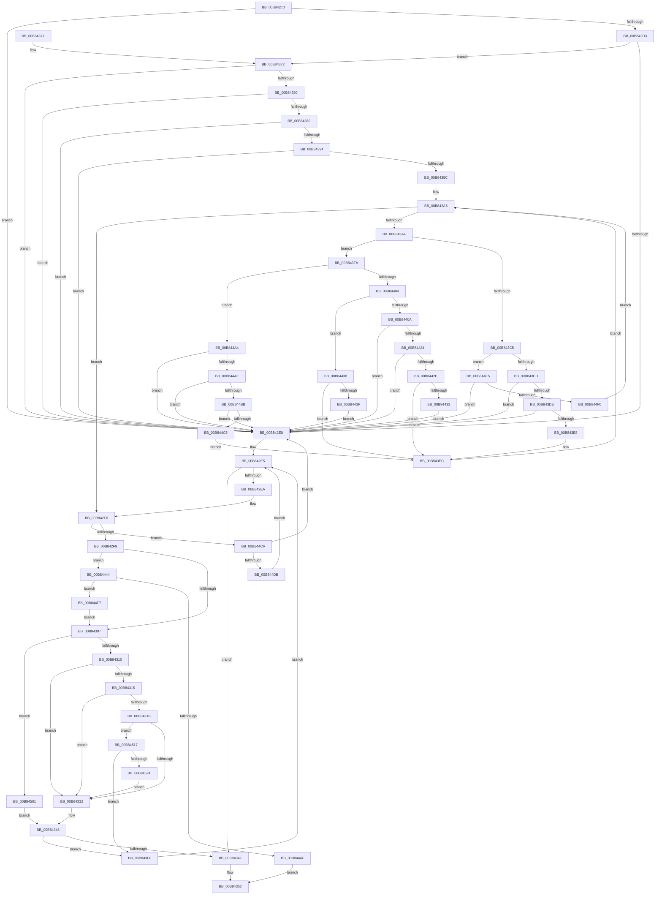

# ExAllocatePool3

- RVA: `0x00B84270`–`0x00B84529` (길이 `697` bytes)
- VA: `0x0000000140B84270`
- 실행 섹션: `POOLCODE`
- PDB 이름 있음: `예`; PDB Function 태그: `아니요`
- unwind 정보 RVA: `0x0009EE90`
- 디코드: `168`개 명령, `697/697` bytes 표시
- 미해석 바이트: `0` (있으면 어셈블리에 `.byte`로 보존)

> 이 문서는 커널 이미지의 기계어와 PDB 기호를 분석해 생성했습니다. 4번과 5번은 함수 원형과 자료형을 바이너리 사용 방식에서 추정한 C 해석이며 원본 소스 복구 결과는 아닙니다.

## 1. Dependencies

- 직접 호출 지점: **6**; 고유 호출 대상: **6**
- 직접 호출자로 확인된 함수: **29**
- RIP 상대 이미지 참조: **2**

### Outgoing calls
- `0x00B842EA` → [RtlRaiseStatus](../../text/2F/RtlRaiseStatus_function_002F6A50.md) (function, `0x002F6A50`)
- `0x00B84325` → [MmResourcesAvailable](../../text/43/MmResourcesAvailable_function_00434FF0.md) (function, `0x00434FF0`)
- `0x00B8433E` → [ExpAllocatePoolWithTagFromNode](../../text/35/ExpAllocatePoolWithTagFromNode_function_0035B970.md) (function, `0x0035B970`)
- `0x00B8449A` → [VfHandlePoolAlloc](../../pagevrfy/BB/VfHandlePoolAlloc_function_00BB8A90.md) (function, `0x00BB8A90`)
- `0x00B844CD` → [ExpSecurePoolFromHandle](../../text/4F/ExpSecurePoolFromHandle_function_004F6D48.md) (function, `0x004F6D48`)
- `0x00B8450D` → [ExpAllocatePoolWithQuotaTag](ExpAllocatePoolWithQuotaTag_function_00B82210.md) (function, `0x00B82210`)

### Direct callers
- [SmAllocEx](../../text/34/SmAllocEx_function_0034C794.md) at `0x0034C7E1`
- [ExpSaBinaryArrayInsert](../../text/3B/ExpSaBinaryArrayInsert_function_003B3CE0.md) at `0x003B3DAC`
- [ExpSaPageGroupDescriptorAllocate](../../text/3B/ExpSaPageGroupDescriptorAllocate_function_003B4224.md) at `0x003B43E5`
- [ExAllocatePoolWithTagPriority](../../text/43/ExAllocatePoolWithTagPriority_function_0043E5F0.md) at `0x0043E705`
- [ExAllocateCacheAwarePushLock](../../text/4C/ExAllocateCacheAwarePushLock_function_004C68C0.md) at `0x004C69F4`
- [KeEtwInitializeCpuStarvationProvider](../../text/5B/KeEtwInitializeCpuStarvationProvider_function_005B5704.md) at `0x005B578B`
- [KiAllocateIdleSearchStructures](../../text/5B/KiAllocateIdleSearchStructures_function_005B6A04.md) at `0x005B6AB2`
- [KiAllocateIdleSearchStructures](../../text/5B/KiAllocateIdleSearchStructures_function_005B6A04.md) at `0x005B6B56`
- [KiAllocateLocalSharedReadyQueue](../../text/5B/KiAllocateLocalSharedReadyQueue_function_005B6BB0.md) at `0x005B6C00`
- [KiAllocateStaticRescheduleContext](../../text/5B/KiAllocateStaticRescheduleContext_function_005B6F98.md) at `0x005B6FE8`
- [KiAllocateSchedulerSubNode](../../text/5B/KiAllocateSchedulerSubNode_function_005BC45C.md) at `0x005BC4A5`
- [KiAllocateForceParkingData](../../text/5C/KiAllocateForceParkingData_function_005C96C8.md) at `0x005C971F`
- [VfIoPendingEntry](../../text/61/VfIoPendingEntry_function_00614340.md) at `0x006143AB`
- [ExpSaInitialize](../../text/65/ExpSaInitialize_function_0065CADC.md) at `0x0065CBE7`
- [PpmIdleInitializeConcurrency](../../page/75/PpmIdleInitializeConcurrency_function_00754F30.md) at `0x00755016`
- [ExpWorkQueueHealthMetricsAllocate](../../page/7C/ExpWorkQueueHealthMetricsAllocate_function_007CFF1C.md) at `0x007CFF75`
- [ExpWorkQueueHealthMetricsAllocate](../../page/7C/ExpWorkQueueHealthMetricsAllocate_function_007CFF1C.md) at `0x007CFFAE`
- [AstLogDeviceSDDLUpdated](../../page/9A/AstLogDeviceSDDLUpdated_function_009A36A8.md) at `0x009A3738`
- [AstLogDeviceCreated](../../page/9A/AstLogDeviceCreated_function_009A5398.md) at `0x009A5459`
- [IoAllocateMiniCompletionPacket](../../page/9A/IoAllocateMiniCompletionPacket_function_009A81E0.md) at `0x009A821A`
- [IopAllocateMiniCompletionPacket](../../page/9D/IopAllocateMiniCompletionPacket_function_009DA2E0.md) at `0x009DA381`
- [AlpcpAllocateCompletionPacketLookaside](../../page/A1/AlpcpAllocateCompletionPacketLookaside_function_00A1A4FC.md) at `0x00A1A5AE`
- [KiInitializeThreadCycleTable](../../pagelk/B6/KiInitializeThreadCycleTable_function_00B66B10.md) at `0x00B66B56`
- [VmInitializeProcessor](../../pagelk/B7/VmInitializeProcessor_function_00B7E858.md) at `0x00B7E89B`
- [IoVerifierCheckForSettingsChange](../../pagevrfy/B9/IoVerifierCheckForSettingsChange_function_00B92258.md) at `0x00B922E1`
- [ViPtInitCircularPoolTrace](../../pagevrfy/B9/ViPtInitCircularPoolTrace_function_00B9C964.md) at `0x00B9CA06`
- [VerifierExAllocatePool3](../../pagevrfy/BA/VerifierExAllocatePool3_function_00BA12D0.md) at `0x00BA13E0`
- [VfKeCheckForChanges](../../pagevrfy/BA/VfKeCheckForChanges_function_00BA5FEC.md) at `0x00BA6032`
- [VfKeCheckForChanges](../../pagevrfy/BA/VfKeCheckForChanges_function_00BA5FEC.md) at `0x00BA6081`
- [VfFaultsInitPhase0](../../pagevrfy/BA/VfFaultsInitPhase0_function_00BA6328.md) at `0x00BA6381`
- [ViIrqlInit](../../pagevrfy/BA/ViIrqlInit_function_00BAD5C4.md) at `0x00BAD600`
- [ViIrqlInit](../../pagevrfy/BA/ViIrqlInit_function_00BAD5C4.md) at `0x00BAD645`
- [VfHandlePoolAlloc](../../pagevrfy/BB/VfHandlePoolAlloc_function_00BB8A90.md) at `0x00BB8B10`
- [VfHandlePoolAlloc](../../pagevrfy/BB/VfHandlePoolAlloc_function_00BB8A90.md) at `0x00BB8D19`

### Static image references
- `0x00B842F9` → RVA `0x00FC6BD0` (`ALMOSTRO`; read)
- `0x00B8440E` → RVA `0x00FC5000` (`ALMOSTRO`; read)

## 2. Other-region calls and transfers

- 다른 실행 섹션으로 향하는 call: **5**
  - `0x00B842EA` → [RtlRaiseStatus](../../text/2F/RtlRaiseStatus_function_002F6A50.md) (`POOLCODE` → `.text`)
  - `0x00B84325` → [MmResourcesAvailable](../../text/43/MmResourcesAvailable_function_00434FF0.md) (`POOLCODE` → `.text`)
  - `0x00B8433E` → [ExpAllocatePoolWithTagFromNode](../../text/35/ExpAllocatePoolWithTagFromNode_function_0035B970.md) (`POOLCODE` → `.text`)
  - `0x00B8449A` → [VfHandlePoolAlloc](../../pagevrfy/BB/VfHandlePoolAlloc_function_00BB8A90.md) (`POOLCODE` → `PAGEVRFY`)
  - `0x00B844CD` → [ExpSecurePoolFromHandle](../../text/4F/ExpSecurePoolFromHandle_function_004F6D48.md) (`POOLCODE` → `.text`)
- 별도 외부 분기/꼬리 이동을 확인하지 못했습니다.

## 3. Assembly (complete function range)

```asm
00B84270  48 89 5C 24 08                  mov qword ptr [rsp + 8], rbx
00B84275  48 89 6C 24 10                  mov qword ptr [rsp + 0x10], rbp
00B8427A  48 89 74 24 18                  mov qword ptr [rsp + 0x18], rsi
00B8427F  48 89 7C 24 20                  mov qword ptr [rsp + 0x20], rdi
00B84284  41 54                           push r12
00B84286  41 56                           push r14
00B84288  41 57                           push r15
00B8428A  48 83 EC 50                     sub rsp, 0x50
00B8428E  33 FF                           xor edi, edi
00B84290  0F 57 C0                        xorps xmm0, xmm0
00B84293  0F 11 44 24 40                  movups xmmword ptr [rsp + 0x40], xmm0
00B84298  65 48 8B 04 25 20 00 00 00      mov rax, qword ptr gs:[0x20]
00B842A1  45 32 DB                        xor r11b, r11b
00B842A4  48 8B D9                        mov rbx, rcx
00B842A7  41 8B F0                        mov esi, r8d
00B842AA  4D 8B E1                        mov r12, r9
00B842AD  44 8D 47 10                     lea r8d, [rdi + 0x10]
00B842B1  48 8B EA                        mov rbp, rdx
00B842B4  44 8B FF                        mov r15d, edi
00B842B7  4C 8B 90 C0 00 00 00            mov r10, qword ptr [rax + 0xc0]
00B842BE  45 0F B7 B2 8A 00 00 00         movzx r14d, word ptr [r10 + 0x8a]
00B842C6  41 0F BA EE 1F                  bts r14d, 0x1f
00B842CB  81 E1 C0 01 00 00               and ecx, 0x1c0
00B842D1  74 0D                           je 0x140b842e0
00B842D3  48 8D 41 FF                     lea rax, [rcx - 1]
00B842D7  48 85 C1                        test rcx, rax
00B842DA  0F 84 92 00 00 00               je 0x140b84372
00B842E0  B9 0D 00 00 C0                  mov ecx, 0xc000000d
00B842E5  F6 C3 20                        test bl, 0x20
00B842E8  74 65                           je 0x140b8434f
00B842EA  E8 61 27 77 FF                  call 0x1402f6a50
00B842EF  CC                              int3
00B842F0  4D 85 FF                        test r15, r15
00B842F3  0F 85 D1 01 00 00               jne 0x140b844ca
00B842F9  8B 05 D1 28 44 00               mov eax, dword ptr [rip + 0x4428d1]
00B842FF  A8 08                           test al, 8
00B84301  0F 85 3D 01 00 00               jne 0x140b84444
00B84307  F6 C3 01                        test bl, 1
00B8430A  0F 85 F1 01 00 00               jne 0x140b84501
00B84310  45 84 DB                        test r11b, r11b
00B84313  74 1D                           je 0x140b84332
00B84315  41 83 F8 20                     cmp r8d, 0x20
00B84319  74 17                           je 0x140b84332
00B8431B  48 8B CB                        mov rcx, rbx
00B8431E  48 8B D5                        mov rdx, rbp
00B84321  48 83 E1 FB                     and rcx, 0xfffffffffffffffb
00B84325  E8 C6 0C 8B FF                  call 0x140434ff0
00B8432A  85 C0                           test eax, eax
00B8432C  0F 84 E5 01 00 00               je 0x140b84517
00B84332  45 8B CE                        mov r9d, r14d
00B84335  44 8B C6                        mov r8d, esi
00B84338  48 8B D5                        mov rdx, rbp
00B8433B  48 8B CB                        mov rcx, rbx
00B8433E  E8 2D 76 7D FF                  call 0x14035b970
00B84343  48 8B F8                        mov rdi, rax
00B84346  48 85 C0                        test rax, rax
00B84349  0F 84 A1 00 00 00               je 0x140b843f0
00B8434F  48 8B C7                        mov rax, rdi
00B84352  4C 8D 5C 24 50                  lea r11, [rsp + 0x50]
00B84357  49 8B 5B 20                     mov rbx, qword ptr [r11 + 0x20]
00B8435B  49 8B 6B 28                     mov rbp, qword ptr [r11 + 0x28]
00B8435F  49 8B 73 30                     mov rsi, qword ptr [r11 + 0x30]
00B84363  49 8B 7B 38                     mov rdi, qword ptr [r11 + 0x38]
00B84367  49 8B E3                        mov rsp, r11
00B8436A  41 5F                           pop r15
00B8436C  41 5E                           pop r14
00B8436E  41 5C                           pop r12
00B84370  C3                              ret
00B84371  CC                              int3
00B84372  B8 00 F0 FF FF                  mov eax, 0xfffff000
00B84377  48 85 D8                        test rax, rbx
00B8437A  0F 85 60 FF FF FF               jne 0x140b842e0
00B84380  41 84 D8                        test r8b, bl
00B84383  0F 85 57 FF FF FF               jne 0x140b842e0
00B84389  48 0F BA E3 0B                  bt rbx, 0xb
00B8438E  0F 82 4C FF FF FF               jb 0x140b842e0
00B84394  85 F6                           test esi, esi
00B84396  0F 84 44 FF FF FF               je 0x140b842e0
00B8439C  44 8B 8C 24 90 00 00 00         mov r9d, dword ptr [rsp + 0x90]
00B843A4  8B D7                           mov edx, edi
00B843A6  41 3B D1                        cmp edx, r9d
00B843A9  0F 83 41 FF FF FF               jae 0x140b842f0
00B843AF  44 8B D2                        mov r10d, edx
00B843B2  49 C1 E2 04                     shl r10, 4
00B843B6  4D 03 D4                        add r10, r12
00B843B9  49 8B 0A                        mov rcx, qword ptr [r10]
00B843BC  0F B6 C1                        movzx eax, cl
00B843BF  48 83 F8 01                     cmp rax, 1
00B843C3  75 35                           jne 0x140b843fa
00B843C5  84 D8                           test al, bl
00B843C7  0F 85 18 01 00 00               jne 0x140b844e5
00B843CD  45 8B 42 08                     mov r8d, dword ptr [r10 + 8]
00B843D1  41 F7 C0 CF FF FF FF            test r8d, 0xffffffcf
00B843D8  0F 85 02 FF FF FF               jne 0x140b842e0
00B843DE  41 83 F8 30                     cmp r8d, 0x30
00B843E2  0F 84 F8 FE FF FF               je 0x140b842e0
00B843E8  44 0F B6 D8                     movzx r11d, al
00B843EC  FF C2                           inc edx
00B843EE  EB B6                           jmp 0x140b843a6
00B843F0  B9 9A 00 00 C0                  mov ecx, 0xc000009a
00B843F5  E9 EB FE FF FF                  jmp 0x140b842e5
00B843FA  48 83 E8 02                     sub rax, 2
00B843FE  0F 84 A0 00 00 00               je 0x140b844a4
00B84404  48 83 F8 01                     cmp rax, 1
00B84408  75 2E                           jne 0x140b84438
00B8440A  45 8B 72 08                     mov r14d, dword ptr [r10 + 8]
00B8440E  0F B7 05 EB 0B 44 00            movzx eax, word ptr [rip + 0x440beb]
00B84415  41 8B CE                        mov ecx, r14d
00B84418  0F BA F1 1F                     btr ecx, 0x1f
00B8441C  3B C8                           cmp ecx, eax
00B8441E  0F 87 BC FE FF FF               ja 0x140b842e0
00B84424  4D 3B 72 08                     cmp r14, qword ptr [r10 + 8]
00B84428  0F 85 B2 FE FF FF               jne 0x140b842e0
00B8442E  F6 C3 40                        test bl, 0x40
00B84431  75 B9                           jne 0x140b843ec
00B84433  E9 A8 FE FF FF                  jmp 0x140b842e0
00B84438  48 0F BA E1 08                  bt rcx, 8
00B8443D  72 AD                           jb 0x140b843ec
00B8443F  E9 9C FE FF FF                  jmp 0x140b842e0
00B84444  48 0F BA E3 09                  bt rbx, 9
00B84449  0F 82 A8 00 00 00               jb 0x140b844f7
00B8444F  48 8B 44 24 40                  mov rax, qword ptr [rsp + 0x40]
00B84454  48 83 E3 FE                     and rbx, 0xfffffffffffffffe
00B84458  48 25 01 FF FF FF               and rax, 0xffffffffffffff01
00B8445E  C7 44 24 48 20 00 00 00         mov dword ptr [rsp + 0x48], 0x20
00B84466  48 83 C8 01                     or rax, 1
00B8446A  44 8B CE                        mov r9d, esi
00B8446D  48 89 44 24 40                  mov qword ptr [rsp + 0x40], rax
00B84472  4C 8B C5                        mov r8, rbp
00B84475  48 8B 44 24 68                  mov rax, qword ptr [rsp + 0x68]
00B8447A  48 8B D3                        mov rdx, rbx
00B8447D  48 89 44 24 38                  mov qword ptr [rsp + 0x38], rax
00B84482  33 C9                           xor ecx, ecx
00B84484  48 8D 44 24 40                  lea rax, [rsp + 0x40]
00B84489  C7 44 24 30 01 00 00 00         mov dword ptr [rsp + 0x30], 1
00B84491  48 89 44 24 28                  mov qword ptr [rsp + 0x28], rax
00B84496  89 7C 24 20                     mov dword ptr [rsp + 0x20], edi
00B8449A  E8 F1 45 03 00                  call 0x140bb8a90
00B8449F  E9 AE FE FF FF                  jmp 0x140b84352
00B844A4  48 83 FB 40                     cmp rbx, 0x40
00B844A8  0F 85 32 FE FF FF               jne 0x140b842e0
00B844AE  4D 8B 7A 08                     mov r15, qword ptr [r10 + 8]
00B844B2  4D 85 FF                        test r15, r15
00B844B5  0F 84 25 FE FF FF               je 0x140b842e0
00B844BB  41 83 F9 01                     cmp r9d, 1
00B844BF  0F 85 1B FE FF FF               jne 0x140b842e0
00B844C5  E9 22 FF FF FF                  jmp 0x140b843ec
00B844CA  49 8B 0F                        mov rcx, qword ptr [r15]
00B844CD  E8 76 28 97 FF                  call 0x1404f6d48
00B844D2  48 85 C0                        test rax, rax
00B844D5  0F 84 05 FE FF FF               je 0x140b842e0
00B844DB  B9 9A 00 00 C0                  mov ecx, 0xc000009a
00B844E0  E9 00 FE FF FF                  jmp 0x140b842e5
00B844E5  48 0F BA E1 08                  bt rcx, 8
00B844EA  0F 83 F0 FD FF FF               jae 0x140b842e0
00B844F0  FF C2                           inc edx
00B844F2  E9 AF FE FF FF                  jmp 0x140b843a6
00B844F7  48 0F BA F3 09                  btr rbx, 9
00B844FC  E9 06 FE FF FF                  jmp 0x140b84307
00B84501  45 8B CE                        mov r9d, r14d
00B84504  44 8B C6                        mov r8d, esi
00B84507  48 8B D5                        mov rdx, rbp
00B8450A  48 8B CB                        mov rcx, rbx
00B8450D  E8 FE DC FF FF                  call 0x140b82210
00B84512  E9 2C FE FF FF                  jmp 0x140b84343
00B84517  48 81 FD E0 0F 00 00            cmp rbp, 0xfe0
00B8451E  0F 87 CC FE FF FF               ja 0x140b843f0
00B84524  E9 09 FE FF FF                  jmp 0x140b84332
```

## 4. C-style interpretation (structured pseudocode)

```c
__int64 __fastcall ExAllocatePool3(__int64 a1, __int64 a2, int a3, __int64 a4, unsigned int a5)
{
    __int64 result;
    __int64 v_r10;
    __int64 v_r11;
    __int64 v_rbx;
    __int64 v_rdi;
    __int64 v_rsp;
    unsigned __int64 v_stack_m10;
    unsigned __int64 v_stack_m18;
    unsigned int v_stack_m20;
    unsigned __int64 v_stack_m28;
    unsigned int v_stack_m30;
    unsigned int v_stack_m8;
    unsigned __int64 v_stack_p10;
    unsigned __int64 v_stack_p18;
    unsigned __int64 v_stack_p20;
    unsigned __int64 v_stack_p8;

    v_stack_p8 = v_rbx;
    v_stack_p10 = v_rbp;
    v_stack_p18 = v_rsi;
    v_stack_p20 = v_rdi;
    v_rsp = (v_rsp) - (80);
    v_rdi = 0;
    v_stack_m28 = v_xmm0;
    v_r11 = 0;
    a1 = (unsigned int)((a1) & (448));
    if (condition_is_equal) goto loc_00B842E0;
    if (((a1) & (a1 - 1)) == 0) goto loc_00B84372;
loc_00B842E0:
loc_00B842E5:
    if ((((unsigned __int8)(a1)) & (32)) == 0) goto loc_00B8434F;
    result = RtlRaiseStatus((unsigned int)(0xC000000DULL), a2, v_rdi + 16, a4);
loc_00B842F0:
    if (0 != 0) goto loc_00B844CA;
    if ((((unsigned __int8)((unsigned int)(*(unsigned int *)(v_rip + 4466897)))) & (8)) != 0) goto loc_00B84444;
loc_00B84307:
    if ((((unsigned __int8)(a1)) & (1)) != 0) goto loc_00B84501;
    if (0 == 0) goto loc_00B84332;
    if (((unsigned int)(v_rdi + 16)) == 32) goto loc_00B84332;
    a1 = (a1) & (-5);
    result = MmResourcesAvailable(a1, a2, v_rdi + 16, a4);
    if ((unsigned int)(result) == 0) goto loc_00B84517;
loc_00B84332:
    result = ExpAllocatePoolWithTagFromNode(a1, a2, (unsigned int)((unsigned int)((unsigned int)(a3))), (unsigned int)((unsigned int)(*(unsigned __int16 *)(*(unsigned __int64 *)(*(unsigned __int64 *)(gs_base + (0 + 32)) + 192) + 138))));
loc_00B84343:
    if (result == 0) goto loc_00B843F0;
loc_00B8434F:
loc_00B84352:
    return result;
loc_00B84372:
    if ((((unsigned int)(0xFFFFF000ULL)) & (*(unsigned __int64 *)(v_stack_m18 + 32))) != 0) goto loc_00B842E0;
    if ((((unsigned __int8)((unsigned int)((unsigned int)((unsigned int)(a3))))) & ((unsigned __int8)(*(unsigned __int64 *)(v_stack_m18 + 32)))) != 0) goto loc_00B842E0;
    if (condition_is_below) goto loc_00B842E0;
    if ((unsigned int)(*(unsigned __int64 *)(v_stack_m18 + 48)) == 0) goto loc_00B842E0;
loc_00B843A6:
    if (((unsigned int)((unsigned int)((unsigned int)(*(unsigned __int64 *)(v_stack_m18 + 56))))) >= ((unsigned int)((unsigned int)(a5)))) goto loc_00B842F0;
    v_r10 = ((unsigned int)((unsigned int)((unsigned int)((unsigned int)(*(unsigned __int64 *)(v_stack_m18 + 56)))))) << (4);
    v_r10 = (v_r10) + (a4);
    if (((unsigned __int8)(*(unsigned __int64 *)(v_r10))) != 1) goto loc_00B843FA;
    if ((((unsigned __int8)((unsigned __int8)(*(unsigned __int64 *)(v_r10)))) & ((unsigned __int8)(*(unsigned __int64 *)(v_stack_m18 + 32)))) != 0) goto loc_00B844E5;
    if ((((unsigned int)((unsigned int)(*(unsigned int *)(v_r10 + 8)))) & (0xFFFFFFCFULL)) != 0) goto loc_00B842E0;
    if (((unsigned int)((unsigned int)(*(unsigned int *)(v_r10 + 8)))) == 48) goto loc_00B842E0;
loc_00B843EC:
    a2 = (unsigned int)(((unsigned int)((unsigned int)(*(unsigned __int64 *)(v_stack_m18 + 56)))) + 1);
    goto loc_00B843A6;
loc_00B843F0:
    goto loc_00B842E5;
loc_00B843FA:
    result = ((unsigned __int8)(*(unsigned __int64 *)(v_r10))) - (2);
    if (condition_is_equal) goto loc_00B844A4;
    if (result != 1) goto loc_00B84438;
    if (((unsigned int)((unsigned int)((unsigned int)((unsigned int)(*(unsigned int *)(v_r10 + 8)))))) > ((unsigned int)(*(unsigned __int16 *)(v_rip + 4459499)))) goto loc_00B842E0;
    if (((unsigned int)(*(unsigned int *)(v_r10 + 8))) != (*(unsigned __int64 *)(v_r10 + 8))) goto loc_00B842E0;
    if ((((unsigned __int8)(*(unsigned __int64 *)(v_stack_m18 + 32))) & (64)) != 0) goto loc_00B843EC;
    goto loc_00B842E0;
loc_00B84438:
    if (condition_is_below) goto loc_00B843EC;
    goto loc_00B842E0;
loc_00B84444:
    if (condition_is_below) goto loc_00B844F7;
    v_rbx = (*(unsigned __int64 *)(v_stack_m18 + 32)) & (-2);
    result = (v_stack_m10) & (-255);
    v_stack_m8 = 32;
    result = (result) | (1);
    v_stack_m10 = result;
    v_stack_m18 = v_stack_p18;
    a1 = 0;
    v_stack_m20 = 1;
    v_stack_m28 = v_stack_m10;
    v_stack_m30 = (unsigned int)(*(unsigned __int64 *)(v_stack_m18 + 56));
    result = VfHandlePoolAlloc(a1, v_rbx, *(unsigned __int64 *)(v_stack_m18 + 40), (unsigned int)((unsigned int)(*(unsigned __int64 *)(v_stack_m18 + 48))));
    goto loc_00B84352;
loc_00B844A4:
    if (v_rbx != 64) goto loc_00B842E0;
    if (*(unsigned __int64 *)(v_r10 + 8) == 0) goto loc_00B842E0;
    if (((unsigned int)((unsigned int)((unsigned int)(*(unsigned __int64 *)(v_stack_m18 + 48))))) != 1) goto loc_00B842E0;
    goto loc_00B843EC;
loc_00B844CA:
    result = ExpSecurePoolFromHandle(*(unsigned __int64 *)(*(unsigned __int64 *)(v_r10 + 8)), v_rbx, *(unsigned __int64 *)(v_stack_m18 + 40), (unsigned int)((unsigned int)(*(unsigned __int64 *)(v_stack_m18 + 48))));
    if (result == 0) goto loc_00B842E0;
    goto loc_00B842E5;
loc_00B844E5:
    if (condition_is_above_or_equal) goto loc_00B842E0;
    a2 = (unsigned int)((v_rbx) + 1);
    goto loc_00B843A6;
loc_00B844F7:
    goto loc_00B84307;
loc_00B84501:
    result = ExpAllocatePoolWithQuotaTag(v_rbx, *(unsigned __int64 *)(v_stack_m18 + 40), (unsigned int)((unsigned int)(*(unsigned __int64 *)(v_stack_m18 + 48))), (unsigned int)((unsigned int)((unsigned int)(*(unsigned int *)(v_r10 + 8)))));
    goto loc_00B84343;
loc_00B84517:
    if ((*(unsigned __int64 *)(v_stack_m18 + 40)) > 0xFE0ULL) goto loc_00B843F0;
    goto loc_00B84332;
}
```

## 5. (Beta) C Style

```c
int64_t ExAllocatePool3(void *Arg1, int64_t Arg2, int32_t Arg3, int64_t Arg4, uint32_t Arg5)
{
    uint8_t *arg1 = (uint8_t *)Arg1;

    int64_t result;
    int64_t local_r10;
    int64_t local_r11;
    int64_t local_rbx;
    int64_t local_rdi;
    int64_t local_rsp;
    uint64_t v_stack_m10;
    uint64_t v_stack_m18;
    uint32_t v_stack_m20;
    uint64_t v_stack_m28;
    uint32_t v_stack_m30;
    uint32_t v_stack_m8;
    uint64_t v_stack_p10;
    uint64_t v_stack_p18;
    uint64_t v_stack_p20;
    uint64_t v_stack_p8;

    v_stack_p8 = local_rbx;
    v_stack_p10 = local_rbp;
    v_stack_p18 = local_rsi;
    v_stack_p20 = local_rdi;
    local_rsp = (local_rsp) - (80);
    local_rdi = 0;
    v_stack_m28 = v_xmm0;
    local_r11 = 0;
    Arg1 = (uint32_t)((Arg1) & (448));
    if (condition_is_equal) goto loc_00B842E0;
    if (((Arg1) & (Arg1 - 1)) == 0) goto loc_00B84372;
loc_00B842E0:
loc_00B842E5:
    if ((((uint8_t)(Arg1)) & (32)) == 0) goto loc_00B8434F;
    result = RtlRaiseStatus((uint32_t)(0xC000000DULL), Arg2, local_rdi + 16, Arg4);
loc_00B842F0:
    if (0 != 0) goto loc_00B844CA;
    if ((((uint8_t)((uint32_t)(*(uint32_t *)(v_rip + 0x4428D1)))) & (8)) != 0) goto loc_00B84444;
loc_00B84307:
    if ((((uint8_t)(Arg1)) & (1)) != 0) goto loc_00B84501;
    if (0 == 0) goto loc_00B84332;
    if (((uint32_t)(local_rdi + 16)) == 32) goto loc_00B84332;
    Arg1 = (Arg1) & (-5);
    result = MmResourcesAvailable(Arg1, Arg2, local_rdi + 16, Arg4);
    if ((uint32_t)(result) == 0) goto loc_00B84517;
loc_00B84332:
    result = ExpAllocatePoolWithTagFromNode(Arg1, Arg2, (uint32_t)((uint32_t)((uint32_t)(Arg3))), (uint32_t)((uint32_t)(*(uint16_t *)(*(uint64_t *)(*(uint64_t *)(gs_base + (0 + 0x20)) + 0xC0) + 0x8A))));
loc_00B84343:
    if (result == 0) goto loc_00B843F0;
loc_00B8434F:
loc_00B84352:
    return result;
loc_00B84372:
    if ((((uint32_t)(0xFFFFF000ULL)) & (*(uint64_t *)(v_stack_m18 + 0x20))) != 0) goto loc_00B842E0;
    if ((((uint8_t)((uint32_t)((uint32_t)((uint32_t)(Arg3))))) & ((uint8_t)(*(uint64_t *)(v_stack_m18 + 0x20)))) != 0) goto loc_00B842E0;
    if (condition_is_below) goto loc_00B842E0;
    if ((uint32_t)(*(uint64_t *)(v_stack_m18 + 0x30)) == 0) goto loc_00B842E0;
loc_00B843A6:
    if (((uint32_t)((uint32_t)((uint32_t)(*(uint64_t *)(v_stack_m18 + 0x38))))) >= ((uint32_t)((uint32_t)(Arg5)))) goto loc_00B842F0;
    local_r10 = ((uint32_t)((uint32_t)((uint32_t)((uint32_t)(*(uint64_t *)(v_stack_m18 + 0x38)))))) << (4);
    local_r10 = (local_r10) + (Arg4);
    if (((uint8_t)(*(uint64_t *)(local_r10))) != 1) goto loc_00B843FA;
    if ((((uint8_t)((uint8_t)(*(uint64_t *)(local_r10)))) & ((uint8_t)(*(uint64_t *)(v_stack_m18 + 0x20)))) != 0) goto loc_00B844E5;
    if ((((uint32_t)((uint32_t)(*(uint32_t *)(local_r10 + 0x8)))) & (0xFFFFFFCFULL)) != 0) goto loc_00B842E0;
    if (((uint32_t)((uint32_t)(*(uint32_t *)(local_r10 + 0x8)))) == 48) goto loc_00B842E0;
loc_00B843EC:
    Arg2 = (uint32_t)(((uint32_t)((uint32_t)(*(uint64_t *)(v_stack_m18 + 0x38)))) + 1);
    goto loc_00B843A6;
loc_00B843F0:
    goto loc_00B842E5;
loc_00B843FA:
    result = ((uint8_t)(*(uint64_t *)(local_r10))) - (2);
    if (condition_is_equal) goto loc_00B844A4;
    if (result != 1) goto loc_00B84438;
    if (((uint32_t)((uint32_t)((uint32_t)((uint32_t)(*(uint32_t *)(local_r10 + 0x8)))))) > ((uint32_t)(*(uint16_t *)(v_rip + 0x440BEB)))) goto loc_00B842E0;
    if (((uint32_t)(*(uint32_t *)(local_r10 + 0x8))) != (*(uint64_t *)(local_r10 + 0x8))) goto loc_00B842E0;
    if ((((uint8_t)(*(uint64_t *)(v_stack_m18 + 0x20))) & (64)) != 0) goto loc_00B843EC;
    goto loc_00B842E0;
loc_00B84438:
    if (condition_is_below) goto loc_00B843EC;
    goto loc_00B842E0;
loc_00B84444:
    if (condition_is_below) goto loc_00B844F7;
    local_rbx = (*(uint64_t *)(v_stack_m18 + 0x20)) & (-2);
    result = (v_stack_m10) & (-255);
    v_stack_m8 = 32;
    result = (result) | (1);
    v_stack_m10 = result;
    v_stack_m18 = v_stack_p18;
    Arg1 = 0;
    v_stack_m20 = 1;
    v_stack_m28 = v_stack_m10;
    v_stack_m30 = (uint32_t)(*(uint64_t *)(v_stack_m18 + 0x38));
    result = VfHandlePoolAlloc(Arg1, local_rbx, *(uint64_t *)(v_stack_m18 + 0x28), (uint32_t)((uint32_t)(*(uint64_t *)(v_stack_m18 + 0x30))));
    goto loc_00B84352;
loc_00B844A4:
    if (local_rbx != 64) goto loc_00B842E0;
    if (*(uint64_t *)(local_r10 + 0x8) == 0) goto loc_00B842E0;
    if (((uint32_t)((uint32_t)((uint32_t)(*(uint64_t *)(v_stack_m18 + 0x30))))) != 1) goto loc_00B842E0;
    goto loc_00B843EC;
loc_00B844CA:
    result = ExpSecurePoolFromHandle(*(uint64_t *)(*(uint64_t *)(local_r10 + 0x8)), local_rbx, *(uint64_t *)(v_stack_m18 + 0x28), (uint32_t)((uint32_t)(*(uint64_t *)(v_stack_m18 + 0x30))));
    if (result == 0) goto loc_00B842E0;
    goto loc_00B842E5;
loc_00B844E5:
    if (condition_is_above_or_equal) goto loc_00B842E0;
    Arg2 = (uint32_t)((local_rbx) + 1);
    goto loc_00B843A6;
loc_00B844F7:
    goto loc_00B84307;
loc_00B84501:
    result = ExpAllocatePoolWithQuotaTag(local_rbx, *(uint64_t *)(v_stack_m18 + 0x28), (uint32_t)((uint32_t)(*(uint64_t *)(v_stack_m18 + 0x30))), (uint32_t)((uint32_t)((uint32_t)(*(uint32_t *)(local_r10 + 0x8)))));
    goto loc_00B84343;
loc_00B84517:
    if ((*(uint64_t *)(v_stack_m18 + 0x28)) > 0xFE0ULL) goto loc_00B843F0;
    goto loc_00B84332;
}
```

### 관측된 메모리 오프셋

구조체 형식이 확인되지 않은 접근은 인자 기준의 오프셋으로만 기록했습니다.

| 기준 인자 | 오프셋 표현 | 폭 (bit) | 접근 |
|---|---:|---:|---|
| `Arg1` | `- 0x1` | `64` | `R` |

## 6. Execution-region graph

[열기: 2D/3D 그래프와 함수 탐색 컨트롤 패널](../../../control-panel.html?section=poolcode&rva=0x00B84270&view=graph)

- 2D 그래프는 위에서 아래로 흐르고, 3D 그래프는 빈 공간을 드래그해 회전합니다. Shift+드래그는 이동, 휠은 확대·축소, 함수 노드 선택은 대상 보고서 이동입니다.

### Static fallback


