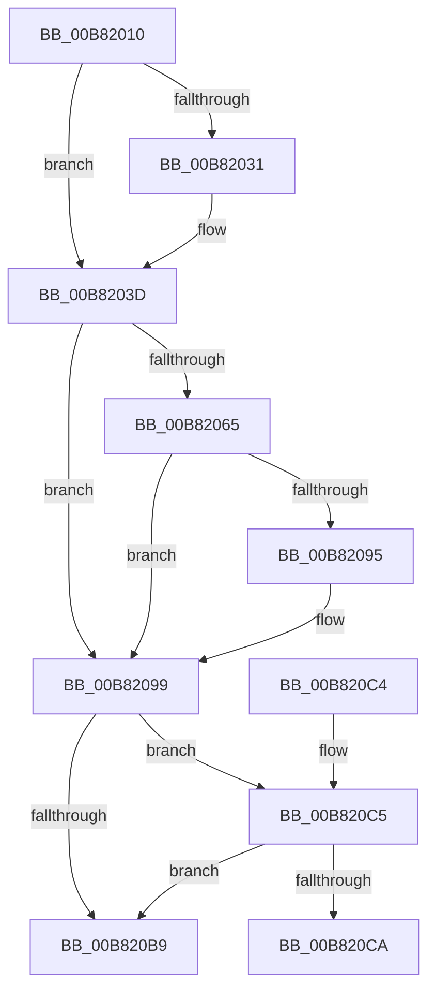

# ExAllocatePoolWithTag

- RVA: `0x00B82010`–`0x00B820E6` (길이 `214` bytes)
- VA: `0x0000000140B82010`
- 실행 섹션: `POOLCODE`
- PDB 이름 있음: `예`; PDB Function 태그: `아니요`
- unwind 정보 RVA: `0x0007BD98`
- 디코드: `62`개 명령, `214/214` bytes 표시
- 미해석 바이트: `0` (있으면 어셈블리에 `.byte`로 보존)

> 이 문서는 커널 이미지의 기계어와 PDB 기호를 분석해 생성했습니다. 4번과 5번은 함수 원형과 자료형을 바이너리 사용 방식에서 추정한 C 해석이며 원본 소스 복구 결과는 아닙니다.

## 1. Dependencies

- 직접 호출 지점: **2**; 고유 호출 대상: **2**
- 직접 호출자로 확인된 함수: **67**
- RIP 상대 이미지 참조: **0**

### Outgoing calls
- `0x00B820AF` → [ExAllocatePool2](ExAllocatePool2_function_00B820F0.md) (function, `0x00B820F0`)
- `0x00B820E0` → [KeBugCheckEx](../../text/4F/KeBugCheckEx_function_004FD660.md) (function, `0x004FD660`)

### Direct callers
- [SepAdtMarshallAuditRecord](../../text/22/SepAdtMarshallAuditRecord_function_00224DD8.md) at `0x00224E61`
- [CcExtendVacbArray](../../text/26/CcExtendVacbArray_function_0026DCD0.md) at `0x0026DDCA`
- [CcPinFileData](../../text/33/CcPinFileData_function_0033FB40.md) at `0x0034013C`
- [sub_00387740](../../text/38/Unknown_function_00387740.md) at `0x00387952`
- [FsRtlAddEntry](../../text/38/FsRtlAddEntry_function_00387BE0.md) at `0x00387C8E`
- [CcInitializeVolumeCacheMap](../../text/38/CcInitializeVolumeCacheMap_function_00389D60.md) at `0x00389E2C`
- [CcFindBitmapRangeToDirty](../../text/3C/CcFindBitmapRangeToDirty_function_003CBBC0.md) at `0x003CBCC5`
- [CcInitializeCacheMapInternal](../../text/3C/CcInitializeCacheMapInternal_function_003CC720.md) at `0x003CCB90`
- [CcCreatePrivateVolumeCacheMap](../../text/3C/CcCreatePrivateVolumeCacheMap_function_003CDB20.md) at `0x003CDBA1`
- [CcCreatePrivateVolumeCacheMap](../../text/3C/CcCreatePrivateVolumeCacheMap_function_003CDB20.md) at `0x003CDBC2`
- [CcInitializePrivateVolumeCacheMap](../../text/3C/CcInitializePrivateVolumeCacheMap_function_003CE088.md) at `0x003CE60B`
- [RtlInsertElementGenericTableAvl](../../text/3E/RtlInsertElementGenericTableAvl_function_003EE510.md) at `0x003EE72C`
- [RtlInsertElementGenericTableFullAvl](../../text/3E/RtlInsertElementGenericTableFullAvl_function_003EED00.md) at `0x003EEE70`
- [FsRtlTruncateBaseMcb](../../text/3F/FsRtlTruncateBaseMcb_function_003FB460.md) at `0x003FB506`
- [CcAllocateInitializeBcb](../../text/41/CcAllocateInitializeBcb_function_0041F5A4.md) at `0x0041F5DC`
- [CcPostVolumeTelemetry](../../text/42/CcPostVolumeTelemetry_function_00420FF8.md) at `0x004210C9`
- [ExAllocatePoolEx](../../text/43/ExAllocatePoolEx_function_0043F0D0.md) at `0x0043F0D8`
- [CBufferAllocate](../../text/47/CBufferAllocate_function_00473E70.md) at `0x00473EA3`
- [CcAllocateInitializeMbcb](../../text/47/CcAllocateInitializeMbcb_function_0047E374.md) at `0x0047E388`
- [FsRtlpOplockSendModernAppTermination](../../text/49/FsRtlpOplockSendModernAppTermination_function_0049F22C.md) at `0x0049F261`
- [CcAllocateInitializeVacbArray](../../text/4A/CcAllocateInitializeVacbArray_function_004AE2BC.md) at `0x004AE301`
- [CcRegisterExternalCache](../../text/57/CcRegisterExternalCache_function_0057BFC0.md) at `0x0057BFF7`
- [CcRegisterExternalCacheEx](../../text/57/CcRegisterExternalCacheEx_function_0057C0B0.md) at `0x0057C120`
- [CcDeferWrite](../../text/57/CcDeferWrite_function_0057C860.md) at `0x0057C8A5`
- [CcQueryRegKeyValue](../../text/57/CcQueryRegKeyValue_function_0057CACC.md) at `0x0057CBA4`
- [CcSetupWatchForRegistryChanges](../../text/57/CcSetupWatchForRegistryChanges_function_0057CE10.md) at `0x0057CE48`
- [CcCreatePartition](../../text/57/CcCreatePartition_function_0057DE10.md) at `0x0057DE5A`
- [CcInitializePartition](../../text/57/CcInitializePartition_function_0057E4D8.md) at `0x0057E9D7`
- [CcInitializePartition](../../text/57/CcInitializePartition_function_0057E4D8.md) at `0x0057EA45`
- [CcQueueAsyncGetDeviceGuid](../../text/57/CcQueueAsyncGetDeviceGuid_function_0057EE74.md) at `0x0057EE99`
- [FsRtlAllocateAePushLock](../../text/58/FsRtlAllocateAePushLock_function_005815E0.md) at `0x005815F3`
- [FsRtlAllocatePool](../../text/58/FsRtlAllocatePool_function_00581BD0.md) at `0x00581BDC`
- [FsRtlAllocatePoolWithTag](../../text/58/FsRtlAllocatePoolWithTag_function_00581C60.md) at `0x00581C66`
- [CcInitializeProcessor](../../page/71/CcInitializeProcessor_function_00710220.md) at `0x00710266`
- [CcAllocateObcb](../../page/71/CcAllocateObcb_function_0071031C.md) at `0x0071036A`
- [DbgkCaptureLiveDump](../../page/71/DbgkCaptureLiveDump_function_0071113C.md) at `0x0071120D`
- [DbgkCaptureLiveDump](../../page/71/DbgkCaptureLiveDump_function_0071113C.md) at `0x007112A7`
- [DbgkpLkmdLaunchSnapApc](../../page/71/DbgkpLkmdLaunchSnapApc_function_00711844.md) at `0x00711878`
- [DbgkpTriageDumpInitialize](../../page/71/DbgkpTriageDumpInitialize_function_00712A74.md) at `0x00712AAB`
- [FsRtlpOplockGetAckTimeoutOverride](../../page/71/FsRtlpOplockGetAckTimeoutOverride_function_00714F54.md) at `0x00715049`
- [SC_ENV::Allocate](../../page/71/SC_ENV_Allocate_function_00716F90.md) at `0x00716FA9`
- [RawQueryFileSystemInformation](../../page/78/RawQueryFileSystemInformation_function_0078A350.md) at `0x0078A430`
- [SepCaptureAuditPolicy](../../page/79/SepCaptureAuditPolicy_function_0079FC80.md) at `0x0079FCC9`
- [SddlpReAlloc](../../page/7A/SddlpReAlloc_function_007A5278.md) at `0x007A52AA`
- [SddlpUuidToString](../../page/7A/SddlpUuidToString_function_007A53F4.md) at `0x007A5421`
- [ExRegisterHost](../../page/7D/ExRegisterHost_function_007D06CC.md) at `0x007D070A`
- [AslPathWildcardFindFirst](../../page/81/AslPathWildcardFindFirst_function_0081B534.md) at `0x0081B803`
- [AslPathWildcardFindFirst](../../page/81/AslPathWildcardFindFirst_function_0081B534.md) at `0x0081B82C`
- [AslPathWildcardFindFirst](../../page/81/AslPathWildcardFindFirst_function_0081B534.md) at `0x0081B9BE`
- [AslPathWildcardFindFirst](../../page/81/AslPathWildcardFindFirst_function_0081B534.md) at `0x0081B9E7`
- [AslPathWildcardFindNext](../../page/81/AslPathWildcardFindNext_function_0081BB2C.md) at `0x0081BE02`
- [AslPathWildcardFindNext](../../page/81/AslPathWildcardFindNext_function_0081BB2C.md) at `0x0081BE2F`
- [AslPathWildcardFindNext](../../page/81/AslPathWildcardFindNext_function_0081BB2C.md) at `0x0081C052`
- [AslPathWildcardFindNext](../../page/81/AslPathWildcardFindNext_function_0081BB2C.md) at `0x0081C08F`
- [CreateTlgAggregateSession](../../page/83/CreateTlgAggregateSession_function_00835FFC.md) at `0x0083603C`
- [CreateTlgAggregateSession](../../page/83/CreateTlgAggregateSession_function_00835FFC.md) at `0x00836085`
- [LkmdTelCreateReport](../../page/84/LkmdTelCreateReport_function_008414CC.md) at `0x00841534`
- [LkmdTelCreateReport](../../page/84/LkmdTelCreateReport_function_008414CC.md) at `0x00841552`
- [sub_0089A0DA](../../page/89/Unknown_function_0089A0DA.md) at `0x0089A187`
- [sub_008BB9AC](../../page/8B/Unknown_function_008BB9AC.md) at `0x008BBB36`
- [SddlpAlloc](../../page/92/SddlpAlloc_function_00925F88.md) at `0x00925FA3`
- [SeCaptureSid](../../page/92/SeCaptureSid_function_009276D4.md) at `0x00927760`
- [SeCaptureSecurityDescriptor](../../page/92/SeCaptureSecurityDescriptor_function_00929F40.md) at `0x0092A29B`
- [VrpHandleIoctlInitializeJobForVreg](../../page/93/VrpHandleIoctlInitializeJobForVreg_function_00937254.md) at `0x00937491`
- [FsRtlFindInTunnelCacheEx](../../page/93/FsRtlFindInTunnelCacheEx_function_00937A50.md) at `0x00937B3A`
- [RawInitializeVcb](../../page/9A/RawInitializeVcb_function_009A5658.md) at `0x009A56A8`
- [ExAllocateCacheAwareRundownProtection](../../page/9A/ExAllocateCacheAwareRundownProtection_function_009A5790.md) at `0x009A57BC`
- [ExAllocateCacheAwareRundownProtection](../../page/9A/ExAllocateCacheAwareRundownProtection_function_009A5790.md) at `0x009A57F3`
- [ExAllocateCacheAwareRundownProtection](../../page/9A/ExAllocateCacheAwareRundownProtection_function_009A5790.md) at `0x009A582A`
- [SeCaptureAcl](../../page/9C/SeCaptureAcl_function_009C6A58.md) at `0x009C6AEC`
- [SeCaptureLuidAndAttributesArray](../../page/9C/SeCaptureLuidAndAttributesArray_function_009C8D18.md) at `0x009C8D8A`
- [SeCaptureSidAndAttributesArray](../../page/9C/SeCaptureSidAndAttributesArray_function_009C9D70.md) at `0x009C9F08`
- [SeCaptureSidAndAttributesArray](../../page/9C/SeCaptureSidAndAttributesArray_function_009C9D70.md) at `0x009CA05B`
- [CcCreateVacbArray](../../page/9F/CcCreateVacbArray_function_009FE10C.md) at `0x009FE221`
- [KGetAppModelStateSeparatedRegKeyPath](../../page/A6/KGetAppModelStateSeparatedRegKeyPath_function_00A690C0.md) at `0x00A69130`
- [sub_00B24914](../../page/B2/Unknown_function_00B24914.md) at `0x00B2498A`
- [sub_00B24B82](../../page/B2/Unknown_function_00B24B82.md) at `0x00B24BF0`
- [sub_00B24B82](../../page/B2/Unknown_function_00B24B82.md) at `0x00B24C31`
- [sub_00B24B82](../../page/B2/Unknown_function_00B24B82.md) at `0x00B24CE8`
- [sub_00B24B82](../../page/B2/Unknown_function_00B24B82.md) at `0x00B24D33`
- [VerifierExAllocatePoolWithTag](../../pagevrfy/BA/VerifierExAllocatePoolWithTag_function_00BA15B0.md) at `0x00BA16A9`
- [ViDeadlockKernelVerifierLookasideAllocate](../../pagevrfy/BA/ViDeadlockKernelVerifierLookasideAllocate_function_00BA9910.md) at `0x00BA9922`
- [CcInitializeVacbs](../../init/C2/CcInitializeVacbs_function_00C26168.md) at `0x00C2618A`
- [FsRtlInitSystem](../../init/C2/FsRtlInitSystem_function_00C28EEC.md) at `0x00C28F12`

### Static image references
- 디코드된 RIP-relative 메모리 참조가 없습니다.

## 2. Other-region calls and transfers

- 다른 실행 섹션으로 향하는 call: **1**
  - `0x00B820E0` → [KeBugCheckEx](../../text/4F/KeBugCheckEx_function_004FD660.md) (`POOLCODE` → `.text`)
- 별도 외부 분기/꼬리 이동을 확인하지 못했습니다.

## 3. Assembly (complete function range)

```asm
00B82010  48 89 5C 24 08                  mov qword ptr [rsp + 8], rbx
00B82015  57                              push rdi
00B82016  48 83 EC 30                     sub rsp, 0x30
00B8201A  8B D9                           mov ebx, ecx
00B8201C  45 8B C8                        mov r9d, r8d
00B8201F  48 8B FA                        mov rdi, rdx
00B82022  B9 00 01 00 00                  mov ecx, 0x100
00B82027  B8 40 00 00 00                  mov eax, 0x40
00B8202C  F6 C3 01                        test bl, 1
00B8202F  75 0C                           jne 0x140b8203d
00B82031  0F BA E3 09                     bt ebx, 9
00B82035  B9 80 00 00 00                  mov ecx, 0x80
00B8203A  0F 42 C8                        cmovb ecx, eax
00B8203D  85 DB                           test ebx, ebx
00B8203F  48 0F 48 C8                     cmovs rcx, rax
00B82043  48 8B D1                        mov rdx, rcx
00B82046  48 83 CA 04                     or rdx, 4
00B8204A  F6 C3 20                        test bl, 0x20
00B8204D  48 0F 44 D1                     cmove rdx, rcx
00B82051  48 8B CA                        mov rcx, rdx
00B82054  48 83 C9 02                     or rcx, 2
00B82058  0F BA E3 0A                     bt ebx, 0xa
00B8205C  48 0F 42 CA                     cmovb rcx, rdx
00B82060  F6 C3 DE                        test bl, 0xde
00B82063  74 34                           je 0x140b82099
00B82065  48 8B D1                        mov rdx, rcx
00B82068  48 83 CA 08                     or rdx, 8
00B8206C  F6 C3 04                        test bl, 4
00B8206F  48 0F 44 D1                     cmove rdx, rcx
00B82073  4C 8B C2                        mov r8, rdx
00B82076  49 0F BA E8 09                  bts r8, 9
00B8207B  F6 C3 80                        test bl, 0x80
00B8207E  4C 0F 44 C2                     cmove r8, rdx
00B82082  49 8B C8                        mov rcx, r8
00B82085  48 0F BA E9 0A                  bts rcx, 0xa
00B8208A  84 D8                           test al, bl
00B8208C  49 0F 44 C8                     cmove rcx, r8
00B82090  F6 C3 10                        test bl, 0x10
00B82093  74 04                           je 0x140b82099
00B82095  48 83 C9 20                     or rcx, 0x20
00B82099  41 81 E1 FF FF FF 7F            and r9d, 0x7fffffff
00B820A0  B8 42 61 64 30                  mov eax, 0x30646142
00B820A5  48 8B D7                        mov rdx, rdi
00B820A8  44 0F 44 C8                     cmove r9d, eax
00B820AC  45 8B C1                        mov r8d, r9d
00B820AF  E8 3C 00 00 00                  call 0x140b820f0
00B820B4  48 85 C0                        test rax, rax
00B820B7  74 0C                           je 0x140b820c5
00B820B9  48 8B 5C 24 40                  mov rbx, qword ptr [rsp + 0x40]
00B820BE  48 83 C4 30                     add rsp, 0x30
00B820C2  5F                              pop rdi
00B820C3  C3                              ret
00B820C4  CC                              int3
00B820C5  F6 C3 02                        test bl, 2
00B820C8  74 EF                           je 0x140b820b9
00B820CA  45 33 C9                        xor r9d, r9d
00B820CD  48 C7 44 24 20 00 00 00 00      mov qword ptr [rsp + 0x20], 0
00B820D6  45 33 C0                        xor r8d, r8d
00B820D9  48 8B D7                        mov rdx, rdi
00B820DC  41 8D 49 41                     lea ecx, [r9 + 0x41]
00B820E0  E8 7B B5 97 FF                  call 0x1404fd660
00B820E5  CC                              int3
```

## 4. C-style interpretation (structured pseudocode)

```c
__int64 __fastcall ExAllocatePoolWithTag(int a1, __int64 a2, int a3)
{
    __int64 result;
    __int64 v_rsp;
    unsigned __int64 v_stack_p20;
    unsigned __int64 v_stack_p8;

    v_stack_p8 = v_rbx;
    v_rsp = (v_rsp) - (48);
    if ((((unsigned __int8)((unsigned int)(a1))) & (1)) == 0) {
        a1 = 128;
        if (condition_is_below) { a1 = 64; }
    }
    if (sign_flag) { a1 = 64; }
    a2 = (a1) | (4);
    if ((((unsigned __int8)((unsigned int)(a1))) & (32)) == 0) { a2 = a1; }
    a1 = (a2) | (2);
    if (condition_is_below) { a1 = a2; }
    if ((((unsigned __int8)((unsigned int)(a1))) & (222)) == 0) goto loc_00B82099;
    a2 = (a1) | (8);
    if ((((unsigned __int8)((unsigned int)(a1))) & (4)) == 0) { a2 = a1; }
    if ((((unsigned __int8)((unsigned int)(a1))) & (128)) == 0) { a2 = a2; }
    if (((64) & ((unsigned __int8)((unsigned int)(a1)))) == 0) { a2 = a2; }
    if ((((unsigned __int8)((unsigned int)(a1))) & (16)) != 0) {
        a1 = (a2) | (32);
    }
    a4 = (unsigned int)(((unsigned int)(a3)) & (0x7FFFFFFFULL));
    if (condition_is_equal) { a4 = (unsigned int)((unsigned int)(0x30646142ULL)); }
    result = ExAllocatePool2(a1, a2, (unsigned int)((unsigned int)(a4)), a4);
    if (result == 0) goto loc_00B820C5;
loc_00B820B9:
    v_rsp = (v_rsp) + (48);
    return result;
loc_00B820C5:
    if ((((unsigned __int8)(v_stack_p8)) & (2)) == 0) goto loc_00B820B9;
    a4 = 0;
    v_stack_p20 = 0;
    a3 = 0;
    result = KeBugCheckEx(a4 + 65, a2, a3, a4);
    return result;
}
```

## 5. (Beta) C Style

```c
int64_t ExAllocatePoolWithTag(int32_t PoolType, int64_t NumberOfBytes, int32_t Tag)
{
    int64_t result;
    int64_t local_rsp;
    uint64_t v_stack_p20;
    uint64_t v_stack_p8;

    v_stack_p8 = local_rbx;
    local_rsp = (local_rsp) - (48);
    if ((((uint8_t)((uint32_t)(PoolType))) & (1)) == 0) {
        PoolType = 128;
        if (condition_is_below) { PoolType = 64; }
    }
    if (sign_flag) { PoolType = 64; }
    NumberOfBytes = (PoolType) | (4);
    if ((((uint8_t)((uint32_t)(PoolType))) & (32)) == 0) { NumberOfBytes = PoolType; }
    PoolType = (NumberOfBytes) | (2);
    if (condition_is_below) { PoolType = NumberOfBytes; }
    if ((((uint8_t)((uint32_t)(PoolType))) & (222)) == 0) goto loc_00B82099;
    NumberOfBytes = (PoolType) | (8);
    if ((((uint8_t)((uint32_t)(PoolType))) & (4)) == 0) { NumberOfBytes = PoolType; }
    if ((((uint8_t)((uint32_t)(PoolType))) & (128)) == 0) { NumberOfBytes = NumberOfBytes; }
    if (((64) & ((uint8_t)((uint32_t)(PoolType)))) == 0) { NumberOfBytes = NumberOfBytes; }
    if ((((uint8_t)((uint32_t)(PoolType))) & (16)) != 0) {
        PoolType = (NumberOfBytes) | (32);
    }
    a4 = (uint32_t)(((uint32_t)(Tag)) & (0x7FFFFFFFULL));
    if (condition_is_equal) { a4 = (uint32_t)((uint32_t)(0x30646142ULL)); }
    result = ExAllocatePool2(PoolType, NumberOfBytes, (uint32_t)((uint32_t)(a4)), a4);
    if (result == 0) goto loc_00B820C5;
loc_00B820B9:
    local_rsp = (local_rsp) + (48);
    return result;
loc_00B820C5:
    if ((((uint8_t)(v_stack_p8)) & (2)) == 0) goto loc_00B820B9;
    a4 = 0;
    v_stack_p20 = 0;
    Tag = 0;
    result = KeBugCheckEx(a4 + 65, NumberOfBytes, Tag, a4);
    return result;
}
```

## 6. Execution-region graph

[열기: 2D/3D 그래프와 함수 탐색 컨트롤 패널](../../../control-panel.html?section=poolcode&rva=0x00B82010&view=graph)

- 2D 그래프는 위에서 아래로 흐르고, 3D 그래프는 빈 공간을 드래그해 회전합니다. Shift+드래그는 이동, 휠은 확대·축소, 함수 노드 선택은 대상 보고서 이동입니다.

### Static fallback


