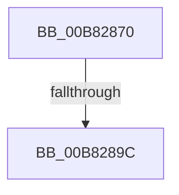

# ExFreePoolWithTag

- RVA: `0x00B82870`–`0x00B828A6` (길이 `54` bytes)
- VA: `0x0000000140B82870`
- 실행 섹션: `POOLCODE`
- PDB 이름 있음: `예`; PDB Function 태그: `아니요`
- unwind 정보 RVA: `0x0007BDD4`
- 디코드: `13`개 명령, `54/54` bytes 표시
- 미해석 바이트: `0` (있으면 어셈블리에 `.byte`로 보존)

> 이 문서는 커널 이미지의 기계어와 PDB 기호를 분석해 생성했습니다. 4번과 5번은 함수 원형과 자료형을 바이너리 사용 방식에서 추정한 C 해석이며 원본 소스 복구 결과는 아닙니다.

## 1. Dependencies

- 직접 호출 지점: **0**; 고유 호출 대상: **0**
- 직접 호출자로 확인된 함수: **3223**
- RIP 상대 이미지 참조: **0**

### Outgoing calls
- 직접 디코드된 call 명령이 없습니다.

### Direct callers
- [sub_002055DD](../../text/20/Unknown_function_002055DD.md) at `0x0020568D`
- [sub_002055DD](../../text/20/Unknown_function_002055DD.md) at `0x0020571B`
- [sub_002055DD](../../text/20/Unknown_function_002055DD.md) at `0x00205746`
- [sub_002055DD](../../text/20/Unknown_function_002055DD.md) at `0x00205755`
- [IopBuildDeviceIoControlRequest](../../text/20/IopBuildDeviceIoControlRequest_function_00205B00.md) at `0x00205D7A`
- [IopBuildDeviceIoControlRequest](../../text/20/IopBuildDeviceIoControlRequest_function_00205B00.md) at `0x00205DC3`
- [sub_00206865](../../text/20/Unknown_function_00206865.md) at `0x00206A73`
- [IopAllocateIrpPrivate](../../text/20/IopAllocateIrpPrivate_function_00207770.md) at `0x002079A0`
- [KiRcuFlushCompleted](../../text/20/KiRcuFlushCompleted_function_0020AD38.md) at `0x0020AEC9`
- [ExpFreeOwnerEntry](../../text/20/ExpFreeOwnerEntry_function_0020F740.md) at `0x0020F99B`
- [ExpFreeOwnerEntry](../../text/20/ExpFreeOwnerEntry_function_0020F740.md) at `0x0020F9DD`
- [ExpFreeOwnerEntry](../../text/20/ExpFreeOwnerEntry_function_0020F740.md) at `0x0020F9FF`
- [IopDropIrp](../../text/21/IopDropIrp_function_002107B0.md) at `0x002107D8`
- [sub_00211C19](../../text/21/Unknown_function_00211C19.md) at `0x00211CB5`
- [ExpAcquireResourceSharedLite](../../text/21/ExpAcquireResourceSharedLite_function_00212040.md) at `0x00212353`
- [ExpAcquireResourceSharedLite](../../text/21/ExpAcquireResourceSharedLite_function_00212040.md) at `0x0021272B`
- [ExpAcquireResourceSharedLite](../../text/21/ExpAcquireResourceSharedLite_function_00212040.md) at `0x002129A6`
- [ExpAcquireResourceSharedLite](../../text/21/ExpAcquireResourceSharedLite_function_00212040.md) at `0x00212B85`
- [ExpAcquireResourceSharedLite](../../text/21/ExpAcquireResourceSharedLite_function_00212040.md) at `0x00212FB8`
- [ExpAcquireResourceSharedLite](../../text/21/ExpAcquireResourceSharedLite_function_00212040.md) at `0x00213385`
- [sub_00213555](../../text/21/Unknown_function_00213555.md) at `0x00213580`
- [sub_00213798](../../text/21/Unknown_function_00213798.md) at `0x002137C7`
- [ExEnterPriorityRegionAndAcquireResourceShared](../../text/21/ExEnterPriorityRegionAndAcquireResourceShared_function_00213870.md) at `0x00213933`
- [sub_00213CA6](../../text/21/Unknown_function_00213CA6.md) at `0x00213CF3`
- [sub_00213CA6](../../text/21/Unknown_function_00213CA6.md) at `0x00213D2C`
- [EtwpGetTrackingLockSlotForThread](../../text/21/EtwpGetTrackingLockSlotForThread_function_00215B34.md) at `0x00215BC2`
- [IoBoostThreadIoPriority](../../text/21/IoBoostThreadIoPriority_function_00216110.md) at `0x0021640F`
- [SepRmCallLsa](../../text/22/SepRmCallLsa_function_00223630.md) at `0x0022388E`
- [SepAdtLogAuditRecord](../../text/22/SepAdtLogAuditRecord_function_00224B6C.md) at `0x00224C2E`
- [SepAdtLogAuditRecord](../../text/22/SepAdtLogAuditRecord_function_00224B6C.md) at `0x00224CE2`
- [SepAdtLogAuditRecord](../../text/22/SepAdtLogAuditRecord_function_00224B6C.md) at `0x00224CEC`
- [MiCloneVads](../../text/22/MiCloneVads_function_0022DC1C.md) at `0x0022E24A`
- [PopUmpoSendPowerRequestOverrideQuery](../../text/23/PopUmpoSendPowerRequestOverrideQuery_function_00230418.md) at `0x002304AA`
- [PopUmpoSendPowerMessage](../../text/23/PopUmpoSendPowerMessage_function_00230730.md) at `0x00230819`
- [PoDestroyReasonContext](../../text/23/PoDestroyReasonContext_function_00230944.md) at `0x00230978`
- [PoDestroyReasonContext](../../text/23/PoDestroyReasonContext_function_00230944.md) at `0x00230985`
- [PoCaptureReasonContext](../../text/23/PoCaptureReasonContext_function_00230A38.md) at `0x00230AF8`
- [PoCaptureReasonContext](../../text/23/PoCaptureReasonContext_function_00230A38.md) at `0x00230B3A`
- [MmFlushSection](../../text/23/MmFlushSection_function_002375E4.md) at `0x00237845`
- [sub_00238945](../../text/23/Unknown_function_00238945.md) at `0x00238B1E`
- [MiReferenceIoPages](../../text/23/MiReferenceIoPages_function_0023C804.md) at `0x0023D0FB`
- [sub_0023FAC2](../../text/23/Unknown_function_0023FAC2.md) at `0x0023FAE7`
- [sub_00249B50](../../text/24/Unknown_function_00249B50.md) at `0x00249B55`
- [sub_0024E316](../../text/24/Unknown_function_0024E316.md) at `0x0024E35D`
- [sub_0024E371](../../text/24/Unknown_function_0024E371.md) at `0x0024E385`
- [sub_0024EA2A](../../text/24/Unknown_function_0024EA2A.md) at `0x0024EA71`
- [sub_0024EA85](../../text/24/Unknown_function_0024EA85.md) at `0x0024EA99`
- [IopFreeIrpExtension](../../text/24/IopFreeIrpExtension_function_0024EDB0.md) at `0x0024EE5F`
- [IopCompleteIrpInFileObjectList](../../text/24/IopCompleteIrpInFileObjectList_function_0024F330.md) at `0x0024F7C0`
- [sub_0025D903](../../text/25/Unknown_function_0025D903.md) at `0x0025DE5E`
- [sub_0025D903](../../text/25/Unknown_function_0025D903.md) at `0x0025E423`
- [sub_0025E5F6](../../text/25/Unknown_function_0025E5F6.md) at `0x0025E603`
- [sub_0025EB5D](../../text/25/Unknown_function_0025EB5D.md) at `0x0025EECC`
- [sub_0025EB5D](../../text/25/Unknown_function_0025EB5D.md) at `0x0025EF16`
- [sub_0025EB5D](../../text/25/Unknown_function_0025EB5D.md) at `0x0025EF40`
- [sub_0025F912](../../text/25/Unknown_function_0025F912.md) at `0x0025F96A`
- [sub_0025FB5C](../../text/25/Unknown_function_0025FB5C.md) at `0x0025FF93`
- [sub_00260355](../../text/26/Unknown_function_00260355.md) at `0x0026035F`
- [sub_00260366](../../text/26/Unknown_function_00260366.md) at `0x002606E1`
- [sub_0026118A](../../text/26/Unknown_function_0026118A.md) at `0x002611D0`
- [sub_0026118A](../../text/26/Unknown_function_0026118A.md) at `0x0026121A`
- [sub_0026118A](../../text/26/Unknown_function_0026118A.md) at `0x00261244`
- [sub_0026118A](../../text/26/Unknown_function_0026118A.md) at `0x00261291`
- [sub_0026118A](../../text/26/Unknown_function_0026118A.md) at `0x002612DE`
- [sub_0026118A](../../text/26/Unknown_function_0026118A.md) at `0x00261309`
- [sub_0026525D](../../text/26/Unknown_function_0026525D.md) at `0x00265264`
- [sub_00266DCF](../../text/26/Unknown_function_00266DCF.md) at `0x00266DFD`
- [B_TREE&lt;_SM_PAGE_KEY,SMKM_STORE_MGR&lt;SM_TRAITS&gt;::SMKM_FRONTEND_ENTRY,4096,B_TREE_DUMMY_NODE_POOL,B_TREE_KEY_COMPARATOR&lt;_SM_PAGE_KEY&gt; &gt;::BTreeMergeNodes](../../text/26/B_TREE__SM_PAGE_KEY_SMKM_STORE_MGR_SM_TRAITS_SMKM_FRONTEND_ENTRY_4096_B_TREE_DUMMY_NODE_POOL_B_TREE__function_002674CC.md) at `0x00267563`
- [B_TREE&lt;_SM_PAGE_KEY,SMKM_STORE_MGR&lt;SM_TRAITS&gt;::SMKM_FRONTEND_ENTRY,4096,B_TREE_DUMMY_NODE_POOL,B_TREE_KEY_COMPARATOR&lt;_SM_PAGE_KEY&gt; &gt;::BTreeSplitChild](../../text/26/B_TREE__SM_PAGE_KEY_SMKM_STORE_MGR_SM_TRAITS_SMKM_FRONTEND_ENTRY_4096_B_TREE_DUMMY_NODE_POOL_B_TREE__function_002675D4.md) at `0x0026770C`
- [SmPrepareForFatalHeapCorruption](../../text/26/SmPrepareForFatalHeapCorruption_function_00267AC0.md) at `0x00267B8A`
- [SmHpBufferAlloc](../../text/26/SmHpBufferAlloc_function_00268F7C.md) at `0x002690A3`
- [CcExtendVacbArray](../../text/26/CcExtendVacbArray_function_0026DCD0.md) at `0x0026DE5F`
- [PopFxNextParentRelationSafe](../../text/26/PopFxNextParentRelationSafe_function_0026EAC0.md) at `0x0026EB6C`
- [IoDeleteDevice](../../text/26/IoDeleteDevice_function_0026FE90.md) at `0x0026FED1`
- [IoDeleteDevice](../../text/26/IoDeleteDevice_function_0026FE90.md) at `0x0026FFEA`
- [PoRunDownDeviceObject](../../text/26/PoRunDownDeviceObject_function_0026FFFC.md) at `0x00270076`
- [PnpGetRelatedTargetDevice](../../text/27/PnpGetRelatedTargetDevice_function_00271F54.md) at `0x0027202C`
- [sub_00273F95](../../text/27/Unknown_function_00273F95.md) at `0x002743D8`
- [sub_0027475D](../../text/27/Unknown_function_0027475D.md) at `0x00274B1B`
- [sub_0027475D](../../text/27/Unknown_function_0027475D.md) at `0x00275556`
- [sub_0027475D](../../text/27/Unknown_function_0027475D.md) at `0x002755A0`
- [sub_0027475D](../../text/27/Unknown_function_0027475D.md) at `0x002755CA`
- [sub_0027475D](../../text/27/Unknown_function_0027475D.md) at `0x00275619`
- [sub_0027475D](../../text/27/Unknown_function_0027475D.md) at `0x00275663`
- [sub_0027475D](../../text/27/Unknown_function_0027475D.md) at `0x0027568D`
- [MiUnlockWorkingSetExclusive](../../text/27/MiUnlockWorkingSetExclusive_function_0027EC70.md) at `0x0027EDB9`
- [MiCreatePrototypePtes](../../text/29/MiCreatePrototypePtes_function_002950FC.md) at `0x00295302`
- [MiRemoveFromSystemSpace](../../text/29/MiRemoveFromSystemSpace_function_002962FC.md) at `0x0029654D`
- [MiDeleteCachedSubsection](../../text/29/MiDeleteCachedSubsection_function_00297888.md) at `0x002979C9`
- [MiEntireSubsectionIsPurged](../../text/29/MiEntireSubsectionIsPurged_function_00297C04.md) at `0x00297CD8`
- [MiFlushComplete](../../text/29/MiFlushComplete_function_002980A0.md) at `0x0029810F`
- [MiFreeOverlappedFlushEntry](../../text/29/MiFreeOverlappedFlushEntry_function_00298240.md) at `0x0029826E`
- [MiFreeOverlappedFlushEntry](../../text/29/MiFreeOverlappedFlushEntry_function_00298240.md) at `0x00298290`
- [FsFilterCtrlFree](../../text/29/FsFilterCtrlFree_function_0029908C.md) at `0x002990AA`
- [IopfCompleteRequest](../../text/29/IopfCompleteRequest_function_0029B5F8.md) at `0x0029B8D9`
- [NtSetInformationFile](../../text/29/NtSetInformationFile_function_0029C5E0.md) at `0x0029D4A1`
- [IoMakeAssociatedIrpPriv](../../text/29/IoMakeAssociatedIrpPriv_function_0029D818.md) at `0x0029DAC5`
- [VslpLockPagesForTransfer](../../text/29/VslpLockPagesForTransfer_function_0029E0FC.md) at `0x0029E323`
- [MiGetWorkingSetInfo](../../text/29/MiGetWorkingSetInfo_function_0029E498.md) at `0x0029E587`
- [MiGetWorkingSetInfo](../../text/29/MiGetWorkingSetInfo_function_0029E498.md) at `0x0029E5D6`
- [IoFreeMdl](../../text/29/IoFreeMdl_function_0029EA80.md) at `0x0029EAFB`
- [VslpUnlockPagesForTransfer](../../text/29/VslpUnlockPagesForTransfer_function_0029EE4C.md) at `0x0029EE94`
- [ExUnlockUserBuffer](../../text/29/ExUnlockUserBuffer_function_0029F258.md) at `0x0029F26B`
- [MiSwapStackPage](../../text/29/MiSwapStackPage_function_0029FDE0.md) at `0x002A00C9`
- [MiSwapStackPage](../../text/29/MiSwapStackPage_function_0029FDE0.md) at `0x002A019A`
- [PspReaper](../../text/2A/PspReaper_function_002A1220.md) at `0x002A12BE`
- [MiCommitPageTableRangesForVad](../../text/2A/MiCommitPageTableRangesForVad_function_002A69D4.md) at `0x002A6A90`
- [MmOutSwapWorkingSet](../../text/2A/MmOutSwapWorkingSet_function_002A6BC8.md) at `0x002A707E`
- [MmOutSwapWorkingSet](../../text/2A/MmOutSwapWorkingSet_function_002A6BC8.md) at `0x002A70AC`
- [MiFreeVadRange](../../text/2A/MiFreeVadRange_function_002A77AC.md) at `0x002A7932`
- [NtGetWriteWatch](../../text/2A/NtGetWriteWatch_function_002A7CE0.md) at `0x002A85DF`
- [MmOutSwapVirtualAddresses](../../text/2A/MmOutSwapVirtualAddresses_function_002A8C30.md) at `0x002A8EBE`
- [MiCreateCloneChain](../../text/2A/MiCreateCloneChain_function_002A8EE0.md) at `0x002A8FEB`
- [MiGetWorkingSetInfoList](../../text/2A/MiGetWorkingSetInfoList_function_002AF770.md) at `0x002B06F3`
- [MiGetWorkingSetInfoList](../../text/2A/MiGetWorkingSetInfoList_function_002AF770.md) at `0x002B0923`
- [MiGetWorkingSetInfoList](../../text/2A/MiGetWorkingSetInfoList_function_002AF770.md) at `0x002B0961`
- [MiStoreWriteModifiedPages](../../text/2B/MiStoreWriteModifiedPages_function_002B46C4.md) at `0x002B5151`
- [MiStoreWriteModifiedPages](../../text/2B/MiStoreWriteModifiedPages_function_002B46C4.md) at `0x002B53F0`
- [MiFreeInPageSupportBlock](../../text/2B/MiFreeInPageSupportBlock_function_002B5900.md) at `0x002B5975`
- [MiFreeInPageSupportBlock](../../text/2B/MiFreeInPageSupportBlock_function_002B5900.md) at `0x002B598B`
- [MiFreeInPageSupportBlock](../../text/2B/MiFreeInPageSupportBlock_function_002B5900.md) at `0x002B59AA`
- [PopFxActivateComponentDependents](../../text/2B/PopFxActivateComponentDependents_function_002BE9F0.md) at `0x002BED2E`
- [MiDereferencePageChains](../../text/2C/MiDereferencePageChains_function_002C75E4.md) at `0x002C75FD`
- [MiStartDpcGang](../../text/2C/MiStartDpcGang_function_002C8C34.md) at `0x002C8E2B`
- [MiStartDpcGang](../../text/2C/MiStartDpcGang_function_002C8C34.md) at `0x002C8E4B`
- [KeQueryLogicalProcessorRelationship](../../text/2C/KeQueryLogicalProcessorRelationship_function_002CEA60.md) at `0x002CED25`
- [KeDisconnectInterrupt](../../text/2D/KeDisconnectInterrupt_function_002D3588.md) at `0x002D3684`
- [KiIntSteerConnect](../../text/2D/KiIntSteerConnect_function_002D44F0.md) at `0x002D47AA`
- [PopFxActivateComponentDependencies](../../text/2D/PopFxActivateComponentDependencies_function_002D9B10.md) at `0x002D9C9D`
- [MiReclaimUnusedUltraMdlMaps](../../text/2D/MiReclaimUnusedUltraMdlMaps_function_002DC4C0.md) at `0x002DC579`
- [MiFreeSlabEntry](../../text/2D/MiFreeSlabEntry_function_002DC650.md) at `0x002DC87A`
- [MiViewMayContainPage](../../text/2E/MiViewMayContainPage_function_002E11F0.md) at `0x002E1586`
- [MiTrimSharedPageFromViews](../../text/2E/MiTrimSharedPageFromViews_function_002E16F8.md) at `0x002E224B`
- [SepCleanupMarkedForDeletionEntries](../../text/2E/SepCleanupMarkedForDeletionEntries_function_002EEC84.md) at `0x002EED37`
- [SepCleanupMarkedForDeletionEntries](../../text/2E/SepCleanupMarkedForDeletionEntries_function_002EEC84.md) at `0x002EEDCB`
- [ExpAddTagForBigPages](../../text/2E/ExpAddTagForBigPages_function_002EF570.md) at `0x002EF8FB`
- [ExpAddTagForBigPages](../../text/2E/ExpAddTagForBigPages_function_002EF570.md) at `0x002EF96B`
- [sub_002F1B1D](../../text/2F/Unknown_function_002F1B1D.md) at `0x002F1B22`
- [SMKM_STORE&lt;SM_TRAITS&gt;::SmStDirectReadCallout](../../text/2F/SMKM_STORE_SM_TRAITS_SmStDirectReadCallout_function_002FA3E0.md) at `0x002FA485`
- [RtlpIsNameInExpressionPrivate](../../text/2F/RtlpIsNameInExpressionPrivate_function_002FDBAC.md) at `0x002FE07A`
- [RtlpIsNameInExpressionPrivate](../../text/2F/RtlpIsNameInExpressionPrivate_function_002FDBAC.md) at `0x002FE091`
- [AuthzBasepCompareUnicodeStringOperands](../../text/2F/AuthzBasepCompareUnicodeStringOperands_function_002FE26C.md) at `0x002FE3E3`
- [AuthzBasepEvaluateAceCondition](../../text/2F/AuthzBasepEvaluateAceCondition_function_002FEBD0.md) at `0x002FEE35`
- [AuthzBasepEvaluateAceCondition](../../text/2F/AuthzBasepEvaluateAceCondition_function_002FEBD0.md) at `0x002FEE47`
- [AuthzBasepEvaluateAceCondition](../../text/2F/AuthzBasepEvaluateAceCondition_function_002FEBD0.md) at `0x002FF0F4`
- [AuthzBasepEvaluateAceCondition](../../text/2F/AuthzBasepEvaluateAceCondition_function_002FEBD0.md) at `0x002FF119`
- [AuthzBasepEvaluateAceCondition](../../text/2F/AuthzBasepEvaluateAceCondition_function_002FEBD0.md) at `0x002FF18A`
- [AuthzBasepEvaluateAceCondition](../../text/2F/AuthzBasepEvaluateAceCondition_function_002FEBD0.md) at `0x002FF1D1`
- [AuthzBasepEvaluateAceCondition](../../text/2F/AuthzBasepEvaluateAceCondition_function_002FEBD0.md) at `0x002FF353`
- [AuthzBasepEvaluateAceCondition](../../text/2F/AuthzBasepEvaluateAceCondition_function_002FEBD0.md) at `0x002FF582`
- [AuthzBasepEvaluateAceCondition](../../text/2F/AuthzBasepEvaluateAceCondition_function_002FEBD0.md) at `0x002FF6CC`
- [AuthzBasepEvaluateAceCondition](../../text/2F/AuthzBasepEvaluateAceCondition_function_002FEBD0.md) at `0x002FF8CF`
- [SepCanTokenMatchAllPackageSid](../../text/2F/SepCanTokenMatchAllPackageSid_function_002FFE90.md) at `0x002FFFED`
- [AuthzBasepResetOperands](../../text/30/AuthzBasepResetOperands_function_00301190.md) at `0x003011C1`
- [AuthzBasepResetOperands](../../text/30/AuthzBasepResetOperands_function_00301190.md) at `0x003011F8`
- [AuthzBasepFreeSecurityAttributesList](../../text/30/AuthzBasepFreeSecurityAttributesList_function_00301230.md) at `0x003012CD`
- [AuthzBasepFreeSecurityAttributesList](../../text/30/AuthzBasepFreeSecurityAttributesList_function_00301230.md) at `0x00301337`
- [AuthzBasepFreeSecurityAttributesList](../../text/30/AuthzBasepFreeSecurityAttributesList_function_00301230.md) at `0x00301363`
- [AuthzBasepCompareFQBNOperands](../../text/30/AuthzBasepCompareFQBNOperands_function_00301444.md) at `0x00301650`
- [sub_003019FE](../../text/30/Unknown_function_003019FE.md) at `0x00301A99`
- [sub_003019FE](../../text/30/Unknown_function_003019FE.md) at `0x00301AA8`
- [sub_00301AC8](../../text/30/Unknown_function_00301AC8.md) at `0x00301B0C`
- [sub_00301AC8](../../text/30/Unknown_function_00301AC8.md) at `0x00301B42`
- [sub_00301D13](../../text/30/Unknown_function_00301D13.md) at `0x00301DAC`
- [sub_00301D13](../../text/30/Unknown_function_00301D13.md) at `0x00301DE6`
- [sub_00301E3A](../../text/30/Unknown_function_00301E3A.md) at `0x00301E54`
- [sub_00302010](../../text/30/Unknown_function_00302010.md) at `0x00302032`
- [AuthzBasepDuplicateSecurityAttributes](../../text/30/AuthzBasepDuplicateSecurityAttributes_function_003023C0.md) at `0x0030268C`
- [AuthzBasepDuplicateSecurityAttributes](../../text/30/AuthzBasepDuplicateSecurityAttributes_function_003023C0.md) at `0x0030274D`
- [AuthzBasepDuplicateSecurityAttributes](../../text/30/AuthzBasepDuplicateSecurityAttributes_function_003023C0.md) at `0x00302888`
- [AuthzBasepDuplicateSecurityAttributes](../../text/30/AuthzBasepDuplicateSecurityAttributes_function_003023C0.md) at `0x00302A92`
- [AuthzBasepInitializeResourceClaimsFromSacl](../../text/30/AuthzBasepInitializeResourceClaimsFromSacl_function_00302E84.md) at `0x00302FBF`
- [AuthzBasepInitializeResourceClaimsFromSacl](../../text/30/AuthzBasepInitializeResourceClaimsFromSacl_function_00302E84.md) at `0x00302FCB`
- [AuthzBasepInitializeResourceClaimsFromSacl](../../text/30/AuthzBasepInitializeResourceClaimsFromSacl_function_00302E84.md) at `0x00302FDF`
- [PpmUpdateIdleVeto](../../text/30/PpmUpdateIdleVeto_function_00304930.md) at `0x00304AD8`
- [HalPutScatterGatherListDmarThin](../../text/30/HalPutScatterGatherListDmarThin_function_00306D50.md) at `0x00306D81`
- [MiAllocateCombineBlock](../../text/31/MiAllocateCombineBlock_function_00317294.md) at `0x00317356`
- [SMKM_STORE_MGR&lt;SM_TRAITS&gt;::SmWorkItemFreeResource](../../text/31/SMKM_STORE_MGR_SM_TRAITS_SmWorkItemFreeResource_function_003179B4.md) at `0x003179E0`
- [MiGetBackgroundHugePageToZero](../../text/31/MiGetBackgroundHugePageToZero_function_0031DD8C.md) at `0x0031DEA0`
- [MiDeleteSubsectionPages](../../text/32/MiDeleteSubsectionPages_function_00326340.md) at `0x00326414`
- [sub_0033D3B7](../../text/33/Unknown_function_0033D3B7.md) at `0x0033D3E9`
- [ExpAcquireSharedStarveExclusive](../../text/34/ExpAcquireSharedStarveExclusive_function_003411C0.md) at `0x0034136E`
- [PfSnGetFileInformation](../../text/34/PfSnGetFileInformation_function_00343210.md) at `0x00343416`
- [PfSnGetFileInformation](../../text/34/PfSnGetFileInformation_function_00343210.md) at `0x00343646`
- [PfSnTraceGetLogEntry](../../text/34/PfSnTraceGetLogEntry_function_003437A0.md) at `0x00343885`
- [ExpWorkerFactoryCompletionPacketRoutine](../../text/34/ExpWorkerFactoryCompletionPacketRoutine_function_00344810.md) at `0x0034493F`
- [MiEmptyPageAccessLog](../../text/34/MiEmptyPageAccessLog_function_00348700.md) at `0x00348A2D`
- [MiQueuePageAccessLog](../../text/34/MiQueuePageAccessLog_function_00348EB0.md) at `0x00348F96`
- [IoDiskIoAttributionDereference](../../text/34/IoDiskIoAttributionDereference_function_00349978.md) at `0x003499B7`
- [sub_0034A431](../../text/34/Unknown_function_0034A431.md) at `0x0034A611`
- [SMKM_STORE_MGR&lt;SM_TRAITS&gt;::SmPageWrite](../../text/34/SMKM_STORE_MGR_SM_TRAITS_SmPageWrite_function_0034BA54.md) at `0x0034BD4E`
- [sub_0034C8E9](../../text/34/Unknown_function_0034C8E9.md) at `0x0034CA27`
- [sub_0034CE1C](../../text/34/Unknown_function_0034CE1C.md) at `0x0034CE37`
- [SMKM_STORE&lt;SM_TRAITS&gt;::SmStCompareRegionDataCallback](../../text/34/SMKM_STORE_SM_TRAITS_SmStCompareRegionDataCallback_function_0034D390.md) at `0x0034D6FB`
- [sub_0034FEB1](../../text/34/Unknown_function_0034FEB1.md) at `0x003500C6`
- [sub_0034FEB1](../../text/34/Unknown_function_0034FEB1.md) at `0x00350110`
- [sub_0034FEB1](../../text/34/Unknown_function_0034FEB1.md) at `0x0035013A`
- [CcWriteBehind](../../text/35/CcWriteBehind_function_00356EAC.md) at `0x003570CA`
- [CcAsyncCopyRead](../../text/35/CcAsyncCopyRead_function_00358880.md) at `0x00358B54`
- [CcPostDeferredWrites](../../text/35/CcPostDeferredWrites_function_003590FC.md) at `0x003591F8`
- [CcFlushCachePriv](../../text/35/CcFlushCachePriv_function_0035B040.md) at `0x0035B1A6`
- [MiPfPutPagesInTransition](../../text/36/MiPfPutPagesInTransition_function_003640EC.md) at `0x003648BC`
- [MiWalkEntireImage](../../text/36/MiWalkEntireImage_function_00365D70.md) at `0x003665C8`
- [MiDeleteControlArea](../../text/36/MiDeleteControlArea_function_003691F4.md) at `0x0036927F`
- [MiDeleteControlArea](../../text/36/MiDeleteControlArea_function_003691F4.md) at `0x00369289`
- [MiDeleteSubsection](../../text/36/MiDeleteSubsection_function_003693C8.md) at `0x003693D4`
- [MiPfCompleteCoalescedIo](../../text/36/MiPfCompleteCoalescedIo_function_0036C344.md) at `0x0036C44A`
- [MiDereferenceInPageAutoBoostLock](../../text/36/MiDereferenceInPageAutoBoostLock_function_0036D398.md) at `0x0036D3B2`
- [MmWaitMultipleForCacheManagerPrefetch](../../text/36/MmWaitMultipleForCacheManagerPrefetch_function_0036D470.md) at `0x0036D558`
- [MmWaitMultipleForCacheManagerPrefetch](../../text/36/MmWaitMultipleForCacheManagerPrefetch_function_0036D470.md) at `0x0036D5E5`
- [MmWaitForCacheManagerPrefetch](../../text/36/MmWaitForCacheManagerPrefetch_function_0036D644.md) at `0x0036D699`
- [FsRtlEmptyFreePoolList](../../text/38/FsRtlEmptyFreePoolList_function_00386D30.md) at `0x00386D75`
- [sub_00387740](../../text/38/Unknown_function_00387740.md) at `0x0038797E`
- [FsRtlAddEntry](../../text/38/FsRtlAddEntry_function_00387BE0.md) at `0x00387CBB`
- [ExFreeToPagedLookasideList](../../text/38/ExFreeToPagedLookasideList_function_00387D30.md) at `0x00387D9C`
- [FsRtlFreeTunnelNode](../../text/38/FsRtlFreeTunnelNode_function_00388D68.md) at `0x00388D78`
- [CcDeleteSharedCacheMap](../../text/38/CcDeleteSharedCacheMap_function_0038A804.md) at `0x0038ABCD`
- [CcDeleteSharedCacheMap](../../text/38/CcDeleteSharedCacheMap_function_0038A804.md) at `0x0038AC36`
- [CcDeleteSharedCacheMap](../../text/38/CcDeleteSharedCacheMap_function_0038A804.md) at `0x0038AC52`
- [CcDeallocateBcb](../../text/38/CcDeallocateBcb_function_0038BA24.md) at `0x0038BA45`
- [sub_0038BBFB](../../text/38/Unknown_function_0038BBFB.md) at `0x0038BC60`
- [CcDeleteMbcb](../../text/38/CcDeleteMbcb_function_0038C088.md) at `0x0038C193`
- [RtlDeleteElementGenericTable](../../text/38/RtlDeleteElementGenericTable_function_0038C340.md) at `0x0038C3DD`
- [sub_0038C51A](../../text/38/Unknown_function_0038C51A.md) at `0x0038C563`
- [sub_0038C58B](../../text/38/Unknown_function_0038C58B.md) at `0x0038C60D`
- [sub_0038C58B](../../text/38/Unknown_function_0038C58B.md) at `0x0038C6A0`
- [sub_0038C58B](../../text/38/Unknown_function_0038C58B.md) at `0x0038C6F8`
- [sub_0038C58B](../../text/38/Unknown_function_0038C58B.md) at `0x0038C726`
- [sub_0038C58B](../../text/38/Unknown_function_0038C58B.md) at `0x0038C78D`
- [sub_0038C58B](../../text/38/Unknown_function_0038C58B.md) at `0x0038C83B`
- [sub_0038C58B](../../text/38/Unknown_function_0038C58B.md) at `0x0038C856`
- [sub_0038C58B](../../text/38/Unknown_function_0038C58B.md) at `0x0038C86D`
- [sub_0038D5A3](../../text/38/Unknown_function_0038D5A3.md) at `0x0038D5F8`
- [sub_0038D5A3](../../text/38/Unknown_function_0038D5A3.md) at `0x0038D61D`
- [ExFreeToNPagedLookasideList](../../text/38/ExFreeToNPagedLookasideList_function_0038D9D0.md) at `0x0038DA40`
- [IoSetOplockPrivateFoExt](../../text/38/IoSetOplockPrivateFoExt_function_0038F5A4.md) at `0x0038F6B8`
- [IoSetOplockKeyContext](../../text/38/IoSetOplockKeyContext_function_0038F7BC.md) at `0x0038F913`
- [PsLeavePriorityRegion](../../text/39/PsLeavePriorityRegion_function_00390F00.md) at `0x00391047`
- [PsLeavePriorityRegion](../../text/39/PsLeavePriorityRegion_function_00390F00.md) at `0x00391089`
- [PsLeavePriorityRegion](../../text/39/PsLeavePriorityRegion_function_00390F00.md) at `0x003910AB`
- [PsBoostThreadIo](../../text/39/PsBoostThreadIo_function_003927C0.md) at `0x00392A01`
- [PsBoostThreadIo](../../text/39/PsBoostThreadIo_function_003927C0.md) at `0x00392A43`
- [PsBoostThreadIo](../../text/39/PsBoostThreadIo_function_003927C0.md) at `0x00392A65`
- [PsBoostThreadIoEx](../../text/39/PsBoostThreadIoEx_function_00392C00.md) at `0x00392E4E`
- [PsBoostThreadIoEx](../../text/39/PsBoostThreadIoEx_function_00392C00.md) at `0x00392E90`
- [PsBoostThreadIoEx](../../text/39/PsBoostThreadIoEx_function_00392C00.md) at `0x00392EB2`
- [sub_00393C19](../../text/39/Unknown_function_00393C19.md) at `0x00393C5E`
- [sub_00393F79](../../text/39/Unknown_function_00393F79.md) at `0x00393F85`
- [NtWaitForWorkViaWorkerFactory](../../text/39/NtWaitForWorkViaWorkerFactory_function_00394270.md) at `0x00394643`
- [IopUnloadSafeCompletion](../../text/3A/IopUnloadSafeCompletion_function_003A16A0.md) at `0x003A1716`
- [ExpFinalizeTimerDeletion](../../text/3A/ExpFinalizeTimerDeletion_function_003A33B0.md) at `0x003A33F8`
- [MiStoreEvictThread](../../text/3A/MiStoreEvictThread_function_003A42D0.md) at `0x003A4342`
- [MiStoreContractVirtualPagefileApc](../../text/3A/MiStoreContractVirtualPagefileApc_function_003A4710.md) at `0x003A48CF`
- [RtlCheckTokenCapability](../../text/3A/RtlCheckTokenCapability_function_003A5520.md) at `0x003A58D9`
- [IopCreateSecurityCheck](../../text/3A/IopCreateSecurityCheck_function_003A5DA0.md) at `0x003A5F64`
- [sub_003A7CA5](../../text/3A/Unknown_function_003A7CA5.md) at `0x003A7D07`
- [AuthzBasepDeleteSecurityAttribute](../../text/3A/AuthzBasepDeleteSecurityAttribute_function_003A8AA8.md) at `0x003A8B88`
- [AuthzBasepFinaliseSecurityAttributesList](../../text/3A/AuthzBasepFinaliseSecurityAttributesList_function_003A8E20.md) at `0x003A8F3D`
- [AuthzBasepFinaliseSecurityAttributesList](../../text/3A/AuthzBasepFinaliseSecurityAttributesList_function_003A8E20.md) at `0x003A8FF3`
- [AuthzBasepFinaliseSecurityAttributesList](../../text/3A/AuthzBasepFinaliseSecurityAttributesList_function_003A8E20.md) at `0x003A901C`
- [AuthzBasepFinaliseSecurityAttributesList](../../text/3A/AuthzBasepFinaliseSecurityAttributesList_function_003A8E20.md) at `0x003A90C3`
- [sub_003A9699](../../text/3A/Unknown_function_003A9699.md) at `0x003A96E5`
- [sub_003A96F0](../../text/3A/Unknown_function_003A96F0.md) at `0x003A9711`
- [SepVerifyDesktopAppxPackageName](../../text/3A/SepVerifyDesktopAppxPackageName_function_003A9728.md) at `0x003A98DF`
- [SepVerifyDesktopAppxPackageName](../../text/3A/SepVerifyDesktopAppxPackageName_function_003A9728.md) at `0x003A9901`
- [NP_CONTEXT::NpNodeFree](../../text/3A/NP_CONTEXT_NpNodeFree_function_003AA5C0.md) at `0x003AA5E6`
- [ST_STORE&lt;SM_TRAITS&gt;::StReleaseReadContext](../../text/3A/ST_STORE_SM_TRAITS_StReleaseReadContext_function_003ABF84.md) at `0x003ABFDD`
- [SmArrayGrow](../../text/3A/SmArrayGrow_function_003AC6C8.md) at `0x003AC781`
- [B_TREE&lt;unsigned long,ST_STORE&lt;SM_TRAITS&gt;::_ST_REGION_ENTRY,4096,NP_CONTEXT,ST_STORE&lt;SM_TRAITS&gt;::ST_REGION_ENTRY_COMPARATOR&gt;::BTreeSearchResultCleanup](../../text/3A/B_TREE_unsigned_long_ST_STORE_SM_TRAITS__ST_REGION_ENTRY_4096_NP_CONTEXT_ST_STORE_SM_TRAITS_ST_REGIO_function_003AC7E0.md) at `0x003AC809`
- [B_TREE&lt;unsigned long,ST_STORE&lt;SM_TRAITS&gt;::_ST_REGION_ENTRY,4096,NP_CONTEXT,ST_STORE&lt;SM_TRAITS&gt;::ST_REGION_ENTRY_COMPARATOR&gt;::BTreeSearchKey](../../text/3A/B_TREE_unsigned_long_ST_STORE_SM_TRAITS__ST_REGION_ENTRY_4096_NP_CONTEXT_ST_STORE_SM_TRAITS_ST_REGIO_function_003ACD20.md) at `0x003AD0AD`
- [B_TREE&lt;unsigned long,ST_STORE&lt;SM_TRAITS&gt;::_ST_HASH_ENTRY,4096,NP_CONTEXT,ST_STORE&lt;SM_TRAITS&gt;::ST_HASH_ENTRY_COMPARATOR&gt;::BTreeSearchKey](../../text/3A/B_TREE_unsigned_long_ST_STORE_SM_TRAITS__ST_HASH_ENTRY_4096_NP_CONTEXT_ST_STORE_SM_TRAITS_ST_HASH_EN_function_003ADDB0.md) at `0x003AE16F`
- [ST_STORE&lt;SM_TRAITS&gt;::StReleaseRegion](../../text/3A/ST_STORE_SM_TRAITS_StReleaseRegion_function_003AF138.md) at `0x003AF25E`
- [ST_STORE&lt;SM_TRAITS&gt;::StDmCleanup](../../text/3A/ST_STORE_SM_TRAITS_StDmCleanup_function_003AF8D4.md) at `0x003AFA20`
- [ST_STORE&lt;SM_TRAITS&gt;::StDmCleanup](../../text/3A/ST_STORE_SM_TRAITS_StDmCleanup_function_003AF8D4.md) at `0x003AFA33`
- [ST_STORE&lt;SM_TRAITS&gt;::StDmCleanup](../../text/3A/ST_STORE_SM_TRAITS_StDmCleanup_function_003AF8D4.md) at `0x003AFB09`
- [ST_STORE&lt;SM_TRAITS&gt;::StDmCleanup](../../text/3A/ST_STORE_SM_TRAITS_StDmCleanup_function_003AF8D4.md) at `0x003AFB71`
- [ST_STORE&lt;SM_TRAITS&gt;::StDmCleanup](../../text/3A/ST_STORE_SM_TRAITS_StDmCleanup_function_003AF8D4.md) at `0x003AFC12`
- [ST_STORE&lt;SM_TRAITS&gt;::StDmCleanup](../../text/3A/ST_STORE_SM_TRAITS_StDmCleanup_function_003AF8D4.md) at `0x003AFC1E`
- [ST_STORE&lt;SM_TRAITS&gt;::StDmCleanup](../../text/3A/ST_STORE_SM_TRAITS_StDmCleanup_function_003AF8D4.md) at `0x003AFC2A`
- [ST_STORE&lt;SM_TRAITS&gt;::StStagingRegionCleanup](../../text/3A/ST_STORE_SM_TRAITS_StStagingRegionCleanup_function_003AFC3C.md) at `0x003AFC57`
- [ST_STORE&lt;SM_TRAITS&gt;::StStagingRegionCleanup](../../text/3A/ST_STORE_SM_TRAITS_StStagingRegionCleanup_function_003AFC3C.md) at `0x003AFC62`
- [B_TREE&lt;_SM_PAGE_KEY,ST_STORE&lt;SM_TRAITS&gt;::_ST_PAGE_ENTRY,4096,NP_CONTEXT,B_TREE_KEY_COMPARATOR&lt;_SM_PAGE_KEY&gt; &gt;::BTreeSearchResultCleanup](../../text/3A/B_TREE__SM_PAGE_KEY_ST_STORE_SM_TRAITS__ST_PAGE_ENTRY_4096_NP_CONTEXT_B_TREE_KEY_COMPARATOR__SM_PAGE_function_003AFC70.md) at `0x003AFCA5`
- [NP_CONTEXT::NpCleanup](../../text/3A/NP_CONTEXT_NpCleanup_function_003AFCB4.md) at `0x003AFCF8`
- [SmHpChunkHeapCleanup](../../text/3A/SmHpChunkHeapCleanup_function_003AFD08.md) at `0x003AFD35`
- [SMKM_STORE_MGR&lt;SM_TRAITS&gt;::SmStoreMgrCallback](../../text/3B/SMKM_STORE_MGR_SM_TRAITS_SmStoreMgrCallback_function_003B0040.md) at `0x003B00AD`
- [SMKM_STORE&lt;SM_TRAITS&gt;::SmStCleanup](../../text/3B/SMKM_STORE_SM_TRAITS_SmStCleanup_function_003B00E0.md) at `0x003B02E5`
- [SMKM_STORE&lt;SM_TRAITS&gt;::SmStCleanup](../../text/3B/SMKM_STORE_SM_TRAITS_SmStCleanup_function_003B00E0.md) at `0x003B032D`
- [SMKM_STORE&lt;SM_TRAITS&gt;::SmStCleanup](../../text/3B/SMKM_STORE_SM_TRAITS_SmStCleanup_function_003B00E0.md) at `0x003B035F`
- [ST_STORE&lt;SM_TRAITS&gt;::StCleanup](../../text/3B/ST_STORE_SM_TRAITS_StCleanup_function_003B03B4.md) at `0x003B03E8`
- [ST_STORE&lt;SM_TRAITS&gt;::StCleanup](../../text/3B/ST_STORE_SM_TRAITS_StCleanup_function_003B03B4.md) at `0x003B040D`
- [ST_STORE&lt;SM_TRAITS&gt;::StCleanup](../../text/3B/ST_STORE_SM_TRAITS_StCleanup_function_003B03B4.md) at `0x003B0420`
- [ST_STORE&lt;SM_TRAITS&gt;::StCleanup](../../text/3B/ST_STORE_SM_TRAITS_StCleanup_function_003B03B4.md) at `0x003B044E`
- [ST_STORE&lt;SM_TRAITS&gt;::StCleanup](../../text/3B/ST_STORE_SM_TRAITS_StCleanup_function_003B03B4.md) at `0x003B0457`
- [ST_STORE&lt;SM_TRAITS&gt;::StDrainReadContextList](../../text/3B/ST_STORE_SM_TRAITS_StDrainReadContextList_function_003B08B0.md) at `0x003B08D2`
- [StEtaCleanup](../../text/3B/StEtaCleanup_function_003B08EC.md) at `0x003B0909`
- [SmHpBufferCleanup](../../text/3B/SmHpBufferCleanup_function_003B1480.md) at `0x003B14AB`
- [SMKM_STORE_MGR&lt;SM_TRAITS&gt;::SmCompressCtxDeleteThreadParams](../../text/3B/SMKM_STORE_MGR_SM_TRAITS_SmCompressCtxDeleteThreadParams_function_003B23D0.md) at `0x003B23ED`
- [NP_CONTEXT::NpStart](../../text/3B/NP_CONTEXT_NpStart_function_003B28D4.md) at `0x003B29B4`
- [MiInsertInSystemSpace](../../text/3B/MiInsertInSystemSpace_function_003B2F5C.md) at `0x003B3544`
- [MiExpandSystemCache](../../text/3B/MiExpandSystemCache_function_003B3DC8.md) at `0x003B3F2B`
- [ExpSaPageGroupDescriptorAllocate](../../text/3B/ExpSaPageGroupDescriptorAllocate_function_003B4224.md) at `0x003B44AE`
- [MiAllocateSkipPagesForMdl](../../text/3B/MiAllocateSkipPagesForMdl_function_003B7C08.md) at `0x003B7DD7`
- [EtwTiLogInsertQueueUserApc](../../text/3B/EtwTiLogInsertQueueUserApc_function_003B8FC4.md) at `0x003B928B`
- [EtwpLogMemNodeInfo](../../text/3B/EtwpLogMemNodeInfo_function_003B991C.md) at `0x003B9AB3`
- [MiDereferencePageRuns](../../text/3B/MiDereferencePageRuns_function_003BD388.md) at `0x003BD423`
- [ExpFastResourceLegacyAcquireSharedStarveExclusive](../../text/3B/ExpFastResourceLegacyAcquireSharedStarveExclusive_function_003BDC18.md) at `0x003BDC6C`
- [PpmEventHgsHardwareTable](../../text/3B/PpmEventHgsHardwareTable_function_003BF110.md) at `0x003BF316`
- [SmKmFreeMdlForLock](../../text/3C/SmKmFreeMdlForLock_function_003C3D98.md) at `0x003C3DB8`
- [MiReleaseOutSwappedProcessCommit](../../text/3C/MiReleaseOutSwappedProcessCommit_function_003C8320.md) at `0x003C85C3`
- [CcDeletePrivateVolumeCacheMap](../../text/3C/CcDeletePrivateVolumeCacheMap_function_003CE950.md) at `0x003CEA96`
- [CcDeletePrivateVolumeCacheMap](../../text/3C/CcDeletePrivateVolumeCacheMap_function_003CE950.md) at `0x003CEB91`
- [CcDeletePrivateVolumeCacheMap](../../text/3C/CcDeletePrivateVolumeCacheMap_function_003CE950.md) at `0x003CEBCD`
- [CcDeletePrivateVolumeCacheMap](../../text/3C/CcDeletePrivateVolumeCacheMap_function_003CE950.md) at `0x003CEC20`
- [CcDeleteNumaNode](../../text/3C/CcDeleteNumaNode_function_003CEF5C.md) at `0x003CEFAF`
- [CcDeleteNumaNode](../../text/3C/CcDeleteNumaNode_function_003CEF5C.md) at `0x003CEFE0`
- [CcDeleteNumaNode](../../text/3C/CcDeleteNumaNode_function_003CEF5C.md) at `0x003CF011`
- [SleepstudyHelperSetBlockerFriendlyName](../../text/3D/SleepstudyHelperSetBlockerFriendlyName_function_003D4050.md) at `0x003D410B`
- [SleepstudyHelperSetBlockerFriendlyName](../../text/3D/SleepstudyHelperSetBlockerFriendlyName_function_003D4050.md) at `0x003D411B`
- [ExpExpandResourceOwnerTable](../../text/3D/ExpExpandResourceOwnerTable_function_003D489C.md) at `0x003D4945`
- [ExpExpandResourceOwnerTable](../../text/3D/ExpExpandResourceOwnerTable_function_003D489C.md) at `0x003D49D6`
- [KeFreeXStateContext](../../text/3D/KeFreeXStateContext_function_003D6324.md) at `0x003D63B0`
- [HalPutScatterGatherListV3](../../text/3D/HalPutScatterGatherListV3_function_003DACA8.md) at `0x003DADCD`
- [HalpBuildScatterGatherList](../../text/3D/HalpBuildScatterGatherList_function_003DBAF8.md) at `0x003DBDD5`
- [sub_003DEA35](../../text/3D/Unknown_function_003DEA35.md) at `0x003DEA3A`
- [sub_003DEA73](../../text/3D/Unknown_function_003DEA73.md) at `0x003DEA78`
- [HalpMmAllocCtxBufferCleanup](../../text/3E/HalpMmAllocCtxBufferCleanup_function_003E1B34.md) at `0x003E1B48`
- [HalpMmAllocCtxBufferCleanup](../../text/3E/HalpMmAllocCtxBufferCleanup_function_003E1B34.md) at `0x003E1B52`
- [BgpFwFreeMemory](../../text/3E/BgpFwFreeMemory_function_003E25E0.md) at `0x003E265E`
- [HalpAllocateDomainCommonBufferInternal](../../text/3E/HalpAllocateDomainCommonBufferInternal_function_003E8B64.md) at `0x003E8FC3`
- [HalpAllocateCommonBufferDmarThin](../../text/3E/HalpAllocateCommonBufferDmarThin_function_003E8FF0.md) at `0x003E91E9`
- [MiAllocateContiguousMemory](../../text/3E/MiAllocateContiguousMemory_function_003E9FDC.md) at `0x003EA51F`
- [EtwpAllocateFreeBuffers](../../text/3E/EtwpAllocateFreeBuffers_function_003EAEA4.md) at `0x003EAFF7`
- [EtwpAllocatePartitionMemory](../../text/3E/EtwpAllocatePartitionMemory_function_003EB12C.md) at `0x003EB1CC`
- [EtwpAdjustStackLookasideBuffers](../../text/3E/EtwpAdjustStackLookasideBuffers_function_003EB6A4.md) at `0x003EB6EE`
- [EtwpAdjustSiloTraceBuffers](../../text/3E/EtwpAdjustSiloTraceBuffers_function_003EB720.md) at `0x003EB817`
- [EtwpAdjustLastBranchLookasideBuffers](../../text/3E/EtwpAdjustLastBranchLookasideBuffers_function_003EB838.md) at `0x003EB873`
- [EtwpFreeTraceBuffer](../../text/3E/EtwpFreeTraceBuffer_function_003EB978.md) at `0x003EB9AD`
- [EtwpFreePartitionMemory](../../text/3E/EtwpFreePartitionMemory_function_003EBA08.md) at `0x003EBA51`
- [EtwpUnregisterPartitionPages](../../text/3E/EtwpUnregisterPartitionPages_function_003EBA68.md) at `0x003EBC47`
- [sub_003EC3E4](../../text/3E/Unknown_function_003EC3E4.md) at `0x003EC6BE`
- [IopProcessBufferedIoCompletion](../../text/3E/IopProcessBufferedIoCompletion_function_003ED220.md) at `0x003ED2A8`
- [RtlDeleteElementGenericTableAvl](../../text/3E/RtlDeleteElementGenericTableAvl_function_003EE750.md) at `0x003EE9C6`
- [RtlDeleteElementGenericTableAvlEx](../../text/3E/RtlDeleteElementGenericTableAvlEx_function_003EEA70.md) at `0x003EEC71`
- [VfTargetDriversRemove](../../text/3E/VfTargetDriversRemove_function_003EEF9C.md) at `0x003EF173`
- [EtwpTraceLostEvent](../../text/3F/EtwpTraceLostEvent_function_003F0D58.md) at `0x003F10A6`
- [EtwpApplyEventNameFilter](../../text/3F/EtwpApplyEventNameFilter_function_003F10B8.md) at `0x003F13C4`
- [FsRtlpAcknowledgeOplockBreakByCacheFlags](../../text/3F/FsRtlpAcknowledgeOplockBreakByCacheFlags_function_003F1988.md) at `0x003F25B5`
- [FsRtlCheckOplockEx2](../../text/3F/FsRtlCheckOplockEx2_function_003F2BC0.md) at `0x003F2D8C`
- [sub_003F434B](../../text/3F/Unknown_function_003F434B.md) at `0x003F43B4`
- [IopLiveDumpFreeDumpBuffers](../../text/3F/IopLiveDumpFreeDumpBuffers_function_003F5FE8.md) at `0x003F606A`
- [IopLiveDumpFreeDumpBuffers](../../text/3F/IopLiveDumpFreeDumpBuffers_function_003F5FE8.md) at `0x003F60B2`
- [IopLiveDumpFreeDumpBuffers](../../text/3F/IopLiveDumpFreeDumpBuffers_function_003F5FE8.md) at `0x003F6144`
- [IopLiveDumpFreeDumpBuffers](../../text/3F/IopLiveDumpFreeDumpBuffers_function_003F5FE8.md) at `0x003F61C8`
- [IopLiveDumpFreeDumpBuffers](../../text/3F/IopLiveDumpFreeDumpBuffers_function_003F5FE8.md) at `0x003F61E0`
- [IopLiveDumpFreeDumpBuffers](../../text/3F/IopLiveDumpFreeDumpBuffers_function_003F5FE8.md) at `0x003F61F8`
- [HalFreeCommonBufferDmarThin](../../text/3F/HalFreeCommonBufferDmarThin_function_003F6290.md) at `0x003F6320`
- [HalFreeCommonBufferDmarThin](../../text/3F/HalFreeCommonBufferDmarThin_function_003F6290.md) at `0x003F632A`
- [IopLiveDumpWriteDumpFile](../../text/3F/IopLiveDumpWriteDumpFile_function_003F6360.md) at `0x003F650F`
- [HalFreeCommonBufferDmaThin](../../text/3F/HalFreeCommonBufferDmaThin_function_003F6800.md) at `0x003F686F`
- [HalFreeCommonBufferDmaThin](../../text/3F/HalFreeCommonBufferDmaThin_function_003F6800.md) at `0x003F6879`
- [MmFreeContiguousMemory](../../text/3F/MmFreeContiguousMemory_function_003F6F60.md) at `0x003F70FC`
- [HalFreeCommonBufferVector](../../text/3F/HalFreeCommonBufferVector_function_003F87C0.md) at `0x003F888C`
- [FsRtlTruncateBaseMcb](../../text/3F/FsRtlTruncateBaseMcb_function_003FB460.md) at `0x003FB52D`
- [HalGetScatterGatherListDmaThin](../../text/3F/HalGetScatterGatherListDmaThin_function_003FF370.md) at `0x003FF519`
- [SepDeleteAccessState](../../text/3F/SepDeleteAccessState_function_003FFF20.md) at `0x003FFF3C`
- [SepDeleteAccessState](../../text/3F/SepDeleteAccessState_function_003FFF20.md) at `0x003FFF4F`
- [SepDeleteAccessState](../../text/3F/SepDeleteAccessState_function_003FFF20.md) at `0x003FFF62`
- [SepAppendAceToTokenDefaultDacl](../../text/40/SepAppendAceToTokenDefaultDacl_function_004002F8.md) at `0x00400476`
- [sub_00400840](../../text/40/Unknown_function_00400840.md) at `0x00400942`
- [MiFlushSection](../../text/40/MiFlushSection_function_004036B0.md) at `0x00403B65`
- [MiFlushSection](../../text/40/MiFlushSection_function_004036B0.md) at `0x00403D2D`
- [MiFlushSection](../../text/40/MiFlushSection_function_004036B0.md) at `0x00404549`
- [MiFlushSection](../../text/40/MiFlushSection_function_004036B0.md) at `0x004045E9`
- [MiMappedPageWriter](../../text/40/MiMappedPageWriter_function_00404AC0.md) at `0x00404E57`
- [MiWriteComplete](../../text/40/MiWriteComplete_function_004069B0.md) at `0x00406F36`
- [MiBuildReservationCluster](../../text/40/MiBuildReservationCluster_function_004071A0.md) at `0x0040795E`
- [MiFreeModWriterEntry](../../text/40/MiFreeModWriterEntry_function_00407AE8.md) at `0x00407B0C`
- [MiFreeModWriterEntry](../../text/40/MiFreeModWriterEntry_function_00407AE8.md) at `0x00407B3D`
- [NtLockVirtualMemory](../../text/40/NtLockVirtualMemory_function_004088A0.md) at `0x00408E92`
- [NtLockVirtualMemory](../../text/40/NtLockVirtualMemory_function_004088A0.md) at `0x004090A0`
- [AdtpBuildAccessReasonAuditString](../../text/40/AdtpBuildAccessReasonAuditString_function_0040EE04.md) at `0x0040F2D0`
- [AdtpBuildAccessReasonAuditString](../../text/40/AdtpBuildAccessReasonAuditString_function_0040EE04.md) at `0x0040F2F3`
- [AdtpBuildAccessReasonAuditString](../../text/40/AdtpBuildAccessReasonAuditString_function_0040EE04.md) at `0x0040F30C`
- [AdtpBuildAccessReasonAuditStringInternal](../../text/40/AdtpBuildAccessReasonAuditStringInternal_function_0040F344.md) at `0x0040F7CD`
- [AdtpBuildAccessReasonAuditStringInternal](../../text/40/AdtpBuildAccessReasonAuditStringInternal_function_0040F344.md) at `0x0040F8AA`
- [AdtpBuildAccessReasonAuditStringInternal](../../text/40/AdtpBuildAccessReasonAuditStringInternal_function_0040F344.md) at `0x0040F8B6`
- [AdtpBuildAccessReasonAuditStringInternal](../../text/40/AdtpBuildAccessReasonAuditStringInternal_function_0040F344.md) at `0x0040F8C2`
- [AdtpBuildAccessReasonAuditStringInternal](../../text/40/AdtpBuildAccessReasonAuditStringInternal_function_0040F344.md) at `0x0040F8CE`
- [IoSetShadowFileInformation](../../text/41/IoSetShadowFileInformation_function_00418EA0.md) at `0x00418F1F`
- [IopAllocateFileObjectExtension](../../text/41/IopAllocateFileObjectExtension_function_00418FB0.md) at `0x00419066`
- [AlpcpLookasidePacketCallbackRoutine](../../text/41/AlpcpLookasidePacketCallbackRoutine_function_00419D50.md) at `0x00419ECC`
- [PopCaptureReasonContext](../../text/41/PopCaptureReasonContext_function_0041CE0C.md) at `0x0041D023`
- [RtlContractHashTable](../../text/41/RtlContractHashTable_function_0041D260.md) at `0x0041D369`
- [RtlContractHashTable](../../text/41/RtlContractHashTable_function_0041D260.md) at `0x0041D38C`
- [RtlExpandHashTable](../../text/41/RtlExpandHashTable_function_0041D3A0.md) at `0x0041D54C`
- [CcPostVolumeTelemetry](../../text/42/CcPostVolumeTelemetry_function_00420FF8.md) at `0x0042308E`
- [FsRtlpOplockCleanup](../../text/42/FsRtlpOplockCleanup_function_00425030.md) at `0x00425365`
- [FsRtlpOplockCleanup](../../text/42/FsRtlpOplockCleanup_function_00425030.md) at `0x00425494`
- [FsRtlpOplockCleanup](../../text/42/FsRtlpOplockCleanup_function_00425030.md) at `0x00425566`
- [FsRtlpRemoveAndCompleteWaitingIrp](../../text/42/FsRtlpRemoveAndCompleteWaitingIrp_function_00425FC0.md) at `0x0042606C`
- [PopDiagTraceFxDeviceAccounting](../../text/42/PopDiagTraceFxDeviceAccounting_function_00426614.md) at `0x0042699A`
- [PopDiagTraceFxDeviceAccounting](../../text/42/PopDiagTraceFxDeviceAccounting_function_00426614.md) at `0x004269A6`
- [VmpPrefetchVirtualAddresses](../../text/42/VmpPrefetchVirtualAddresses_function_00428844.md) at `0x00428A2D`
- [MiDeprioritizeVad](../../text/42/MiDeprioritizeVad_function_0042AAB4.md) at `0x0042ABEA`
- [IopAdjustFileObjectKeepAliveCount](../../text/42/IopAdjustFileObjectKeepAliveCount_function_0042EBE8.md) at `0x0042ECE9`
- [IopAdjustFileObjectKeepAliveCount](../../text/42/IopAdjustFileObjectKeepAliveCount_function_0042EBE8.md) at `0x0042ECF8`
- [IopAdjustFileObjectKeepAliveCount](../../text/42/IopAdjustFileObjectKeepAliveCount_function_0042EBE8.md) at `0x0042ED61`
- [IopGetSetSpecificExtension](../../text/42/IopGetSetSpecificExtension_function_0042EE80.md) at `0x0042EFCC`
- [IopGetSetSpecificExtension](../../text/42/IopGetSetSpecificExtension_function_0042EE80.md) at `0x0042EFDC`
- [PopTraceThermalRequestPassiveHistogram](../../text/42/PopTraceThermalRequestPassiveHistogram_function_0042FFB4.md) at `0x00430202`
- [MiRemoveSecureEntry](../../text/43/MiRemoveSecureEntry_function_00430D5C.md) at `0x00430DF3`
- [sub_004338BF](../../text/43/Unknown_function_004338BF.md) at `0x004338E2`
- [sub_004339AF](../../text/43/Unknown_function_004339AF.md) at `0x00433A16`
- [sub_004339AF](../../text/43/Unknown_function_004339AF.md) at `0x00433A26`
- [SeCaptureObjectTypeList](../../text/43/SeCaptureObjectTypeList_function_00434320.md) at `0x0043452E`
- [PspInsertProperty](../../text/43/PspInsertProperty_function_00434B2C.md) at `0x00434C02`
- [PspRemoveProperty](../../text/43/PspRemoveProperty_function_00434C10.md) at `0x00434C98`
- [SmFpFree](../../text/43/SmFpFree_function_00436350.md) at `0x004363CC`
- [SmFpFree](../../text/43/SmFpFree_function_00436350.md) at `0x004363EE`
- [PpmEventTraceProcessorIdleAccounting](../../text/43/PpmEventTraceProcessorIdleAccounting_function_0043A6D0.md) at `0x0043A856`
- [PpmEventTraceProcessorIdleAccounting](../../text/43/PpmEventTraceProcessorIdleAccounting_function_0043A6D0.md) at `0x0043A914`
- [PpmQueryPlatformStateResidency](../../text/43/PpmQueryPlatformStateResidency_function_0043AEF4.md) at `0x0043AFA7`
- [EtwpCovSampCaptureContextStop](../../text/43/EtwpCovSampCaptureContextStop_function_0043BE5C.md) at `0x0043BF8C`
- [EtwpCovSampCaptureContextStop](../../text/43/EtwpCovSampCaptureContextStop_function_0043BE5C.md) at `0x0043BFA7`
- [PopFxDeactivateComponentDependencies](../../text/43/PopFxDeactivateComponentDependencies_function_0043CF70.md) at `0x0043D086`
- [IopSetFileObjectExtensionFlag](../../text/43/IopSetFileObjectExtensionFlag_function_0043D710.md) at `0x0043D7CA`
- [HalPutScatterGatherListDmaThin](../../text/43/HalPutScatterGatherListDmaThin_function_0043D8E0.md) at `0x0043D8F6`
- [PfSnNameRemove](../../text/43/PfSnNameRemove_function_0043E3C0.md) at `0x0043E4FF`
- [IopDereferenceVpbAndFree](../../text/43/IopDereferenceVpbAndFree_function_0043F474.md) at `0x0043F559`
- [KiRemoveAndFreeCpuPartitionAssignmentProcess](../../text/43/KiRemoveAndFreeCpuPartitionAssignmentProcess_function_0043F8C0.md) at `0x0043F965`
- [SeAccessCheckByType](../../text/44/SeAccessCheckByType_function_00440BC8.md) at `0x00441590`
- [SeAccessCheckByType](../../text/44/SeAccessCheckByType_function_00440BC8.md) at `0x004415BC`
- [SeAccessCheckByType](../../text/44/SeAccessCheckByType_function_00440BC8.md) at `0x004415D2`
- [SeAccessCheckByType](../../text/44/SeAccessCheckByType_function_00440BC8.md) at `0x004426BD`
- [SeAccessCheckByType](../../text/44/SeAccessCheckByType_function_00440BC8.md) at `0x004426D4`
- [SeAccessCheckByType](../../text/44/SeAccessCheckByType_function_00440BC8.md) at `0x0044275E`
- [IopMcDereferenceBufferEntry](../../text/44/IopMcDereferenceBufferEntry_function_00442BE8.md) at `0x00442C22`
- [EmpEvaluateTargetRule](../../text/44/EmpEvaluateTargetRule_function_00442E50.md) at `0x00443080`
- [EmpEvaluateTargetRule](../../text/44/EmpEvaluateTargetRule_function_00442E50.md) at `0x004430B0`
- [EmpEvaluateTargetRule](../../text/44/EmpEvaluateTargetRule_function_00442E50.md) at `0x004430DD`
- [EmpEvaluateNodeLink](../../text/44/EmpEvaluateNodeLink_function_0044313C.md) at `0x0044353F`
- [EmpEvaluateNodeLink](../../text/44/EmpEvaluateNodeLink_function_0044313C.md) at `0x00443551`
- [EmpEvaluateNodeLink](../../text/44/EmpEvaluateNodeLink_function_0044313C.md) at `0x00443563`
- [FsRtlUninitializeBaseMcb](../../text/44/FsRtlUninitializeBaseMcb_function_00446CB0.md) at `0x00446D64`
- [PpmInstallNewIdleStates](../../text/44/PpmInstallNewIdleStates_function_00446E80.md) at `0x004472CC`
- [PiControlFreeUserModeCallersBuffer](../../text/44/PiControlFreeUserModeCallersBuffer_function_00448990.md) at `0x004489AB`
- [CmpFreePoolWithTag](../../text/44/CmpFreePoolWithTag_function_004489E0.md) at `0x004489E4`
- [EtwpTraceImageUnloadApc](../../text/44/EtwpTraceImageUnloadApc_function_0044BF50.md) at `0x0044C01F`
- [MiDemoteSlabEntry](../../text/44/MiDemoteSlabEntry_function_0044CB0C.md) at `0x0044CD2B`
- [sub_00450C96](../../text/45/Unknown_function_00450C96.md) at `0x00450D14`
- [RtlInsertDynamicUserFunctionTable](../../text/45/RtlInsertDynamicUserFunctionTable_function_004513C4.md) at `0x0045153C`
- [IopSessionChangeWorker](../../text/45/IopSessionChangeWorker_function_004522B0.md) at `0x00452352`
- [IopSessionChangeWorker](../../text/45/IopSessionChangeWorker_function_004522B0.md) at `0x00452375`
- [LdrUnloadAlternateResourceModuleEx](../../text/45/LdrUnloadAlternateResourceModuleEx_function_00454AE4.md) at `0x00454BCC`
- [LdrUnloadAlternateResourceModuleEx](../../text/45/LdrUnloadAlternateResourceModuleEx_function_00454AE4.md) at `0x00454C36`
- [LdrpSetAlternateResourceModuleHandle](../../text/45/LdrpSetAlternateResourceModuleHandle_function_00455EBC.md) at `0x0045618A`
- [CmpDoQueryKeyName](../../text/45/CmpDoQueryKeyName_function_00456664.md) at `0x00456989`
- [AdtpWriteToEtwEx](../../text/45/AdtpWriteToEtwEx_function_004595EC.md) at `0x004597F0`
- [AdtpPackageParameters](../../text/45/AdtpPackageParameters_function_00459964.md) at `0x0045A333`
- [MmInSwapWorkingSet](../../text/45/MmInSwapWorkingSet_function_0045B6C4.md) at `0x0045B942`
- [MiReturnCcAccessLog](../../text/45/MiReturnCcAccessLog_function_0045D1F8.md) at `0x0045D25A`
- [CcCompleteAsyncReadWorker](../../text/45/CcCompleteAsyncReadWorker_function_0045D9C0.md) at `0x0045DAE9`
- [CcAsyncReadWorker](../../text/45/CcAsyncReadWorker_function_0045DB10.md) at `0x0045DEA5`
- [CcAsyncReadWorker](../../text/45/CcAsyncReadWorker_function_0045DB10.md) at `0x0045E0AB`
- [CcAsyncReadWorker](../../text/45/CcAsyncReadWorker_function_0045DB10.md) at `0x0045E144`
- [IopDereferencePassiveInterruptBlock](../../text/45/IopDereferencePassiveInterruptBlock_function_0045F52C.md) at `0x0045F5E0`
- [EtwTelemetryCoverageReport](../../text/46/EtwTelemetryCoverageReport_function_00460430.md) at `0x004605D6`
- [PopSetWatchdog](../../text/46/PopSetWatchdog_function_00460CAC.md) at `0x00460FDC`
- [MiIssueSegmentDereferenceWork](../../text/46/MiIssueSegmentDereferenceWork_function_00464AB0.md) at `0x00464CCE`
- [FsRtlInsertPerFileContextWithReserve](../../text/46/FsRtlInsertPerFileContextWithReserve_function_004657F0.md) at `0x004658C2`
- [HalGetScatterGatherListDmarThin](../../text/46/HalGetScatterGatherListDmarThin_function_004679E0.md) at `0x00467B18`
- [HalpBuildScatterGatherListDmarThin](../../text/46/HalpBuildScatterGatherListDmarThin_function_00467B28.md) at `0x00467CC6`
- [CmQueryLayeredKey](../../text/46/CmQueryLayeredKey_function_0046A930.md) at `0x0046AAC9`
- [EtwpFreeCompression](../../text/46/EtwpFreeCompression_function_0046CCD8.md) at `0x0046CD75`
- [EtwpFreeCompression](../../text/46/EtwpFreeCompression_function_0046CCD8.md) at `0x0046CD87`
- [EtwpFreePlaceholderList](../../text/46/EtwpFreePlaceholderList_function_0046CF3C.md) at `0x0046CF92`
- [PnpRemoveLockedDeviceNode](../../text/47/PnpRemoveLockedDeviceNode_function_004702AC.md) at `0x00470634`
- [PnpRemoveLockedDeviceNode](../../text/47/PnpRemoveLockedDeviceNode_function_004702AC.md) at `0x0047063E`
- [PnpRemoveLockedDeviceNode](../../text/47/PnpRemoveLockedDeviceNode_function_004702AC.md) at `0x00470698`
- [PnpDeviceCompletionRequestDestroyWorkItem](../../text/47/PnpDeviceCompletionRequestDestroyWorkItem_function_00471FC0.md) at `0x00471FF3`
- [IoFreeWorkItem](../../text/47/IoFreeWorkItem_function_00472010.md) at `0x0047201C`
- [SMKM_STORE_MGR&lt;SM_TRAITS&gt;::SmDrainSList](../../text/47/SMKM_STORE_MGR_SM_TRAITS_SmDrainSList_function_0047204C.md) at `0x00472082`
- [ExpFastResourceLegacyRelease](../../text/47/ExpFastResourceLegacyRelease_function_00474224.md) at `0x00474325`
- [MmFreeAccessPfnBuffer](../../text/47/MmFreeAccessPfnBuffer_function_004751BC.md) at `0x004751E8`
- [CmSiFreeMemory](../../text/47/CmSiFreeMemory_function_00475D80.md) at `0x00475D86`
- [SepCommonAccessCheckEx](../../text/47/SepCommonAccessCheckEx_function_0047602C.md) at `0x00476F8C`
- [SepCommonAccessCheckEx](../../text/47/SepCommonAccessCheckEx_function_0047602C.md) at `0x004770E6`
- [VrpOriginalKeyNameParameterCleanup](../../text/47/VrpOriginalKeyNameParameterCleanup_function_00479060.md) at `0x00479084`
- [MiAllocateModWriterEntry](../../text/47/MiAllocateModWriterEntry_function_0047A718.md) at `0x0047A77D`
- [PnpUnregisterPlugPlayNotification](../../text/47/PnpUnregisterPlugPlayNotification_function_0047AFAC.md) at `0x0047B0D0`
- [SepFreeTokenCapabilities](../../text/47/SepFreeTokenCapabilities_function_0047BB70.md) at `0x0047BB8B`
- [AlpcpDeferredFreeCompletionPacketLookaside](../../text/47/AlpcpDeferredFreeCompletionPacketLookaside_function_0047BC14.md) at `0x0047BC42`
- [MiFreeProtoPool](../../text/47/MiFreeProtoPool_function_0047D140.md) at `0x0047D149`
- [AdtpCleanupParameterAllocations](../../text/47/AdtpCleanupParameterAllocations_function_0047DFC4.md) at `0x0047DFEB`
- [MiStoreCheckCompleteWriteBatch](../../text/47/MiStoreCheckCompleteWriteBatch_function_0047EC80.md) at `0x0047ED4E`
- [MiStoreDrainWriteSupports](../../text/47/MiStoreDrainWriteSupports_function_0047EE3C.md) at `0x0047EE5E`
- [KiDpcRuntimeHistoryHashTableCleanupDpcRoutine](../../text/48/KiDpcRuntimeHistoryHashTableCleanupDpcRoutine_function_00482F60.md) at `0x0048306A`
- [PfFbBufferListInsertInFree](../../text/48/PfFbBufferListInsertInFree_function_00484210.md) at `0x004842A8`
- [MiDeleteEmptySubsectionProtoPool](../../text/48/MiDeleteEmptySubsectionProtoPool_function_004842B8.md) at `0x004842D2`
- [ExpDeleteWorkerFactory](../../text/48/ExpDeleteWorkerFactory_function_00486880.md) at `0x0048690A`
- [MiMakePageBad](../../text/48/MiMakePageBad_function_00486F04.md) at `0x00486F95`
- [SepCaptureTokenSecurityOperations](../../text/48/SepCaptureTokenSecurityOperations_function_004883D4.md) at `0x004884CB`
- [MiAllocatePfnRepurposeLogDispatch](../../text/48/MiAllocatePfnRepurposeLogDispatch_function_00488BD0.md) at `0x00488D5D`
- [MiAllocatePfnRepurposeLogDispatch](../../text/48/MiAllocatePfnRepurposeLogDispatch_function_00488BD0.md) at `0x00488DEF`
- [VmpRemoveMemoryRange](../../text/48/VmpRemoveMemoryRange_function_00489018.md) at `0x004890A4`
- [SepDeleteSessionLowboxEntries](../../text/48/SepDeleteSessionLowboxEntries_function_0048C188.md) at `0x0048C341`
- [SepDeleteSessionLowboxEntries](../../text/48/SepDeleteSessionLowboxEntries_function_0048C188.md) at `0x0048C3A9`
- [RtlDeleteHashTable](../../text/48/RtlDeleteHashTable_function_0048C570.md) at `0x0048C59E`
- [RtlDeleteHashTable](../../text/48/RtlDeleteHashTable_function_0048C570.md) at `0x0048C5AE`
- [RtlDeleteHashTable](../../text/48/RtlDeleteHashTable_function_0048C570.md) at `0x0048C5DD`
- [MiDeleteWorkingSetList](../../text/48/MiDeleteWorkingSetList_function_0048C7E8.md) at `0x0048C830`
- [MiDereferenceExtendInfo](../../text/48/MiDereferenceExtendInfo_function_0048EFA4.md) at `0x0048F05E`
- [ExFreeCacheAwareRundownProtection](../../text/48/ExFreeCacheAwareRundownProtection_function_0048FDD0.md) at `0x0048FDDF`
- [ExFreeCacheAwareRundownProtection](../../text/48/ExFreeCacheAwareRundownProtection_function_0048FDD0.md) at `0x0048FDE9`
- [PpmEventTracePreVetoAccounting](../../text/49/PpmEventTracePreVetoAccounting_function_00490F88.md) at `0x004910EA`
- [DbgkPostModuleMessage](../../text/49/DbgkPostModuleMessage_function_004913C4.md) at `0x004914C5`
- [MiFreeClonePool](../../text/49/MiFreeClonePool_function_00492EE0.md) at `0x00492F31`
- [MiFreeCombinePool](../../text/49/MiFreeCombinePool_function_00492F60.md) at `0x00492F9F`
- [HvpAllocateLogBuffers](../../text/49/HvpAllocateLogBuffers_function_00493A14.md) at `0x00493AC1`
- [HvpAllocateLogBuffers](../../text/49/HvpAllocateLogBuffers_function_00493A14.md) at `0x00493AD5`
- [MiReturnSystemCacheRegionsToKva](../../text/49/MiReturnSystemCacheRegionsToKva_function_00494DFC.md) at `0x00494EC0`
- [IopKeepAliveWorker](../../text/49/IopKeepAliveWorker_function_00494FD0.md) at `0x00495115`
- [SshpWriteBlocker](../../text/49/SshpWriteBlocker_function_00496300.md) at `0x00496710`
- [SMKM_STORE&lt;SM_TRAITS&gt;::SmStInSwapStore](../../text/49/SMKM_STORE_SM_TRAITS_SmStInSwapStore_function_00496BC8.md) at `0x00496C64`
- [SMKM_STORE&lt;SM_TRAITS&gt;::SmStOutSwapStore](../../text/49/SMKM_STORE_SM_TRAITS_SmStOutSwapStore_function_00496C84.md) at `0x00496F90`
- [SMKM_STORE&lt;SM_TRAITS&gt;::SmStOutSwapStore](../../text/49/SMKM_STORE_SM_TRAITS_SmStOutSwapStore_function_00496C84.md) at `0x00496FA7`
- [SMKM_STORE&lt;SM_TRAITS&gt;::SmStOutSwapStore](../../text/49/SMKM_STORE_SM_TRAITS_SmStOutSwapStore_function_00496C84.md) at `0x00496FB6`
- [SMKM_STORE_MGR&lt;SM_TRAITS&gt;::SmPerformStoreMaintenance](../../text/49/SMKM_STORE_MGR_SM_TRAITS_SmPerformStoreMaintenance_function_00496FD8.md) at `0x004970E7`
- [KiIntSteerDisable](../../text/49/KiIntSteerDisable_function_00497144.md) at `0x004971DD`
- [KiIntSteerDisable](../../text/49/KiIntSteerDisable_function_00497144.md) at `0x0049727C`
- [CcInitializeAsyncReadForNodeHelper](../../text/49/CcInitializeAsyncReadForNodeHelper_function_00498CD0.md) at `0x004990D1`
- [RtlIsUntrustedObject](../../text/49/RtlIsUntrustedObject_function_0049BC50.md) at `0x0049BDE1`
- [MiFreeImageCfgContext](../../text/49/MiFreeImageCfgContext_function_0049BEA4.md) at `0x0049BEB8`
- [CcUnInitializeAsyncReadForNodeHelper](../../text/49/CcUnInitializeAsyncReadForNodeHelper_function_0049E600.md) at `0x0049E65B`
- [CcUnInitializeAsyncReadForNodeHelper](../../text/49/CcUnInitializeAsyncReadForNodeHelper_function_0049E600.md) at `0x0049E671`
- [CcUnInitializeAsyncReadForNodeHelper](../../text/49/CcUnInitializeAsyncReadForNodeHelper_function_0049E600.md) at `0x0049E6E2`
- [CcUnInitializeAsyncReadForNodeHelper](../../text/49/CcUnInitializeAsyncReadForNodeHelper_function_0049E600.md) at `0x0049E6F3`
- [CcUnInitializeAsyncReadForNodeHelper](../../text/49/CcUnInitializeAsyncReadForNodeHelper_function_0049E600.md) at `0x0049E704`
- [CcUnInitializeAsyncReadForNodeHelper](../../text/49/CcUnInitializeAsyncReadForNodeHelper_function_0049E600.md) at `0x0049E715`
- [CcUnInitializeAsyncReadForNodeHelper](../../text/49/CcUnInitializeAsyncReadForNodeHelper_function_0049E600.md) at `0x0049E726`
- [CcUnInitializeAsyncReadForNodeHelper](../../text/49/CcUnInitializeAsyncReadForNodeHelper_function_0049E600.md) at `0x0049E737`
- [FsRtlpOplockSendModernAppTermination](../../text/49/FsRtlpOplockSendModernAppTermination_function_0049F22C.md) at `0x0049F2A1`
- [MiCleanupBestCandidatesContext](../../text/49/MiCleanupBestCandidatesContext_function_0049F52C.md) at `0x0049F551`
- [MiDeletePxeSharedLocks](../../text/4A/MiDeletePxeSharedLocks_function_004A0740.md) at `0x004A0761`
- [MiDeletePerSessionProtos](../../text/4A/MiDeletePerSessionProtos_function_004A0840.md) at `0x004A0905`
- [MiDeletePerSessionProtos](../../text/4A/MiDeletePerSessionProtos_function_004A0840.md) at `0x004A090F`
- [MiObtainRotateProtectionRanges](../../text/4A/MiObtainRotateProtectionRanges_function_004A4768.md) at `0x004A48C7`
- [EtwpFreeApcPool](../../text/4A/EtwpFreeApcPool_function_004A5998.md) at `0x004A59C9`
- [HalCancelAdapterChannelDmaThin](../../text/4A/HalCancelAdapterChannelDmaThin_function_004A7CA0.md) at `0x004A7CE9`
- [HalpIumGetNextVariableName](../../text/4A/HalpIumGetNextVariableName_function_004A7DB0.md) at `0x004A7E84`
- [PopUpdateWakeSource](../../text/4A/PopUpdateWakeSource_function_004AA70C.md) at `0x004AA779`
- [KsepPoolFreeNonPaged](../../text/4A/KsepPoolFreeNonPaged_function_004AAA00.md) at `0x004AAA0E`
- [HalpIumGetVariable](../../text/4A/HalpIumGetVariable_function_004AAA30.md) at `0x004AAB76`
- [PpDevNodeRemoveFromTree](../../text/4A/PpDevNodeRemoveFromTree_function_004AD5A0.md) at `0x004AD719`
- [PpDevNodeRemoveFromTree](../../text/4A/PpDevNodeRemoveFromTree_function_004AD5A0.md) at `0x004AD771`
- [DbgLoadImageSymbolsUnicode](../../text/4A/DbgLoadImageSymbolsUnicode_function_004AE0BC.md) at `0x004AE0F6`
- [DbgUnLoadImageSymbolsUnicode](../../text/4A/DbgUnLoadImageSymbolsUnicode_function_004AE114.md) at `0x004AE16D`
- [DbgUnicodeStringToAnsiString](../../text/4A/DbgUnicodeStringToAnsiString_function_004AE190.md) at `0x004AE1FA`
- [PiDevCfgPushCopyKeyEntry](../../text/4A/PiDevCfgPushCopyKeyEntry_function_004AFBA4.md) at `0x004AFCA1`
- [KsepPoolFreePaged](../../text/4B/KsepPoolFreePaged_function_004B0E10.md) at `0x004B0E1E`
- [DestroyEventEntry](../../text/4B/DestroyEventEntry_function_004B2838.md) at `0x004B2847`
- [PfTFreeTraceDump](../../text/4B/PfTFreeTraceDump_function_004B3550.md) at `0x004B3562`
- [AppModelFreeUnicodeString](../../text/4B/AppModelFreeUnicodeString_function_004B5A04.md) at `0x004B5A1B`
- [ExpSaPageGroupDescriptorFree](../../text/4B/ExpSaPageGroupDescriptorFree_function_004B5EA8.md) at `0x004B5F33`
- [PopReadRegKeyValue](../../text/4B/PopReadRegKeyValue_function_004B5F64.md) at `0x004B6044`
- [PopUnregisterPowerSettingCallback](../../text/4B/PopUnregisterPowerSettingCallback_function_004B7594.md) at `0x004B75FF`
- [ExUnregisterCallback](../../text/4B/ExUnregisterCallback_function_004B7F80.md) at `0x004B8017`
- [IoRaiseInformationalHardError](../../text/4B/IoRaiseInformationalHardError_function_004B82B0.md) at `0x004B845D`
- [IoAllocateDriverObjectExtension](../../text/4B/IoAllocateDriverObjectExtension_function_004B8650.md) at `0x004B8705`
- [MiAddPrivateFixupEntryForSystemImage](../../text/4B/MiAddPrivateFixupEntryForSystemImage_function_004BAA18.md) at `0x004BAB31`
- [RtlNormalizeSecurityDescriptor](../../text/4B/RtlNormalizeSecurityDescriptor_function_004BABA0.md) at `0x004BAC7F`
- [RtlNormalizeSecurityDescriptor](../../text/4B/RtlNormalizeSecurityDescriptor_function_004BABA0.md) at `0x004BAE06`
- [VslAllocatePool](../../text/4B/VslAllocatePool_function_004BAF80.md) at `0x004BAFEB`
- [VslAllocatePool](../../text/4B/VslAllocatePool_function_004BAF80.md) at `0x004BB059`
- [ExRegisterCallback](../../text/4B/ExRegisterCallback_function_004BDFC0.md) at `0x004BE093`
- [PspJobDelete](../../text/4B/PspJobDelete_function_004BF8F0.md) at `0x004BFABA`
- [PspJobDelete](../../text/4B/PspJobDelete_function_004BF8F0.md) at `0x004BFB15`
- [PspJobDelete](../../text/4B/PspJobDelete_function_004BF8F0.md) at `0x004BFBF5`
- [SepExpandSingletonArrays](../../text/4B/SepExpandSingletonArrays_function_004BFCE0.md) at `0x004BFD9E`
- [SepExpandSingletonArrays](../../text/4B/SepExpandSingletonArrays_function_004BFCE0.md) at `0x004BFDDA`
- [PnpGetRegistryDword](../../text/4B/PnpGetRegistryDword_function_004BFDE8.md) at `0x004BFE40`
- [BiMapEfiDeviceForSpaces](../../text/4C/BiMapEfiDeviceForSpaces_function_004C06F4.md) at `0x004C082F`
- [BiMapEfiDeviceForSpaces](../../text/4C/BiMapEfiDeviceForSpaces_function_004C06F4.md) at `0x004C0844`
- [HalpGrowMapBufferWorker](../../text/4C/HalpGrowMapBufferWorker_function_004C09B0.md) at `0x004C0A69`
- [SepMandatorySubProcessToken](../../text/4C/SepMandatorySubProcessToken_function_004C0B88.md) at `0x004C0F2C`
- [ST_STORE&lt;SM_TRAITS&gt;::StStoreWorkItemCleanup](../../text/4C/ST_STORE_SM_TRAITS_StStoreWorkItemCleanup_function_004C1F58.md) at `0x004C1F6C`
- [IopFreeCopyObjectsFromDataBuffer](../../text/4C/IopFreeCopyObjectsFromDataBuffer_function_004C201C.md) at `0x004C204B`
- [KasanDriverLoadImageInternal](../../text/4C/KasanDriverLoadImageInternal_function_004C2840.md) at `0x004C2C7C`
- [VslFreePoolTransferObject](../../text/4C/VslFreePoolTransferObject_function_004C4290.md) at `0x004C42B9`
- [sub_004C4874](../../text/4C/Unknown_function_004C4874.md) at `0x004C4CBB`
- [VfPoolDelayFreeIfPossible](../../text/4C/VfPoolDelayFreeIfPossible_function_004C65F0.md) at `0x004C662E`
- [VfPoolDelayFreeIfPossible](../../text/4C/VfPoolDelayFreeIfPossible_function_004C65F0.md) at `0x004C665A`
- [CcMmLogLostDelayedWriteError](../../text/4C/CcMmLogLostDelayedWriteError_function_004C6C60.md) at `0x004C6CE3`
- [SeSetLearningModeObjectInformation](../../text/4C/SeSetLearningModeObjectInformation_function_004C7098.md) at `0x004C71C3`
- [SeSetLearningModeObjectInformation](../../text/4C/SeSetLearningModeObjectInformation_function_004C7098.md) at `0x004C7297`
- [IopInvalidateBusRelationsWorker](../../text/4C/IopInvalidateBusRelationsWorker_function_004C8900.md) at `0x004C8A39`
- [CcUninitializeAsyncLazywriteForNodeHelper](../../text/4C/CcUninitializeAsyncLazywriteForNodeHelper_function_004CA090.md) at `0x004CA0AE`
- [CcUninitializeAsyncLazywriteForNodeHelper](../../text/4C/CcUninitializeAsyncLazywriteForNodeHelper_function_004CA090.md) at `0x004CA0DD`
- [CcUninitializeAsyncLazywriteForNodeHelper](../../text/4C/CcUninitializeAsyncLazywriteForNodeHelper_function_004CA090.md) at `0x004CA10E`
- [PsFreeEnclaveModuleInfo](../../text/4C/PsFreeEnclaveModuleInfo_function_004CA520.md) at `0x004CA54F`
- [PsFreeEnclaveModuleInfo](../../text/4C/PsFreeEnclaveModuleInfo_function_004CA520.md) at `0x004CA55E`
- [PopIdlePhaseWatchdogCallback](../../text/4C/PopIdlePhaseWatchdogCallback_function_004CB090.md) at `0x004CB1C3`
- [PopIdlePhaseWatchdogCallback](../../text/4C/PopIdlePhaseWatchdogCallback_function_004CB090.md) at `0x004CB1D6`
- [PopIdlePhaseWatchdogCallback](../../text/4C/PopIdlePhaseWatchdogCallback_function_004CB090.md) at `0x004CB1EC`
- [PopIdlePhaseWatchdogCallback](../../text/4C/PopIdlePhaseWatchdogCallback_function_004CB090.md) at `0x004CB1FC`
- [PopIdlePhaseWatchdogCallback](../../text/4C/PopIdlePhaseWatchdogCallback_function_004CB090.md) at `0x004CB20C`
- [PopIdlePhaseWatchdogCallback](../../text/4C/PopIdlePhaseWatchdogCallback_function_004CB090.md) at `0x004CB21C`
- [PopIdlePhaseWatchdogCallback](../../text/4C/PopIdlePhaseWatchdogCallback_function_004CB090.md) at `0x004CB22C`
- [PopIdlePhaseWatchdogCallback](../../text/4C/PopIdlePhaseWatchdogCallback_function_004CB090.md) at `0x004CB23F`
- [RtlpMuiRegLoadLicInformation](../../text/4C/RtlpMuiRegLoadLicInformation_function_004CB26C.md) at `0x004CB2F7`
- [RtlpMuiRegLoadLicInformation](../../text/4C/RtlpMuiRegLoadLicInformation_function_004CB26C.md) at `0x004CB327`
- [RtlpMuiRegLoadLicInformation](../../text/4C/RtlpMuiRegLoadLicInformation_function_004CB26C.md) at `0x004CB430`
- [RtlpMuiRegLoadLicInformation](../../text/4C/RtlpMuiRegLoadLicInformation_function_004CB26C.md) at `0x004CB44B`
- [RtlpMuiRegLoadLicInformation](../../text/4C/RtlpMuiRegLoadLicInformation_function_004CB26C.md) at `0x004CB558`
- [RtlpMuiRegLoadLicInformation](../../text/4C/RtlpMuiRegLoadLicInformation_function_004CB26C.md) at `0x004CB583`
- [RtlpMuiRegLoadLicInformation](../../text/4C/RtlpMuiRegLoadLicInformation_function_004CB26C.md) at `0x004CB6B2`
- [RtlpMuiRegLoadLicInformation](../../text/4C/RtlpMuiRegLoadLicInformation_function_004CB26C.md) at `0x004CB6D9`
- [RtlpMuiRegLoadLicInformation](../../text/4C/RtlpMuiRegLoadLicInformation_function_004CB26C.md) at `0x004CB6F3`
- [RtlpMuiRegLoadLicInformation](../../text/4C/RtlpMuiRegLoadLicInformation_function_004CB26C.md) at `0x004CB707`
- [PopGetDope](../../text/4C/PopGetDope_function_004CB77C.md) at `0x004CB802`
- [BiWasFirmwareModified](../../text/4C/BiWasFirmwareModified_function_004CB8F4.md) at `0x004CB941`
- [ExGetWakeTimerList](../../text/4C/ExGetWakeTimerList_function_004CB964.md) at `0x004CBBDB`
- [PpmEventHgsNormalizedTable](../../text/4C/PpmEventHgsNormalizedTable_function_004CC7BC.md) at `0x004CC952`
- [PopRecordPoIrpBlackboxInformation](../../text/4C/PopRecordPoIrpBlackboxInformation_function_004CE14C.md) at `0x004CE3CC`
- [SmFpPreAllocate](../../text/4C/SmFpPreAllocate_function_004CF32C.md) at `0x004CF4AE`
- [PfpMemoryRangesQuery](../../text/4D/PfpMemoryRangesQuery_function_004D1D54.md) at `0x004D1E92`
- [PopRecordPowerWatchdogBlackboxInformation](../../text/4D/PopRecordPowerWatchdogBlackboxInformation_function_004D3A18.md) at `0x004D3BE0`
- [PiDevCfgPopDriverNodeEntry](../../text/4D/PiDevCfgPopDriverNodeEntry_function_004D4E5C.md) at `0x004D4E93`
- [IopAllowRemoteDASD](../../text/4D/IopAllowRemoteDASD_function_004D5BAC.md) at `0x004D5C56`
- [PpmEventHgsHardwareTableResonChanged](../../text/4D/PpmEventHgsHardwareTableResonChanged_function_004D6D5C.md) at `0x004D6E9E`
- [PipFreeDependencyEdge](../../text/4D/PipFreeDependencyEdge_function_004D7658.md) at `0x004D7724`
- [HalpHvInitMcaPcrContext](../../text/4D/HalpHvInitMcaPcrContext_function_004D7D88.md) at `0x004D7F8E`
- [SepLogUnmatchedSessionFlagImpersonationAttempt](../../text/4D/SepLogUnmatchedSessionFlagImpersonationAttempt_function_004D8574.md) at `0x004D86D1`
- [MiDereferenceHugeContext](../../text/4D/MiDereferenceHugeContext_function_004D9664.md) at `0x004D97F0`
- [sub_004DD3C8](../../text/4D/Unknown_function_004DD3C8.md) at `0x004DD869`
- [EtwpGetDriverDataDosPath](../../text/4D/EtwpGetDriverDataDosPath_function_004DDF10.md) at `0x004DE020`
- [MiDeleteZeroThreadContext](../../text/4D/MiDeleteZeroThreadContext_function_004DF788.md) at `0x004DF7CE`
- [IoCaptureLiveDump](../../text/4E/IoCaptureLiveDump_function_004E085C.md) at `0x004E10CD`
- [KeStartProfile](../../text/4E/KeStartProfile_function_004E1120.md) at `0x004E1214`
- [MiFreeTransitionPageHeatList](../../text/4E/MiFreeTransitionPageHeatList_function_004E2B08.md) at `0x004E2B29`
- [MiLockWorkingSetForLargeMapping](../../text/4E/MiLockWorkingSetForLargeMapping_function_004E3110.md) at `0x004E31BB`
- [KeDisableProfiling](../../text/4E/KeDisableProfiling_function_004E32BC.md) at `0x004E32FE`
- [PopFxDestroyDeviceDpm](../../text/4E/PopFxDestroyDeviceDpm_function_004E394C.md) at `0x004E39BA`
- [PopFxDestroyDeviceDpm](../../text/4E/PopFxDestroyDeviceDpm_function_004E394C.md) at `0x004E39EF`
- [PopFxDestroyDeviceDpm](../../text/4E/PopFxDestroyDeviceDpm_function_004E394C.md) at `0x004E3A12`
- [FsRtlUninitializeOplock](../../text/4E/FsRtlUninitializeOplock_function_004E42C0.md) at `0x004E4448`
- [FsRtlUninitializeOplock](../../text/4E/FsRtlUninitializeOplock_function_004E42C0.md) at `0x004E445F`
- [FsRtlUninitializeOplock](../../text/4E/FsRtlUninitializeOplock_function_004E42C0.md) at `0x004E446D`
- [FsRtlUninitializeOplock](../../text/4E/FsRtlUninitializeOplock_function_004E42C0.md) at `0x004E4477`
- [FsRtlUninitializeOplock](../../text/4E/FsRtlUninitializeOplock_function_004E42C0.md) at `0x004E467F`
- [FsRtlCancelNotify](../../text/4E/FsRtlCancelNotify_function_004E7F90.md) at `0x004E82EE`
- [FsRtlCancelNotify](../../text/4E/FsRtlCancelNotify_function_004E7F90.md) at `0x004E8327`
- [FsRtlCancelNotify](../../text/4E/FsRtlCancelNotify_function_004E7F90.md) at `0x004E835E`
- [PopTraceThermalRequestActiveActivity](../../text/4E/PopTraceThermalRequestActiveActivity_function_004E9104.md) at `0x004E939F`
- [SepCreateTokenEx](../../text/4E/SepCreateTokenEx_function_004E9CD0.md) at `0x004EA1A4`
- [SepCreateTokenEx](../../text/4E/SepCreateTokenEx_function_004E9CD0.md) at `0x004EA1B7`
- [SepCreateTokenEx](../../text/4E/SepCreateTokenEx_function_004E9CD0.md) at `0x004EA2BC`
- [SepCreateTokenEx](../../text/4E/SepCreateTokenEx_function_004E9CD0.md) at `0x004EA2D2`
- [SepCreateTokenEx](../../text/4E/SepCreateTokenEx_function_004E9CD0.md) at `0x004EA2DC`
- [WmipReceiveNotifications](../../text/4E/WmipReceiveNotifications_function_004EC280.md) at `0x004EC732`
- [EtwpInitializeCompression](../../text/4E/EtwpInitializeCompression_function_004EC774.md) at `0x004EC8E5`
- [MiUnlockAndDereferenceNestedVad](../../text/4E/MiUnlockAndDereferenceNestedVad_function_004EEFCC.md) at `0x004EF00E`
- [FsRtlpFreeRHOpContext](../../text/4F/FsRtlpFreeRHOpContext_function_004F2394.md) at `0x004F23AF`
- [ST_STORE&lt;SM_TRAITS&gt;::StDeviceWorkItemCleanup](../../text/4F/ST_STORE_SM_TRAITS_StDeviceWorkItemCleanup_function_004F6808.md) at `0x004F685C`
- [ST_STORE&lt;SM_TRAITS&gt;::StDeviceWorkItemCleanup](../../text/4F/ST_STORE_SM_TRAITS_StDeviceWorkItemCleanup_function_004F6808.md) at `0x004F688C`
- [ExpSaBinaryArrayRemove](../../text/4F/ExpSaBinaryArrayRemove_function_004F77B4.md) at `0x004F77E3`
- [SepValidateAndCopyGlobalEntry](../../text/4F/SepValidateAndCopyGlobalEntry_function_004F825C.md) at `0x004F8331`
- [PsFreeAffinityToken](../../text/4F/PsFreeAffinityToken_function_004F9970.md) at `0x004F9979`
- [AuthzBasepDeleteSecurityAttributeValues](../../text/4F/AuthzBasepDeleteSecurityAttributeValues_function_004F9B00.md) at `0x004F9BC8`
- [MiDeleteCloneDescriptor](../../text/4F/MiDeleteCloneDescriptor_function_004F9E28.md) at `0x004F9EAE`
- [IopLoadDriverImage](../../text/4F/IopLoadDriverImage_function_004FA0FC.md) at `0x004FA20F`
- [IopLoadDriverImage](../../text/4F/IopLoadDriverImage_function_004FA0FC.md) at `0x004FA2EE`
- [ExpDiskEnumCallback](../../text/4F/ExpDiskEnumCallback_function_004FB9AC.md) at `0x004FBA22`
- [PopFxDestroyDeviceCommon](../../text/4F/PopFxDestroyDeviceCommon_function_004FC26C.md) at `0x004FC2A7`
- [PopFxDestroyDeviceCommon](../../text/4F/PopFxDestroyDeviceCommon_function_004FC26C.md) at `0x004FC2B4`
- [SafeFree](../../text/4F/SafeFree_function_004FCD88.md) at `0x004FCDA2`
- [ExFreeCacheAwarePushLock](../../text/4F/ExFreeCacheAwarePushLock_function_004FCF90.md) at `0x004FCFC7`
- [ExFreeCacheAwarePushLock](../../text/4F/ExFreeCacheAwarePushLock_function_004FCF90.md) at `0x004FCFDB`
- [HalInitializeBios](../../text/53/HalInitializeBios_function_0053D9A0.md) at `0x0053DC94`
- [HalpDmaFindDeviceObjectByToken](../../text/53/HalpDmaFindDeviceObjectByToken_function_0053FD28.md) at `0x0053FDD7`
- [HalCancelAdapterChannel](../../text/55/HalCancelAdapterChannel_function_005502A0.md) at `0x00550336`
- [HalpDmaFreeChildAdapter](../../text/55/HalpDmaFreeChildAdapter_function_00550E30.md) at `0x00550FBF`
- [HalpDmaFreeChildAdapter](../../text/55/HalpDmaFreeChildAdapter_function_00550E30.md) at `0x00551095`
- [HalFreeCommonBufferV3](../../text/55/HalFreeCommonBufferV3_function_00551A70.md) at `0x00551B59`
- [HalFreeCommonBufferV3](../../text/55/HalFreeCommonBufferV3_function_00551A70.md) at `0x00551B63`
- [HalCancelAdapterChannelDmarThin](../../text/55/HalCancelAdapterChannelDmarThin_function_00552CD0.md) at `0x00552D26`
- [HalpErrorDeferredHandler](../../text/55/HalpErrorDeferredHandler_function_005565D0.md) at `0x0055664D`
- [HalpFreeDrsPool](../../text/55/HalpFreeDrsPool_function_0055666C.md) at `0x00556681`
- [HalpPmemErrorDeferredHandler](../../text/55/HalpPmemErrorDeferredHandler_function_00556A30.md) at `0x00556AFE`
- [HalpPmemErrorDeferredRecovery](../../text/55/HalpPmemErrorDeferredRecovery_function_00556B24.md) at `0x00556BDD`
- [HalpDeleteSecondaryIcEntry](../../text/55/HalpDeleteSecondaryIcEntry_function_00556E58.md) at `0x00556ED9`
- [HalpMcEnumerateAndSetPatchConfig](../../text/55/HalpMcEnumerateAndSetPatchConfig_function_0055AB38.md) at `0x0055ABD5`
- [HalpMcEnumerateAndSetPatchConfig](../../text/55/HalpMcEnumerateAndSetPatchConfig_function_0055AB38.md) at `0x0055AC96`
- [HalpMcEnumerateAndSetPatchConfig](../../text/55/HalpMcEnumerateAndSetPatchConfig_function_0055AB38.md) at `0x0055AEC8`
- [HalpMcEnumerateAndSetPatchConfig](../../text/55/HalpMcEnumerateAndSetPatchConfig_function_0055AB38.md) at `0x0055AED5`
- [HalpMcEnumerateAndSetPatchConfig](../../text/55/HalpMcEnumerateAndSetPatchConfig_function_0055AB38.md) at `0x0055AEE7`
- [HalpIumSetVariable](../../text/56/HalpIumSetVariable_function_00562FC0.md) at `0x005630CD`
- [CcDeleteVolumeCacheMap](../../text/57/CcDeleteVolumeCacheMap_function_0057B070.md) at `0x0057B0C5`
- [CcRegisterExternalCache](../../text/57/CcRegisterExternalCache_function_0057BFC0.md) at `0x0057C068`
- [CcRegisterExternalCacheEx](../../text/57/CcRegisterExternalCacheEx_function_0057C0B0.md) at `0x0057C1F7`
- [CcUnregisterExternalCache](../../text/57/CcUnregisterExternalCache_function_0057C3A0.md) at `0x0057C3C2`
- [CcUnregisterExternalCacheEx](../../text/57/CcUnregisterExternalCacheEx_function_0057C3E0.md) at `0x0057C402`
- [CcQueryRegKeyValue](../../text/57/CcQueryRegKeyValue_function_0057CACC.md) at `0x0057CBBF`
- [CcRegistryChangeCallback](../../text/57/CcRegistryChangeCallback_function_0057CC20.md) at `0x0057CCF9`
- [CcUpdateDynamicRegistrySettings](../../text/57/CcUpdateDynamicRegistrySettings_function_0057CFC0.md) at `0x0057D4F8`
- [CcDeletePartition](../../text/57/CcDeletePartition_function_0057DE9C.md) at `0x0057DFF4`
- [CcDeletePartition](../../text/57/CcDeletePartition_function_0057DE9C.md) at `0x0057E06D`
- [CcDeletePartition](../../text/57/CcDeletePartition_function_0057DE9C.md) at `0x0057E099`
- [CcDeletePartition](../../text/57/CcDeletePartition_function_0057DE9C.md) at `0x0057E0CF`
- [CcInitializePartition](../../text/57/CcInitializePartition_function_0057E4D8.md) at `0x0057EB29`
- [CcGetDeviceGuidAsync](../../text/57/CcGetDeviceGuidAsync_function_0057ED70.md) at `0x0057EE4A`
- [CcCompleteAsyncWriteBehind](../../text/57/CcCompleteAsyncWriteBehind_function_0057F824.md) at `0x0057F9AE`
- [CcWriteBehindAsyncPreProcess](../../text/57/CcWriteBehindAsyncPreProcess_function_0057FB6C.md) at `0x0057FC93`
- [EmpProviderDeregisterEntry](../../text/58/EmpProviderDeregisterEntry_function_00580920.md) at `0x00580990`
- [EmpRuleUpdateWorkerThread](../../text/58/EmpRuleUpdateWorkerThread_function_00580B20.md) at `0x00580C21`
- [EmpEvaluateUpdateRuleEvalState](../../text/58/EmpEvaluateUpdateRuleEvalState_function_00580DC8.md) at `0x00580F19`
- [ExFreeAutoExpandPushLock](../../text/58/ExFreeAutoExpandPushLock_function_00581620.md) at `0x00581633`
- [FsFilterInit](../../text/58/FsFilterInit_function_00582B2C.md) at `0x00582B8C`
- [FsRtlStackOverflowRead](../../text/58/FsRtlStackOverflowRead_function_00583400.md) at `0x00583450`
- [HvlpDepositPages](../../text/58/HvlpDepositPages_function_00585474.md) at `0x00585624`
- [VslGetEtwDebugId](../../text/58/VslGetEtwDebugId_function_0058E3B4.md) at `0x0058E48E`
- [VslGetEtwDebugId](../../text/58/VslGetEtwDebugId_function_0058E3B4.md) at `0x0058E4C6`
- [VslQueryActiveSecurePatches](../../text/58/VslQueryActiveSecurePatches_function_0058ED14.md) at `0x0058EE64`
- [VslQueryActiveSecurePatches](../../text/58/VslQueryActiveSecurePatches_function_0058ED14.md) at `0x0058EE99`
- [BgkDisplayString](../../text/59/BgkDisplayString_function_00590B50.md) at `0x00590BDB`
- [BvgaReleaseResources](../../text/59/BvgaReleaseResources_function_005916E0.md) at `0x00591722`
- [IoFillDumpHeader](../../text/59/IoFillDumpHeader_function_00591ECC.md) at `0x005920D6`
- [IopGetPhysicalMemoryBlock](../../text/59/IopGetPhysicalMemoryBlock_function_00595690.md) at `0x00595756`
- [IopGetPhysicalMemoryBlock](../../text/59/IopGetPhysicalMemoryBlock_function_00595690.md) at `0x0059577D`
- [IopInitializeOfflineCrashDump](../../text/59/IopInitializeOfflineCrashDump_function_00595A24.md) at `0x00595B26`
- [IopInitializeOfflineCrashDump](../../text/59/IopInitializeOfflineCrashDump_function_00595A24.md) at `0x00595BF4`
- [IopIsBitlockerOn](../../text/59/IopIsBitlockerOn_function_00595C3C.md) at `0x00595CBA`
- [IopReadDumpRegistry](../../text/59/IopReadDumpRegistry_function_00595CE0.md) at `0x00595D67`
- [IopReadDumpRegistry](../../text/59/IopReadDumpRegistry_function_00595CE0.md) at `0x00595DA0`
- [IopReadDumpRegistry](../../text/59/IopReadDumpRegistry_function_00595CE0.md) at `0x00595DD8`
- [IopReadDumpRegistry](../../text/59/IopReadDumpRegistry_function_00595CE0.md) at `0x00595E10`
- [IopReadDumpRegistry](../../text/59/IopReadDumpRegistry_function_00595CE0.md) at `0x00595E48`
- [IopRemoveDumpCapsuleSupport](../../text/59/IopRemoveDumpCapsuleSupport_function_00595E6C.md) at `0x00595E87`
- [IoFreeErrorLogEntry](../../text/59/IoFreeErrorLogEntry_function_00597A40.md) at `0x00597A82`
- [IoFreeSfioStreamIdentifier](../../text/59/IoFreeSfioStreamIdentifier_function_00597AA0.md) at `0x00597B1B`
- [IoDiscardDeferredLiveDumpData](../../text/59/IoDiscardDeferredLiveDumpData_function_00598AC8.md) at `0x00598AFD`
- [IoInitializeLiveDump](../../text/59/IoInitializeLiveDump_function_00598B14.md) at `0x00598BAD`
- [IoInitializeLiveDump](../../text/59/IoInitializeLiveDump_function_00598B14.md) at `0x00598C1A`
- [IoWriteDeferredLiveDumpData](../../text/59/IoWriteDeferredLiveDumpData_function_00598CD0.md) at `0x00598E52`
- [IopGetRegistryULongValue](../../text/59/IopGetRegistryULongValue_function_00598EA4.md) at `0x00598EDC`
- [IopLiveDumpAllocAndInitResources](../../text/59/IopLiveDumpAllocAndInitResources_function_005993B0.md) at `0x00599A55`
- [IopLiveDumpAllocateFromIOSpace](../../text/59/IopLiveDumpAllocateFromIOSpace_function_00599DEC.md) at `0x0059A24B`
- [IopLiveDumpAllocateFromVMMemoryPartition](../../text/59/IopLiveDumpAllocateFromVMMemoryPartition_function_0059A2D8.md) at `0x0059A4D0`
- [IopLiveDumpAllocateIoSpaceRanges](../../text/59/IopLiveDumpAllocateIoSpaceRanges_function_0059A50C.md) at `0x0059A66A`
- [IopLiveDumpFreeIoSpaceRanges](../../text/59/IopLiveDumpFreeIoSpaceRanges_function_0059BEE4.md) at `0x0059BFAB`
- [IopLiveDumpFreeIoSpaceRanges](../../text/59/IopLiveDumpFreeIoSpaceRanges_function_0059BEE4.md) at `0x0059BFBD`
- [IopLiveDumpFreeMappingResources](../../text/59/IopLiveDumpFreeMappingResources_function_0059BFE0.md) at `0x0059C049`
- [IopLiveDumpQueryIOSpaceRanges](../../text/59/IopLiveDumpQueryIOSpaceRanges_function_0059DD60.md) at `0x0059DDE7`
- [IopLiveDumpReleaseResources](../../text/59/IopLiveDumpReleaseResources_function_0059DF1C.md) at `0x0059DF7A`
- [IopLiveDumpReleaseResources](../../text/59/IopLiveDumpReleaseResources_function_0059DF1C.md) at `0x0059DF9F`
- [IopLiveDumpReleaseResources](../../text/59/IopLiveDumpReleaseResources_function_0059DF1C.md) at `0x0059DFBA`
- [IopLiveDumpReleaseResources](../../text/59/IopLiveDumpReleaseResources_function_0059DF1C.md) at `0x0059DFD5`
- [IopLiveDumpReleaseResources](../../text/59/IopLiveDumpReleaseResources_function_0059DF1C.md) at `0x0059DFF0`
- [IopLiveDumpReleaseResources](../../text/59/IopLiveDumpReleaseResources_function_0059DF1C.md) at `0x0059E00B`
- [IopLiveDumpReleaseResources](../../text/59/IopLiveDumpReleaseResources_function_0059DF1C.md) at `0x0059E121`
- [IopLiveDumpReleaseResources](../../text/59/IopLiveDumpReleaseResources_function_0059DF1C.md) at `0x0059E145`
- [IopLiveDumpReleaseResources](../../text/59/IopLiveDumpReleaseResources_function_0059DF1C.md) at `0x0059E166`
- [IopLiveDumpReleaseResources](../../text/59/IopLiveDumpReleaseResources_function_0059DF1C.md) at `0x0059E181`
- [IopLiveDumpWriteDumpFileWithExtraPages](../../text/59/IopLiveDumpWriteDumpFileWithExtraPages_function_0059F910.md) at `0x0059FBEB`
- [IopLiveDumpWriteDumpFileWithExtraPages](../../text/59/IopLiveDumpWriteDumpFileWithExtraPages_function_0059F910.md) at `0x005A0188`
- [IopLiveDumpWriteDumpFileWithExtraPages](../../text/59/IopLiveDumpWriteDumpFileWithExtraPages_function_0059F910.md) at `0x005A0197`
- [SecureDump_ConvertToRsaBlob](../../text/5A/SecureDump_ConvertToRsaBlob_function_005A26E0.md) at `0x005A276E`
- [SecureDump_EncryptSymmetricKeyWithPublicKey](../../text/5A/SecureDump_EncryptSymmetricKeyWithPublicKey_function_005A27A4.md) at `0x005A29E7`
- [SecureDump_Init](../../text/5A/SecureDump_Init_function_005A2CC4.md) at `0x005A2DA8`
- [SecureDump_Init](../../text/5A/SecureDump_Init_function_005A2CC4.md) at `0x005A2DC3`
- [SecureDump_Init](../../text/5A/SecureDump_Init_function_005A2CC4.md) at `0x005A2DDE`
- [SecureDump_LoadCertAndProvisionKey](../../text/5A/SecureDump_LoadCertAndProvisionKey_function_005A2E04.md) at `0x005A30D0`
- [SecureDump_LoadCertAndProvisionKey](../../text/5A/SecureDump_LoadCertAndProvisionKey_function_005A2E04.md) at `0x005A3100`
- [SecureDump_LoadCertAndProvisionKey](../../text/5A/SecureDump_LoadCertAndProvisionKey_function_005A2E04.md) at `0x005A310F`
- [SecureDump_LoadCertAndProvisionKey](../../text/5A/SecureDump_LoadCertAndProvisionKey_function_005A2E04.md) at `0x005A311E`
- [SecureDump_PrepareForInit](../../text/5A/SecureDump_PrepareForInit_function_005A317C.md) at `0x005A3227`
- [SecureDump_PrepareForInit](../../text/5A/SecureDump_PrepareForInit_function_005A317C.md) at `0x005A3281`
- [SecureDump_PrepareForInit](../../text/5A/SecureDump_PrepareForInit_function_005A317C.md) at `0x005A32CF`
- [SecureDump_PrepareForInit](../../text/5A/SecureDump_PrepareForInit_function_005A317C.md) at `0x005A3367`
- [SecureDump_PrepareForInit](../../text/5A/SecureDump_PrepareForInit_function_005A317C.md) at `0x005A3381`
- [SecureDump_ReInitialize](../../text/5A/SecureDump_ReInitialize_function_005A348C.md) at `0x005A3521`
- [SecureDump_ReInitialize](../../text/5A/SecureDump_ReInitialize_function_005A348C.md) at `0x005A353B`
- [SecureDump_ReInitialize](../../text/5A/SecureDump_ReInitialize_function_005A348C.md) at `0x005A3555`
- [SecureDump_ReInitialize](../../text/5A/SecureDump_ReInitialize_function_005A348C.md) at `0x005A35FB`
- [SecureDump_ReInitialize](../../text/5A/SecureDump_ReInitialize_function_005A348C.md) at `0x005A3615`
- [SecureDump_ReInitialize](../../text/5A/SecureDump_ReInitialize_function_005A348C.md) at `0x005A362F`
- [SecureDump_ReadRegistry](../../text/5A/SecureDump_ReadRegistry_function_005A3668.md) at `0x005A373F`
- [SecureDump_SymmetricEncryptionSetup](../../text/5A/SecureDump_SymmetricEncryptionSetup_function_005A3774.md) at `0x005A37F6`
- [SecureDump_SymmetricEncryptionSetup](../../text/5A/SecureDump_SymmetricEncryptionSetup_function_005A3774.md) at `0x005A3829`
- [IopErrorLogDpc](../../text/5A/IopErrorLogDpc_function_005A3AA0.md) at `0x005A3AAB`
- [PipUpdateDeviceProducts](../../text/5A/PipUpdateDeviceProducts_function_005A46C0.md) at `0x005A49BC`
- [PipUpdateDeviceProducts](../../text/5A/PipUpdateDeviceProducts_function_005A46C0.md) at `0x005A4A52`
- [PipUpdateDeviceProducts](../../text/5A/PipUpdateDeviceProducts_function_005A46C0.md) at `0x005A4CF0`
- [PipUpdateDeviceProducts](../../text/5A/PipUpdateDeviceProducts_function_005A46C0.md) at `0x005A4CFF`
- [PipUpdateDeviceProducts](../../text/5A/PipUpdateDeviceProducts_function_005A46C0.md) at `0x005A4D0E`
- [PipUpdateDeviceProducts](../../text/5A/PipUpdateDeviceProducts_function_005A46C0.md) at `0x005A4D1D`
- [PipUpdateDeviceProducts](../../text/5A/PipUpdateDeviceProducts_function_005A46C0.md) at `0x005A4D2C`
- [PnpBootDeviceWait](../../text/5A/PnpBootDeviceWait_function_005A4D68.md) at `0x005A4E21`
- [PipEnumeratePersistedMemoryCallback](../../text/5A/PipEnumeratePersistedMemoryCallback_function_005A5300.md) at `0x005A5485`
- [PipCreateNewDependencyEdge](../../text/5A/PipCreateNewDependencyEdge_function_005A55BC.md) at `0x005A5627`
- [IoTranslateBusAddress](../../text/5A/IoTranslateBusAddress_function_005A5F60.md) at `0x005A60A0`
- [PnpReleaseBootResourcesForFilteredRequirements](../../text/5A/PnpReleaseBootResourcesForFilteredRequirements_function_005A79D4.md) at `0x005A7A5A`
- [PiDevCfgQueryResolveValue](../../text/5A/PiDevCfgQueryResolveValue_function_005A801C.md) at `0x005A8174`
- [PnpFreeUnicodeStringList](../../text/5A/PnpFreeUnicodeStringList_function_005AA43C.md) at `0x005AA467`
- [PnpFreeUnicodeStringList](../../text/5A/PnpFreeUnicodeStringList_function_005AA43C.md) at `0x005AA47B`
- [sub_005AAA71](../../text/5A/Unknown_function_005AAA71.md) at `0x005AAB51`
- [KdDeregisterPowerHandler](../../text/5B/KdDeregisterPowerHandler_function_005B05E0.md) at `0x005B068C`
- [KdSetDbgPrintBufferSize](../../text/5B/KdSetDbgPrintBufferSize_function_005B0F54.md) at `0x005B1159`
- [KeProcessorProfileControlArea](../../text/5B/KeProcessorProfileControlArea_function_005B184C.md) at `0x005B194D`
- [KiDeregisterNmiSxCallback](../../text/5B/KiDeregisterNmiSxCallback_function_005B1D4C.md) at `0x005B1E33`
- [KeEtwInitializeCpuStarvationProvider](../../text/5B/KeEtwInitializeCpuStarvationProvider_function_005B5704.md) at `0x005B57CC`
- [KiAssignCooperativeIdleSearchContexts](../../text/5B/KiAssignCooperativeIdleSearchContexts_function_005B7088.md) at `0x005B72FF`
- [KiFreeIdleSearchStructures](../../text/5B/KiFreeIdleSearchStructures_function_005B7E88.md) at `0x005B7EB7`
- [KiFreeIdleSearchStructures](../../text/5B/KiFreeIdleSearchStructures_function_005B7E88.md) at `0x005B7EDB`
- [KiFreeLocalSharedReadyQueue](../../text/5B/KiFreeLocalSharedReadyQueue_function_005B7F0C.md) at `0x005B7F23`
- [KiFreeStaticRescheduleContext](../../text/5B/KiFreeStaticRescheduleContext_function_005B8120.md) at `0x005B8137`
- [KeEnableOptionalXStateFeaturesApc](../../text/5B/KeEnableOptionalXStateFeaturesApc_function_005B9B90.md) at `0x005B9C18`
- [KiAdjustGroupConfiguration](../../text/5B/KiAdjustGroupConfiguration_function_005BBF84.md) at `0x005BC2C2`
- [KiFreeProcessorNumber](../../text/5B/KiFreeProcessorNumber_function_005BCA68.md) at `0x005BCADF`
- [KeStopProfile](../../text/5C/KeStopProfile_function_005C0640.md) at `0x005C06E4`
- [KeAssignCpuPartitionsToProcess](../../text/5C/KeAssignCpuPartitionsToProcess_function_005C08D0.md) at `0x005C0AE4`
- [KeAssignCpuPartitionsToProcess](../../text/5C/KeAssignCpuPartitionsToProcess_function_005C08D0.md) at `0x005C0B0B`
- [KeAssignCpuPartitionsToProcess](../../text/5C/KeAssignCpuPartitionsToProcess_function_005C08D0.md) at `0x005C0B21`
- [KeAssignCpuPartitionsToProcess](../../text/5C/KeAssignCpuPartitionsToProcess_function_005C08D0.md) at `0x005C0B30`
- [KeAssignCpuPartitionsToProcess](../../text/5C/KeAssignCpuPartitionsToProcess_function_005C08D0.md) at `0x005C0B3F`
- [KeCpuPartitionMoveCpus](../../text/5C/KeCpuPartitionMoveCpus_function_005C0B70.md) at `0x005C0DD1`
- [KeCpuPartitionMoveCpus](../../text/5C/KeCpuPartitionMoveCpus_function_005C0B70.md) at `0x005C0DE0`
- [KiCpuPartitionCheckAffinitization](../../text/5C/KiCpuPartitionCheckAffinitization_function_005C1420.md) at `0x005C1563`
- [KiCpuPartitionCheckAffinitization](../../text/5C/KiCpuPartitionCheckAffinitization_function_005C1420.md) at `0x005C1572`
- [KeSrcuFree](../../text/5C/KeSrcuFree_function_005C1F60.md) at `0x005C2055`
- [KiSrcuInitializeTopology](../../text/5C/KiSrcuInitializeTopology_function_005C2408.md) at `0x005C262B`
- [KiPristineTriageDumpAllocationWorker](../../text/5C/KiPristineTriageDumpAllocationWorker_function_005C7A70.md) at `0x005C7AA7`
- [KiLogUserCetSetContextIpValidationFailure](../../text/5C/KiLogUserCetSetContextIpValidationFailure_function_005C830C.md) at `0x005C83DC`
- [KiFreeForceParkingData](../../text/5C/KiFreeForceParkingData_function_005C99B8.md) at `0x005C99CF`
- [KiAltContextProcessMcheckAltReturn](../../text/5C/KiAltContextProcessMcheckAltReturn_function_005CAF50.md) at `0x005CAFFD`
- [KiMcheckAlternateReturn](../../text/5C/KiMcheckAlternateReturn_function_005CB180.md) at `0x005CB3B5`
- [PfpPowerActionDpcRoutine](../../text/5C/PfpPowerActionDpcRoutine_function_005CDAE0.md) at `0x005CDB69`
- [PfpServiceMainThreadUnboost](../../text/5C/PfpServiceMainThreadUnboost_function_005CDCB0.md) at `0x005CDD33`
- [PfSnEnablePrefetcherTimerRoutine](../../text/5C/PfSnEnablePrefetcherTimerRoutine_function_005CDDC0.md) at `0x005CDDDB`
- [PfpPartitionCreate](../../text/5C/PfpPartitionCreate_function_005CDE8C.md) at `0x005CDF91`
- [PpmRemoveIdleStates](../../text/5D/PpmRemoveIdleStates_function_005D0730.md) at `0x005D07EA`
- [PopCleanPowerLimitExtension](../../text/5D/PopCleanPowerLimitExtension_function_005D0DD4.md) at `0x005D0E0F`
- [PopCleanPowerLimitExtension](../../text/5D/PopCleanPowerLimitExtension_function_005D0DD4.md) at `0x005D0E27`
- [PopCleanPowerLimitExtension](../../text/5D/PopCleanPowerLimitExtension_function_005D0DD4.md) at `0x005D0E3F`
- [PopCleanPowerLimitExtension](../../text/5D/PopCleanPowerLimitExtension_function_005D0DD4.md) at `0x005D0E51`
- [PopFxComponentRelationsCleanup](../../text/5D/PopFxComponentRelationsCleanup_function_005D221C.md) at `0x005D22EF`
- [PopFxComponentRelationsCleanup](../../text/5D/PopFxComponentRelationsCleanup_function_005D221C.md) at `0x005D23ED`
- [PopFxCreateDeviceCommon](../../text/5D/PopFxCreateDeviceCommon_function_005D2424.md) at `0x005D2482`
- [PopFxDeviceRelationsCleanup](../../text/5D/PopFxDeviceRelationsCleanup_function_005D2660.md) at `0x005D2774`
- [PopFxRegisterPluginEx](../../text/5D/PopFxRegisterPluginEx_function_005D31B8.md) at `0x005D32BF`
- [PoUnregisterSstNotificationHandler](../../text/5D/PoUnregisterSstNotificationHandler_function_005D4920.md) at `0x005D4975`
- [PopDereferenceWakeInfos](../../text/5D/PopDereferenceWakeInfos_function_005D498C.md) at `0x005D49EA`
- [PopTracePowerLimitHistogram](../../text/5D/PopTracePowerLimitHistogram_function_005D7B10.md) at `0x005D7D4D`
- [PpmHeteroInitializeFeedbackClass](../../text/5D/PpmHeteroInitializeFeedbackClass_function_005D8FA4.md) at `0x005D906F`
- [PpmHeteroInitializeFeedbackClass](../../text/5D/PpmHeteroInitializeFeedbackClass_function_005D8FA4.md) at `0x005D908A`
- [PpmHeteroInitializeFeedbackClass](../../text/5D/PpmHeteroInitializeFeedbackClass_function_005D8FA4.md) at `0x005D90A5`
- [PopShutdownListenerRemoveCallback](../../text/5D/PopShutdownListenerRemoveCallback_function_005D9310.md) at `0x005D93C2`
- [PpmFireWmiEvent](../../text/5D/PpmFireWmiEvent_function_005D9678.md) at `0x005D96DD`
- [PpmWmiFireIdleAccountingEvent](../../text/5D/PpmWmiFireIdleAccountingEvent_function_005D9700.md) at `0x005D977D`
- [PpmEventHgsContainmentGroupInfo](../../text/5D/PpmEventHgsContainmentGroupInfo_function_005DA8DC.md) at `0x005DAA5E`
- [PpmParkRegisterParking](../../text/5D/PpmParkRegisterParking_function_005DB508.md) at `0x005DBD7C`
- [PpmParkRegisterParking](../../text/5D/PpmParkRegisterParking_function_005DB508.md) at `0x005DBD93`
- [PopRecordPepWorkorderBlackboxInformation](../../text/5D/PopRecordPepWorkorderBlackboxInformation_function_005DF8F8.md) at `0x005DFA79`
- [PpmParkRegisterParkingEx](../../text/5E/PpmParkRegisterParkingEx_function_005E183C.md) at `0x005E1D64`
- [PpmParkRegisterParkingEx](../../text/5E/PpmParkRegisterParkingEx_function_005E183C.md) at `0x005E1D7B`
- [SshpCopyDataEntry](../../text/5E/SshpCopyDataEntry_function_005E1E10.md) at `0x005E1E88`
- [PspReadDfssConfigurationValues](../../text/5E/PspReadDfssConfigurationValues_function_005E2508.md) at `0x005E26E9`
- [PsSetCpuQuotaInformation](../../text/5E/PsSetCpuQuotaInformation_function_005E28F8.md) at `0x005E2AF0`
- [PspTimerDelayWorkerRoutine](../../text/5E/PspTimerDelayWorkerRoutine_function_005E3F30.md) at `0x005E3F7E`
- [PspIumAllocatePartitionState](../../text/5E/PspIumAllocatePartitionState_function_005E43A8.md) at `0x005E454D`
- [PspIumAllocatePartitionState](../../text/5E/PspIumAllocatePartitionState_function_005E43A8.md) at `0x005E4557`
- [PspIumAllocatePhysicalPages](../../text/5E/PspIumAllocatePhysicalPages_function_005E4574.md) at `0x005E466E`
- [PspIumAllocateSecurePool](../../text/5E/PspIumAllocateSecurePool_function_005E4698.md) at `0x005E4880`
- [PspIumFreePartitionState](../../text/5E/PspIumFreePartitionState_function_005E48C4.md) at `0x005E498D`
- [PspIumFreePartitionState](../../text/5E/PspIumFreePartitionState_function_005E48C4.md) at `0x005E49A5`
- [PsAdjustBasicEnclaveThreadList](../../text/5E/PsAdjustBasicEnclaveThreadList_function_005E4BD8.md) at `0x005E4D2E`
- [PsLoadVsmEnclaveData](../../text/5E/PsLoadVsmEnclaveData_function_005E4D5C.md) at `0x005E4EBA`
- [DbgpRemoveDebugPrintCallback](../../text/5E/DbgpRemoveDebugPrintCallback_function_005E59E4.md) at `0x005E5ACD`
- [RtlpGetBootStatusPathFromRegistry](../../text/5E/RtlpGetBootStatusPathFromRegistry_function_005E7A68.md) at `0x005E7BBA`
- [RtlCompareExchangePointerMapping](../../text/5E/RtlCompareExchangePointerMapping_function_005E7E20.md) at `0x005E7F3D`
- [RtlCompareExchangePropertyStore](../../text/5E/RtlCompareExchangePropertyStore_function_005E7F70.md) at `0x005E8085`
- [RtlCompareExchangePropertyStore](../../text/5E/RtlCompareExchangePropertyStore_function_005E7F70.md) at `0x005E8176`
- [RtlRemovePointerMapping](../../text/5E/RtlRemovePointerMapping_function_005E8300.md) at `0x005E83B2`
- [RtlpIdnToUnicodeWorker](../../text/5E/RtlpIdnToUnicodeWorker_function_005ECB3C.md) at `0x005ECD8C`
- [RtlpIdnToUnicodeWorker](../../text/5E/RtlpIdnToUnicodeWorker_function_005ECB3C.md) at `0x005ECDB0`
- [RtlpEtcGetDwordFromPersistedState](../../text/5E/RtlpEtcGetDwordFromPersistedState_function_005ED38C.md) at `0x005ED424`
- [RtlpEtcGetDwordFromPersistedState](../../text/5E/RtlpEtcGetDwordFromPersistedState_function_005ED38C.md) at `0x005ED438`
- [RtlpGetPersistedRegistryLocation](../../text/5E/RtlpGetPersistedRegistryLocation_function_005ED5BC.md) at `0x005ED689`
- [RtlTraceDatabaseDestroy](../../text/5E/RtlTraceDatabaseDestroy_function_005EE750.md) at `0x005EE779`
- [SepInitProcessAuditSd](../../text/60/SepInitProcessAuditSd_function_00606230.md) at `0x00606258`
- [SepInitProcessAuditSd](../../text/60/SepInitProcessAuditSd_function_00606230.md) at `0x006062AF`
- [SepInitProcessAuditSd](../../text/60/SepInitProcessAuditSd_function_00606230.md) at `0x006062C6`
- [SeFreeCapturedObjectTypeList](../../text/60/SeFreeCapturedObjectTypeList_function_00606CA4.md) at `0x00606CAF`
- [SeInitializeObjectTypeEnumPolicyEntry](../../text/60/SeInitializeObjectTypeEnumPolicyEntry_function_00607790.md) at `0x006077D5`
- [SeInitializeObjectTypePolicyEntry](../../text/60/SeInitializeObjectTypePolicyEntry_function_00607800.md) at `0x0060784E`
- [SeInitializeObjectTypeUserAppInstancePolicyEntry](../../text/60/SeInitializeObjectTypeUserAppInstancePolicyEntry_function_00607870.md) at `0x006078AF`
- [SepAppIdentityFromHash](../../text/60/SepAppIdentityFromHash_function_006079E4.md) at `0x00607A56`
- [SepAppIdentityFromImageHash](../../text/60/SepAppIdentityFromImageHash_function_00607AA4.md) at `0x00607B58`
- [SepAppIdentityFromImageHash](../../text/60/SepAppIdentityFromImageHash_function_00607AA4.md) at `0x00607CF0`
- [SepAppIdentityFromImageHash](../../text/60/SepAppIdentityFromImageHash_function_00607AA4.md) at `0x00607D6A`
- [SepAppIdentityFromPackageInformation](../../text/60/SepAppIdentityFromPackageInformation_function_00607D7C.md) at `0x00607EFC`
- [SepAppSuiteFromHash](../../text/60/SepAppSuiteFromHash_function_00607F3C.md) at `0x00607FA7`
- [SepGetImageEa](../../text/60/SepGetImageEa_function_006081FC.md) at `0x006082E0`
- [SepSetImageEa](../../text/60/SepSetImageEa_function_0060874C.md) at `0x0060880C`
- [SepVerifyDesktopAppxImage](../../text/60/SepVerifyDesktopAppxImage_function_0060885C.md) at `0x00608A81`
- [SepGetLearningModeObjectInformation](../../text/60/SepGetLearningModeObjectInformation_function_00608F74.md) at `0x006092AF`
- [SepGetLearningModeObjectInformation](../../text/60/SepGetLearningModeObjectInformation_function_00608F74.md) at `0x006092BE`
- [SepGetLearningModeObjectInformation](../../text/60/SepGetLearningModeObjectInformation_function_00608F74.md) at `0x006092CD`
- [SepGetLearningModeObjectInformation](../../text/60/SepGetLearningModeObjectInformation_function_00608F74.md) at `0x006092DC`
- [SepGetLearningModeObjectInformation](../../text/60/SepGetLearningModeObjectInformation_function_00608F74.md) at `0x006092E6`
- [SeSetTokenTamperProtection](../../text/60/SeSetTokenTamperProtection_function_00609644.md) at `0x006099BD`
- [SeSetTokenTamperProtection](../../text/60/SeSetTokenTamperProtection_function_00609644.md) at `0x006099CC`
- [SeSetTokenTamperProtection](../../text/60/SeSetTokenTamperProtection_function_00609644.md) at `0x006099DC`
- [SeSetTokenTamperProtection](../../text/60/SeSetTokenTamperProtection_function_00609644.md) at `0x006099EB`
- [SeSetTokenTamperProtection](../../text/60/SeSetTokenTamperProtection_function_00609644.md) at `0x006099FE`
- [SeCaptureHandles](../../text/60/SeCaptureHandles_function_00609FEC.md) at `0x0060A073`
- [SepAllocateInstanceSid](../../text/60/SepAllocateInstanceSid_function_0060A788.md) at `0x0060A7EF`
- [SepCopyAntiTamperDebugPolicy](../../text/60/SepCopyAntiTamperDebugPolicy_function_0060A924.md) at `0x0060AA3A`
- [SepCopyAntiTamperDebugPolicy](../../text/60/SepCopyAntiTamperDebugPolicy_function_0060A924.md) at `0x0060AA52`
- [SepCopyAntiTamperDebugPolicy](../../text/60/SepCopyAntiTamperDebugPolicy_function_0060A924.md) at `0x0060AA66`
- [SepDeleteAntiTamperPolicy](../../text/60/SepDeleteAntiTamperPolicy_function_0060AA7C.md) at `0x0060AAB7`
- [SepDeleteAntiTamperPolicy](../../text/60/SepDeleteAntiTamperPolicy_function_0060AA7C.md) at `0x0060AACB`
- [SepDeleteAntiTamperPolicy](../../text/60/SepDeleteAntiTamperPolicy_function_0060AA7C.md) at `0x0060AAD5`
- [SepDeleteSessionAntiTamperEntries](../../text/60/SepDeleteSessionAntiTamperEntries_function_0060AAF8.md) at `0x0060ACA6`
- [SepDeleteSessionAntiTamperEntries](../../text/60/SepDeleteSessionAntiTamperEntries_function_0060AAF8.md) at `0x0060ACEC`
- [SepGetAntiTamperEntry](../../text/60/SepGetAntiTamperEntry_function_0060AEE4.md) at `0x0060AF89`
- [SepGetAntiTamperEntry](../../text/60/SepGetAntiTamperEntry_function_0060AEE4.md) at `0x0060B001`
- [SepGetAntiTamperEntry](../../text/60/SepGetAntiTamperEntry_function_0060AEE4.md) at `0x0060B0A4`
- [SepGetAntiTamperEntry](../../text/60/SepGetAntiTamperEntry_function_0060AEE4.md) at `0x0060B0CB`
- [SepBuildCapPolicyTable](../../text/60/SepBuildCapPolicyTable_function_0060B8F0.md) at `0x0060B9D1`
- [SepRmCapPoolExpand](../../text/60/SepRmCapPoolExpand_function_0060BAE8.md) at `0x0060BAF6`
- [B_TREE&lt;_SM_PAGE_KEY,SMKM_STORE_MGR&lt;SM_TRAITS&gt;::SMKM_FRONTEND_ENTRY,4096,B_TREE_DUMMY_NODE_POOL,B_TREE_KEY_COMPARATOR&lt;_SM_PAGE_KEY&gt; &gt;::BTreeNodeFree](../../text/60/B_TREE__SM_PAGE_KEY_SMKM_STORE_MGR_SM_TRAITS_SMKM_FRONTEND_ENTRY_4096_B_TREE_DUMMY_NODE_POOL_B_TREE__function_0060BC94.md) at `0x0060BD09`
- [SMKM_STORE_MGR&lt;SM_TRAITS&gt;::SmCompressManagerCleanup](../../text/60/SMKM_STORE_MGR_SM_TRAITS_SmCompressManagerCleanup_function_0060C330.md) at `0x0060C3B0`
- [SMKM_STORE_MGR&lt;SM_TRAITS&gt;::SmCompressManagerCleanup](../../text/60/SMKM_STORE_MGR_SM_TRAITS_SmCompressManagerCleanup_function_0060C330.md) at `0x0060C3C0`
- [SMKM_STORE_MGR&lt;SM_TRAITS&gt;::SmCompressManagerCleanup](../../text/60/SMKM_STORE_MGR_SM_TRAITS_SmCompressManagerCleanup_function_0060C330.md) at `0x0060C3F0`
- [ST_STORE&lt;SM_TRAITS&gt;::StDeviceIoBuild](../../text/60/ST_STORE_SM_TRAITS_StDeviceIoBuild_function_0060CDEC.md) at `0x0060CF99`
- [SmpKeyedStoreCtxCleanup](../../text/60/SmpKeyedStoreCtxCleanup_function_0060EBE4.md) at `0x0060EBF3`
- [SmKmStoreTerminateWorker](../../text/60/SmKmStoreTerminateWorker_function_0060FB30.md) at `0x0060FE58`
- [SMKM_STORE_MGR&lt;SM_TRAITS&gt;::SmStoreContentsRundown](../../text/61/SMKM_STORE_MGR_SM_TRAITS_SmStoreContentsRundown_function_00610ADC.md) at `0x00610B97`
- [SMKM_STORE_MGR&lt;SM_TRAITS&gt;::SmStoreTerminate](../../text/61/SMKM_STORE_MGR_SM_TRAITS_SmStoreTerminate_function_00610BD4.md) at `0x00610C39`
- [SmRecordDecompressionFailureDumpPayload](../../text/61/SmRecordDecompressionFailureDumpPayload_function_00611120.md) at `0x0061138F`
- [SmRecordDecompressionFailureDumpPayload](../../text/61/SmRecordDecompressionFailureDumpPayload_function_00611120.md) at `0x0061139E`
- [SmHwAcceleratorMgrHotRemoveAccelerator](../../text/61/SmHwAcceleratorMgrHotRemoveAccelerator_function_006115FC.md) at `0x006118E3`
- [SmHwAcceleratorMgrHotRemoveAccelerator](../../text/61/SmHwAcceleratorMgrHotRemoveAccelerator_function_006115FC.md) at `0x006118F7`
- [VfAllocateDomainCommonBuffer](../../text/61/VfAllocateDomainCommonBuffer_function_00612B20.md) at `0x00612BFA`
- [VfDifRecoverIoCallbacks](../../text/61/VfDifRecoverIoCallbacks_function_00612F40.md) at `0x00613054`
- [VfTargetReplaceIoCallbacks](../../text/61/VfTargetReplaceIoCallbacks_function_00613260.md) at `0x00613318`
- [ViTargetDriversFreeVerifiedData](../../text/61/ViTargetDriversFreeVerifiedData_function_00613354.md) at `0x00613362`
- [VfIoPendingUnload](../../text/61/VfIoPendingUnload_function_00614410.md) at `0x00614429`
- [VfGetVerifierInformation](../../text/61/VfGetVerifierInformation_function_006167C4.md) at `0x00616850`
- [VfVolatileClearDifRuleClass](../../text/61/VfVolatileClearDifRuleClass_function_006168E0.md) at `0x00616973`
- [VfVolatileSetDifRuleClass](../../text/61/VfVolatileSetDifRuleClass_function_00616AA4.md) at `0x00616D1C`
- [VfVolatileSetDifRuleClass](../../text/61/VfVolatileSetDifRuleClass_function_00616AA4.md) at `0x00616D41`
- [VfVolatileSetDifRuleClass](../../text/61/VfVolatileSetDifRuleClass_function_00616AA4.md) at `0x00616D54`
- [ViRlrsUnload](../../text/61/ViRlrsUnload_function_00617590.md) at `0x006175A2`
- [CarCopyRuleViolationDetails](../../text/61/CarCopyRuleViolationDetails_function_00618590.md) at `0x0061869D`
- [CarCopyRuleViolationDetails](../../text/61/CarCopyRuleViolationDetails_function_00618590.md) at `0x006186AF`
- [CarCreateRuleViolationDetails](../../text/61/CarCreateRuleViolationDetails_function_00618770.md) at `0x006187C1`
- [CarDeleteRuleOverrideEntry](../../text/61/CarDeleteRuleOverrideEntry_function_006187DC.md) at `0x006187F6`
- [CarDeleteRuleViolationDetails](../../text/61/CarDeleteRuleViolationDetails_function_00618810.md) at `0x00618833`
- [CarDeleteRuleViolationDetails](../../text/61/CarDeleteRuleViolationDetails_function_00618810.md) at `0x00618849`
- [CarDeleteRuleViolationDetails](../../text/61/CarDeleteRuleViolationDetails_function_00618810.md) at `0x00618856`
- [CarDeregisterRuleClassConfiguration](../../text/61/CarDeregisterRuleClassConfiguration_function_00618870.md) at `0x006188E5`
- [CarInitializeTelemetryData](../../text/61/CarInitializeTelemetryData_function_00618BB0.md) at `0x00618D4A`
- [CarReportDifPluginRuleViolation](../../text/61/CarReportDifPluginRuleViolation_function_00619250.md) at `0x006193B6`
- [CarReportDifPluginRuleViolation](../../text/61/CarReportDifPluginRuleViolation_function_00619250.md) at `0x006194E9`
- [DifPopThreadContextData](../../text/61/DifPopThreadContextData_function_00619670.md) at `0x00619704`
- [DifPopThreadContextData](../../text/61/DifPopThreadContextData_function_00619670.md) at `0x00619711`
- [DifPopThreadContextData](../../text/61/DifPopThreadContextData_function_00619670.md) at `0x00619737`
- [DifPushThreadContextData](../../text/61/DifPushThreadContextData_function_00619760.md) at `0x00619849`
- [DifPushThreadContextData](../../text/61/DifPushThreadContextData_function_00619760.md) at `0x00619860`
- [DifAddPerDriverDataForPlugins](../../text/61/DifAddPerDriverDataForPlugins_function_006198CC.md) at `0x0061996B`
- [DifAddPerDriverDataForPlugins](../../text/61/DifAddPerDriverDataForPlugins_function_006198CC.md) at `0x006199AA`
- [DifAddPerDriverDataForPlugins](../../text/61/DifAddPerDriverDataForPlugins_function_006198CC.md) at `0x006199BC`
- [DifRemovePerDriverDataForPlugins](../../text/61/DifRemovePerDriverDataForPlugins_function_00619AF0.md) at `0x00619B32`
- [DifRemovePerDriverDataForPlugins](../../text/61/DifRemovePerDriverDataForPlugins_function_00619AF0.md) at `0x00619B44`
- [DifObjTrkFreeNode](../../text/61/DifObjTrkFreeNode_function_00619CC0.md) at `0x00619CCC`
- [DifRegisterObjectTracking](../../text/61/DifRegisterObjectTracking_function_0061A360.md) at `0x0061A48C`
- [DifRegisterObjectTracking](../../text/61/DifRegisterObjectTracking_function_0061A360.md) at `0x0061A4AA`
- [DifDeregisterPlugin](../../text/61/DifDeregisterPlugin_function_0061A6C8.md) at `0x0061A773`
- [DifDeregisterPlugin](../../text/61/DifDeregisterPlugin_function_0061A6C8.md) at `0x0061A7C0`
- [DifDeregisterPlugin](../../text/61/DifDeregisterPlugin_function_0061A6C8.md) at `0x0061A83E`
- [DifDeregisterPlugin](../../text/61/DifDeregisterPlugin_function_0061A6C8.md) at `0x0061A84F`
- [DifDeregisterPlugin](../../text/61/DifDeregisterPlugin_function_0061A6C8.md) at `0x0061A894`
- [DifDeregisterPlugin](../../text/61/DifDeregisterPlugin_function_0061A6C8.md) at `0x0061A8A6`
- [DifRegisterPlugin](../../text/61/DifRegisterPlugin_function_0061ABE0.md) at `0x0061AEB1`
- [DifRegisterPlugin](../../text/61/DifRegisterPlugin_function_0061ABE0.md) at `0x0061AEBE`
- [DifRegisterPlugin](../../text/61/DifRegisterPlugin_function_0061ABE0.md) at `0x0061AEF0`
- [CarAddUniqueViolation](../../text/61/CarAddUniqueViolation_function_0061B08C.md) at `0x0061B224`
- [CarDeleteRuleViolationDB](../../text/61/CarDeleteRuleViolationDB_function_0061B4D0.md) at `0x0061B55F`
- [CarFreeDbNode](../../text/61/CarFreeDbNode_function_0061B580.md) at `0x0061B5AA`
- [CarFreeDbNode](../../text/61/CarFreeDbNode_function_0061B580.md) at `0x0061B5B5`
- [CarFreeDbNode](../../text/61/CarFreeDbNode_function_0061B580.md) at `0x0061B5C2`
- [CarWriteEarlyRuleViolationEvents](../../text/61/CarWriteEarlyRuleViolationEvents_function_0061B628.md) at `0x0061B6B1`
- [CarWriteEarlyRuleViolationEvents](../../text/61/CarWriteEarlyRuleViolationEvents_function_0061B628.md) at `0x0061B6BB`
- [CarLiveDump](../../text/61/CarLiveDump_function_0061BB30.md) at `0x0061BBF3`
- [CarLiveDumpCallBack](../../text/61/CarLiveDumpCallBack_function_0061BC20.md) at `0x0061BCFC`
- [DifExFreePoolWithTagWrapper](../../text/62/DifExFreePoolWithTagWrapper_function_00620420.md) at `0x006204F7`
- [DifExFreePoolWrapper](../../text/62/DifExFreePoolWrapper_function_00620590.md) at `0x00620658`
- [VmpPinMemoryRange](../../text/64/VmpPinMemoryRange_function_0064CCD0.md) at `0x0064D185`
- [VmpUnpinMemoryRangeHelper](../../text/64/VmpUnpinMemoryRangeHelper_function_0064D370.md) at `0x0064D593`
- [WdipAccessCheck](../../text/64/WdipAccessCheck_function_0064E084.md) at `0x0064E2A5`
- [WdipAccessCheck](../../text/64/WdipAccessCheck_function_0064E084.md) at `0x0064E2B4`
- [EtwpGetPmcOwnership](../../text/64/EtwpGetPmcOwnership_function_0064E960.md) at `0x0064EAE2`
- [EtwpQueryPartitionRegistryInformation](../../text/64/EtwpQueryPartitionRegistryInformation_function_0064ECCC.md) at `0x0064EEF1`
- [EtwpTraceContextRegisters](../../text/64/EtwpTraceContextRegisters_function_0064F108.md) at `0x0064F30B`
- [EtwpUnsubscribeContainerStateWnf](../../text/64/EtwpUnsubscribeContainerStateWnf_function_0064F340.md) at `0x0064F362`
- [EtwTraceCpuPartitionAffinityViolation](../../text/64/EtwTraceCpuPartitionAffinityViolation_function_0064F644.md) at `0x0064F7B8`
- [EtwTraceCpuPartitionAffinityViolation](../../text/64/EtwTraceCpuPartitionAffinityViolation_function_0064F644.md) at `0x0064F7C7`
- [EtwTraceWorkQueueHealthMetricsBucketUpperBounds](../../text/65/EtwTraceWorkQueueHealthMetricsBucketUpperBounds_function_0065060C.md) at `0x006506F6`
- [EtwpCancelTraceImageUnloadApc](../../text/65/EtwpCancelTraceImageUnloadApc_function_00650810.md) at `0x006508C4`
- [EtwpCoverageHighIrqlCPWorkItemCallback](../../text/65/EtwpCoverageHighIrqlCPWorkItemCallback_function_00651B00.md) at `0x00651BE7`
- [EtwpStackDeleteProcessor](../../text/65/EtwpStackDeleteProcessor_function_00651D90.md) at `0x00651DB1`
- [EtwpStackInitializeProcessor](../../text/65/EtwpStackInitializeProcessor_function_00651DD8.md) at `0x00651E4F`
- [EtwpFreeKeyNameEntry](../../text/65/EtwpFreeKeyNameEntry_function_00652940.md) at `0x0065294C`
- [EtwpRegisterPartitionPages](../../text/65/EtwpRegisterPartitionPages_function_00652960.md) at `0x00652B45`
- [EtwpRegisterPartitionPages](../../text/65/EtwpRegisterPartitionPages_function_00652960.md) at `0x00652C15`
- [EtwpCovSampLookasideGrow](../../text/65/EtwpCovSampLookasideGrow_function_0065410C.md) at `0x006541DC`
- [EtwpCCSwapDeleteProcessor](../../text/65/EtwpCCSwapDeleteProcessor_function_00654598.md) at `0x006545B8`
- [BapdpInitializePageDatabase](../../text/65/BapdpInitializePageDatabase_function_00654688.md) at `0x006546C7`
- [BapdpMarshallBootDataToRegistry](../../text/65/BapdpMarshallBootDataToRegistry_function_006548A8.md) at `0x00654C38`
- [BapdpProcessEtwEvents](../../text/65/BapdpProcessEtwEvents_function_00654C74.md) at `0x00654D0F`
- [BapdpProcessEtwEvents](../../text/65/BapdpProcessEtwEvents_function_00654C74.md) at `0x00654D7D`
- [BapdpProcessSpacesBootInformation](../../text/65/BapdpProcessSpacesBootInformation_function_00654DB0.md) at `0x00654E66`
- [ExpSetBootLoaderMetadata](../../text/65/ExpSetBootLoaderMetadata_function_00654F98.md) at `0x00655026`
- [NtDrawText](../../text/65/NtDrawText_function_006559F0.md) at `0x00655B40`
- [ExFreePool2](../../text/65/ExFreePool2_function_006560A0.md) at `0x006560B6`
- [ExPoolQueryLimits](../../text/65/ExPoolQueryLimits_function_006562A0.md) at `0x0065646E`
- [ExPoolSetLimit](../../text/65/ExPoolSetLimit_function_00656498.md) at `0x00656617`
- [ExpPlGrowTableIfNeeded](../../text/65/ExpPlGrowTableIfNeeded_function_00656F14.md) at `0x00656FEB`
- [ExpPlGrowTableIfNeeded](../../text/65/ExpPlGrowTableIfNeeded_function_00656F14.md) at `0x00657146`
- [ExpTrackTableInsertLimit](../../text/65/ExpTrackTableInsertLimit_function_006572D0.md) at `0x0065753E`
- [ExpTrackTableInsertLimit](../../text/65/ExpTrackTableInsertLimit_function_006572D0.md) at `0x00657560`
- [ExpTrackTableInsertLimit](../../text/65/ExpTrackTableInsertLimit_function_006572D0.md) at `0x00657570`
- [ExpDeleteSiloState](../../text/65/ExpDeleteSiloState_function_00657664.md) at `0x0065767A`
- [ExpDeleteSiloState](../../text/65/ExpDeleteSiloState_function_00657664.md) at `0x00657705`
- [ExpDeleteSiloState](../../text/65/ExpDeleteSiloState_function_00657664.md) at `0x00657716`
- [ExpDeleteSiloState](../../text/65/ExpDeleteSiloState_function_00657664.md) at `0x0065772B`
- [sub_006578CC](../../text/65/Unknown_function_006578CC.md) at `0x00657A15`
- [sub_006578CC](../../text/65/Unknown_function_006578CC.md) at `0x00657A27`
- [ExpNlsDeleteSiloState](../../text/65/ExpNlsDeleteSiloState_function_00657E74.md) at `0x00657E99`
- [ExDeleteWakeTimerInfo](../../text/65/ExDeleteWakeTimerInfo_function_00659254.md) at `0x0065925D`
- [ExCreateDpcEvent](../../text/65/ExCreateDpcEvent_function_00659520.md) at `0x006595AA`
- [ExDeleteDpcEvent](../../text/65/ExDeleteDpcEvent_function_00659630.md) at `0x0065964C`
- [ExpAtsDereferenceDevice](../../text/65/ExpAtsDereferenceDevice_function_00659EDC.md) at `0x00659F8E`
- [ExpPrepareNewAtsDevice](../../text/65/ExpPrepareNewAtsDevice_function_00659FB0.md) at `0x0065A11E`
- [ExpNodeHotAddProcessor](../../text/65/ExpNodeHotAddProcessor_function_0065A664.md) at `0x0065A708`
- [ExpAllocateAsid](../../text/65/ExpAllocateAsid_function_0065AF68.md) at `0x0065B0A1`
- [ExpPrepareNewSvmDevice](../../text/65/ExpPrepareNewSvmDevice_function_0065B288.md) at `0x0065B4C9`
- [ExpShareAddressSpaceWithDevice](../../text/65/ExpShareAddressSpaceWithDevice_function_0065B528.md) at `0x0065B963`
- [ExpShareAddressSpaceWithDevice](../../text/65/ExpShareAddressSpaceWithDevice_function_0065B528.md) at `0x0065BAB0`
- [ExpSvmDereferenceDevice](../../text/65/ExpSvmDereferenceDevice_function_0065BBCC.md) at `0x0065BCF8`
- [OpenGlobalizationUserSettingsKey_ForMua](../../text/65/OpenGlobalizationUserSettingsKey_ForMua_function_0065D0C8.md) at `0x0065D2F8`
- [OpenGlobalizationUserSettingsKey_ForMua](../../text/65/OpenGlobalizationUserSettingsKey_ForMua_function_0065D0C8.md) at `0x0065D325`
- [OpenGlobalizationUserSettingsKey_ForSingleUserModel](../../text/65/OpenGlobalizationUserSettingsKey_ForSingleUserModel_function_0065D368.md) at `0x0065D50A`
- [ExpResourceTimeoutCaptureLiveDump](../../text/65/ExpResourceTimeoutCaptureLiveDump_function_0065D5E0.md) at `0x0065D628`
- [WheapCheckForAndReportErrorsFromPreviousSession](../../text/65/WheapCheckForAndReportErrorsFromPreviousSession_function_0065DC98.md) at `0x0065DD46`
- [WheapCheckForAndReportErrorsFromPreviousSession](../../text/65/WheapCheckForAndReportErrorsFromPreviousSession_function_0065DC98.md) at `0x0065DD52`
- [WheapCheckForAndReportErrorsFromPreviousSession](../../text/65/WheapCheckForAndReportErrorsFromPreviousSession_function_0065DC98.md) at `0x0065DD81`
- [WheapFreeDriverPacketBuffer](../../text/65/WheapFreeDriverPacketBuffer_function_0065EC58.md) at `0x0065ECA6`
- [WheapFreeDriverPacketBuffer](../../text/65/WheapFreeDriverPacketBuffer_function_0065EC58.md) at `0x0065ECB3`
- [WheapInitErrorReportDeviceDriver](../../text/65/WheapInitErrorReportDeviceDriver_function_0065ED88.md) at `0x0065EEB8`
- [WheapInitErrorReportDeviceDriver](../../text/65/WheapInitErrorReportDeviceDriver_function_0065ED88.md) at `0x0065F00E`
- [WheaPersistBadPageToBcd](../../text/65/WheaPersistBadPageToBcd_function_0065F3D0.md) at `0x0065F56D`
- [WheaPersistBadPageToRegistry](../../text/65/WheaPersistBadPageToRegistry_function_0065F58C.md) at `0x0065F7BD`
- [WheapProcessOfflineList](../../text/66/WheapProcessOfflineList_function_00661D70.md) at `0x00661E47`
- [ApiSetReleaseSchema](../../text/66/ApiSetReleaseSchema_function_00661F54.md) at `0x00661F5A`
- [ApiSetComposeSchema](../../text/66/ApiSetComposeSchema_function_00662684.md) at `0x00662CC5`
- [ApiSetComposeSchema_V7](../../text/66/ApiSetComposeSchema_V7_function_00663CCC.md) at `0x00663EAD`
- [ApiSetComposeSchema_V7](../../text/66/ApiSetComposeSchema_V7_function_00663CCC.md) at `0x00663EC1`
- [MiReAcquireOutSwappedProcessCommit](../../text/66/MiReAcquireOutSwappedProcessCommit_function_0066F598.md) at `0x0066F755`
- [MiZeroPageFile](../../text/67/MiZeroPageFile_function_00671180.md) at `0x006711D8`
- [MiGetFileOnlyRanges](../../text/67/MiGetFileOnlyRanges_function_00672684.md) at `0x0067284A`
- [MiGetFileOnlyRanges](../../text/67/MiGetFileOnlyRanges_function_00672684.md) at `0x0067289F`
- [MiPerformMemoryChange](../../text/67/MiPerformMemoryChange_function_006733A8.md) at `0x0067356B`
- [MiReturnAddMemoryResources](../../text/67/MiReturnAddMemoryResources_function_00673BC0.md) at `0x00673BF5`
- [MiReturnAddMemoryResources](../../text/67/MiReturnAddMemoryResources_function_00673BC0.md) at `0x00673C2B`
- [MiHotRemoveHugeRange](../../text/67/MiHotRemoveHugeRange_function_00675DD0.md) at `0x006760EB`
- [MiHotRemoveHugeRange](../../text/67/MiHotRemoveHugeRange_function_00675DD0.md) at `0x006760F5`
- [MiInitializeHugePfnDatabase](../../text/67/MiInitializeHugePfnDatabase_function_00676410.md) at `0x00676483`
- [MiMarkHugePfnBad](../../text/67/MiMarkHugePfnBad_function_00676744.md) at `0x006768E5`
- [MiMarkHugePfnBad](../../text/67/MiMarkHugePfnBad_function_00676744.md) at `0x00676B21`
- [MiMarkHugePfnBad](../../text/67/MiMarkHugePfnBad_function_00676744.md) at `0x00676B2B`
- [MiMarkHugePfnGood](../../text/67/MiMarkHugePfnGood_function_00676BB0.md) at `0x00676D9B`
- [MiMarkHugePfnGood](../../text/67/MiMarkHugePfnGood_function_00676BB0.md) at `0x00676DA5`
- [MiReturnMdlExcess](../../text/67/MiReturnMdlExcess_function_0067774C.md) at `0x006777CA`
- [MiReturnMdlExcess](../../text/67/MiReturnMdlExcess_function_0067774C.md) at `0x0067789B`
- [MiCheckLostBadPageNode](../../text/67/MiCheckLostBadPageNode_function_00679550.md) at `0x00679636`
- [MiDeletePendingBadPageNodesAwaitingDeleteList](../../text/67/MiDeletePendingBadPageNodesAwaitingDeleteList_function_00679660.md) at `0x006796B0`
- [MiEnumeratePartitionBadPages](../../text/67/MiEnumeratePartitionBadPages_function_00679700.md) at `0x006797AA`
- [MiEnumeratePartitionBadPages](../../text/67/MiEnumeratePartitionBadPages_function_00679700.md) at `0x0067987B`
- [MiEnumerateQuarantinedBadHugeRangePages](../../text/67/MiEnumerateQuarantinedBadHugeRangePages_function_006798AC.md) at `0x00679942`
- [MiEnumerateQuarantinedBadHugeRangePages](../../text/67/MiEnumerateQuarantinedBadHugeRangePages_function_006798AC.md) at `0x0067997E`
- [MiGetListOfPendingBadPages](../../text/67/MiGetListOfPendingBadPages_function_006799D0.md) at `0x00679ABC`
- [MiGetListOfPendingBadPages](../../text/67/MiGetListOfPendingBadPages_function_006799D0.md) at `0x00679BFD`
- [MiGetListOfPendingBadPages](../../text/67/MiGetListOfPendingBadPages_function_006799D0.md) at `0x00679D36`
- [MiGetListOfPendingBadPages](../../text/67/MiGetListOfPendingBadPages_function_006799D0.md) at `0x00679D8B`
- [MiRemoveBadPages](../../text/67/MiRemoveBadPages_function_00679F6C.md) at `0x0067A098`
- [MmMarkPhysicalMemoryAsBad](../../text/67/MmMarkPhysicalMemoryAsBad_function_0067AA50.md) at `0x0067AC38`
- [MmMarkPhysicalMemoryAsBad](../../text/67/MmMarkPhysicalMemoryAsBad_function_0067AA50.md) at `0x0067AC91`
- [MmMarkPhysicalMemoryAsBad](../../text/67/MmMarkPhysicalMemoryAsBad_function_0067AA50.md) at `0x0067ACFD`
- [MiDeleteKernelStackNode](../../text/67/MiDeleteKernelStackNode_function_0067B1B0.md) at `0x0067B1ED`
- [MiDeleteStaleCacheMaps](../../text/67/MiDeleteStaleCacheMaps_function_0067B780.md) at `0x0067BBA4`
- [MiFreeVadEvents](../../text/67/MiFreeVadEvents_function_0067E3EC.md) at `0x0067E401`
- [MiLocateSharedPageViews](../../text/67/MiLocateSharedPageViews_function_0067F1E4.md) at `0x0067F32E`
- [MiChangePagingFileMaximum](../../text/67/MiChangePagingFileMaximum_function_0067FEFC.md) at `0x00680173`
- [MiInsertCopyExtents](../../text/68/MiInsertCopyExtents_function_00681440.md) at `0x006814C8`
- [MiMarkFileOnlyPfnBad](../../text/68/MiMarkFileOnlyPfnBad_function_006815C4.md) at `0x00681761`
- [MiMergeCopyExtents](../../text/68/MiMergeCopyExtents_function_00681844.md) at `0x006818DF`
- [MiMergeCopyExtents](../../text/68/MiMergeCopyExtents_function_00681844.md) at `0x00681A14`
- [MiReapplyImportOptimizationForDriverVerifier](../../text/68/MiReapplyImportOptimizationForDriverVerifier_function_00682268.md) at `0x006826ED`
- [MiUnlockAndFreeDvPatchImage](../../text/68/MiUnlockAndFreeDvPatchImage_function_00682A78.md) at `0x00682AB3`
- [MmManageFaultRange](../../text/68/MmManageFaultRange_function_00686AD4.md) at `0x00686C93`
- [MiEmptyAccessLogs](../../text/68/MiEmptyAccessLogs_function_00689FF0.md) at `0x0068A15A`
- [MiCombineWorkingSet](../../text/68/MiCombineWorkingSet_function_0068BB18.md) at `0x0068BCC1`
- [MiInitializeSlabIdentities](../../text/68/MiInitializeSlabIdentities_function_0068EBD8.md) at `0x0068ED46`
- [MmAllocateSecureKernelPages](../../text/68/MmAllocateSecureKernelPages_function_0068F394.md) at `0x0068F6C6`
- [MiAddRangeToPartitionTree](../../text/69/MiAddRangeToPartitionTree_function_0069020C.md) at `0x006905BB`
- [MiDeletePartitionPageNode](../../text/69/MiDeletePartitionPageNode_function_006908C4.md) at `0x006908D3`
- [MiDeletePartitionPageNode](../../text/69/MiDeletePartitionPageNode_function_006908C4.md) at `0x006908DD`
- [MiStoreDeletePartition](../../text/69/MiStoreDeletePartition_function_006926F4.md) at `0x00692815`
- [MiAbsorbPossibleEngineChanges](../../text/69/MiAbsorbPossibleEngineChanges_function_006958B4.md) at `0x00695AEE`
- [MiAbsorbPossibleEngineChanges](../../text/69/MiAbsorbPossibleEngineChanges_function_006958B4.md) at `0x00695BF8`
- [MiAbsorbPossibleEngineChanges](../../text/69/MiAbsorbPossibleEngineChanges_function_006958B4.md) at `0x00695D8E`
- [MiDeleteThreadContext](../../text/69/MiDeleteThreadContext_function_00695E54.md) at `0x00695EF7`
- [MiPreserveBootDecisions](../../text/69/MiPreserveBootDecisions_function_00696388.md) at `0x0069663C`
- [MiZeroNodeExiting](../../text/69/MiZeroNodeExiting_function_00696A04.md) at `0x00696AE2`
- [MiZeroNodeExiting](../../text/69/MiZeroNodeExiting_function_00696A04.md) at `0x00696AF8`
- [MiZeroNodeExiting](../../text/69/MiZeroNodeExiting_function_00696A04.md) at `0x00696B13`
- [MiZeroNodeExiting](../../text/69/MiZeroNodeExiting_function_00696A04.md) at `0x00696B96`
- [MiZeroNodeExiting](../../text/69/MiZeroNodeExiting_function_00696A04.md) at `0x00696BBB`
- [MiZeroNodeExiting](../../text/69/MiZeroNodeExiting_function_00696A04.md) at `0x00696BCB`
- [MiZeroNodeExiting](../../text/69/MiZeroNodeExiting_function_00696A04.md) at `0x00696BD5`
- [MiAllocateAcceleratorDescriptor](../../text/69/MiAllocateAcceleratorDescriptor_function_00697124.md) at `0x00697271`
- [MiDeleteHardwareAccelerators](../../text/69/MiDeleteHardwareAccelerators_function_006972DC.md) at `0x00697434`
- [MiSignalNewAcceleratorsAvailable](../../text/69/MiSignalNewAcceleratorsAvailable_function_006974E4.md) at `0x00697691`
- [MiInsertPteTracker](../../text/69/MiInsertPteTracker_function_00697BE4.md) at `0x00697C7B`
- [MiCreateProcessLargePageCacheAnchor](../../text/69/MiCreateProcessLargePageCacheAnchor_function_00698A44.md) at `0x00698B31`
- [MiFreeZeroCalibrationBuffer](../../text/69/MiFreeZeroCalibrationBuffer_function_00699E44.md) at `0x00699ECE`
- [MiMergeCalibrationResults](../../text/69/MiMergeCalibrationResults_function_0069A104.md) at `0x0069A221`
- [MiZeroPageCalibrate](../../text/69/MiZeroPageCalibrate_function_0069A69C.md) at `0x0069A9B4`
- [UcOnUnexpectedCodePath](../../text/69/UcOnUnexpectedCodePath_function_0069AED0.md) at `0x0069B0B9`
- [UcpRetrieveCurrentConfigSettings](../../text/69/UcpRetrieveCurrentConfigSettings_function_0069B484.md) at `0x0069B60E`
- [AuthzBasepRollbackSecurityAttributeChanges](../../text/69/AuthzBasepRollbackSecurityAttributeChanges_function_0069D5C0.md) at `0x0069D648`
- [AdtpBuildStagingReasonAuditStringInternal](../../text/69/AdtpBuildStagingReasonAuditStringInternal_function_0069DA44.md) at `0x0069DDAB`
- [AdtpBuildStagingReasonAuditStringInternal](../../text/69/AdtpBuildStagingReasonAuditStringInternal_function_0069DA44.md) at `0x0069DDBC`
- [BiLogFileOwnerProcess](../../text/69/BiLogFileOwnerProcess_function_0069E404.md) at `0x0069E65E`
- [BiLogFileOwnerProcess](../../text/69/BiLogFileOwnerProcess_function_0069E404.md) at `0x0069E6B6`
- [BiLogFileOwnerProcess](../../text/69/BiLogFileOwnerProcess_function_0069E404.md) at `0x0069E6C6`
- [BiSpacesUpdatePhysicalDevicePath](../../text/69/BiSpacesUpdatePhysicalDevicePath_function_0069E6F8.md) at `0x0069E84B`
- [BiSpacesUpdatePhysicalDevicePath](../../text/69/BiSpacesUpdatePhysicalDevicePath_function_0069E6F8.md) at `0x0069E92C`
- [BiSpacesUpdatePhysicalDevicePath](../../text/69/BiSpacesUpdatePhysicalDevicePath_function_0069E6F8.md) at `0x0069E93A`
- [BiSpacesUpdatePhysicalDevicePath](../../text/69/BiSpacesUpdatePhysicalDevicePath_function_0069E6F8.md) at `0x0069E958`
- [BiSpacesUpdatePhysicalDevicePath](../../text/69/BiSpacesUpdatePhysicalDevicePath_function_0069E6F8.md) at `0x0069E968`
- [IpmiHwpReadSpmiConfiguration](../../text/6A/IpmiHwpReadSpmiConfiguration_function_006A672C.md) at `0x006A67C8`
- [IpmiLibReadSmbiosRecord38](../../text/6A/IpmiLibReadSmbiosRecord38_function_006A67E4.md) at `0x006A68F7`
- [FcPalFree](../../text/6A/FcPalFree_function_006A7848.md) at `0x006A7851`
- [VhdDeferredAutoAttachVirtualDisks](../../text/6A/VhdDeferredAutoAttachVirtualDisks_function_006A84A8.md) at `0x006A8505`
- [NtReplacePartitionUnit](../../text/6A/NtReplacePartitionUnit_function_006A85A0.md) at `0x006A883F`
- [NtReplacePartitionUnit](../../text/6A/NtReplacePartitionUnit_function_006A85A0.md) at `0x006A8850`
- [RtlpMuiRegAddAlternateCodePage](../../text/6A/RtlpMuiRegAddAlternateCodePage_function_006A8EE4.md) at `0x006A9067`
- [RtlpMuiRegCreateKernelRegistryInfo](../../text/6A/RtlpMuiRegCreateKernelRegistryInfo_function_006A908C.md) at `0x006A920C`
- [RtlpMuiRegCreateKernelRegistryInfo](../../text/6A/RtlpMuiRegCreateKernelRegistryInfo_function_006A908C.md) at `0x006A922A`
- [_SafeReallocBlob](../../text/6A/_SafeReallocBlob_function_006A986C.md) at `0x006A98D7`
- [RtlUpdateImportRelocationsInImage](../../text/6A/RtlUpdateImportRelocationsInImage_function_006A9E1C.md) at `0x006AA029`
- [RtlpUpcaseUnicodeStringPrivate$fin$0](../../text/6D/RtlpUpcaseUnicodeStringPrivate_fin_0_function_006D2010.md) at `0x006D2032`
- [FsRtlpAcknowledgeOplockBreakByCacheFlags$fin$0](../../text/6D/FsRtlpAcknowledgeOplockBreakByCacheFlags_fin_0_function_006D2D80.md) at `0x006D2D94`
- [FsRtlCancelNotify$fin$1](../../text/6D/FsRtlCancelNotify_fin_1_function_006D54F9.md) at `0x006D552E`
- [sub_006D6A74](../../text/6D/Unknown_function_006D6A74.md) at `0x006D6AC5`
- [sub_006D6AD0](../../text/6D/Unknown_function_006D6AD0.md) at `0x006D6AD6`
- [sub_006D6AD0](../../text/6D/Unknown_function_006D6AD0.md) at `0x006D6AE0`
- [sub_006D71DE](../../text/6D/Unknown_function_006D71DE.md) at `0x006D71EA`
- [sub_006DAA04](../../text/6D/Unknown_function_006DAA04.md) at `0x006DAA22`
- [sub_006DC9C6](../../text/6D/Unknown_function_006DC9C6.md) at `0x006DCA47`
- [sub_006DDF26](../../text/6D/Unknown_function_006DDF26.md) at `0x006DDF2E`
- [sub_006E2110](../../text/6E/Unknown_function_006E2110.md) at `0x006E2115`
- [sub_006E5110](../../text/6E/Unknown_function_006E5110.md) at `0x006E51E4`
- [sub_006E548E](../../text/6E/Unknown_function_006E548E.md) at `0x006E5496`
- [sub_006E548E](../../text/6E/Unknown_function_006E548E.md) at `0x006E54AB`
- [sub_006E634E](../../text/6E/Unknown_function_006E634E.md) at `0x006E6353`
- [sub_006E7030](../../text/6E/Unknown_function_006E7030.md) at `0x006E7069`
- [sub_006E7030](../../text/6E/Unknown_function_006E7030.md) at `0x006E7073`
- [sub_006E72E8](../../text/6E/Unknown_function_006E72E8.md) at `0x006E7343`
- [sub_006E72E8](../../text/6E/Unknown_function_006E72E8.md) at `0x006E736C`
- [sub_006E75BA](../../text/6E/Unknown_function_006E75BA.md) at `0x006E76A1`
- [sub_006E8924](../../text/6E/Unknown_function_006E8924.md) at `0x006E8929`
- [sub_006EA1F8](../../text/6E/Unknown_function_006EA1F8.md) at `0x006EA213`
- [sub_006EA22C](../../text/6E/Unknown_function_006EA22C.md) at `0x006EA2AA`
- [sub_006EA81C](../../text/6E/Unknown_function_006EA81C.md) at `0x006EA852`
- [sub_006EA972](../../text/6E/Unknown_function_006EA972.md) at `0x006EAAA1`
- [sub_006EAAF4](../../text/6E/Unknown_function_006EAAF4.md) at `0x006EAB5E`
- [sub_006EABA2](../../text/6E/Unknown_function_006EABA2.md) at `0x006EAC9D`
- [sub_006EB65A](../../text/6E/Unknown_function_006EB65A.md) at `0x006EB6B0`
- [sub_006EB65A](../../text/6E/Unknown_function_006EB65A.md) at `0x006EB71E`
- [sub_006EB65A](../../text/6E/Unknown_function_006EB65A.md) at `0x006EB8DD`
- [sub_006EBEFC](../../text/6E/Unknown_function_006EBEFC.md) at `0x006EC09F`
- [sub_006EC360](../../text/6E/Unknown_function_006EC360.md) at `0x006EC365`
- [sub_006ECA3A](../../text/6E/Unknown_function_006ECA3A.md) at `0x006ECD0A`
- [sub_006ECA3A](../../text/6E/Unknown_function_006ECA3A.md) at `0x006ECD1C`
- [sub_006ECA3A](../../text/6E/Unknown_function_006ECA3A.md) at `0x006ECD59`
- [sub_006ECEEA](../../text/6E/Unknown_function_006ECEEA.md) at `0x006ED07E`
- [sub_006EF3AA](../../text/6E/Unknown_function_006EF3AA.md) at `0x006EF4C6`
- [sub_006F0AA0](../../text/6F/Unknown_function_006F0AA0.md) at `0x006F0AA5`
- [sub_006F0AA0](../../text/6F/Unknown_function_006F0AA0.md) at `0x006F0AB4`
- [sub_006F0AA0](../../text/6F/Unknown_function_006F0AA0.md) at `0x006F0AC3`
- [sub_006F0AA0](../../text/6F/Unknown_function_006F0AA0.md) at `0x006F0AD2`
- [sub_006F0AA0](../../text/6F/Unknown_function_006F0AA0.md) at `0x006F0B02`
- [sub_006F0AA0](../../text/6F/Unknown_function_006F0AA0.md) at `0x006F0B0D`
- [sub_006F0AA0](../../text/6F/Unknown_function_006F0AA0.md) at `0x006F0B1C`
- [sub_006F0AA0](../../text/6F/Unknown_function_006F0AA0.md) at `0x006F0B27`
- [sub_006F0AA0](../../text/6F/Unknown_function_006F0AA0.md) at `0x006F0B31`
- [sub_006F5408](../../text/6F/Unknown_function_006F5408.md) at `0x006F540F`
- [sub_006F64F4](../../text/6F/Unknown_function_006F64F4.md) at `0x006F6552`
- [sub_006F71BC](../../text/6F/Unknown_function_006F71BC.md) at `0x006F728A`
- [sub_006F71BC](../../text/6F/Unknown_function_006F71BC.md) at `0x006F72A2`
- [sub_006F71BC](../../text/6F/Unknown_function_006F71BC.md) at `0x006F72E8`
- [sub_006F71BC](../../text/6F/Unknown_function_006F71BC.md) at `0x006F7300`
- [sub_006F79AC](../../text/6F/Unknown_function_006F79AC.md) at `0x006F79E1`
- [sub_006F7EE2](../../text/6F/Unknown_function_006F7EE2.md) at `0x006F7F76`
- [sub_006F84D2](../../text/6F/Unknown_function_006F84D2.md) at `0x006F855D`
- [sub_006F88AE](../../text/6F/Unknown_function_006F88AE.md) at `0x006F88D6`
- [sub_006F88AE](../../text/6F/Unknown_function_006F88AE.md) at `0x006F8D6D`
- [sub_006F9120](../../text/6F/Unknown_function_006F9120.md) at `0x006F917E`
- [sub_006F9120](../../text/6F/Unknown_function_006F9120.md) at `0x006F91EE`
- [sub_006FB21E](../../text/6F/Unknown_function_006FB21E.md) at `0x006FB24F`
- [sub_006FB340](../../text/6F/Unknown_function_006FB340.md) at `0x006FB349`
- [sub_006FBBCC](../../text/6F/Unknown_function_006FBBCC.md) at `0x006FBBE7`
- [sub_006FBBFE](../../text/6F/Unknown_function_006FBBFE.md) at `0x006FBC20`
- [sub_006FBC2C](../../text/6F/Unknown_function_006FBC2C.md) at `0x006FBC64`
- [sub_006FBF78](../../text/6F/Unknown_function_006FBF78.md) at `0x006FC033`
- [sub_006FC35A](../../text/6F/Unknown_function_006FC35A.md) at `0x006FC360`
- [sub_006FC35A](../../text/6F/Unknown_function_006FC35A.md) at `0x006FC36A`
- [sub_006FC882](../../text/6F/Unknown_function_006FC882.md) at `0x006FC88B`
- [EtwpCovSampContextCleanup](../../page/6F/EtwpCovSampContextCleanup_function_006FDF84.md) at `0x006FE1EC`
- [PipDeleteDependencyNode](../../page/6F/PipDeleteDependencyNode_function_006FE670.md) at `0x006FE6E4`
- [sub_006FEE40](../../page/6F/Unknown_function_006FEE40.md) at `0x006FF1E0`
- [sub_006FF210](../../page/6F/Unknown_function_006FF210.md) at `0x006FF5B0`
- [BiGetSystemPartition](../../page/6F/BiGetSystemPartition_function_006FF724.md) at `0x006FF79E`
- [CmFcpManagerOnFeatureUsageDataTransferComplete](../../page/6F/CmFcpManagerOnFeatureUsageDataTransferComplete_function_006FF830.md) at `0x006FF8C4`
- [EtwpUpdateEventFilterAndFree](../../page/70/EtwpUpdateEventFilterAndFree_function_00700B94.md) at `0x00700BAC`
- [RtlpFcNotifyFeatureUsageTarget](../../page/70/RtlpFcNotifyFeatureUsageTarget_function_00702268.md) at `0x00702382`
- [IopFreeReqAlternative](../../page/70/IopFreeReqAlternative_function_007027B4.md) at `0x007027EF`
- [IopFreeReqAlternative](../../page/70/IopFreeReqAlternative_function_007027B4.md) at `0x00702802`
- [EtwpCoverageEnsureContext](../../page/70/EtwpCoverageEnsureContext_function_007028E4.md) at `0x00702D9A`
- [EtwpCoverageEnsureContext](../../page/70/EtwpCoverageEnsureContext_function_007028E4.md) at `0x00702DB1`
- [ExpStringFree](../../page/70/ExpStringFree_function_00702EE8.md) at `0x00702EF6`
- [PnpReadDeviceConfiguration](../../page/70/PnpReadDeviceConfiguration_function_00703350.md) at `0x0070346E`
- [RtlpGetWindowsPolicy](../../page/70/RtlpGetWindowsPolicy_function_00703DCC.md) at `0x00703E9B`
- [PiPnpRtlFreeInstallerClassChangeInfo](../../page/70/PiPnpRtlFreeInstallerClassChangeInfo_function_00704564.md) at `0x007045B2`
- [PopFreeHiberContext](../../page/70/PopFreeHiberContext_function_00704F1C.md) at `0x00704F74`
- [PopFreeHiberContext](../../page/70/PopFreeHiberContext_function_00704F1C.md) at `0x00704FB9`
- [PopFreeHiberContext](../../page/70/PopFreeHiberContext_function_00704F1C.md) at `0x00704FFF`
- [PopFreeHiberContext](../../page/70/PopFreeHiberContext_function_00704F1C.md) at `0x007050AF`
- [PopFreeHiberContext](../../page/70/PopFreeHiberContext_function_00704F1C.md) at `0x00705102`
- [CmFcpManagerFreeUsageProviderSubscription](../../page/70/CmFcpManagerFreeUsageProviderSubscription_function_007056E0.md) at `0x00705704`
- [PopResetActionDefaults](../../page/70/PopResetActionDefaults_function_007058E0.md) at `0x00705951`
- [HalpQueryResources](../../page/70/HalpQueryResources_function_007086B0.md) at `0x0070874B`
- [HalpQueryResources](../../page/70/HalpQueryResources_function_007086B0.md) at `0x007087E3`
- [HalpDmaAllocateLocalContiguousPool](../../page/70/HalpDmaAllocateLocalContiguousPool_function_00708EE4.md) at `0x0070906C`
- [HalpDmaAllocateLocalScatterPool](../../page/70/HalpDmaAllocateLocalScatterPool_function_007091D4.md) at `0x007092C5`
- [HalpInitializeInterruptRemappingBspLate](../../page/70/HalpInitializeInterruptRemappingBspLate_function_0070A708.md) at `0x0070A860`
- [HalpIrtExtendApertureRange](../../page/70/HalpIrtExtendApertureRange_function_0070AC38.md) at `0x0070AD16`
- [HalpIrtExtendRemappingRange](../../page/70/HalpIrtExtendRemappingRange_function_0070AD40.md) at `0x0070AE0D`
- [HalpLoadMicrocode](../../page/70/HalpLoadMicrocode_function_0070B200.md) at `0x0070B34E`
- [HalpMcExportAndChargeNeededData](../../page/70/HalpMcExportAndChargeNeededData_function_0070B524.md) at `0x0070B5B5`
- [HalpMcExportAndChargeNeededData](../../page/70/HalpMcExportAndChargeNeededData_function_0070B524.md) at `0x0070B5F4`
- [HalpDpReplaceBegin](../../page/70/HalpDpReplaceBegin_function_0070C130.md) at `0x0070C293`
- [HalpDpReplaceBegin](../../page/70/HalpDpReplaceBegin_function_0070C130.md) at `0x0070C2A0`
- [HalpDpReplaceEnd](../../page/70/HalpDpReplaceEnd_function_0070C2E0.md) at `0x0070C2F7`
- [HalpDpReplaceEnd](../../page/70/HalpDpReplaceEnd_function_0070C2E0.md) at `0x0070C304`
- [HalpRegisterPmuNotification](../../page/70/HalpRegisterPmuNotification_function_0070C38C.md) at `0x0070C521`
- [HalacpiIrqTranslateResourceRequirementsIsa](../../page/70/HalacpiIrqTranslateResourceRequirementsIsa_function_0070C6C0.md) at `0x0070C9F2`
- [HalacpiIrqTranslateResourceRequirementsIsa](../../page/70/HalacpiIrqTranslateResourceRequirementsIsa_function_0070C6C0.md) at `0x0070C9FC`
- [ArbAddInaccessibleAllocationRange](../../page/70/ArbAddInaccessibleAllocationRange_function_0070DEB0.md) at `0x0070DFF9`
- [ArbAddInaccessibleAllocationRange](../../page/70/ArbAddInaccessibleAllocationRange_function_0070DEB0.md) at `0x0070E08D`
- [ArbAddOrdering](../../page/70/ArbAddOrdering_function_0070E184.md) at `0x0070E20A`
- [ArbBootAllocation](../../page/70/ArbBootAllocation_function_0070E290.md) at `0x0070E3D0`
- [ArbBuildAssignmentOrdering](../../page/70/ArbBuildAssignmentOrdering_function_0070E43C.md) at `0x0070E614`
- [ArbBuildAssignmentOrdering](../../page/70/ArbBuildAssignmentOrdering_function_0070E43C.md) at `0x0070E6FA`
- [ArbBuildAssignmentOrdering](../../page/70/ArbBuildAssignmentOrdering_function_0070E43C.md) at `0x0070E7CA`
- [ArbBuildAssignmentOrdering](../../page/70/ArbBuildAssignmentOrdering_function_0070E43C.md) at `0x0070E8B8`
- [ArbBuildAssignmentOrdering](../../page/70/ArbBuildAssignmentOrdering_function_0070E43C.md) at `0x0070E8F6`
- [ArbBuildAssignmentOrdering](../../page/70/ArbBuildAssignmentOrdering_function_0070E43C.md) at `0x0070E906`
- [ArbBuildAssignmentOrdering](../../page/70/ArbBuildAssignmentOrdering_function_0070E43C.md) at `0x0070E91A`
- [ArbFreeOrderingList](../../page/70/ArbFreeOrderingList_function_0070EAF8.md) at `0x0070EB12`
- [ArbInitializeArbiterInstance](../../page/70/ArbInitializeArbiterInstance_function_0070ECB4.md) at `0x0070EFB7`
- [ArbInitializeArbiterInstance](../../page/70/ArbInitializeArbiterInstance_function_0070ECB4.md) at `0x0070EFCA`
- [ArbInitializeArbiterInstance](../../page/70/ArbInitializeArbiterInstance_function_0070ECB4.md) at `0x0070EFDA`
- [ArbInitializeArbiterInstance](../../page/70/ArbInitializeArbiterInstance_function_0070ECB4.md) at `0x0070EFEA`
- [ArbInitializeArbiterInstance](../../page/70/ArbInitializeArbiterInstance_function_0070ECB4.md) at `0x0070EFF9`
- [ArbPruneOrdering](../../page/70/ArbPruneOrdering_function_0070F26C.md) at `0x0070F39F`
- [ArbPruneOrdering](../../page/70/ArbPruneOrdering_function_0070F26C.md) at `0x0070F3B3`
- [ArbPruneOrdering](../../page/70/ArbPruneOrdering_function_0070F26C.md) at `0x0070F3D8`
- [ArbQueryConflict](../../page/70/ArbQueryConflict_function_0070F410.md) at `0x0070F66F`
- [ArbQueryConflict](../../page/70/ArbQueryConflict_function_0070F410.md) at `0x0070F6F7`
- [ArbQueryConflict](../../page/70/ArbQueryConflict_function_0070F410.md) at `0x0070F716`
- [ArbRegReadMmConfigRanges](../../page/70/ArbRegReadMmConfigRanges_function_0070F7AC.md) at `0x0070F907`
- [ArbRetestAllocation](../../page/70/ArbRetestAllocation_function_0070F940.md) at `0x0070FAAE`
- [ArbpBuildAllocationStack](../../page/70/ArbpBuildAllocationStack_function_0070FF10.md) at `0x0070FFA6`
- [ArbpGetRegistryValue](../../page/71/ArbpGetRegistryValue_function_00710124.md) at `0x007101DC`
- [CcFreeVacbArray](../../page/71/CcFreeVacbArray_function_007102DC.md) at `0x007102EB`
- [CcUnpinDataForThread](../../page/71/CcUnpinDataForThread_function_00710410.md) at `0x00710451`
- [DbgkpCreateNotificationEvent](../../page/71/DbgkpCreateNotificationEvent_function_00710480.md) at `0x007105A1`
- [DbgkpCreateNotificationEvent](../../page/71/DbgkpCreateNotificationEvent_function_00710480.md) at `0x007106ED`
- [DbgkQueueUserExceptionReport](../../page/71/DbgkQueueUserExceptionReport_function_00710B04.md) at `0x00710CAF`
- [DbgkUserReportWorkRoutine](../../page/71/DbgkUserReportWorkRoutine_function_00710D10.md) at `0x00710FD7`
- [DbgkpDeleteErrorPort](../../page/71/DbgkpDeleteErrorPort_function_0071100C.md) at `0x00711025`
- [DbgkCaptureLiveDump](../../page/71/DbgkCaptureLiveDump_function_0071113C.md) at `0x007114FC`
- [DbgkCaptureLiveDump](../../page/71/DbgkCaptureLiveDump_function_0071113C.md) at `0x0071150E`
- [DbgkCaptureLiveDump](../../page/71/DbgkCaptureLiveDump_function_0071113C.md) at `0x0071152D`
- [DbgkLkmdRegisterCallback](../../page/71/DbgkLkmdRegisterCallback_function_00711570.md) at `0x00711635`
- [DbgkLkmdUnregisterCallback](../../page/71/DbgkLkmdUnregisterCallback_function_00711660.md) at `0x007116DC`
- [DbgkpLkmdLaunchSnapApc](../../page/71/DbgkpLkmdLaunchSnapApc_function_00711844.md) at `0x007118FD`
- [DbgkpLkmdLaunchSnapApc](../../page/71/DbgkpLkmdLaunchSnapApc_function_00711844.md) at `0x0071195C`
- [DbgkpLkmdSnapThreadApc](../../page/71/DbgkpLkmdSnapThreadApc_function_00711AC0.md) at `0x00711B24`
- [DbgkpWerFreePool](../../page/71/DbgkpWerFreePool_function_00712450.md) at `0x0071245E`
- [EmClientRuleDeregisterNotification](../../page/71/EmClientRuleDeregisterNotification_function_00712CB0.md) at `0x00712D62`
- [EmClientRuleDeregisterNotification](../../page/71/EmClientRuleDeregisterNotification_function_00712CB0.md) at `0x00712D6F`
- [EmpClientRuleRegisterNotification](../../page/71/EmpClientRuleRegisterNotification_function_00712DE4.md) at `0x00712FD3`
- [EmpClientRuleRegisterNotification](../../page/71/EmpClientRuleRegisterNotification_function_00712DE4.md) at `0x00712FE0`
- [EmProviderDeregister](../../page/71/EmProviderDeregister_function_00713060.md) at `0x00713103`
- [EmProviderDeregister](../../page/71/EmProviderDeregister_function_00713060.md) at `0x007131D9`
- [EmProviderDeregister](../../page/71/EmProviderDeregister_function_00713060.md) at `0x007131E6`
- [EmProviderRegisterEntry](../../page/71/EmProviderRegisterEntry_function_00713300.md) at `0x007134FA`
- [EmProviderRegisterEntry](../../page/71/EmProviderRegisterEntry_function_00713300.md) at `0x00713504`
- [FsRtlGetTunnelParameterValue](../../page/71/FsRtlGetTunnelParameterValue_function_00713FA8.md) at `0x00714080`
- [FsRtlGetTunnelParameterValue](../../page/71/FsRtlGetTunnelParameterValue_function_00713FA8.md) at `0x007140DE`
- [FsRtlpRegisterProviderWithMUP](../../page/71/FsRtlpRegisterProviderWithMUP_function_007143D4.md) at `0x007144A8`
- [FsRtlpOplockGetAckTimeoutOverride](../../page/71/FsRtlpOplockGetAckTimeoutOverride_function_00714F54.md) at `0x00715035`
- [FsRtlpOplockGetAckTimeoutOverride](../../page/71/FsRtlpOplockGetAckTimeoutOverride_function_00714F54.md) at `0x00715077`
- [FsRtlpOplockPerfCleanupData](../../page/71/FsRtlpOplockPerfCleanupData_function_007151C4.md) at `0x007151DF`
- [FsRtlpOplockPerfCleanupData](../../page/71/FsRtlpOplockPerfCleanupData_function_007151C4.md) at `0x00715207`
- [FsRtlDedupChangeInit](../../page/71/FsRtlDedupChangeInit_function_00715B80.md) at `0x00715C55`
- [FsRtlDedupChangeUninit](../../page/71/FsRtlDedupChangeUninit_function_00715D40.md) at `0x00715DB2`
- [FsRtlpDedupChangeQueryValueKey](../../page/71/FsRtlpDedupChangeQueryValueKey_function_00715E34.md) at `0x00715F1C`
- [FsRtlHeatInit](../../page/71/FsRtlHeatInit_function_007166A0.md) at `0x007167A9`
- [FsRtlpHeatUnregisterVolume](../../page/71/FsRtlpHeatUnregisterVolume_function_00716B10.md) at `0x00716B79`
- [FsRtlpQueryValueKey](../../page/71/FsRtlpQueryValueKey_function_00716BA0.md) at `0x00716C88`
- [FsRtlNotifyCleanupAll](../../page/71/FsRtlNotifyCleanupAll_function_00716D90.md) at `0x00716DFC`
- [IoReadDiskSignature](../../page/71/IoReadDiskSignature_function_00717300.md) at `0x007173B0`
- [IoReadPartitionTable](../../page/71/IoReadPartitionTable_function_00717400.md) at `0x00717579`
- [IoWritePartitionTable](../../page/71/IoWritePartitionTable_function_007178C0.md) at `0x007179D5`
- [HvlQuerySetBootPagesInfo](../../page/71/HvlQuerySetBootPagesInfo_function_00717D7C.md) at `0x00717E4A`
- [VslObtainHotPatchUndoTable](../../page/71/VslObtainHotPatchUndoTable_function_00718F50.md) at `0x007190C3`
- [VslQueryRuntimeAttestationReport](../../page/71/VslQueryRuntimeAttestationReport_function_00719100.md) at `0x007192EB`
- [VslStartSecureProcessor](../../page/71/VslStartSecureProcessor_function_00719714.md) at `0x0071993F`
- [VslTransformDumpKey](../../page/71/VslTransformDumpKey_function_00719A08.md) at `0x00719BA2`
- [IopInitializeDumpPolicySettings](../../page/71/IopInitializeDumpPolicySettings_function_0071A444.md) at `0x0071A552`
- [IopInitializeDumpPolicySettings](../../page/71/IopInitializeDumpPolicySettings_function_0071A444.md) at `0x0071A618`
- [IopInitializeTriageDumpData](../../page/71/IopInitializeTriageDumpData_function_0071A740.md) at `0x0071A7FF`
- [IopCopyBootLogRegistryToFile](../../page/71/IopCopyBootLogRegistryToFile_function_0071B19C.md) at `0x0071B3B3`
- [IopFreeGenericTableEntry](../../page/71/IopFreeGenericTableEntry_function_0071B480.md) at `0x0071B48C`
- [IopGetRelatedFileName](../../page/71/IopGetRelatedFileName_function_0071B4A0.md) at `0x0071B4DF`
- [IopGetRelatedFileName](../../page/71/IopGetRelatedFileName_function_0071B4A0.md) at `0x0071B560`
- [IopGetRelatedFileName](../../page/71/IopGetRelatedFileName_function_0071B4A0.md) at `0x0071B641`
- [IopGetRelatedFileName](../../page/71/IopGetRelatedFileName_function_0071B4A0.md) at `0x0071B65E`
- [IopHardErrorThread](../../page/71/IopHardErrorThread_function_0071B690.md) at `0x0071B71D`
- [IopHardErrorThread](../../page/71/IopHardErrorThread_function_0071B690.md) at `0x0071B727`
- [IopSetEaOrQuotaInformationFile](../../page/71/IopSetEaOrQuotaInformationFile_function_0071BD70.md) at `0x0071BF79`
- [IopSetFileObjectIosbRange](../../page/71/IopSetFileObjectIosbRange_function_0071C1C8.md) at `0x0071C567`
- [IopSetFileObjectIosbRange](../../page/71/IopSetFileObjectIosbRange_function_0071C1C8.md) at `0x0071C635`
- [IopSetFileObjectIosbRange](../../page/71/IopSetFileObjectIosbRange_function_0071C1C8.md) at `0x0071C663`
- [IopValidateJunctionTarget](../../page/71/IopValidateJunctionTarget_function_0071C808.md) at `0x0071CB27`
- [IopValidateJunctionTarget](../../page/71/IopValidateJunctionTarget_function_0071C808.md) at `0x0071CDA6`
- [IopValidateJunctionTarget](../../page/71/IopValidateJunctionTarget_function_0071C808.md) at `0x0071CDB5`
- [IopValidateJunctionTarget](../../page/71/IopValidateJunctionTarget_function_0071C808.md) at `0x0071CDC4`
- [IopValidateJunctionTarget](../../page/71/IopValidateJunctionTarget_function_0071C808.md) at `0x0071CDD5`
- [IoUnregisterFsRegistrationChange](../../page/71/IoUnregisterFsRegistrationChange_function_0071E1D0.md) at `0x0071E23E`
- [IopSetFileMemoryPartitionInformation](../../page/71/IopSetFileMemoryPartitionInformation_function_0071E414.md) at `0x0071E52F`
- [IoRegisterContainerNotification](../../page/71/IoRegisterContainerNotification_function_0071E700.md) at `0x0071E86E`
- [IoUnregisterContainerNotification](../../page/71/IoUnregisterContainerNotification_function_0071E9C0.md) at `0x0071EA73`
- [IoIsValidNameGraftingBuffer](../../page/71/IoIsValidNameGraftingBuffer_function_0071EBA0.md) at `0x0071EE41`
- [IoIsValidNameGraftingBuffer](../../page/71/IoIsValidNameGraftingBuffer_function_0071EBA0.md) at `0x0071EE50`
- [pIoQueryDeviceDescription](../../page/71/pIoQueryDeviceDescription_function_0071F10C.md) at `0x0071F246`
- [pIoQueryDeviceDescription](../../page/71/pIoQueryDeviceDescription_function_0071F10C.md) at `0x0071F3FE`
- [pIoQueryDeviceDescription](../../page/71/pIoQueryDeviceDescription_function_0071F10C.md) at `0x0071F518`
- [pIoQueryDeviceDescription](../../page/71/pIoQueryDeviceDescription_function_0071F10C.md) at `0x0071F52D`
- [pIoQueryDeviceDescription](../../page/71/pIoQueryDeviceDescription_function_0071F10C.md) at `0x0071F542`
- [pIoQueryDeviceDescription](../../page/71/pIoQueryDeviceDescription_function_0071F10C.md) at `0x0071F56D`
- [pIoQueryDeviceDescription](../../page/71/pIoQueryDeviceDescription_function_0071F10C.md) at `0x0071F581`
- [pIoQueryDeviceDescription](../../page/71/pIoQueryDeviceDescription_function_0071F10C.md) at `0x0071F595`
- [IoUnregisterIoTracking](../../page/71/IoUnregisterIoTracking_function_0071F750.md) at `0x0071F82E`
- [IopDeleteIoRing](../../page/71/IopDeleteIoRing_function_0071F8A0.md) at `0x0071F8D1`
- [IopIoRingCleanupRegBufferArray](../../page/71/IopIoRingCleanupRegBufferArray_function_0071F914.md) at `0x0071F94E`
- [IopIoRingDispatchRegisterFiles](../../page/71/IopIoRingDispatchRegisterFiles_function_0071FFD8.md) at `0x007201F1`
- [IopIoRingDispatchRegisterFiles](../../page/71/IopIoRingDispatchRegisterFiles_function_0071FFD8.md) at `0x00720203`
- [IoVolumeDeviceNameToGuid](../../page/72/IoVolumeDeviceNameToGuid_function_00720EE0.md) at `0x00720F48`
- [NtQueryQuotaInformationFile](../../page/72/NtQueryQuotaInformationFile_function_00720FE0.md) at `0x0072124F`
- [NtQueryQuotaInformationFile](../../page/72/NtQueryQuotaInformationFile_function_00720FE0.md) at `0x007212E7`
- [NtQueryQuotaInformationFile](../../page/72/NtQueryQuotaInformationFile_function_00720FE0.md) at `0x00721313`
- [NtQueryQuotaInformationFile](../../page/72/NtQueryQuotaInformationFile_function_00720FE0.md) at `0x007213ED`
- [NtQueryQuotaInformationFile](../../page/72/NtQueryQuotaInformationFile_function_00720FE0.md) at `0x0072142A`
- [NtQueryQuotaInformationFile](../../page/72/NtQueryQuotaInformationFile_function_00720FE0.md) at `0x00721493`
- [NtQueryQuotaInformationFile](../../page/72/NtQueryQuotaInformationFile_function_00720FE0.md) at `0x00721584`
- [NtQueryQuotaInformationFile](../../page/72/NtQueryQuotaInformationFile_function_00720FE0.md) at `0x0072165A`
- [NtSetVolumeInformationFile](../../page/72/NtSetVolumeInformationFile_function_00721750.md) at `0x00721A50`
- [IopEnumerateEnvironmentVariablesTrEE](../../page/72/IopEnumerateEnvironmentVariablesTrEE_function_007220A0.md) at `0x0072232C`
- [IopEnumerateEnvironmentVariablesTrEE](../../page/72/IopEnumerateEnvironmentVariablesTrEE_function_007220A0.md) at `0x007224BF`
- [IopEnumerateEnvironmentVariablesTrEE](../../page/72/IopEnumerateEnvironmentVariablesTrEE_function_007220A0.md) at `0x007224CE`
- [IopEnumerateEnvironmentVariablesTrEE](../../page/72/IopEnumerateEnvironmentVariablesTrEE_function_007220A0.md) at `0x007224DD`
- [IopEnumerateEnvironmentVariablesTrEE](../../page/72/IopEnumerateEnvironmentVariablesTrEE_function_007220A0.md) at `0x007224EC`
- [IopGetEnvironmentVariableSysEnv](../../page/72/IopGetEnvironmentVariableSysEnv_function_00722540.md) at `0x00722674`
- [IopGetEnvironmentVariableSysEnv](../../page/72/IopGetEnvironmentVariableSysEnv_function_00722540.md) at `0x0072267E`
- [IopGetEnvironmentVariableTrEE](../../page/72/IopGetEnvironmentVariableTrEE_function_007226B0.md) at `0x0072280F`
- [IopGetEnvironmentVariableTrEE](../../page/72/IopGetEnvironmentVariableTrEE_function_007226B0.md) at `0x0072281E`
- [IopSetEnvironmentVariableSysEnv](../../page/72/IopSetEnvironmentVariableSysEnv_function_00722BC0.md) at `0x00722CA5`
- [IopSetEnvironmentVariableTrEE](../../page/72/IopSetEnvironmentVariableTrEE_function_00722CE0.md) at `0x00722E0A`
- [IopFindSystemDevice](../../page/72/IopFindSystemDevice_function_007230E8.md) at `0x00723173`
- [PipOobeCompleteAsyncCallback](../../page/72/PipOobeCompleteAsyncCallback_function_00723710.md) at `0x00723723`
- [PipUpdateAsyncOptionsCallback](../../page/72/PipUpdateAsyncOptionsCallback_function_00723740.md) at `0x00723786`
- [PipUpdateSetupInProgress](../../page/72/PipUpdateSetupInProgress_function_007237F8.md) at `0x0072384A`
- [PipUpdateSetupInProgress](../../page/72/PipUpdateSetupInProgress_function_007237F8.md) at `0x00723883`
- [PipUpdateSetupInProgress](../../page/72/PipUpdateSetupInProgress_function_007237F8.md) at `0x007238C4`
- [PnpHardwareConfigCreateBootDriverFlags](../../page/72/PnpHardwareConfigCreateBootDriverFlags_function_00723B88.md) at `0x00723EDE`
- [PnpShutdownDevices](../../page/72/PnpShutdownDevices_function_00723F20.md) at `0x00724119`
- [PnpShutdownDevices](../../page/72/PnpShutdownDevices_function_00723F20.md) at `0x00724138`
- [IoFreeKsrPersistentMemory](../../page/72/IoFreeKsrPersistentMemory_function_00724370.md) at `0x007243D8`
- [IoFreeKsrPersistentMemory](../../page/72/IoFreeKsrPersistentMemory_function_00724370.md) at `0x007243EB`
- [IoFreeKsrPersistentMemory](../../page/72/IoFreeKsrPersistentMemory_function_00724370.md) at `0x007243F8`
- [IoReserveKsrPersistentMemoryEx](../../page/72/IoReserveKsrPersistentMemoryEx_function_007248C0.md) at `0x00724BBD`
- [IoReserveKsrPersistentMemoryEx](../../page/72/IoReserveKsrPersistentMemoryEx_function_007248C0.md) at `0x00724BD3`
- [IoReserveKsrPersistentMemoryEx](../../page/72/IoReserveKsrPersistentMemoryEx_function_007248C0.md) at `0x00724BFF`
- [IoReserveKsrPersistentMemoryEx](../../page/72/IoReserveKsrPersistentMemoryEx_function_007248C0.md) at `0x00724C0F`
- [IoReserveKsrPersistentMemoryEx](../../page/72/IoReserveKsrPersistentMemoryEx_function_007248C0.md) at `0x00724C1F`
- [PipGetDeviceObjectLocation](../../page/72/PipGetDeviceObjectLocation_function_00724EA4.md) at `0x00724F7D`
- [PipGetDeviceObjectLocation](../../page/72/PipGetDeviceObjectLocation_function_00724EA4.md) at `0x00724FCA`
- [PipGetDriverKsrGuidRegistryValue](../../page/72/PipGetDriverKsrGuidRegistryValue_function_007251C0.md) at `0x0072526C`
- [PipGetPersistentMemory](../../page/72/PipGetPersistentMemory_function_00725290.md) at `0x0072564F`
- [PipGetPersistentMemory](../../page/72/PipGetPersistentMemory_function_00725290.md) at `0x007258F3`
- [PipGetPersistentMemory](../../page/72/PipGetPersistentMemory_function_00725290.md) at `0x00725905`
- [PipGetPersistentMemory](../../page/72/PipGetPersistentMemory_function_00725290.md) at `0x00725917`
- [PipMatchPersistentMemory](../../page/72/PipMatchPersistentMemory_function_0072594C.md) at `0x00725A0C`
- [PipMatchPersistentMemoryV1](../../page/72/PipMatchPersistentMemoryV1_function_00725A30.md) at `0x00725AA8`
- [IoReportDetectedDevice](../../page/72/IoReportDetectedDevice_function_00725CD0.md) at `0x007266DE`
- [IopIsReportedAlready](../../page/72/IopIsReportedAlready_function_00726C6C.md) at `0x00726F15`
- [IopIsReportedAlready](../../page/72/IopIsReportedAlready_function_00726C6C.md) at `0x00726F24`
- [PipFreeBindingRequestEntry](../../page/72/PipFreeBindingRequestEntry_function_00727C84.md) at `0x00727CAA`
- [PipFreeBindingRequestEntry](../../page/72/PipFreeBindingRequestEntry_function_00727C84.md) at `0x00727CBC`
- [PiGetDeviceRegistryProperty](../../page/72/PiGetDeviceRegistryProperty_function_007280A8.md) at `0x0072832F`
- [IoGetDeviceDirectory](../../page/72/IoGetDeviceDirectory_function_00728370.md) at `0x007286DC`
- [PiCreateServiceKeyUnderPath](../../page/72/PiCreateServiceKeyUnderPath_function_00728DEC.md) at `0x0072900D`
- [PiOpenDirectoryWithRoot](../../page/72/PiOpenDirectoryWithRoot_function_00729198.md) at `0x007292BD`
- [PiOpenDirectoryWithRoot](../../page/72/PiOpenDirectoryWithRoot_function_00729198.md) at `0x0072932A`
- [PnpReportTargetDeviceChangeAsyncWorker](../../page/72/PnpReportTargetDeviceChangeAsyncWorker_function_00729E20.md) at `0x00729E63`
- [IoReportResourceUsageInternal](../../page/72/IoReportResourceUsageInternal_function_0072A398.md) at `0x0072A46D`
- [IoReportResourceUsageInternal](../../page/72/IoReportResourceUsageInternal_function_0072A398.md) at `0x0072A47E`
- [PnpRequestDeviceEjectExWorker](../../page/72/PnpRequestDeviceEjectExWorker_function_0072A6D0.md) at `0x0072A758`
- [IopFreeReqList](../../page/72/IopFreeReqList_function_0072ADAC.md) at `0x0072ADE6`
- [IopTranslateAndAdjustReqDesc](../../page/72/IopTranslateAndAdjustReqDesc_function_0072B2AC.md) at `0x0072B347`
- [IopTranslateAndAdjustReqDesc](../../page/72/IopTranslateAndAdjustReqDesc_function_0072B2AC.md) at `0x0072B459`
- [IopTranslateAndAdjustReqDesc](../../page/72/IopTranslateAndAdjustReqDesc_function_0072B2AC.md) at `0x0072B5CE`
- [IopTranslateAndAdjustReqDesc](../../page/72/IopTranslateAndAdjustReqDesc_function_0072B2AC.md) at `0x0072B5DF`
- [IopTranslateAndAdjustReqDesc](../../page/72/IopTranslateAndAdjustReqDesc_function_0072B2AC.md) at `0x0072B5E9`
- [PipApplyFunctionToServiceInstances](../../page/72/PipApplyFunctionToServiceInstances_function_0072BF40.md) at `0x0072BFDB`
- [PipApplyFunctionToServiceInstances](../../page/72/PipApplyFunctionToServiceInstances_function_0072BF40.md) at `0x0072C04F`
- [PipServiceInstanceToDeviceInstance](../../page/72/PipServiceInstanceToDeviceInstance_function_0072C150.md) at `0x0072C282`
- [PnpRegCopyKeySecurity](../../page/72/PnpRegCopyKeySecurity_function_0072CAC8.md) at `0x0072CBDA`
- [PnpRegCopyKeySecurityTree](../../page/72/PnpRegCopyKeySecurityTree_function_0072CBF8.md) at `0x0072CC72`
- [PnpRestartDeviceNode](../../page/72/PnpRestartDeviceNode_function_0072CD60.md) at `0x0072CDE6`
- [PnpRestartDeviceNode](../../page/72/PnpRestartDeviceNode_function_0072CD60.md) at `0x0072CE0C`
- [PnpProcessCompletedEject](../../page/72/PnpProcessCompletedEject_function_0072D090.md) at `0x0072D1EB`
- [PiProcessNewDeviceNodeWorker](../../page/72/PiProcessNewDeviceNodeWorker_function_0072D4C0.md) at `0x0072D4EA`
- [PiProcessSetDeviceProblem](../../page/72/PiProcessSetDeviceProblem_function_0072D668.md) at `0x0072D795`
- [PnpCheckPossibleBootStartDriver](../../page/72/PnpCheckPossibleBootStartDriver_function_0072D854.md) at `0x0072D89F`
- [IopReleaseResources](../../page/72/IopReleaseResources_function_0072D964.md) at `0x0072D98C`
- [IopReleaseResources](../../page/72/IopReleaseResources_function_0072D964.md) at `0x0072D9A7`
- [IopReleaseResources](../../page/72/IopReleaseResources_function_0072D964.md) at `0x0072DA0C`
- [IopReleaseResources](../../page/72/IopReleaseResources_function_0072D964.md) at `0x0072DA27`
- [PnpSetInterruptInformation](../../page/72/PnpSetInterruptInformation_function_0072DC8C.md) at `0x0072DCF5`
- [PiNotifyCiDriverBlocked](../../page/72/PiNotifyCiDriverBlocked_function_0072E100.md) at `0x0072E1A2`
- [PpBootDDBHelper](../../page/72/PpBootDDBHelper_function_0072E1CC.md) at `0x0072E293`
- [PpReleaseBootDDB](../../page/72/PpReleaseBootDDB_function_0072E324.md) at `0x0072E36B`
- [PpReleaseBootDDB](../../page/72/PpReleaseBootDDB_function_0072E324.md) at `0x0072E3A3`
- [IopDuplicateDetection](../../page/72/IopDuplicateDetection_function_0072E4AC.md) at `0x0072E561`
- [IopAllocateBootResourcesInternal](../../page/72/IopAllocateBootResourcesInternal_function_0072E708.md) at `0x0072E7EB`
- [IopAllocateBootResourcesInternal](../../page/72/IopAllocateBootResourcesInternal_function_0072E708.md) at `0x0072E803`
- [IopAllocateBootResourcesInternal](../../page/72/IopAllocateBootResourcesInternal_function_0072E708.md) at `0x0072E835`
- [IopAllocateBootResourcesInternal](../../page/72/IopAllocateBootResourcesInternal_function_0072E708.md) at `0x0072E84C`
- [IopAllocateBootResourcesInternal](../../page/72/IopAllocateBootResourcesInternal_function_0072E708.md) at `0x0072E867`
- [IopCreateCmResourceList](../../page/72/IopCreateCmResourceList_function_0072EA38.md) at `0x0072EB3D`
- [IopReleaseFilteredBootResources](../../page/72/IopReleaseFilteredBootResources_function_0072EBF8.md) at `0x0072ECAC`
- [IopIsPciRootBus](../../page/72/IopIsPciRootBus_function_0072EF40.md) at `0x0072F002`
- [IopIsPciRootBus](../../page/72/IopIsPciRootBus_function_0072EF40.md) at `0x0072F01F`
- [PiPnpRtlFreeContainerRemoveInfo](../../page/72/PiPnpRtlFreeContainerRemoveInfo_function_0072FA94.md) at `0x0072FAC4`
- [PiPnpRtlFreeDeviceDeleteInfo](../../page/72/PiPnpRtlFreeDeviceDeleteInfo_function_0072FAD8.md) at `0x0072FAE6`
- [PiPnpRtlFreeInterfaceDeleteInfo](../../page/72/PiPnpRtlFreeInterfaceDeleteInfo_function_0072FAF8.md) at `0x0072FB44`
- [PiPnpRtlGatherInterfaceDeleteInfo](../../page/72/PiPnpRtlGatherInterfaceDeleteInfo_function_0072FD48.md) at `0x0072FFC1`
- [PiDmFreeGenericTableEntry](../../page/73/PiDmFreeGenericTableEntry_function_00730260.md) at `0x0073026C`
- [PiDmListInit](../../page/73/PiDmListInit_function_00730280.md) at `0x007302C5`
- [PiDmListInitEnumCallback](../../page/73/PiDmListInitEnumCallback_function_007302E0.md) at `0x0073033F`
- [PiDmObjectManagerPopulate](../../page/73/PiDmObjectManagerPopulate_function_00730598.md) at `0x007305C6`
- [PiDmObjectManagerPopulate](../../page/73/PiDmObjectManagerPopulate_function_00730598.md) at `0x007306C3`
- [PipDmgInitReadGroupPolicy](../../page/73/PipDmgInitReadGroupPolicy_function_007309B8.md) at `0x00730A5B`
- [PiDcFreeGenericTableEntry](../../page/73/PiDcFreeGenericTableEntry_function_00730B00.md) at `0x00730B0C`
- [PiDcInitUpdateProperties](../../page/73/PiDcInitUpdateProperties_function_00730B3C.md) at `0x00730DA1`
- [PiDcResetChildDeviceContainerCallback](../../page/73/PiDcResetChildDeviceContainerCallback_function_00730DE0.md) at `0x00730FDF`
- [PiDcResetChildDeviceContainerCallback](../../page/73/PiDcResetChildDeviceContainerCallback_function_00730DE0.md) at `0x00730FFB`
- [PiDcResetChildDeviceContainers](../../page/73/PiDcResetChildDeviceContainers_function_00731030.md) at `0x007311C2`
- [PiAuAllocateAndInitializeSid](../../page/73/PiAuAllocateAndInitializeSid_function_00731200.md) at `0x0073125F`
- [PiAuCheckClientInteractive](../../page/73/PiAuCheckClientInteractive_function_00731284.md) at `0x0073132A`
- [PiAuCheckTokenMembership](../../page/73/PiAuCheckTokenMembership_function_00731348.md) at `0x007314BF`
- [PiAuGetServiceStateSecurityObject](../../page/73/PiAuGetServiceStateSecurityObject_function_007314F0.md) at `0x00731701`
- [PiAuGetServiceStateSecurityObject](../../page/73/PiAuGetServiceStateSecurityObject_function_007314F0.md) at `0x00731710`
- [PiAuGetStateDirectorySecurityObject](../../page/73/PiAuGetStateDirectorySecurityObject_function_00731738.md) at `0x007319E1`
- [PiAuGetStateDirectorySecurityObject](../../page/73/PiAuGetStateDirectorySecurityObject_function_00731738.md) at `0x007319F0`
- [PiDevCfgConvertPropertyFromValue](../../page/73/PiDevCfgConvertPropertyFromValue_function_00732530.md) at `0x0073265C`
- [PiDevCfgFindDeviceMigrationNode](../../page/73/PiDevCfgFindDeviceMigrationNode_function_00732920.md) at `0x00732ACC`
- [PiDevCfgFindDeviceMigrationNode](../../page/73/PiDevCfgFindDeviceMigrationNode_function_00732920.md) at `0x00733148`
- [PiDevCfgFindDeviceMigrationNode](../../page/73/PiDevCfgFindDeviceMigrationNode_function_00732920.md) at `0x0073328F`
- [PiDevCfgFreeDriverNode](../../page/73/PiDevCfgFreeDriverNode_function_00733354.md) at `0x00733403`
- [PiDevCfgFreeDriverNode](../../page/73/PiDevCfgFreeDriverNode_function_00733354.md) at `0x007334EB`
- [PiDevCfgInitDriverDatabaseCallback](../../page/73/PiDevCfgInitDriverDatabaseCallback_function_00733958.md) at `0x00733A00`
- [PiDevCfgInitDriverDatabaseCallback](../../page/73/PiDevCfgInitDriverDatabaseCallback_function_00733958.md) at `0x00733B7D`
- [PiDevCfgMakeServiceBootStart](../../page/73/PiDevCfgMakeServiceBootStart_function_00733BC8.md) at `0x00733C7B`
- [PiDevCfgMakeServiceBootStart](../../page/73/PiDevCfgMakeServiceBootStart_function_00733BC8.md) at `0x00733DBE`
- [PiDevCfgMigrateRootDevice](../../page/73/PiDevCfgMigrateRootDevice_function_00733DF0.md) at `0x00733E66`
- [PiDevCfgProcessDeviceCallback](../../page/73/PiDevCfgProcessDeviceCallback_function_00734080.md) at `0x0073428A`
- [PiDevCfgQueryDriverNode](../../page/73/PiDevCfgQueryDriverNode_function_0073435C.md) at `0x007347BD`
- [PiDevCfgQueryIncludedDriverNode](../../page/73/PiDevCfgQueryIncludedDriverNode_function_00734D88.md) at `0x007350A3`
- [PiDevCfgQueryMinWhcpVersion](../../page/73/PiDevCfgQueryMinWhcpVersion_function_00735204.md) at `0x007352BC`
- [PiDevCfgQueryPolicyEnabled](../../page/73/PiDevCfgQueryPolicyEnabled_function_007352E8.md) at `0x0073533A`
- [PiDevCfgQueryPolicyStringList](../../page/73/PiDevCfgQueryPolicyStringList_function_00735358.md) at `0x007353E1`
- [PiDevCfgQueryPolicyStringList](../../page/73/PiDevCfgQueryPolicyStringList_function_00735358.md) at `0x00735498`
- [PiDevCfgQueryPolicyStringList](../../page/73/PiDevCfgQueryPolicyStringList_function_00735358.md) at `0x007354FA`
- [PiDevCfgQueryPolicyStringList](../../page/73/PiDevCfgQueryPolicyStringList_function_00735358.md) at `0x007355DE`
- [PiDevCfgQueryPolicyStringList](../../page/73/PiDevCfgQueryPolicyStringList_function_00735358.md) at `0x007355F3`
- [PiDevCfgResolveVariableConstant](../../page/73/PiDevCfgResolveVariableConstant_function_007359E0.md) at `0x00735A8A`
- [PiDevCfgResolveVariableFormatString](../../page/73/PiDevCfgResolveVariableFormatString_function_00735AB0.md) at `0x00735F3C`
- [PiDevCfgResolveVariableFormatString](../../page/73/PiDevCfgResolveVariableFormatString_function_00735AB0.md) at `0x00735F73`
- [PiDevCfgResolveVariableFormatString](../../page/73/PiDevCfgResolveVariableFormatString_function_00735AB0.md) at `0x00735F82`
- [PiDevCfgResolveVariableFormatString](../../page/73/PiDevCfgResolveVariableFormatString_function_00735AB0.md) at `0x00735F91`
- [PiDevCfgResolveVariableKeyCopy](../../page/73/PiDevCfgResolveVariableKeyCopy_function_007360D0.md) at `0x00736179`
- [PiDevCfgResolveVariableKeyValue](../../page/73/PiDevCfgResolveVariableKeyValue_function_007361B0.md) at `0x0073634A`
- [PiDevCfgResolveVariableKeyValue](../../page/73/PiDevCfgResolveVariableKeyValue_function_007361B0.md) at `0x00736359`
- [PiDevCfgResolveVariableSwitchCase](../../page/73/PiDevCfgResolveVariableSwitchCase_function_00736390.md) at `0x0073642D`
- [PiDevCfgResolveVariableSwitchCase](../../page/73/PiDevCfgResolveVariableSwitchCase_function_00736390.md) at `0x007364CE`
- [PpDevCfgProcessDevices](../../page/73/PpDevCfgProcessDevices_function_007373C0.md) at `0x00737589`
- [PiProfileUpdateDeviceTreeWorker](../../page/73/PiProfileUpdateDeviceTreeWorker_function_007376F0.md) at `0x00737728`
- [PnpProfileUpdateHardwareProfile](../../page/73/PnpProfileUpdateHardwareProfile_function_0073773C.md) at `0x007378B7`
- [PpProfileCommitTransitioningDock](../../page/73/PpProfileCommitTransitioningDock_function_00737A4C.md) at `0x00737A77`
- [PpProfileIncludeInHardwareProfileTransition](../../page/73/PpProfileIncludeInHardwareProfileTransition_function_00737B9C.md) at `0x00737C33`
- [PnpFreeVetoInformation](../../page/73/PnpFreeVetoInformation_function_00737F5C.md) at `0x00737FC0`
- [PnpFreeVetoInformation](../../page/73/PnpFreeVetoInformation_function_00737F5C.md) at `0x00737FCF`
- [PnpGetProcessCommandLine](../../page/73/PnpGetProcessCommandLine_function_00737FF4.md) at `0x00738070`
- [PnpRemoveEventFromQueue](../../page/73/PnpRemoveEventFromQueue_function_0073808C.md) at `0x007380E2`
- [PnpReplacePartitionUnit](../../page/73/PnpReplacePartitionUnit_function_00738550.md) at `0x00738A90`
- [PnpReplacePartitionUnit](../../page/73/PnpReplacePartitionUnit_function_00738550.md) at `0x00738F51`
- [PnpReplacePartitionUnit](../../page/73/PnpReplacePartitionUnit_function_00738550.md) at `0x00738F62`
- [PnpReplacePartitionUnit](../../page/73/PnpReplacePartitionUnit_function_00738550.md) at `0x00738F81`
- [PnpReplacePartitionUnit](../../page/73/PnpReplacePartitionUnit_function_00738550.md) at `0x00738F98`
- [PnpReplacePartitionUnit](../../page/73/PnpReplacePartitionUnit_function_00738550.md) at `0x00738FAF`
- [PnpReplacePartitionUnit](../../page/73/PnpReplacePartitionUnit_function_00738550.md) at `0x00738FC6`
- [PnpReplacePartitionUnit](../../page/73/PnpReplacePartitionUnit_function_00738550.md) at `0x00738FD7`
- [PnprAddMemoryResources](../../page/73/PnprAddMemoryResources_function_007390C4.md) at `0x007391DA`
- [PnprAddMemoryResources](../../page/73/PnprAddMemoryResources_function_007390C4.md) at `0x0073928D`
- [PnprAddProcessorResources](../../page/73/PnprAddProcessorResources_function_007392AC.md) at `0x0073935C`
- [PnprAllocateMappingReserves](../../page/73/PnprAllocateMappingReserves_function_007393C4.md) at `0x00739530`
- [PnprAllocateMappingReserves](../../page/73/PnprAllocateMappingReserves_function_007393C4.md) at `0x00739542`
- [PnprCollectResources](../../page/73/PnprCollectResources_function_00739550.md) at `0x0073981A`
- [PnprCollectResources](../../page/73/PnprCollectResources_function_00739550.md) at `0x00739826`
- [PnprCollectResources](../../page/73/PnprCollectResources_function_00739550.md) at `0x0073983C`
- [PnprCollectResources](../../page/73/PnprCollectResources_function_00739550.md) at `0x00739852`
- [PnprCollectResources](../../page/73/PnprCollectResources_function_00739550.md) at `0x00739868`
- [PnprGetPluginDriverImagePath](../../page/73/PnprGetPluginDriverImagePath_function_007398E8.md) at `0x00739A89`
- [PnprGetPluginDriverImagePath](../../page/73/PnprGetPluginDriverImagePath_function_007398E8.md) at `0x00739AE5`
- [PnprIsMemoryDevice](../../page/73/PnprIsMemoryDevice_function_00739DF0.md) at `0x00739E8C`
- [PnprIsProcessorDevice](../../page/73/PnprIsProcessorDevice_function_00739EA8.md) at `0x00739F0A`
- [PnprLoadPluginDriver](../../page/73/PnprLoadPluginDriver_function_00739FC4.md) at `0x0073A133`
- [PnprMmFree](../../page/73/PnprMmFree_function_0073A874.md) at `0x0073A8A0`
- [PiSwFreeGenericTableEntry](../../page/73/PiSwFreeGenericTableEntry_function_0073ABF0.md) at `0x0073ABFC`
- [PiCMGenerateDeviceInstance](../../page/73/PiCMGenerateDeviceInstance_function_0073B69C.md) at `0x0073B9AE`
- [IopAppendLegacyVeto](../../page/73/IopAppendLegacyVeto_function_0073D310.md) at `0x0073D37F`
- [IopCreateLegacyDeviceIds](../../page/73/IopCreateLegacyDeviceIds_function_0073D3E4.md) at `0x0073D554`
- [IopQueryBusResourceUpdateInterface](../../page/73/IopQueryBusResourceUpdateInterface_function_0073DE44.md) at `0x0073DEAA`
- [IopQueryDockRemovalInterface](../../page/73/IopQueryDockRemovalInterface_function_0073DED0.md) at `0x0073DF97`
- [PiRegisterKernelSoftRestartNotification](../../page/73/PiRegisterKernelSoftRestartNotification_function_0073E28C.md) at `0x0073E386`
- [PnpBuildCmResourceLists](../../page/73/PnpBuildCmResourceLists_function_0073E684.md) at `0x0073E6E7`
- [PnpBuildCmResourceLists](../../page/73/PnpBuildCmResourceLists_function_0073E684.md) at `0x0073E702`
- [PnpFreeResourceRequirementsForAssignTable](../../page/73/PnpFreeResourceRequirementsForAssignTable_function_0073E8B8.md) at `0x0073E8FB`
- [PnpRestoreResourcesInternal](../../page/73/PnpRestoreResourcesInternal_function_0073EB10.md) at `0x0073EBFE`
- [PnpRestoreResourcesInternal](../../page/73/PnpRestoreResourcesInternal_function_0073EB10.md) at `0x0073EC0E`
- [PnpRestoreResourcesInternal](../../page/73/PnpRestoreResourcesInternal_function_0073EB10.md) at `0x0073EC38`
- [PiInitializeDevice](../../page/73/PiInitializeDevice_function_0073EC5C.md) at `0x0073EDE5`
- [PnpRebalance](../../page/73/PnpRebalance_function_0073F508.md) at `0x0073F71E`
- [PnpRebalance](../../page/73/PnpRebalance_function_0073F508.md) at `0x0073F860`
- [PnpRecordBlackboxDelayedRemoveWorkerInformation](../../page/73/PnpRecordBlackboxDelayedRemoveWorkerInformation_function_0073F908.md) at `0x0073F9F9`
- [IopFileUtilWalkDirectoryTreeBottomUp](../../page/73/IopFileUtilWalkDirectoryTreeBottomUp_function_0073FB40.md) at `0x0073FCC1`
- [IopFileUtilWalkDirectoryTreeBottomUp](../../page/73/IopFileUtilWalkDirectoryTreeBottomUp_function_0073FB40.md) at `0x0073FCFD`
- [IopFileUtilWalkDirectoryTreeHelper](../../page/73/IopFileUtilWalkDirectoryTreeHelper_function_0073FD40.md) at `0x0073FF8F`
- [PiIommuFreeExtension](../../page/74/PiIommuFreeExtension_function_007401D8.md) at `0x00740215`
- [PiIommuFreeExtension](../../page/74/PiIommuFreeExtension_function_007401D8.md) at `0x00740226`
- [PipIommuRetrieveDeviceId](../../page/74/PipIommuRetrieveDeviceId_function_00740308.md) at `0x007403D5`
- [PiUpdateDeviceResourceLists](../../page/74/PiUpdateDeviceResourceLists_function_007406BC.md) at `0x0074076B`
- [PiUpdateDeviceResourceLists](../../page/74/PiUpdateDeviceResourceLists_function_007406BC.md) at `0x0074077E`
- [PiUpdateDeviceResourceLists](../../page/74/PiUpdateDeviceResourceLists_function_007406BC.md) at `0x007407B1`
- [PiUpdateDeviceResourceLists](../../page/74/PiUpdateDeviceResourceLists_function_007406BC.md) at `0x007407C4`
- [PiUpdateDeviceResourceLists](../../page/74/PiUpdateDeviceResourceLists_function_007406BC.md) at `0x007407D3`
- [PiDrvDbDestroyNode](../../page/74/PiDrvDbDestroyNode_function_00740DF8.md) at `0x00740E83`
- [PiDrvDbEnumDriverStoreNodes](../../page/74/PiDrvDbEnumDriverStoreNodes_function_00740EF8.md) at `0x0074101F`
- [PiDrvDbOverlayCopyKeys](../../page/74/PiDrvDbOverlayCopyKeys_function_007413FC.md) at `0x0074163A`
- [PiDrvDbOverlayCopyKeys](../../page/74/PiDrvDbOverlayCopyKeys_function_007413FC.md) at `0x00741847`
- [PiDrvDbOverlayCopyKeys](../../page/74/PiDrvDbOverlayCopyKeys_function_007413FC.md) at `0x00741881`
- [PiDrvDbOverlayCopyKeys](../../page/74/PiDrvDbOverlayCopyKeys_function_007413FC.md) at `0x00741913`
- [PiDrvDbOverlayCopyKeys](../../page/74/PiDrvDbOverlayCopyKeys_function_007413FC.md) at `0x00741922`
- [PiDrvDbOverlayCopyKeys](../../page/74/PiDrvDbOverlayCopyKeys_function_007413FC.md) at `0x00741935`
- [PiDrvDbOverlayNodeHive](../../page/74/PiDrvDbOverlayNodeHive_function_00741990.md) at `0x00741D61`
- [PiDrvDbQuerySyncNodesUpdated](../../page/74/PiDrvDbQuerySyncNodesUpdated_function_00741F70.md) at `0x0074200B`
- [PiDrvDbQuerySyncNodesUpdated](../../page/74/PiDrvDbQuerySyncNodesUpdated_function_00741F70.md) at `0x007421C9`
- [PiDrvDbQuerySystemPathWin32](../../page/74/PiDrvDbQuerySystemPathWin32_function_007421F4.md) at `0x0074260E`
- [PiDrvDbRegisterNode](../../page/74/PiDrvDbRegisterNode_function_00742658.md) at `0x00742AB5`
- [PiDrvDbRegisterNodeCallback](../../page/74/PiDrvDbRegisterNodeCallback_function_00742B00.md) at `0x00742BCF`
- [PiDrvDbResolveFilePathKeyValues](../../page/74/PiDrvDbResolveFilePathKeyValues_function_00742C00.md) at `0x00742EB8`
- [PiDrvDbResolveFilePathKeyValues](../../page/74/PiDrvDbResolveFilePathKeyValues_function_00742C00.md) at `0x00742EF8`
- [PiDrvDbResolveFilePathKeyValues](../../page/74/PiDrvDbResolveFilePathKeyValues_function_00742C00.md) at `0x007431DE`
- [PiDrvDbResolveFilePathKeyValues](../../page/74/PiDrvDbResolveFilePathKeyValues_function_00742C00.md) at `0x00743247`
- [PiDrvDbResolveFilePathKeyValues](../../page/74/PiDrvDbResolveFilePathKeyValues_function_00742C00.md) at `0x0074325A`
- [IopExecuteHardwareProfileChange](../../page/74/IopExecuteHardwareProfileChange_function_00744024.md) at `0x007441C4`
- [IopExecuteHardwareProfileChange](../../page/74/IopExecuteHardwareProfileChange_function_00744024.md) at `0x007441D6`
- [PipDgqFreeEntry](../../page/74/PipDgqFreeEntry_function_007446BC.md) at `0x007446E0`
- [KiStartDynamicProcessor](../../page/74/KiStartDynamicProcessor_function_007456C8.md) at `0x00745CC1`
- [KeUnregisterAvailableCpusChangeNotification](../../page/74/KeUnregisterAvailableCpusChangeNotification_function_00745FB4.md) at `0x0074610E`
- [KeDeleteCpuPartition](../../page/74/KeDeleteCpuPartition_function_00747158.md) at `0x007471F9`
- [KiLogUserCetSetContextIpValidationFailureWorker](../../page/74/KiLogUserCetSetContextIpValidationFailureWorker_function_00747760.md) at `0x007477E0`
- [KiGetSystemServiceTraceTable](../../page/74/KiGetSystemServiceTraceTable_function_00747BE4.md) at `0x00747CF0`
- [KeSetTracepoint](../../page/74/KeSetTracepoint_function_00747F80.md) at `0x007482A3`
- [KeSetTracepoint](../../page/74/KeSetTracepoint_function_00747F80.md) at `0x00748560`
- [AlpcpAllocateMessageFromExtendedTables](../../page/74/AlpcpAllocateMessageFromExtendedTables_function_0074C500.md) at `0x0074C569`
- [AlpcpGetPortNameInformation](../../page/74/AlpcpGetPortNameInformation_function_0074C6CC.md) at `0x0074C756`
- [AlpcpPortQueryServerInfo](../../page/74/AlpcpPortQueryServerInfo_function_0074C784.md) at `0x0074CB76`
- [AlpcRegisterLogRoutine](../../page/74/AlpcRegisterLogRoutine_function_0074CE5C.md) at `0x0074CF03`
- [AlpcUnregisterLogRoutine](../../page/74/AlpcUnregisterLogRoutine_function_0074CF84.md) at `0x0074D00E`
- [AlpcpLogWaitForNewMessage](../../page/74/AlpcpLogWaitForNewMessage_function_0074D294.md) at `0x0074D362`
- [AlpcpLogWaitForNewMessage](../../page/74/AlpcpLogWaitForNewMessage_function_0074D294.md) at `0x0074D371`
- [AlpcpInitializeMessageLog](../../page/74/AlpcpInitializeMessageLog_function_0074D510.md) at `0x0074D5F7`
- [AlpcpInitializeMessageLog](../../page/74/AlpcpInitializeMessageLog_function_0074D510.md) at `0x0074D621`
- [ObCleanupSecurityDescriptor](../../page/74/ObCleanupSecurityDescriptor_function_0074D734.md) at `0x0074D767`
- [ObCreateKernelObjectsSD](../../page/74/ObCreateKernelObjectsSD_function_0074D7A8.md) at `0x0074D8DC`
- [ObShutdownSystem](../../page/74/ObShutdownSystem_function_0074DBB0.md) at `0x0074DF29`
- [ObShutdownSystem](../../page/74/ObShutdownSystem_function_0074DBB0.md) at `0x0074DF9A`
- [ObpCreateDosDevicesDirectory](../../page/74/ObpCreateDosDevicesDirectory_function_0074E03C.md) at `0x0074E282`
- [ObpCreateDefaultObjectTypeSD](../../page/74/ObpCreateDefaultObjectTypeSD_function_0074F04C.md) at `0x0074F18E`
- [ObpInitObjectTypeSD](../../page/74/ObpInitObjectTypeSD_function_0074F1B8.md) at `0x0074F231`
- [ObUnRegisterCallbacks](../../page/74/ObUnRegisterCallbacks_function_0074F260.md) at `0x0074F2CD`
- [ObpDeleteDeviceMap](../../page/74/ObpDeleteDeviceMap_function_0074F2F0.md) at `0x0074F376`
- [ObpDestroyStackAndObjectTables](../../page/74/ObpDestroyStackAndObjectTables_function_0074F858.md) at `0x0074F8A3`
- [ObpDestroyStackAndObjectTables](../../page/74/ObpDestroyStackAndObjectTables_function_0074F858.md) at `0x0074F8C2`
- [ObpDestroyStackAndObjectTables](../../page/74/ObpDestroyStackAndObjectTables_function_0074F858.md) at `0x0074F8EC`
- [ObpDestroyStackAndObjectTables](../../page/74/ObpDestroyStackAndObjectTables_function_0074F858.md) at `0x0074F90F`
- [ObpFreeWorkItemBlock](../../page/74/ObpFreeWorkItemBlock_function_0074F940.md) at `0x0074F9D4`
- [ObpGetObjectRefInfo](../../page/74/ObpGetObjectRefInfo_function_0074FA1C.md) at `0x0074FAFA`
- [ObpInitStackAndObjectTables](../../page/74/ObpInitStackAndObjectTables_function_0074FCF4.md) at `0x0074FDF5`
- [ObpInitStackAndObjectTables](../../page/74/ObpInitStackAndObjectTables_function_0074FCF4.md) at `0x0074FE0D`
- [ObpInitStackAndObjectTables](../../page/74/ObpInitStackAndObjectTables_function_0074FCF4.md) at `0x0074FE24`
- [ObpInitStackAndObjectTables](../../page/74/ObpInitStackAndObjectTables_function_0074FCF4.md) at `0x0074FE32`
- [ObpStartRuntimeStackTrace](../../page/75/ObpStartRuntimeStackTrace_function_00750134.md) at `0x00750393`
- [ObpStartRuntimeStackTrace](../../page/75/ObpStartRuntimeStackTrace_function_00750134.md) at `0x00750535`
- [ObpStopRuntimeStackTrace](../../page/75/ObpStopRuntimeStackTrace_function_00750574.md) at `0x0075075A`
- [PfpQueryFileExtentsRequest](../../page/75/PfpQueryFileExtentsRequest_function_007508E8.md) at `0x00750CC7`
- [PfpQueryFileExtentsRequest](../../page/75/PfpQueryFileExtentsRequest_function_007508E8.md) at `0x00750F49`
- [PfpQueryFileExtentsRequest](../../page/75/PfpQueryFileExtentsRequest_function_007508E8.md) at `0x00750F58`
- [PfTCleanupBuffers](../../page/75/PfTCleanupBuffers_function_007514C4.md) at `0x007514FA`
- [PfTCleanupBuffers](../../page/75/PfTCleanupBuffers_function_007514C4.md) at `0x0075152F`
- [PfpRpShutdown](../../page/75/PfpRpShutdown_function_00751C70.md) at `0x00751DE5`
- [PfpRpShutdown](../../page/75/PfpRpShutdown_function_00751C70.md) at `0x00751DFE`
- [PfDeletePartition](../../page/75/PfDeletePartition_function_00751EB4.md) at `0x00751F6F`
- [PfSnSetAltPrefetchParam](../../page/75/PfSnSetAltPrefetchParam_function_00752424.md) at `0x0075284C`
- [PfSnSetAltPrefetchParam](../../page/75/PfSnSetAltPrefetchParam_function_00752424.md) at `0x00752866`
- [PfSnTracingStateExWorkerRoutine](../../page/75/PfSnTracingStateExWorkerRoutine_function_007528B0.md) at `0x0075291B`
- [PfSnTracingStateExWorkerRoutine](../../page/75/PfSnTracingStateExWorkerRoutine_function_007528B0.md) at `0x00752956`
- [PfpCreateEventInternal](../../page/75/PfpCreateEventInternal_function_00753480.md) at `0x0075364F`
- [PfFbBufferListCleanup](../../page/75/PfFbBufferListCleanup_function_00753680.md) at `0x007536A9`
- [PfFbBufferListCleanup](../../page/75/PfFbBufferListCleanup_function_00753680.md) at `0x007536D4`
- [PfFbBufferListCleanup](../../page/75/PfFbBufferListCleanup_function_00753680.md) at `0x007536F5`
- [PopLoadFileInMemory](../../page/75/PopLoadFileInMemory_function_007540E4.md) at `0x00754226`
- [PpmIdleAllocateVetoReasons](../../page/75/PpmIdleAllocateVetoReasons_function_00754D08.md) at `0x00754E96`
- [PpmIdleAllocateVetoReasons](../../page/75/PpmIdleAllocateVetoReasons_function_00754D08.md) at `0x00754EF3`
- [PpmIdleRegisterDefaultStates](../../page/75/PpmIdleRegisterDefaultStates_function_00755110.md) at `0x00755273`
- [PpmInstallCoordinatedIdleStates](../../page/75/PpmInstallCoordinatedIdleStates_function_007552A0.md) at `0x007553EF`
- [PopEvaluatePowerLimitChange](../../page/75/PopEvaluatePowerLimitChange_function_00756224.md) at `0x00756471`
- [PopFreePowerLimitRequest](../../page/75/PopFreePowerLimitRequest_function_00756494.md) at `0x0075667E`
- [PopFreePowerLimitRequest](../../page/75/PopFreePowerLimitRequest_function_00756494.md) at `0x00756692`
- [PopFreePowerLimitRequest](../../page/75/PopFreePowerLimitRequest_function_00756494.md) at `0x007566A0`
- [PopQueryPowerLimitAttributes](../../page/75/PopQueryPowerLimitAttributes_function_00756928.md) at `0x00756A4D`
- [PopQueryPowerLimitAttributes](../../page/75/PopQueryPowerLimitAttributes_function_00756928.md) at `0x00756A5D`
- [PopQueryPowerLimitAttributes](../../page/75/PopQueryPowerLimitAttributes_function_00756928.md) at `0x00756A6D`
- [PopRegisterTargetDeviceProtection](../../page/75/PopRegisterTargetDeviceProtection_function_00756A94.md) at `0x00756BBE`
- [PoCreateThermalRequest](../../page/75/PoCreateThermalRequest_function_00756BF0.md) at `0x00756CDC`
- [PoDeleteThermalRequest](../../page/75/PoDeleteThermalRequest_function_00756D00.md) at `0x00756D1F`
- [PopRegisterCoolingExtensionProtection](../../page/75/PopRegisterCoolingExtensionProtection_function_007575D0.md) at `0x007577C1`
- [PopRegisterCoolingExtensionProtection](../../page/75/PopRegisterCoolingExtensionProtection_function_007575D0.md) at `0x007577E7`
- [PopRegisterCoolingExtensionProtection](../../page/75/PopRegisterCoolingExtensionProtection_function_007575D0.md) at `0x00757826`
- [PoReenableSleepStates](../../page/75/PoReenableSleepStates_function_00757FA0.md) at `0x00757FE2`
- [PoFxRegisterCoreDevice](../../page/75/PoFxRegisterCoreDevice_function_00758800.md) at `0x007588FA`
- [PoFxRegisterDevice](../../page/75/PoFxRegisterDevice_function_00758940.md) at `0x00758BC1`
- [PoFxRegisterPrimaryDevice](../../page/75/PoFxRegisterPrimaryDevice_function_00758C20.md) at `0x00758D20`
- [PopFxDestroyDripsBlockingDeviceList](../../page/75/PopFxDestroyDripsBlockingDeviceList_function_00758DEC.md) at `0x00758E31`
- [PopFxInitializeSocSubsystemStaticInfo](../../page/75/PopFxInitializeSocSubsystemStaticInfo_function_00758EC8.md) at `0x00758FBE`
- [PopFxPepPerfInfoFree](../../page/75/PopFxPepPerfInfoFree_function_007594E4.md) at `0x0075951E`
- [PopFxPepPerfInfoFree](../../page/75/PopFxPepPerfInfoFree_function_007594E4.md) at `0x00759532`
- [PopFxPepPerfInfoFree](../../page/75/PopFxPepPerfInfoFree_function_007594E4.md) at `0x00759545`
- [PopFxRegisterDevice](../../page/75/PopFxRegisterDevice_function_00759B80.md) at `0x00759DA6`
- [PopFxRegisterDeviceWorker](../../page/75/PopFxRegisterDeviceWorker_function_00759E20.md) at `0x0075A624`
- [PopFxRegisterDeviceWorker](../../page/75/PopFxRegisterDeviceWorker_function_00759E20.md) at `0x0075A63F`
- [PopFxRegisterDeviceWorker](../../page/75/PopFxRegisterDeviceWorker_function_00759E20.md) at `0x0075A651`
- [PopFxRegisterDeviceWorker](../../page/75/PopFxRegisterDeviceWorker_function_00759E20.md) at `0x0075A662`
- [PopFxVerifyDependencies](../../page/75/PopFxVerifyDependencies_function_0075A7E4.md) at `0x0075A90A`
- [PopPluginQuerySocSubsystemMetadata](../../page/75/PopPluginQuerySocSubsystemMetadata_function_0075AABC.md) at `0x0075ACAC`
- [PopPluginQuerySocSubsystemMetadata](../../page/75/PopPluginQuerySocSubsystemMetadata_function_0075AABC.md) at `0x0075ACBB`
- [PpmRegisterPerfStates](../../page/75/PpmRegisterPerfStates_function_0075B084.md) at `0x0075BCAB`
- [PpmRegisterPerfStates](../../page/75/PpmRegisterPerfStates_function_0075B084.md) at `0x0075BCC9`
- [PpmRegisterPerfStates](../../page/75/PpmRegisterPerfStates_function_0075B084.md) at `0x0075BCEA`
- [PpmRegisterPerfStates](../../page/75/PpmRegisterPerfStates_function_0075B084.md) at `0x0075BCFF`
- [PpmRegisterPerfStates](../../page/75/PpmRegisterPerfStates_function_0075B084.md) at `0x0075BD1F`
- [PoUnregisterCoalescingCallback](../../page/75/PoUnregisterCoalescingCallback_function_0075C000.md) at `0x0075C09D`
- [PoRegisterForEffectivePowerModeNotifications](../../page/75/PoRegisterForEffectivePowerModeNotifications_function_0075C210.md) at `0x0075C30B`
- [PoUnregisterFromEffectivePowerModeNotifications](../../page/75/PoUnregisterFromEffectivePowerModeNotifications_function_0075C340.md) at `0x0075C390`
- [PopFreeRegistration](../../page/75/PopFreeRegistration_function_0075C484.md) at `0x0075C4D0`
- [PopWakeSourceGetDeviceProperty](../../page/75/PopWakeSourceGetDeviceProperty_function_0075CA08.md) at `0x0075CAAE`
- [PopCreateHiberFile](../../page/75/PopCreateHiberFile_function_0075CE70.md) at `0x0075D38F`
- [PopCreateHiberFile](../../page/75/PopCreateHiberFile_function_0075CE70.md) at `0x0075D39F`
- [PopCreateHiberFileSecurityDescriptor](../../page/75/PopCreateHiberFileSecurityDescriptor_function_0075D3DC.md) at `0x0075D527`
- [PopCreateHiberFileSecurityDescriptor](../../page/75/PopCreateHiberFileSecurityDescriptor_function_0075D3DC.md) at `0x0075D531`
- [PopCreateHiberFileSecurityDescriptor](../../page/75/PopCreateHiberFileSecurityDescriptor_function_0075D3DC.md) at `0x0075D540`
- [PopHiberInitializeResources](../../page/75/PopHiberInitializeResources_function_0075D5FC.md) at `0x0075D7C8`
- [PopInitHiberPersistedRegValues](../../page/75/PopInitHiberPersistedRegValues_function_0075D974.md) at `0x0075DA46`
- [PopInitializeHibernateGlobals](../../page/75/PopInitializeHibernateGlobals_function_0075DA64.md) at `0x0075DB7B`
- [PopPreallocateHibernateMemory](../../page/75/PopPreallocateHibernateMemory_function_0075DB98.md) at `0x0075DCDC`
- [PopValidateWinresume](../../page/75/PopValidateWinresume_function_0075DFF4.md) at `0x0075E32A`
- [PopValidateWinresume](../../page/75/PopValidateWinresume_function_0075DFF4.md) at `0x0075E33A`
- [PopValidateWinresume](../../page/75/PopValidateWinresume_function_0075DFF4.md) at `0x0075E379`
- [PopValidateWinresume](../../page/75/PopValidateWinresume_function_0075DFF4.md) at `0x0075E38C`
- [PopValidateWinresume](../../page/75/PopValidateWinresume_function_0075DFF4.md) at `0x0075E39E`
- [PopExecutePowerAction](../../page/75/PopExecutePowerAction_function_0075E6B4.md) at `0x0075EA1C`
- [PopExecutePowerAction](../../page/75/PopExecutePowerAction_function_0075E6B4.md) at `0x0075EA7D`
- [PopThermalHandlePreviousShutdown](../../page/75/PopThermalHandlePreviousShutdown_function_0075F400.md) at `0x0075F7D6`
- [PopThermalZoneRemove](../../page/75/PopThermalZoneRemove_function_0075FAD0.md) at `0x0075FC0C`
- [NtInitiatePowerAction](../../page/75/NtInitiatePowerAction_function_0075FCB0.md) at `0x0075FF3F`
- [PopDeferDoze](../../page/75/PopDeferDoze_function_0075FF88.md) at `0x007600F8`
- [PopIsWakeTimerImmanent](../../page/76/PopIsWakeTimerImmanent_function_00760118.md) at `0x00760240`
- [PopIsWakeTimerImmanent](../../page/76/PopIsWakeTimerImmanent_function_00760118.md) at `0x0076025F`
- [PopDiagTracePowerLimitExtension](../../page/76/PopDiagTracePowerLimitExtension_function_0076233C.md) at `0x0076254B`
- [PopDiagTracePowerLimitExtensionValueUpdate](../../page/76/PopDiagTracePowerLimitExtensionValueUpdate_function_00762580.md) at `0x007626A3`
- [PopDiagTracePowerLimitRequest](../../page/76/PopDiagTracePowerLimitRequest_function_007626D0.md) at `0x007629A6`
- [PopDiagTracePowerLimitRequest](../../page/76/PopDiagTracePowerLimitRequest_function_007626D0.md) at `0x007629B3`
- [PopDiagTracePowerLimitRequestValueUpdate](../../page/76/PopDiagTracePowerLimitRequestValueUpdate_function_007629E8.md) at `0x00762BA4`
- [PopDiagTracePowerLimitRequestValueUpdate](../../page/76/PopDiagTracePowerLimitRequestValueUpdate_function_007629E8.md) at `0x00762BB1`
- [PpmAllocatePerfCheck](../../page/76/PpmAllocatePerfCheck_function_00764070.md) at `0x00764129`
- [PpmAllocatePerfCheck](../../page/76/PpmAllocatePerfCheck_function_00764070.md) at `0x0076413A`
- [PpmAllocatePerfCheck](../../page/76/PpmAllocatePerfCheck_function_00764070.md) at `0x0076414E`
- [PpmAllocatePerfCheck](../../page/76/PpmAllocatePerfCheck_function_00764070.md) at `0x00764159`
- [PopConnectToPolicyDevice](../../page/76/PopConnectToPolicyDevice_function_00765D20.md) at `0x00765E98`
- [PopPolicyDeviceTargetChange](../../page/76/PopPolicyDeviceTargetChange_function_00766490.md) at `0x0076655F`
- [PpmWmiIdleAccountingWork](../../page/76/PpmWmiIdleAccountingWork_function_00768670.md) at `0x00768679`
- [PopEtBucketsFree](../../page/76/PopEtBucketsFree_function_00769B24.md) at `0x00769B2D`
- [PopEtDeferredInitDxgContext](../../page/76/PopEtDeferredInitDxgContext_function_00769B40.md) at `0x00769C79`
- [PopEtEnergyTrackerCleanup](../../page/76/PopEtEnergyTrackerCleanup_function_00769CB4.md) at `0x00769D7E`
- [PopEtEnergyTrackerCleanup](../../page/76/PopEtEnergyTrackerCleanup_function_00769CB4.md) at `0x00769DA0`
- [PopEtEnergyTrackerCleanup](../../page/76/PopEtEnergyTrackerCleanup_function_00769CB4.md) at `0x00769E4E`
- [PopEtEnergyTrackerCleanup](../../page/76/PopEtEnergyTrackerCleanup_function_00769CB4.md) at `0x00769E66`
- [PopEtEnergyTrackerFindDxgAdapters](../../page/76/PopEtEnergyTrackerFindDxgAdapters_function_0076A1E8.md) at `0x0076A302`
- [PopEtEnergyTrackerFindDxgAdapters](../../page/76/PopEtEnergyTrackerFindDxgAdapters_function_0076A1E8.md) at `0x0076A38C`
- [PpmParkFreeParkNodes](../../page/76/PpmParkFreeParkNodes_function_0076ACFC.md) at `0x0076AD43`
- [PpmParkFreeParkNodes](../../page/76/PpmParkFreeParkNodes_function_0076ACFC.md) at `0x0076AD57`
- [PpmParkFreeParkNodes](../../page/76/PpmParkFreeParkNodes_function_0076ACFC.md) at `0x0076AD86`
- [PpmParkFreeParkNodes](../../page/76/PpmParkFreeParkNodes_function_0076ACFC.md) at `0x0076ADA7`
- [PpmParkFreeParkNodes](../../page/76/PpmParkFreeParkNodes_function_0076ACFC.md) at `0x0076ADCC`
- [PpmParkFreeParkNodes](../../page/76/PpmParkFreeParkNodes_function_0076ACFC.md) at `0x0076ADD7`
- [PopIdleWakeFreeWakeSourceDiagnostic](../../page/76/PopIdleWakeFreeWakeSourceDiagnostic_function_0076B3BC.md) at `0x0076B3DE`
- [PopIdleWakeFreeWakeSourceDiagnostic](../../page/76/PopIdleWakeFreeWakeSourceDiagnostic_function_0076B3BC.md) at `0x0076B414`
- [PopAdaptiveGetSystemInitiatedRebootTargetBootEntry](../../page/76/PopAdaptiveGetSystemInitiatedRebootTargetBootEntry_function_0076B69C.md) at `0x0076B775`
- [PopExtendConnectionState](../../page/76/PopExtendConnectionState_function_0076BBB8.md) at `0x0076BC2E`
- [PopAdaptiveStandbyTraceBatteryUpdate](../../page/76/PopAdaptiveStandbyTraceBatteryUpdate_function_0076EF7C.md) at `0x0076F263`
- [PopAdaptiveStandbyTraceSessionSettings](../../page/76/PopAdaptiveStandbyTraceSessionSettings_function_0076F428.md) at `0x0076F811`
- [PopAdaptiveStandbyTraceSessionSettings](../../page/76/PopAdaptiveStandbyTraceSessionSettings_function_0076F428.md) at `0x0076F82C`
- [PopBcdCopyLoaderObjectSettings](../../page/76/PopBcdCopyLoaderObjectSettings_function_0076FFF4.md) at `0x00770071`
- [PopBcdCopyLoaderObjectSettings](../../page/76/PopBcdCopyLoaderObjectSettings_function_0076FFF4.md) at `0x007700BC`
- [PopBcdGetApplicationPathFromResumeObject](../../page/77/PopBcdGetApplicationPathFromResumeObject_function_007702AC.md) at `0x00770479`
- [PopBcdGetApplicationPathFromResumeObject](../../page/77/PopBcdGetApplicationPathFromResumeObject_function_007702AC.md) at `0x00770488`
- [PopBcdRegenerateResumeObject](../../page/77/PopBcdRegenerateResumeObject_function_007704BC.md) at `0x00770680`
- [PopBcdRegenerateResumeObject](../../page/77/PopBcdRegenerateResumeObject_function_007704BC.md) at `0x00770698`
- [PopBcdRegenerateResumeObject](../../page/77/PopBcdRegenerateResumeObject_function_007704BC.md) at `0x007706A7`
- [PopDirectedDripsDiagFreeDeviceDiagnostic](../../page/77/PopDirectedDripsDiagFreeDeviceDiagnostic_function_007711FC.md) at `0x00771219`
- [PopDirectedDripsDiagFreeDeviceDiagnostic](../../page/77/PopDirectedDripsDiagFreeDeviceDiagnostic_function_007711FC.md) at `0x00771229`
- [PopDirectedDripsDiagFreeDeviceDiagnostic](../../page/77/PopDirectedDripsDiagFreeDeviceDiagnostic_function_007711FC.md) at `0x00771239`
- [PopDirectedDripsDiagFreeDeviceDiagnostic](../../page/77/PopDirectedDripsDiagFreeDeviceDiagnostic_function_007711FC.md) at `0x00771249`
- [PopDirectedDripsDiagFreeDeviceDiagnostic](../../page/77/PopDirectedDripsDiagFreeDeviceDiagnostic_function_007711FC.md) at `0x00771259`
- [PopDirectedDripsDiagFreeDeviceDiagnostic](../../page/77/PopDirectedDripsDiagFreeDeviceDiagnostic_function_007711FC.md) at `0x00771263`
- [PopDirectedDripsUmDirectedFxAddTestDevice](../../page/77/PopDirectedDripsUmDirectedFxAddTestDevice_function_007715D4.md) at `0x007716B8`
- [PopDirectedDripsUmTestDeviceFree](../../page/77/PopDirectedDripsUmTestDeviceFree_function_00771950.md) at `0x0077195C`
- [PopPlInitComponents](../../page/77/PopPlInitComponents_function_00772080.md) at `0x00772159`
- [PopPlInitComponents](../../page/77/PopPlInitComponents_function_00772080.md) at `0x0077216E`
- [PopPlInitDevice](../../page/77/PopPlInitDevice_function_007721B4.md) at `0x00772285`
- [PopPlInitDevices](../../page/77/PopPlInitDevices_function_007722BC.md) at `0x007723B7`
- [PopPlInitDevices](../../page/77/PopPlInitDevices_function_007722BC.md) at `0x007723D4`
- [PopPlInitDevices](../../page/77/PopPlInitDevices_function_007722BC.md) at `0x007723DF`
- [PopPlInitDevices](../../page/77/PopPlInitDevices_function_007722BC.md) at `0x007723F2`
- [PopPlInitPowerPlane](../../page/77/PopPlInitPowerPlane_function_00772438.md) at `0x007724EB`
- [PopPlInitPowerPlane](../../page/77/PopPlInitPowerPlane_function_00772438.md) at `0x007724FE`
- [PopPlInitWString](../../page/77/PopPlInitWString_function_0077252C.md) at `0x007725D3`
- [TtmNotifyDeviceArrival](../../page/77/TtmNotifyDeviceArrival_function_007754F0.md) at `0x007757A9`
- [TtmiSessionDeviceListWorker](../../page/77/TtmiSessionDeviceListWorker_function_00775CA0.md) at `0x00775E17`
- [TtmpCommitTerminalDisplayStateUpdateWorker](../../page/77/TtmpCommitTerminalDisplayStateUpdateWorker_function_00776390.md) at `0x007764D4`
- [TtmNotifySessionPowerRequestDeleted](../../page/77/TtmNotifySessionPowerRequestDeleted_function_00776E10.md) at `0x00776F40`
- [TtmiPurgeSessionPowerRequestEntries](../../page/77/TtmiPurgeSessionPowerRequestEntries_function_00777070.md) at `0x00777144`
- [TtmiSetDisplayPowerRequest](../../page/77/TtmiSetDisplayPowerRequest_function_0077727C.md) at `0x00777434`
- [TtmiWriteEventToAllQueues](../../page/77/TtmiWriteEventToAllQueues_function_007775AC.md) at `0x0077763A`
- [TtmpCleanupPowerRequestsTrackingFromCurrentSession](../../page/77/TtmpCleanupPowerRequestsTrackingFromCurrentSession_function_00777744.md) at `0x0077783C`
- [TtmpCleanupPowerRequestsTrackingFromCurrentSession](../../page/77/TtmpCleanupPowerRequestsTrackingFromCurrentSession_function_00777744.md) at `0x0077784B`
- [TtmpCleanupPowerRequestsTrackingFromCurrentSession](../../page/77/TtmpCleanupPowerRequestsTrackingFromCurrentSession_function_00777744.md) at `0x0077786D`
- [TtmpDereferenceSessionMaybeLast](../../page/77/TtmpDereferenceSessionMaybeLast_function_00777898.md) at `0x007778B0`
- [TtmpInsertPowerRequestToSession](../../page/77/TtmpInsertPowerRequestToSession_function_00777A98.md) at `0x00777DB4`
- [TtmpPowerRequestHashDeallocator](../../page/77/TtmpPowerRequestHashDeallocator_function_00777DF8.md) at `0x00777E01`
- [TtmpSetDisplayRequestEnded](../../page/77/TtmpSetDisplayRequestEnded_function_00778124.md) at `0x0077820A`
- [TtmiRetrieveEventFromQueue](../../page/77/TtmiRetrieveEventFromQueue_function_0077DCB8.md) at `0x0077DDCC`
- [TtmpDeleteQueue](../../page/77/TtmpDeleteQueue_function_0077DFC0.md) at `0x0077E03B`
- [PsRegisterSyscallProvider](../../page/77/PsRegisterSyscallProvider_function_0077E140.md) at `0x0077E2EF`
- [PspDestroySyscallProvider](../../page/77/PspDestroySyscallProvider_function_0077E454.md) at `0x0077E4A3`
- [PspDeleteServerSiloGlobals](../../page/77/PspDeleteServerSiloGlobals_function_0077FC54.md) at `0x0077FCF1`
- [PspDeleteServerSiloGlobals](../../page/77/PspDeleteServerSiloGlobals_function_0077FC54.md) at `0x0077FDA5`
- [PspDeleteServerSiloGlobals](../../page/77/PspDeleteServerSiloGlobals_function_0077FC54.md) at `0x0077FE51`
- [PspDeleteServerSiloGlobals](../../page/77/PspDeleteServerSiloGlobals_function_0077FC54.md) at `0x0077FE5E`
- [PspSiloInitializeSystemRootSymlink](../../page/78/PspSiloInitializeSystemRootSymlink_function_00780558.md) at `0x00780662`
- [PsUpdateSvmProcessPasidAllThreads](../../page/78/PsUpdateSvmProcessPasidAllThreads_function_00781404.md) at `0x0078156D`
- [PsUpdateSvmProcessPasidAllThreads](../../page/78/PsUpdateSvmProcessPasidAllThreads_function_00781404.md) at `0x007815B0`
- [PsUpdateSvmProcessPasidAllThreads](../../page/78/PsUpdateSvmProcessPasidAllThreads_function_00781404.md) at `0x0078161F`
- [PsEstablishWin32Callouts](../../page/78/PsEstablishWin32Callouts_function_00781B20.md) at `0x00781B50`
- [PspEnableProcessOptionalXStateFeatures](../../page/78/PspEnableProcessOptionalXStateFeatures_function_00781EF0.md) at `0x00782269`
- [PspEnableProcessOptionalXStateFeatures](../../page/78/PspEnableProcessOptionalXStateFeatures_function_00781EF0.md) at `0x00782311`
- [PspProcessDynamicEHContinuationTargets](../../page/78/PspProcessDynamicEHContinuationTargets_function_00782348.md) at `0x00782551`
- [NtQueryInformationCpuPartition](../../page/78/NtQueryInformationCpuPartition_function_00783320.md) at `0x007834CF`
- [NtSetInformationCpuPartition](../../page/78/NtSetInformationCpuPartition_function_00783510.md) at `0x00783794`
- [NtSetInformationCpuPartition](../../page/78/NtSetInformationCpuPartition_function_00783510.md) at `0x007837A6`
- [PspAssignCpuPartitionsToProcess](../../page/78/PspAssignCpuPartitionsToProcess_function_00783FB4.md) at `0x007840C8`
- [PspAssignCpuPartitionsToProcess](../../page/78/PspAssignCpuPartitionsToProcess_function_00783FB4.md) at `0x007840D7`
- [PspQueryAndCheckCpuPartitionName](../../page/78/PspQueryAndCheckCpuPartitionName_function_0078445C.md) at `0x0078451E`
- [PspApplyWorkingSetLimits](../../page/78/PspApplyWorkingSetLimits_function_00784C00.md) at `0x00784D5B`
- [PsRegisterSiloMonitor](../../page/78/PsRegisterSiloMonitor_function_007866A0.md) at `0x00786783`
- [PsUnregisterSiloMonitor](../../page/78/PsUnregisterSiloMonitor_function_00786A00.md) at `0x00786B3E`
- [PspSetMinimalProcessName](../../page/78/PspSetMinimalProcessName_function_00787674.md) at `0x007876DF`
- [PspSetCreateThreadNotifyRoutine](../../page/78/PspSetCreateThreadNotifyRoutine_function_00787868.md) at `0x007878F2`
- [PspIumVerifyParentSd](../../page/78/PspIumVerifyParentSd_function_00787D04.md) at `0x00787D9F`
- [PsInitializeVsmEnclave](../../page/78/PsInitializeVsmEnclave_function_0078875C.md) at `0x00788907`
- [PsSessionObjectDelete](../../page/78/PsSessionObjectDelete_function_00788E70.md) at `0x00788E9D`
- [PspGetNewSessionId](../../page/78/PspGetNewSessionId_function_00789108.md) at `0x007891C6`
- [PspSessionObjectCreate](../../page/78/PspSessionObjectCreate_function_007892A8.md) at `0x00789378`
- [PspSessionObjectCreate](../../page/78/PspSessionObjectCreate_function_007892A8.md) at `0x0078942F`
- [PspSessionObjectCreate](../../page/78/PspSessionObjectCreate_function_007892A8.md) at `0x007894AF`
- [NtAlertMultipleThreadByThreadId](../../page/78/NtAlertMultipleThreadByThreadId_function_00789650.md) at `0x0078988C`
- [RawQueryFileSystemInformation](../../page/78/RawQueryFileSystemInformation_function_0078A350.md) at `0x0078A588`
- [RtlAddResourceAttributeAce](../../page/78/RtlAddResourceAttributeAce_function_0078D7F0.md) at `0x0078DB1E`
- [RtlGetAppContainerParent](../../page/78/RtlGetAppContainerParent_function_0078E4A0.md) at `0x0078E54D`
- [RtlpGetTokenNamedObjectPath](../../page/78/RtlpGetTokenNamedObjectPath_function_0078ED40.md) at `0x0078F33D`
- [RtlCheckBootStatusIntegrity](../../page/79/RtlCheckBootStatusIntegrity_function_00790464.md) at `0x0079059A`
- [RtlCreateSystemVolumeInformationFolder](../../page/79/RtlCreateSystemVolumeInformationFolder_function_00791010.md) at `0x0079114F`
- [RtlCreateSystemVolumeInformationFolder](../../page/79/RtlCreateSystemVolumeInformationFolder_function_00791010.md) at `0x007912B9`
- [RtlCreateSystemVolumeInformationFolder](../../page/79/RtlCreateSystemVolumeInformationFolder_function_00791010.md) at `0x007912C8`
- [RtlCreateSystemVolumeInformationFolder](../../page/79/RtlCreateSystemVolumeInformationFolder_function_00791010.md) at `0x007912D8`
- [RtlpSysVolCheckOwnerAndSecurity](../../page/79/RtlpSysVolCheckOwnerAndSecurity_function_00791324.md) at `0x007913E4`
- [RtlpSysVolCheckOwnerAndSecurity](../../page/79/RtlpSysVolCheckOwnerAndSecurity_function_00791324.md) at `0x0079153D`
- [RtlpSysVolCheckOwnerAndSecurity](../../page/79/RtlpSysVolCheckOwnerAndSecurity_function_00791324.md) at `0x00791561`
- [RtlpSysVolCheckOwnerAndSecurity](../../page/79/RtlpSysVolCheckOwnerAndSecurity_function_00791324.md) at `0x007915F1`
- [RtlpSysVolCheckOwnerAndSecurity](../../page/79/RtlpSysVolCheckOwnerAndSecurity_function_00791324.md) at `0x00791616`
- [RtlpSysVolCreateSecurityDescriptor](../../page/79/RtlpSysVolCreateSecurityDescriptor_function_00791654.md) at `0x00791780`
- [RtlpSysVolCreateSecurityDescriptor](../../page/79/RtlpSysVolCreateSecurityDescriptor_function_00791654.md) at `0x0079178C`
- [LdrpQueryValueKey](../../page/79/LdrpQueryValueKey_function_007919D0.md) at `0x00791AC2`
- [RtlIdnToUnicode](../../page/79/RtlIdnToUnicode_function_00791DF0.md) at `0x00791E60`
- [RtlpNameprepAsciiWorker](../../page/79/RtlpNameprepAsciiWorker_function_00791E8C.md) at `0x00791F2F`
- [RtlpNameprepAsciiWorker](../../page/79/RtlpNameprepAsciiWorker_function_00791E8C.md) at `0x00791F3E`
- [RtlpCtContextFree](../../page/79/RtlpCtContextFree_function_007948DC.md) at `0x00794901`
- [RtlpCtContextFree](../../page/79/RtlpCtContextFree_function_007948DC.md) at `0x00794918`
- [RtlpCtContextFree](../../page/79/RtlpCtContextFree_function_007948DC.md) at `0x00794925`
- [RtlpCtFreeMemory](../../page/79/RtlpCtFreeMemory_function_00794A4C.md) at `0x00794A55`
- [RtlAddDynamicEnforcedAddressRange](../../page/79/RtlAddDynamicEnforcedAddressRange_function_00794E64.md) at `0x00794F19`
- [RtlRemoveDynamicEnforcedAddressRange](../../page/79/RtlRemoveDynamicEnforcedAddressRange_function_00794F2C.md) at `0x00794FAD`
- [RtlpGetNormalization](../../page/79/RtlpGetNormalization_function_0079AB58.md) at `0x0079AC22`
- [Pdcv2ActivationClientRegister](../../page/79/Pdcv2ActivationClientRegister_function_0079AF28.md) at `0x0079B0BA`
- [Pdcv2ActivationClientRegister](../../page/79/Pdcv2ActivationClientRegister_function_0079AF28.md) at `0x0079B0C8`
- [PdcTaskClientRegister](../../page/79/PdcTaskClientRegister_function_0079B49C.md) at `0x0079B525`
- [PdcPortOpenCommon](../../page/79/PdcPortOpenCommon_function_0079B544.md) at `0x0079B5C3`
- [PdcpPortReleaseResources](../../page/79/PdcpPortReleaseResources_function_0079B6D0.md) at `0x0079B731`
- [SeCodeIntegritySetInformationProcess](../../page/79/SeCodeIntegritySetInformationProcess_function_0079B808.md) at `0x0079B89C`
- [SepImageVerificationCallbackWorker](../../page/79/SepImageVerificationCallbackWorker_function_0079BA40.md) at `0x0079BAAC`
- [SepImageVerificationCallbackWorker](../../page/79/SepImageVerificationCallbackWorker_function_0079BA40.md) at `0x0079BAB9`
- [SepLoadNgenLocations](../../page/79/SepLoadNgenLocations_function_0079BCCC.md) at `0x0079BFCB`
- [SepLoadNgenLocations](../../page/79/SepLoadNgenLocations_function_0079BCCC.md) at `0x0079BFD8`
- [SepSetSystemPaths](../../page/79/SepSetSystemPaths_function_0079C040.md) at `0x0079C1FF`
- [SeShutdownServerSilo](../../page/79/SeShutdownServerSilo_function_0079C4DC.md) at `0x0079C544`
- [SeShutdownServerSilo](../../page/79/SeShutdownServerSilo_function_0079C4DC.md) at `0x0079C55C`
- [SepInitializationPhase1](../../page/79/SepInitializationPhase1_function_0079C580.md) at `0x0079C74B`
- [SepConstructMandatoryAccessControlList](../../page/79/SepConstructMandatoryAccessControlList_function_0079D3AC.md) at `0x0079D536`
- [SepFreeObjectTypeMacls](../../page/79/SepFreeObjectTypeMacls_function_0079D564.md) at `0x0079D5A6`
- [SepFreeObjectTypeMacls](../../page/79/SepFreeObjectTypeMacls_function_0079D564.md) at `0x0079D5C1`
- [SepFreeObjectTypeMacls](../../page/79/SepFreeObjectTypeMacls_function_0079D564.md) at `0x0079D5CB`
- [SepGetMandatoryAccessControlList](../../page/79/SepGetMandatoryAccessControlList_function_0079D5EC.md) at `0x0079D827`
- [SepGetMandatoryAccessControlList](../../page/79/SepGetMandatoryAccessControlList_function_0079D5EC.md) at `0x0079D862`
- [SepGetMandatoryAccessControlList](../../page/79/SepGetMandatoryAccessControlList_function_0079D5EC.md) at `0x0079D8D2`
- [SepGetMandatoryAccessControlList](../../page/79/SepGetMandatoryAccessControlList_function_0079D5EC.md) at `0x0079D922`
- [SepLogTokenSidManagement](../../page/79/SepLogTokenSidManagement_function_0079DA10.md) at `0x0079DD91`
- [SepLogTokenSidManagement](../../page/79/SepLogTokenSidManagement_function_0079DA10.md) at `0x0079DDA0`
- [SeAdtRegistryValueChangedAuditAlarm](../../page/79/SeAdtRegistryValueChangedAuditAlarm_function_0079DDD4.md) at `0x0079E2F9`
- [SeAdtRegistryValueChangedAuditAlarm](../../page/79/SeAdtRegistryValueChangedAuditAlarm_function_0079DDD4.md) at `0x0079E30B`
- [SeAdtRegistryValueChangedAuditAlarm](../../page/79/SeAdtRegistryValueChangedAuditAlarm_function_0079DDD4.md) at `0x0079E31C`
- [SeAdtRegistryValueChangedAuditAlarm](../../page/79/SeAdtRegistryValueChangedAuditAlarm_function_0079DDD4.md) at `0x0079E32D`
- [SeAuditFipsCryptoSelftests](../../page/79/SeAuditFipsCryptoSelftests_function_0079E820.md) at `0x0079E9A6`
- [SeAuditProcessExit](../../page/79/SeAuditProcessExit_function_0079EA08.md) at `0x0079EB58`
- [SeAuditSystemTimeChange](../../page/79/SeAuditSystemTimeChange_function_0079EB8C.md) at `0x0079ED06`
- [SeAuditTransactionStateChange](../../page/79/SeAuditTransactionStateChange_function_0079ED50.md) at `0x0079EF4E`
- [SepAdtGenerateDiscardAudit](../../page/79/SepAdtGenerateDiscardAudit_function_0079EF90.md) at `0x0079F053`
- [SepAdtObjectReferenceAuditAlarm](../../page/79/SepAdtObjectReferenceAuditAlarm_function_0079F27C.md) at `0x0079F594`
- [SepAdtObjectReferenceAuditAlarm](../../page/79/SepAdtObjectReferenceAuditAlarm_function_0079F27C.md) at `0x0079F5A3`
- [SepAuditAssignPrimaryToken](../../page/79/SepAuditAssignPrimaryToken_function_0079F828.md) at `0x0079F9EE`
- [SepAuditAssignPrimaryToken](../../page/79/SepAuditAssignPrimaryToken_function_0079F828.md) at `0x0079F9FF`
- [SepCaptureAuditPolicy](../../page/79/SepCaptureAuditPolicy_function_0079FC80.md) at `0x0079FD19`
- [SepCaptureFqbnArray](../../page/79/SepCaptureFqbnArray_function_0079FD38.md) at `0x0079FE5C`
- [SepCaptureFqbnArray](../../page/79/SepCaptureFqbnArray_function_0079FD38.md) at `0x0079FF06`
- [SepCaptureFqbnArray](../../page/79/SepCaptureFqbnArray_function_0079FD38.md) at `0x0079FF23`
- [SepCaptureFqbnArray](../../page/79/SepCaptureFqbnArray_function_0079FD38.md) at `0x0079FF2F`
- [SepCaptureFqbnArray](../../page/79/SepCaptureFqbnArray_function_0079FD38.md) at `0x0079FF41`
- [SepCaptureOctetStringArray](../../page/79/SepCaptureOctetStringArray_function_0079FF6C.md) at `0x007A008C`
- [SepCaptureOctetStringArray](../../page/79/SepCaptureOctetStringArray_function_0079FF6C.md) at `0x007A0119`
- [SepCaptureOctetStringArray](../../page/79/SepCaptureOctetStringArray_function_0079FF6C.md) at `0x007A0136`
- [SepCaptureOctetStringArray](../../page/79/SepCaptureOctetStringArray_function_0079FF6C.md) at `0x007A0142`
- [SepCaptureOctetStringArray](../../page/79/SepCaptureOctetStringArray_function_0079FF6C.md) at `0x007A0154`
- [SepReleaseAuditPolicy](../../page/7A/SepReleaseAuditPolicy_function_007A017C.md) at `0x007A018C`
- [NtDeleteObjectAuditAlarm](../../page/7A/NtDeleteObjectAuditAlarm_function_007A03C0.md) at `0x007A049D`
- [SepDeleteTokenUserAndGroups](../../page/7A/SepDeleteTokenUserAndGroups_function_007A0EF8.md) at `0x007A0F38`
- [SepDereferenceSidValuesBlock](../../page/7A/SepDereferenceSidValuesBlock_function_007A0F80.md) at `0x007A0FC7`
- [SeUnregisterLogonSessionTerminatedRoutine](../../page/7A/SeUnregisterLogonSessionTerminatedRoutine_function_007A1350.md) at `0x007A13F6`
- [SeUnregisterLogonSessionTerminatedRoutineEx](../../page/7A/SeUnregisterLogonSessionTerminatedRoutineEx_function_007A1410.md) at `0x007A14A3`
- [SepNotifyFileSystems](../../page/7A/SepNotifyFileSystems_function_007A1910.md) at `0x007A19AC`
- [SepRemoveTokenLogonSession](../../page/7A/SepRemoveTokenLogonSession_function_007A19C8.md) at `0x007A1AA3`
- [NtFilterBootOption](../../page/7A/NtFilterBootOption_function_007A1BE0.md) at `0x007A1F72`
- [SepSecureBootCorrectBcd](../../page/7A/SepSecureBootCorrectBcd_function_007A2174.md) at `0x007A23D0`
- [SepSecureBootUpdateBcdDataForRule](../../page/7A/SepSecureBootUpdateBcdDataForRule_function_007A2514.md) at `0x007A2696`
- [SepRmFetchGlobalSacl](../../page/7A/SepRmFetchGlobalSacl_function_007A298C.md) at `0x007A2B18`
- [SepRmFetchGlobalSacl](../../page/7A/SepRmFetchGlobalSacl_function_007A298C.md) at `0x007A2B3A`
- [SepRmGlobalSaclSetWrkr](../../page/7A/SepRmGlobalSaclSetWrkr_function_007A2B60.md) at `0x007A2C15`
- [SepRmGlobalSaclSetWrkr](../../page/7A/SepRmGlobalSaclSetWrkr_function_007A2B60.md) at `0x007A2C4A`
- [SepRmGlobalSaclSetWrkr](../../page/7A/SepRmGlobalSaclSetWrkr_function_007A2B60.md) at `0x007A2C5E`
- [SepRmGlobalSaclSetWrkr](../../page/7A/SepRmGlobalSaclSetWrkr_function_007A2B60.md) at `0x007A2C6C`
- [SepRmGlobalSaclSetWrkr](../../page/7A/SepRmGlobalSaclSetWrkr_function_007A2B60.md) at `0x007A2CC1`
- [SepRmGlobalSaclSetWrkr](../../page/7A/SepRmGlobalSaclSetWrkr_function_007A2B60.md) at `0x007A2D06`
- [SepDeReferenceSharedSidEntries](../../page/7A/SepDeReferenceSharedSidEntries_function_007A2D40.md) at `0x007A2DED`
- [SepDereferenceAntiTamperEntry](../../page/7A/SepDereferenceAntiTamperEntry_function_007A2E50.md) at `0x007A3045`
- [SepInsertOrReferenceSharedSidEntries](../../page/7A/SepInsertOrReferenceSharedSidEntries_function_007A32A8.md) at `0x007A3405`
- [SepInsertOrReferenceSharedSidEntries](../../page/7A/SepInsertOrReferenceSharedSidEntries_function_007A32A8.md) at `0x007A3455`
- [SepBuildDefaultCap](../../page/7A/SepBuildDefaultCap_function_007A38B8.md) at `0x007A3909`
- [SepReadAndInsertCaps](../../page/7A/SepReadAndInsertCaps_function_007A3960.md) at `0x007A3C5D`
- [SepReadAndInsertCaps](../../page/7A/SepReadAndInsertCaps_function_007A3960.md) at `0x007A3C7E`
- [SepReadAndPopulateCapes](../../page/7A/SepReadAndPopulateCapes_function_007A3CB8.md) at `0x007A3E90`
- [SepReadAndPopulateCapes](../../page/7A/SepReadAndPopulateCapes_function_007A3CB8.md) at `0x007A4380`
- [SepReadAndPopulateCapes](../../page/7A/SepReadAndPopulateCapes_function_007A3CB8.md) at `0x007A439E`
- [SepReadAndPopulateCapes](../../page/7A/SepReadAndPopulateCapes_function_007A3CB8.md) at `0x007A43B0`
- [SepReadSingleCap](../../page/7A/SepReadSingleCap_function_007A43E4.md) at `0x007A46A0`
- [SepRmDestroyCapTable](../../page/7A/SepRmDestroyCapTable_function_007A4894.md) at `0x007A48D9`
- [SepRmDestroyCapTable](../../page/7A/SepRmDestroyCapTable_function_007A4894.md) at `0x007A4916`
- [SepRmDestroyCapTable](../../page/7A/SepRmDestroyCapTable_function_007A4894.md) at `0x007A4923`
- [SddlpFreeUuidString](../../page/7A/SddlpFreeUuidString_function_007A5258.md) at `0x007A5266`
- [SddlpReAlloc](../../page/7A/SddlpReAlloc_function_007A5278.md) at `0x007A52D7`
- [SmKmStoreFileCreateForIoType](../../page/7A/SmKmStoreFileCreateForIoType_function_007A93C8.md) at `0x007A9617`
- [SmKmStoreFileGetExtents](../../page/7A/SmKmStoreFileGetExtents_function_007A971C.md) at `0x007A993E`
- [SmKmStoreFileMakeSecurityDescriptor](../../page/7A/SmKmStoreFileMakeSecurityDescriptor_function_007A9988.md) at `0x007A9BC3`
- [SmKmStoreFileMakeSecurityDescriptor](../../page/7A/SmKmStoreFileMakeSecurityDescriptor_function_007A9988.md) at `0x007A9BD2`
- [SmKmStoreFileMakeSecurityDescriptor](../../page/7A/SmKmStoreFileMakeSecurityDescriptor_function_007A9988.md) at `0x007A9BE1`
- [SmKmStoreFileMakeSecurityDescriptor](../../page/7A/SmKmStoreFileMakeSecurityDescriptor_function_007A9988.md) at `0x007A9BF0`
- [SmKmStoreFileWriteHeader](../../page/7A/SmKmStoreFileWriteHeader_function_007A9DB4.md) at `0x007A9FA7`
- [VmpPrefetchForVirtualFault](../../page/7A/VmpPrefetchForVirtualFault_function_007ADC3C.md) at `0x007ADCF3`
- [VmpPrefetchWorker](../../page/7A/VmpPrefetchWorker_function_007ADD20.md) at `0x007ADD8A`
- [VmpProcessContextSetup](../../page/7A/VmpProcessContextSetup_function_007ADDC0.md) at `0x007ADE96`
- [PerfDiagpProxyWorker](../../page/7A/PerfDiagpProxyWorker_function_007AEF20.md) at `0x007AEF46`
- [PerfDiagpStartPerfDiagLogger](../../page/7A/PerfDiagpStartPerfDiagLogger_function_007AF144.md) at `0x007AF1F9`
- [WdipSemFreePool](../../page/7B/WdipSemFreePool_function_007B0FC8.md) at `0x007B0FF5`
- [WdipSemCleanupGroupPolicy](../../page/7B/WdipSemCleanupGroupPolicy_function_007B10F8.md) at `0x007B110A`
- [IoWMISetSingleInstance](../../page/7B/IoWMISetSingleInstance_function_007B22C0.md) at `0x007B23B5`
- [IoWMISetSingleItem](../../page/7B/IoWMISetSingleItem_function_007B23F0.md) at `0x007B24E9`
- [IoWMISuggestInstanceName](../../page/7B/IoWMISuggestInstanceName_function_007B2520.md) at `0x007B2717`
- [IoWMISuggestInstanceName](../../page/7B/IoWMISuggestInstanceName_function_007B2520.md) at `0x007B272B`
- [IoWMISuggestInstanceName](../../page/7B/IoWMISuggestInstanceName_function_007B2520.md) at `0x007B2774`
- [IoWMISuggestInstanceName](../../page/7B/IoWMISuggestInstanceName_function_007B2520.md) at `0x007B2797`
- [WmipGetSysIds](../../page/7B/WmipGetSysIds_function_007B2DB0.md) at `0x007B2F03`
- [WmipGetSysIds](../../page/7B/WmipGetSysIds_function_007B2DB0.md) at `0x007B2F92`
- [WmipQuerySingleMultiple](../../page/7B/WmipQuerySingleMultiple_function_007B36F0.md) at `0x007B3948`
- [WmipQuerySingleMultiple](../../page/7B/WmipQuerySingleMultiple_function_007B36F0.md) at `0x007B3C1B`
- [WmipQuerySingleMultiple](../../page/7B/WmipQuerySingleMultiple_function_007B36F0.md) at `0x007B3CAF`
- [WmipGECleanup](../../page/7B/WmipGECleanup_function_007B3D00.md) at `0x007B3D20`
- [WmipGenerateBinaryMofNotification](../../page/7B/WmipGenerateBinaryMofNotification_function_007B4348.md) at `0x007B44C4`
- [WmipInsertMofResource](../../page/7B/WmipInsertMofResource_function_007B44FC.md) at `0x007B45EF`
- [WmipUpdateModifyGuid](../../page/7B/WmipUpdateModifyGuid_function_007B4798.md) at `0x007B48ED`
- [WmipUpdateModifyGuid](../../page/7B/WmipUpdateModifyGuid_function_007B4798.md) at `0x007B495C`
- [WmipSaveGuidSecurityDescriptor](../../page/7B/WmipSaveGuidSecurityDescriptor_function_007B4A38.md) at `0x007B4ABB`
- [WmipSaveGuidSecurityDescriptor](../../page/7B/WmipSaveGuidSecurityDescriptor_function_007B4A38.md) at `0x007B4B29`
- [EtwDeleteProcessor](../../page/7B/EtwDeleteProcessor_function_007B4CC0.md) at `0x007B4CE7`
- [EtwDeleteProcessor](../../page/7B/EtwDeleteProcessor_function_007B4CC0.md) at `0x007B4CFA`
- [EtwDeleteProcessor](../../page/7B/EtwDeleteProcessor_function_007B4CC0.md) at `0x007B4D0D`
- [EtwDeleteProcessor](../../page/7B/EtwDeleteProcessor_function_007B4CC0.md) at `0x007B4D1F`
- [EtwInitializeProcessor](../../page/7B/EtwInitializeProcessor_function_007B4EBC.md) at `0x007B4F72`
- [EtwInitializeProcessor](../../page/7B/EtwInitializeProcessor_function_007B4EBC.md) at `0x007B4F85`
- [EtwInitializeProcessor](../../page/7B/EtwInitializeProcessor_function_007B4EBC.md) at `0x007B4F98`
- [EtwInitializeProcessor](../../page/7B/EtwInitializeProcessor_function_007B4EBC.md) at `0x007B4FB2`
- [EtwpAddMicroarchitecturalPmcToPmcGroup](../../page/7B/EtwpAddMicroarchitecturalPmcToPmcGroup_function_007B5228.md) at `0x007B552D`
- [EtwpAddMicroarchitecturalPmcToRegistry](../../page/7B/EtwpAddMicroarchitecturalPmcToRegistry_function_007B5558.md) at `0x007B57A5`
- [EtwpAllocatePhysicalPages](../../page/7B/EtwpAllocatePhysicalPages_function_007B57DC.md) at `0x007B58C3`
- [EtwpAllocatePmcData](../../page/7B/EtwpAllocatePmcData_function_007B5944.md) at `0x007B59A8`
- [EtwpCleanupSiloState](../../page/7B/EtwpCleanupSiloState_function_007B59CC.md) at `0x007B59F3`
- [EtwpCleanupSiloState](../../page/7B/EtwpCleanupSiloState_function_007B59CC.md) at `0x007B5A09`
- [EtwpCleanupSiloState](../../page/7B/EtwpCleanupSiloState_function_007B59CC.md) at `0x007B5A1F`
- [EtwpCleanupSiloState](../../page/7B/EtwpCleanupSiloState_function_007B59CC.md) at `0x007B5A5D`
- [EtwpCleanupSiloState](../../page/7B/EtwpCleanupSiloState_function_007B59CC.md) at `0x007B5A6A`
- [EtwpFreePfnArray](../../page/7B/EtwpFreePfnArray_function_007B66A8.md) at `0x007B672F`
- [EtwpFreePmcData](../../page/7B/EtwpFreePmcData_function_007B6758.md) at `0x007B67A6`
- [EtwpFreePmcData](../../page/7B/EtwpFreePmcData_function_007B6758.md) at `0x007B67B0`
- [EtwpLoadMicroarchitecturalPmcs](../../page/7B/EtwpLoadMicroarchitecturalPmcs_function_007B6D48.md) at `0x007B6F3B`
- [EtwpLoadMicroarchitecturalProfileGroup](../../page/7B/EtwpLoadMicroarchitecturalProfileGroup_function_007B6F74.md) at `0x007B724F`
- [EtwpLoadMicroarchitecturalProfileSource](../../page/7B/EtwpLoadMicroarchitecturalProfileSource_function_007B7288.md) at `0x007B764A`
- [EtwpRemoveMicroarchitecturalPmcFromPmcGroup](../../page/7B/EtwpRemoveMicroarchitecturalPmcFromPmcGroup_function_007B7844.md) at `0x007B7A79`
- [EtwpRemoveMicroarchitecturalPmcFromRegistry](../../page/7B/EtwpRemoveMicroarchitecturalPmcFromRegistry_function_007B7ACC.md) at `0x007B7B6B`
- [EtwpUserInAdminOrLogUsersGroup](../../page/7B/EtwpUserInAdminOrLogUsersGroup_function_007B7D50.md) at `0x007B7DC7`
- [EtwpSetPmcProfileSource](../../page/7B/EtwpSetPmcProfileSource_function_007B8900.md) at `0x007B896B`
- [EtwpCoverageFreeStringBuffers](../../page/7B/EtwpCoverageFreeStringBuffers_function_007B9EA0.md) at `0x007B9F19`
- [EtwpCoverageResetCP](../../page/7B/EtwpCoverageResetCP_function_007BA154.md) at `0x007BA420`
- [EtwTimLogBlockNonCetBinaries](../../page/7B/EtwTimLogBlockNonCetBinaries_function_007BA5B8.md) at `0x007BA99D`
- [EtwTimLogControlProtectionUserModeReturnMismatch](../../page/7B/EtwTimLogControlProtectionUserModeReturnMismatch_function_007BA9D4.md) at `0x007BB1A0`
- [EtwTimLogControlProtectionUserModeReturnMismatch](../../page/7B/EtwTimLogControlProtectionUserModeReturnMismatch_function_007BA9D4.md) at `0x007BB1AF`
- [EtwTimLogControlProtectionUserModeReturnMismatch](../../page/7B/EtwTimLogControlProtectionUserModeReturnMismatch_function_007BA9D4.md) at `0x007BB1BE`
- [EtwTimLogProhibitLowILImageMap](../../page/7B/EtwTimLogProhibitLowILImageMap_function_007BB1F4.md) at `0x007BB512`
- [EtwTimLogProhibitNonMicrosoftBinaries](../../page/7B/EtwTimLogProhibitNonMicrosoftBinaries_function_007BB550.md) at `0x007BB8E9`
- [EtwTimLogUserCetSetContextIpValidationFailure](../../page/7B/EtwTimLogUserCetSetContextIpValidationFailure_function_007BB920.md) at `0x007BBCF4`
- [EtwTimLogUserCetSetContextIpValidationFailure](../../page/7B/EtwTimLogUserCetSetContextIpValidationFailure_function_007BB920.md) at `0x007BBD03`
- [EtwpSendDbgId](../../page/7B/EtwpSendDbgId_function_007BC1C0.md) at `0x007BC2C6`
- [EtwRegisterEventCallback](../../page/7B/EtwRegisterEventCallback_function_007BC3B0.md) at `0x007BC44A`
- [EtwpDeleteSessionDemuxObject](../../page/7B/EtwpDeleteSessionDemuxObject_function_007BC480.md) at `0x007BC540`
- [EtwpRegisterPrivateSession](../../page/7B/EtwpRegisterPrivateSession_function_007BC92C.md) at `0x007BCAD5`
- [EtwpUpdatePeriodicCaptureState](../../page/7B/EtwpUpdatePeriodicCaptureState_function_007BCC4C.md) at `0x007BCD93`
- [EtwpUpdatePeriodicCaptureState](../../page/7B/EtwpUpdatePeriodicCaptureState_function_007BCC4C.md) at `0x007BCE0A`
- [SendCaptureStateNotificationsWorker](../../page/7B/SendCaptureStateNotificationsWorker_function_007BCF30.md) at `0x007BD288`
- [EtwStartAutoLogger](../../page/7B/EtwStartAutoLogger_function_007BD2F8.md) at `0x007BE22A`
- [EtwStartAutoLogger](../../page/7B/EtwStartAutoLogger_function_007BD2F8.md) at `0x007BE239`
- [EtwpEnumerateAutologgerPath](../../page/7B/EtwpEnumerateAutologgerPath_function_007BE398.md) at `0x007BE619`
- [EtwpEnumerateAutologgerPath](../../page/7B/EtwpEnumerateAutologgerPath_function_007BE398.md) at `0x007BE628`
- [EtwpInitializeAutoLoggers](../../page/7B/EtwpInitializeAutoLoggers_function_007BE694.md) at `0x007BE882`
- [EtwpInitializeAutoLoggers](../../page/7B/EtwpInitializeAutoLoggers_function_007BE694.md) at `0x007BE8D2`
- [EtwpInitializeAutoLoggers](../../page/7B/EtwpInitializeAutoLoggers_function_007BE694.md) at `0x007BE91C`
- [EtwpInitializeAutoLoggers](../../page/7B/EtwpInitializeAutoLoggers_function_007BE694.md) at `0x007BE92C`
- [EtwpPreserveLogger](../../page/7B/EtwpPreserveLogger_function_007BEF4C.md) at `0x007BF146`
- [EtwpPreserveLogger](../../page/7B/EtwpPreserveLogger_function_007BEF4C.md) at `0x007BF150`
- [EtwpPreserveMdlList](../../page/7B/EtwpPreserveMdlList_function_007BF180.md) at `0x007BF25D`
- [EtwpQueryPersistedMemory](../../page/7B/EtwpQueryPersistedMemory_function_007BF288.md) at `0x007BF351`
- [EtwpSavePersistedLogger](../../page/7B/EtwpSavePersistedLogger_function_007BF374.md) at `0x007BF83D`
- [EtwpSavePersistedLogger](../../page/7B/EtwpSavePersistedLogger_function_007BF374.md) at `0x007BF852`
- [EtwpSavePersistedLogger](../../page/7B/EtwpSavePersistedLogger_function_007BF374.md) at `0x007BF885`
- [EtwpSavePersistedLogger](../../page/7B/EtwpSavePersistedLogger_function_007BF374.md) at `0x007BF896`
- [EtwpSavePersistedLoggersWorker](../../page/7B/EtwpSavePersistedLoggersWorker_function_007BF940.md) at `0x007BFA0F`
- [EtwpEnumerateWorkingSet](../../page/7B/EtwpEnumerateWorkingSet_function_007BFFA4.md) at `0x007C0017`
- [EtwpObjectHandleEnumCallback](../../page/7C/EtwpObjectHandleEnumCallback_function_007C0240.md) at `0x007C0398`
- [EtwpObjectHandleEnumCallback](../../page/7C/EtwpObjectHandleEnumCallback_function_007C0240.md) at `0x007C0444`
- [EtwpObjectTypeRundown](../../page/7C/EtwpObjectTypeRundown_function_007C04F4.md) at `0x007C053F`
- [EtwpObjectTypeRundown](../../page/7C/EtwpObjectTypeRundown_function_007C04F4.md) at `0x007C061E`
- [EtwpPoolRunDown](../../page/7C/EtwpPoolRunDown_function_007C0650.md) at `0x007C06B9`
- [EtwpPoolRunDown](../../page/7C/EtwpPoolRunDown_function_007C0650.md) at `0x007C078A`
- [EtwpPoolRunDown](../../page/7C/EtwpPoolRunDown_function_007C0650.md) at `0x007C0832`
- [EtwpProcessorRundown](../../page/7C/EtwpProcessorRundown_function_007C0868.md) at `0x007C0972`
- [EtwpFreeLbrData](../../page/7C/EtwpFreeLbrData_function_007C0DA4.md) at `0x007C0DE7`
- [EtwpConstructIptData](../../page/7C/EtwpConstructIptData_function_007C1048.md) at `0x007C10B7`
- [EtwpDestructIptData](../../page/7C/EtwpDestructIptData_function_007C10DC.md) at `0x007C112C`
- [EtwpCovSampStackHashTableAlloc](../../page/7C/EtwpCovSampStackHashTableAlloc_function_007C1D3C.md) at `0x007C1D6B`
- [ExEnumerateSystemFirmwareTables](../../page/7C/ExEnumerateSystemFirmwareTables_function_007C3830.md) at `0x007C38F1`
- [ExGetSystemFirmwareTable](../../page/7C/ExGetSystemFirmwareTable_function_007C3920.md) at `0x007C39E8`
- [ExNotifyPlatformBinaryExecuted](../../page/7C/ExNotifyPlatformBinaryExecuted_function_007C3A18.md) at `0x007C3ABC`
- [ExpGetSystemPlatformBinary](../../page/7C/ExpGetSystemPlatformBinary_function_007C3C18.md) at `0x007C4091`
- [ExpQueryElamCertInfo](../../page/7C/ExpQueryElamCertInfo_function_007C4564.md) at `0x007C47DC`
- [ExpQueryLegacyDriverInformation](../../page/7C/ExpQueryLegacyDriverInformation_function_007C4948.md) at `0x007C49ED`
- [ExpQueryNumaAvailableMemory](../../page/7C/ExpQueryNumaAvailableMemory_function_007C4AA0.md) at `0x007C4BCF`
- [ExpQueryPortableWorkspaceEfiLauncherInformation](../../page/7C/ExpQueryPortableWorkspaceEfiLauncherInformation_function_007C4D04.md) at `0x007C4D4F`
- [ExpQueryPortableWorkspaceEfiLauncherInformation](../../page/7C/ExpQueryPortableWorkspaceEfiLauncherInformation_function_007C4D04.md) at `0x007C4D61`
- [ExpRegisterFirmwareTableInformationHandler](../../page/7C/ExpRegisterFirmwareTableInformationHandler_function_007C504C.md) at `0x007C5114`
- [ExpParseAndUpdateLeapSecondData](../../page/7C/ExpParseAndUpdateLeapSecondData_function_007C5DB0.md) at `0x007C5E80`
- [ExpReadLeapSecondData](../../page/7C/ExpReadLeapSecondData_function_007C5EAC.md) at `0x007C6145`
- [ExpReadLeapSecondData](../../page/7C/ExpReadLeapSecondData_function_007C5EAC.md) at `0x007C6157`
- [ExpWatchLicenseInfoWork](../../page/7C/ExpWatchLicenseInfoWork_function_007C6DB0.md) at `0x007C7131`
- [ExpWatchLicenseInfoWork](../../page/7C/ExpWatchLicenseInfoWork_function_007C6DB0.md) at `0x007C713C`
- [NtDisplayString](../../page/7C/NtDisplayString_function_007C7270.md) at `0x007C736E`
- [NtDisplayString](../../page/7C/NtDisplayString_function_007C7270.md) at `0x007C73E4`
- [ExpGenuinePolicyPostProcess](../../page/7C/ExpGenuinePolicyPostProcess_function_007C8380.md) at `0x007C858C`
- [ExpOsProductCacheProviderHelper](../../page/7C/ExpOsProductCacheProviderHelper_function_007C8A58.md) at `0x007C8B72`
- [SLGetSubscriptionPfn](../../page/7C/SLGetSubscriptionPfn_function_007C9108.md) at `0x007C91E2`
- [SLQueryLicenseValueInternal](../../page/7C/SLQueryLicenseValueInternal_function_007C93EC.md) at `0x007C97A4`
- [SLQueryLicenseValueInternal](../../page/7C/SLQueryLicenseValueInternal_function_007C93EC.md) at `0x007C97B3`
- [SLUpdateLicenseDataInternal](../../page/7C/SLUpdateLicenseDataInternal_function_007C9C04.md) at `0x007CA709`
- [SLUpdateLicenseDataInternal](../../page/7C/SLUpdateLicenseDataInternal_function_007C9C04.md) at `0x007CA9CA`
- [SpRegOpenRedirectedKey](../../page/7C/SpRegOpenRedirectedKey_function_007CAB44.md) at `0x007CAC54`
- [ExStartRecordingIRTimerExpiries](../../page/7C/ExStartRecordingIRTimerExpiries_function_007CAD18.md) at `0x007CAD71`
- [ExSetFirmwareEnvironmentVariable](../../page/7C/ExSetFirmwareEnvironmentVariable_function_007CAE70.md) at `0x007CAEDF`
- [ExpConvertArcName](../../page/7C/ExpConvertArcName_function_007CAF04.md) at `0x007CAFAD`
- [ExpConvertArcName](../../page/7C/ExpConvertArcName_function_007CAF04.md) at `0x007CB021`
- [ExpConvertArcName](../../page/7C/ExpConvertArcName_function_007CAF04.md) at `0x007CB05B`
- [ExpConvertArcName](../../page/7C/ExpConvertArcName_function_007CAF04.md) at `0x007CB09A`
- [ExpConvertSignatureName](../../page/7C/ExpConvertSignatureName_function_007CB0C8.md) at `0x007CB28F`
- [ExpConvertSignatureName](../../page/7C/ExpConvertSignatureName_function_007CB0C8.md) at `0x007CB2DD`
- [ExpCreateOutputARC](../../page/7C/ExpCreateOutputARC_function_007CB30C.md) at `0x007CB38C`
- [ExpCreateOutputARC](../../page/7C/ExpCreateOutputARC_function_007CB30C.md) at `0x007CB3C1`
- [ExpCreateOutputSIGNATURE](../../page/7C/ExpCreateOutputSIGNATURE_function_007CB404.md) at `0x007CB4F1`
- [ExpFindArcName](../../page/7C/ExpFindArcName_function_007CB5CC.md) at `0x007CB697`
- [ExpFindArcName](../../page/7C/ExpFindArcName_function_007CB5CC.md) at `0x007CB6FE`
- [ExpFindArcName](../../page/7C/ExpFindArcName_function_007CB5CC.md) at `0x007CB806`
- [ExpFindArcName](../../page/7C/ExpFindArcName_function_007CB5CC.md) at `0x007CB816`
- [ExpFindArcName](../../page/7C/ExpFindArcName_function_007CB5CC.md) at `0x007CB858`
- [ExpFindArcName](../../page/7C/ExpFindArcName_function_007CB5CC.md) at `0x007CB88A`
- [ExpParseSignatureName](../../page/7C/ExpParseSignatureName_function_007CBA30.md) at `0x007CBB4C`
- [ExpParseSignatureName](../../page/7C/ExpParseSignatureName_function_007CBA30.md) at `0x007CBCAF`
- [ExpParseSignatureName](../../page/7C/ExpParseSignatureName_function_007CBA30.md) at `0x007CBCF7`
- [ExpSetBootEntry](../../page/7C/ExpSetBootEntry_function_007CBD2C.md) at `0x007CC391`
- [ExpSetBootEntry](../../page/7C/ExpSetBootEntry_function_007CBD2C.md) at `0x007CC3A7`
- [ExpSetBootEntry](../../page/7C/ExpSetBootEntry_function_007CBD2C.md) at `0x007CC3B1`
- [ExpSetBootEntry](../../page/7C/ExpSetBootEntry_function_007CBD2C.md) at `0x007CC3E6`
- [ExpSetDriverEntry](../../page/7C/ExpSetDriverEntry_function_007CC424.md) at `0x007CC91D`
- [ExpSetDriverEntry](../../page/7C/ExpSetDriverEntry_function_007CC424.md) at `0x007CC931`
- [ExpSetDriverEntry](../../page/7C/ExpSetDriverEntry_function_007CC424.md) at `0x007CC93B`
- [ExpSetDriverEntry](../../page/7C/ExpSetDriverEntry_function_007CC424.md) at `0x007CC96D`
- [ExpTranslateNtPath](../../page/7C/ExpTranslateNtPath_function_007CCEF4.md) at `0x007CD009`
- [ExpTranslateNtPath](../../page/7C/ExpTranslateNtPath_function_007CCEF4.md) at `0x007CD12D`
- [ExpTranslateNtPath](../../page/7C/ExpTranslateNtPath_function_007CCEF4.md) at `0x007CD15F`
- [NtEnumerateDriverEntries](../../page/7C/NtEnumerateDriverEntries_function_007CD5D0.md) at `0x007CD9E5`
- [NtQuerySystemEnvironmentValue](../../page/7C/NtQuerySystemEnvironmentValue_function_007CDFB0.md) at `0x007CE16D`
- [NtQuerySystemEnvironmentValue](../../page/7C/NtQuerySystemEnvironmentValue_function_007CDFB0.md) at `0x007CE19F`
- [NtQuerySystemEnvironmentValue](../../page/7C/NtQuerySystemEnvironmentValue_function_007CDFB0.md) at `0x007CE1F4`
- [NtQuerySystemEnvironmentValue](../../page/7C/NtQuerySystemEnvironmentValue_function_007CDFB0.md) at `0x007CE202`
- [NtQuerySystemEnvironmentValue](../../page/7C/NtQuerySystemEnvironmentValue_function_007CDFB0.md) at `0x007CE257`
- [NtQuerySystemEnvironmentValue](../../page/7C/NtQuerySystemEnvironmentValue_function_007CDFB0.md) at `0x007CE269`
- [NtQuerySystemEnvironmentValue](../../page/7C/NtQuerySystemEnvironmentValue_function_007CDFB0.md) at `0x007CE280`
- [NtSetDriverEntryOrder](../../page/7C/NtSetDriverEntryOrder_function_007CE490.md) at `0x007CE58E`
- [NtSetDriverEntryOrder](../../page/7C/NtSetDriverEntryOrder_function_007CE490.md) at `0x007CE5B4`
- [NtSetDriverEntryOrder](../../page/7C/NtSetDriverEntryOrder_function_007CE490.md) at `0x007CE624`
- [NtSetSystemEnvironmentValue](../../page/7C/NtSetSystemEnvironmentValue_function_007CE650.md) at `0x007CE846`
- [NtSetSystemEnvironmentValue](../../page/7C/NtSetSystemEnvironmentValue_function_007CE650.md) at `0x007CE895`
- [NtSetSystemEnvironmentValue](../../page/7C/NtSetSystemEnvironmentValue_function_007CE650.md) at `0x007CE8CC`
- [NtSetSystemEnvironmentValue](../../page/7C/NtSetSystemEnvironmentValue_function_007CE650.md) at `0x007CE8D8`
- [NtSetSystemEnvironmentValue](../../page/7C/NtSetSystemEnvironmentValue_function_007CE650.md) at `0x007CE92A`
- [NtSetSystemEnvironmentValue](../../page/7C/NtSetSystemEnvironmentValue_function_007CE650.md) at `0x007CE936`
- [NtSetSystemEnvironmentValue](../../page/7C/NtSetSystemEnvironmentValue_function_007CE650.md) at `0x007CE954`
- [NtSetSystemEnvironmentValue](../../page/7C/NtSetSystemEnvironmentValue_function_007CE650.md) at `0x007CE965`
- [NtSetSystemEnvironmentValueEx](../../page/7C/NtSetSystemEnvironmentValueEx_function_007CE990.md) at `0x007CEB9D`
- [NtSetSystemEnvironmentValueEx](../../page/7C/NtSetSystemEnvironmentValueEx_function_007CE990.md) at `0x007CEBD5`
- [NtSetSystemEnvironmentValueEx](../../page/7C/NtSetSystemEnvironmentValueEx_function_007CE990.md) at `0x007CEBF2`
- [ExpNtDeleteWnfStateData](../../page/7C/ExpNtDeleteWnfStateData_function_007CF1A8.md) at `0x007CF525`
- [ExStartStopWorkQueueProvider](../../page/7C/ExStartStopWorkQueueProvider_function_007CF59C.md) at `0x007CF78C`
- [ExStartStopWorkQueueProvider](../../page/7C/ExStartStopWorkQueueProvider_function_007CF59C.md) at `0x007CF79B`
- [ExStartStopWorkQueueProvider](../../page/7C/ExStartStopWorkQueueProvider_function_007CF59C.md) at `0x007CF7AA`
- [ExpNodeInitialize](../../page/7C/ExpNodeInitialize_function_007CF8A0.md) at `0x007CF990`
- [ExpPartitionDestroy](../../page/7C/ExpPartitionDestroy_function_007CF9B8.md) at `0x007CFA6D`
- [ExpPartitionDestroy](../../page/7C/ExpPartitionDestroy_function_007CF9B8.md) at `0x007CFA89`
- [ExpPartitionDestroy](../../page/7C/ExpPartitionDestroy_function_007CF9B8.md) at `0x007CFB1A`
- [ExpPartitionDestroy](../../page/7C/ExpPartitionDestroy_function_007CF9B8.md) at `0x007CFB4B`
- [ExpPartitionDestroy](../../page/7C/ExpPartitionDestroy_function_007CF9B8.md) at `0x007CFB55`
- [ExpWorkQueueHealthMetricsFree](../../page/7D/ExpWorkQueueHealthMetricsFree_function_007D000C.md) at `0x007D001F`
- [ExpWorkQueueHealthMetricsFree](../../page/7D/ExpWorkQueueHealthMetricsFree_function_007D000C.md) at `0x007D002F`
- [ExpWorkQueueHealthMetricsFree](../../page/7D/ExpWorkQueueHealthMetricsFree_function_007D000C.md) at `0x007D0039`
- [ExpDereferenceHost](../../page/7D/ExpDereferenceHost_function_007D0990.md) at `0x007D09B4`
- [ExSvmUpdateThreadPasidMsrApc](../../page/7D/ExSvmUpdateThreadPasidMsrApc_function_007D0A70.md) at `0x007D0AA4`
- [NtSetUuidSeed](../../page/7D/NtSetUuidSeed_function_007D0DD0.md) at `0x007D1072`
- [NtSetUuidSeed](../../page/7D/NtSetUuidSeed_function_007D0DD0.md) at `0x007D1086`
- [ExpKdPullRemoteFileForUser](../../page/7D/ExpKdPullRemoteFileForUser_function_007D15AC.md) at `0x007D1712`
- [ExpKdPullRemoteFileForUser](../../page/7D/ExpKdPullRemoteFileForUser_function_007D15AC.md) at `0x007D1812`
- [ExpKdPullRemoteFileForUser](../../page/7D/ExpKdPullRemoteFileForUser_function_007D15AC.md) at `0x007D18ED`
- [ExpKdPullRemoteFileForUser](../../page/7D/ExpKdPullRemoteFileForUser_function_007D15AC.md) at `0x007D1A74`
- [ExpProfileDelete](../../page/7D/ExpProfileDelete_function_007D1FE0.md) at `0x007D2015`
- [NtStartProfile](../../page/7D/NtStartProfile_function_007D22C0.md) at `0x007D245B`
- [NtStartProfile](../../page/7D/NtStartProfile_function_007D22C0.md) at `0x007D253B`
- [NtStartProfile](../../page/7D/NtStartProfile_function_007D22C0.md) at `0x007D2584`
- [NtStopProfile](../../page/7D/NtStopProfile_function_007D25C0.md) at `0x007D268A`
- [CMFCheckAccess](../../page/7D/CMFCheckAccess_function_007D28B4.md) at `0x007D29C3`
- [CMFCreateSecurityDescriptor](../../page/7D/CMFCreateSecurityDescriptor_function_007D2B10.md) at `0x007D30B5`
- [CMFCreateSecurityDescriptor](../../page/7D/CMFCreateSecurityDescriptor_function_007D2B10.md) at `0x007D30C4`
- [CMFCreateSecurityDescriptor](../../page/7D/CMFCreateSecurityDescriptor_function_007D2B10.md) at `0x007D30D3`
- [CMFCreateSecurityDescriptor](../../page/7D/CMFCreateSecurityDescriptor_function_007D2B10.md) at `0x007D30E2`
- [CMFCreateSecurityDescriptor](../../page/7D/CMFCreateSecurityDescriptor_function_007D2B10.md) at `0x007D30F1`
- [CMFCreateSecurityDescriptor](../../page/7D/CMFCreateSecurityDescriptor_function_007D2B10.md) at `0x007D3100`
- [CMFCreateSecurityDescriptor](../../page/7D/CMFCreateSecurityDescriptor_function_007D2B10.md) at `0x007D3113`
- [CMFFlushHitsFile](../../page/7D/CMFFlushHitsFile_function_007D3140.md) at `0x007D33F8`
- [CMFSystemThreadRoutine](../../page/7D/CMFSystemThreadRoutine_function_007D3A70.md) at `0x007D401D`
- [CMFSystemThreadRoutine](../../page/7D/CMFSystemThreadRoutine_function_007D3A70.md) at `0x007D4039`
- [CMFUnmapModules](../../page/7D/CMFUnmapModules_function_007D4090.md) at `0x007D40EF`
- [NtMapCMFModule](../../page/7D/NtMapCMFModule_function_007D4310.md) at `0x007D47FC`
- [ExpQuerySystemMemoryNumaPerformanceInformation](../../page/7D/ExpQuerySystemMemoryNumaPerformanceInformation_function_007D5BD4.md) at `0x007D5F5A`
- [ExpQuerySystemMemoryNumaPerformanceInformation](../../page/7D/ExpQuerySystemMemoryNumaPerformanceInformation_function_007D5BD4.md) at `0x007D5F6C`
- [ExpWnfDestroyPermanentDataStore](../../page/7D/ExpWnfDestroyPermanentDataStore_function_007D6484.md) at `0x007D6582`
- [WheaAddErrorSource](../../page/7D/WheaAddErrorSource_function_007D69D0.md) at `0x007D6B06`
- [WheaRemoveErrorSource](../../page/7D/WheaRemoveErrorSource_function_007D6C70.md) at `0x007D6DBD`
- [WheaAddErrorSourceDeviceDriver](../../page/7D/WheaAddErrorSourceDeviceDriver_function_007D6E70.md) at `0x007D7008`
- [WheaAddErrorSourceDeviceDriver](../../page/7D/WheaAddErrorSourceDeviceDriver_function_007D6E70.md) at `0x007D7018`
- [WheaRemoveErrorSourceDeviceDriver](../../page/7D/WheaRemoveErrorSourceDeviceDriver_function_007D7060.md) at `0x007D712A`
- [WheaRemoveErrorSourceDeviceDriver](../../page/7D/WheaRemoveErrorSourceDeviceDriver_function_007D7060.md) at `0x007D713B`
- [WheaPageOfflineAndPersist](../../page/7D/WheaPageOfflineAndPersist_function_007D7594.md) at `0x007D76AD`
- [WheaUnregisterInUsePageOfflineNotification](../../page/7D/WheaUnregisterInUsePageOfflineNotification_function_007D7890.md) at `0x007D7948`
- [WheapLogInitEvent](../../page/7D/WheapLogInitEvent_function_007D83F8.md) at `0x007D853F`
- [WheapLogInitEvent](../../page/7D/WheapLogInitEvent_function_007D83F8.md) at `0x007D854C`
- [WheapReportDeferredLiveDumps](../../page/7D/WheapReportDeferredLiveDumps_function_007D87E0.md) at `0x007D8864`
- [WheapExecuteRowFailureCheck](../../page/7D/WheapExecuteRowFailureCheck_function_007D8ED8.md) at `0x007D9031`
- [WheapPfaMemoryCheck](../../page/7D/WheapPfaMemoryCheck_function_007D9214.md) at `0x007D93DB`
- [WheapPfaReset](../../page/7D/WheapPfaReset_function_007D93F4.md) at `0x007D9487`
- [WheapPfaRetireExpiredMemoryEntries](../../page/7D/WheapPfaRetireExpiredMemoryEntries_function_007D94DC.md) at `0x007D9561`
- [ApiSetpConstructPathToExtension](../../page/7D/ApiSetpConstructPathToExtension_function_007D9950.md) at `0x007D99E6`
- [ApiSetpLoadSchemaExtension](../../page/7D/ApiSetpLoadSchemaExtension_function_007D9A0C.md) at `0x007D9AF0`
- [CmpFinishSystemHivesLoad](../../page/7D/CmpFinishSystemHivesLoad_function_007DA210.md) at `0x007DAC23`
- [CmpLoadHiveThread](../../page/7D/CmpLoadHiveThread_function_007DB040.md) at `0x007DB376`
- [CmpMountPreloadedHives](../../page/7D/CmpMountPreloadedHives_function_007DBE18.md) at `0x007DC045`
- [CmpMountPreloadedHives](../../page/7D/CmpMountPreloadedHives_function_007DBE18.md) at `0x007DC574`
- [CmpSaveKeyByFileCopy](../../page/7D/CmpSaveKeyByFileCopy_function_007DEFC0.md) at `0x007DF1AC`
- [NtReplaceKey](../../page/7E/NtReplaceKey_function_007E0970.md) at `0x007E0B89`
- [NtReplaceKey](../../page/7E/NtReplaceKey_function_007E0970.md) at `0x007E0B9A`
- [CmUnRegisterCallback](../../page/7E/CmUnRegisterCallback_function_007E1510.md) at `0x007E17D6`
- [CmUnRegisterCallback](../../page/7E/CmUnRegisterCallback_function_007E1510.md) at `0x007E17EB`
- [CmUnRegisterCallback](../../page/7E/CmUnRegisterCallback_function_007E1510.md) at `0x007E17F5`
- [CmUnRegisterCallback](../../page/7E/CmUnRegisterCallback_function_007E1510.md) at `0x007E1882`
- [CmUnregisterMachineHiveLoadedNotification](../../page/7E/CmUnregisterMachineHiveLoadedNotification_function_007E1CE0.md) at `0x007E1DCD`
- [CmpQuotaWarningWorker](../../page/7E/CmpQuotaWarningWorker_function_007E2360.md) at `0x007E236B`
- [CmpSystemHiveHysteresisWorker](../../page/7E/CmpSystemHiveHysteresisWorker_function_007E23C0.md) at `0x007E23C6`
- [CmDeleteKeyRecursive](../../page/7E/CmDeleteKeyRecursive_function_007E23F8.md) at `0x007E2523`
- [CmSetAcpiHwProfile](../../page/7E/CmSetAcpiHwProfile_function_007E2584.md) at `0x007E2B79`
- [CmSetAcpiHwProfile](../../page/7E/CmSetAcpiHwProfile_function_007E2584.md) at `0x007E2BA7`
- [CmSetAcpiHwProfile](../../page/7E/CmSetAcpiHwProfile_function_007E2584.md) at `0x007E2BC3`
- [CmSetAcpiHwProfile](../../page/7E/CmSetAcpiHwProfile_function_007E2584.md) at `0x007E2BF3`
- [CmSetAcpiHwProfile](../../page/7E/CmSetAcpiHwProfile_function_007E2584.md) at `0x007E2C0F`
- [CmpCloneHwProfile](../../page/7E/CmpCloneHwProfile_function_007E303C.md) at `0x007E31E7`
- [CmpCloneHwProfile](../../page/7E/CmpCloneHwProfile_function_007E303C.md) at `0x007E324B`
- [CmpFilterAcpiDockingState](../../page/7E/CmpFilterAcpiDockingState_function_007E3B1C.md) at `0x007E3CEE`
- [CmpGetAcpiProfileInformation](../../page/7E/CmpGetAcpiProfileInformation_function_007E3D7C.md) at `0x007E44F1`
- [CmpGetAcpiProfileInformation](../../page/7E/CmpGetAcpiProfileInformation_function_007E3D7C.md) at `0x007E4503`
- [CmpGetAcpiProfileInformation](../../page/7E/CmpGetAcpiProfileInformation_function_007E3D7C.md) at `0x007E452F`
- [CmpGetAcpiProfileInformation](../../page/7E/CmpGetAcpiProfileInformation_function_007E3D7C.md) at `0x007E4540`
- [CmInitializeProcessor](../../page/7E/CmInitializeProcessor_function_007E4BAC.md) at `0x007E4CB8`
- [CmpFreeAllMemory](../../page/7E/CmpFreeAllMemory_function_007E51D0.md) at `0x007E52BD`
- [CmpCmdInit](../../page/7E/CmpCmdInit_function_007E5768.md) at `0x007E583A`
- [CmpCmdRenameHive](../../page/7E/CmpCmdRenameHive_function_007E5910.md) at `0x007E59BF`
- [CmpDiskFullWarningWorker](../../page/7E/CmpDiskFullWarningWorker_function_007E5A60.md) at `0x007E5A6B`
- [CmpLoadLayerVersions](../../page/7E/CmpLoadLayerVersions_function_007E6EC4.md) at `0x007E701C`
- [CmpLoadLayerVersions](../../page/7E/CmpLoadLayerVersions_function_007E6EC4.md) at `0x007E7080`
- [CmpLoadSystemVersionData](../../page/7E/CmpLoadSystemVersionData_function_007E70BC.md) at `0x007E72D4`
- [CmpSetVersionData](../../page/7E/CmpSetVersionData_function_007E7854.md) at `0x007E7D58`
- [CmpCreateRegistryProcessToken](../../page/7E/CmpCreateRegistryProcessToken_function_007E7F6C.md) at `0x007E8091`
- [CmpCreateRegistryProcessToken](../../page/7E/CmpCreateRegistryProcessToken_function_007E7F6C.md) at `0x007E80A1`
- [CmpVolumeContextStart](../../page/7E/CmpVolumeContextStart_function_007E88A4.md) at `0x007E8A0E`
- [CmRenameKey](../../page/7E/CmRenameKey_function_007E8F48.md) at `0x007E9ECC`
- [CmpRecordUnloadEventForHive](../../page/7E/CmpRecordUnloadEventForHive_function_007EA6CC.md) at `0x007EA739`
- [CmpBuildVirtualReplicationStack](../../page/7E/CmpBuildVirtualReplicationStack_function_007EB1F0.md) at `0x007EB311`
- [CmpReplicateKeyToVirtual](../../page/7E/CmpReplicateKeyToVirtual_function_007EBAEC.md) at `0x007EBCB7`
- [CmpAdminSystemSecurityDescriptor](../../page/7E/CmpAdminSystemSecurityDescriptor_function_007EBED8.md) at `0x007EC0C6`
- [CmpAdminSystemSecurityDescriptor](../../page/7E/CmpAdminSystemSecurityDescriptor_function_007EBED8.md) at `0x007EC0FF`
- [CmpAdminSystemSecurityDescriptor](../../page/7E/CmpAdminSystemSecurityDescriptor_function_007EBED8.md) at `0x007EC121`
- [CmpAdminSystemSecurityDescriptor](../../page/7E/CmpAdminSystemSecurityDescriptor_function_007EBED8.md) at `0x007EC12B`
- [CmpAdminSystemSecurityDescriptor](../../page/7E/CmpAdminSystemSecurityDescriptor_function_007EBED8.md) at `0x007EC135`
- [CmpFreeOffsetArray](../../page/7E/CmpFreeOffsetArray_function_007EC540.md) at `0x007EC561`
- [CmpFreeOffsetArray](../../page/7E/CmpFreeOffsetArray_function_007EC540.md) at `0x007EC575`
- [CmpGenerateAppHiveSecurityDescriptor](../../page/7E/CmpGenerateAppHiveSecurityDescriptor_function_007ECEAC.md) at `0x007ED0BF`
- [CmpGenerateAppHiveSecurityDescriptor](../../page/7E/CmpGenerateAppHiveSecurityDescriptor_function_007ECEAC.md) at `0x007ED0D0`
- [CmpHiveRootSecurityDescriptor](../../page/7E/CmpHiveRootSecurityDescriptor_function_007ED104.md) at `0x007ED586`
- [CmpHiveRootSecurityDescriptor](../../page/7E/CmpHiveRootSecurityDescriptor_function_007ED104.md) at `0x007ED5C1`
- [CmpHiveRootSecurityDescriptor](../../page/7E/CmpHiveRootSecurityDescriptor_function_007ED104.md) at `0x007ED5E5`
- [CmpHiveRootSecurityDescriptor](../../page/7E/CmpHiveRootSecurityDescriptor_function_007ED104.md) at `0x007ED5EF`
- [CmpHiveRootSecurityDescriptor](../../page/7E/CmpHiveRootSecurityDescriptor_function_007ED104.md) at `0x007ED5F9`
- [CmpHiveRootSecurityDescriptor](../../page/7E/CmpHiveRootSecurityDescriptor_function_007ED104.md) at `0x007ED603`
- [CmpHiveRootSecurityDescriptor](../../page/7E/CmpHiveRootSecurityDescriptor_function_007ED104.md) at `0x007ED60D`
- [CmpHiveRootSecurityDescriptor](../../page/7E/CmpHiveRootSecurityDescriptor_function_007ED104.md) at `0x007ED617`
- [CmpReportAuditVirtualizationEvent](../../page/7E/CmpReportAuditVirtualizationEvent_function_007ED758.md) at `0x007ED9A9`
- [CmpCreateEmptyHiveClone](../../page/7E/CmpCreateEmptyHiveClone_function_007EE2E0.md) at `0x007EE35A`
- [CmpInitializeRegistryNode](../../page/7E/CmpInitializeRegistryNode_function_007EE81C.md) at `0x007EEAE5`
- [CmpRmAnalysisPhase](../../page/7F/CmpRmAnalysisPhase_function_007F0568.md) at `0x007F077F`
- [CmpRmUnDoPhase](../../page/7F/CmpRmUnDoPhase_function_007F0968.md) at `0x007F0ABF`
- [CmpStartRMLog](../../page/7F/CmpStartRMLog_function_007F0AFC.md) at `0x007F0D70`
- [CmpStartRMLog](../../page/7F/CmpStartRMLog_function_007F0AFC.md) at `0x007F1066`
- [CmpStartRMLog](../../page/7F/CmpStartRMLog_function_007F0AFC.md) at `0x007F1075`
- [CmpPreserveSystemHiveData](../../page/7F/CmpPreserveSystemHiveData_function_007F2518.md) at `0x007F2D3E`
- [CmpPreserveSystemHiveData](../../page/7F/CmpPreserveSystemHiveData_function_007F2518.md) at `0x007F2DD1`
- [CmpGetValueForAudit](../../page/7F/CmpGetValueForAudit_function_007F37C0.md) at `0x007F38CD`
- [CmpValueToData](../../page/7F/CmpValueToData_function_007F3934.md) at `0x007F3987`
- [HvAllocateOffsetArraysForHiveSnapshot](../../page/7F/HvAllocateOffsetArraysForHiveSnapshot_function_007F3A24.md) at `0x007F3AF3`
- [HvAllocateOffsetArraysForHiveSnapshot](../../page/7F/HvAllocateOffsetArraysForHiveSnapshot_function_007F3A24.md) at `0x007F3B0B`
- [CmFcManagerUnregisterFeatureConfigurationChangeNotification](../../page/7F/CmFcManagerUnregisterFeatureConfigurationChangeNotification_function_007F49CC.md) at `0x007F4A94`
- [CmpAddRemoveContainerToCLFSLog](../../page/7F/CmpAddRemoveContainerToCLFSLog_function_007F69FC.md) at `0x007F6C52`
- [CmpDeleteCorruptedLogfile](../../page/7F/CmpDeleteCorruptedLogfile_function_007F6C80.md) at `0x007F6FC3`
- [CmpDeleteCorruptedLogfile](../../page/7F/CmpDeleteCorruptedLogfile_function_007F6C80.md) at `0x007F6FD4`
- [CmpDeleteCorruptedLogfile](../../page/7F/CmpDeleteCorruptedLogfile_function_007F6C80.md) at `0x007F6FE5`
- [CmpStartCLFSLog](../../page/7F/CmpStartCLFSLog_function_007F7228.md) at `0x007F7445`
- [CmpStartCLFSLog](../../page/7F/CmpStartCLFSLog_function_007F7228.md) at `0x007F744F`
- [CmpStartCLFSLog](../../page/7F/CmpStartCLFSLog_function_007F7228.md) at `0x007F74D7`
- [MmFreeBootRegistry](../../page/7F/MmFreeBootRegistry_function_007F7C50.md) at `0x007F7CF3`
- [MiFormDllRegistryPath](../../page/7F/MiFormDllRegistryPath_function_007F7E3C.md) at `0x007F7F98`
- [MiFormFullImageName](../../page/7F/MiFormFullImageName_function_007F7FC4.md) at `0x007F8043`
- [MiIssueDllInitializeCall](../../page/7F/MiIssueDllInitializeCall_function_007F8078.md) at `0x007F8111`
- [MmDeleteProcessor](../../page/7F/MmDeleteProcessor_function_007F8FB4.md) at `0x007F8FF4`
- [MiCreateNodeLists](../../page/7F/MiCreateNodeLists_function_007FA220.md) at `0x007FA324`
- [MiCreateNodeLists](../../page/7F/MiCreateNodeLists_function_007FA220.md) at `0x007FA359`
- [MiExtendMemoryBlocks](../../page/7F/MiExtendMemoryBlocks_function_007FA454.md) at `0x007FA4A1`
- [MiExtendMemoryBlocks](../../page/7F/MiExtendMemoryBlocks_function_007FA454.md) at `0x007FA4EC`
- [MmAllocateNonCachedMemory](../../page/7F/MmAllocateNonCachedMemory_function_007FBB60.md) at `0x007FBC26`
- [MiAddRun](../../page/7F/MiAddRun_function_007FBD04.md) at `0x007FBDD1`
- [MmAllocateMemoryRanges](../../page/7F/MmAllocateMemoryRanges_function_007FC0C0.md) at `0x007FC2D0`
- [MmQueryMemoryRanges](../../page/7F/MmQueryMemoryRanges_function_007FC3A0.md) at `0x007FC53A`
- [MiRemoveMdlPages](../../page/7F/MiRemoveMdlPages_function_007FC568.md) at `0x007FC6FE`
- [MiLdwPopupWorker](../../page/7F/MiLdwPopupWorker_function_007FCFF0.md) at `0x007FD009`
- [MiDeletePartition](../../page/7F/MiDeletePartition_function_007FD2BC.md) at `0x007FD2E6`
- [MmEnumerateBadPages](../../page/7F/MmEnumerateBadPages_function_007FDE28.md) at `0x007FDFD9`
- [MmSetPermanentCacheAttribute](../../page/7F/MmSetPermanentCacheAttribute_function_007FE0F0.md) at `0x007FE1C9`
- [MiFreeRotateView](../../page/7F/MiFreeRotateView_function_007FE6CC.md) at `0x007FE6F1`
- [MiCreatePagingFile](../../page/7F/MiCreatePagingFile_function_007FEFF4.md) at `0x007FF28D`
- [MiCreatePagingFile](../../page/7F/MiCreatePagingFile_function_007FEFF4.md) at `0x007FF541`
- [MiCreatePagingFile](../../page/7F/MiCreatePagingFile_function_007FEFF4.md) at `0x007FFA1F`
- [MiCreatePagingFile](../../page/7F/MiCreatePagingFile_function_007FEFF4.md) at `0x007FFA29`
- [MiDeletePagefile](../../page/7F/MiDeletePagefile_function_007FFB88.md) at `0x007FFBC8`
- [MiDeletePagefile](../../page/7F/MiDeletePagefile_function_007FFB88.md) at `0x007FFCF3`
- [MiDeletePagefile](../../page/7F/MiDeletePagefile_function_007FFB88.md) at `0x007FFD06`
- [MiDeletePagefile](../../page/7F/MiDeletePagefile_function_007FFB88.md) at `0x007FFD15`
- [MiAllocateEntireImageFileExtents](../../page/80/MiAllocateEntireImageFileExtents_function_008008DC.md) at `0x008009A4`
- [MiAllocateEntireImageFileExtents](../../page/80/MiAllocateEntireImageFileExtents_function_008008DC.md) at `0x008009F0`
- [MiComputeIdealFirstSubsection](../../page/80/MiComputeIdealFirstSubsection_function_00800B0C.md) at `0x00800BA8`
- [MiDeleteFileExtentList](../../page/80/MiDeleteFileExtentList_function_00800F6C.md) at `0x00800FCB`
- [MiFlushDeferredRetpolineImageLoadEvents](../../page/80/MiFlushDeferredRetpolineImageLoadEvents_function_00801540.md) at `0x00801599`
- [MiApplyDriverHotPatch](../../page/80/MiApplyDriverHotPatch_function_008018EC.md) at `0x00801DFD`
- [MiApplyImageHotPatchRequest](../../page/80/MiApplyImageHotPatchRequest_function_008025AC.md) at `0x008027BC`
- [MiApplyImageHotPatchRequest](../../page/80/MiApplyImageHotPatchRequest_function_008025AC.md) at `0x00802B0C`
- [MiApplyImageHotPatchRequest](../../page/80/MiApplyImageHotPatchRequest_function_008025AC.md) at `0x00802B31`
- [MiCaptureHotPatchInfo](../../page/80/MiCaptureHotPatchInfo_function_00802F98.md) at `0x008030E9`
- [MiDeleteHotPatchEntry](../../page/80/MiDeleteHotPatchEntry_function_008033C0.md) at `0x008033FB`
- [MiDeleteHotPatchEntry](../../page/80/MiDeleteHotPatchEntry_function_008033C0.md) at `0x008034A9`
- [MiGetAllRegisteredPatches](../../page/80/MiGetAllRegisteredPatches_function_0080367C.md) at `0x00803910`
- [MiGetProcessHotPatchContext](../../page/80/MiGetProcessHotPatchContext_function_00803948.md) at `0x008039A6`
- [MiInsertHotPatchRecord](../../page/80/MiInsertHotPatchRecord_function_008041D4.md) at `0x00804345`
- [MiInsertSecureImageActivePatch](../../page/80/MiInsertSecureImageActivePatch_function_0080448C.md) at `0x008044EE`
- [MiLogHotPatchRundown](../../page/80/MiLogHotPatchRundown_function_008057A4.md) at `0x00806048`
- [MiPrepareToHotPatchImage](../../page/80/MiPrepareToHotPatchImage_function_00806820.md) at `0x00806B21`
- [MiProcessPatchImageCfg](../../page/80/MiProcessPatchImageCfg_function_00806F9C.md) at `0x008071E2`
- [MmRemoveSecureImageActivePatch](../../page/80/MmRemoveSecureImageActivePatch_function_0080760C.md) at `0x00807694`
- [MiAllocateEnclaveVad](../../page/80/MiAllocateEnclaveVad_function_008080A4.md) at `0x0080826A`
- [MiAllocateEnclaveVad](../../page/80/MiAllocateEnclaveVad_function_008080A4.md) at `0x0080828F`
- [MiDereferenceEnclaveModule](../../page/80/MiDereferenceEnclaveModule_function_008089B4.md) at `0x008089C7`
- [NtCreateEnclave](../../page/80/NtCreateEnclave_function_00808CC0.md) at `0x00809041`
- [NtInitializeEnclave](../../page/80/NtInitializeEnclave_function_008090B0.md) at `0x008092E0`
- [MmLogSystemShareablePfnInfo](../../page/80/MmLogSystemShareablePfnInfo_function_008093F4.md) at `0x00809467`
- [MmLogSystemShareablePfnInfo](../../page/80/MmLogSystemShareablePfnInfo_function_008093F4.md) at `0x008094EC`
- [MiAllocateUserPhysicalPages](../../page/80/MiAllocateUserPhysicalPages_function_00809828.md) at `0x0080A441`
- [MiAllocateUserPhysicalPages](../../page/80/MiAllocateUserPhysicalPages_function_00809828.md) at `0x0080A47C`
- [MiAllocateUserPhysicalPages](../../page/80/MiAllocateUserPhysicalPages_function_00809828.md) at `0x0080A584`
- [MiCreateAweInfoBitMap](../../page/80/MiCreateAweInfoBitMap_function_0080A770.md) at `0x0080A884`
- [MiDeleteAweBitMap](../../page/80/MiDeleteAweBitMap_function_0080A9A8.md) at `0x0080A9E3`
- [MiDeleteAweInfo](../../page/80/MiDeleteAweInfo_function_0080A9F8.md) at `0x0080AA29`
- [NtMapUserPhysicalPages](../../page/80/NtMapUserPhysicalPages_function_0080B460.md) at `0x0080B704`
- [NtMapUserPhysicalPagesScatter](../../page/80/NtMapUserPhysicalPagesScatter_function_0080B750.md) at `0x0080BABE`
- [MiDeletePartitionSlabState](../../page/80/MiDeletePartitionSlabState_function_0080C890.md) at `0x0080C8EA`
- [MiAllocatePartitionPhysicalPages](../../page/80/MiAllocatePartitionPhysicalPages_function_0080C9D4.md) at `0x0080CF87`
- [MiAllocatePartitionPhysicalPages](../../page/80/MiAllocatePartitionPhysicalPages_function_0080C9D4.md) at `0x0080CF9F`
- [MiDeletePartitionResources](../../page/80/MiDeletePartitionResources_function_0080D074.md) at `0x0080D13B`
- [MiDeletePartitionResources](../../page/80/MiDeletePartitionResources_function_0080D074.md) at `0x0080D1A8`
- [MiExpandPartitionIds](../../page/80/MiExpandPartitionIds_function_0080D258.md) at `0x0080D37E`
- [MiExpandPartitionIds](../../page/80/MiExpandPartitionIds_function_0080D258.md) at `0x0080D40F`
- [MiMakePartitionMemoryBlock](../../page/80/MiMakePartitionMemoryBlock_function_0080D94C.md) at `0x0080DAEF`
- [MmCreatePartition](../../page/80/MmCreatePartition_function_0080DC3C.md) at `0x0080DCD5`
- [MmManagePartitionCharges](../../page/80/MmManagePartitionCharges_function_0080DDAC.md) at `0x0080DF6C`
- [MmManagePartitionNodeInformation](../../page/80/MmManagePartitionNodeInformation_function_0080E490.md) at `0x0080E57D`
- [MmStoreRegister](../../page/80/MmStoreRegister_function_0080E6D8.md) at `0x0080E7BB`
- [MmStoreRegister](../../page/80/MmStoreRegister_function_0080E6D8.md) at `0x0080E8BD`
- [MmStoreRegister](../../page/80/MmStoreRegister_function_0080E6D8.md) at `0x0080E8CC`
- [MiReferenceNonPagedMemoryProcessList](../../page/80/MiReferenceNonPagedMemoryProcessList_function_0080EAF8.md) at `0x0080EBD9`
- [MiReferenceNonPagedMemoryProcessList](../../page/80/MiReferenceNonPagedMemoryProcessList_function_0080EAF8.md) at `0x0080ECCE`
- [MiReleaseScrubPacket](../../page/80/MiReleaseScrubPacket_function_0080ED24.md) at `0x0080ED44`
- [MmScrubMemory](../../page/80/MmScrubMemory_function_0080EFA0.md) at `0x0080F13F`
- [MmScrubMemory](../../page/80/MmScrubMemory_function_0080EFA0.md) at `0x0080F157`
- [MiCreateSpecialPurposeMemoryPageFile](../../page/80/MiCreateSpecialPurposeMemoryPageFile_function_0080F444.md) at `0x0080F4DD`
- [MiDeletePageFileMemoryExtents](../../page/80/MiDeletePageFileMemoryExtents_function_0080F4F8.md) at `0x0080F51A`
- [MiDeleteSpecialPurposeMemory](../../page/80/MiDeleteSpecialPurposeMemory_function_0080F52C.md) at `0x0080F5C4`
- [MiInitializePartitionSpecialPurposeMemory](../../page/80/MiInitializePartitionSpecialPurposeMemory_function_0080F704.md) at `0x0080F9FE`
- [MiQuerySpecialPurposeMemoryInformation](../../page/80/MiQuerySpecialPurposeMemoryInformation_function_0080FBC8.md) at `0x0080FEB0`
- [MiSpecialPurposeMemoryRemoved](../../page/80/MiSpecialPurposeMemoryRemoved_function_0080FFD8.md) at `0x0081012B`
- [MiDeleteNewlyCreatedPartialVads](../../page/81/MiDeleteNewlyCreatedPartialVads_function_00810374.md) at `0x00810450`
- [MiCreatePerNodeZeroingConductor](../../page/81/MiCreatePerNodeZeroingConductor_function_00810480.md) at `0x00810583`
- [MiCreateZeroThreadContext](../../page/81/MiCreateZeroThreadContext_function_008105B4.md) at `0x00810699`
- [MiMakeSpaceForConductorListZeroThread](../../page/81/MiMakeSpaceForConductorListZeroThread_function_008109D4.md) at `0x00810A79`
- [MiCreateMemoryEventSD](../../page/81/MiCreateMemoryEventSD_function_00810F40.md) at `0x008110EE`
- [MiInitializeMemoryEvents](../../page/81/MiInitializeMemoryEvents_function_0081123C.md) at `0x00811346`
- [MiAcceptNewAccelerators](../../page/81/MiAcceptNewAccelerators_function_00811364.md) at `0x00811433`
- [MiDeletePartialCloneVads](../../page/81/MiDeletePartialCloneVads_function_008116E4.md) at `0x0081175E`
- [MiDeletePartialCloneVads](../../page/81/MiDeletePartialCloneVads_function_008116E4.md) at `0x0081187D`
- [UcpApcNormalRoutine](../../page/81/UcpApcNormalRoutine_function_00811B40.md) at `0x00811B71`
- [SdbpFreeAppAttributes](../../page/81/SdbpFreeAppAttributes_function_0081587C.md) at `0x00815983`
- [AslPathWildcardFindFirst](../../page/81/AslPathWildcardFindFirst_function_0081B534.md) at `0x0081B865`
- [AslPathWildcardFindFirst](../../page/81/AslPathWildcardFindFirst_function_0081B534.md) at `0x0081B8E4`
- [AslPathWildcardFindFirst](../../page/81/AslPathWildcardFindFirst_function_0081B534.md) at `0x0081BA20`
- [AslPathWildcardFindNext](../../page/81/AslPathWildcardFindNext_function_0081BB2C.md) at `0x0081BE6C`
- [AslPathWildcardFindNext](../../page/81/AslPathWildcardFindNext_function_0081BB2C.md) at `0x0081C0C8`
- [AslpPathWildcardFreeFindContext](../../page/81/AslpPathWildcardFreeFindContext_function_0081C844.md) at `0x0081C8CC`
- [AdtpBuildGuidString](../../page/82/AdtpBuildGuidString_function_00821EF0.md) at `0x00821FD4`
- [AdtpBuildHexInt64String](../../page/82/AdtpBuildHexInt64String_function_00822018.md) at `0x0082208D`
- [AdtpBuildMacStrings](../../page/82/AdtpBuildMacStrings_function_008220DC.md) at `0x00822153`
- [AdtpBuildRegistryValueString](../../page/82/AdtpBuildRegistryValueString_function_00822194.md) at `0x008223BF`
- [AdtpBuildSidListString](../../page/82/AdtpBuildSidListString_function_00822440.md) at `0x00822616`
- [AdtpAppendString](../../page/82/AdtpAppendString_function_00822678.md) at `0x008227D5`
- [AdtpObjsInitialize](../../page/82/AdtpObjsInitialize_function_00822B30.md) at `0x00822DC4`
- [AdtpObjsInitialize](../../page/82/AdtpObjsInitialize_function_00822B30.md) at `0x00822F9A`
- [AdtpInitializeDriveLetters](../../page/82/AdtpInitializeDriveLetters_function_00823058.md) at `0x00823184`
- [AdtpInitializeDriveLetters](../../page/82/AdtpInitializeDriveLetters_function_00823058.md) at `0x0082325D`
- [BiMarkTreatAsSystemStore](../../page/82/BiMarkTreatAsSystemStore_function_008234C8.md) at `0x0082351D`
- [BcdEnumerateObjects](../../page/82/BcdEnumerateObjects_function_00823594.md) at `0x0082382E`
- [BiResolveLocateDevice](../../page/82/BiResolveLocateDevice_function_00823AB4.md) at `0x00823C64`
- [BiResolveLocateDevice](../../page/82/BiResolveLocateDevice_function_00823AB4.md) at `0x00823C76`
- [BiConvertBootEnvironmentDeviceToNt](../../page/82/BiConvertBootEnvironmentDeviceToNt_function_00823E44.md) at `0x0082461B`
- [BiConvertBootEnvironmentDeviceToNt](../../page/82/BiConvertBootEnvironmentDeviceToNt_function_00823E44.md) at `0x0082465A`
- [BiConvertBootEnvironmentDeviceToNt](../../page/82/BiConvertBootEnvironmentDeviceToNt_function_00823E44.md) at `0x0082466D`
- [BiConvertBootEnvironmentDeviceToQualifiedPartition](../../page/82/BiConvertBootEnvironmentDeviceToQualifiedPartition_function_008248D4.md) at `0x0082499A`
- [BiConvertNtFilePathToBootEnvironment](../../page/82/BiConvertNtFilePathToBootEnvironment_function_00824A64.md) at `0x00824B39`
- [BiCreateFileDeviceElement](../../page/82/BiCreateFileDeviceElement_function_00824B64.md) at `0x00824CD1`
- [BiCreateFileDeviceElement](../../page/82/BiCreateFileDeviceElement_function_00824B64.md) at `0x00824CE4`
- [BiCreatePartitionDevice](../../page/82/BiCreatePartitionDevice_function_00824D10.md) at `0x00824E8D`
- [BiCreatePartitionDevice](../../page/82/BiCreatePartitionDevice_function_00824D10.md) at `0x008250F5`
- [BiCreatePartitionDevice](../../page/82/BiCreatePartitionDevice_function_00824D10.md) at `0x00825109`
- [BiCreatePartitionDevice](../../page/82/BiCreatePartitionDevice_function_00824D10.md) at `0x0082511B`
- [BiCreatePartitionDevice](../../page/82/BiCreatePartitionDevice_function_00824D10.md) at `0x0082512D`
- [BiCreatePartitionDevice](../../page/82/BiCreatePartitionDevice_function_00824D10.md) at `0x0082514E`
- [BiGetDriveLayoutBlock](../../page/82/BiGetDriveLayoutBlock_function_0082538C.md) at `0x008253FB`
- [BiGetDriveLayoutBlock](../../page/82/BiGetDriveLayoutBlock_function_0082538C.md) at `0x00825445`
- [BiGetNtPartitionPath](../../page/82/BiGetNtPartitionPath_function_0082546C.md) at `0x0082562E`
- [BiGetNtPartitionPath](../../page/82/BiGetNtPartitionPath_function_0082546C.md) at `0x0082571F`
- [BiGetNtPartitionPath](../../page/82/BiGetNtPartitionPath_function_0082546C.md) at `0x00825872`
- [BiGetNtPartitionPath](../../page/82/BiGetNtPartitionPath_function_0082546C.md) at `0x008258D7`
- [BiGetNtPartitionPath](../../page/82/BiGetNtPartitionPath_function_0082546C.md) at `0x00825918`
- [BiGetNtPartitionPath](../../page/82/BiGetNtPartitionPath_function_0082546C.md) at `0x0082595B`
- [BiGetNtPartitionPath](../../page/82/BiGetNtPartitionPath_function_0082546C.md) at `0x00825987`
- [BiGetNtPartitionPath](../../page/82/BiGetNtPartitionPath_function_0082546C.md) at `0x00825997`
- [BiGetNtPartitionPath](../../page/82/BiGetNtPartitionPath_function_0082546C.md) at `0x008259A7`
- [BiGetNtPartitionPath](../../page/82/BiGetNtPartitionPath_function_0082546C.md) at `0x008259B7`
- [BiGetVolumeDiskExtentsInformation](../../page/82/BiGetVolumeDiskExtentsInformation_function_008259FC.md) at `0x00825AA3`
- [BiGetVolumeDiskExtentsInformation](../../page/82/BiGetVolumeDiskExtentsInformation_function_008259FC.md) at `0x00825ACC`
- [BiTranslateSymbolicLinkFile](../../page/82/BiTranslateSymbolicLinkFile_function_00825C2C.md) at `0x00825D2C`
- [BiTranslateSymbolicLinkFile](../../page/82/BiTranslateSymbolicLinkFile_function_00825C2C.md) at `0x00825D6F`
- [BiVerifyBootPartition](../../page/82/BiVerifyBootPartition_function_00825D94.md) at `0x00825FFF`
- [BiVerifyBootPartition](../../page/82/BiVerifyBootPartition_function_00825D94.md) at `0x00826011`
- [BiIsPortableWorkspaceBoot](../../page/82/BiIsPortableWorkspaceBoot_function_008261C0.md) at `0x00826240`
- [BiAddBootEntryToEfiBootManagerDisplayOrder](../../page/82/BiAddBootEntryToEfiBootManagerDisplayOrder_function_008262D8.md) at `0x008263DF`
- [BiAddBootEntryToEfiBootManagerDisplayOrder](../../page/82/BiAddBootEntryToEfiBootManagerDisplayOrder_function_008262D8.md) at `0x008263F6`
- [BiAddBootEntryToNvramDisplayOrder](../../page/82/BiAddBootEntryToNvramDisplayOrder_function_00826428.md) at `0x008264DB`
- [BiAddBootEntryToNvramDisplayOrder](../../page/82/BiAddBootEntryToNvramDisplayOrder_function_00826428.md) at `0x008264ED`
- [BiCreateBootEntry](../../page/82/BiCreateBootEntry_function_00826510.md) at `0x0082684F`
- [BiCreateBootEntry](../../page/82/BiCreateBootEntry_function_00826510.md) at `0x00826865`
- [BiCreateBootEntry](../../page/82/BiCreateBootEntry_function_00826510.md) at `0x00826875`
- [BiCreateBootEntry](../../page/82/BiCreateBootEntry_function_00826510.md) at `0x00826885`
- [BiCreateBootEntry](../../page/82/BiCreateBootEntry_function_00826510.md) at `0x00826895`
- [BiCreateBootEntry](../../page/82/BiCreateBootEntry_function_00826510.md) at `0x008268A5`
- [BiCreateEfiEntry](../../page/82/BiCreateEfiEntry_function_008268C4.md) at `0x00826A8E`
- [BiHandleFirmwareDefaultEntry](../../page/82/BiHandleFirmwareDefaultEntry_function_00826D08.md) at `0x00826E33`
- [BiHandleFirmwareDefaultEntry](../../page/82/BiHandleFirmwareDefaultEntry_function_00826D08.md) at `0x00826E53`
- [BiRemoveBootEntryFromNvramDisplayOrder](../../page/82/BiRemoveBootEntryFromNvramDisplayOrder_function_00826EEC.md) at `0x00826F60`
- [BiUpdateBcdObject](../../page/82/BiUpdateBcdObject_function_008270D0.md) at `0x008273B8`
- [BiUpdateBcdObject](../../page/82/BiUpdateBcdObject_function_008270D0.md) at `0x008273D8`
- [BiUpdateBcdObject](../../page/82/BiUpdateBcdObject_function_008270D0.md) at `0x008273EA`
- [BiUpdateBcdObject](../../page/82/BiUpdateBcdObject_function_008270D0.md) at `0x00827404`
- [BiUpdateBcdObject](../../page/82/BiUpdateBcdObject_function_008270D0.md) at `0x00827423`
- [BiUpdateBcdObject](../../page/82/BiUpdateBcdObject_function_008270D0.md) at `0x00827435`
- [BiUpdateObjectReferenceInEfiEntry](../../page/82/BiUpdateObjectReferenceInEfiEntry_function_0082745C.md) at `0x00827593`
- [SyspartGetPhysicalPartitions](../../page/82/SyspartGetPhysicalPartitions_function_008275F8.md) at `0x008276D0`
- [SyspartIsSpace](../../page/82/SyspartIsSpace_function_008276F8.md) at `0x00827739`
- [SiFindSystemPartition](../../page/82/SiFindSystemPartition_function_00827754.md) at `0x0082782C`
- [SiGetDriveLayoutInformation](../../page/82/SiGetDriveLayoutInformation_function_00827934.md) at `0x008279DA`
- [SiGetDriveLayoutInformation](../../page/82/SiGetDriveLayoutInformation_function_00827934.md) at `0x008279FC`
- [SiBootEntryGetNtFilePath](../../page/82/SiBootEntryGetNtFilePath_function_00827ADC.md) at `0x00827B76`
- [SiDisambiguateSystemDevice](../../page/82/SiDisambiguateSystemDevice_function_00827B9C.md) at `0x00827C2A`
- [SiGetEfiSystemDevice](../../page/82/SiGetEfiSystemDevice_function_00827C68.md) at `0x00827DF8`
- [SiGetEfiSystemDevice](../../page/82/SiGetEfiSystemDevice_function_00827C68.md) at `0x00827F0D`
- [SiGetEfiSystemDevice](../../page/82/SiGetEfiSystemDevice_function_00827C68.md) at `0x00828052`
- [SiGetEfiSystemDevice](../../page/82/SiGetEfiSystemDevice_function_00827C68.md) at `0x00828066`
- [SiGetEfiSystemDevice](../../page/82/SiGetEfiSystemDevice_function_00827C68.md) at `0x00828075`
- [SiGetEspFromFirmware](../../page/82/SiGetEspFromFirmware_function_008280C0.md) at `0x00828151`
- [SiGetEspFromFirmware](../../page/82/SiGetEspFromFirmware_function_008280C0.md) at `0x008281B3`
- [SiGetEspFromFirmware](../../page/82/SiGetEspFromFirmware_function_008280C0.md) at `0x0082824F`
- [SiGetEspFromFirmware](../../page/82/SiGetEspFromFirmware_function_008280C0.md) at `0x00828289`
- [SiGetEspFromFirmware](../../page/82/SiGetEspFromFirmware_function_008280C0.md) at `0x0082834F`
- [SiGetEspFromFirmware](../../page/82/SiGetEspFromFirmware_function_008280C0.md) at `0x00828413`
- [SiGetEspFromFirmware](../../page/82/SiGetEspFromFirmware_function_008280C0.md) at `0x00828422`
- [SiGetEspFromFirmware](../../page/82/SiGetEspFromFirmware_function_008280C0.md) at `0x00828431`
- [SiGetEspFromFirmware](../../page/82/SiGetEspFromFirmware_function_008280C0.md) at `0x00828440`
- [SiGetEspFromFirmware](../../page/82/SiGetEspFromFirmware_function_008280C0.md) at `0x0082844F`
- [SiGetBiosSystemDisk](../../page/82/SiGetBiosSystemDisk_function_00828590.md) at `0x0082869E`
- [SiGetBiosSystemPartition](../../page/82/SiGetBiosSystemPartition_function_008286C0.md) at `0x008287C4`
- [SiGetBiosSystemPartition](../../page/82/SiGetBiosSystemPartition_function_008286C0.md) at `0x008287D7`
- [SiGetBiosSystemPartition](../../page/82/SiGetBiosSystemPartition_function_008286C0.md) at `0x008287E6`
- [SiIsWinPeHardDiskZeroUfdBoot](../../page/82/SiIsWinPeHardDiskZeroUfdBoot_function_00828808.md) at `0x008288D2`
- [PnpCtxCloseMachine](../../page/82/PnpCtxCloseMachine_function_00828B10.md) at `0x00828B9D`
- [PnpCtxCloseMachine](../../page/82/PnpCtxCloseMachine_function_00828B10.md) at `0x00828BA7`
- [PnpCtxDestroyNode](../../page/82/PnpCtxDestroyNode_function_00828D50.md) at `0x00828E3C`
- [PnpCtxOpenMachine](../../page/82/PnpCtxOpenMachine_function_00828FB0.md) at `0x00829196`
- [PnpCtxOpenMachine](../../page/82/PnpCtxOpenMachine_function_00828FB0.md) at `0x008291C3`
- [CmDeleteCommonClassRegKeyWorker](../../page/82/CmDeleteCommonClassRegKeyWorker_function_008298F8.md) at `0x0082999D`
- [CmDeleteCommonClassRegKeyWorker](../../page/82/CmDeleteCommonClassRegKeyWorker_function_008298F8.md) at `0x00829B90`
- [CmDeleteDeviceInterfaceRegKeyWorker](../../page/82/CmDeleteDeviceInterfaceRegKeyWorker_function_00829E1C.md) at `0x00829EDD`
- [CmDeleteDeviceInterfaceRegKeyWorker](../../page/82/CmDeleteDeviceInterfaceRegKeyWorker_function_00829E1C.md) at `0x0082A092`
- [CmDeleteDeviceInterfaceWorker](../../page/82/CmDeleteDeviceInterfaceWorker_function_0082A0B8.md) at `0x0082A1E9`
- [CmDeleteDeviceInterfaceWorker](../../page/82/CmDeleteDeviceInterfaceWorker_function_0082A0B8.md) at `0x0082A302`
- [CmDeleteInstallerClassWorker](../../page/82/CmDeleteInstallerClassWorker_function_0082A490.md) at `0x0082A5C5`
- [CmDeleteInstallerClassWorker](../../page/82/CmDeleteInstallerClassWorker_function_0082A490.md) at `0x0082A6B0`
- [CmDeleteInterfaceClassWorker](../../page/82/CmDeleteInterfaceClassWorker_function_0082A838.md) at `0x0082A973`
- [CmDeleteInterfaceClassWorker](../../page/82/CmDeleteInterfaceClassWorker_function_0082A838.md) at `0x0082AA5E`
- [CmDeleteDeviceContainerRegKeyWorker](../../page/82/CmDeleteDeviceContainerRegKeyWorker_function_0082B15C.md) at `0x0082B20A`
- [CmDeleteDeviceContainerRegKeyWorker](../../page/82/CmDeleteDeviceContainerRegKeyWorker_function_0082B15C.md) at `0x0082B350`
- [CmDeleteDeviceContainerWorker](../../page/82/CmDeleteDeviceContainerWorker_function_0082B37C.md) at `0x0082B44F`
- [CmDeleteDeviceContainerWorker](../../page/82/CmDeleteDeviceContainerWorker_function_0082B37C.md) at `0x0082B516`
- [CmEnumDevicesInContainerWithCallbackWorker](../../page/82/CmEnumDevicesInContainerWithCallbackWorker_function_0082B688.md) at `0x0082B8A9`
- [CmGetDevicesInBaseContainerList](../../page/82/CmGetDevicesInBaseContainerList_function_0082BA6C.md) at `0x0082BC31`
- [CmMoveBaseContainer](../../page/82/CmMoveBaseContainer_function_0082BE5C.md) at `0x0082BF12`
- [CmDeviceClassesSubkeyCallback](../../page/82/CmDeviceClassesSubkeyCallback_function_0082C940.md) at `0x0082CD2A`
- [CmDeviceClassesSubkeyCallback](../../page/82/CmDeviceClassesSubkeyCallback_function_0082C940.md) at `0x0082CDFF`
- [CmDeviceClassesSubkeyCallback](../../page/82/CmDeviceClassesSubkeyCallback_function_0082C940.md) at `0x0082CE0E`
- [CmEnumSubkeyCallback](../../page/82/CmEnumSubkeyCallback_function_0082CE50.md) at `0x0082D024`
- [CmEnumSubkeyCallback](../../page/82/CmEnumSubkeyCallback_function_0082CE50.md) at `0x0082D0EA`
- [CmGetMatchingCommonClassListWorker](../../page/82/CmGetMatchingCommonClassListWorker_function_0082D28C.md) at `0x0082D3E8`
- [CmGetMatchingDeviceListForSubkey](../../page/82/CmGetMatchingDeviceListForSubkey_function_0082D5A0.md) at `0x0082D764`
- [CmServiceFilterCallback](../../page/82/CmServiceFilterCallback_function_0082D7A0.md) at `0x0082D89D`
- [CmServiceFilterCallback](../../page/82/CmServiceFilterCallback_function_0082D7A0.md) at `0x0082DAB3`
- [CmDeleteDevicePanelRegKeyWorker](../../page/82/CmDeleteDevicePanelRegKeyWorker_function_0082E554.md) at `0x0082E601`
- [CmDeleteDevicePanelRegKeyWorker](../../page/82/CmDeleteDevicePanelRegKeyWorker_function_0082E554.md) at `0x0082E7BD`
- [CmDeleteDevicePanelWorker](../../page/82/CmDeleteDevicePanelWorker_function_0082E7EC.md) at `0x0082E8BF`
- [CmDeleteDevicePanelWorker](../../page/82/CmDeleteDevicePanelWorker_function_0082E7EC.md) at `0x0082E986`
- [CmDevicePanelEnumSubkeyCallback](../../page/82/CmDevicePanelEnumSubkeyCallback_function_0082E9B0.md) at `0x0082EC0C`
- [CmDevicePanelEnumSubkeyCallback](../../page/82/CmDevicePanelEnumSubkeyCallback_function_0082E9B0.md) at `0x0082EC96`
- [CmGetMatchingDevicePanelListWorker](../../page/82/CmGetMatchingDevicePanelListWorker_function_0082F090.md) at `0x0082F195`
- [CmAppendDeclarativeFilterLevel](../../page/82/CmAppendDeclarativeFilterLevel_function_0082F7A4.md) at `0x0082F908`
- [CmGetInstallerClassCompoundFiltersWorker](../../page/83/CmGetInstallerClassCompoundFiltersWorker_function_00830130.md) at `0x0083068F`
- [CmGetInstallerClassCompoundFiltersWorker](../../page/83/CmGetInstallerClassCompoundFiltersWorker_function_00830130.md) at `0x0083069E`
- [CmGetInstallerClassCompoundFiltersWorker](../../page/83/CmGetInstallerClassCompoundFiltersWorker_function_00830130.md) at `0x008306AD`
- [CmGetInstallerClassCompoundFiltersWorker](../../page/83/CmGetInstallerClassCompoundFiltersWorker_function_00830130.md) at `0x008306C0`
- [SysCtxCloseMachine](../../page/83/SysCtxCloseMachine_function_00831A70.md) at `0x00831AC4`
- [SysCtxOpenMachine](../../page/83/SysCtxOpenMachine_function_00831D24.md) at `0x00831DED`
- [PnpGetEnumSecurityDescriptor](../../page/83/PnpGetEnumSecurityDescriptor_function_00831FCC.md) at `0x008322AA`
- [PnpGetEnumSecurityDescriptor](../../page/83/PnpGetEnumSecurityDescriptor_function_00831FCC.md) at `0x008322B4`
- [RegRtlCopyTreeInternal](../../page/83/RegRtlCopyTreeInternal_function_008324C0.md) at `0x00832605`
- [RegRtlCopyTreeInternal](../../page/83/RegRtlCopyTreeInternal_function_008324C0.md) at `0x008327AD`
- [RegRtlCopyTreeInternal](../../page/83/RegRtlCopyTreeInternal_function_008324C0.md) at `0x008328B8`
- [RegRtlCopyTreeInternal](../../page/83/RegRtlCopyTreeInternal_function_008324C0.md) at `0x008328FC`
- [RegRtlCopyTreeInternal](../../page/83/RegRtlCopyTreeInternal_function_008324C0.md) at `0x0083297F`
- [RegRtlCopyTreeInternal](../../page/83/RegRtlCopyTreeInternal_function_008324C0.md) at `0x0083298E`
- [RegRtlCopyTreeInternal](../../page/83/RegRtlCopyTreeInternal_function_008324C0.md) at `0x008329B9`
- [RegRtlQueryKeyPathName](../../page/83/RegRtlQueryKeyPathName_function_00832AD8.md) at `0x00832C96`
- [DrvDbDeleteObjectSubKey](../../page/83/DrvDbDeleteObjectSubKey_function_00832EEC.md) at `0x00832FA9`
- [DrvDbDeleteObjectSubKey](../../page/83/DrvDbDeleteObjectSubKey_function_00832EEC.md) at `0x008332A1`
- [DrvDbDeleteObjectSubKey](../../page/83/DrvDbDeleteObjectSubKey_function_00832EEC.md) at `0x008332B0`
- [DrvDbSetDriverPackageMappedProperty](../../page/83/DrvDbSetDriverPackageMappedProperty_function_00834848.md) at `0x00834A7F`
- [DrvDbSetDriverPackageMappedProperty](../../page/83/DrvDbSetDriverPackageMappedProperty_function_00834848.md) at `0x00834CBB`
- [DrvDbOpenContext](../../page/83/DrvDbOpenContext_function_00834F8C.md) at `0x0083502D`
- [DrvDbOpenContext](../../page/83/DrvDbOpenContext_function_00834F8C.md) at `0x0083510C`
- [DrvDbOpenContext](../../page/83/DrvDbOpenContext_function_00834F8C.md) at `0x00835116`
- [DrvDbCreateDatabaseNode](../../page/83/DrvDbCreateDatabaseNode_function_0083533C.md) at `0x0083543B`
- [DrvDbCreateDatabaseNode](../../page/83/DrvDbCreateDatabaseNode_function_0083533C.md) at `0x00835565`
- [DrvDbDestroyDatabaseNode](../../page/83/DrvDbDestroyDatabaseNode_function_00835674.md) at `0x008356E5`
- [DrvDbDestroyDatabaseNode](../../page/83/DrvDbDestroyDatabaseNode_function_00835674.md) at `0x00835701`
- [DrvDbGetRegistrarSecurityDescriptor](../../page/83/DrvDbGetRegistrarSecurityDescriptor_function_00835728.md) at `0x008357ED`
- [DrvDbGetSecurityDescriptor](../../page/83/DrvDbGetSecurityDescriptor_function_0083580C.md) at `0x00835B3A`
- [DrvDbGetSecurityDescriptor](../../page/83/DrvDbGetSecurityDescriptor_function_0083580C.md) at `0x00835B44`
- [DrvDbGetSecurityDescriptor](../../page/83/DrvDbGetSecurityDescriptor_function_0083580C.md) at `0x00835B4E`
- [DrvDbGetSecurityDescriptor](../../page/83/DrvDbGetSecurityDescriptor_function_0083580C.md) at `0x00835B58`
- [DrvDbGetSecurityDescriptor](../../page/83/DrvDbGetSecurityDescriptor_function_0083580C.md) at `0x00835B62`
- [DrvDbGetSecurityDescriptor](../../page/83/DrvDbGetSecurityDescriptor_function_0083580C.md) at `0x00835B6C`
- [DestroyAggregateSession](../../page/83/DestroyAggregateSession_function_00836138.md) at `0x00836158`
- [DestroyAggregateSession](../../page/83/DestroyAggregateSession_function_00836138.md) at `0x00836162`
- [MinCryptVerifyCertificateWithPolicy2](../../page/83/MinCryptVerifyCertificateWithPolicy2_function_008368A8.md) at `0x008374E8`
- [MincrypK_ParseCertificateChainWithPolicy2](../../page/83/MincrypK_ParseCertificateChainWithPolicy2_function_00837534.md) at `0x008376BE`
- [MinCryptParseRevocationList](../../page/83/MinCryptParseRevocationList_function_008377D0.md) at `0x00837A3F`
- [MinCrypK_VerifySignedDataKModeEx](../../page/83/MinCrypK_VerifySignedDataKModeEx_function_00838568.md) at `0x008389ED`
- [I_MincryptFreeChainInfo](../../page/83/I_MincryptFreeChainInfo_function_008395E8.md) at `0x008395F6`
- [MincryptFree](../../page/83/MincryptFree_function_0083A6FC.md) at `0x0083A705`
- [AhcCacheQueryHwId](../../page/83/AhcCacheQueryHwId_function_0083ACB8.md) at `0x0083AE62`
- [VrpHandleIoctlCreateMultipleNamespaceNodes](../../page/83/VrpHandleIoctlCreateMultipleNamespaceNodes_function_0083B17C.md) at `0x0083B419`
- [VrpHandleIoctlLoadDifferencingHiveForHost](../../page/83/VrpHandleIoctlLoadDifferencingHiveForHost_function_0083B464.md) at `0x0083B66B`
- [VrpHandleIoctlUnloadDifferencingHiveForHost](../../page/83/VrpHandleIoctlUnloadDifferencingHiveForHost_function_0083B7A4.md) at `0x0083B928`
- [VhdVerifyBootDisk](../../page/83/VhdVerifyBootDisk_function_0083BB84.md) at `0x0083BCA5`
- [VhdiMountVhdFile](../../page/83/VhdiMountVhdFile_function_0083BED0.md) at `0x0083C49F`
- [VhdiMountVhdFile](../../page/83/VhdiMountVhdFile_function_0083BED0.md) at `0x0083C4B1`
- [VhdiMountVhdFile](../../page/83/VhdiMountVhdFile_function_0083BED0.md) at `0x0083C4DB`
- [NtEnableLastKnownGood](../../page/83/NtEnableLastKnownGood_function_0083C680.md) at `0x0083C7A1`
- [ObpGetSilosRootDirectory](../../page/83/ObpGetSilosRootDirectory_function_0083CF00.md) at `0x0083D076`
- [RtlpLoadInstallLanguageFallback](../../page/83/RtlpLoadInstallLanguageFallback_function_0083D278.md) at `0x0083D426`
- [RtlpLoadLanguageConfigList](../../page/83/RtlpLoadLanguageConfigList_function_0083D450.md) at `0x0083D554`
- [RtlpLoadPolicyLanguageSpec](../../page/83/RtlpLoadPolicyLanguageSpec_function_0083D594.md) at `0x0083D70E`
- [RtlpMuiRegConfigMatchesInstalled](../../page/83/RtlpMuiRegConfigMatchesInstalled_function_0083DA08.md) at `0x0083DC53`
- [RtlpMuiRegFreeRegistryInfo](../../page/83/RtlpMuiRegFreeRegistryInfo_function_0083DE14.md) at `0x0083DE62`
- [RtlpMuiRegFreeRegistryInfo](../../page/83/RtlpMuiRegFreeRegistryInfo_function_0083DE14.md) at `0x0083DE85`
- [RtlpMuiRegFreeRegistryInfo](../../page/83/RtlpMuiRegFreeRegistryInfo_function_0083DE14.md) at `0x0083DEA8`
- [RtlpMuiRegFreeRegistryInfo](../../page/83/RtlpMuiRegFreeRegistryInfo_function_0083DE14.md) at `0x0083DECB`
- [RtlpMuiRegFreeRegistryInfo](../../page/83/RtlpMuiRegFreeRegistryInfo_function_0083DE14.md) at `0x0083DF08`
- [RtlpMuiRegFreeRegistryInfo](../../page/83/RtlpMuiRegFreeRegistryInfo_function_0083DE14.md) at `0x0083DF3F`
- [RtlpMuiRegFreeRegistryInfo](../../page/83/RtlpMuiRegFreeRegistryInfo_function_0083DE14.md) at `0x0083DF76`
- [RtlpMuiRegFreeRegistryInfo](../../page/83/RtlpMuiRegFreeRegistryInfo_function_0083DE14.md) at `0x0083DFAC`
- [RtlpMuiRegFreeRegistryInfo](../../page/83/RtlpMuiRegFreeRegistryInfo_function_0083DE14.md) at `0x0083DFE4`
- [RtlpMuiRegFreeRegistryInfo](../../page/83/RtlpMuiRegFreeRegistryInfo_function_0083DE14.md) at `0x0083E00B`
- [RtlpMuiRegFreeRegistryInfo](../../page/83/RtlpMuiRegFreeRegistryInfo_function_0083DE14.md) at `0x0083E03E`
- [RtlpMuiRegGetInstalledLanguageIndexByLangId](../../page/83/RtlpMuiRegGetInstalledLanguageIndexByLangId_function_0083E31C.md) at `0x0083E426`
- [RtlpMuiRegLangInfoMatchesSpec](../../page/83/RtlpMuiRegLangInfoMatchesSpec_function_0083EBD0.md) at `0x0083ED69`
- [RtlpMuiRegLangInfoMatchesSpec](../../page/83/RtlpMuiRegLangInfoMatchesSpec_function_0083EBD0.md) at `0x0083ED78`
- [RtlpMuiRegResizeStringPool](../../page/83/RtlpMuiRegResizeStringPool_function_0083EE40.md) at `0x0083EEF5`
- [RtlpMuiRegValidateInstalled](../../page/84/RtlpMuiRegValidateInstalled_function_008404D4.md) at `0x00840857`
- [LkmdTelpFreeMem](../../page/84/LkmdTelpFreeMem_function_008417BC.md) at `0x008417CA`
- [HashpHashMemory](../../page/84/HashpHashMemory_function_008419AC.md) at `0x00841AC5`
- [HashpVerifyPkcs1Signature](../../page/84/HashpVerifyPkcs1Signature_function_00841C68.md) at `0x00841EF8`
- [CmpCleanupTransactionState](../../page/84/CmpCleanupTransactionState_function_008428E0.md) at `0x00842993`
- [CmpComputeLogFillLevel](../../page/84/CmpComputeLogFillLevel_function_00842BB8.md) at `0x00842CC0`
- [CmpDoTransWriteLogRecord](../../page/84/CmpDoTransWriteLogRecord_function_00842D30.md) at `0x00842DFB`
- [CmpLogCheckpoint](../../page/84/CmpLogCheckpoint_function_00842F04.md) at `0x00842FFF`
- [CmpLogCheckpoint](../../page/84/CmpLogCheckpoint_function_00842F04.md) at `0x00843046`
- [CmSetLastWriteTimeKey](../../page/84/CmSetLastWriteTimeKey_function_00843368.md) at `0x00843691`
- [CmAddLogForAction](../../page/84/CmAddLogForAction_function_008445AC.md) at `0x00844975`
- [CmAddLogForAction](../../page/84/CmAddLogForAction_function_008445AC.md) at `0x008449A7`
- [CmAddLogForAction](../../page/84/CmAddLogForAction_function_008445AC.md) at `0x00844B46`
- [CmSetValueKey](../../page/84/CmSetValueKey_function_008457C0.md) at `0x008467B9`
- [CmpCompareNewValueDataAgainstKCBCache](../../page/84/CmpCompareNewValueDataAgainstKCBCache_function_00846920.md) at `0x00846AE7`
- [CmQueryMultipleValueKey](../../page/84/CmQueryMultipleValueKey_function_00846EC0.md) at `0x008475B4`
- [CmDeleteValueKey](../../page/84/CmDeleteValueKey_function_008476E8.md) at `0x00847F14`
- [CmpFreePostBlock](../../page/84/CmpFreePostBlock_function_00848560.md) at `0x00848581`
- [CmpFreePostBlock](../../page/84/CmpFreePostBlock_function_00848560.md) at `0x0084858B`
- [CmpFreePostBlock](../../page/84/CmpFreePostBlock_function_00848560.md) at `0x008485A6`
- [CmDeleteKey](../../page/84/CmDeleteKey_function_00848E5C.md) at `0x00849759`
- [CmDeleteKey](../../page/84/CmDeleteKey_function_00848E5C.md) at `0x00849770`
- [CmpCleanUpSubKeyInfo](../../page/84/CmpCleanUpSubKeyInfo_function_0084C6F4.md) at `0x0084C7AB`
- [CmpVEExecuteRealStoreParseLogic](../../page/84/CmpVEExecuteRealStoreParseLogic_function_0084CCD4.md) at `0x0084CEA2`
- [CmpVEExecuteRealStoreParseLogic](../../page/84/CmpVEExecuteRealStoreParseLogic_function_0084CCD4.md) at `0x0084CF11`
- [CmpFree](../../page/84/CmpFree_function_0084D8F0.md) at `0x0084D905`
- [sub_00851B91](../../page/85/Unknown_function_00851B91.md) at `0x00851C40`
- [sub_00851B91](../../page/85/Unknown_function_00851B91.md) at `0x00851D5B`
- [CmpCreateKeyControlBlock](../../page/85/CmpCreateKeyControlBlock_function_00851DB0.md) at `0x0085255B`
- [sub_00854E68](../../page/85/Unknown_function_00854E68.md) at `0x00854E6A`
- [CmpQueryKeyValueData](../../page/85/CmpQueryKeyValueData_function_00856650.md) at `0x00856ABA`
- [sub_0085707B](../../page/85/Unknown_function_0085707B.md) at `0x00857089`
- [CmpGetSymbolicLinkTarget](../../page/85/CmpGetSymbolicLinkTarget_function_008570A0.md) at `0x008574CF`
- [sub_00857CAB](../../page/85/Unknown_function_00857CAB.md) at `0x00857D2D`
- [sub_00857E9A](../../page/85/Unknown_function_00857E9A.md) at `0x00857EA8`
- [sub_00857F1D](../../page/85/Unknown_function_00857F1D.md) at `0x00857F1F`
- [sub_00858022](../../page/85/Unknown_function_00858022.md) at `0x00858027`
- [sub_00858022](../../page/85/Unknown_function_00858022.md) at `0x00858036`
- [CmpCopyValue](../../page/85/CmpCopyValue_function_0085B798.md) at `0x0085BABE`
- [CmpCopySyncTree2](../../page/85/CmpCopySyncTree2_function_0085BF78.md) at `0x0085C580`
- [CmpCopySyncTree2](../../page/85/CmpCopySyncTree2_function_0085BF78.md) at `0x0085C90C`
- [CmpCopySyncTree2](../../page/85/CmpCopySyncTree2_function_0085BF78.md) at `0x0085C91B`
- [sub_0085EDE5](../../page/85/Unknown_function_0085EDE5.md) at `0x0085EDEF`
- [sub_0085EE30](../../page/85/Unknown_function_0085EE30.md) at `0x0085EE38`
- [sub_0085F0D8](../../page/85/Unknown_function_0085F0D8.md) at `0x0085F0DA`
- [sub_008621C0](../../page/86/Unknown_function_008621C0.md) at `0x008622D5`
- [sub_0086232F](../../page/86/Unknown_function_0086232F.md) at `0x00862338`
- [CmpDecommisssionKcb](../../page/86/CmpDecommisssionKcb_function_00862750.md) at `0x00862819`
- [sub_0086303A](../../page/86/Unknown_function_0086303A.md) at `0x0086315A`
- [sub_0086325E](../../page/86/Unknown_function_0086325E.md) at `0x00863267`
- [sub_0086325E](../../page/86/Unknown_function_0086325E.md) at `0x00863291`
- [ObpDecrementHandleCount](../../page/86/ObpDecrementHandleCount_function_008632E0.md) at `0x008638B2`
- [CmpCloseKeyObject](../../page/86/CmpCloseKeyObject_function_00863AD0.md) at `0x00863CDA`
- [sub_00863F57](../../page/86/Unknown_function_00863F57.md) at `0x00863F9B`
- [sub_00863F57](../../page/86/Unknown_function_00863F57.md) at `0x00863FFC`
- [sub_0086409A](../../page/86/Unknown_function_0086409A.md) at `0x008640AB`
- [CmpDeleteHive](../../page/86/CmpDeleteHive_function_0086450C.md) at `0x00864576`
- [CmpDeleteHive](../../page/86/CmpDeleteHive_function_0086450C.md) at `0x00864595`
- [CmpDeleteHive](../../page/86/CmpDeleteHive_function_0086450C.md) at `0x008645A8`
- [CmpDeleteHive](../../page/86/CmpDeleteHive_function_0086450C.md) at `0x008645CB`
- [sub_00864C3A](../../page/86/Unknown_function_00864C3A.md) at `0x00864DD7`
- [sub_00864E32](../../page/86/Unknown_function_00864E32.md) at `0x00864E42`
- [sub_00864E32](../../page/86/Unknown_function_00864E32.md) at `0x00864E72`
- [sub_00864EE6](../../page/86/Unknown_function_00864EE6.md) at `0x00864F92`
- [sub_00864EE6](../../page/86/Unknown_function_00864EE6.md) at `0x00864FAF`
- [sub_00864EE6](../../page/86/Unknown_function_00864EE6.md) at `0x0086512D`
- [sub_00864EE6](../../page/86/Unknown_function_00864EE6.md) at `0x00865300`
- [sub_008654CA](../../page/86/Unknown_function_008654CA.md) at `0x0086551F`
- [sub_0086560A](../../page/86/Unknown_function_0086560A.md) at `0x0086588B`
- [sub_0086560A](../../page/86/Unknown_function_0086560A.md) at `0x00865905`
- [CmpCallCallBacksEx](../../page/86/CmpCallCallBacksEx_function_00865F40.md) at `0x008666CA`
- [CmpCallCallBacksEx](../../page/86/CmpCallCallBacksEx_function_00865F40.md) at `0x00866736`
- [ObWaitForMultipleObjects](../../page/86/ObWaitForMultipleObjects_function_00868DF0.md) at `0x008692CB`
- [ObCloseHandleTableEntry](../../page/86/ObCloseHandleTableEntry_function_00869E20.md) at `0x0086A81E`
- [EtwpTraceHandle](../../page/86/EtwpTraceHandle_function_0086AA44.md) at `0x0086AC07`
- [EtwpTraceHandle](../../page/86/EtwpTraceHandle_function_0086AA44.md) at `0x0086AC9E`
- [ExpFreeTablePagedPool](../../page/86/ExpFreeTablePagedPool_function_0086B410.md) at `0x0086B42B`
- [SepAdtCloseObjectAuditAlarm](../../page/86/SepAdtCloseObjectAuditAlarm_function_0086B4E8.md) at `0x0086B6E9`
- [ObpCreateHandle](../../page/86/ObpCreateHandle_function_0086B950.md) at `0x0086C27F`
- [ObpCreateHandle](../../page/86/ObpCreateHandle_function_0086B950.md) at `0x0086C446`
- [ObpCreateHandle](../../page/86/ObpCreateHandle_function_0086B950.md) at `0x0086C746`
- [ObpCreateHandle](../../page/86/ObpCreateHandle_function_0086B950.md) at `0x0086CF6D`
- [ObpCreateHandle](../../page/86/ObpCreateHandle_function_0086B950.md) at `0x0086D82A`
- [ObpCreateHandle](../../page/86/ObpCreateHandle_function_0086B950.md) at `0x0086D95E`
- [SepAdtPrivilegeObjectAuditAlarm](../../page/86/SepAdtPrivilegeObjectAuditAlarm_function_0086E3F0.md) at `0x0086E721`
- [sub_0086E95E](../../page/86/Unknown_function_0086E95E.md) at `0x0086EB69`
- [sub_0086E95E](../../page/86/Unknown_function_0086E95E.md) at `0x0086EBC5`
- [sub_0086E95E](../../page/86/Unknown_function_0086E95E.md) at `0x0086EC2B`
- [sub_0086E95E](../../page/86/Unknown_function_0086E95E.md) at `0x0086EC3A`
- [ObpGrantAccess](../../page/86/ObpGrantAccess_function_0086F250.md) at `0x0086F711`
- [ObpGrantAccess](../../page/86/ObpGrantAccess_function_0086F250.md) at `0x0086F760`
- [ObpGrantAccess](../../page/86/ObpGrantAccess_function_0086F250.md) at `0x0086F89B`
- [ObpGrantAccess](../../page/86/ObpGrantAccess_function_0086F250.md) at `0x0086F9AC`
- [sub_0086FDC3](../../page/86/Unknown_function_0086FDC3.md) at `0x0086FF26`
- [CmpCheckOpenAccessOnKeyBody](../../page/87/CmpCheckOpenAccessOnKeyBody_function_00870000.md) at `0x008709D0`
- [SepAdtPrivilegedServiceAuditAlarm](../../page/87/SepAdtPrivilegedServiceAuditAlarm_function_008714F0.md) at `0x00871651`
- [ObpGetObjectSecurity](../../page/87/ObpGetObjectSecurity_function_008717E0.md) at `0x0087199D`
- [ObpGetObjectSecurity](../../page/87/ObpGetObjectSecurity_function_008717E0.md) at `0x008719FA`
- [ObCheckObjectAccess](../../page/87/ObCheckObjectAccess_function_00872260.md) at `0x008725F7`
- [ObCheckObjectAccess](../../page/87/ObCheckObjectAccess_function_00872260.md) at `0x00872646`
- [ObCheckObjectAccess](../../page/87/ObCheckObjectAccess_function_00872260.md) at `0x008726CC`
- [ObCheckObjectAccess](../../page/87/ObCheckObjectAccess_function_00872260.md) at `0x008727C7`
- [ObCreateObject](../../page/87/ObCreateObject_function_00872CB0.md) at `0x00872E59`
- [ObCreateObject](../../page/87/ObCreateObject_function_00872CB0.md) at `0x00872FCD`
- [CmpTransSearchAddLightWeightTrans](../../page/87/CmpTransSearchAddLightWeightTrans_function_00873494.md) at `0x008735A4`
- [IopGetSetSecurityObject](../../page/87/IopGetSetSecurityObject_function_00873A80.md) at `0x00873E69`
- [sub_00874165](../../page/87/Unknown_function_00874165.md) at `0x008741AF`
- [ObpAllocateAndQuerySecurityDescriptorInfo](../../page/87/ObpAllocateAndQuerySecurityDescriptorInfo_function_0087421C.md) at `0x00874329`
- [ObpAllocateAndQuerySecurityDescriptorInfo](../../page/87/ObpAllocateAndQuerySecurityDescriptorInfo_function_0087421C.md) at `0x0087437D`
- [CmpTransMgrFreeVolatileData](../../page/87/CmpTransMgrFreeVolatileData_function_00874BDC.md) at `0x00874CBD`
- [CmLoadDifferencingKey](../../page/87/CmLoadDifferencingKey_function_00875670.md) at `0x00875F20`
- [CmpNameFromAttributes](../../page/87/CmpNameFromAttributes_function_00876AC8.md) at `0x00876D9E`
- [CmLoadAppKey](../../page/87/CmLoadAppKey_function_00876FFC.md) at `0x00877383`
- [RtlAcquirePrivilege](../../page/87/RtlAcquirePrivilege_function_00879120.md) at `0x00879330`
- [RtlAcquirePrivilege](../../page/87/RtlAcquirePrivilege_function_00879120.md) at `0x00879386`
- [CmpCreateHive](../../page/87/CmpCreateHive_function_00879DF0.md) at `0x0087A2EA`
- [CmpLogHiveFileInaccessible](../../page/87/CmpLogHiveFileInaccessible_function_0087AEAC.md) at `0x0087B173`
- [CmpClearKeyAccessBits](../../page/87/CmpClearKeyAccessBits_function_0087BB5C.md) at `0x0087BCD8`
- [CmpInitCmRM](../../page/87/CmpInitCmRM_function_0087C700.md) at `0x0087C8C2`
- [CmpInitCmRM](../../page/87/CmpInitCmRM_function_0087C700.md) at `0x0087CC43`
- [CmpInitCmRM](../../page/87/CmpInitCmRM_function_0087C700.md) at `0x0087CD3D`
- [CmpInitCmRM](../../page/87/CmpInitCmRM_function_0087C700.md) at `0x0087D250`
- [CmpInitCmRM](../../page/87/CmpInitCmRM_function_0087C700.md) at `0x0087D264`
- [PspEstablishJobHierarchy](../../page/87/PspEstablishJobHierarchy_function_0087E17C.md) at `0x0087E4B3`
- [EtwTiLogProtectExecVm](../../page/88/EtwTiLogProtectExecVm_function_00881A48.md) at `0x00881C02`
- [EtwTiLogProtectExecVm](../../page/88/EtwTiLogProtectExecVm_function_00881A48.md) at `0x00881D98`
- [MiReserveUserMemory](../../page/88/MiReserveUserMemory_function_00884498.md) at `0x008848D6`
- [sub_008859DF](../../page/88/Unknown_function_008859DF.md) at `0x00885AAB`
- [sub_00885AED](../../page/88/Unknown_function_00885AED.md) at `0x00885BE3`
- [MiInitializePartialVad](../../page/88/MiInitializePartialVad_function_00887954.md) at `0x00887AE5`
- [MmLinkJobProcess](../../page/88/MmLinkJobProcess_function_00887C48.md) at `0x00887E26`
- [MmLinkJobProcess](../../page/88/MmLinkJobProcess_function_00887C48.md) at `0x00887EEE`
- [sub_00888A05](../../page/88/Unknown_function_00888A05.md) at `0x00888AD7`
- [AlpcpFreeMessageFunction](../../page/88/AlpcpFreeMessageFunction_function_0088A060.md) at `0x0088A0DF`
- [sub_0088AFC2](../../page/88/Unknown_function_0088AFC2.md) at `0x0088AFD0`
- [AlpcMessageDestroyProcedure](../../page/88/AlpcMessageDestroyProcedure_function_0088B500.md) at `0x0088B541`
- [sub_0088B66B](../../page/88/Unknown_function_0088B66B.md) at `0x0088B679`
- [sub_0088BAC5](../../page/88/Unknown_function_0088BAC5.md) at `0x0088BAD3`
- [AlpcpSendMessage](../../page/88/AlpcpSendMessage_function_0088BD40.md) at `0x0088C7DA`
- [AlpcpSendMessage](../../page/88/AlpcpSendMessage_function_0088BD40.md) at `0x0088C8B3`
- [AlpcpSendMessage](../../page/88/AlpcpSendMessage_function_0088BD40.md) at `0x0088C961`
- [AlpcpCaptureMessageDataSafe](../../page/88/AlpcpCaptureMessageDataSafe_function_0088F3B0.md) at `0x0088F423`
- [AlpcpCaptureMessageDataSafe](../../page/88/AlpcpCaptureMessageDataSafe_function_0088F3B0.md) at `0x0088F519`
- [AlpcpCaptureMessageDataSafe](../../page/88/AlpcpCaptureMessageDataSafe_function_0088F3B0.md) at `0x0088F549`
- [sub_00891F9F](../../page/89/Unknown_function_00891F9F.md) at `0x00891FC3`
- [sub_00892302](../../page/89/Unknown_function_00892302.md) at `0x00892307`
- [sub_008929C9](../../page/89/Unknown_function_008929C9.md) at `0x00892ACC`
- [sub_00892B22](../../page/89/Unknown_function_00892B22.md) at `0x00892B36`
- [sub_00892B22](../../page/89/Unknown_function_00892B22.md) at `0x00892B68`
- [AlpcpCaptureHandleAttributeInternal](../../page/89/AlpcpCaptureHandleAttributeInternal_function_00892CDC.md) at `0x00892E58`
- [AlpcpAllocateMessageFunction](../../page/89/AlpcpAllocateMessageFunction_function_00892FF0.md) at `0x0089306B`
- [sub_00897C23](../../page/89/Unknown_function_00897C23.md) at `0x00897C31`
- [IopAllocRealFileObject](../../page/89/IopAllocRealFileObject_function_00899720.md) at `0x008998F3`
- [IopAllocRealFileObject](../../page/89/IopAllocRealFileObject_function_00899720.md) at `0x00899CE7`
- [sub_0089A511](../../page/89/Unknown_function_0089A511.md) at `0x0089A679`
- [sub_0089A903](../../page/89/Unknown_function_0089A903.md) at `0x0089ABB1`
- [sub_0089A903](../../page/89/Unknown_function_0089A903.md) at `0x0089ADAF`
- [sub_0089AEE3](../../page/89/Unknown_function_0089AEE3.md) at `0x0089AEE8`
- [ObCreateObjectEx](../../page/89/ObCreateObjectEx_function_0089B1E0.md) at `0x0089B390`
- [ObCreateObjectEx](../../page/89/ObCreateObjectEx_function_0089B1E0.md) at `0x0089B59A`
- [ObpCaptureObjectCreateInformation](../../page/89/ObpCaptureObjectCreateInformation_function_0089B930.md) at `0x0089BB68`
- [ObpCaptureObjectName](../../page/89/ObpCaptureObjectName_function_0089BC40.md) at `0x0089BE65`
- [ObpLookupObjectName](../../page/89/ObpLookupObjectName_function_0089BE90.md) at `0x0089D8A2`
- [ObpLookupObjectName](../../page/89/ObpLookupObjectName_function_0089BE90.md) at `0x0089D947`
- [IopParseDevice](../../page/89/IopParseDevice_function_0089E510.md) at `0x0089EEE6`
- [IopParseDevice](../../page/89/IopParseDevice_function_0089E510.md) at `0x0089EF28`
- [IopParseDevice](../../page/89/IopParseDevice_function_0089E510.md) at `0x0089EFE1`
- [IopParseDevice](../../page/89/IopParseDevice_function_0089E510.md) at `0x0089F53A`
- [IopParseDevice](../../page/89/IopParseDevice_function_0089E510.md) at `0x0089F9FB`
- [IopParseDevice](../../page/89/IopParseDevice_function_0089E510.md) at `0x0089FB8C`
- [IopParseDevice](../../page/89/IopParseDevice_function_0089E510.md) at `0x0089FC06`
- [IopParseDevice](../../page/89/IopParseDevice_function_0089E510.md) at `0x008A0293`
- [IopParseDevice](../../page/89/IopParseDevice_function_0089E510.md) at `0x008A05F4`
- [IopParseDevice](../../page/89/IopParseDevice_function_0089E510.md) at `0x008A0674`
- [IopParseDevice](../../page/89/IopParseDevice_function_0089E510.md) at `0x008A06B9`
- [sub_008A0B76](../../page/8A/Unknown_function_008A0B76.md) at `0x008A0C02`
- [sub_008A0C3F](../../page/8A/Unknown_function_008A0C3F.md) at `0x008A0CBE`
- [sub_008A134D](../../page/8A/Unknown_function_008A134D.md) at `0x008A13D8`
- [sub_008A13F1](../../page/8A/Unknown_function_008A13F1.md) at `0x008A13F6`
- [FsRtlFreeExtraCreateParameterList](../../page/8A/FsRtlFreeExtraCreateParameterList_function_008A1420.md) at `0x008A1548`
- [FsRtlFreeExtraCreateParameterList](../../page/8A/FsRtlFreeExtraCreateParameterList_function_008A1420.md) at `0x008A1557`
- [IopSymlinkPropagateToExtensionIfNeeded](../../page/8A/IopSymlinkPropagateToExtensionIfNeeded_function_008A1580.md) at `0x008A1619`
- [FsRtlFreeExtraCreateParameter](../../page/8A/FsRtlFreeExtraCreateParameter_function_008A1760.md) at `0x008A180B`
- [IopSymlinkFreeRelatedMountPointChain](../../page/8A/IopSymlinkFreeRelatedMountPointChain_function_008A1828.md) at `0x008A1858`
- [IopSymlinkUpdateECP](../../page/8A/IopSymlinkUpdateECP_function_008A20CC.md) at `0x008A2219`
- [DbgkpQueueMessage](../../page/8A/DbgkpQueueMessage_function_008A31C0.md) at `0x008A34C4`
- [PspRecordCrashedProcessIntoBlackbox](../../page/8A/PspRecordCrashedProcessIntoBlackbox_function_008A3514.md) at `0x008A35C9`
- [EtwpPsProvTraceProcess](../../page/8A/EtwpPsProvTraceProcess_function_008A3954.md) at `0x008A3B85`
- [EtwpPsProvTraceProcess](../../page/8A/EtwpPsProvTraceProcess_function_008A3954.md) at `0x008A3BC7`
- [EtwpPsProvTraceProcess](../../page/8A/EtwpPsProvTraceProcess_function_008A3954.md) at `0x008A3DE4`
- [EtwpPsProvTraceProcess](../../page/8A/EtwpPsProvTraceProcess_function_008A3954.md) at `0x008A3E07`
- [EtwTraceProcess](../../page/8A/EtwTraceProcess_function_008A4004.md) at `0x008A414D`
- [EtwTraceProcess](../../page/8A/EtwTraceProcess_function_008A4004.md) at `0x008A415C`
- [EtwTraceAppStateChange](../../page/8A/EtwTraceAppStateChange_function_008A452C.md) at `0x008A4781`
- [EtwpTraceProcessRundown](../../page/8A/EtwpTraceProcessRundown_function_008A5024.md) at `0x008A5168`
- [EtwpTraceProcessRundown](../../page/8A/EtwpTraceProcessRundown_function_008A5024.md) at `0x008A5191`
- [EtwQueryProcessTelemetryInfo](../../page/8A/EtwQueryProcessTelemetryInfo_function_008A51A0.md) at `0x008A54DF`
- [EtwpQueryProcessCommandLine](../../page/8A/EtwpQueryProcessCommandLine_function_008A5C20.md) at `0x008A5DEA`
- [IoQueryFileDosDeviceName](../../page/8A/IoQueryFileDosDeviceName_function_008A6340.md) at `0x008A63C3`
- [IoVolumeDeviceToDosName](../../page/8A/IoVolumeDeviceToDosName_function_008A63F0.md) at `0x008A6699`
- [IoVolumeDeviceToDosName](../../page/8A/IoVolumeDeviceToDosName_function_008A63F0.md) at `0x008A6757`
- [IopQueryNameInternal](../../page/8A/IopQueryNameInternal_function_008A6770.md) at `0x008A6B3B`
- [IopQueryNameInternal](../../page/8A/IopQueryNameInternal_function_008A6770.md) at `0x008A6BF5`
- [EtwpEnumerateAddressSpace](../../page/8A/EtwpEnumerateAddressSpace_function_008A7590.md) at `0x008A7C2A`
- [EtwpEnumerateAddressSpace](../../page/8A/EtwpEnumerateAddressSpace_function_008A7590.md) at `0x008A7DCA`
- [PfSnSectionInfoCleanupWorkItem](../../page/8A/PfSnSectionInfoCleanupWorkItem_function_008A8DA0.md) at `0x008A8DF0`
- [sub_008A9284](../../page/8A/Unknown_function_008A9284.md) at `0x008A9333`
- [sub_008A9431](../../page/8A/Unknown_function_008A9431.md) at `0x008A9436`
- [PfSnOpenVolumesForPrefetch](../../page/8A/PfSnOpenVolumesForPrefetch_function_008AA4AC.md) at `0x008AA87B`
- [PfSnOpenVolumesForPrefetch](../../page/8A/PfSnOpenVolumesForPrefetch_function_008AA4AC.md) at `0x008AA8EB`
- [PfSnOpenVolumesForPrefetch](../../page/8A/PfSnOpenVolumesForPrefetch_function_008AA4AC.md) at `0x008AA8FC`
- [IopCreateFile](../../page/8A/IopCreateFile_function_008AB298.md) at `0x008ABE08`
- [IopCreateFile](../../page/8A/IopCreateFile_function_008AB298.md) at `0x008ABE8F`
- [IopCreateFile](../../page/8A/IopCreateFile_function_008AB298.md) at `0x008ABF7A`
- [IopCreateFile](../../page/8A/IopCreateFile_function_008AB298.md) at `0x008AC01A`
- [NtQueryEaFile](../../page/8A/NtQueryEaFile_function_008AC1B0.md) at `0x008AC32E`
- [NtQueryEaFile](../../page/8A/NtQueryEaFile_function_008AC1B0.md) at `0x008AC359`
- [NtQueryEaFile](../../page/8A/NtQueryEaFile_function_008AC1B0.md) at `0x008AC3D0`
- [NtQueryEaFile](../../page/8A/NtQueryEaFile_function_008AC1B0.md) at `0x008AC3FC`
- [NtQueryEaFile](../../page/8A/NtQueryEaFile_function_008AC1B0.md) at `0x008AC428`
- [NtQueryEaFile](../../page/8A/NtQueryEaFile_function_008AC1B0.md) at `0x008AC459`
- [NtQueryEaFile](../../page/8A/NtQueryEaFile_function_008AC1B0.md) at `0x008AC7D0`
- [NtQueryEaFile](../../page/8A/NtQueryEaFile_function_008AC1B0.md) at `0x008AC7F1`
- [NtQueryEaFile](../../page/8A/NtQueryEaFile_function_008AC1B0.md) at `0x008AC853`
- [NtQueryEaFile](../../page/8A/NtQueryEaFile_function_008AC1B0.md) at `0x008AC862`
- [NtQueryEaFile](../../page/8A/NtQueryEaFile_function_008AC1B0.md) at `0x008AC86F`
- [NtQueryVolumeInformationFile](../../page/8A/NtQueryVolumeInformationFile_function_008AC8C0.md) at `0x008ACDFA`
- [IopSynchronousApiServiceTail](../../page/8A/IopSynchronousApiServiceTail_function_008ACE3C.md) at `0x008ACE82`
- [IopFlushBuffersFile](../../page/8A/IopFlushBuffersFile_function_008ACFA4.md) at `0x008AD36F`
- [IopExceptionCleanupEx](../../page/8A/IopExceptionCleanupEx_function_008AE5C8.md) at `0x008AE5F8`
- [IopExceptionCleanupEx](../../page/8A/IopExceptionCleanupEx_function_008AE5C8.md) at `0x008AE659`
- [IoQueryInformationByName](../../page/8A/IoQueryInformationByName_function_008AE840.md) at `0x008AEBA1`
- [PfSnGetPrefetchInstructions](../../page/8A/PfSnGetPrefetchInstructions_function_008AEBE4.md) at `0x008AEE7F`
- [PfSnGetPrefetchInstructions](../../page/8A/PfSnGetPrefetchInstructions_function_008AEBE4.md) at `0x008AEE8E`
- [PfSnGetPrefetchInstructions](../../page/8A/PfSnGetPrefetchInstructions_function_008AEBE4.md) at `0x008AEF00`
- [PfSnEndTrace](../../page/8B/PfSnEndTrace_function_008B04A8.md) at `0x008B05D8`
- [PfSnEndTrace](../../page/8B/PfSnEndTrace_function_008B04A8.md) at `0x008B077F`
- [PfSnEndTrace](../../page/8B/PfSnEndTrace_function_008B04A8.md) at `0x008B07A2`
- [PfSnBuildDumpFromTrace](../../page/8B/PfSnBuildDumpFromTrace_function_008B0820.md) at `0x008B0A49`
- [PfSnCleanupTrace](../../page/8B/PfSnCleanupTrace_function_008B0B7C.md) at `0x008B0BDE`
- [PfSnCleanupTrace](../../page/8B/PfSnCleanupTrace_function_008B0B7C.md) at `0x008B0C2D`
- [PfSnCleanupTrace](../../page/8B/PfSnCleanupTrace_function_008B0B7C.md) at `0x008B0C4C`
- [PfSnCleanupTrace](../../page/8B/PfSnCleanupTrace_function_008B0B7C.md) at `0x008B0CAD`
- [ObpParseSymbolicLinkEx](../../page/8B/ObpParseSymbolicLinkEx_function_008B35C0.md) at `0x008B38AF`
- [ObpParseSymbolicLinkEx](../../page/8B/ObpParseSymbolicLinkEx_function_008B35C0.md) at `0x008B3A51`
- [sub_008B4E48](../../page/8B/Unknown_function_008B4E48.md) at `0x008B4E4A`
- [SeQueryInformationToken](../../page/8B/SeQueryInformationToken_function_008B5090.md) at `0x008B5C29`
- [SepAppendAceToTokenObjectAcl](../../page/8B/SepAppendAceToTokenObjectAcl_function_008B6430.md) at `0x008B6840`
- [SepAppendAceToTokenObjectAcl](../../page/8B/SepAppendAceToTokenObjectAcl_function_008B6430.md) at `0x008B68D4`
- [SepAppendAceToTokenObjectAcl](../../page/8B/SepAppendAceToTokenObjectAcl_function_008B6430.md) at `0x008B69AB`
- [SepAppendAceToTokenObjectAcl](../../page/8B/SepAppendAceToTokenObjectAcl_function_008B6430.md) at `0x008B6B35`
- [SepAppendAceToTokenObjectAcl](../../page/8B/SepAppendAceToTokenObjectAcl_function_008B6430.md) at `0x008B6B4C`
- [SepAppendAceToTokenObjectAcl](../../page/8B/SepAppendAceToTokenObjectAcl_function_008B6430.md) at `0x008B6BA5`
- [SepAppendAceToTokenObjectAcl](../../page/8B/SepAppendAceToTokenObjectAcl_function_008B6430.md) at `0x008B6BC8`
- [SepAppendAceToTokenObjectAcl](../../page/8B/SepAppendAceToTokenObjectAcl_function_008B6430.md) at `0x008B6C4B`
- [SepAppendAceToTokenObjectAcl](../../page/8B/SepAppendAceToTokenObjectAcl_function_008B6430.md) at `0x008B6C67`
- [SepAppendAceToTokenObjectAcl](../../page/8B/SepAppendAceToTokenObjectAcl_function_008B6430.md) at `0x008B6CDE`
- [SepAppendAceToTokenObjectAcl](../../page/8B/SepAppendAceToTokenObjectAcl_function_008B6430.md) at `0x008B6D0C`
- [SepAppendAceToTokenObjectAcl](../../page/8B/SepAppendAceToTokenObjectAcl_function_008B6430.md) at `0x008B6D61`
- [NtOpenThreadTokenEx](../../page/8B/NtOpenThreadTokenEx_function_008B7840.md) at `0x008B7C0E`
- [NtOpenThreadTokenEx](../../page/8B/NtOpenThreadTokenEx_function_008B7840.md) at `0x008B7C5E`
- [SepDuplicateToken](../../page/8B/SepDuplicateToken_function_008B87EC.md) at `0x008B88BF`
- [SepDuplicateToken](../../page/8B/SepDuplicateToken_function_008B87EC.md) at `0x008B88D2`
- [SepDuplicateToken](../../page/8B/SepDuplicateToken_function_008B87EC.md) at `0x008B8955`
- [SepDuplicateToken](../../page/8B/SepDuplicateToken_function_008B87EC.md) at `0x008B895F`
- [SepDuplicateToken](../../page/8B/SepDuplicateToken_function_008B87EC.md) at `0x008B8972`
- [SepDuplicateToken](../../page/8B/SepDuplicateToken_function_008B87EC.md) at `0x008B90CC`
- [SepDuplicateToken](../../page/8B/SepDuplicateToken_function_008B87EC.md) at `0x008B90D6`
- [SepDuplicateToken](../../page/8B/SepDuplicateToken_function_008B87EC.md) at `0x008B90E9`
- [NtCreateEvent](../../page/8B/NtCreateEvent_function_008B9140.md) at `0x008B9322`
- [NtCreateEvent](../../page/8B/NtCreateEvent_function_008B9140.md) at `0x008B953E`
- [ObInsertObjectEx](../../page/8B/ObInsertObjectEx_function_008B97A0.md) at `0x008B9B4D`
- [ObInsertObjectEx](../../page/8B/ObInsertObjectEx_function_008B97A0.md) at `0x008B9B74`
- [ObInsertObjectEx](../../page/8B/ObInsertObjectEx_function_008B97A0.md) at `0x008B9C09`
- [sub_008BA0FD](../../page/8B/Unknown_function_008BA0FD.md) at `0x008BA19D`
- [sub_008BA0FD](../../page/8B/Unknown_function_008BA0FD.md) at `0x008BA20A`
- [sub_008BA23A](../../page/8B/Unknown_function_008BA23A.md) at `0x008BA241`
- [sub_008BA32C](../../page/8B/Unknown_function_008BA32C.md) at `0x008BA638`
- [sub_008BA32C](../../page/8B/Unknown_function_008BA32C.md) at `0x008BA645`
- [sub_008BA676](../../page/8B/Unknown_function_008BA676.md) at `0x008BA740`
- [sub_008BA74A](../../page/8B/Unknown_function_008BA74A.md) at `0x008BA9D9`
- [sub_008BAA6F](../../page/8B/Unknown_function_008BAA6F.md) at `0x008BABCF`
- [ObSetSecurityDescriptorInfo](../../page/8B/ObSetSecurityDescriptorInfo_function_008BAE20.md) at `0x008BB0E6`
- [ObSetSecurityDescriptorInfo](../../page/8B/ObSetSecurityDescriptorInfo_function_008BAE20.md) at `0x008BB2BF`
- [ObSetSecurityDescriptorInfo](../../page/8B/ObSetSecurityDescriptorInfo_function_008BAE20.md) at `0x008BB3B2`
- [sub_008BB534](../../page/8B/Unknown_function_008BB534.md) at `0x008BB93D`
- [sub_008BBC01](../../page/8B/Unknown_function_008BBC01.md) at `0x008BBF81`
- [sub_008BBC01](../../page/8B/Unknown_function_008BBC01.md) at `0x008BBF9B`
- [sub_008BBC01](../../page/8B/Unknown_function_008BBC01.md) at `0x008BBFB5`
- [sub_008BBC01](../../page/8B/Unknown_function_008BBC01.md) at `0x008BC1C4`
- [sub_008BBC01](../../page/8B/Unknown_function_008BBC01.md) at `0x008BC219`
- [sub_008BC25B](../../page/8B/Unknown_function_008BC25B.md) at `0x008BC3A8`
- [sub_008BC3C4](../../page/8B/Unknown_function_008BC3C4.md) at `0x008BC7C9`
- [sub_008BC3C4](../../page/8B/Unknown_function_008BC3C4.md) at `0x008BC843`
- [sub_008BC3C4](../../page/8B/Unknown_function_008BC3C4.md) at `0x008BC852`
- [PsReturnSharedPoolQuota](../../page/8B/PsReturnSharedPoolQuota_function_008BCC30.md) at `0x008BCD90`
- [RtlpCreateServerAcl](../../page/8B/RtlpCreateServerAcl_function_008BCF58.md) at `0x008BD0C0`
- [RtlpFreeAtom](../../page/8B/RtlpFreeAtom_function_008BD87C.md) at `0x008BD89A`
- [ExpWnfLookupPermanentName](../../page/8B/ExpWnfLookupPermanentName_function_008BD914.md) at `0x008BDACD`
- [ExpWnfLookupPermanentName](../../page/8B/ExpWnfLookupPermanentName_function_008BD914.md) at `0x008BDAE7`
- [ExpWnfRegisterPermanentName](../../page/8B/ExpWnfRegisterPermanentName_function_008BE17C.md) at `0x008BE284`
- [NtCreateWnfStateName](../../page/8B/NtCreateWnfStateName_function_008BE2B0.md) at `0x008BE5EF`
- [ExpWnfPopulateStateData](../../page/8B/ExpWnfPopulateStateData_function_008BF354.md) at `0x008BF48D`
- [ExpWnfCreateNameInstance](../../page/8B/ExpWnfCreateNameInstance_function_008BF590.md) at `0x008BF817`
- [ExpWnfCreateNameInstance](../../page/8B/ExpWnfCreateNameInstance_function_008BF590.md) at `0x008BF855`
- [EtwpReceiveNotification](../../page/8B/EtwpReceiveNotification_function_008BF9F0.md) at `0x008BFC0B`
- [EtwpUnreferenceDataBlock](../../page/8B/EtwpUnreferenceDataBlock_function_008BFC5C.md) at `0x008BFC6F`
- [EtwpAllocGuidEntry](../../page/8B/EtwpAllocGuidEntry_function_008BFF20.md) at `0x008BFFDD`
- [EtwpAllocGuidEntry](../../page/8B/EtwpAllocGuidEntry_function_008BFF20.md) at `0x008C0010`
- [ObLogSecurityDescriptor](../../page/8C/ObLogSecurityDescriptor_function_008C0020.md) at `0x008C029E`
- [EtwpAccessCheckFromState](../../page/8C/EtwpAccessCheckFromState_function_008C0350.md) at `0x008C048B`
- [EtwpGetGuidSecurityDescriptor](../../page/8C/EtwpGetGuidSecurityDescriptor_function_008C05D4.md) at `0x008C0609`
- [EtwpGetGuidSecurityDescriptor](../../page/8C/EtwpGetGuidSecurityDescriptor_function_008C05D4.md) at `0x008C06DE`
- [EtwpGetGuidSecurityDescriptor](../../page/8C/EtwpGetGuidSecurityDescriptor_function_008C05D4.md) at `0x008C0706`
- [EtwpReleaseProviderTraitsReference](../../page/8C/EtwpReleaseProviderTraitsReference_function_008C11EC.md) at `0x008C1255`
- [EtwpRundownNotifications](../../page/8C/EtwpRundownNotifications_function_008C1284.md) at `0x008C1404`
- [EtwpDeleteRegistrationObject](../../page/8C/EtwpDeleteRegistrationObject_function_008C1F30.md) at `0x008C2260`
- [sub_008C2328](../../page/8C/Unknown_function_008C2328.md) at `0x008C269F`
- [NtCreateSemaphore](../../page/8C/NtCreateSemaphore_function_008C38D0.md) at `0x008C3A7D`
- [sub_008C3C89](../../page/8C/Unknown_function_008C3C89.md) at `0x008C3DD5`
- [ObpFreeObjectNameBuffer](../../page/8C/ObpFreeObjectNameBuffer_function_008C4250.md) at `0x008C4292`
- [EtwpFreeGuidEntry](../../page/8C/EtwpFreeGuidEntry_function_008C42E4.md) at `0x008C4341`
- [EtwpFreeGuidEntry](../../page/8C/EtwpFreeGuidEntry_function_008C42E4.md) at `0x008C43B4`
- [NtCreateMutant](../../page/8C/NtCreateMutant_function_008C43D0.md) at `0x008C4555`
- [NtCreateWaitCompletionPacket](../../page/8C/NtCreateWaitCompletionPacket_function_008C4700.md) at `0x008C4881`
- [ObDuplicateObject](../../page/8C/ObDuplicateObject_function_008C4FA0.md) at `0x008C572D`
- [ObpCheckObjectReference](../../page/8C/ObpCheckObjectReference_function_008C6084.md) at `0x008C62C1`
- [ObCheckCreateObjectAccess](../../page/8C/ObCheckCreateObjectAccess_function_008C6340.md) at `0x008C647B`
- [EtwpCheckGuidAccess](../../page/8C/EtwpCheckGuidAccess_function_008C697C.md) at `0x008C69CB`
- [ObReleaseObjectSecurityEx](../../page/8C/ObReleaseObjectSecurityEx_function_008C6E30.md) at `0x008C6E69`
- [sub_008C742B](../../page/8C/Unknown_function_008C742B.md) at `0x008C745B`
- [WmipCreateGuidObject](../../page/8C/WmipCreateGuidObject_function_008C7930.md) at `0x008C7B36`
- [WmipGetGuidSecurityDescriptor](../../page/8C/WmipGetGuidSecurityDescriptor_function_008C7B4C.md) at `0x008C7C61`
- [WmipGetGuidSecurityDescriptor](../../page/8C/WmipGetGuidSecurityDescriptor_function_008C7B4C.md) at `0x008C7CEF`
- [WmipGetGuidSecurityDescriptor](../../page/8C/WmipGetGuidSecurityDescriptor_function_008C7B4C.md) at `0x008C7D21`
- [EtwpAddDataSource](../../page/8C/EtwpAddDataSource_function_008C8924.md) at `0x008C8984`
- [EtwpFreeFilterInfo](../../page/8C/EtwpFreeFilterInfo_function_008C8A24.md) at `0x008C8AA2`
- [EtwpFreeFilterInfo](../../page/8C/EtwpFreeFilterInfo_function_008C8A24.md) at `0x008C8AAB`
- [EtwpFreeFilterInfo](../../page/8C/EtwpFreeFilterInfo_function_008C8A24.md) at `0x008C8AB4`
- [EtwpFreeFilterInfo](../../page/8C/EtwpFreeFilterInfo_function_008C8A24.md) at `0x008C8ABD`
- [EtwpFreeFilterInfo](../../page/8C/EtwpFreeFilterInfo_function_008C8A24.md) at `0x008C8AC6`
- [EtwpFreeFilterInfo](../../page/8C/EtwpFreeFilterInfo_function_008C8A24.md) at `0x008C8ACF`
- [EtwpFreeFilterInfo](../../page/8C/EtwpFreeFilterInfo_function_008C8A24.md) at `0x008C8AD8`
- [EtwpFreeFilterInfo](../../page/8C/EtwpFreeFilterInfo_function_008C8A24.md) at `0x008C8AE1`
- [EtwpFreeFilterInfo](../../page/8C/EtwpFreeFilterInfo_function_008C8A24.md) at `0x008C8AEA`
- [EtwpFreeFilterInfo](../../page/8C/EtwpFreeFilterInfo_function_008C8A24.md) at `0x008C8AF3`
- [EtwpFreeFilterInfo](../../page/8C/EtwpFreeFilterInfo_function_008C8A24.md) at `0x008C8AFC`
- [RtlGetPersistedStateLocation](../../page/8C/RtlGetPersistedStateLocation_function_008C8DE0.md) at `0x008C8FB9`
- [RtlpQueryRegistryValues](../../page/8C/RtlpQueryRegistryValues_function_008C9050.md) at `0x008C920D`
- [RtlpQueryRegistryValues](../../page/8C/RtlpQueryRegistryValues_function_008C9050.md) at `0x008C9238`
- [RtlpQueryRegistryValues](../../page/8C/RtlpQueryRegistryValues_function_008C9050.md) at `0x008C9329`
- [NtSetInformationThread](../../page/8C/NtSetInformationThread_function_008C9F60.md) at `0x008CA9D7`
- [NtSetInformationThread](../../page/8C/NtSetInformationThread_function_008C9F60.md) at `0x008CA9ED`
- [PsImpersonateClient](../../page/8C/PsImpersonateClient_function_008CBE10.md) at `0x008CC2AD`
- [MiCreatePlaceholderStorage](../../page/8C/MiCreatePlaceholderStorage_function_008CF330.md) at `0x008CF3D2`
- [MiAllocateVad](../../page/8C/MiAllocateVad_function_008CF3F8.md) at `0x008CF52B`
- [MiReturnProcessVads](../../page/8C/MiReturnProcessVads_function_008CF54C.md) at `0x008CF570`
- [MiReturnProcessVads](../../page/8C/MiReturnProcessVads_function_008CF54C.md) at `0x008CF57A`
- [MiCopyToCfgBitMap](../../page/8D/MiCopyToCfgBitMap_function_008D1140.md) at `0x008D12ED`
- [MiCopyToCfgBitMap](../../page/8D/MiCopyToCfgBitMap_function_008D1140.md) at `0x008D1506`
- [PdcCloseEvent](../../page/8D/PdcCloseEvent_function_008D2404.md) at `0x008D240F`
- [sub_008D2AC5](../../page/8D/Unknown_function_008D2AC5.md) at `0x008D2B0F`
- [sub_008D2C07](../../page/8D/Unknown_function_008D2C07.md) at `0x008D2C2D`
- [sub_008D2C07](../../page/8D/Unknown_function_008D2C07.md) at `0x008D2C37`
- [sub_008D3420](../../page/8D/Unknown_function_008D3420.md) at `0x008D3597`
- [EtwpCovSampContextGetModule](../../page/8D/EtwpCovSampContextGetModule_function_008D7FEC.md) at `0x008D8308`
- [EtwpCovSampContextGetModule](../../page/8D/EtwpCovSampContextGetModule_function_008D7FEC.md) at `0x008D8D54`
- [EtwpCovSampContextGetModule](../../page/8D/EtwpCovSampContextGetModule_function_008D7FEC.md) at `0x008D8E7C`
- [EtwpCovSampContextGetModule](../../page/8D/EtwpCovSampContextGetModule_function_008D7FEC.md) at `0x008D8E8E`
- [EtwpCovSampProcessEnsureContext](../../page/8D/EtwpCovSampProcessEnsureContext_function_008D8EB4.md) at `0x008D8F3C`
- [EtwpCovSampProcessAddModule](../../page/8D/EtwpCovSampProcessAddModule_function_008D8F58.md) at `0x008D9085`
- [EtwpCovSampProcessAddModule](../../page/8D/EtwpCovSampProcessAddModule_function_008D8F58.md) at `0x008D91CD`
- [EtwpCovSampProcessCleanup](../../page/8D/EtwpCovSampProcessCleanup_function_008D94A0.md) at `0x008D9524`
- [EtwpCoverageSamplerAllocateTable](../../page/8D/EtwpCoverageSamplerAllocateTable_function_008D9654.md) at `0x008D96DA`
- [EtwpCovSampContextPruneModules](../../page/8D/EtwpCovSampContextPruneModules_function_008DA03C.md) at `0x008DA51D`
- [PiSwDeviceFree](../../page/8D/PiSwDeviceFree_function_008DA63C.md) at `0x008DA665`
- [PiSwDeviceFree](../../page/8D/PiSwDeviceFree_function_008DA63C.md) at `0x008DA6E2`
- [PiSwPnPInfoFree](../../page/8D/PiSwPnPInfoFree_function_008DA6F8.md) at `0x008DA714`
- [PiSwPnPInfoFree](../../page/8D/PiSwPnPInfoFree_function_008DA6F8.md) at `0x008DA728`
- [PiSwPnPInfoFree](../../page/8D/PiSwPnPInfoFree_function_008DA6F8.md) at `0x008DA73D`
- [PiSwPnPInfoFree](../../page/8D/PiSwPnPInfoFree_function_008DA6F8.md) at `0x008DA752`
- [PiSwPnPInfoFree](../../page/8D/PiSwPnPInfoFree_function_008DA6F8.md) at `0x008DA767`
- [PiSwIrpStartCreate](../../page/8D/PiSwIrpStartCreate_function_008DA834.md) at `0x008DA911`
- [PiSwBusRelationAdd](../../page/8D/PiSwBusRelationAdd_function_008DA994.md) at `0x008DAB12`
- [PiSwCompleteCreate](../../page/8D/PiSwCompleteCreate_function_008DAB90.md) at `0x008DAFCD`
- [PiSwInterfaceFree](../../page/8D/PiSwInterfaceFree_function_008DB064.md) at `0x008DB07B`
- [PiSwInterfaceFree](../../page/8D/PiSwInterfaceFree_function_008DB064.md) at `0x008DB091`
- [PiSwInstanceInfoFree](../../page/8D/PiSwInstanceInfoFree_function_008DB0B4.md) at `0x008DB0CA`
- [PiSwInstanceInfoFree](../../page/8D/PiSwInstanceInfoFree_function_008DB0B4.md) at `0x008DB0E1`
- [PnpFreeDevProperty](../../page/8D/PnpFreeDevProperty_function_008DB29C.md) at `0x008DB2B4`
- [PnpFreeDevProperty](../../page/8D/PnpFreeDevProperty_function_008DB29C.md) at `0x008DB2C4`
- [ConstraintEval](../../page/8D/ConstraintEval_function_008DC1D0.md) at `0x008DC2EC`
- [PiDqQuerySerializeActionQueue](../../page/8D/PiDqQuerySerializeActionQueue_function_008DD340.md) at `0x008DD5B2`
- [PiDqObjectManagerServiceActionQueue](../../page/8D/PiDqObjectManagerServiceActionQueue_function_008DD640.md) at `0x008DD7EA`
- [PiDqObjectManagerServiceActionQueue](../../page/8D/PiDqObjectManagerServiceActionQueue_function_008DD640.md) at `0x008DD897`
- [PiDqQueryActionQueueEntryFree](../../page/8D/PiDqQueryActionQueueEntryFree_function_008DE1B0.md) at `0x008DE1DD`
- [PiDqActionDataFree](../../page/8D/PiDqActionDataFree_function_008DE4A8.md) at `0x008DE4C4`
- [PiDqActionDataFree](../../page/8D/PiDqActionDataFree_function_008DE4A8.md) at `0x008DE4E8`
- [PnpAllocatePWSTR](../../page/8D/PnpAllocatePWSTR_function_008DE620.md) at `0x008DE77A`
- [PnpFreeDevPropertyArray](../../page/8D/PnpFreeDevPropertyArray_function_008DE78C.md) at `0x008DE7BB`
- [PnpFreeDevPropertyArray](../../page/8D/PnpFreeDevPropertyArray_function_008DE78C.md) at `0x008DE7CA`
- [PnpFreeDevPropertyArray](../../page/8D/PnpFreeDevPropertyArray_function_008DE78C.md) at `0x008DE7DE`
- [PiDqQueryRelease](../../page/8D/PiDqQueryRelease_function_008DE800.md) at `0x008DE849`
- [PiDqQueryRelease](../../page/8D/PiDqQueryRelease_function_008DE800.md) at `0x008DE874`
- [PiDqPnPGetObjectPropertyInBestLocale](../../page/8D/PiDqPnPGetObjectPropertyInBestLocale_function_008DEE10.md) at `0x008DEFA2`
- [PiDqPnPGetObjectPropertyInBestLocale](../../page/8D/PiDqPnPGetObjectPropertyInBestLocale_function_008DEE10.md) at `0x008DF0C4`
- [PiDqPnPGetObjectPropertyInBestLocale](../../page/8D/PiDqPnPGetObjectPropertyInBestLocale_function_008DEE10.md) at `0x008DF0DA`
- [PiDqPnPGetObjectPropertyInBestLocale](../../page/8D/PiDqPnPGetObjectPropertyInBestLocale_function_008DEE10.md) at `0x008DF10A`
- [PiDqPnPGetObjectPropertyInBestLocale](../../page/8D/PiDqPnPGetObjectPropertyInBestLocale_function_008DEE10.md) at `0x008DF281`
- [PiDqPnPGetObjectPropertyInBestLocale](../../page/8D/PiDqPnPGetObjectPropertyInBestLocale_function_008DEE10.md) at `0x008DF2A9`
- [PiDqPnPGetObjectProperty](../../page/8D/PiDqPnPGetObjectProperty_function_008DFD90.md) at `0x008DFEF5`
- [PiDqPnPGetObjectProperty](../../page/8D/PiDqPnPGetObjectProperty_function_008DFD90.md) at `0x008E001D`
- [PiDqPnPGetObjectProperty](../../page/8D/PiDqPnPGetObjectProperty_function_008DFD90.md) at `0x008E0153`
- [PiDqPnPGetObjectProperty](../../page/8D/PiDqPnPGetObjectProperty_function_008DFD90.md) at `0x008E0178`
- [PiDqQueryEvaluateFilter](../../page/8E/PiDqQueryEvaluateFilter_function_008E01C4.md) at `0x008E02A3`
- [PiDqQueryEvaluateFilter](../../page/8E/PiDqQueryEvaluateFilter_function_008E01C4.md) at `0x008E02B5`
- [PiDqQueryEvaluateFilter](../../page/8E/PiDqQueryEvaluateFilter_function_008E01C4.md) at `0x008E02CC`
- [PiPnpRtlEndOperation](../../page/8E/PiPnpRtlEndOperation_function_008E0518.md) at `0x008E055F`
- [PnpGetObjectProperty](../../page/8E/PnpGetObjectProperty_function_008E1110.md) at `0x008E1170`
- [PnpGetObjectProperty](../../page/8E/PnpGetObjectProperty_function_008E1110.md) at `0x008E1277`
- [PnpGetObjectProperty](../../page/8E/PnpGetObjectProperty_function_008E1110.md) at `0x008E12CB`
- [PnpGetObjectPropertyWorker](../../page/8E/PnpGetObjectPropertyWorker_function_008E1810.md) at `0x008E1D4F`
- [PnpGetObjectProperty](../../page/8E/PnpGetObjectProperty_function_008E2180.md) at `0x008E2825`
- [sub_008E2EB2](../../page/8E/Unknown_function_008E2EB2.md) at `0x008E30EA`
- [sub_008E314B](../../page/8E/Unknown_function_008E314B.md) at `0x008E33BC`
- [sub_008E34DB](../../page/8E/Unknown_function_008E34DB.md) at `0x008E3520`
- [sub_008E37F5](../../page/8E/Unknown_function_008E37F5.md) at `0x008E3871`
- [sub_008E37F5](../../page/8E/Unknown_function_008E37F5.md) at `0x008E38A2`
- [PiDmListEnumObjectsWithCallback](../../page/8E/PiDmListEnumObjectsWithCallback_function_008E3B60.md) at `0x008E3CAA`
- [sub_008E402C](../../page/8E/Unknown_function_008E402C.md) at `0x008E408E`
- [sub_008E402C](../../page/8E/Unknown_function_008E402C.md) at `0x008E40A9`
- [sub_008E41B3](../../page/8E/Unknown_function_008E41B3.md) at `0x008E443E`
- [sub_008E4545](../../page/8E/Unknown_function_008E4545.md) at `0x008E4553`
- [sub_008E46F9](../../page/8E/Unknown_function_008E46F9.md) at `0x008E4703`
- [PiDmObjectRelease](../../page/8E/PiDmObjectRelease_function_008E4F70.md) at `0x008E4FA9`
- [PiPnpRtlInterfaceFilterCallback](../../page/8E/PiPnpRtlInterfaceFilterCallback_function_008E4FC0.md) at `0x008E52D7`
- [sub_008E5795](../../page/8E/Unknown_function_008E5795.md) at `0x008E57E6`
- [sub_008E5795](../../page/8E/Unknown_function_008E5795.md) at `0x008E57FF`
- [PiPnpRtlApplyMandatoryDeviceInterfaceFilters](../../page/8E/PiPnpRtlApplyMandatoryDeviceInterfaceFilters_function_008E59D0.md) at `0x008E5A2C`
- [PiPnpRtlApplyMandatoryDeviceInterfaceFilters](../../page/8E/PiPnpRtlApplyMandatoryDeviceInterfaceFilters_function_008E59D0.md) at `0x008E5B44`
- [PiPnpRtlApplyMandatoryDeviceInterfaceFilters](../../page/8E/PiPnpRtlApplyMandatoryDeviceInterfaceFilters_function_008E59D0.md) at `0x008E5B7A`
- [PiPnpRtlApplyMandatoryDeviceFilters](../../page/8E/PiPnpRtlApplyMandatoryDeviceFilters_function_008E5E90.md) at `0x008E5F83`
- [PiPnpRtlApplyMandatoryDeviceFilters](../../page/8E/PiPnpRtlApplyMandatoryDeviceFilters_function_008E5E90.md) at `0x008E607B`
- [PiPnpRtlApplyMandatoryDeviceFilters](../../page/8E/PiPnpRtlApplyMandatoryDeviceFilters_function_008E5E90.md) at `0x008E60A4`
- [PiPnpRtlApplyMandatoryDeviceFilters](../../page/8E/PiPnpRtlApplyMandatoryDeviceFilters_function_008E5E90.md) at `0x008E6445`
- [PiUEventNotifyTargetDeviceChange](../../page/8E/PiUEventNotifyTargetDeviceChange_function_008E65B0.md) at `0x008E6827`
- [PiPnpRtlObjectEventRelease](../../page/8E/PiPnpRtlObjectEventRelease_function_008E6E24.md) at `0x008E6E6A`
- [PiPnpRtlObjectEventRelease](../../page/8E/PiPnpRtlObjectEventRelease_function_008E6E24.md) at `0x008E6EAB`
- [PiCMGetObjectList](../../page/8E/PiCMGetObjectList_function_008E7720.md) at `0x008E78C4`
- [PiCMGetObjectList](../../page/8E/PiCMGetObjectList_function_008E7720.md) at `0x008E7933`
- [PiCMValidateDeviceInstance](../../page/8E/PiCMValidateDeviceInstance_function_008E799C.md) at `0x008E7CC6`
- [sub_008E802B](../../page/8E/Unknown_function_008E802B.md) at `0x008E8033`
- [sub_008E802B](../../page/8E/Unknown_function_008E802B.md) at `0x008E8045`
- [sub_008E807F](../../page/8E/Unknown_function_008E807F.md) at `0x008E80A7`
- [NtRemoveIoCompletionEx](../../page/8E/NtRemoveIoCompletionEx_function_008E8760.md) at `0x008E88A1`
- [IopXxxControlFile](../../page/8E/IopXxxControlFile_function_008E9AD0.md) at `0x008EA552`
- [IopXxxControlFile](../../page/8E/IopXxxControlFile_function_008E9AD0.md) at `0x008EA7C9`
- [IopXxxControlFile](../../page/8E/IopXxxControlFile_function_008E9AD0.md) at `0x008EB1F8`
- [PiCMHandleIoctl](../../page/8E/PiCMHandleIoctl_function_008EB880.md) at `0x008EBB53`
- [PiCMHandleIoctl](../../page/8E/PiCMHandleIoctl_function_008EB880.md) at `0x008EBD9F`
- [PiCMHandleIoctl](../../page/8E/PiCMHandleIoctl_function_008EB880.md) at `0x008EBDDA`
- [PiCMHandleIoctl](../../page/8E/PiCMHandleIoctl_function_008EB880.md) at `0x008EBDE6`
- [PiCMHandleIoctl](../../page/8E/PiCMHandleIoctl_function_008EB880.md) at `0x008EBDEF`
- [BuildQueryDirectoryIrp](../../page/8E/BuildQueryDirectoryIrp_function_008EC770.md) at `0x008ECAD6`
- [BuildQueryDirectoryIrp](../../page/8E/BuildQueryDirectoryIrp_function_008EC770.md) at `0x008ECD37`
- [BuildQueryDirectoryIrp](../../page/8E/BuildQueryDirectoryIrp_function_008EC770.md) at `0x008ECD52`
- [BuildQueryDirectoryIrp](../../page/8E/BuildQueryDirectoryIrp_function_008EC770.md) at `0x008ECD75`
- [BuildQueryDirectoryIrp](../../page/8E/BuildQueryDirectoryIrp_function_008EC770.md) at `0x008ECDF9`
- [BuildQueryDirectoryIrp](../../page/8E/BuildQueryDirectoryIrp_function_008EC770.md) at `0x008ECE78`
- [BuildQueryDirectoryIrp](../../page/8E/BuildQueryDirectoryIrp_function_008EC770.md) at `0x008ECEB9`
- [PnpRegQueryValueIndirect](../../page/8E/PnpRegQueryValueIndirect_function_008EE210.md) at `0x008EE360`
- [PnpRegQueryValueIndirect](../../page/8E/PnpRegQueryValueIndirect_function_008EE210.md) at `0x008EE3E7`
- [PnpRegQueryValueIndirect](../../page/8E/PnpRegQueryValueIndirect_function_008EE210.md) at `0x008EE4E2`
- [_CmOpenDeviceRegKey](../../page/8E/_CmOpenDeviceRegKey_function_008EE540.md) at `0x008EE64D`
- [sub_008EE8C3](../../page/8E/Unknown_function_008EE8C3.md) at `0x008EE8F4`
- [sub_008EE966](../../page/8E/Unknown_function_008EE966.md) at `0x008EED3E`
- [sub_008EF0D3](../../page/8E/Unknown_function_008EF0D3.md) at `0x008EF0F6`
- [PiPnpRtlCmActionCallback](../../page/8E/PiPnpRtlCmActionCallback_function_008EF110.md) at `0x008EF5F4`
- [sub_008EFE2C](../../page/8E/Unknown_function_008EFE2C.md) at `0x008EFF4C`
- [IopGetDeviceInterfaces](../../page/8F/IopGetDeviceInterfaces_function_008F0120.md) at `0x008F03ED`
- [IopGetDeviceInterfaces](../../page/8F/IopGetDeviceInterfaces_function_008F0120.md) at `0x008F05B4`
- [IopGetDeviceInterfaces](../../page/8F/IopGetDeviceInterfaces_function_008F0120.md) at `0x008F09AD`
- [IopGetDeviceInterfaces](../../page/8F/IopGetDeviceInterfaces_function_008F0120.md) at `0x008F09EC`
- [IopGetDeviceInterfaces](../../page/8F/IopGetDeviceInterfaces_function_008F0120.md) at `0x008F09FB`
- [IopGetDeviceInterfaces](../../page/8F/IopGetDeviceInterfaces_function_008F0120.md) at `0x008F0A0A`
- [_CmOpenCommonClassRegKeyWorker](../../page/8F/_CmOpenCommonClassRegKeyWorker_function_008F0A1C.md) at `0x008F0B97`
- [_CmOpenCommonClassRegKeyWorker](../../page/8F/_CmOpenCommonClassRegKeyWorker_function_008F0A1C.md) at `0x008F0F79`
- [sub_008F21D1](../../page/8F/Unknown_function_008F21D1.md) at `0x008F21D6`
- [_CmOpenDeviceInterfaceRegKeyWorker](../../page/8F/_CmOpenDeviceInterfaceRegKeyWorker_function_008F2B48.md) at `0x008F2E13`
- [_CmOpenDeviceInterfaceRegKeyWorker](../../page/8F/_CmOpenDeviceInterfaceRegKeyWorker_function_008F2B48.md) at `0x008F2F89`
- [_CmOpenDeviceInterfaceRegKeyWorker](../../page/8F/_CmOpenDeviceInterfaceRegKeyWorker_function_008F2B48.md) at `0x008F31E4`
- [CmGetDeviceInterfaceMappedPropertyFromComposite](../../page/8F/CmGetDeviceInterfaceMappedPropertyFromComposite_function_008F3D70.md) at `0x008F4029`
- [SysCtxRegOpenCurrentUserKey](../../page/8F/SysCtxRegOpenCurrentUserKey_function_008F455C.md) at `0x008F47CD`
- [CmOpenDeviceContainerRegKeyWorker](../../page/8F/CmOpenDeviceContainerRegKeyWorker_function_008F4904.md) at `0x008F4AC0`
- [CmOpenDeviceContainerRegKeyWorker](../../page/8F/CmOpenDeviceContainerRegKeyWorker_function_008F4904.md) at `0x008F4B6E`
- [SepValidateReferencedCachedHandles](../../page/8F/SepValidateReferencedCachedHandles_function_008F4BB0.md) at `0x008F4CD7`
- [SepValidateReferencedCachedHandles](../../page/8F/SepValidateReferencedCachedHandles_function_008F4BB0.md) at `0x008F4D61`
- [SepValidateReferencedCachedHandles](../../page/8F/SepValidateReferencedCachedHandles_function_008F4BB0.md) at `0x008F4F3C`
- [IoGetDeviceInterfaceAlias](../../page/8F/IoGetDeviceInterfaceAlias_function_008F5570.md) at `0x008F58E8`
- [IoGetDeviceInterfaceAlias](../../page/8F/IoGetDeviceInterfaceAlias_function_008F5570.md) at `0x008F58F7`
- [IoGetDeviceInterfaceAlias](../../page/8F/IoGetDeviceInterfaceAlias_function_008F5570.md) at `0x008F5949`
- [IoGetDeviceInterfaceAlias](../../page/8F/IoGetDeviceInterfaceAlias_function_008F5570.md) at `0x008F59DC`
- [PnpUnicodeStringToWstrFree](../../page/8F/PnpUnicodeStringToWstrFree_function_008F59F0.md) at `0x008F5A18`
- [SepQueryNameString](../../page/8F/SepQueryNameString_function_008F5DE8.md) at `0x008F5E96`
- [PiSwIrpInterfacePropertySet](../../page/8F/PiSwIrpInterfacePropertySet_function_008F7900.md) at `0x008F7A7F`
- [PipEnumerateCompleted](../../page/8F/PipEnumerateCompleted_function_008F7B1C.md) at `0x008F7C67`
- [PiPnpRtlObjectEventWorker](../../page/8F/PiPnpRtlObjectEventWorker_function_008F8630.md) at `0x008F88A6`
- [PiDmObjectProcessPropertyChange](../../page/8F/PiDmObjectProcessPropertyChange_function_008F8A48.md) at `0x008F8B2C`
- [PiDmObjectProcessPropertyChange](../../page/8F/PiDmObjectProcessPropertyChange_function_008F8A48.md) at `0x008F8B3E`
- [PiDmCacheDataFree](../../page/8F/PiDmCacheDataFree_function_008F9C48.md) at `0x008F9C84`
- [PiDmObjectUpdateCachedObjectProperty](../../page/8F/PiDmObjectUpdateCachedObjectProperty_function_008F9C94.md) at `0x008F9E7B`
- [PiDmObjectUpdateCachedObjectProperty](../../page/8F/PiDmObjectUpdateCachedObjectProperty_function_008F9C94.md) at `0x008F9ED3`
- [PiControlGetPropertyData](../../page/8F/PiControlGetPropertyData_function_008FA330.md) at `0x008FA50B`
- [IoGetDeviceProperty](../../page/8F/IoGetDeviceProperty_function_008FA720.md) at `0x008FA8C7`
- [PiGetDeviceRegProperty](../../page/8F/PiGetDeviceRegProperty_function_008FAC6C.md) at `0x008FADCA`
- [PnpAllocateAndEnableEventWatchdog](../../page/8F/PnpAllocateAndEnableEventWatchdog_function_008FB3F8.md) at `0x008FB561`
- [PnpQueryID](../../page/8F/PnpQueryID_function_008FB984.md) at `0x008FBA64`
- [IopQueryDeviceResources](../../page/8F/IopQueryDeviceResources_function_008FC344.md) at `0x008FC52C`
- [IopQueryDeviceResources](../../page/8F/IopQueryDeviceResources_function_008FC344.md) at `0x008FC63F`
- [IopQueryDeviceResources](../../page/8F/IopQueryDeviceResources_function_008FC344.md) at `0x008FC64E`
- [IopQueryDeviceResources](../../page/8F/IopQueryDeviceResources_function_008FC344.md) at `0x008FC687`
- [IopQueryDeviceResources](../../page/8F/IopQueryDeviceResources_function_008FC344.md) at `0x008FC6AD`
- [IopQueryDeviceResources](../../page/8F/IopQueryDeviceResources_function_008FC344.md) at `0x008FC6DB`
- [PiSwStopDestroy](../../page/8F/PiSwStopDestroy_function_008FCA68.md) at `0x008FCBC4`
- [IopUncacheInterfaceInformation](../../page/8F/IopUncacheInterfaceInformation_function_008FCC28.md) at `0x008FCD19`
- [IopUncacheInterfaceInformation](../../page/8F/IopUncacheInterfaceInformation_function_008FCC28.md) at `0x008FCD42`
- [IopUncacheInterfaceInformation](../../page/8F/IopUncacheInterfaceInformation_function_008FCC28.md) at `0x008FCD5F`
- [PiQueryAndAllocateBootResources](../../page/8F/PiQueryAndAllocateBootResources_function_008FDB10.md) at `0x008FDC2F`
- [PiQueryResourceRequirements](../../page/8F/PiQueryResourceRequirements_function_008FE61C.md) at `0x008FE73E`
- [PiPnpRtlGetFilteredDeviceList](../../page/8F/PiPnpRtlGetFilteredDeviceList_function_008FE9F8.md) at `0x008FECF6`
- [IopConnectLineBasedInterrupt](../../page/8F/IopConnectLineBasedInterrupt_function_008FFE64.md) at `0x008FFED4`
- [IoDisconnectInterruptEx](../../page/90/IoDisconnectInterruptEx_function_00900140.md) at `0x009001A7`
- [IoConnectInterruptEx](../../page/90/IoConnectInterruptEx_function_009001F0.md) at `0x00900417`
- [IoConnectInterruptEx](../../page/90/IoConnectInterruptEx_function_009001F0.md) at `0x00900428`
- [IopGetInterruptConnectionData](../../page/90/IopGetInterruptConnectionData_function_009004E4.md) at `0x0090059F`
- [IoDisconnectInterrupt](../../page/90/IoDisconnectInterrupt_function_00900890.md) at `0x009009FC`
- [IopConnectMessageBasedInterrupt](../../page/90/IopConnectMessageBasedInterrupt_function_0090124C.md) at `0x009013DE`
- [PfpPfnPrioRequest](../../page/90/PfpPfnPrioRequest_function_00902488.md) at `0x00902590`
- [PfpCopyUserPfnPrioRequest](../../page/90/PfpCopyUserPfnPrioRequest_function_00902690.md) at `0x009028CD`
- [ExpFreeHandleTable](../../page/90/ExpFreeHandleTable_function_00903B70.md) at `0x00903BC2`
- [PfProcessExitNotification](../../page/90/PfProcessExitNotification_function_00903CA4.md) at `0x00903D3D`
- [PspExitLastThread](../../page/90/PspExitLastThread_function_00904184.md) at `0x00904284`
- [SepAdtTokenRightAdjusted](../../page/90/SepAdtTokenRightAdjusted_function_0090445C.md) at `0x009044F3`
- [SepAdtTokenRightAdjusted](../../page/90/SepAdtTokenRightAdjusted_function_0090445C.md) at `0x00904537`
- [SepAdtTokenRightAdjusted](../../page/90/SepAdtTokenRightAdjusted_function_0090445C.md) at `0x00904540`
- [KeRundownApcQueues](../../page/90/KeRundownApcQueues_function_00905C44.md) at `0x00905CD3`
- [PspExitThread](../../page/90/PspExitThread_function_00905F60.md) at `0x00906660`
- [PspExitThread](../../page/90/PspExitThread_function_00905F60.md) at `0x0090675A`
- [PspExitThread](../../page/90/PspExitThread_function_00905F60.md) at `0x009067BA`
- [PspRundownSingleProcess](../../page/90/PspRundownSingleProcess_function_00906D50.md) at `0x00906EC5`
- [PspRundownSingleProcess](../../page/90/PspRundownSingleProcess_function_00906D50.md) at `0x009071A9`
- [AlpcpFreeBuffer](../../page/90/AlpcpFreeBuffer_function_009071C0.md) at `0x009071C6`
- [EtwExitProcess](../../page/90/EtwExitProcess_function_00907600.md) at `0x00907641`
- [EtwExitProcess](../../page/90/EtwExitProcess_function_00907600.md) at `0x00907678`
- [PspProcessDelete](../../page/90/PspProcessDelete_function_00907B90.md) at `0x00907C44`
- [PspProcessDelete](../../page/90/PspProcessDelete_function_00907B90.md) at `0x00907FD1`
- [PspProcessDelete](../../page/90/PspProcessDelete_function_00907B90.md) at `0x00908133`
- [PspProcessDelete](../../page/90/PspProcessDelete_function_00907B90.md) at `0x00908158`
- [ExpWnfDeleteProcessContext](../../page/90/ExpWnfDeleteProcessContext_function_00908270.md) at `0x009084C5`
- [ExpWnfDeleteSubscription](../../page/90/ExpWnfDeleteSubscription_function_00908528.md) at `0x00908789`
- [ExpWnfDeleteNameInstance](../../page/90/ExpWnfDeleteNameInstance_function_009088C8.md) at `0x00908BA7`
- [NtDeleteWnfStateName](../../page/90/NtDeleteWnfStateName_function_00908E60.md) at `0x009090F9`
- [NtQueryWnfStateData](../../page/90/NtQueryWnfStateData_function_00909DF0.md) at `0x0090A4CE`
- [NtQueryWnfStateData](../../page/90/NtQueryWnfStateData_function_00909DF0.md) at `0x0090A6EC`
- [NtQueryWnfStateData](../../page/90/NtQueryWnfStateData_function_00909DF0.md) at `0x0090A736`
- [ExpNtUpdateWnfStateData](../../page/90/ExpNtUpdateWnfStateData_function_0090A7A0.md) at `0x0090AF7B`
- [ExpNtUpdateWnfStateData](../../page/90/ExpNtUpdateWnfStateData_function_0090A7A0.md) at `0x0090B0C6`
- [ExpNtUpdateWnfStateData](../../page/90/ExpNtUpdateWnfStateData_function_0090A7A0.md) at `0x0090B169`
- [sub_0090B2DA](../../page/90/Unknown_function_0090B2DA.md) at `0x0090B3DA`
- [sub_0090B43E](../../page/90/Unknown_function_0090B43E.md) at `0x0090B46B`
- [ExpWnfWriteStateData](../../page/90/ExpWnfWriteStateData_function_0090B7B0.md) at `0x0090BCE1`
- [ExpWnfWriteStateData](../../page/90/ExpWnfWriteStateData_function_0090B7B0.md) at `0x0090BD12`
- [ExpWnfCheckCrossScopeAccess](../../page/90/ExpWnfCheckCrossScopeAccess_function_0090CA94.md) at `0x0090CB5F`
- [PopEnableHiberFile](../../page/90/PopEnableHiberFile_function_0090F850.md) at `0x0090F9D8`
- [PopEnableHiberFile](../../page/90/PopEnableHiberFile_function_0090F850.md) at `0x0090FD4D`
- [PopEnableHiberFile](../../page/90/PopEnableHiberFile_function_0090F850.md) at `0x0090FD73`
- [IoGetLegacyVetoList](../../page/91/IoGetLegacyVetoList_function_00911300.md) at `0x009113BC`
- [PopFilterCapabilities](../../page/91/PopFilterCapabilities_function_0091141C.md) at `0x009116E6`
- [PopFilterCapabilities](../../page/91/PopFilterCapabilities_function_0091141C.md) at `0x00911713`
- [IopGetLegacyVetoListDrivers](../../page/91/IopGetLegacyVetoListDrivers_function_00911814.md) at `0x009119F5`
- [IopGetLegacyVetoListDrivers](../../page/91/IopGetLegacyVetoListDrivers_function_00911814.md) at `0x00911A04`
- [IopGetLegacyVetoListDrivers](../../page/91/IopGetLegacyVetoListDrivers_function_00911814.md) at `0x00911A50`
- [PopRemoveReasonRecordByReasonCode](../../page/91/PopRemoveReasonRecordByReasonCode_function_00911B30.md) at `0x00911B6D`
- [PopResetIdlePhaseWatchdogDiagnosticContext](../../page/91/PopResetIdlePhaseWatchdogDiagnosticContext_function_009149B4.md) at `0x009149EE`
- [PopSetPowerSettingValue](../../page/91/PopSetPowerSettingValue_function_00914E54.md) at `0x00914F7C`
- [PopDiagTraceWin32kCalloutStart](../../page/91/PopDiagTraceWin32kCalloutStart_function_0091564C.md) at `0x009157E5`
- [PopDispatchPowerSettingCallbacks](../../page/91/PopDispatchPowerSettingCallbacks_function_00916190.md) at `0x0091629D`
- [PopUnreferencePowerSetting](../../page/91/PopUnreferencePowerSetting_function_009164A4.md) at `0x009164B2`
- [BiCloseKey](../../page/91/BiCloseKey_function_00916A00.md) at `0x00916A32`
- [PiUEventInitClientRegistrationContext](../../page/91/PiUEventInitClientRegistrationContext_function_00916A54.md) at `0x00916D12`
- [PiUEventInitClientRegistrationContext](../../page/91/PiUEventInitClientRegistrationContext_function_00916A54.md) at `0x00916D1D`
- [PiUEventInitClientRegistrationContext](../../page/91/PiUEventInitClientRegistrationContext_function_00916A54.md) at `0x00916D30`
- [BiCreateKeySecurityDescriptor](../../page/91/BiCreateKeySecurityDescriptor_function_00916D6C.md) at `0x00916E45`
- [PspJobClose](../../page/91/PspJobClose_function_00916FE0.md) at `0x00917117`
- [PspAllocateAndQueryNotificationChannel](../../page/91/PspAllocateAndQueryNotificationChannel_function_00917EE4.md) at `0x00918021`
- [PspAllocateAndQueryNotificationChannel](../../page/91/PspAllocateAndQueryNotificationChannel_function_00917EE4.md) at `0x00918031`
- [PspQueryRateControlHistory](../../page/91/PspQueryRateControlHistory_function_00918D1C.md) at `0x00918FB8`
- [EtwpLogMemInfoWs](../../page/91/EtwpLogMemInfoWs_function_0091C594.md) at `0x0091C7E3`
- [EtwpLogMemInfoWs](../../page/91/EtwpLogMemInfoWs_function_0091C594.md) at `0x0091C85D`
- [ExProcessCounterSetCallback](../../page/91/ExProcessCounterSetCallback_function_0091CDF0.md) at `0x0091D1FA`
- [EtwpPerfMemInfoWork](../../page/91/EtwpPerfMemInfoWork_function_0091D5C0.md) at `0x0091D5CC`
- [SepAdtSecurityDescriptorChangedAuditAlarm](../../page/91/SepAdtSecurityDescriptorChangedAuditAlarm_function_0091E3E8.md) at `0x0091E5FF`
- [SepAdtDeleteObjectAuditAlarm](../../page/91/SepAdtDeleteObjectAuditAlarm_function_0091E824.md) at `0x0091EA68`
- [SeOperationAuditAlarm](../../page/91/SeOperationAuditAlarm_function_0091EA78.md) at `0x0091EF66`
- [SeOperationAuditAlarm](../../page/91/SeOperationAuditAlarm_function_0091EA78.md) at `0x0091EF72`
- [SeOperationAuditAlarm](../../page/91/SeOperationAuditAlarm_function_0091EA78.md) at `0x0091EF7E`
- [SepAdtOpenObjectAuditAlarm](../../page/91/SepAdtOpenObjectAuditAlarm_function_0091F23C.md) at `0x0091F74A`
- [SepAdtOpenObjectAuditAlarm](../../page/91/SepAdtOpenObjectAuditAlarm_function_0091F23C.md) at `0x0091F8D6`
- [SepAdtOpenObjectAuditAlarm](../../page/91/SepAdtOpenObjectAuditAlarm_function_0091F23C.md) at `0x0091F8E2`
- [SepAdtOpenObjectAuditAlarm](../../page/91/SepAdtOpenObjectAuditAlarm_function_0091F23C.md) at `0x0091F8FA`
- [SepAdtOpenObjectAuditAlarm](../../page/91/SepAdtOpenObjectAuditAlarm_function_0091F23C.md) at `0x0091F912`
- [SepAdtOpenObjectAuditAlarm](../../page/91/SepAdtOpenObjectAuditAlarm_function_0091F23C.md) at `0x0091F92A`
- [SeSecurityDescriptorChangedAuditAlarm](../../page/91/SeSecurityDescriptorChangedAuditAlarm_function_0091FC5C.md) at `0x0091FF19`
- [SeSecurityDescriptorChangedAuditAlarm](../../page/91/SeSecurityDescriptorChangedAuditAlarm_function_0091FC5C.md) at `0x0092019D`
- [SepQueryTypeString](../../page/92/SepQueryTypeString_function_00920420.md) at `0x009204A3`
- [SeTokenDefaultDaclChangedAuditAlarm](../../page/92/SeTokenDefaultDaclChangedAuditAlarm_function_00920570.md) at `0x0092074D`
- [SeTokenDefaultDaclChangedAuditAlarm](../../page/92/SeTokenDefaultDaclChangedAuditAlarm_function_00920570.md) at `0x00920765`
- [SeTokenDefaultDaclChangedAuditAlarm](../../page/92/SeTokenDefaultDaclChangedAuditAlarm_function_00920570.md) at `0x0092078F`
- [sub_00922D82](../../page/92/Unknown_function_00922D82.md) at `0x00922D87`
- [sub_00922E15](../../page/92/Unknown_function_00922E15.md) at `0x00922E1A`
- [sub_00922E15](../../page/92/Unknown_function_00922E15.md) at `0x00922E4C`
- [NtSecureConnectPort](../../page/92/NtSecureConnectPort_function_00922F20.md) at `0x009234E7`
- [AlpcConnectionDestroyProcedure](../../page/92/AlpcConnectionDestroyProcedure_function_00924310.md) at `0x00924405`
- [AlpcpConnectPort](../../page/92/AlpcpConnectPort_function_00926C8C.md) at `0x00926FEE`
- [AlpcpConnectPort](../../page/92/AlpcpConnectPort_function_00926C8C.md) at `0x00927058`
- [SeCaptureSid](../../page/92/SeCaptureSid_function_009276D4.md) at `0x00927795`
- [SeCaptureSid](../../page/92/SeCaptureSid_function_009276D4.md) at `0x00927805`
- [LocalGetAclForString](../../page/92/LocalGetAclForString_function_00927F30.md) at `0x00928143`
- [LocalGetAclForString](../../page/92/LocalGetAclForString_function_00927F30.md) at `0x0092821B`
- [LocalGetAclForString](../../page/92/LocalGetAclForString_function_00927F30.md) at `0x0092823C`
- [LocalGetAclForString](../../page/92/LocalGetAclForString_function_00927F30.md) at `0x0092853D`
- [LocalGetAclForString](../../page/92/LocalGetAclForString_function_00927F30.md) at `0x0092855C`
- [LocalGetAclForString](../../page/92/LocalGetAclForString_function_00927F30.md) at `0x00928A2D`
- [LocalGetAclForString](../../page/92/LocalGetAclForString_function_00927F30.md) at `0x00928C31`
- [LocalGetAclForString](../../page/92/LocalGetAclForString_function_00927F30.md) at `0x00928C43`
- [LocalGetAclForString](../../page/92/LocalGetAclForString_function_00927F30.md) at `0x00928F3C`
- [LocalGetAclForString](../../page/92/LocalGetAclForString_function_00927F30.md) at `0x00928F88`
- [SeCaptureSecurityDescriptor](../../page/92/SeCaptureSecurityDescriptor_function_00929F40.md) at `0x0092A319`
- [SeCaptureSecurityDescriptor](../../page/92/SeCaptureSecurityDescriptor_function_00929F40.md) at `0x0092A397`
- [SeCaptureSecurityDescriptor](../../page/92/SeCaptureSecurityDescriptor_function_00929F40.md) at `0x0092A40F`
- [SeCaptureSecurityDescriptor](../../page/92/SeCaptureSecurityDescriptor_function_00929F40.md) at `0x0092A539`
- [SeCaptureSecurityDescriptor](../../page/92/SeCaptureSecurityDescriptor_function_00929F40.md) at `0x0092A661`
- [SeCaptureSecurityDescriptor](../../page/92/SeCaptureSecurityDescriptor_function_00929F40.md) at `0x0092A6CB`
- [RtlpNewSecurityObject](../../page/92/RtlpNewSecurityObject_function_0092AB50.md) at `0x0092B3D5`
- [RtlpNewSecurityObject](../../page/92/RtlpNewSecurityObject_function_0092AB50.md) at `0x0092B515`
- [RtlpNewSecurityObject](../../page/92/RtlpNewSecurityObject_function_0092AB50.md) at `0x0092B52F`
- [RtlpNewSecurityObject](../../page/92/RtlpNewSecurityObject_function_0092AB50.md) at `0x0092B57C`
- [RtlpNewSecurityObject](../../page/92/RtlpNewSecurityObject_function_0092AB50.md) at `0x0092B666`
- [RtlpNewSecurityObject](../../page/92/RtlpNewSecurityObject_function_0092AB50.md) at `0x0092B6B0`
- [RtlpNewSecurityObject](../../page/92/RtlpNewSecurityObject_function_0092AB50.md) at `0x0092B6C0`
- [RtlpNewSecurityObject](../../page/92/RtlpNewSecurityObject_function_0092AB50.md) at `0x0092B70B`
- [RtlpNewSecurityObject](../../page/92/RtlpNewSecurityObject_function_0092AB50.md) at `0x0092BAF8`
- [RtlpNewSecurityObject](../../page/92/RtlpNewSecurityObject_function_0092AB50.md) at `0x0092C0E7`
- [RtlpNewSecurityObject](../../page/92/RtlpNewSecurityObject_function_0092AB50.md) at `0x0092C1F2`
- [RtlpNewSecurityObject](../../page/92/RtlpNewSecurityObject_function_0092AB50.md) at `0x0092C29C`
- [RtlpNewSecurityObject](../../page/92/RtlpNewSecurityObject_function_0092AB50.md) at `0x0092C2C2`
- [RtlpNewSecurityObject](../../page/92/RtlpNewSecurityObject_function_0092AB50.md) at `0x0092C541`
- [RtlpNewSecurityObject](../../page/92/RtlpNewSecurityObject_function_0092AB50.md) at `0x0092C615`
- [RtlpNewSecurityObject](../../page/92/RtlpNewSecurityObject_function_0092AB50.md) at `0x0092C6C3`
- [RtlpNewSecurityObject](../../page/92/RtlpNewSecurityObject_function_0092AB50.md) at `0x0092C6FC`
- [RtlpNewSecurityObject](../../page/92/RtlpNewSecurityObject_function_0092AB50.md) at `0x0092C7C0`
- [sub_0092CDFD](../../page/92/Unknown_function_0092CDFD.md) at `0x0092D16F`
- [sub_0092CDFD](../../page/92/Unknown_function_0092CDFD.md) at `0x0092D414`
- [DrvDbGetRegValueMappedProperty](../../page/92/DrvDbGetRegValueMappedProperty_function_0092FB80.md) at `0x0092FC98`
- [DrvDbGetDriverPackageMappedProperty](../../page/93/DrvDbGetDriverPackageMappedProperty_function_009305BC.md) at `0x0093088A`
- [sub_00930F5A](../../page/93/Unknown_function_00930F5A.md) at `0x00931001`
- [sub_00931420](../../page/93/Unknown_function_00931420.md) at `0x00931658`
- [DrvDbLoadDatabaseNode](../../page/93/DrvDbLoadDatabaseNode_function_00931668.md) at `0x0093182C`
- [RegRtlCreateTreeTransacted](../../page/93/RegRtlCreateTreeTransacted_function_00931D1C.md) at `0x00932062`
- [VrpPreOpenOrCreate](../../page/93/VrpPreOpenOrCreate_function_00932B84.md) at `0x00932ED5`
- [VrpPreOpenOrCreate](../../page/93/VrpPreOpenOrCreate_function_00932B84.md) at `0x00932EEC`
- [VrpPreOpenOrCreate](../../page/93/VrpPreOpenOrCreate_function_00932B84.md) at `0x0093308E`
- [sub_0093345B](../../page/93/Unknown_function_0093345B.md) at `0x009335C9`
- [sub_009338BA](../../page/93/Unknown_function_009338BA.md) at `0x009338CA`
- [VrpPostQueryKey](../../page/93/VrpPostQueryKey_function_009338F0.md) at `0x00933990`
- [VrpPostQueryKey](../../page/93/VrpPostQueryKey_function_009338F0.md) at `0x009339A2`
- [VrpPostEnumerateKey](../../page/93/VrpPostEnumerateKey_function_00933EA8.md) at `0x009341D8`
- [VrpPostEnumerateKey](../../page/93/VrpPostEnumerateKey_function_00933EA8.md) at `0x009341EE`
- [VrpPostEnumerateKey](../../page/93/VrpPostEnumerateKey_function_00933EA8.md) at `0x00934209`
- [VrpPostEnumerateKey](../../page/93/VrpPostEnumerateKey_function_00933EA8.md) at `0x00934555`
- [VrpPostEnumerateKey](../../page/93/VrpPostEnumerateKey_function_00933EA8.md) at `0x009345C7`
- [VrpDestroyNamespaceNode](../../page/93/VrpDestroyNamespaceNode_function_00934A50.md) at `0x00934AE0`
- [VrpDestroyNamespaceNode](../../page/93/VrpDestroyNamespaceNode_function_00934A50.md) at `0x00934AF0`
- [VrpDestroyNamespaceNode](../../page/93/VrpDestroyNamespaceNode_function_00934A50.md) at `0x00934B00`
- [VrpDestroyNamespaceNode](../../page/93/VrpDestroyNamespaceNode_function_00934A50.md) at `0x00934B0A`
- [VrpDestroyNamespaceNodeList](../../page/93/VrpDestroyNamespaceNodeList_function_00934BB0.md) at `0x00934C09`
- [VrpCreateNamespaceNode](../../page/93/VrpCreateNamespaceNode_function_00935538.md) at `0x009357CB`
- [VrpFindOrCreateDiffHiveEntryForMountPoint](../../page/93/VrpFindOrCreateDiffHiveEntryForMountPoint_function_00936290.md) at `0x00936401`
- [VrpCleanupNamespace](../../page/93/VrpCleanupNamespace_function_0093649C.md) at `0x009364F6`
- [VrpPostOpenOrCreate](../../page/93/VrpPostOpenOrCreate_function_00936510.md) at `0x00936761`
- [VrpPostOpenOrCreate](../../page/93/VrpPostOpenOrCreate_function_00936510.md) at `0x00936772`
- [VrpPostOpenOrCreate](../../page/93/VrpPostOpenOrCreate_function_00936510.md) at `0x0093677D`
- [VrpPostOpenOrCreate](../../page/93/VrpPostOpenOrCreate_function_00936510.md) at `0x009367F0`
- [VrpHandleIoctlInitializeJobForVreg](../../page/93/VrpHandleIoctlInitializeJobForVreg_function_00937254.md) at `0x00937365`
- [VrpDereferenceDiffHiveEntryWithLock](../../page/93/VrpDereferenceDiffHiveEntryWithLock_function_00937674.md) at `0x00937766`
- [PfpVolumeOpenAndVerify](../../page/93/PfpVolumeOpenAndVerify_function_009381F4.md) at `0x009385BB`
- [PfpPrefetchRequest](../../page/93/PfpPrefetchRequest_function_009385CC.md) at `0x009387DC`
- [PfpPrefetchRequestPerform](../../page/93/PfpPrefetchRequestPerform_function_00938F74.md) at `0x00939250`
- [PfpPrefetchRequestPerform](../../page/93/PfpPrefetchRequestPerform_function_00938F74.md) at `0x009393D8`
- [PfpPrefetchVolumesCleanup](../../page/93/PfpPrefetchVolumesCleanup_function_009393FC.md) at `0x00939480`
- [PfSnAsyncPrefetchWorker](../../page/93/PfSnAsyncPrefetchWorker_function_009394B0.md) at `0x0093970E`
- [PfSnAsyncContextCleanup](../../page/93/PfSnAsyncContextCleanup_function_00939844.md) at `0x00939873`
- [PfSnCleanupPrefetchHeader](../../page/93/PfSnCleanupPrefetchHeader_function_00939898.md) at `0x0093990A`
- [PfSnCleanupPrefetchHeader](../../page/93/PfSnCleanupPrefetchHeader_function_00939898.md) at `0x00939926`
- [PfSnCleanupPrefetchHeader](../../page/93/PfSnCleanupPrefetchHeader_function_00939898.md) at `0x00939936`
- [PfSnCleanupPrefetchHeader](../../page/93/PfSnCleanupPrefetchHeader_function_00939898.md) at `0x00939946`
- [PfSnCleanupPrefetchHeader](../../page/93/PfSnCleanupPrefetchHeader_function_00939898.md) at `0x0093996D`
- [PfpPrefetchSharedDeref](../../page/93/PfpPrefetchSharedDeref_function_00939E78.md) at `0x00939E93`
- [PfpPrefetchPrivatePages](../../page/93/PfpPrefetchPrivatePages_function_0093A7FC.md) at `0x0093AA83`
- [PfpPrefetchFiles](../../page/93/PfpPrefetchFiles_function_0093AD58.md) at `0x0093AF0F`
- [PfpFileBuildReadSupport](../../page/93/PfpFileBuildReadSupport_function_0093B504.md) at `0x0093B8CF`
- [PfpReadSupportCleanup](../../page/93/PfpReadSupportCleanup_function_0093B8E0.md) at `0x0093B908`
- [MmPrefetchPagesEx](../../page/93/MmPrefetchPagesEx_function_0093C9A0.md) at `0x0093CB53`
- [MmPrefetchPagesEx](../../page/93/MmPrefetchPagesEx_function_0093C9A0.md) at `0x0093CB67`
- [MmPrefetchPagesEx](../../page/93/MmPrefetchPagesEx_function_0093C9A0.md) at `0x0093CCBA`
- [MmPrefetchPagesEx](../../page/93/MmPrefetchPagesEx_function_0093C9A0.md) at `0x0093CD4C`
- [MiPfPrepareReadList](../../page/93/MiPfPrepareReadList_function_0093CD5C.md) at `0x0093CE1B`
- [MiPfPrepareReadList](../../page/93/MiPfPrepareReadList_function_0093CD5C.md) at `0x0093D461`
- [MiReleaseReadListResources](../../page/93/MiReleaseReadListResources_function_0093D570.md) at `0x0093D5DA`
- [MmPrefetchForCacheManager](../../page/93/MmPrefetchForCacheManager_function_0093D714.md) at `0x0093D89F`
- [MiPfPrepareSequentialReadList](../../page/93/MiPfPrepareSequentialReadList_function_0093D8E8.md) at `0x0093DB05`
- [MiPrefetchControlArea](../../page/93/MiPrefetchControlArea_function_0093E830.md) at `0x0093E9A3`
- [MiValidateImagePfn](../../page/93/MiValidateImagePfn_function_0093EA08.md) at `0x0093ECF3`
- [MiFreeRelocations](../../page/93/MiFreeRelocations_function_0093F08C.md) at `0x0093F0D9`
- [MiFreeRelocations](../../page/93/MiFreeRelocations_function_0093F08C.md) at `0x0093F0EB`
- [MiFreeImageLoadConfig](../../page/93/MiFreeImageLoadConfig_function_0093F144.md) at `0x0093F15B`
- [MiFreeRetpolineRelocationInformation](../../page/93/MiFreeRetpolineRelocationInformation_function_0093F194.md) at `0x0093F1B1`
- [MiFreeRetpolineRelocationInformation](../../page/93/MiFreeRetpolineRelocationInformation_function_0093F194.md) at `0x0093F1BB`
- [MiFreeRetpolineRelocationInformation](../../page/93/MiFreeRetpolineRelocationInformation_function_0093F194.md) at `0x0093F1C9`
- [MiValidateSectionCreate](../../page/94/MiValidateSectionCreate_function_00940190.md) at `0x0094044D`
- [MiValidateSectionCreate](../../page/94/MiValidateSectionCreate_function_00940190.md) at `0x009409F2`
- [MiFreeImageRetpolineContext](../../page/94/MiFreeImageRetpolineContext_function_00941488.md) at `0x0094149C`
- [MiFreeImageRetpolineContext](../../page/94/MiFreeImageRetpolineContext_function_00941488.md) at `0x009414B1`
- [MiFreeImageRetpolineContext](../../page/94/MiFreeImageRetpolineContext_function_00941488.md) at `0x009414CD`
- [RtlCreateRvaList](../../page/94/RtlCreateRvaList_function_00942490.md) at `0x0094263A`
- [RtlCreateFunctionOverrideFixupInfo](../../page/94/RtlCreateFunctionOverrideFixupInfo_function_00943034.md) at `0x0094317E`
- [RtlpCreateFunctionOverrideFixupInfo](../../page/94/RtlpCreateFunctionOverrideFixupInfo_function_009433D8.md) at `0x0094344F`
- [SeAuditProcessCreation](../../page/94/SeAuditProcessCreation_function_00947624.md) at `0x0094778F`
- [SeAuditProcessCreation](../../page/94/SeAuditProcessCreation_function_00947624.md) at `0x00947A4C`
- [SeAuditProcessCreation](../../page/94/SeAuditProcessCreation_function_00947624.md) at `0x00947A64`
- [CmpCreateChild](../../page/94/CmpCreateChild_function_0094817C.md) at `0x00948C08`
- [CmpCreateChild](../../page/94/CmpCreateChild_function_0094817C.md) at `0x0094912B`
- [CmpCreateChild](../../page/94/CmpCreateChild_function_0094817C.md) at `0x00949145`
- [CmpCreateChild](../../page/94/CmpCreateChild_function_0094817C.md) at `0x00949151`
- [CmpSetSecurityDescriptorInfo](../../page/94/CmpSetSecurityDescriptorInfo_function_00949688.md) at `0x00949948`
- [CmpSetKeySecurity](../../page/94/CmpSetKeySecurity_function_0094A124.md) at `0x0094A718`
- [CmpUndoDeleteKeyForTrans](../../page/94/CmpUndoDeleteKeyForTrans_function_0094A728.md) at `0x0094AC08`
- [sub_0094AD50](../../page/94/Unknown_function_0094AD50.md) at `0x0094AE9A`
- [sub_0094B023](../../page/94/Unknown_function_0094B023.md) at `0x0094B025`
- [CmpLightWeightCleanupSetSecDescUoW](../../page/94/CmpLightWeightCleanupSetSecDescUoW_function_0094B374.md) at `0x0094B38C`
- [CmpRollbackTransactionArray](../../page/94/CmpRollbackTransactionArray_function_0094B3AC.md) at `0x0094B43C`
- [ExpAllocateHandleTable](../../page/94/ExpAllocateHandleTable_function_0094C8F0.md) at `0x0094C9DF`
- [ExpAllocateHandleTable](../../page/94/ExpAllocateHandleTable_function_0094C8F0.md) at `0x0094C9F5`
- [ExpAllocateTablePagedPoolNoZero](../../page/94/ExpAllocateTablePagedPoolNoZero_function_0094CA48.md) at `0x0094CAA5`
- [PiSwQueuedCreateInfoFree](../../page/94/PiSwQueuedCreateInfoFree_function_0094D92C.md) at `0x0094D942`
- [PiSwQueuedCreateInfoFree](../../page/94/PiSwQueuedCreateInfoFree_function_0094D92C.md) at `0x0094D962`
- [PiSwQueuedCreateInfoFree](../../page/94/PiSwQueuedCreateInfoFree_function_0094D92C.md) at `0x0094D98B`
- [PiSwBusRelationRemove](../../page/94/PiSwBusRelationRemove_function_0094D9C0.md) at `0x0094DA5C`
- [PiSwIrpInterfaceSetState](../../page/94/PiSwIrpInterfaceSetState_function_0094DC24.md) at `0x0094DDB2`
- [PiSwProcessRemove](../../page/94/PiSwProcessRemove_function_0094E3B8.md) at `0x0094E62C`
- [PiSwDeviceInterfacesUpdateState](../../page/94/PiSwDeviceInterfacesUpdateState_function_0094E744.md) at `0x0094E7FB`
- [PiSwDeviceInterfacesUpdateState](../../page/94/PiSwDeviceInterfacesUpdateState_function_0094E744.md) at `0x0094E85B`
- [PiSwDeviceDereference](../../page/94/PiSwDeviceDereference_function_0094E8A8.md) at `0x0094E8D1`
- [PiSwIrpPropertySet](../../page/94/PiSwIrpPropertySet_function_0094E97C.md) at `0x0094EB0F`
- [PiSwIrpPropertySet](../../page/94/PiSwIrpPropertySet_function_0094E97C.md) at `0x0094EB23`
- [PiSwUpdateArrayProperties](../../page/94/PiSwUpdateArrayProperties_function_0094EBAC.md) at `0x0094ED38`
- [PiSwDeviceInterfaceSetState](../../page/94/PiSwDeviceInterfaceSetState_function_0094ED48.md) at `0x0094EE50`
- [IopDoDeferredSetInterfaceState](../../page/94/IopDoDeferredSetInterfaceState_function_0094EF68.md) at `0x0094EFDD`
- [IopDoDeferredSetInterfaceState](../../page/94/IopDoDeferredSetInterfaceState_function_0094EF68.md) at `0x0094EFE7`
- [PiSwIrpInterfaceRegister](../../page/94/PiSwIrpInterfaceRegister_function_0094F01C.md) at `0x0094F1DF`
- [PiSwIrpInterfaceRegister](../../page/94/PiSwIrpInterfaceRegister_function_0094F01C.md) at `0x0094F1F3`
- [PipCheckForDenyExecute](../../page/94/PipCheckForDenyExecute_function_0094F880.md) at `0x0094F96A`
- [IoRegisterDeviceInterface](../../page/94/IoRegisterDeviceInterface_function_0094F9A0.md) at `0x0094FBB5`
- [PnpQueueQueryAndRemoveEvent](../../page/94/PnpQueueQueryAndRemoveEvent_function_0094FD2C.md) at `0x0094FFAF`
- [PnpQueueQueryAndRemoveEvent](../../page/94/PnpQueueQueryAndRemoveEvent_function_0094FD2C.md) at `0x00950118`
- [IopRegisterDeviceInterface](../../page/95/IopRegisterDeviceInterface_function_009501B0.md) at `0x00950717`
- [IopProcessSetInterfaceState](../../page/95/IopProcessSetInterfaceState_function_00950964.md) at `0x00950B87`
- [IopProcessSetInterfaceState](../../page/95/IopProcessSetInterfaceState_function_00950964.md) at `0x00950B96`
- [IopProcessSetInterfaceState](../../page/95/IopProcessSetInterfaceState_function_00950964.md) at `0x00950F13`
- [IopBuildGlobalSymbolicLinkString](../../page/95/IopBuildGlobalSymbolicLinkString_function_00951530.md) at `0x009516B8`
- [IopBuildGlobalSymbolicLinkString](../../page/95/IopBuildGlobalSymbolicLinkString_function_00951530.md) at `0x009516F8`
- [ExGetFirmwareEnvironmentVariable](../../page/95/ExGetFirmwareEnvironmentVariable_function_00952080.md) at `0x009520DA`
- [NtQuerySystemEnvironmentValueEx](../../page/95/NtQuerySystemEnvironmentValueEx_function_00952180.md) at `0x0095244B`
- [IopOpenSystemVariableDevice](../../page/95/IopOpenSystemVariableDevice_function_00952910.md) at `0x009529D0`
- [IoVolumeDeviceToGuid](../../page/95/IoVolumeDeviceToGuid_function_00952A90.md) at `0x00952AF8`
- [IoVolumeDeviceNameToGuidPath](../../page/95/IoVolumeDeviceNameToGuidPath_function_00952CC0.md) at `0x00952F79`
- [IoVolumeDeviceNameToGuidPath](../../page/95/IoVolumeDeviceNameToGuidPath_function_00952CC0.md) at `0x00952F89`
- [ExLockUserBuffer](../../page/95/ExLockUserBuffer_function_009533B8.md) at `0x0095347E`
- [IopQueryDeviceHardwareIdForPdcTask](../../page/95/IopQueryDeviceHardwareIdForPdcTask_function_00953500.md) at `0x00953586`
- [IoRegisterPlugPlayNotification](../../page/95/IoRegisterPlugPlayNotification_function_009535A0.md) at `0x009536DC`
- [IoRegisterPlugPlayNotification](../../page/95/IoRegisterPlugPlayNotification_function_009535A0.md) at `0x0095390C`
- [IoRegisterPlugPlayNotification](../../page/95/IoRegisterPlugPlayNotification_function_009535A0.md) at `0x0095393D`
- [IoRegisterPlugPlayNotification](../../page/95/IoRegisterPlugPlayNotification_function_009535A0.md) at `0x00953993`
- [IopProcessInvalidateBusRelationsRequest](../../page/95/IopProcessInvalidateBusRelationsRequest_function_009539A8.md) at `0x00953A86`
- [Pdcv2ActivationClientActivate](../../page/95/Pdcv2ActivationClientActivate_function_00953C70.md) at `0x00953ED6`
- [Pdcv2ActivationClientActivate](../../page/95/Pdcv2ActivationClientActivate_function_00953C70.md) at `0x00953F2E`
- [PnpProcessDeferredRegistrations](../../page/95/PnpProcessDeferredRegistrations_function_009545BC.md) at `0x009546B0`
- [PnpDereferenceNotify](../../page/95/PnpDereferenceNotify_function_00954A04.md) at `0x00954A7C`
- [PnpDereferenceNotify](../../page/95/PnpDereferenceNotify_function_00954A04.md) at `0x00954A86`
- [PnpDeleteDeviceActionRequest](../../page/95/PnpDeleteDeviceActionRequest_function_00955284.md) at `0x009552B0`
- [Pdcv2ActivationClientDeactivate](../../page/95/Pdcv2ActivationClientDeactivate_function_009552E0.md) at `0x00955494`
- [PnpCompleteDeviceEvent](../../page/95/PnpCompleteDeviceEvent_function_00955548.md) at `0x009555FC`
- [PnpCompleteDeviceEvent](../../page/95/PnpCompleteDeviceEvent_function_00955548.md) at `0x00955618`
- [PnpCompleteDeviceEvent](../../page/95/PnpCompleteDeviceEvent_function_00955548.md) at `0x00955644`
- [PnpDeviceEventWorker](../../page/95/PnpDeviceEventWorker_function_009556B0.md) at `0x0095585E`
- [PnpRecordBlackboxDeviceCompletionQueueInformation](../../page/95/PnpRecordBlackboxDeviceCompletionQueueInformation_function_00955A20.md) at `0x00955AAC`
- [PnpDisableAndFreeEventWatchdog](../../page/95/PnpDisableAndFreeEventWatchdog_function_00955ABC.md) at `0x00955AF1`
- [PnpDisableWatchdog](../../page/95/PnpDisableWatchdog_function_00955B00.md) at `0x00955B38`
- [PnpRecordBlackboxPnpEventWorkerInformation](../../page/95/PnpRecordBlackboxPnpEventWorkerInformation_function_00955CD8.md) at `0x00955D64`
- [NtPowerInformation](../../page/95/NtPowerInformation_function_00955D80.md) at `0x00956CB6`
- [NtPowerInformation](../../page/95/NtPowerInformation_function_00955D80.md) at `0x00956CCC`
- [NtPowerInformation](../../page/95/NtPowerInformation_function_00955D80.md) at `0x00956CFC`
- [ExpStringCapture](../../page/95/ExpStringCapture_function_00959BF4.md) at `0x00959CCC`
- [ExpGetDeviceDataInformation](../../page/95/ExpGetDeviceDataInformation_function_0095A300.md) at `0x0095A4E9`
- [AslFree](../../page/95/AslFree_function_0095B674.md) at `0x0095B688`
- [PfProcessCreateNotification](../../page/95/PfProcessCreateNotification_function_0095EB98.md) at `0x0095EBE7`
- [PfSnBeginAppLaunch](../../page/95/PfSnBeginAppLaunch_function_0095EC44.md) at `0x0095EEB0`
- [PfSnBeginScenario](../../page/95/PfSnBeginScenario_function_0095EFC0.md) at `0x0095F2AB`
- [PfCalculateProcessHash](../../page/96/PfCalculateProcessHash_function_00960310.md) at `0x0096051C`
- [PfSnBeginTrace](../../page/96/PfSnBeginTrace_function_00960DE8.md) at `0x00960FCA`
- [PfSnPrefetchScenario](../../page/96/PfSnPrefetchScenario_function_00961080.md) at `0x00961157`
- [PfSnOperationProcess](../../page/96/PfSnOperationProcess_function_009615A4.md) at `0x009616FE`
- [PiCMOpenDeviceKey](../../page/96/PiCMOpenDeviceKey_function_00961C00.md) at `0x00961D9F`
- [PiCMOpenObjectKey](../../page/96/PiCMOpenObjectKey_function_00961E08.md) at `0x00962017`
- [PiCMReleasePropertyInputData](../../page/96/PiCMReleasePropertyInputData_function_009628E4.md) at `0x0096292A`
- [PiCMReleasePropertyInputData](../../page/96/PiCMReleasePropertyInputData_function_009628E4.md) at `0x00962933`
- [PiCMRegisterDeviceInterface](../../page/96/PiCMRegisterDeviceInterface_function_00962A94.md) at `0x00962C75`
- [PiCMReleaseRegistryPropertyInputData](../../page/96/PiCMReleaseRegistryPropertyInputData_function_00963568.md) at `0x009635AA`
- [PiDqIrpPropertySet](../../page/96/PiDqIrpPropertySet_function_00963770.md) at `0x00963AAB`
- [PiDevCfgCopyObjectProperties](../../page/96/PiDevCfgCopyObjectProperties_function_009645D8.md) at `0x00964753`
- [PiDevCfgConfigureDeviceKeys](../../page/96/PiDevCfgConfigureDeviceKeys_function_00964BA8.md) at `0x00964D40`
- [PiDevCfgConfigureDeviceKeys](../../page/96/PiDevCfgConfigureDeviceKeys_function_00964BA8.md) at `0x00964D7C`
- [PiDevCfgConfigureDeviceKeys](../../page/96/PiDevCfgConfigureDeviceKeys_function_00964BA8.md) at `0x00964DB9`
- [PiDevCfgFreeResolveContext](../../page/96/PiDevCfgFreeResolveContext_function_00964E00.md) at `0x00964E37`
- [PiDevCfgFreeVariable](../../page/96/PiDevCfgFreeVariable_function_00964E80.md) at `0x00964ECA`
- [PiDevCfgFreeVariable](../../page/96/PiDevCfgFreeVariable_function_00964E80.md) at `0x00964ED4`
- [PiDevCfgConfigureSoftwareDevices](../../page/96/PiDevCfgConfigureSoftwareDevices_function_009652EC.md) at `0x0096545E`
- [PiDqDeleteUserObject](../../page/96/PiDqDeleteUserObject_function_00965B24.md) at `0x00965B6D`
- [_RegRtlDeletePathInternal](../../page/96/_RegRtlDeletePathInternal_function_00965F04.md) at `0x009660A7`
- [PiDevCfgVerifyDeviceAllowed](../../page/96/PiDevCfgVerifyDeviceAllowed_function_009664E4.md) at `0x009665B0`
- [MiCompressRelocations](../../page/96/MiCompressRelocations_function_00966600.md) at `0x0096680D`
- [sub_009669C4](../../page/96/Unknown_function_009669C4.md) at `0x00966D2B`
- [sub_00966DF0](../../page/96/Unknown_function_00966DF0.md) at `0x00966FF1`
- [sub_00966DF0](../../page/96/Unknown_function_00966DF0.md) at `0x00966FFD`
- [sub_00967DEF](../../page/96/Unknown_function_00967DEF.md) at `0x00967DF1`
- [sub_00967DEF](../../page/96/Unknown_function_00967DEF.md) at `0x00967E13`
- [sub_00967DEF](../../page/96/Unknown_function_00967DEF.md) at `0x00967E2A`
- [sub_00967DEF](../../page/96/Unknown_function_00967DEF.md) at `0x00967E44`
- [sub_00967DEF](../../page/96/Unknown_function_00967DEF.md) at `0x00967E5D`
- [sub_00967DEF](../../page/96/Unknown_function_00967DEF.md) at `0x00967E73`
- [sub_00967DEF](../../page/96/Unknown_function_00967DEF.md) at `0x00967E82`
- [sub_00967EA0](../../page/96/Unknown_function_00967EA0.md) at `0x00967EB4`
- [sub_00967EA0](../../page/96/Unknown_function_00967EA0.md) at `0x00967ECA`
- [sub_00967EA0](../../page/96/Unknown_function_00967EA0.md) at `0x00967EDE`
- [sub_00967EA0](../../page/96/Unknown_function_00967EA0.md) at `0x00967EEC`
- [sub_00967F06](../../page/96/Unknown_function_00967F06.md) at `0x00967F0B`
- [sub_00967F18](../../page/96/Unknown_function_00967F18.md) at `0x00968633`
- [sub_00967F18](../../page/96/Unknown_function_00967F18.md) at `0x00968647`
- [sub_00967F18](../../page/96/Unknown_function_00967F18.md) at `0x0096865B`
- [sub_00967F18](../../page/96/Unknown_function_00967F18.md) at `0x00968669`
- [sub_00967F18](../../page/96/Unknown_function_00967F18.md) at `0x0096884C`
- [sub_00967F18](../../page/96/Unknown_function_00967F18.md) at `0x0096887D`
- [sub_00967F18](../../page/96/Unknown_function_00967F18.md) at `0x00968891`
- [sub_00967F18](../../page/96/Unknown_function_00967F18.md) at `0x009688A5`
- [sub_00967F18](../../page/96/Unknown_function_00967F18.md) at `0x009688B3`
- [sub_00968ACE](../../page/96/Unknown_function_00968ACE.md) at `0x00968AD3`
- [sub_00968AF6](../../page/96/Unknown_function_00968AF6.md) at `0x00968D90`
- [sub_00968AF6](../../page/96/Unknown_function_00968AF6.md) at `0x0096911A`
- [sub_00968AF6](../../page/96/Unknown_function_00968AF6.md) at `0x009696E1`
- [sub_00968AF6](../../page/96/Unknown_function_00968AF6.md) at `0x009696F8`
- [sub_00968AF6](../../page/96/Unknown_function_00968AF6.md) at `0x0096970C`
- [sub_00968AF6](../../page/96/Unknown_function_00968AF6.md) at `0x0096971A`
- [sub_00968AF6](../../page/96/Unknown_function_00968AF6.md) at `0x009697CA`
- [sub_00968AF6](../../page/96/Unknown_function_00968AF6.md) at `0x00969ACA`
- [sub_00968AF6](../../page/96/Unknown_function_00968AF6.md) at `0x0096A02E`
- [SPCallServerHandleQueryPolicy](../../page/96/SPCallServerHandleQueryPolicy_function_0096AF24.md) at `0x0096B157`
- [SPCallServerHandleQueryPolicy](../../page/96/SPCallServerHandleQueryPolicy_function_0096AF24.md) at `0x0096B16E`
- [NtQueryLicenseValue](../../page/96/NtQueryLicenseValue_function_0096BCC0.md) at `0x0096BF6F`
- [NtQueryLicenseValue](../../page/96/NtQueryLicenseValue_function_0096BCC0.md) at `0x0096BF83`
- [SepCaptureTokenSecurityAttributesAndOperationsInformation](../../page/97/SepCaptureTokenSecurityAttributesAndOperationsInformation_function_00971E0C.md) at `0x00971FA5`
- [SepCaptureTokenSecurityAttributesInformation](../../page/97/SepCaptureTokenSecurityAttributesInformation_function_00971FB8.md) at `0x00972356`
- [SepCaptureTokenSecurityAttributesInformation](../../page/97/SepCaptureTokenSecurityAttributesInformation_function_00971FB8.md) at `0x00972367`
- [PnpCheckDeviceIdsChanged](../../page/97/PnpCheckDeviceIdsChanged_function_00972938.md) at `0x009729E3`
- [PnpCheckDeviceIdsChanged](../../page/97/PnpCheckDeviceIdsChanged_function_00972938.md) at `0x00972AD7`
- [SepCaptureInt64Array](../../page/97/SepCaptureInt64Array_function_00972B84.md) at `0x00972C68`
- [NtQuerySecurityAttributesToken](../../page/97/NtQuerySecurityAttributesToken_function_00972C80.md) at `0x00972EB4`
- [SepCaptureUnicodeStringArray](../../page/97/SepCaptureUnicodeStringArray_function_00972F70.md) at `0x00973141`
- [SepCaptureUnicodeStringArray](../../page/97/SepCaptureUnicodeStringArray_function_00972F70.md) at `0x0097315A`
- [SeCaptureUnicodeStringStructures](../../page/97/SeCaptureUnicodeStringStructures_function_00973210.md) at `0x0097332F`
- [SeReleaseUnicodeStringStructures](../../page/97/SeReleaseUnicodeStringStructures_function_00973360.md) at `0x00973370`
- [NtQuerySecurityPolicy](../../page/97/NtQuerySecurityPolicy_function_00973410.md) at `0x00973651`
- [NtSetCachedSigningLevel2](../../page/97/NtSetCachedSigningLevel2_function_00973720.md) at `0x0097381D`
- [NtSetCachedSigningLevel2](../../page/97/NtSetCachedSigningLevel2_function_00973720.md) at `0x00973A18`
- [SeExamineSacl](../../page/97/SeExamineSacl_function_00973A30.md) at `0x00973B8C`
- [NtPrivilegeObjectAuditAlarm](../../page/97/NtPrivilegeObjectAuditAlarm_function_00974170.md) at `0x009743AB`
- [NtPrivilegeObjectAuditAlarm](../../page/97/NtPrivilegeObjectAuditAlarm_function_00974170.md) at `0x00974413`
- [NtPrivilegeObjectAuditAlarm](../../page/97/NtPrivilegeObjectAuditAlarm_function_00974170.md) at `0x00974423`
- [NtPrivilegedServiceAuditAlarm](../../page/97/NtPrivilegedServiceAuditAlarm_function_00974430.md) at `0x00974649`
- [NtPrivilegedServiceAuditAlarm](../../page/97/NtPrivilegedServiceAuditAlarm_function_00974430.md) at `0x00974658`
- [NtPrivilegedServiceAuditAlarm](../../page/97/NtPrivilegedServiceAuditAlarm_function_00974430.md) at `0x00974667`
- [NtPrivilegedServiceAuditAlarm](../../page/97/NtPrivilegedServiceAuditAlarm_function_00974430.md) at `0x009746EE`
- [NtOpenObjectAuditAlarm](../../page/97/NtOpenObjectAuditAlarm_function_00974700.md) at `0x00974BBA`
- [NtOpenObjectAuditAlarm](../../page/97/NtOpenObjectAuditAlarm_function_00974700.md) at `0x00974BCE`
- [NtOpenObjectAuditAlarm](../../page/97/NtOpenObjectAuditAlarm_function_00974700.md) at `0x00974BDD`
- [NtOpenObjectAuditAlarm](../../page/97/NtOpenObjectAuditAlarm_function_00974700.md) at `0x00974BF1`
- [NtOpenObjectAuditAlarm](../../page/97/NtOpenObjectAuditAlarm_function_00974700.md) at `0x00974C05`
- [NtOpenObjectAuditAlarm](../../page/97/NtOpenObjectAuditAlarm_function_00974700.md) at `0x00974DDB`
- [NtOpenObjectAuditAlarm](../../page/97/NtOpenObjectAuditAlarm_function_00974700.md) at `0x00974DE7`
- [NtOpenObjectAuditAlarm](../../page/97/NtOpenObjectAuditAlarm_function_00974700.md) at `0x00974DF3`
- [NtOpenObjectAuditAlarm](../../page/97/NtOpenObjectAuditAlarm_function_00974700.md) at `0x00974DFF`
- [SepProbeAndCaptureString_U](../../page/97/SepProbeAndCaptureString_U_function_00975070.md) at `0x00975166`
- [SeReleaseSecurityDescriptor](../../page/97/SeReleaseSecurityDescriptor_function_00975190.md) at `0x009751A4`
- [PiDevCfgQueryIncludedDriverConfigurations](../../page/97/PiDevCfgQueryIncludedDriverConfigurations_function_009754BC.md) at `0x0097581B`
- [PiDevCfgVerifyService](../../page/97/PiDevCfgVerifyService_function_00975EA0.md) at `0x00975F51`
- [PiDevCfgVerifyService](../../page/97/PiDevCfgVerifyService_function_00975EA0.md) at `0x00975FA8`
- [PiDevCfgVerifyService](../../page/97/PiDevCfgVerifyService_function_00975EA0.md) at `0x00975FFC`
- [PiDevCfgFindDeviceDriver](../../page/97/PiDevCfgFindDeviceDriver_function_0097602C.md) at `0x0097620B`
- [PiDevCfgFindDeviceDriver](../../page/97/PiDevCfgFindDeviceDriver_function_0097602C.md) at `0x00976CFF`
- [PiDevCfgQueryObjectProperties](../../page/97/PiDevCfgQueryObjectProperties_function_0097776C.md) at `0x00977A68`
- [PiDevCfgQueryObjectProperties](../../page/97/PiDevCfgQueryObjectProperties_function_0097776C.md) at `0x00977A90`
- [PiDevCfgConfigureDevice](../../page/97/PiDevCfgConfigureDevice_function_00977BB4.md) at `0x00977E9A`
- [PiDevCfgConfigureDevice](../../page/97/PiDevCfgConfigureDevice_function_00977BB4.md) at `0x00977EAA`
- [PnpDeleteDeviceInterfaces](../../page/97/PnpDeleteDeviceInterfaces_function_0097A08C.md) at `0x0097A1F7`
- [PnpDeleteDeviceInterfaces](../../page/97/PnpDeleteDeviceInterfaces_function_0097A08C.md) at `0x0097A2D8`
- [PiDevCfgBuildIndirectString](../../page/97/PiDevCfgBuildIndirectString_function_0097A890.md) at `0x0097AB2F`
- [PiDevCfgBuildIndirectString](../../page/97/PiDevCfgBuildIndirectString_function_0097A890.md) at `0x0097AB8B`
- [PopFxLogSocSubsystemMetadata](../../page/97/PopFxLogSocSubsystemMetadata_function_0097AC1C.md) at `0x0097AF44`
- [PopFxLogSocSubsystemMetadata](../../page/97/PopFxLogSocSubsystemMetadata_function_0097AC1C.md) at `0x0097AF54`
- [PopFxLogSocSubsystemMetadata](../../page/97/PopFxLogSocSubsystemMetadata_function_0097AC1C.md) at `0x0097AF66`
- [PfTCreateTraceDump](../../page/97/PfTCreateTraceDump_function_0097B450.md) at `0x0097B883`
- [sub_0097CDB6](../../page/97/Unknown_function_0097CDB6.md) at `0x0097D082`
- [sub_0097D3A5](../../page/97/Unknown_function_0097D3A5.md) at `0x0097D43D`
- [CmpRegisterCallbackInternal](../../page/97/CmpRegisterCallbackInternal_function_0097D54C.md) at `0x0097D673`
- [EtwpCovSampContextRemoveAndFreeModule](../../page/97/EtwpCovSampContextRemoveAndFreeModule_function_0097D870.md) at `0x0097D8FC`
- [EtwpCovSampModuleCleanup](../../page/97/EtwpCovSampModuleCleanup_function_0097D91C.md) at `0x0097D94C`
- [EtwpCovSampEnumerateProcess](../../page/97/EtwpCovSampEnumerateProcess_function_0097D9B0.md) at `0x0097DB80`
- [MiAllocateChildVads](../../page/97/MiAllocateChildVads_function_0097E380.md) at `0x0097E5DD`
- [MiMapViewOfPhysicalSection](../../page/97/MiMapViewOfPhysicalSection_function_0097F984.md) at `0x0097FC27`
- [MiMapLockedPagesInUserSpace](../../page/97/MiMapLockedPagesInUserSpace_function_0097FE04.md) at `0x0098009C`
- [MiCreateVadEventBitmap](../../page/98/MiCreateVadEventBitmap_function_009803FC.md) at `0x00980477`
- [MiAllocateNewSubAllocatedRegion](../../page/98/MiAllocateNewSubAllocatedRegion_function_00981EC0.md) at `0x00982101`
- [MiCreateDataFileMap](../../page/98/MiCreateDataFileMap_function_00983494.md) at `0x0098374D`
- [MiCreateDataFileMap](../../page/98/MiCreateDataFileMap_function_00983494.md) at `0x009837EF`
- [MiCreateDataFileMap](../../page/98/MiCreateDataFileMap_function_00983494.md) at `0x0098388E`
- [MiCreatePagingFileMap](../../page/98/MiCreatePagingFileMap_function_009852F8.md) at `0x009859B4`
- [MiCreatePagingFileMap](../../page/98/MiCreatePagingFileMap_function_009852F8.md) at `0x00985B05`
- [MiCreatePagingFileMap](../../page/98/MiCreatePagingFileMap_function_009852F8.md) at `0x00985B5D`
- [MiCreateNewSection](../../page/98/MiCreateNewSection_function_00985DB0.md) at `0x00986273`
- [MiCreateImageFileMap](../../page/98/MiCreateImageFileMap_function_00986830.md) at `0x00986E64`
- [MiCreateImageFileMap](../../page/98/MiCreateImageFileMap_function_00986830.md) at `0x00986E6E`
- [MiCreateImageFileMap](../../page/98/MiCreateImageFileMap_function_00986830.md) at `0x00986E78`
- [MiBuildImageControlArea](../../page/98/MiBuildImageControlArea_function_009878A4.md) at `0x00987C5E`
- [MiBuildImageControlArea](../../page/98/MiBuildImageControlArea_function_009878A4.md) at `0x00987D25`
- [MiBuildImageControlArea](../../page/98/MiBuildImageControlArea_function_009878A4.md) at `0x00987D7A`
- [MiCreateMdl](../../page/98/MiCreateMdl_function_009883A8.md) at `0x009884EA`
- [MiDeleteImageCreationMdls](../../page/98/MiDeleteImageCreationMdls_function_009884FC.md) at `0x009885B9`
- [MiRelocateImage](../../page/98/MiRelocateImage_function_00988E14.md) at `0x00989073`
- [MiRelocateImage](../../page/98/MiRelocateImage_function_00988E14.md) at `0x00989534`
- [MiRelocateImage](../../page/98/MiRelocateImage_function_00988E14.md) at `0x00989552`
- [MiRelocateImage](../../page/98/MiRelocateImage_function_00988E14.md) at `0x00989653`
- [MiCreateFileOnlyImageFixupList](../../page/98/MiCreateFileOnlyImageFixupList_function_00989AD0.md) at `0x00989B7D`
- [MiCreateFileOnlyImageFixupList](../../page/98/MiCreateFileOnlyImageFixupList_function_00989AD0.md) at `0x00989C60`
- [TtmInitCurrentSession](../../page/98/TtmInitCurrentSession_function_0098AA18.md) at `0x0098AB9F`
- [TtmDispatchApi](../../page/98/TtmDispatchApi_function_0098AD08.md) at `0x0098AF60`
- [PopEtEnergyTrackerCleanupAggregates](../../page/98/PopEtEnergyTrackerCleanupAggregates_function_0098D1D8.md) at `0x0098D293`
- [PopEtProcessSnapshotUpdate](../../page/98/PopEtProcessSnapshotUpdate_function_0098D430.md) at `0x0098D5E5`
- [PopEtInternerFree](../../page/98/PopEtInternerFree_function_0098DEA0.md) at `0x0098DEAC`
- [PopEtAggregateGet](../../page/98/PopEtAggregateGet_function_0098DEEC.md) at `0x0098E1DD`
- [PopEtProcessSnapshotCreate](../../page/98/PopEtProcessSnapshotCreate_function_0098E4C8.md) at `0x0098E7BE`
- [PiDqActionDataGetAllPropertiesInBestLanguage](../../page/98/PiDqActionDataGetAllPropertiesInBestLanguage_function_0098FB7C.md) at `0x0098FCB7`
- [PiDqOpenUserObjectRegKey](../../page/99/PiDqOpenUserObjectRegKey_function_00990444.md) at `0x0099065F`
- [PiDqOpenUserObjectRegKey](../../page/99/PiDqOpenUserObjectRegKey_function_00990444.md) at `0x00990680`
- [PiDqOpenUserObjectRegKey](../../page/99/PiDqOpenUserObjectRegKey_function_00990444.md) at `0x00990786`
- [PnpConcatPWSTR](../../page/99/PnpConcatPWSTR_function_00990A00.md) at `0x00990B59`
- [PiDqGetRelativeObjectRegPath](../../page/99/PiDqGetRelativeObjectRegPath_function_00990B6C.md) at `0x00990C5E`
- [PiDqPnPGetObjectPropertyKeys](../../page/99/PiDqPnPGetObjectPropertyKeys_function_009917B8.md) at `0x009918EF`
- [PiDqPnPGetObjectPropertyKeys](../../page/99/PiDqPnPGetObjectPropertyKeys_function_009917B8.md) at `0x0099190A`
- [PiDqGrowPropertyArray](../../page/99/PiDqGrowPropertyArray_function_00991920.md) at `0x009919A7`
- [PiCMEnumerateSubKeys](../../page/99/PiCMEnumerateSubKeys_function_009926E8.md) at `0x00992835`
- [_RegRtlEnumKeyWithCallback](../../page/99/_RegRtlEnumKeyWithCallback_function_009929EC.md) at `0x00992AAE`
- [_RegRtlEnumKeyWithCallback](../../page/99/_RegRtlEnumKeyWithCallback_function_009929EC.md) at `0x00992BD0`
- [RegRtlEnumKey](../../page/99/RegRtlEnumKey_function_00992C00.md) at `0x00992CAD`
- [RegRtlEnumValue](../../page/99/RegRtlEnumValue_function_0099369C.md) at `0x0099379B`
- [_PnpOpenPropertiesKey](../../page/99/_PnpOpenPropertiesKey_function_009938A0.md) at `0x00993B0F`
- [_PnpOpenPropertiesKey](../../page/99/_PnpOpenPropertiesKey_function_009938A0.md) at `0x00993BA6`
- [PnpCtxRegQueryValue](../../page/99/PnpCtxRegQueryValue_function_009940FC.md) at `0x00994201`
- [DrvDbGetDeviceIdDriverInfMatches](../../page/99/DrvDbGetDeviceIdDriverInfMatches_function_00994250.md) at `0x00994439`
- [RegRtlDeleteTreeInternal](../../page/99/RegRtlDeleteTreeInternal_function_00994700.md) at `0x00994830`
- [RegRtlDeleteTreeInternal](../../page/99/RegRtlDeleteTreeInternal_function_00994700.md) at `0x00994921`
- [PipChangeDeviceObjectFromRegistryProperties](../../page/99/PipChangeDeviceObjectFromRegistryProperties_function_00994FD0.md) at `0x0099527E`
- [PipChangeDeviceObjectFromRegistryProperties](../../page/99/PipChangeDeviceObjectFromRegistryProperties_function_00994FD0.md) at `0x0099532E`
- [PipChangeDeviceObjectFromRegistryProperties](../../page/99/PipChangeDeviceObjectFromRegistryProperties_function_00994FD0.md) at `0x0099533D`
- [PipGetRegistrySecurityWithFallback](../../page/99/PipGetRegistrySecurityWithFallback_function_0099542C.md) at `0x00995518`
- [PipGetRegistrySecurityWithFallback](../../page/99/PipGetRegistrySecurityWithFallback_function_0099542C.md) at `0x0099556C`
- [PipGetRegistrySecurityWithFallback](../../page/99/PipGetRegistrySecurityWithFallback_function_0099542C.md) at `0x009955C7`
- [PiDqActionDataGetAllPropertiesInAllLanguages](../../page/99/PiDqActionDataGetAllPropertiesInAllLanguages_function_0099569C.md) at `0x009957AE`
- [PiDqActionDataGetAllPropertiesInAllLanguages](../../page/99/PiDqActionDataGetAllPropertiesInAllLanguages_function_0099569C.md) at `0x009958EA`
- [PiDqActionDataGetAllPropertiesInAllLanguages](../../page/99/PiDqActionDataGetAllPropertiesInAllLanguages_function_0099569C.md) at `0x009958FC`
- [PiDqPnPGetObjectPropertyLocales](../../page/99/PiDqPnPGetObjectPropertyLocales_function_0099590C.md) at `0x009959DA`
- [PiDqPnPGetObjectPropertyLocales](../../page/99/PiDqPnPGetObjectPropertyLocales_function_0099590C.md) at `0x00995A0B`
- [PiDevCfgCopyDeviceKeys](../../page/99/PiDevCfgCopyDeviceKeys_function_00995E1C.md) at `0x00995EC5`
- [PiDevCfgCopyDeviceKeys](../../page/99/PiDevCfgCopyDeviceKeys_function_00995E1C.md) at `0x00995F45`
- [PiDevCfgCopyDeviceKeys](../../page/99/PiDevCfgCopyDeviceKeys_function_00995E1C.md) at `0x00995F79`
- [PnpCallDriverQueryServiceHelper](../../page/99/PnpCallDriverQueryServiceHelper_function_00995FB0.md) at `0x009961C5`
- [PiDevCfgGetKeySecurityDescriptor](../../page/99/PiDevCfgGetKeySecurityDescriptor_function_00996240.md) at `0x0099637B`
- [PiDevCfgGetKeySecurityDescriptor](../../page/99/PiDevCfgGetKeySecurityDescriptor_function_00996240.md) at `0x009965A7`
- [PiDevCfgGetKeySecurityDescriptor](../../page/99/PiDevCfgGetKeySecurityDescriptor_function_00996240.md) at `0x009965B6`
- [PiDevCfgGetKeySecurityDescriptor](../../page/99/PiDevCfgGetKeySecurityDescriptor_function_00996240.md) at `0x009965C5`
- [IopLoadUnloadDriver](../../page/99/IopLoadUnloadDriver_function_00996B80.md) at `0x00996C7C`
- [pIoQueryBusDescription](../../page/99/pIoQueryBusDescription_function_00996F58.md) at `0x00997002`
- [pIoQueryBusDescription](../../page/99/pIoQueryBusDescription_function_00996F58.md) at `0x0099711F`
- [pIoQueryBusDescription](../../page/99/pIoQueryBusDescription_function_00996F58.md) at `0x00997133`
- [pIoQueryBusDescription](../../page/99/pIoQueryBusDescription_function_00996F58.md) at `0x0099719F`
- [pIoQueryBusDescription](../../page/99/pIoQueryBusDescription_function_00996F58.md) at `0x00997286`
- [IopGetRegistryKeyInformation](../../page/99/IopGetRegistryKeyInformation_function_009972C0.md) at `0x00997365`
- [PiDevCfgCopyDeviceKey](../../page/99/PiDevCfgCopyDeviceKey_function_00997374.md) at `0x0099746E`
- [PiDevCfgCopyDeviceKey](../../page/99/PiDevCfgCopyDeviceKey_function_00997374.md) at `0x00997655`
- [PiDevCfgCopyDeviceKey](../../page/99/PiDevCfgCopyDeviceKey_function_00997374.md) at `0x0099772E`
- [PiDevCfgCopyDeviceKey](../../page/99/PiDevCfgCopyDeviceKey_function_00997374.md) at `0x009977DB`
- [PiDevCfgCopyDeviceKey](../../page/99/PiDevCfgCopyDeviceKey_function_00997374.md) at `0x009979C1`
- [PiDevCfgCopyDeviceKey](../../page/99/PiDevCfgCopyDeviceKey_function_00997374.md) at `0x00997A8D`
- [PiDevCfgCopyDeviceKey](../../page/99/PiDevCfgCopyDeviceKey_function_00997374.md) at `0x00997AFD`
- [PiDevCfgCopyDeviceKey](../../page/99/PiDevCfgCopyDeviceKey_function_00997374.md) at `0x00997B2D`
- [IopLoadDriver](../../page/99/IopLoadDriver_function_00997B54.md) at `0x00997EA3`
- [IopLoadDriver](../../page/99/IopLoadDriver_function_00997B54.md) at `0x00997F89`
- [IopLoadDriver](../../page/99/IopLoadDriver_function_00997B54.md) at `0x00997F99`
- [IopLoadDriver](../../page/99/IopLoadDriver_function_00997B54.md) at `0x00997FAA`
- [IopLoadDriver](../../page/99/IopLoadDriver_function_00997B54.md) at `0x009982A7`
- [IopLoadDriver](../../page/99/IopLoadDriver_function_00997B54.md) at `0x009984CB`
- [PiProcessDriverInstance](../../page/99/PiProcessDriverInstance_function_00998530.md) at `0x00998691`
- [IopGetDriverNameFromKeyNode](../../page/99/IopGetDriverNameFromKeyNode_function_00998808.md) at `0x00998967`
- [IopGetDriverNameFromKeyNode](../../page/99/IopGetDriverNameFromKeyNode_function_00998808.md) at `0x00998971`
- [IopGetDriverNameFromKeyNode](../../page/99/IopGetDriverNameFromKeyNode_function_00998808.md) at `0x00998996`
- [IopGetDriverNameFromKeyNode](../../page/99/IopGetDriverNameFromKeyNode_function_00998808.md) at `0x009989A5`
- [IopGetDriverNameFromKeyNode](../../page/99/IopGetDriverNameFromKeyNode_function_00998808.md) at `0x009989B3`
- [IopGetDriverNameFromKeyNode](../../page/99/IopGetDriverNameFromKeyNode_function_00998808.md) at `0x00998A75`
- [IopGetDriverNameFromKeyNode](../../page/99/IopGetDriverNameFromKeyNode_function_00998808.md) at `0x00998A84`
- [IopGetDriverNameFromKeyNode](../../page/99/IopGetDriverNameFromKeyNode_function_00998808.md) at `0x00998A93`
- [PiGetServiceNameInfo](../../page/99/PiGetServiceNameInfo_function_00998AA8.md) at `0x00998B9B`
- [IoOpenDriverRegistryKey](../../page/99/IoOpenDriverRegistryKey_function_00998BB0.md) at `0x00998D66`
- [IopGetRegistryValue](../../page/99/IopGetRegistryValue_function_009990EC.md) at `0x009991CA`
- [IopGetRegistryValue](../../page/99/IopGetRegistryValue_function_009990EC.md) at `0x00999238`
- [PiCreateServiceStateKey](../../page/99/PiCreateServiceStateKey_function_009993E0.md) at `0x00999569`
- [PiFindDevInstMatch](../../page/99/PiFindDevInstMatch_function_009996A0.md) at `0x00999730`
- [PiFindDevInstMatch](../../page/99/PiFindDevInstMatch_function_009996A0.md) at `0x00999876`
- [PiFindDevInstMatch](../../page/99/PiFindDevInstMatch_function_009996A0.md) at `0x00999886`
- [PiFindDevInstMatch](../../page/99/PiFindDevInstMatch_function_009996A0.md) at `0x009998AD`
- [IopBuildFullDriverPath](../../page/99/IopBuildFullDriverPath_function_009998E4.md) at `0x00999B20`
- [MmLoadSystemImageEx](../../page/99/MmLoadSystemImageEx_function_00999B8C.md) at `0x00999D3E`
- [MmLoadSystemImageEx](../../page/99/MmLoadSystemImageEx_function_00999B8C.md) at `0x00999F17`
- [IopQueryRegistryKeySystemPath](../../page/99/IopQueryRegistryKeySystemPath_function_0099A1CC.md) at `0x0099A3A4`
- [IopQueryRegistryKeySystemPath](../../page/99/IopQueryRegistryKeySystemPath_function_0099A1CC.md) at `0x0099A42C`
- [PiNormalizeDeviceText](../../page/99/PiNormalizeDeviceText_function_0099A43C.md) at `0x0099A726`
- [PiNormalizeDeviceText](../../page/99/PiNormalizeDeviceText_function_0099A43C.md) at `0x0099A83A`
- [PiNormalizeDeviceText](../../page/99/PiNormalizeDeviceText_function_0099A43C.md) at `0x0099A849`
- [PiNormalizeDeviceText](../../page/99/PiNormalizeDeviceText_function_0099A43C.md) at `0x0099A86B`
- [PpCheckInDriverDatabase](../../page/99/PpCheckInDriverDatabase_function_0099A9E4.md) at `0x0099AAAF`
- [PiRearrangeDeviceInstances](../../page/99/PiRearrangeDeviceInstances_function_0099AF9C.md) at `0x0099B129`
- [PiRearrangeDeviceInstances](../../page/99/PiRearrangeDeviceInstances_function_0099AF9C.md) at `0x0099B140`
- [PnpQueryDeviceText](../../page/99/PnpQueryDeviceText_function_0099B150.md) at `0x0099B20F`
- [sub_0099CD37](../../page/99/Unknown_function_0099CD37.md) at `0x0099CDFD`
- [sub_0099CD37](../../page/99/Unknown_function_0099CD37.md) at `0x0099D1E9`
- [EtwpCapturePreviousRegistryData](../../page/99/EtwpCapturePreviousRegistryData_function_0099D3EC.md) at `0x0099D463`
- [EtwpCapturePreviousRegistryData](../../page/99/EtwpCapturePreviousRegistryData_function_0099D3EC.md) at `0x0099D4D2`
- [EtwpCaptureRegistryData](../../page/99/EtwpCaptureRegistryData_function_0099D4FC.md) at `0x0099D575`
- [PspAddSchedulingGroupToJobChain](../../page/99/PspAddSchedulingGroupToJobChain_function_0099DE5C.md) at `0x0099E0CA`
- [PspFreeRateControl](../../page/99/PspFreeRateControl_function_0099E1BC.md) at `0x0099E1E8`
- [PspFreeRateControl](../../page/99/PspFreeRateControl_function_0099E1BC.md) at `0x0099E1F5`
- [PspAllocateRateControl](../../page/99/PspAllocateRateControl_function_0099E208.md) at `0x0099E26D`
- [RtlpAllocateAtom](../../page/99/RtlpAllocateAtom_function_0099E2B4.md) at `0x0099E32E`
- [NtQueryDirectoryObject](../../page/99/NtQueryDirectoryObject_function_0099EA20.md) at `0x0099EDB9`
- [ObpDeleteDirectoryName](../../page/99/ObpDeleteDirectoryName_function_0099EF94.md) at `0x0099EFDB`
- [ObpInsertOrLocateNamedObject](../../page/99/ObpInsertOrLocateNamedObject_function_0099F2C0.md) at `0x0099F5AB`
- [ObpInsertOrLocateNamedObject](../../page/99/ObpInsertOrLocateNamedObject_function_0099F2C0.md) at `0x0099F6E7`
- [sub_009A018C](../../page/9A/Unknown_function_009A018C.md) at `0x009A01CC`
- [IopUpdateSecureDeviceClassState](../../page/9A/IopUpdateSecureDeviceClassState_function_009A2CE8.md) at `0x009A2DAF`
- [IopUpdateSecureDeviceClassState](../../page/9A/IopUpdateSecureDeviceClassState_function_009A2CE8.md) at `0x009A2DCC`
- [IopUpdateSecureDeviceClassState](../../page/9A/IopUpdateSecureDeviceClassState_function_009A2CE8.md) at `0x009A2F5B`
- [IopUpdateSecureDeviceClassState](../../page/9A/IopUpdateSecureDeviceClassState_function_009A2CE8.md) at `0x009A2F6A`
- [IopCreateSecureDeviceClassSettings](../../page/9A/IopCreateSecureDeviceClassSettings_function_009A30D8.md) at `0x009A31C8`
- [IoCreateDeviceSecure](../../page/9A/IoCreateDeviceSecure_function_009A31E0.md) at `0x009A3320`
- [IoCreateDeviceSecure](../../page/9A/IoCreateDeviceSecure_function_009A31E0.md) at `0x009A342A`
- [CmpCheckExeOwnerForPca](../../page/9A/CmpCheckExeOwnerForPca_function_009A343C.md) at `0x009A3523`
- [CmpCheckExeOwnerForPca](../../page/9A/CmpCheckExeOwnerForPca_function_009A343C.md) at `0x009A3531`
- [AstLogDeviceSDDLUpdated](../../page/9A/AstLogDeviceSDDLUpdated_function_009A36A8.md) at `0x009A37A6`
- [AstLogDeviceSDDLUpdated](../../page/9A/AstLogDeviceSDDLUpdated_function_009A36A8.md) at `0x009A38BC`
- [IoCreateDevice](../../page/9A/IoCreateDevice_function_009A4B00.md) at `0x009A4E9B`
- [IoCreateDevice](../../page/9A/IoCreateDevice_function_009A4B00.md) at `0x009A4FC7`
- [IoCreateDevice](../../page/9A/IoCreateDevice_function_009A4B00.md) at `0x009A4FDB`
- [IoCreateDevice](../../page/9A/IoCreateDevice_function_009A4B00.md) at `0x009A4FF7`
- [AstLogDeviceCreated](../../page/9A/AstLogDeviceCreated_function_009A5398.md) at `0x009A5576`
- [ExAllocateCacheAwareRundownProtection](../../page/9A/ExAllocateCacheAwareRundownProtection_function_009A5790.md) at `0x009A5818`
- [ExAllocateCacheAwareRundownProtection](../../page/9A/ExAllocateCacheAwareRundownProtection_function_009A5790.md) at `0x009A5896`
- [RawCleanupVcb](../../page/9A/RawCleanupVcb_function_009A5C44.md) at `0x009A5C5F`
- [RawCleanupVcb](../../page/9A/RawCleanupVcb_function_009A5C44.md) at `0x009A5CB6`
- [sub_009A732C](../../page/9A/Unknown_function_009A732C.md) at `0x009A75FA`
- [sub_009A732C](../../page/9A/Unknown_function_009A732C.md) at `0x009A7606`
- [ObpCallPostOperationCallbacks](../../page/9A/ObpCallPostOperationCallbacks_function_009A7BC0.md) at `0x009A7C3E`
- [NtCreateWorkerFactory](../../page/9A/NtCreateWorkerFactory_function_009A7E10.md) at `0x009A81B6`
- [sub_009A8388](../../page/9A/Unknown_function_009A8388.md) at `0x009A83A6`
- [sub_009A83B5](../../page/9A/Unknown_function_009A83B5.md) at `0x009A83C1`
- [CmpCheckAdminAccess](../../page/9A/CmpCheckAdminAccess_function_009A87A0.md) at `0x009A8872`
- [CmpBuildAdminInformation](../../page/9A/CmpBuildAdminInformation_function_009A8884.md) at `0x009A8BC6`
- [SepSetTokenCachedHandles](../../page/9A/SepSetTokenCachedHandles_function_009A939C.md) at `0x009A955C`
- [SepGetCachedHandlesEntry](../../page/9A/SepGetCachedHandlesEntry_function_009A95C0.md) at `0x009A9686`
- [NtQueryInformationProcess](../../page/9A/NtQueryInformationProcess_function_009AA250.md) at `0x009AB792`
- [ExWnfHiveUnloaded](../../page/9A/ExWnfHiveUnloaded_function_009AF900.md) at `0x009AFA08`
- [ExWnfHiveUnloaded](../../page/9A/ExWnfHiveUnloaded_function_009AF900.md) at `0x009AFA17`
- [CmpPerformUnloadKey](../../page/9A/CmpPerformUnloadKey_function_009AFA28.md) at `0x009AFBD8`
- [HvWriteHivePrimaryFile](../../page/9B/HvWriteHivePrimaryFile_function_009B2374.md) at `0x009B24A1`
- [HvFreeDirtyData](../../page/9B/HvFreeDirtyData_function_009B2678.md) at `0x009B269D`
- [HvFreeDirtyData](../../page/9B/HvFreeDirtyData_function_009B2678.md) at `0x009B26D5`
- [HvFreeDirtyData](../../page/9B/HvFreeDirtyData_function_009B2678.md) at `0x009B26F2`
- [HvValidateOrInvalidatePrimaryFileHeader](../../page/9B/HvValidateOrInvalidatePrimaryFileHeader_function_009B27A8.md) at `0x009B28D6`
- [CmpVERemoveHiveFromSIDMappingTable](../../page/9B/CmpVERemoveHiveFromSIDMappingTable_function_009B3244.md) at `0x009B32AD`
- [CmpFlushNotify](../../page/9B/CmpFlushNotify_function_009B36A8.md) at `0x009B3758`
- [CmpSignalUnloadEventArrayForHive](../../page/9B/CmpSignalUnloadEventArrayForHive_function_009B3788.md) at `0x009B37FA`
- [HvFreeUnreconciledData](../../page/9B/HvFreeUnreconciledData_function_009B3CCC.md) at `0x009B3CE7`
- [HvFreeUnreconciledData](../../page/9B/HvFreeUnreconciledData_function_009B3CCC.md) at `0x009B3D26`
- [HvFreeUnreconciledData](../../page/9B/HvFreeUnreconciledData_function_009B3CCC.md) at `0x009B3D3E`
- [HvFreeUnreconciledData](../../page/9B/HvFreeUnreconciledData_function_009B3CCC.md) at `0x009B3D4C`
- [HvStoreModifiedData](../../page/9B/HvStoreModifiedData_function_009B4FB4.md) at `0x009B53B1`
- [HvStoreModifiedData](../../page/9B/HvStoreModifiedData_function_009B4FB4.md) at `0x009B53F3`
- [HvStoreModifiedData](../../page/9B/HvStoreModifiedData_function_009B4FB4.md) at `0x009B5419`
- [HvpGenerateLogEntry](../../page/9B/HvpGenerateLogEntry_function_009B65F0.md) at `0x009B6772`
- [HvpMapHiveImageFromFile](../../page/9B/HvpMapHiveImageFromFile_function_009BA028.md) at `0x009BA0BE`
- [CmpQueryNameString](../../page/9B/CmpQueryNameString_function_009BA2AC.md) at `0x009BA34C`
- [CmpQueryNameString](../../page/9B/CmpQueryNameString_function_009BA2AC.md) at `0x009BA399`
- [sub_009BB189](../../page/9B/Unknown_function_009BB189.md) at `0x009BB252`
- [MiFreePlaceholderVadEvent](../../page/9B/MiFreePlaceholderVadEvent_function_009BB2B4.md) at `0x009BB2CF`
- [EtwTiLogReadWriteVm](../../page/9B/EtwTiLogReadWriteVm_function_009BB7C8.md) at `0x009BB965`
- [EtwTiLogReadWriteVm](../../page/9B/EtwTiLogReadWriteVm_function_009BB7C8.md) at `0x009BBA74`
- [MiCopyVirtualMemory](../../page/9B/MiCopyVirtualMemory_function_009BBB50.md) at `0x009BC306`
- [MiCopyVirtualMemory](../../page/9B/MiCopyVirtualMemory_function_009BBB50.md) at `0x009BC403`
- [PiDevCfgFreeDeviceMigrationNode](../../page/9B/PiDevCfgFreeDeviceMigrationNode_function_009BCD54.md) at `0x009BCDC2`
- [IopThreadStart](../../page/9B/IopThreadStart_function_009BCDF0.md) at `0x009BCE09`
- [EtwpCaptureString](../../page/9B/EtwpCaptureString_function_009BD754.md) at `0x009BD800`
- [EtwpRealtimeCreateLogfile](../../page/9B/EtwpRealtimeCreateLogfile_function_009BE96C.md) at `0x009BEB72`
- [EtwpRealtimeFlushSavedBuffers](../../page/9B/EtwpRealtimeFlushSavedBuffers_function_009BF1B0.md) at `0x009BF2C1`
- [EtwpRealtimeFlushSavedBuffers](../../page/9B/EtwpRealtimeFlushSavedBuffers_function_009BF1B0.md) at `0x009BF321`
- [EtwpRealtimeNotifyConsumers](../../page/9C/EtwpRealtimeNotifyConsumers_function_009C019C.md) at `0x009C022B`
- [EtwpUpdateFileHeader](../../page/9C/EtwpUpdateFileHeader_function_009C082C.md) at `0x009C0989`
- [EtwpDelayCreate](../../page/9C/EtwpDelayCreate_function_009C1188.md) at `0x009C11EF`
- [EtwpCreateNtFileName](../../page/9C/EtwpCreateNtFileName_function_009C1364.md) at `0x009C144E`
- [EtwpFreeLoggerContext](../../page/9C/EtwpFreeLoggerContext_function_009C1688.md) at `0x009C1830`
- [EtwpFreeLoggerContext](../../page/9C/EtwpFreeLoggerContext_function_009C1688.md) at `0x009C18BB`
- [EtwpFreeLoggerContext](../../page/9C/EtwpFreeLoggerContext_function_009C1688.md) at `0x009C1925`
- [EtwpFreeLoggerContext](../../page/9C/EtwpFreeLoggerContext_function_009C1688.md) at `0x009C1985`
- [EtwpFreeLoggerContext](../../page/9C/EtwpFreeLoggerContext_function_009C1688.md) at `0x009C19CA`
- [EtwpFreeLoggerContext](../../page/9C/EtwpFreeLoggerContext_function_009C1688.md) at `0x009C1A33`
- [EtwpFreeLoggerContext](../../page/9C/EtwpFreeLoggerContext_function_009C1688.md) at `0x009C1A45`
- [EtwpFreeLoggerContext](../../page/9C/EtwpFreeLoggerContext_function_009C1688.md) at `0x009C1A58`
- [EtwpFreeLoggerContext](../../page/9C/EtwpFreeLoggerContext_function_009C1688.md) at `0x009C1A64`
- [EtwpFreeTraceBufferPool](../../page/9C/EtwpFreeTraceBufferPool_function_009C1A74.md) at `0x009C1C0C`
- [EtwpFreeTraceBufferPool](../../page/9C/EtwpFreeTraceBufferPool_function_009C1A74.md) at `0x009C1C3F`
- [EtwpFreeSoftRestartContext](../../page/9C/EtwpFreeSoftRestartContext_function_009C1D94.md) at `0x009C1DCC`
- [EtwpFinalizeHeader](../../page/9C/EtwpFinalizeHeader_function_009C1EF0.md) at `0x009C212C`
- [PiUEventHandleVetoEvent](../../page/9C/PiUEventHandleVetoEvent_function_009C2744.md) at `0x009C2849`
- [PiUEventProcessEventWorker](../../page/9C/PiUEventProcessEventWorker_function_009C2870.md) at `0x009C2962`
- [PiUEventDequeuePendingEventWorker](../../page/9C/PiUEventDequeuePendingEventWorker_function_009C29C0.md) at `0x009C2A93`
- [PiUEventHandleGetEvent](../../page/9C/PiUEventHandleGetEvent_function_009C2C30.md) at `0x009C2E16`
- [PiUEventFreeEventEntry](../../page/9C/PiUEventFreeEventEntry_function_009C32A4.md) at `0x009C32C4`
- [PiUEventFreeEventEntry](../../page/9C/PiUEventFreeEventEntry_function_009C32A4.md) at `0x009C32DA`
- [PiUEventFreeEventEntry](../../page/9C/PiUEventFreeEventEntry_function_009C32A4.md) at `0x009C32EB`
- [PiUEventFreeEventEntry](../../page/9C/PiUEventFreeEventEntry_function_009C32A4.md) at `0x009C32F7`
- [PiUEventFreeClientRegistrationContext](../../page/9C/PiUEventFreeClientRegistrationContext_function_009C3A2C.md) at `0x009C3B0B`
- [PiUEventFreeClientRegistrationContext](../../page/9C/PiUEventFreeClientRegistrationContext_function_009C3A2C.md) at `0x009C3B25`
- [ObpInsertHandleCount](../../page/9C/ObpInsertHandleCount_function_009C4FA0.md) at `0x009C50C1`
- [NtSetTimerResolution](../../page/9C/NtSetTimerResolution_function_009C5170.md) at `0x009C5451`
- [NtSetTimerResolution](../../page/9C/NtSetTimerResolution_function_009C5170.md) at `0x009C5463`
- [PoDiagCaptureUsermodeStack](../../page/9C/PoDiagCaptureUsermodeStack_function_009C58C0.md) at `0x009C590B`
- [SeCaptureAcl](../../page/9C/SeCaptureAcl_function_009C6A58.md) at `0x009C6B1A`
- [SeCaptureAcl](../../page/9C/SeCaptureAcl_function_009C6A58.md) at `0x009C6B6E`
- [SepFilterToken](../../page/9C/SepFilterToken_function_009C6B80.md) at `0x009C6CD3`
- [SepFilterToken](../../page/9C/SepFilterToken_function_009C6B80.md) at `0x009C6CE6`
- [SepFilterToken](../../page/9C/SepFilterToken_function_009C6B80.md) at `0x009C6DC6`
- [SepFilterToken](../../page/9C/SepFilterToken_function_009C6B80.md) at `0x009C6DD0`
- [SepFilterToken](../../page/9C/SepFilterToken_function_009C6B80.md) at `0x009C7859`
- [SepFilterToken](../../page/9C/SepFilterToken_function_009C6B80.md) at `0x009C7863`
- [SepFilterToken](../../page/9C/SepFilterToken_function_009C6B80.md) at `0x009C7876`
- [SeReleaseLuidAndAttributesArray](../../page/9C/SeReleaseLuidAndAttributesArray_function_009C7C40.md) at `0x009C7C50`
- [SeReleaseAcl](../../page/9C/SeReleaseAcl_function_009C7C64.md) at `0x009C7C6F`
- [NtCreateTokenEx](../../page/9C/NtCreateTokenEx_function_009C7C80.md) at `0x009C8504`
- [NtCreateTokenEx](../../page/9C/NtCreateTokenEx_function_009C7C80.md) at `0x009C850D`
- [NtAdjustPrivilegesToken](../../page/9C/NtAdjustPrivilegesToken_function_009C86C0.md) at `0x009C89D1`
- [NtPrivilegeCheck](../../page/9C/NtPrivilegeCheck_function_009C8AE0.md) at `0x009C8CE2`
- [SeCaptureLuidAndAttributesArray](../../page/9C/SeCaptureLuidAndAttributesArray_function_009C8D18.md) at `0x009C8DB8`
- [NtOpenPrivateNamespace](../../page/9C/NtOpenPrivateNamespace_function_009C94E0.md) at `0x009C9607`
- [ObpCaptureBoundaryDescriptor](../../page/9C/ObpCaptureBoundaryDescriptor_function_009C9738.md) at `0x009C9A6D`
- [ObpCaptureBoundaryDescriptor](../../page/9C/ObpCaptureBoundaryDescriptor_function_009C9738.md) at `0x009C9A88`
- [SepSetTokenCapabilities](../../page/9C/SepSetTokenCapabilities_function_009C9AF4.md) at `0x009C9C1A`
- [SepLengthSidAndAttributesArray](../../page/9C/SepLengthSidAndAttributesArray_function_009C9CB8.md) at `0x009C9D3C`
- [SeCaptureSidAndAttributesArray](../../page/9C/SeCaptureSidAndAttributesArray_function_009C9D70.md) at `0x009C9ED0`
- [SeCaptureSidAndAttributesArray](../../page/9C/SeCaptureSidAndAttributesArray_function_009C9D70.md) at `0x009CA02E`
- [SeCaptureSidAndAttributesArray](../../page/9C/SeCaptureSidAndAttributesArray_function_009C9D70.md) at `0x009CA041`
- [SeCaptureSidAndAttributesArray](../../page/9C/SeCaptureSidAndAttributesArray_function_009C9D70.md) at `0x009CA16B`
- [SeCaptureSidAndAttributesArray](../../page/9C/SeCaptureSidAndAttributesArray_function_009C9D70.md) at `0x009CA19F`
- [SeCaptureSidAndAttributesArray](../../page/9C/SeCaptureSidAndAttributesArray_function_009C9D70.md) at `0x009CA1B6`
- [SeCaptureSidAndAttributesArray](../../page/9C/SeCaptureSidAndAttributesArray_function_009C9D70.md) at `0x009CA1FB`
- [SeCaptureSidAndAttributesArray](../../page/9C/SeCaptureSidAndAttributesArray_function_009C9D70.md) at `0x009CA20C`
- [ObpVerifyCreatorAccessCheck](../../page/9C/ObpVerifyCreatorAccessCheck_function_009CA524.md) at `0x009CA6B4`
- [NtCreatePrivateNamespace](../../page/9C/NtCreatePrivateNamespace_function_009CA6D0.md) at `0x009CA7E8`
- [NtCreatePrivateNamespace](../../page/9C/NtCreatePrivateNamespace_function_009CA6D0.md) at `0x009CA8F9`
- [AlpcpPortQueryConnectedSidInfo](../../page/9C/AlpcpPortQueryConnectedSidInfo_function_009CAC3C.md) at `0x009CAE30`
- [CmGetDeviceSiblings](../../page/9D/CmGetDeviceSiblings_function_009D0734.md) at `0x009D07E3`
- [CmGetDeviceSiblings](../../page/9D/CmGetDeviceSiblings_function_009D0734.md) at `0x009D08B4`
- [PnpMultiSzDeleteString](../../page/9D/PnpMultiSzDeleteString_function_009D0C8C.md) at `0x009D0D64`
- [sub_009D2CEA](../../page/9D/Unknown_function_009D2CEA.md) at `0x009D2E49`
- [sub_009D2CEA](../../page/9D/Unknown_function_009D2CEA.md) at `0x009D2E64`
- [_CmGetInstallerClassMappedPropertyFromRegProp](../../page/9D/_CmGetInstallerClassMappedPropertyFromRegProp_function_009D3E34.md) at `0x009D3FB9`
- [ObGetObjectSecurity](../../page/9D/ObGetObjectSecurity_function_009D45F0.md) at `0x009D479D`
- [ObGetObjectSecurity](../../page/9D/ObGetObjectSecurity_function_009D45F0.md) at `0x009D47F7`
- [ExpWnfSubscribeWnfStateChange](../../page/9D/ExpWnfSubscribeWnfStateChange_function_009D4D0C.md) at `0x009D5036`
- [ExpWnfSubscribeWnfStateChange](../../page/9D/ExpWnfSubscribeWnfStateChange_function_009D4D0C.md) at `0x009D50D8`
- [ExpWnfSubscribeNameInstance](../../page/9D/ExpWnfSubscribeNameInstance_function_009D50E8.md) at `0x009D53C4`
- [ExpWnfSubscribeNameInstance](../../page/9D/ExpWnfSubscribeNameInstance_function_009D50E8.md) at `0x009D549A`
- [sub_009D78BF](../../page/9D/Unknown_function_009D78BF.md) at `0x009D7907`
- [sub_009D794E](../../page/9D/Unknown_function_009D794E.md) at `0x009D7950`
- [SeAppendPrivileges](../../page/9D/SeAppendPrivileges_function_009D7980.md) at `0x009D7A8E`
- [ObpDeregisterObject](../../page/9D/ObpDeregisterObject_function_009D7F78.md) at `0x009D80D6`
- [sub_009DA829](../../page/9D/Unknown_function_009DA829.md) at `0x009DA92B`
- [ObRegisterCallbacks](../../page/9D/ObRegisterCallbacks_function_009DAB00.md) at `0x009DACF8`
- [ObGetObjectInformation](../../page/9D/ObGetObjectInformation_function_009DADE0.md) at `0x009DAE90`
- [ObGetObjectInformation](../../page/9D/ObGetObjectInformation_function_009DADE0.md) at `0x009DB2AB`
- [ObGetObjectInformation](../../page/9D/ObGetObjectInformation_function_009DADE0.md) at `0x009DB443`
- [ObpDestroyTypeArray](../../page/9D/ObpDestroyTypeArray_function_009DB464.md) at `0x009DB49D`
- [CmpFreeKeyControlBlock](../../page/9D/CmpFreeKeyControlBlock_function_009DB7B0.md) at `0x009DB85E`
- [IopSymlinkApplyToOpenedName](../../page/9D/IopSymlinkApplyToOpenedName_function_009DBCF8.md) at `0x009DBDA1`
- [IopSymlinkApplyToOpenedName](../../page/9D/IopSymlinkApplyToOpenedName_function_009DBCF8.md) at `0x009DBE5B`
- [IopSymlinkApplyToOpenedName](../../page/9D/IopSymlinkApplyToOpenedName_function_009DBCF8.md) at `0x009DBE71`
- [IopReplaceSymlinkPath](../../page/9D/IopReplaceSymlinkPath_function_009DBE80.md) at `0x009DBFB4`
- [sub_009DD363](../../page/9D/Unknown_function_009DD363.md) at `0x009DD418`
- [WmipUpdateDataSource](../../page/9D/WmipUpdateDataSource_function_009DD474.md) at `0x009DD6E5`
- [WmipUpdateDataSource](../../page/9D/WmipUpdateDataSource_function_009DD474.md) at `0x009DD745`
- [WmipUpdateDataSource](../../page/9D/WmipUpdateDataSource_function_009DD474.md) at `0x009DD7B1`
- [WmipRegistrationWorker](../../page/9D/WmipRegistrationWorker_function_009DD820.md) at `0x009DD8E0`
- [WmipAllocGuidEntry](../../page/9D/WmipAllocGuidEntry_function_009DD93C.md) at `0x009DD98C`
- [WmipRegisterOrUpdateDS](../../page/9D/WmipRegisterOrUpdateDS_function_009DD9DC.md) at `0x009DDA9B`
- [WmipRegisterOrUpdateDS](../../page/9D/WmipRegisterOrUpdateDS_function_009DD9DC.md) at `0x009DDB01`
- [WmipAddDataSource](../../page/9D/WmipAddDataSource_function_009DDC30.md) at `0x009DDDED`
- [WmipAddDataSource](../../page/9D/WmipAddDataSource_function_009DDC30.md) at `0x009DDEA7`
- [WmipBuildInstanceSet](../../page/9D/WmipBuildInstanceSet_function_009DDFC4.md) at `0x009DE10D`
- [WmipSendGuidUpdateNotifications](../../page/9D/WmipSendGuidUpdateNotifications_function_009DE50C.md) at `0x009DE643`
- [WmipQueryAllDataMultiple](../../page/9D/WmipQueryAllDataMultiple_function_009DF11C.md) at `0x009DF384`
- [WmipGenerateRegistrationNotification](../../page/9D/WmipGenerateRegistrationNotification_function_009DF60C.md) at `0x009DF6B0`
- [WmipGenerateRegistrationNotification](../../page/9D/WmipGenerateRegistrationNotification_function_009DF60C.md) at `0x009DF744`
- [WmipEventNotification](../../page/9D/WmipEventNotification_function_009DF9D0.md) at `0x009DFA1B`
- [WmipProcessEvent](../../page/9D/WmipProcessEvent_function_009DFA40.md) at `0x009DFB67`
- [WmipProcessEvent](../../page/9D/WmipProcessEvent_function_009DFA40.md) at `0x009DFBD2`
- [WmipProcessEvent](../../page/9D/WmipProcessEvent_function_009DFA40.md) at `0x009DFBEB`
- [WmipProcessEvent](../../page/9D/WmipProcessEvent_function_009DFA40.md) at `0x009DFBFA`
- [IoWMIQuerySingleInstance](../../page/9D/IoWMIQuerySingleInstance_function_009DFD70.md) at `0x009DFEA3`
- [WmipQuerySetExecuteSI](../../page/9E/WmipQuerySetExecuteSI_function_009E0574.md) at `0x009E0830`
- [WmipQueryAllData](../../page/9E/WmipQueryAllData_function_009E086C.md) at `0x009E0C70`
- [WmipPrepareWnodeSI](../../page/9E/WmipPrepareWnodeSI_function_009E1740.md) at `0x009E18E1`
- [WmipPrepareWnodeSI](../../page/9E/WmipPrepareWnodeSI_function_009E1740.md) at `0x009E19FA`
- [WmipPrepareForWnodeAD](../../page/9E/WmipPrepareForWnodeAD_function_009E1A48.md) at `0x009E1BE0`
- [WmipAddProviderIdToPIList](../../page/9E/WmipAddProviderIdToPIList_function_009E1C3C.md) at `0x009E1D39`
- [WmipDSCleanup](../../page/9E/WmipDSCleanup_function_009E2400.md) at `0x009E256A`
- [WmipDeleteMethod](../../page/9E/WmipDeleteMethod_function_009E25E0.md) at `0x009E26B7`
- [WmipDeleteMethod](../../page/9E/WmipDeleteMethod_function_009E25E0.md) at `0x009E26C0`
- [WmipLegacyEtwWorker](../../page/9E/WmipLegacyEtwWorker_function_009E3290.md) at `0x009E3342`
- [WmipSendEnableDisableRequest](../../page/9E/WmipSendEnableDisableRequest_function_009E3800.md) at `0x009E3A1C`
- [EtwpProcessThreadImageRundown](../../page/9E/EtwpProcessThreadImageRundown_function_009E4568.md) at `0x009E4687`
- [EtwpProcessThreadImageRundown](../../page/9E/EtwpProcessThreadImageRundown_function_009E4568.md) at `0x009E4690`
- [WmipFreeTraceDeviceList](../../page/9E/WmipFreeTraceDeviceList_function_009E4780.md) at `0x009E47B5`
- [NtUnlockFile](../../page/9E/NtUnlockFile_function_009E5DA0.md) at `0x009E611A`
- [NtUnlockFile](../../page/9E/NtUnlockFile_function_009E5DA0.md) at `0x009E628F`
- [PspCaptureUserProcessParameters](../../page/9E/PspCaptureUserProcessParameters_function_009E63C0.md) at `0x009E67AA`
- [SepSetTokenTrust](../../page/9E/SepSetTokenTrust_function_009E79B0.md) at `0x009E79DF`
- [PspLazyInitializeStorageExpansion](../../page/9E/PspLazyInitializeStorageExpansion_function_009E87E4.md) at `0x009E883C`
- [IopCleanupFileObjectIosbRange](../../page/9E/IopCleanupFileObjectIosbRange_function_009E88A8.md) at `0x009E8960`
- [EtwpUpdateDisallowedGuids](../../page/9E/EtwpUpdateDisallowedGuids_function_009EA8FC.md) at `0x009EABCD`
- [EtwpUpdateDisallowedGuids](../../page/9E/EtwpUpdateDisallowedGuids_function_009EA8FC.md) at `0x009EABD7`
- [EtwpUpdateDisallowedGuids](../../page/9E/EtwpUpdateDisallowedGuids_function_009EA8FC.md) at `0x009EAC2C`
- [EtwpUpdateDisallowedGuids](../../page/9E/EtwpUpdateDisallowedGuids_function_009EA8FC.md) at `0x009EACEE`
- [EtwpUpdateDisallowedGuids](../../page/9E/EtwpUpdateDisallowedGuids_function_009EA8FC.md) at `0x009EAD01`
- [NtQueryWnfStateNameInformation](../../page/9E/NtQueryWnfStateNameInformation_function_009EBD20.md) at `0x009EC070`
- [ExpWnfReleaseCapturedScopeInstanceId](../../page/9E/ExpWnfReleaseCapturedScopeInstanceId_function_009EC0B4.md) at `0x009EC100`
- [SeCopyClientToken](../../page/9E/SeCopyClientToken_function_009EC5A8.md) at `0x009EC648`
- [NtGetMUIRegistryInfo](../../page/9E/NtGetMUIRegistryInfo_function_009EC780.md) at `0x009ECAD2`
- [MUIInitializeResourceLock](../../page/9E/MUIInitializeResourceLock_function_009ECB08.md) at `0x009ECB8A`
- [IoCreateSystemThread](../../page/9E/IoCreateSystemThread_function_009ECD10.md) at `0x009ECE1F`
- [IopStartApcHardError](../../page/9E/IopStartApcHardError_function_009ECE30.md) at `0x009ECE94`
- [PspDeleteCreateProcessContext](../../page/9E/PspDeleteCreateProcessContext_function_009EF4C4.md) at `0x009EF650`
- [PspDeleteCreateProcessContext](../../page/9E/PspDeleteCreateProcessContext_function_009EF4C4.md) at `0x009EF66C`
- [PspDeleteCreateProcessContext](../../page/9E/PspDeleteCreateProcessContext_function_009EF4C4.md) at `0x009EF678`
- [PspDeleteCreateProcessContext](../../page/9E/PspDeleteCreateProcessContext_function_009EF4C4.md) at `0x009EF6AC`
- [PspDeleteCreateProcessContext](../../page/9E/PspDeleteCreateProcessContext_function_009EF4C4.md) at `0x009EF6CD`
- [PspDeleteCreateProcessContext](../../page/9E/PspDeleteCreateProcessContext_function_009EF4C4.md) at `0x009EF6F8`
- [PspDeleteCreateProcessContext](../../page/9E/PspDeleteCreateProcessContext_function_009EF4C4.md) at `0x009EF719`
- [PspInsertThread](../../page/9F/PspInsertThread_function_009F0314.md) at `0x009F063C`
- [PspInsertThread](../../page/9F/PspInsertThread_function_009F0314.md) at `0x009F06B0`
- [FsRtlpOplockFsctrlInternal](../../page/9F/FsRtlpOplockFsctrlInternal_function_009F1640.md) at `0x009F17D6`
- [FsRtlpOplockFsctrlInternal](../../page/9F/FsRtlpOplockFsctrlInternal_function_009F1640.md) at `0x009F18C7`
- [FsRtlpOplockFsctrlInternal](../../page/9F/FsRtlpOplockFsctrlInternal_function_009F1640.md) at `0x009F1AA8`
- [EtwpSetProviderTraitsUm](../../page/9F/EtwpSetProviderTraitsUm_function_009F3514.md) at `0x009F363D`
- [EtwpSetProviderTraitsCommon](../../page/9F/EtwpSetProviderTraitsCommon_function_009F36EC.md) at `0x009F3914`
- [EtwpAddRegEntryToGroup](../../page/9F/EtwpAddRegEntryToGroup_function_009F39D4.md) at `0x009F40F5`
- [NtSetInformationVirtualMemory](../../page/9F/NtSetInformationVirtualMemory_function_009F4580.md) at `0x009F4D00`
- [NtSetInformationVirtualMemory](../../page/9F/NtSetInformationVirtualMemory_function_009F4580.md) at `0x009F4E36`
- [MiCombineAllPhysicalMemory](../../page/9F/MiCombineAllPhysicalMemory_function_009F6B6C.md) at `0x009F6D77`
- [MiCombineAllPhysicalMemory](../../page/9F/MiCombineAllPhysicalMemory_function_009F6B6C.md) at `0x009F6D81`
- [MiCombineAllPhysicalMemory](../../page/9F/MiCombineAllPhysicalMemory_function_009F6B6C.md) at `0x009F6F6E`
- [MiCombineAllPhysicalMemory](../../page/9F/MiCombineAllPhysicalMemory_function_009F6B6C.md) at `0x009F6F78`
- [MiProcessCrcList](../../page/9F/MiProcessCrcList_function_009F6F94.md) at `0x009F7486`
- [MiProcessCrcList](../../page/9F/MiProcessCrcList_function_009F6F94.md) at `0x009F7555`
- [RtlQueryRegistryValueWithFallback](../../page/9F/RtlQueryRegistryValueWithFallback_function_009F7780.md) at `0x009F7835`
- [PspSetJobIoRateControlForVolume](../../page/9F/PspSetJobIoRateControlForVolume_function_009F80A0.md) at `0x009F8140`
- [PspSetJobIoRateControlForVolume](../../page/9F/PspSetJobIoRateControlForVolume_function_009F80A0.md) at `0x009F8182`
- [NtSetInformationJobObject](../../page/9F/NtSetInformationJobObject_function_009F84C0.md) at `0x009F8F6B`
- [NtSetInformationJobObject](../../page/9F/NtSetInformationJobObject_function_009F84C0.md) at `0x009F9569`
- [NtSetInformationJobObject](../../page/9F/NtSetInformationJobObject_function_009F84C0.md) at `0x009F9A2C`
- [NtSetInformationJobObject](../../page/9F/NtSetInformationJobObject_function_009F84C0.md) at `0x009FA5E5`
- [NtSetInformationJobObject](../../page/9F/NtSetInformationJobObject_function_009F84C0.md) at `0x009FA63D`
- [NtSetInformationJobObject](../../page/9F/NtSetInformationJobObject_function_009F84C0.md) at `0x009FAA43`
- [EtwpAllocateEventNameFilter](../../page/9F/EtwpAllocateEventNameFilter_function_009FCBA4.md) at `0x009FCF1A`
- [EtwpUpdateGuidFilterData](../../page/9F/EtwpUpdateGuidFilterData_function_009FD214.md) at `0x009FD53D`
- [EtwpUpdateGuidFilterData](../../page/9F/EtwpUpdateGuidFilterData_function_009FD214.md) at `0x009FD581`
- [EtwpUpdateGuidFilterData](../../page/9F/EtwpUpdateGuidFilterData_function_009FD214.md) at `0x009FD66D`
- [EtwpUpdateGuidFilterData](../../page/9F/EtwpUpdateGuidFilterData_function_009FD214.md) at `0x009FD689`
- [EtwpFreeEventNameFilter](../../page/9F/EtwpFreeEventNameFilter_function_009FD69C.md) at `0x009FD6B0`
- [EtwpFreeEventNameFilter](../../page/9F/EtwpFreeEventNameFilter_function_009FD69C.md) at `0x009FD6BA`
- [EtwpReleaseQueueEntry](../../page/9F/EtwpReleaseQueueEntry_function_009FED48.md) at `0x009FED79`
- [VrpFreeKeyContext](../../page/9F/VrpFreeKeyContext_function_009FEED4.md) at `0x009FEEF8`
- [VrpDecommissionKeyContext](../../page/9F/VrpDecommissionKeyContext_function_009FEF0C.md) at `0x009FEF23`
- [EtwpTiVadQueryEventWriteCallback](../../page/A0/EtwpTiVadQueryEventWriteCallback_function_00A03970.md) at `0x00A03A43`
- [EtwpTiVadQueryEventWriteCallback](../../page/A0/EtwpTiVadQueryEventWriteCallback_function_00A03970.md) at `0x00A03A63`
- [EtwpTiQueryVad](../../page/A0/EtwpTiQueryVad_function_00A03A70.md) at `0x00A03B63`
- [EtwpTiFreeVad](../../page/A0/EtwpTiFreeVad_function_00A03BD4.md) at `0x00A03BE3`
- [EtwpProviderArrivalCallback](../../page/A0/EtwpProviderArrivalCallback_function_00A03F94.md) at `0x00A0405A`
- [EtwpProviderArrivalCallback](../../page/A0/EtwpProviderArrivalCallback_function_00A03F94.md) at `0x00A04127`
- [PnpProcessRelation](../../page/A0/PnpProcessRelation_function_00A04A4C.md) at `0x00A04C4B`
- [PnpProcessRelation](../../page/A0/PnpProcessRelation_function_00A04A4C.md) at `0x00A04CBA`
- [PnpRecordBlackboxPnpEventInformation](../../page/A0/PnpRecordBlackboxPnpEventInformation_function_00A04EE0.md) at `0x00A05003`
- [PnpProcessQueryRemoveAndEject](../../page/A0/PnpProcessQueryRemoveAndEject_function_00A05170.md) at `0x00A053DC`
- [PnpProcessQueryRemoveAndEject](../../page/A0/PnpProcessQueryRemoveAndEject_function_00A05170.md) at `0x00A053EA`
- [PnpProcessQueryRemoveAndEject](../../page/A0/PnpProcessQueryRemoveAndEject_function_00A05170.md) at `0x00A05677`
- [PnpProcessQueryRemoveAndEject](../../page/A0/PnpProcessQueryRemoveAndEject_function_00A05170.md) at `0x00A056F3`
- [PnpProcessQueryRemoveAndEject](../../page/A0/PnpProcessQueryRemoveAndEject_function_00A05170.md) at `0x00A056FF`
- [PiEventAllocateVetoBuffer](../../page/A0/PiEventAllocateVetoBuffer_function_00A05840.md) at `0x00A058BE`
- [PiProcessQueryAndCancelRemoval](../../page/A0/PiProcessQueryAndCancelRemoval_function_00A05A58.md) at `0x00A05BF0`
- [IopDeleteDevice](../../page/A0/IopDeleteDevice_function_00A066B0.md) at `0x00A06717`
- [IopDestroyDeviceNode](../../page/A0/IopDestroyDeviceNode_function_00A06A3C.md) at `0x00A06AD0`
- [IopDestroyDeviceNode](../../page/A0/IopDestroyDeviceNode_function_00A06A3C.md) at `0x00A06B43`
- [IopDestroyDeviceNode](../../page/A0/IopDestroyDeviceNode_function_00A06A3C.md) at `0x00A06B70`
- [IopDestroyDeviceNode](../../page/A0/IopDestroyDeviceNode_function_00A06A3C.md) at `0x00A06B7A`
- [IopDestroyDeviceNode](../../page/A0/IopDestroyDeviceNode_function_00A06A3C.md) at `0x00A06C0E`
- [IopDestroyDeviceNode](../../page/A0/IopDestroyDeviceNode_function_00A06A3C.md) at `0x00A06C1D`
- [IopLegacyResourceAllocation](../../page/A0/IopLegacyResourceAllocation_function_00A07224.md) at `0x00A07380`
- [IopLegacyResourceAllocation](../../page/A0/IopLegacyResourceAllocation_function_00A07224.md) at `0x00A07462`
- [PnpFreeDeviceInstancePath](../../page/A0/PnpFreeDeviceInstancePath_function_00A074F0.md) at `0x00A07538`
- [PiDeviceRegistration](../../page/A0/PiDeviceRegistration_function_00A07A60.md) at `0x00A07C41`
- [PiDeviceRegistration](../../page/A0/PiDeviceRegistration_function_00A07A60.md) at `0x00A07D13`
- [PpForEachDeviceInstanceDriver](../../page/A0/PpForEachDeviceInstanceDriver_function_00A07D2C.md) at `0x00A07F33`
- [PpForEachDeviceInstanceDriver](../../page/A0/PpForEachDeviceInstanceDriver_function_00A07D2C.md) at `0x00A08112`
- [IopFreeRelationList](../../page/A0/IopFreeRelationList_function_00A08310.md) at `0x00A08336`
- [PipFreeDeviceObjectList](../../page/A0/PipFreeDeviceObjectList_function_00A08348.md) at `0x00A0835B`
- [PnpDisableDeviceInterfaces](../../page/A0/PnpDisableDeviceInterfaces_function_00A0885C.md) at `0x00A08A29`
- [PnpDisableDeviceInterfaces](../../page/A0/PnpDisableDeviceInterfaces_function_00A0885C.md) at `0x00A08AB4`
- [PnpDelayedRemoveWorker](../../page/A0/PnpDelayedRemoveWorker_function_00A08AE0.md) at `0x00A08CDD`
- [PipRemoveDevicesInRelationList](../../page/A0/PipRemoveDevicesInRelationList_function_00A08CF0.md) at `0x00A08DBF`
- [PiBuildDeviceNodeInstancePath](../../page/A0/PiBuildDeviceNodeInstancePath_function_00A08DEC.md) at `0x00A08F0B`
- [_CmDeleteDeviceWorker](../../page/A0/_CmDeleteDeviceWorker_function_00A08F48.md) at `0x00A0936E`
- [_CmDeleteDeviceWorker](../../page/A0/_CmDeleteDeviceWorker_function_00A08F48.md) at `0x00A093E2`
- [_CmDeleteDeviceWorker](../../page/A0/_CmDeleteDeviceWorker_function_00A08F48.md) at `0x00A09410`
- [_CmDeleteDeviceWorker](../../page/A0/_CmDeleteDeviceWorker_function_00A08F48.md) at `0x00A09482`
- [_CmDeleteDeviceWorker](../../page/A0/_CmDeleteDeviceWorker_function_00A08F48.md) at `0x00A094D3`
- [_CmDeleteDeviceWorker](../../page/A0/_CmDeleteDeviceWorker_function_00A08F48.md) at `0x00A094E2`
- [_CmDeleteDeviceWorker](../../page/A0/_CmDeleteDeviceWorker_function_00A08F48.md) at `0x00A094F1`
- [_CmDeleteDeviceWorker](../../page/A0/_CmDeleteDeviceWorker_function_00A08F48.md) at `0x00A09500`
- [CmGetMatchingFilteredDeviceInterfaceListWorker](../../page/A0/CmGetMatchingFilteredDeviceInterfaceListWorker_function_00A097EC.md) at `0x00A099A9`
- [CmGetMatchingFilteredDeviceInterfaceListWorker](../../page/A0/CmGetMatchingFilteredDeviceInterfaceListWorker_function_00A097EC.md) at `0x00A099F4`
- [_CmUpdateDevicePanelInterface](../../page/A0/_CmUpdateDevicePanelInterface_function_00A09FC4.md) at `0x00A0A128`
- [_CmUpdateDevicePanelInterface](../../page/A0/_CmUpdateDevicePanelInterface_function_00A09FC4.md) at `0x00A0A13B`
- [_CmUpdateDevicePanelInterface](../../page/A0/_CmUpdateDevicePanelInterface_function_00A09FC4.md) at `0x00A0A159`
- [_CmUpdateDevicePanel](../../page/A0/_CmUpdateDevicePanel_function_00A0A16C.md) at `0x00A0A300`
- [_CmUpdateDevicePanel](../../page/A0/_CmUpdateDevicePanel_function_00A0A16C.md) at `0x00A0A60B`
- [_CmUpdateDevicePanel](../../page/A0/_CmUpdateDevicePanel_function_00A0A16C.md) at `0x00A0A61A`
- [_CmUpdateDevicePanel](../../page/A0/_CmUpdateDevicePanel_function_00A0A16C.md) at `0x00A0AADD`
- [_CmUpdateDevicePanel](../../page/A0/_CmUpdateDevicePanel_function_00A0A16C.md) at `0x00A0AD08`
- [_CmUpdateDevicePanel](../../page/A0/_CmUpdateDevicePanel_function_00A0A16C.md) at `0x00A0AD49`
- [_CmUpdateDevicePanel](../../page/A0/_CmUpdateDevicePanel_function_00A0A16C.md) at `0x00A0AD58`
- [_CmUpdateDevicePanel](../../page/A0/_CmUpdateDevicePanel_function_00A0A16C.md) at `0x00A0AD67`
- [_CmUpdateDevicePanel](../../page/A0/_CmUpdateDevicePanel_function_00A0A16C.md) at `0x00A0AD76`
- [CmQueryDevicePanelPldProperty](../../page/A0/CmQueryDevicePanelPldProperty_function_00A0AD88.md) at `0x00A0AECF`
- [CmGetParentDeviceContainerId](../../page/A0/CmGetParentDeviceContainerId_function_00A0AF08.md) at `0x00A0AFE2`
- [sub_00A0B648](../../page/A0/Unknown_function_00A0B648.md) at `0x00A0B897`
- [sub_00A0BA74](../../page/A0/Unknown_function_00A0BA74.md) at `0x00A0BD52`
- [sub_00A0BA74](../../page/A0/Unknown_function_00A0BA74.md) at `0x00A0BEC6`
- [sub_00A0BA74](../../page/A0/Unknown_function_00A0BA74.md) at `0x00A0BF79`
- [sub_00A0C12C](../../page/A0/Unknown_function_00A0C12C.md) at `0x00A0C47E`
- [sub_00A0C12C](../../page/A0/Unknown_function_00A0C12C.md) at `0x00A0C4C4`
- [sub_00A0C12C](../../page/A0/Unknown_function_00A0C12C.md) at `0x00A0C4D6`
- [FsRtlTeardownPerFileContexts](../../page/A0/FsRtlTeardownPerFileContexts_function_00A0CDD0.md) at `0x00A0CE91`
- [PiPnpRtlServiceFilterCallback](../../page/A0/PiPnpRtlServiceFilterCallback_function_00A0DB80.md) at `0x00A0DF04`
- [PiPnpRtlServiceFilterCallback](../../page/A0/PiPnpRtlServiceFilterCallback_function_00A0DB80.md) at `0x00A0DF58`
- [CmpLightWeightPrepareSetValueKeyUoW](../../page/A0/CmpLightWeightPrepareSetValueKeyUoW_function_00A0EF28.md) at `0x00A0F149`
- [CmpLightWeightPrepareSetValueKeyUoW](../../page/A0/CmpLightWeightPrepareSetValueKeyUoW_function_00A0EF28.md) at `0x00A0F1DD`
- [CmpLightWeightPrepareDeleteValueKeyUoW](../../page/A0/CmpLightWeightPrepareDeleteValueKeyUoW_function_00A0F3D8.md) at `0x00A0F59A`
- [DbgkpFreeDebugEvent](../../page/A1/DbgkpFreeDebugEvent_function_00A10718.md) at `0x00A10765`
- [DrvDbGetObjectSubKeyCallback](../../page/A1/DrvDbGetObjectSubKeyCallback_function_00A11300.md) at `0x00A11447`
- [DrvDbGetObjectSubKeyCallback](../../page/A1/DrvDbGetObjectSubKeyCallback_function_00A11300.md) at `0x00A11504`
- [EtwpTrackBinaryForSession](../../page/A1/EtwpTrackBinaryForSession_function_00A11708.md) at `0x00A118F4`
- [PspAllocateProcess](../../page/A1/PspAllocateProcess_function_00A13B3C.md) at `0x00A14D28`
- [PiCMGetDeviceInterfaceList](../../page/A1/PiCMGetDeviceInterfaceList_function_00A163D0.md) at `0x00A164BB`
- [PiControlGetRelatedDevice](../../page/A1/PiControlGetRelatedDevice_function_00A16A40.md) at `0x00A16BC4`
- [PiControlGetRelatedDevice](../../page/A1/PiControlGetRelatedDevice_function_00A16A40.md) at `0x00A16BDF`
- [PiControlGetRelatedDevice](../../page/A1/PiControlGetRelatedDevice_function_00A16A40.md) at `0x00A16BF2`
- [ExGetPoolTagInfo](../../page/A1/ExGetPoolTagInfo_function_00A170D8.md) at `0x00A17280`
- [ExDereferenceHandleDebugInfo](../../page/A1/ExDereferenceHandleDebugInfo_function_00A17430.md) at `0x00A17463`
- [sub_00A179B0](../../page/A1/Unknown_function_00A179B0.md) at `0x00A17BDE`
- [sub_00A179B0](../../page/A1/Unknown_function_00A179B0.md) at `0x00A17BED`
- [MmInSwapVirtualAddresses](../../page/A1/MmInSwapVirtualAddresses_function_00A17CCC.md) at `0x00A17D35`
- [PfSnArrayGrow](../../page/A1/PfSnArrayGrow_function_00A189F0.md) at `0x00A18AB1`
- [AdtpBuildMessageString](../../page/A1/AdtpBuildMessageString_function_00A19214.md) at `0x00A192F0`
- [SepDereferenceCachedHandlesEntryInternal](../../page/A1/SepDereferenceCachedHandlesEntryInternal_function_00A19424.md) at `0x00A19560`
- [SepDereferenceCachedHandlesEntryInternal](../../page/A1/SepDereferenceCachedHandlesEntryInternal_function_00A19424.md) at `0x00A1956A`
- [AlpcpAllocateCompletionPacketLookaside](../../page/A1/AlpcpAllocateCompletionPacketLookaside_function_00A1A4FC.md) at `0x00A1A60F`
- [AlpcpFreeCompletionList](../../page/A1/AlpcpFreeCompletionList_function_00A1AD08.md) at `0x00A1AD3B`
- [SepAccessCheckAndAuditAlarm](../../page/A1/SepAccessCheckAndAuditAlarm_function_00A1AF4C.md) at `0x00A1D72F`
- [SepAccessCheckAndAuditAlarm](../../page/A1/SepAccessCheckAndAuditAlarm_function_00A1AF4C.md) at `0x00A1D763`
- [SepAccessCheckAndAuditAlarm](../../page/A1/SepAccessCheckAndAuditAlarm_function_00A1AF4C.md) at `0x00A1D777`
- [SepAccessCheckAndAuditAlarm](../../page/A1/SepAccessCheckAndAuditAlarm_function_00A1AF4C.md) at `0x00A1D78B`
- [SepAccessCheckAndAuditAlarm](../../page/A1/SepAccessCheckAndAuditAlarm_function_00A1AF4C.md) at `0x00A1D7CE`
- [SepAccessCheckAndAuditAlarm](../../page/A1/SepAccessCheckAndAuditAlarm_function_00A1AF4C.md) at `0x00A1D7DD`
- [SepAccessCheckAndAuditAlarm](../../page/A1/SepAccessCheckAndAuditAlarm_function_00A1AF4C.md) at `0x00A1D808`
- [RtlpFlsDataCleanup](../../page/A1/RtlpFlsDataCleanup_function_00A1D998.md) at `0x00A1DA32`
- [RtlpFlsHeapFree](../../page/A1/RtlpFlsHeapFree_function_00A1DBBC.md) at `0x00A1DBC5`
- [EtwpFreeSecurityDescriptor](../../page/A1/EtwpFreeSecurityDescriptor_function_00A1E7DC.md) at `0x00A1E801`
- [FsRtlNotifyFilterReportChange](../../page/A1/FsRtlNotifyFilterReportChange_function_00A1E880.md) at `0x00A1F244`
- [FsRtlNotifyFilterReportChangeLiteEx](../../page/A1/FsRtlNotifyFilterReportChangeLiteEx_function_00A1F2B0.md) at `0x00A1F894`
- [FsRtlNotifyCompleteIrp](../../page/A1/FsRtlNotifyCompleteIrp_function_00A1FA28.md) at `0x00A1FBA0`
- [SepSetTokenPackage](../../page/A2/SepSetTokenPackage_function_00A20CB8.md) at `0x00A20D7B`
- [SeTokenIsElevated](../../page/A2/SeTokenIsElevated_function_00A220FC.md) at `0x00A2214D`
- [PerfLogImageUnload](../../page/A2/PerfLogImageUnload_function_00A2216C.md) at `0x00A2232C`
- [CmpDelayedDerefKeys](../../page/A2/CmpDelayedDerefKeys_function_00A23B88.md) at `0x00A23BC1`
- [MiResolveImageReferences](../../page/A2/MiResolveImageReferences_function_00A23BE4.md) at `0x00A23FA2`
- [MiResolveImageReferences](../../page/A2/MiResolveImageReferences_function_00A23BE4.md) at `0x00A23FDF`
- [MiSnapThunk](../../page/A2/MiSnapThunk_function_00A24004.md) at `0x00A242DE`
- [MiCompressImportList](../../page/A2/MiCompressImportList_function_00A24344.md) at `0x00A243AB`
- [MiObtainSectionForDriver](../../page/A2/MiObtainSectionForDriver_function_00A24494.md) at `0x00A24644`
- [MiCreateSectionForDriver](../../page/A2/MiCreateSectionForDriver_function_00A2477C.md) at `0x00A24995`
- [MiCreateSectionForDriver](../../page/A2/MiCreateSectionForDriver_function_00A2477C.md) at `0x00A249AC`
- [NtTranslateFilePath](../../page/A2/NtTranslateFilePath_function_00A24D50.md) at `0x00A24F3D`
- [NtTranslateFilePath](../../page/A2/NtTranslateFilePath_function_00A24D50.md) at `0x00A24F62`
- [NtTranslateFilePath](../../page/A2/NtTranslateFilePath_function_00A24D50.md) at `0x00A24F89`
- [NtTranslateFilePath](../../page/A2/NtTranslateFilePath_function_00A24D50.md) at `0x00A24F9D`
- [NtTranslateFilePath](../../page/A2/NtTranslateFilePath_function_00A24D50.md) at `0x00A24FE0`
- [NtEnumerateBootEntries](../../page/A2/NtEnumerateBootEntries_function_00A25040.md) at `0x00A2550D`
- [NtEnumerateBootEntries](../../page/A2/NtEnumerateBootEntries_function_00A25040.md) at `0x00A25625`
- [WdtpAllocateTimer](../../page/A2/WdtpAllocateTimer_function_00A26C94.md) at `0x00A26CF7`
- [CmpVEExecuteCreateLogic](../../page/A2/CmpVEExecuteCreateLogic_function_00A26F28.md) at `0x00A26FF4`
- [PipCallDriverAddDevice](../../page/A2/PipCallDriverAddDevice_function_00A272E0.md) at `0x00A27857`
- [PnpGetDeviceLocationStrings](../../page/A2/PnpGetDeviceLocationStrings_function_00A286C0.md) at `0x00A28840`
- [PnpGetDeviceLocationStrings](../../page/A2/PnpGetDeviceLocationStrings_function_00A286C0.md) at `0x00A2885D`
- [PnpGetDeviceLocationStrings](../../page/A2/PnpGetDeviceLocationStrings_function_00A286C0.md) at `0x00A2886C`
- [PnpGetDeviceLocationStrings](../../page/A2/PnpGetDeviceLocationStrings_function_00A286C0.md) at `0x00A2894F`
- [PnpGetDeviceLocationStrings](../../page/A2/PnpGetDeviceLocationStrings_function_00A286C0.md) at `0x00A289C4`
- [PnpGetDeviceLocationStrings](../../page/A2/PnpGetDeviceLocationStrings_function_00A286C0.md) at `0x00A28D25`
- [PiProcessNewDeviceNode](../../page/A2/PiProcessNewDeviceNode_function_00A28F20.md) at `0x00A29197`
- [PiProcessNewDeviceNode](../../page/A2/PiProcessNewDeviceNode_function_00A28F20.md) at `0x00A291EA`
- [PiProcessNewDeviceNode](../../page/A2/PiProcessNewDeviceNode_function_00A28F20.md) at `0x00A2946E`
- [PiProcessNewDeviceNode](../../page/A2/PiProcessNewDeviceNode_function_00A28F20.md) at `0x00A29BEC`
- [PiProcessNewDeviceNode](../../page/A2/PiProcessNewDeviceNode_function_00A28F20.md) at `0x00A29C9A`
- [PiProcessNewDeviceNode](../../page/A2/PiProcessNewDeviceNode_function_00A28F20.md) at `0x00A29CFC`
- [PiProcessNewDeviceNode](../../page/A2/PiProcessNewDeviceNode_function_00A28F20.md) at `0x00A29D86`
- [PiProcessNewDeviceNode](../../page/A2/PiProcessNewDeviceNode_function_00A28F20.md) at `0x00A2A128`
- [PiProcessNewDeviceNode](../../page/A2/PiProcessNewDeviceNode_function_00A28F20.md) at `0x00A2A38B`
- [PiProcessNewDeviceNode](../../page/A2/PiProcessNewDeviceNode_function_00A28F20.md) at `0x00A2A39A`
- [PiProcessNewDeviceNode](../../page/A2/PiProcessNewDeviceNode_function_00A28F20.md) at `0x00A2A3AA`
- [PiProcessNewDeviceNode](../../page/A2/PiProcessNewDeviceNode_function_00A28F20.md) at `0x00A2A3C7`
- [PiProcessNewDeviceNode](../../page/A2/PiProcessNewDeviceNode_function_00A28F20.md) at `0x00A2A3D7`
- [PiProcessNewDeviceNode](../../page/A2/PiProcessNewDeviceNode_function_00A28F20.md) at `0x00A2A3E6`
- [PiProcessNewDeviceNode](../../page/A2/PiProcessNewDeviceNode_function_00A28F20.md) at `0x00A2A3F6`
- [PipFindDeviceOverrideEntry](../../page/A2/PipFindDeviceOverrideEntry_function_00A2A694.md) at `0x00A2A84B`
- [PnpProcessAssignResources](../../page/A2/PnpProcessAssignResources_function_00A2A950.md) at `0x00A2A9C1`
- [PnpProcessAssignResources](../../page/A2/PnpProcessAssignResources_function_00A2A950.md) at `0x00A2AAC5`
- [PnpGetResourceRequirementsForAssignTable](../../page/A2/PnpGetResourceRequirementsForAssignTable_function_00A2ADBC.md) at `0x00A2AED9`
- [PnpGetResourceRequirementsForAssignTable](../../page/A2/PnpGetResourceRequirementsForAssignTable_function_00A2ADBC.md) at `0x00A2AF03`
- [PnpQueryBusInformation](../../page/A2/PnpQueryBusInformation_function_00A2AF8C.md) at `0x00A2B00F`
- [PnpQueryDeviceID](../../page/A2/PnpQueryDeviceID_function_00A2B21C.md) at `0x00A2B35B`
- [MmGetFileNameForAddress](../../page/A2/MmGetFileNameForAddress_function_00A2B878.md) at `0x00A2B972`
- [PiCMGetDeviceIdList](../../page/A2/PiCMGetDeviceIdList_function_00A2BAAC.md) at `0x00A2BC6D`
- [CmGetMatchingFilteredDeviceListWorker](../../page/A2/CmGetMatchingFilteredDeviceListWorker_function_00A2C2BC.md) at `0x00A2C384`
- [PiUEventCacheObjectProperties](../../page/A2/PiUEventCacheObjectProperties_function_00A2C458.md) at `0x00A2C574`
- [PiUEventCacheObjectProperties](../../page/A2/PiUEventCacheObjectProperties_function_00A2C458.md) at `0x00A2C63E`
- [PiDqSerializationAlloc](../../page/A2/PiDqSerializationAlloc_function_00A2C9A0.md) at `0x00A2CA34`
- [SepCreateLogonSessionTrack](../../page/A2/SepCreateLogonSessionTrack_function_00A2CD3C.md) at `0x00A2CE81`
- [RtlQueryImageFileKeyOption](../../page/A2/RtlQueryImageFileKeyOption_function_00A2D110.md) at `0x00A2D232`
- [RtlQueryImageFileKeyOption](../../page/A2/RtlQueryImageFileKeyOption_function_00A2D110.md) at `0x00A2D2C9`
- [PopPowerRequestStatsFreeId](../../page/A2/PopPowerRequestStatsFreeId_function_00A2D74C.md) at `0x00A2D764`
- [PopPowerRequestStatsFreeId](../../page/A2/PopPowerRequestStatsFreeId_function_00A2D74C.md) at `0x00A2D771`
- [PopUnicodeStringDeepCopy](../../page/A2/PopUnicodeStringDeepCopy_function_00A2E6B8.md) at `0x00A2E782`
- [PopUmpoProcessMessages](../../page/A2/PopUmpoProcessMessages_function_00A2E790.md) at `0x00A2E87E`
- [SeReleaseSid](../../page/A2/SeReleaseSid_function_00A2EF50.md) at `0x00A2EF65`
- [SepExamineSaclEx](../../page/A2/SepExamineSaclEx_function_00A2F39C.md) at `0x00A2F55B`
- [SeDeassignSecurity](../../page/A3/SeDeassignSecurity_function_00A305A0.md) at `0x00A305B3`
- [PfpRpCHashDeleteEntries](../../page/A3/PfpRpCHashDeleteEntries_function_00A322A8.md) at `0x00A32447`
- [FsRtlNotifyCleanup](../../page/A3/FsRtlNotifyCleanup_function_00A32840.md) at `0x00A328D3`
- [FsRtlNotifyCleanupOneEntry](../../page/A3/FsRtlNotifyCleanupOneEntry_function_00A32908.md) at `0x00A32974`
- [FsRtlNotifyCleanupOneEntry](../../page/A3/FsRtlNotifyCleanupOneEntry_function_00A32908.md) at `0x00A329B0`
- [IopMountVolume](../../page/A3/IopMountVolume_function_00A329D0.md) at `0x00A32EE4`
- [IopMountVolume](../../page/A3/IopMountVolume_function_00A329D0.md) at `0x00A32F79`
- [IopGraftName](../../page/A3/IopGraftName_function_00A33160.md) at `0x00A333F2`
- [IopCopyOverNewPathSecure](../../page/A3/IopCopyOverNewPathSecure_function_00A33660.md) at `0x00A3371D`
- [RtlQueryModuleInformation](../../page/A3/RtlQueryModuleInformation_function_00A35040.md) at `0x00A35122`
- [RtlQueryModuleInformation](../../page/A3/RtlQueryModuleInformation_function_00A35040.md) at `0x00A3529B`
- [IopTrackLink](../../page/A3/IopTrackLink_function_00A36764.md) at `0x00A370E3`
- [IopTrackLink](../../page/A3/IopTrackLink_function_00A36764.md) at `0x00A370F8`
- [IopTrackLink](../../page/A3/IopTrackLink_function_00A36764.md) at `0x00A37128`
- [IopTrackLink](../../page/A3/IopTrackLink_function_00A36764.md) at `0x00A37145`
- [IopTrackLink](../../page/A3/IopTrackLink_function_00A36764.md) at `0x00A37171`
- [IopTrackLink](../../page/A3/IopTrackLink_function_00A36764.md) at `0x00A37181`
- [SiIsWinPEBoot](../../page/A3/SiIsWinPEBoot_function_00A37880.md) at `0x00A378D8`
- [SiGetBootDeviceName](../../page/A3/SiGetBootDeviceName_function_00A378FC.md) at `0x00A37A8D`
- [SiGetBootDeviceName](../../page/A3/SiGetBootDeviceName_function_00A378FC.md) at `0x00A37AE4`
- [SiGetBootDeviceName](../../page/A3/SiGetBootDeviceName_function_00A378FC.md) at `0x00A37AF8`
- [SiGetBootDeviceName](../../page/A3/SiGetBootDeviceName_function_00A378FC.md) at `0x00A37B1D`
- [SiGetBootDeviceName](../../page/A3/SiGetBootDeviceName_function_00A378FC.md) at `0x00A37B55`
- [SiTranslateSymbolicLink](../../page/A3/SiTranslateSymbolicLink_function_00A37BE4.md) at `0x00A37D5C`
- [SiTranslateSymbolicLink](../../page/A3/SiTranslateSymbolicLink_function_00A37BE4.md) at `0x00A37D7C`
- [SiGetRegistryValue](../../page/A3/SiGetRegistryValue_function_00A37D8C.md) at `0x00A37EC8`
- [MiRotateToFrameBuffer](../../page/A3/MiRotateToFrameBuffer_function_00A38214.md) at `0x00A3841A`
- [MiRotateToFrameBuffer](../../page/A3/MiRotateToFrameBuffer_function_00A38214.md) at `0x00A384DD`
- [MiRotateToFrameBufferNoCopy](../../page/A3/MiRotateToFrameBufferNoCopy_function_00A38530.md) at `0x00A386F8`
- [PiPnpRtlOperationFreeGenericTableEntry](../../page/A3/PiPnpRtlOperationFreeGenericTableEntry_function_00A38760.md) at `0x00A3876C`
- [ExpGetSystemFirmwareTableInformation](../../page/A3/ExpGetSystemFirmwareTableInformation_function_00A38A2C.md) at `0x00A38B03`
- [PopDiagTraceControlCallback](../../page/A3/PopDiagTraceControlCallback_function_00A38CB0.md) at `0x00A38ECD`
- [PopDiagTracePowerRequestCreate](../../page/A3/PopDiagTracePowerRequestCreate_function_00A38EEC.md) at `0x00A3927A`
- [RtlpProcessIFEOKeyFilter](../../page/A3/RtlpProcessIFEOKeyFilter_function_00A3BA78.md) at `0x00A3BDC1`
- [RtlpProcessIFEOKeyFilter](../../page/A3/RtlpProcessIFEOKeyFilter_function_00A3BA78.md) at `0x00A3BE22`
- [BiLoadSystemStore](../../page/A3/BiLoadSystemStore_function_00A3C198.md) at `0x00A3C309`
- [BiLoadSystemStore](../../page/A3/BiLoadSystemStore_function_00A3C198.md) at `0x00A3C31B`
- [BcdGetSystemStorePath](../../page/A3/BcdGetSystemStorePath_function_00A3C340.md) at `0x00A3C51A`
- [BcdGetSystemStorePath](../../page/A3/BcdGetSystemStorePath_function_00A3C340.md) at `0x00A3C530`
- [PopBcdReadElement](../../page/A3/PopBcdReadElement_function_00A3C740.md) at `0x00A3C7CF`
- [PopBcdSetDefaultResumeObjectElements](../../page/A3/PopBcdSetDefaultResumeObjectElements_function_00A3C7F8.md) at `0x00A3CB1E`
- [PopBcdSetDefaultResumeObjectElements](../../page/A3/PopBcdSetDefaultResumeObjectElements_function_00A3C7F8.md) at `0x00A3CB2D`
- [PopBcdSetDefaultResumeObjectElements](../../page/A3/PopBcdSetDefaultResumeObjectElements_function_00A3C7F8.md) at `0x00A3CB3C`
- [BiUpdateEfiEntry](../../page/A3/BiUpdateEfiEntry_function_00A3CCC0.md) at `0x00A3CDA5`
- [BiUpdateEfiEntry](../../page/A3/BiUpdateEfiEntry_function_00A3CCC0.md) at `0x00A3CE23`
- [BiUpdateEfiEntry](../../page/A3/BiUpdateEfiEntry_function_00A3CCC0.md) at `0x00A3CE49`
- [BiUpdateEfiEntry](../../page/A3/BiUpdateEfiEntry_function_00A3CCC0.md) at `0x00A3CE5B`
- [BiCreateMergedBootEntry](../../page/A3/BiCreateMergedBootEntry_function_00A3CE7C.md) at `0x00A3D118`
- [BiCreateMergedBootEntry](../../page/A3/BiCreateMergedBootEntry_function_00A3CE7C.md) at `0x00A3D127`
- [BiCreateMergedBootEntry](../../page/A3/BiCreateMergedBootEntry_function_00A3CE7C.md) at `0x00A3D136`
- [BiCreateMergedBootEntry](../../page/A3/BiCreateMergedBootEntry_function_00A3CE7C.md) at `0x00A3D145`
- [PopBcdSetupResumeObject](../../page/A3/PopBcdSetupResumeObject_function_00A3D158.md) at `0x00A3D226`
- [BiGetDeviceFromEfiPath](../../page/A3/BiGetDeviceFromEfiPath_function_00A3D3BC.md) at `0x00A3D486`
- [BiGetDeviceFromEfiPath](../../page/A3/BiGetDeviceFromEfiPath_function_00A3D3BC.md) at `0x00A3D523`
- [BiTranslateFilePath](../../page/A3/BiTranslateFilePath_function_00A3D534.md) at `0x00A3D5EF`
- [BiQueryBootOptions](../../page/A3/BiQueryBootOptions_function_00A3DB04.md) at `0x00A3DB76`
- [BiQueryBootEntryOrder](../../page/A3/BiQueryBootEntryOrder_function_00A3DBD4.md) at `0x00A3DC7D`
- [BiBindEfiBootManager](../../page/A3/BiBindEfiBootManager_function_00A3DCB0.md) at `0x00A3DE60`
- [BiBindEfiBootManager](../../page/A3/BiBindEfiBootManager_function_00A3DCB0.md) at `0x00A3DF36`
- [BiBindEfiBootManager](../../page/A3/BiBindEfiBootManager_function_00A3DCB0.md) at `0x00A3DF48`
- [BiIsSystemStore](../../page/A3/BiIsSystemStore_function_00A3DF84.md) at `0x00A3DFE3`
- [BiIsSystemStoreCandidate](../../page/A3/BiIsSystemStoreCandidate_function_00A3E00C.md) at `0x00A3E059`
- [BiGetElement](../../page/A3/BiGetElement_function_00A3E2B4.md) at `0x00A3E334`
- [BiBuildIdentifierList](../../page/A3/BiBuildIdentifierList_function_00A3E584.md) at `0x00A3E7C1`
- [BiBuildIdentifierList](../../page/A3/BiBuildIdentifierList_function_00A3E584.md) at `0x00A3EAFA`
- [BiBuildIdentifierList](../../page/A3/BiBuildIdentifierList_function_00A3E584.md) at `0x00A3EB76`
- [BiBuildIdentifierList](../../page/A3/BiBuildIdentifierList_function_00A3E584.md) at `0x00A3EB96`
- [BcdGetElementDataWithFlags](../../page/A3/BcdGetElementDataWithFlags_function_00A3EBE4.md) at `0x00A3ED95`
- [BiGetObjectIdentifier](../../page/A3/BiGetObjectIdentifier_function_00A3EEA0.md) at `0x00A3EEED`
- [BiGetKeyName](../../page/A3/BiGetKeyName_function_00A3EF04.md) at `0x00A3EFA6`
- [BcdSetElementDataWithFlags](../../page/A3/BcdSetElementDataWithFlags_function_00A3F080.md) at `0x00A3F20C`
- [BiGetObjectDescription](../../page/A3/BiGetObjectDescription_function_00A3F2FC.md) at `0x00A3F3A5`
- [BiGetRegistryValue](../../page/A3/BiGetRegistryValue_function_00A3F3CC.md) at `0x00A3F56B`
- [BiOpenKey](../../page/A3/BiOpenKey_function_00A3F60C.md) at `0x00A3F751`
- [BiDeleteKey](../../page/A3/BiDeleteKey_function_00A3FC58.md) at `0x00A3FD11`
- [BiEnumerateSubKeys](../../page/A3/BiEnumerateSubKeys_function_00A3FD24.md) at `0x00A3FFBE`
- [BiEnumerateSubKeys](../../page/A3/BiEnumerateSubKeys_function_00A3FD24.md) at `0x00A40097`
- [BiConvertElementToRegistryData](../../page/A4/BiConvertElementToRegistryData_function_00A400A8.md) at `0x00A40333`
- [BiConvertElementToRegistryData](../../page/A4/BiConvertElementToRegistryData_function_00A400A8.md) at `0x00A403D4`
- [BiConvertElementToRegistryData](../../page/A4/BiConvertElementToRegistryData_function_00A400A8.md) at `0x00A404CA`
- [BiCreateKey](../../page/A4/BiCreateKey_function_00A404DC.md) at `0x00A40641`
- [BiEnumerateBootEntries](../../page/A4/BiEnumerateBootEntries_function_00A4074C.md) at `0x00A407C6`
- [BiEnumerateBootEntries](../../page/A4/BiEnumerateBootEntries_function_00A4074C.md) at `0x00A40813`
- [BiOpenSystemStore](../../page/A4/BiOpenSystemStore_function_00A40844.md) at `0x00A40B38`
- [BiIsWinPEBoot](../../page/A4/BiIsWinPEBoot_function_00A40F54.md) at `0x00A40FB5`
- [BiFreeIdentifierList](../../page/A4/BiFreeIdentifierList_function_00A40FD8.md) at `0x00A4102D`
- [BiFreeIdentifierList](../../page/A4/BiFreeIdentifierList_function_00A40FD8.md) at `0x00A4103A`
- [BiUnloadHiveByHandle](../../page/A4/BiUnloadHiveByHandle_function_00A4105C.md) at `0x00A410D0`
- [BiGetSavedBootEntry](../../page/A4/BiGetSavedBootEntry_function_00A41248.md) at `0x00A412BB`
- [BiConvertQualifiedPartitionToBootEnvironment](../../page/A4/BiConvertQualifiedPartitionToBootEnvironment_function_00A41684.md) at `0x00A41739`
- [BiConvertNtDeviceToBootEnvironment](../../page/A4/BiConvertNtDeviceToBootEnvironment_function_00A41760.md) at `0x00A41924`
- [BiConvertNtDeviceToBootEnvironment](../../page/A4/BiConvertNtDeviceToBootEnvironment_function_00A41760.md) at `0x00A41967`
- [BiConvertNtDeviceToBootEnvironment](../../page/A4/BiConvertNtDeviceToBootEnvironment_function_00A41760.md) at `0x00A41C34`
- [BiConvertNtDeviceToBootEnvironment](../../page/A4/BiConvertNtDeviceToBootEnvironment_function_00A41760.md) at `0x00A41DBB`
- [SepAddLuidToIndexEntry](../../page/A4/SepAddLuidToIndexEntry_function_00A425C0.md) at `0x00A42779`
- [SepAddLuidToIndexEntry](../../page/A4/SepAddLuidToIndexEntry_function_00A425C0.md) at `0x00A427E4`
- [SepAddLuidToIndexEntry](../../page/A4/SepAddLuidToIndexEntry_function_00A425C0.md) at `0x00A427F7`
- [sub_00A42ACC](../../page/A4/Unknown_function_00A42ACC.md) at `0x00A42D37`
- [sub_00A42ACC](../../page/A4/Unknown_function_00A42ACC.md) at `0x00A42D4A`
- [PspInitializeFullProcessImageName](../../page/A4/PspInitializeFullProcessImageName_function_00A4345C.md) at `0x00A435E3`
- [EtwTimLogProhibitChildProcessCreation](../../page/A4/EtwTimLogProhibitChildProcessCreation_function_00A43694.md) at `0x00A43954`
- [MiCopyPagesIntoEnclave](../../page/A4/MiCopyPagesIntoEnclave_function_00A472AC.md) at `0x00A47673`
- [PiCMGetDeviceInterfaceAlias](../../page/A4/PiCMGetDeviceInterfaceAlias_function_00A47904.md) at `0x00A47A49`
- [PiCMGetDeviceInterfaceAlias](../../page/A4/PiCMGetDeviceInterfaceAlias_function_00A47904.md) at `0x00A47AE1`
- [MiFreeWorkingSetSwapContext](../../page/A4/MiFreeWorkingSetSwapContext_function_00A4AABC.md) at `0x00A4AAD6`
- [MiFreeWorkingSetSwapContext](../../page/A4/MiFreeWorkingSetSwapContext_function_00A4AABC.md) at `0x00A4AAEF`
- [MiFreeWorkingSetSwapContext](../../page/A4/MiFreeWorkingSetSwapContext_function_00A4AABC.md) at `0x00A4AB05`
- [MiFreeWorkingSetSwapContext](../../page/A4/MiFreeWorkingSetSwapContext_function_00A4AABC.md) at `0x00A4AB18`
- [ExpWnfDeleteStateData](../../page/A4/ExpWnfDeleteStateData_function_00A4AC3C.md) at `0x00A4ACC0`
- [MiUnlockDriverPages](../../page/A4/MiUnlockDriverPages_function_00A4BA6C.md) at `0x00A4BABF`
- [MiUnlockDriverPages](../../page/A4/MiUnlockDriverPages_function_00A4BA6C.md) at `0x00A4BACD`
- [MiUnlockDriverPages](../../page/A4/MiUnlockDriverPages_function_00A4BA6C.md) at `0x00A4BADB`
- [PiQueryDeviceRelations](../../page/A4/PiQueryDeviceRelations_function_00A4BE8C.md) at `0x00A4BFFB`
- [PopBootStatGet](../../page/A4/PopBootStatGet_function_00A4C398.md) at `0x00A4C6DA`
- [PopBootStatGet](../../page/A4/PopBootStatGet_function_00A4C398.md) at `0x00A4C769`
- [PopBootStatSet](../../page/A4/PopBootStatSet_function_00A4C77C.md) at `0x00A4CA6E`
- [PopBootStatSet](../../page/A4/PopBootStatSet_function_00A4C77C.md) at `0x00A4CAD1`
- [RtlUnlockBootStatusData](../../page/A4/RtlUnlockBootStatusData_function_00A4CAF0.md) at `0x00A4CBC9`
- [SepReleaseTokenSecurityAttributesAndOperationsInformation](../../page/A4/SepReleaseTokenSecurityAttributesAndOperationsInformation_function_00A4D0E4.md) at `0x00A4D0F7`
- [SepReleaseTokenSecurityAttributesAndOperationsInformation](../../page/A4/SepReleaseTokenSecurityAttributesAndOperationsInformation_function_00A4D0E4.md) at `0x00A4D10E`
- [SepFreeCapturedTokenSecurityAttributesInformation](../../page/A4/SepFreeCapturedTokenSecurityAttributesInformation_function_00A4D124.md) at `0x00A4D158`
- [SepFreeCapturedTokenSecurityAttributesInformation](../../page/A4/SepFreeCapturedTokenSecurityAttributesInformation_function_00A4D124.md) at `0x00A4D175`
- [SepFreeCapturedTokenSecurityAttributesInformation](../../page/A4/SepFreeCapturedTokenSecurityAttributesInformation_function_00A4D124.md) at `0x00A4D17F`
- [SepFreeCapturedTokenSecurityAttributesInformation](../../page/A4/SepFreeCapturedTokenSecurityAttributesInformation_function_00A4D124.md) at `0x00A4D1C4`
- [EtwpUpdateKernelGroupsWork](../../page/A4/EtwpUpdateKernelGroupsWork_function_00A4F530.md) at `0x00A4F536`
- [PfSnGetCompletedTrace](../../page/A5/PfSnGetCompletedTrace_function_00A51C74.md) at `0x00A51DC9`
- [EtwpFreeStackCache](../../page/A5/EtwpFreeStackCache_function_00A53FF4.md) at `0x00A54026`
- [EtwpFreeStackCache](../../page/A5/EtwpFreeStackCache_function_00A53FF4.md) at `0x00A54035`
- [EtwpFreeStackCache](../../page/A5/EtwpFreeStackCache_function_00A53FF4.md) at `0x00A5407B`
- [SiGetSystemDeviceName](../../page/A5/SiGetSystemDeviceName_function_00A558B8.md) at `0x00A55934`
- [WheapPredictiveFailureAnalysis](../../page/A5/WheapPredictiveFailureAnalysis_function_00A564AC.md) at `0x00A5659B`
- [SepGetLogonSessionAccountInfo](../../page/A5/SepGetLogonSessionAccountInfo_function_00A56F18.md) at `0x00A57107`
- [ExpQuerySystemInformation](../../page/A5/ExpQuerySystemInformation_function_00A57858.md) at `0x00A5955C`
- [ExpQuerySystemInformation](../../page/A5/ExpQuerySystemInformation_function_00A57858.md) at `0x00A5A71E`
- [ExpQuerySystemInformation](../../page/A5/ExpQuerySystemInformation_function_00A57858.md) at `0x00A5B3EE`
- [EtwpEnableTrace](../../page/A5/EtwpEnableTrace_function_00A5C8EC.md) at `0x00A5CA5C`
- [IopErrorLogThread](../../page/A5/IopErrorLogThread_function_00A5DC80.md) at `0x00A5DE85`
- [IopErrorLogThread](../../page/A5/IopErrorLogThread_function_00A5DC80.md) at `0x00A5DFE1`
- [MmCreateProcessAddressSpace](../../page/A5/MmCreateProcessAddressSpace_function_00A5EE5C.md) at `0x00A5F0BC`
- [WmipCachePtrs](../../page/A5/WmipCachePtrs_function_00A5FFF0.md) at `0x00A600A7`
- [SepUpdateLogonSessionTrack](../../page/A6/SepUpdateLogonSessionTrack_function_00A60AA4.md) at `0x00A60C20`
- [MiDeleteTrimViewInfoList](../../page/A6/MiDeleteTrimViewInfoList_function_00A610A4.md) at `0x00A610D4`
- [MiInSwapStoreContextDereference](../../page/A6/MiInSwapStoreContextDereference_function_00A61D98.md) at `0x00A61DAB`
- [PiDqActionDataGetChangedProperties](../../page/A6/PiDqActionDataGetChangedProperties_function_00A61F10.md) at `0x00A620C0`
- [PiDqActionDataGetChangedProperties](../../page/A6/PiDqActionDataGetChangedProperties_function_00A61F10.md) at `0x00A620D3`
- [PiDqActionDataGetChangedProperties](../../page/A6/PiDqActionDataGetChangedProperties_function_00A61F10.md) at `0x00A6220F`
- [PiDqActionDataGetChangedProperties](../../page/A6/PiDqActionDataGetChangedProperties_function_00A61F10.md) at `0x00A62226`
- [DrvDbSetDeviceIdDriverInfMatches](../../page/A6/DrvDbSetDeviceIdDriverInfMatches_function_00A6251C.md) at `0x00A62700`
- [IopRaiseInformationalHardError](../../page/A6/IopRaiseInformationalHardError_function_00A64190.md) at `0x00A641C7`
- [IopRaiseInformationalHardError](../../page/A6/IopRaiseInformationalHardError_function_00A64190.md) at `0x00A641D1`
- [IopApcHardError](../../page/A6/IopApcHardError_function_00A64220.md) at `0x00A6423F`
- [IopRaiseHardError](../../page/A6/IopRaiseHardError_function_00A64260.md) at `0x00A643BD`
- [IopRaiseHardError](../../page/A6/IopRaiseHardError_function_00A64260.md) at `0x00A64501`
- [SepGetLowBoxNumberEntry](../../page/A6/SepGetLowBoxNumberEntry_function_00A65040.md) at `0x00A6514B`
- [SepGetLowBoxNumberEntry](../../page/A6/SepGetLowBoxNumberEntry_function_00A65040.md) at `0x00A651EC`
- [SepGetLowBoxNumberEntry](../../page/A6/SepGetLowBoxNumberEntry_function_00A65040.md) at `0x00A65205`
- [AdtpBuildSecurityDescriptorChangeString](../../page/A6/AdtpBuildSecurityDescriptorChangeString_function_00A662F0.md) at `0x00A663B0`
- [AdtpBuildSecurityDescriptorUnicodeString](../../page/A6/AdtpBuildSecurityDescriptorUnicodeString_function_00A663C0.md) at `0x00A664A5`
- [SepExpandDynamic](../../page/A6/SepExpandDynamic_function_00A665F0.md) at `0x00A666A6`
- [MiAllocatePerSessionProtos](../../page/A6/MiAllocatePerSessionProtos_function_00A66830.md) at `0x00A66982`
- [RtlReleasePrivilege](../../page/A6/RtlReleasePrivilege_function_00A685A0.md) at `0x00A68620`
- [RtlReleasePrivilege](../../page/A6/RtlReleasePrivilege_function_00A685A0.md) at `0x00A68638`
- [SiQueryProperty](../../page/A6/SiQueryProperty_function_00A6896C.md) at `0x00A68A86`
- [SiQueryProperty](../../page/A6/SiQueryProperty_function_00A6896C.md) at `0x00A68A9B`
- [KIsUnlockSettingEnabled](../../page/A6/KIsUnlockSettingEnabled_function_00A68F54.md) at `0x00A68FF1`
- [KIsUnlockSettingEnabled](../../page/A6/KIsUnlockSettingEnabled_function_00A68F54.md) at `0x00A69008`
- [KGetAppModelStateSeparatedRegKeyPath](../../page/A6/KGetAppModelStateSeparatedRegKeyPath_function_00A690C0.md) at `0x00A69173`
- [RtlpFreeRangeListEntry](../../page/A6/RtlpFreeRangeListEntry_function_00A69918.md) at `0x00A69952`
- [PopRequestShutdownWait](../../page/A6/PopRequestShutdownWait_function_00A6AE34.md) at `0x00A6AEA4`
- [MiBuildNewCloneDescriptor](../../page/A6/MiBuildNewCloneDescriptor_function_00A6C744.md) at `0x00A6C7EB`
- [MiBuildNewCloneDescriptor](../../page/A6/MiBuildNewCloneDescriptor_function_00A6C744.md) at `0x00A6C800`
- [MiBuildNewCloneDescriptor](../../page/A6/MiBuildNewCloneDescriptor_function_00A6C744.md) at `0x00A6C8AB`
- [WmipCopyFromEventQueues](../../page/A6/WmipCopyFromEventQueues_function_00A6C92C.md) at `0x00A6CAAF`
- [SPCallServerHandleGetAppPolicyValue](../../page/A6/SPCallServerHandleGetAppPolicyValue_function_00A6CCD0.md) at `0x00A6CEB6`
- [SPCallServerHandleGetAppPolicyValue](../../page/A6/SPCallServerHandleGetAppPolicyValue_function_00A6CCD0.md) at `0x00A6D49B`
- [WmipQueueNotification](../../page/A6/WmipQueueNotification_function_00A6D684.md) at `0x00A6D7C0`
- [PspFreeStorage](../../page/A6/PspFreeStorage_function_00A6DF98.md) at `0x00A6DFCE`
- [PipMakeGloballyUniqueId](../../page/A6/PipMakeGloballyUniqueId_function_00A6F428.md) at `0x00A6F64D`
- [PipMakeGloballyUniqueId](../../page/A6/PipMakeGloballyUniqueId_function_00A6F428.md) at `0x00A6F772`
- [PopFxTraceDeviceRegistration](../../page/A6/PopFxTraceDeviceRegistration_function_00A6F888.md) at `0x00A6FAE2`
- [PiControlGetDeviceStack](../../page/A6/PiControlGetDeviceStack_function_00A6FE34.md) at `0x00A6FFAD`
- [PiControlGetDeviceStack](../../page/A6/PiControlGetDeviceStack_function_00A6FE34.md) at `0x00A70140`
- [CmpDeleteKcbCache](../../page/A7/CmpDeleteKcbCache_function_00A70184.md) at `0x00A701B8`
- [CmpDeleteKcbCache](../../page/A7/CmpDeleteKcbCache_function_00A70184.md) at `0x00A701D9`
- [PnpFreeInterruptInformation](../../page/A7/PnpFreeInterruptInformation_function_00A70A30.md) at `0x00A70A55`
- [ExpQueryChannelInformation](../../page/A7/ExpQueryChannelInformation_function_00A70F20.md) at `0x00A70FC5`
- [PiDqFreeGenericTableEntry](../../page/A7/PiDqFreeGenericTableEntry_function_00A710C0.md) at `0x00A710CC`
- [EtwpInitLoggerContext](../../page/A7/EtwpInitLoggerContext_function_00A7154C.md) at `0x00A717D3`
- [IopSetDeviceSecurityDescriptor](../../page/A7/IopSetDeviceSecurityDescriptor_function_00A7199C.md) at `0x00A71A8F`
- [EtwUnregister](../../page/A7/EtwUnregister_function_00A723D0.md) at `0x00A725BD`
- [MmAllocateMappingAddressEx](../../page/A7/MmAllocateMappingAddressEx_function_00A726B0.md) at `0x00A72811`
- [MiReserveDriverPtes](../../page/A7/MiReserveDriverPtes_function_00A75150.md) at `0x00A75252`
- [VmpFreeMemoryRanges](../../page/A7/VmpFreeMemoryRanges_function_00A75744.md) at `0x00A7577F`
- [PnpGetDeviceInstanceCsConfigFlags](../../page/A7/PnpGetDeviceInstanceCsConfigFlags_function_00A75D5C.md) at `0x00A75EEF`
- [MmFreeMappingAddress](../../page/A7/MmFreeMappingAddress_function_00A75F20.md) at `0x00A75FAF`
- [SepDuplicateClaimAttributes](../../page/A7/SepDuplicateClaimAttributes_function_00A76334.md) at `0x00A7640A`
- [PiUEventBroadcastEventWorker](../../page/A7/PiUEventBroadcastEventWorker_function_00A764D0.md) at `0x00A76578`
- [PiUEventBroadcastEventWorker](../../page/A7/PiUEventBroadcastEventWorker_function_00A764D0.md) at `0x00A7658E`
- [PspJobIoRateControlDisable](../../page/A7/PspJobIoRateControlDisable_function_00A76854.md) at `0x00A768F4`
- [CmpVEExecuteVirtualStoreParseLogic](../../page/A7/CmpVEExecuteVirtualStoreParseLogic_function_00A76A20.md) at `0x00A76B8B`
- [CmpVEExecuteVirtualStoreParseLogic](../../page/A7/CmpVEExecuteVirtualStoreParseLogic_function_00A76A20.md) at `0x00A76BC3`
- [CmpVEExecuteVirtualStoreParseLogic](../../page/A7/CmpVEExecuteVirtualStoreParseLogic_function_00A76A20.md) at `0x00A76BDB`
- [SshpSessionManagerFlushControlEventBufferWorker](../../page/A7/SshpSessionManagerFlushControlEventBufferWorker_function_00A76CC0.md) at `0x00A76EBA`
- [ExpWnfFreeScopeInstance](../../page/A7/ExpWnfFreeScopeInstance_function_00A77614.md) at `0x00A7768D`
- [MIDL_user_free](../../page/A7/MIDL_user_free_function_00A77BC0.md) at `0x00A77BC9`
- [NtSetEaFile](../../page/A7/NtSetEaFile_function_00A788A0.md) at `0x00A78B86`
- [ObpDeleteSymbolicLink](../../page/A7/ObpDeleteSymbolicLink_function_00A78E20.md) at `0x00A78E3B`
- [PpmIdleGetConcurrencyStats](../../page/A7/PpmIdleGetConcurrencyStats_function_00A798E4.md) at `0x00A79A67`
- [PspThreadDelete](../../page/A7/PspThreadDelete_function_00A79C20.md) at `0x00A7A0BF`
- [ExpWnfGetPermanentPerUserDataStoreHandle](../../page/A7/ExpWnfGetPermanentPerUserDataStoreHandle_function_00A7A35C.md) at `0x00A7A491`
- [IopGetRootDevices](../../page/A7/IopGetRootDevices_function_00A7A4BC.md) at `0x00A7A56F`
- [IopGetRootDevices](../../page/A7/IopGetRootDevices_function_00A7A4BC.md) at `0x00A7A640`
- [IopGetRootDevices](../../page/A7/IopGetRootDevices_function_00A7A4BC.md) at `0x00A7A6C2`
- [IopInitializeDeviceInstanceKey](../../page/A7/IopInitializeDeviceInstanceKey_function_00A7A6DC.md) at `0x00A7A7AE`
- [PopAnsiStringToUnicodeString](../../page/A7/PopAnsiStringToUnicodeString_function_00A7AB48.md) at `0x00A7AC3F`
- [ExpTranslateEfiPath](../../page/A7/ExpTranslateEfiPath_function_00A7AF84.md) at `0x00A7B0A6`
- [ExpTranslateEfiPath](../../page/A7/ExpTranslateEfiPath_function_00A7AF84.md) at `0x00A7B0BE`
- [ExpTranslateEfiPath](../../page/A7/ExpTranslateEfiPath_function_00A7AF84.md) at `0x00A7B0F5`
- [ExpTranslateEfiPath](../../page/A7/ExpTranslateEfiPath_function_00A7AF84.md) at `0x00A7B108`
- [ExpTranslateEfiPath](../../page/A7/ExpTranslateEfiPath_function_00A7AF84.md) at `0x00A7B13D`
- [ExpTranslateEfiPath](../../page/A7/ExpTranslateEfiPath_function_00A7AF84.md) at `0x00A7B14D`
- [ExpTranslateEfiPath](../../page/A7/ExpTranslateEfiPath_function_00A7AF84.md) at `0x00A7B199`
- [ExpTranslateSymbolicLink](../../page/A7/ExpTranslateSymbolicLink_function_00A7B38C.md) at `0x00A7B511`
- [ExpTranslateSymbolicLink](../../page/A7/ExpTranslateSymbolicLink_function_00A7B38C.md) at `0x00A7B529`
- [ExpFindDiskSignature](../../page/A7/ExpFindDiskSignature_function_00A7B608.md) at `0x00A7B74D`
- [ExpFindDiskSignature](../../page/A7/ExpFindDiskSignature_function_00A7B608.md) at `0x00A7B76D`
- [ExpFindDiskSignature](../../page/A7/ExpFindDiskSignature_function_00A7B608.md) at `0x00A7B7C5`
- [ExpGetPartitionTableInfo](../../page/A7/ExpGetPartitionTableInfo_function_00A7B7D4.md) at `0x00A7B8EB`
- [MiReplaceRotateWithDemandZero](../../page/A7/MiReplaceRotateWithDemandZero_function_00A7C010.md) at `0x00A7C237`
- [MiReplaceRotateWithDemandZero](../../page/A7/MiReplaceRotateWithDemandZero_function_00A7C010.md) at `0x00A7C2B6`
- [PiCMGetObjectPropertyKeys](../../page/A7/PiCMGetObjectPropertyKeys_function_00A7C554.md) at `0x00A7C6F4`
- [PopUmpoSendPowerRequestCreate](../../page/A7/PopUmpoSendPowerRequestCreate_function_00A7CE40.md) at `0x00A7CF03`
- [PfpRpControlRequest](../../page/A7/PfpRpControlRequest_function_00A7CF24.md) at `0x00A7CFE9`
- [PfpRpControlRequestCopy](../../page/A7/PfpRpControlRequestCopy_function_00A7CFF8.md) at `0x00A7D21F`
- [PfpRpCHashAddEntries](../../page/A7/PfpRpCHashAddEntries_function_00A7D43C.md) at `0x00A7D4AF`
- [NtNotifyChangeSession](../../page/A7/NtNotifyChangeSession_function_00A7E630.md) at `0x00A7E987`
- [EtwpReferenceStackLookasideList](../../page/A7/EtwpReferenceStackLookasideList_function_00A7EF68.md) at `0x00A7EFF6`
- [MiCreateRotateView](../../page/A7/MiCreateRotateView_function_00A7F498.md) at `0x00A7F528`
- [MiCreateRotateView](../../page/A7/MiCreateRotateView_function_00A7F498.md) at `0x00A7F532`
- [PnpInitializeInheritedRestrictedSd](../../page/A7/PnpInitializeInheritedRestrictedSd_function_00A7FB28.md) at `0x00A7FC66`
- [PnpInitializeInheritedRestrictedSd](../../page/A7/PnpInitializeInheritedRestrictedSd_function_00A7FB28.md) at `0x00A7FC7D`
- [PopPowerRequestStatsIdConcat](../../page/A8/PopPowerRequestStatsIdConcat_function_00A80018.md) at `0x00A800A4`
- [CmpDeleteLightWeightTransaction](../../page/A8/CmpDeleteLightWeightTransaction_function_00A802A0.md) at `0x00A802B2`
- [PopDirectedDripsDiagRundownBroadcastTrees](../../page/A8/PopDirectedDripsDiagRundownBroadcastTrees_function_00A80D2C.md) at `0x00A80DC0`
- [SPCallServerHandleUpdatePolicies](../../page/A8/SPCallServerHandleUpdatePolicies_function_00A815EC.md) at `0x00A8174B`
- [PiDevCfgResolveVariable](../../page/A8/PiDevCfgResolveVariable_function_00A81AB8.md) at `0x00A81D7A`
- [EtwpTimLogMitigationForProcess](../../page/A8/EtwpTimLogMitigationForProcess_function_00A81E6C.md) at `0x00A820E7`
- [IoReplaceFileObjectName](../../page/A8/IoReplaceFileObjectName_function_00A82490.md) at `0x00A82535`
- [IoReplaceFileObjectName](../../page/A8/IoReplaceFileObjectName_function_00A82490.md) at `0x00A82574`
- [ExpQueryMemoryTopologyInformation](../../page/A8/ExpQueryMemoryTopologyInformation_function_00A826E0.md) at `0x00A82752`
- [EtwpAcquireTokenAccessInformation](../../page/A8/EtwpAcquireTokenAccessInformation_function_00A83AC0.md) at `0x00A83B16`
- [HvWriteExternal](../../page/A8/HvWriteExternal_function_00A83C20.md) at `0x00A83D7C`
- [_CmGetDeviceRegKeySecurityDescriptor](../../page/A8/_CmGetDeviceRegKeySecurityDescriptor_function_00A83E80.md) at `0x00A83F25`
- [_CmGetRegKeySecurityDescriptor](../../page/A8/_CmGetRegKeySecurityDescriptor_function_00A83F34.md) at `0x00A84184`
- [PpmEventTraceProcessorIdle](../../page/A8/PpmEventTraceProcessorIdle_function_00A857D4.md) at `0x00A859EB`
- [PiAuditDeviceOperation](../../page/A8/PiAuditDeviceOperation_function_00A864DC.md) at `0x00A86912`
- [PiAuditDeviceOperation](../../page/A8/PiAuditDeviceOperation_function_00A864DC.md) at `0x00A86981`
- [PiAuditDeviceOperation](../../page/A8/PiAuditDeviceOperation_function_00A864DC.md) at `0x00A869F7`
- [PiAuditDeviceOperation](../../page/A8/PiAuditDeviceOperation_function_00A864DC.md) at `0x00A86A0A`
- [PiAuditDeviceOperation](../../page/A8/PiAuditDeviceOperation_function_00A864DC.md) at `0x00A86A24`
- [PiAuditDeviceOperation](../../page/A8/PiAuditDeviceOperation_function_00A864DC.md) at `0x00A86A3B`
- [PiAuditDeviceOperation](../../page/A8/PiAuditDeviceOperation_function_00A864DC.md) at `0x00A86AA1`
- [PiAuditDeviceOperation](../../page/A8/PiAuditDeviceOperation_function_00A864DC.md) at `0x00A86AB3`
- [PiAuditDeviceOperation](../../page/A8/PiAuditDeviceOperation_function_00A864DC.md) at `0x00A86ADE`
- [PiAuditDeviceOperation](../../page/A8/PiAuditDeviceOperation_function_00A864DC.md) at `0x00A86B08`
- [PiAuditDeviceOperation](../../page/A8/PiAuditDeviceOperation_function_00A864DC.md) at `0x00A86B1A`
- [PiAuditDeviceOperation](../../page/A8/PiAuditDeviceOperation_function_00A864DC.md) at `0x00A86B6F`
- [PiAuditDeviceOperation](../../page/A8/PiAuditDeviceOperation_function_00A864DC.md) at `0x00A86B7E`
- [PiAuditDeviceOperation](../../page/A8/PiAuditDeviceOperation_function_00A864DC.md) at `0x00A86B8D`
- [PopPowerRequestTableFree](../../page/A8/PopPowerRequestTableFree_function_00A87610.md) at `0x00A8761C`
- [EtwpCoverageSamplerFreeTable](../../page/A8/EtwpCoverageSamplerFreeTable_function_00A878A4.md) at `0x00A878BB`
- [EtwpCoverageSamplerFreeTable](../../page/A8/EtwpCoverageSamplerFreeTable_function_00A878A4.md) at `0x00A878CD`
- [EtwpReceiveReplyDataBlock](../../page/A8/EtwpReceiveReplyDataBlock_function_00A87954.md) at `0x00A87A50`
- [EtwpTiQueryTokenIdentity](../../page/A8/EtwpTiQueryTokenIdentity_function_00A87A7C.md) at `0x00A87B12`
- [PspCreateSecureThread](../../page/A8/PspCreateSecureThread_function_00A89160.md) at `0x00A89295`
- [PiUpdateDriverDBCache](../../page/A8/PiUpdateDriverDBCache_function_00A895CC.md) at `0x00A896C4`
- [MiFreeCloneDescriptor](../../page/A8/MiFreeCloneDescriptor_function_00A89F0C.md) at `0x00A89F6B`
- [MiFreeCloneDescriptor](../../page/A8/MiFreeCloneDescriptor_function_00A89F0C.md) at `0x00A89F75`
- [MiFreeCloneDescriptor](../../page/A8/MiFreeCloneDescriptor_function_00A89F0C.md) at `0x00A89F7F`
- [FsRtlNotifyUninitializeSync](../../page/A8/FsRtlNotifyUninitializeSync_function_00A8A410.md) at `0x00A8A423`
- [VrpPreLoadKey](../../page/A8/VrpPreLoadKey_function_00A8A43C.md) at `0x00A8A8AF`
- [VrpPreLoadKey](../../page/A8/VrpPreLoadKey_function_00A8A43C.md) at `0x00A8A8BE`
- [PopPepUnregisterDevice](../../page/A8/PopPepUnregisterDevice_function_00A8B048.md) at `0x00A8B115`
- [PopPowerInformationInternal](../../page/A8/PopPowerInformationInternal_function_00A8B7C0.md) at `0x00A8BBE7`
- [IopCreateArcName](../../page/A8/IopCreateArcName_function_00A8D580.md) at `0x00A8D8BC`
- [IopCreateArcName](../../page/A8/IopCreateArcName_function_00A8D580.md) at `0x00A8D902`
- [IopCreateArcName](../../page/A8/IopCreateArcName_function_00A8D580.md) at `0x00A8DA25`
- [EtwpCreateUmReplyObject](../../page/A8/EtwpCreateUmReplyObject_function_00A8DBE4.md) at `0x00A8DD1D`
- [CmQueryMultipleValueForLayeredKey](../../page/A8/CmQueryMultipleValueForLayeredKey_function_00A8DE80.md) at `0x00A8E2D9`
- [CmQueryMultipleValueForLayeredKey](../../page/A8/CmQueryMultipleValueForLayeredKey_function_00A8DE80.md) at `0x00A8E319`
- [SepDeleteClaimAttributes](../../page/A8/SepDeleteClaimAttributes_function_00A8F64C.md) at `0x00A8F67F`
- [SepDeleteClaimAttributes](../../page/A8/SepDeleteClaimAttributes_function_00A8F64C.md) at `0x00A8F699`
- [SepDeleteClaimAttributes](../../page/A8/SepDeleteClaimAttributes_function_00A8F64C.md) at `0x00A8F6B6`
- [SepDeleteClaimAttributes](../../page/A8/SepDeleteClaimAttributes_function_00A8F64C.md) at `0x00A8F6C7`
- [WmipISCleanup](../../page/A8/WmipISCleanup_function_00A8FC70.md) at `0x00A8FC84`
- [PpmEventTraceProcessorPerformanceDomainRundown](../../page/A8/PpmEventTraceProcessorPerformanceDomainRundown_function_00A8FCC4.md) at `0x00A8FF2A`
- [PiDevCfgConfigureDeviceInterfaces](../../page/A9/PiDevCfgConfigureDeviceInterfaces_function_00A90060.md) at `0x00A90376`
- [PiDevCfgConfigureDeviceInterfaces](../../page/A9/PiDevCfgConfigureDeviceInterfaces_function_00A90060.md) at `0x00A903BC`
- [PopSetHiberFileMcb](../../page/A9/PopSetHiberFileMcb_function_00A905DC.md) at `0x00A90608`
- [PopSetHiberFileMcb](../../page/A9/PopSetHiberFileMcb_function_00A905DC.md) at `0x00A90668`
- [PopFxFindDeviceAndAllocateUniqueId](../../page/A9/PopFxFindDeviceAndAllocateUniqueId_function_00A90D8C.md) at `0x00A90E30`
- [NtSetBootEntryOrder](../../page/A9/NtSetBootEntryOrder_function_00A91930.md) at `0x00A91A6A`
- [_PnpGetPropertiesSecurityDescriptor](../../page/A9/_PnpGetPropertiesSecurityDescriptor_function_00A91B8C.md) at `0x00A91CC4`
- [_CmDeleteDeviceRegKeyWorker](../../page/A9/_CmDeleteDeviceRegKeyWorker_function_00A9200C.md) at `0x00A9228C`
- [ObpSetDeviceMap](../../page/A9/ObpSetDeviceMap_function_00A925D0.md) at `0x00A926AD`
- [PopGetPowerRequestListInfo](../../page/A9/PopGetPowerRequestListInfo_function_00A92948.md) at `0x00A92AEE`
- [EtwpEnableAutoLoggerProvider](../../page/A9/EtwpEnableAutoLoggerProvider_function_00A92B00.md) at `0x00A93181`
- [EtwpEnableAutoLoggerProvider](../../page/A9/EtwpEnableAutoLoggerProvider_function_00A92B00.md) at `0x00A9319E`
- [EtwpEnableAutoLoggerProvider](../../page/A9/EtwpEnableAutoLoggerProvider_function_00A92B00.md) at `0x00A931AE`
- [EtwpEnableAutoLoggerProvider](../../page/A9/EtwpEnableAutoLoggerProvider_function_00A92B00.md) at `0x00A931BE`
- [EtwpEnableAutoLoggerProvider](../../page/A9/EtwpEnableAutoLoggerProvider_function_00A92B00.md) at `0x00A931CE`
- [EtwpEnableAutoLoggerProvider](../../page/A9/EtwpEnableAutoLoggerProvider_function_00A92B00.md) at `0x00A931DE`
- [EtwpEnableAutoLoggerProvider](../../page/A9/EtwpEnableAutoLoggerProvider_function_00A92B00.md) at `0x00A9320C`
- [EtwpGetAutoLoggerProviderFilter](../../page/A9/EtwpGetAutoLoggerProviderFilter_function_00A93248.md) at `0x00A9344A`
- [EtwpGetAutoLoggerProviderFilter](../../page/A9/EtwpGetAutoLoggerProviderFilter_function_00A93248.md) at `0x00A9349B`
- [EtwpGetAutoLoggerProviderFilter](../../page/A9/EtwpGetAutoLoggerProviderFilter_function_00A93248.md) at `0x00A934AA`
- [EtwpGetAutoLoggerLevelKwFilter](../../page/A9/EtwpGetAutoLoggerLevelKwFilter_function_00A93AA8.md) at `0x00A93E00`
- [EtwpGetAutoLoggerLevelKwFilter](../../page/A9/EtwpGetAutoLoggerLevelKwFilter_function_00A93AA8.md) at `0x00A93E21`
- [EtwpGetAutoLoggerLevelKwFilter](../../page/A9/EtwpGetAutoLoggerLevelKwFilter_function_00A93AA8.md) at `0x00A93E3F`
- [EtwpGetAutoLoggerEventNameFilter](../../page/A9/EtwpGetAutoLoggerEventNameFilter_function_00A93E78.md) at `0x00A94343`
- [EtwpGetAutoLoggerEventNameFilter](../../page/A9/EtwpGetAutoLoggerEventNameFilter_function_00A93E78.md) at `0x00A94364`
- [EtwpGetAutoLoggerEventNameFilter](../../page/A9/EtwpGetAutoLoggerEventNameFilter_function_00A93E78.md) at `0x00A94382`
- [RtlLockBootStatusData](../../page/A9/RtlLockBootStatusData_function_00A94BE0.md) at `0x00A94C76`
- [EtwpLogPmcCounterRundown](../../page/A9/EtwpLogPmcCounterRundown_function_00A95790.md) at `0x00A9597B`
- [EtwpLogPmcCounterRundown](../../page/A9/EtwpLogPmcCounterRundown_function_00A95790.md) at `0x00A95997`
- [EtwpLogPmcCounterRundown](../../page/A9/EtwpLogPmcCounterRundown_function_00A95790.md) at `0x00A95A8C`
- [SiQuerySystemInformationString](../../page/A9/SiQuerySystemInformationString_function_00A97438.md) at `0x00A974CA`
- [FsRtlDeleteTunnelCache](../../page/A9/FsRtlDeleteTunnelCache_function_00A97F50.md) at `0x00A97F88`
- [_CmOpenDevicePanelRegKeyWorker](../../page/A9/_CmOpenDevicePanelRegKeyWorker_function_00A98434.md) at `0x00A985CF`
- [PopGenerateDeviceFriendlyName](../../page/A9/PopGenerateDeviceFriendlyName_function_00A98968.md) at `0x00A98A07`
- [SepCleanupLUIDDeviceMapDirectory](../../page/A9/SepCleanupLUIDDeviceMapDirectory_function_00A98F24.md) at `0x00A990F0`
- [SepCleanupLUIDDeviceMapDirectory](../../page/A9/SepCleanupLUIDDeviceMapDirectory_function_00A98F24.md) at `0x00A9919E`
- [SepCleanupLUIDDeviceMapDirectory](../../page/A9/SepCleanupLUIDDeviceMapDirectory_function_00A98F24.md) at `0x00A991B9`
- [SepCleanupLUIDDeviceMapDirectory](../../page/A9/SepCleanupLUIDDeviceMapDirectory_function_00A98F24.md) at `0x00A991F5`
- [KeFreeCalloutStack](../../page/A9/KeFreeCalloutStack_function_00A99AB0.md) at `0x00A99AEE`
- [MiCreateLargePageVad](../../page/A9/MiCreateLargePageVad_function_00A99B50.md) at `0x00A99C78`
- [MiCreateLargePageVad](../../page/A9/MiCreateLargePageVad_function_00A99B50.md) at `0x00A99C92`
- [EtwpStartLogger](../../page/A9/EtwpStartLogger_function_00A99D80.md) at `0x00A9A7AC`
- [EtwpStartLogger](../../page/A9/EtwpStartLogger_function_00A99D80.md) at `0x00A9A7F2`
- [DbgkpSectionToFileHandle](../../page/A9/DbgkpSectionToFileHandle_function_00A9AE08.md) at `0x00A9AE91`
- [MmGetFileNameForSection](../../page/A9/MmGetFileNameForSection_function_00A9AEBC.md) at `0x00A9AF4F`
- [MmGetFileNameForSection](../../page/A9/MmGetFileNameForSection_function_00A9AEBC.md) at `0x00A9AFEF`
- [PiPnpFreePdoDeviceList](../../page/A9/PiPnpFreePdoDeviceList_function_00A9B5F8.md) at `0x00A9B62C`
- [BiTranslateSymbolicLink](../../page/A9/BiTranslateSymbolicLink_function_00A9BA0C.md) at `0x00A9BB5B`
- [BiTranslateSymbolicLink](../../page/A9/BiTranslateSymbolicLink_function_00A9BA0C.md) at `0x00A9BB7E`
- [PsCreateVsmEnclave](../../page/A9/PsCreateVsmEnclave_function_00A9BCCC.md) at `0x00A9BDD9`
- [PsCreateVsmEnclave](../../page/A9/PsCreateVsmEnclave_function_00A9BCCC.md) at `0x00A9BE81`
- [DbgkRegisterErrorPort](../../page/A9/DbgkRegisterErrorPort_function_00A9C39C.md) at `0x00A9C6E3`
- [IoQueryDeviceDescription](../../page/A9/IoQueryDeviceDescription_function_00A9D8E0.md) at `0x00A9D9E6`
- [BiGetPartitionVhdFilePathFromUnicodeString](../../page/A9/BiGetPartitionVhdFilePathFromUnicodeString_function_00A9E624.md) at `0x00A9E715`
- [BiGetPartitionVhdFilePathFromUnicodeString](../../page/A9/BiGetPartitionVhdFilePathFromUnicodeString_function_00A9E624.md) at `0x00A9E74B`
- [BiGetPartitionVhdFilePathFromUnicodeString](../../page/A9/BiGetPartitionVhdFilePathFromUnicodeString_function_00A9E624.md) at `0x00A9E772`
- [CmGetDeviceInterfaceRegKeySecurityDescriptor](../../page/A9/CmGetDeviceInterfaceRegKeySecurityDescriptor_function_00A9EAC0.md) at `0x00A9EB1B`
- [PerfDiagpSaveActiveDCLLogFileName](../../page/A9/PerfDiagpSaveActiveDCLLogFileName_function_00A9EB80.md) at `0x00A9EC8F`
- [NtTraceControl](../../page/A9/NtTraceControl_function_00A9ED40.md) at `0x00A9F8F7`
- [SepDeleteLogonSessionTrack](../../page/AA/SepDeleteLogonSessionTrack_function_00AA04E0.md) at `0x00AA0647`
- [SepDeleteLogonSessionTrack](../../page/AA/SepDeleteLogonSessionTrack_function_00AA04E0.md) at `0x00AA067F`
- [BiIssueGetDriveLayoutIoctl](../../page/AA/BiIssueGetDriveLayoutIoctl_function_00AA1240.md) at `0x00AA12DB`
- [BiIssueGetDriveLayoutIoctl](../../page/AA/BiIssueGetDriveLayoutIoctl_function_00AA1240.md) at `0x00AA135D`
- [BiIssueGetDriveLayoutIoctl](../../page/AA/BiIssueGetDriveLayoutIoctl_function_00AA1240.md) at `0x00AA137A`
- [BiIssueGetDriveLayoutIoctl](../../page/AA/BiIssueGetDriveLayoutIoctl_function_00AA1240.md) at `0x00AA142A`
- [BiIssueGetDriveLayoutIoctl](../../page/AA/BiIssueGetDriveLayoutIoctl_function_00AA1240.md) at `0x00AA143E`
- [PsSetLoadImageNotifyRoutineEx](../../page/AA/PsSetLoadImageNotifyRoutineEx_function_00AA19A0.md) at `0x00AA1A40`
- [PopPdcCsDeviceNotification](../../page/AA/PopPdcCsDeviceNotification_function_00AA1B28.md) at `0x00AA1CB3`
- [PopDiagQueryDevicePropertyString](../../page/AA/PopDiagQueryDevicePropertyString_function_00AA2014.md) at `0x00AA20DD`
- [CmpAddStringToMapping](../../page/AA/CmpAddStringToMapping_function_00AA222C.md) at `0x00AA22DA`
- [HalpDmaGrowScatterMapBuffers](../../page/AA/HalpDmaGrowScatterMapBuffers_function_00AA2CF0.md) at `0x00AA2D37`
- [HalpDmaAllocateScatterMemory](../../page/AA/HalpDmaAllocateScatterMemory_function_00AA2D70.md) at `0x00AA2DF6`
- [IopDeleteDriver](../../page/AA/IopDeleteDriver_function_00AA2E50.md) at `0x00AA2E85`
- [IopDeleteDriver](../../page/AA/IopDeleteDriver_function_00AA2E50.md) at `0x00AA2ED7`
- [IopDeleteDriver](../../page/AA/IopDeleteDriver_function_00AA2E50.md) at `0x00AA2EF2`
- [IopDeleteDriver](../../page/AA/IopDeleteDriver_function_00AA2E50.md) at `0x00AA2EFB`
- [IopDeleteDriver](../../page/AA/IopDeleteDriver_function_00AA2E50.md) at `0x00AA2F04`
- [MiUnloadSystemImage](../../page/AA/MiUnloadSystemImage_function_00AA2FD4.md) at `0x00AA33EB`
- [MiUnloadSystemImage](../../page/AA/MiUnloadSystemImage_function_00AA2FD4.md) at `0x00AA347E`
- [PsRemoveCreateThreadNotifyRoutine](../../page/AA/PsRemoveCreateThreadNotifyRoutine_function_00AA3870.md) at `0x00AA3919`
- [PoClearBroadcast](../../page/AA/PoClearBroadcast_function_00AA3CE8.md) at `0x00AA3D2D`
- [PiQueryPowerRelations](../../page/AA/PiQueryPowerRelations_function_00AA3F9C.md) at `0x00AA4064`
- [PiQueryPowerRelations](../../page/AA/PiQueryPowerRelations_function_00AA3F9C.md) at `0x00AA449B`
- [PiQueryPowerDependencyRelations](../../page/AA/PiQueryPowerDependencyRelations_function_00AA4524.md) at `0x00AA4642`
- [SepCheckCapabilities](../../page/AA/SepCheckCapabilities_function_00AA4A10.md) at `0x00AA4C0F`
- [SepCheckCapabilities](../../page/AA/SepCheckCapabilities_function_00AA4A10.md) at `0x00AA4C1F`
- [PopIdleWakeNotifyModernStandbyExitWorker](../../page/AA/PopIdleWakeNotifyModernStandbyExitWorker_function_00AA55E0.md) at `0x00AA57E8`
- [IopReadFileScatter](../../page/AA/IopReadFileScatter_function_00AA5D78.md) at `0x00AA60E7`
- [IopReadFileScatter](../../page/AA/IopReadFileScatter_function_00AA5D78.md) at `0x00AA6318`
- [PiDevCfgResolveVariableDeviceProperty](../../page/AA/PiDevCfgResolveVariableDeviceProperty_function_00AA63A0.md) at `0x00AA6494`
- [PiDevCfgResolveVariableDeviceProperty](../../page/AA/PiDevCfgResolveVariableDeviceProperty_function_00AA63A0.md) at `0x00AA6792`
- [PiDevCfgResolveVariableDeviceProperty](../../page/AA/PiDevCfgResolveVariableDeviceProperty_function_00AA63A0.md) at `0x00AA67A7`
- [PiDeferSetInterfaceState](../../page/AA/PiDeferSetInterfaceState_function_00AA6FA4.md) at `0x00AA7053`
- [CmpAllocatePostBlock](../../page/AA/CmpAllocatePostBlock_function_00AA77F8.md) at `0x00AA792B`
- [PnpUnloadAttachedDriver](../../page/AA/PnpUnloadAttachedDriver_function_00AA80E8.md) at `0x00AA8199`
- [PnpAddVetoInformation](../../page/AA/PnpAddVetoInformation_function_00AA8250.md) at `0x00AA8327`
- [MiFindLargePageMemory](../../page/AA/MiFindLargePageMemory_function_00AA8334.md) at `0x00AA8638`
- [PiDevCfgResolveVariableExpression](../../page/AA/PiDevCfgResolveVariableExpression_function_00AA8C00.md) at `0x00AA9C7C`
- [PiDevCfgResolveVariableExpression](../../page/AA/PiDevCfgResolveVariableExpression_function_00AA8C00.md) at `0x00AA9C86`
- [PiDevCfgResolveVariableExpression](../../page/AA/PiDevCfgResolveVariableExpression_function_00AA8C00.md) at `0x00AA9D17`
- [PiDevCfgResolveVariableExpression](../../page/AA/PiDevCfgResolveVariableExpression_function_00AA8C00.md) at `0x00AA9D69`
- [PiDevCfgResolveVariableExpression](../../page/AA/PiDevCfgResolveVariableExpression_function_00AA8C00.md) at `0x00AA9D73`
- [PiDevCfgResolveVariableExpression](../../page/AA/PiDevCfgResolveVariableExpression_function_00AA8C00.md) at `0x00AA9DBE`
- [PiDevCfgResolveVariableExpression](../../page/AA/PiDevCfgResolveVariableExpression_function_00AA8C00.md) at `0x00AA9DC8`
- [PiDevCfgResolveVariableExpression](../../page/AA/PiDevCfgResolveVariableExpression_function_00AA8C00.md) at `0x00AA9DE2`
- [PiDevCfgResolveVariableExpression](../../page/AA/PiDevCfgResolveVariableExpression_function_00AA8C00.md) at `0x00AA9E2D`
- [MiConstructLoaderEntry](../../page/AA/MiConstructLoaderEntry_function_00AAA264.md) at `0x00AAA40D`
- [MiConstructLoaderEntry](../../page/AA/MiConstructLoaderEntry_function_00AAA264.md) at `0x00AAA41C`
- [IopWriteFileGather](../../page/AA/IopWriteFileGather_function_00AAA95C.md) at `0x00AAAF5C`
- [IopWriteFileGather](../../page/AA/IopWriteFileGather_function_00AAA95C.md) at `0x00AAB010`
- [PnpBuildCmResourceList](../../page/AA/PnpBuildCmResourceList_function_00AAB034.md) at `0x00AAB121`
- [PnpBuildCmResourceList](../../page/AA/PnpBuildCmResourceList_function_00AAB034.md) at `0x00AAB241`
- [PnpBuildCmResourceList](../../page/AA/PnpBuildCmResourceList_function_00AAB034.md) at `0x00AAB31F`
- [PnpBuildCmResourceList](../../page/AA/PnpBuildCmResourceList_function_00AAB034.md) at `0x00AAB329`
- [IopChildToRootTranslation](../../page/AA/IopChildToRootTranslation_function_00AAB4CC.md) at `0x00AAB549`
- [IopChildToRootTranslation](../../page/AA/IopChildToRootTranslation_function_00AAB4CC.md) at `0x00AAB65B`
- [IopChildToRootTranslation](../../page/AA/IopChildToRootTranslation_function_00AAB4CC.md) at `0x00AAB672`
- [FsRtlNotifyFilterChangeDirectory](../../page/AA/FsRtlNotifyFilterChangeDirectory_function_00AAB9E0.md) at `0x00AABD0A`
- [MiFreePlaceholderStorage](../../page/AA/MiFreePlaceholderStorage_function_00AAC868.md) at `0x00AAC894`
- [PoDiagFreeUsermodeStack](../../page/AA/PoDiagFreeUsermodeStack_function_00AACA28.md) at `0x00AACA31`
- [EtwpTiFreeTokenIdentity](../../page/AA/EtwpTiFreeTokenIdentity_function_00AAE7A0.md) at `0x00AAE7D4`
- [EtwpTiFreeTokenIdentity](../../page/AA/EtwpTiFreeTokenIdentity_function_00AAE7A0.md) at `0x00AAE7DD`
- [PopPepRegisterDevice](../../page/AA/PopPepRegisterDevice_function_00AAEBD0.md) at `0x00AAEECA`
- [WmipGetFilePDO](../../page/AA/WmipGetFilePDO_function_00AAF454.md) at `0x00AAF526`
- [PpmPerfResizeHistory](../../page/AA/PpmPerfResizeHistory_function_00AAF9C8.md) at `0x00AAFA34`
- [MiFreeRetpolineImportInfo](../../page/AA/MiFreeRetpolineImportInfo_function_00AAFF1C.md) at `0x00AB001A`
- [SeReleaseImageValidationContext](../../page/AB/SeReleaseImageValidationContext_function_00AB0028.md) at `0x00AB003A`
- [BcdEnumerateDisks](../../page/AB/BcdEnumerateDisks_function_00AB04CC.md) at `0x00AB05BC`
- [BcdEnumerateDisks](../../page/AB/BcdEnumerateDisks_function_00AB04CC.md) at `0x00AB066C`
- [BcdEnumerateDisks](../../page/AB/BcdEnumerateDisks_function_00AB04CC.md) at `0x00AB0677`
- [MiCloneDiscardVadCommit](../../page/AB/MiCloneDiscardVadCommit_function_00AB0CD8.md) at `0x00AB0D04`
- [MiLoadSectionIntoVsmEnclave](../../page/AB/MiLoadSectionIntoVsmEnclave_function_00AB1D4C.md) at `0x00AB1DE5`
- [PopFxUpdateVetoMaskWork](../../page/AB/PopFxUpdateVetoMaskWork_function_00AB2800.md) at `0x00AB28FD`
- [PiDevCfgResolveVariableKeyHandle](../../page/AB/PiDevCfgResolveVariableKeyHandle_function_00AB2A24.md) at `0x00AB2CD0`
- [PiDevCfgResolveVariableKeyHandle](../../page/AB/PiDevCfgResolveVariableKeyHandle_function_00AB2A24.md) at `0x00AB2EB7`
- [PiDevCfgResolveVariableKeyHandle](../../page/AB/PiDevCfgResolveVariableKeyHandle_function_00AB2A24.md) at `0x00AB2EC6`
- [IoWMIExecuteMethod](../../page/AB/IoWMIExecuteMethod_function_00AB39D0.md) at `0x00AB3AFF`
- [PiSwPdoAssociationFree](../../page/AB/PiSwPdoAssociationFree_function_00AB45FC.md) at `0x00AB461F`
- [MmFreeNonCachedMemory](../../page/AB/MmFreeNonCachedMemory_function_00AB4640.md) at `0x00AB46BD`
- [ObCreateObjectTypeEx](../../page/AB/ObCreateObjectTypeEx_function_00AB46D0.md) at `0x00AB4972`
- [ObCreateObjectTypeEx](../../page/AB/ObCreateObjectTypeEx_function_00AB46D0.md) at `0x00AB4AC9`
- [PfpRpCHashEmpty](../../page/AB/PfpRpCHashEmpty_function_00AB4D84.md) at `0x00AB4E2F`
- [CMFFreeFn](../../page/AB/CMFFreeFn_function_00AB4E50.md) at `0x00AB4E59`
- [MiLoadHotPatchForUserSid](../../page/AB/MiLoadHotPatchForUserSid_function_00AB4F08.md) at `0x00AB51BE`
- [MiLoadHotPatch](../../page/AB/MiLoadHotPatch_function_00AB521C.md) at `0x00AB55FC`
- [MiLoadHotPatch](../../page/AB/MiLoadHotPatch_function_00AB521C.md) at `0x00AB5646`
- [PpmEventTracePlatformIdleAccounting](../../page/AB/PpmEventTracePlatformIdleAccounting_function_00AB6128.md) at `0x00AB633D`
- [PpmEventTracePlatformIdleAccounting](../../page/AB/PpmEventTracePlatformIdleAccounting_function_00AB6128.md) at `0x00AB634A`
- [MiFreeLoadedImportList](../../page/AB/MiFreeLoadedImportList_function_00AB6380.md) at `0x00AB639D`
- [PipFreeBindingId](../../page/AB/PipFreeBindingId_function_00AB657C.md) at `0x00AB6596`
- [CmpDelayFreeRMWorker](../../page/AB/CmpDelayFreeRMWorker_function_00AB65B0.md) at `0x00AB6632`
- [CmpDelayFreeRMWorker](../../page/AB/CmpDelayFreeRMWorker_function_00AB65B0.md) at `0x00AB663F`
- [PiDevCfgResolveMultiSzValue](../../page/AB/PiDevCfgResolveMultiSzValue_function_00AB6894.md) at `0x00AB6BBC`
- [PnpLogVetoInformation](../../page/AB/PnpLogVetoInformation_function_00AB6BE8.md) at `0x00AB6C79`
- [PnpLogVetoInformation](../../page/AB/PnpLogVetoInformation_function_00AB6BE8.md) at `0x00AB6D4A`
- [PnpLogVetoInformation](../../page/AB/PnpLogVetoInformation_function_00AB6BE8.md) at `0x00AB6D61`
- [PopFreeWakeInfo](../../page/AB/PopFreeWakeInfo_function_00AB7120.md) at `0x00AB7136`
- [PopFreeWakeSource](../../page/AB/PopFreeWakeSource_function_00AB719C.md) at `0x00AB71DA`
- [PopFreeWakeSource](../../page/AB/PopFreeWakeSource_function_00AB719C.md) at `0x00AB71EA`
- [PopFreeWakeSource](../../page/AB/PopFreeWakeSource_function_00AB719C.md) at `0x00AB71FA`
- [PopFreeWakeSource](../../page/AB/PopFreeWakeSource_function_00AB719C.md) at `0x00AB720A`
- [PopFreeWakeSource](../../page/AB/PopFreeWakeSource_function_00AB719C.md) at `0x00AB7214`
- [PiUEventGetProcessImagePath](../../page/AB/PiUEventGetProcessImagePath_function_00AB76F0.md) at `0x00AB7780`
- [PnpDriverLoadingFailed](../../page/AB/PnpDriverLoadingFailed_function_00AB8928.md) at `0x00AB8A74`
- [PnpDriverLoadingFailed](../../page/AB/PnpDriverLoadingFailed_function_00AB8928.md) at `0x00AB8B6B`
- [PnpDriverLoadingFailed](../../page/AB/PnpDriverLoadingFailed_function_00AB8928.md) at `0x00AB8CF1`
- [NtCreateLowBoxToken](../../page/AB/NtCreateLowBoxToken_function_00AB9880.md) at `0x00AB9B69`
- [NtCreateLowBoxToken](../../page/AB/NtCreateLowBoxToken_function_00AB9880.md) at `0x00ABA3E6`
- [EtwTimLogRedirectionTrustPolicy](../../page/AB/EtwTimLogRedirectionTrustPolicy_function_00ABA7E0.md) at `0x00ABA914`
- [EtwTimLogRedirectionTrustPolicy](../../page/AB/EtwTimLogRedirectionTrustPolicy_function_00ABA7E0.md) at `0x00ABB2DF`
- [EtwTimLogRedirectionTrustPolicy](../../page/AB/EtwTimLogRedirectionTrustPolicy_function_00ABA7E0.md) at `0x00ABB2F2`
- [EtwTimLogRedirectionTrustPolicy](../../page/AB/EtwTimLogRedirectionTrustPolicy_function_00ABA7E0.md) at `0x00ABB301`
- [PiCreateDriverSwDeviceCallback](../../page/AB/PiCreateDriverSwDeviceCallback_function_00ABB420.md) at `0x00ABB9EC`
- [PiCreateDriverSwDeviceCallback](../../page/AB/PiCreateDriverSwDeviceCallback_function_00ABB420.md) at `0x00ABBA64`
- [PiCreateDriverSwDeviceCallback](../../page/AB/PiCreateDriverSwDeviceCallback_function_00ABB420.md) at `0x00ABBA73`
- [PiCreateDriverSwDeviceCallback](../../page/AB/PiCreateDriverSwDeviceCallback_function_00ABB420.md) at `0x00ABBC56`
- [PiCreateDriverSwDeviceCallback](../../page/AB/PiCreateDriverSwDeviceCallback_function_00ABB420.md) at `0x00ABBD7A`
- [PiCreateDriverSwDeviceCallback](../../page/AB/PiCreateDriverSwDeviceCallback_function_00ABB420.md) at `0x00ABBDC2`
- [PiCreateDriverSwDeviceCallback](../../page/AB/PiCreateDriverSwDeviceCallback_function_00ABB420.md) at `0x00ABBDD6`
- [PiCreateDriverSwDeviceCallback](../../page/AB/PiCreateDriverSwDeviceCallback_function_00ABB420.md) at `0x00ABBDE9`
- [PpmEventTraceCoordinatedIdleStates](../../page/AB/PpmEventTraceCoordinatedIdleStates_function_00ABBF5C.md) at `0x00ABC0B2`
- [PopClearTransitionCheckpoints](../../page/AB/PopClearTransitionCheckpoints_function_00ABC3FC.md) at `0x00ABC440`
- [IopQuerySecureDeviceClassState](../../page/AB/IopQuerySecureDeviceClassState_function_00ABC9A4.md) at `0x00ABCA37`
- [IopQuerySecureDeviceClassState](../../page/AB/IopQuerySecureDeviceClassState_function_00ABC9A4.md) at `0x00ABCAD4`
- [IopQuerySecureDeviceClassState](../../page/AB/IopQuerySecureDeviceClassState_function_00ABC9A4.md) at `0x00ABCB36`
- [IopQuerySecureDeviceClassState](../../page/AB/IopQuerySecureDeviceClassState_function_00ABC9A4.md) at `0x00ABCB94`
- [IopQuerySecureDeviceClassState](../../page/AB/IopQuerySecureDeviceClassState_function_00ABC9A4.md) at `0x00ABCBB6`
- [IopQuerySecureDeviceClassState](../../page/AB/IopQuerySecureDeviceClassState_function_00ABC9A4.md) at `0x00ABCBCA`
- [IopQuerySecureDeviceClassState](../../page/AB/IopQuerySecureDeviceClassState_function_00ABC9A4.md) at `0x00ABCBE5`
- [MiAllocateFileExtents](../../page/AB/MiAllocateFileExtents_function_00ABDF54.md) at `0x00ABE1A1`
- [MiAllocateFileExtents](../../page/AB/MiAllocateFileExtents_function_00ABDF54.md) at `0x00ABE267`
- [MiAllocateFileExtents](../../page/AB/MiAllocateFileExtents_function_00ABDF54.md) at `0x00ABE279`
- [MiAllocateFileExtents](../../page/AB/MiAllocateFileExtents_function_00ABDF54.md) at `0x00ABE2C6`
- [MiAllocateFileExtents](../../page/AB/MiAllocateFileExtents_function_00ABDF54.md) at `0x00ABE487`
- [MiAllocateFileExtents](../../page/AB/MiAllocateFileExtents_function_00ABDF54.md) at `0x00ABE4B8`
- [MiAllocateFileExtents](../../page/AB/MiAllocateFileExtents_function_00ABDF54.md) at `0x00ABE500`
- [WmipMRCleanup](../../page/AB/WmipMRCleanup_function_00ABE810.md) at `0x00ABE850`
- [WmipMRCleanup](../../page/AB/WmipMRCleanup_function_00ABE810.md) at `0x00ABE865`
- [CmRmFinalizeRecovery](../../page/AB/CmRmFinalizeRecovery_function_00ABEB68.md) at `0x00ABEC41`
- [CmpCreateHiveRootCell](../../page/AB/CmpCreateHiveRootCell_function_00ABF568.md) at `0x00ABF7A5`
- [CmpCreateHiveRootCell](../../page/AB/CmpCreateHiveRootCell_function_00ABF568.md) at `0x00ABF7DD`
- [IopUnloadDriver](../../page/AB/IopUnloadDriver_function_00ABF868.md) at `0x00ABF9AE`
- [IopUnloadDriver](../../page/AB/IopUnloadDriver_function_00ABF868.md) at `0x00ABFCDE`
- [PopDiagTraceSleepStudyStop](../../page/AC/PopDiagTraceSleepStudyStop_function_00AC016C.md) at `0x00AC0687`
- [IopSendMessageToTrackService](../../page/AC/IopSendMessageToTrackService_function_00AC0E5C.md) at `0x00AC10EC`
- [IopAllocatePassiveInterruptBlock](../../page/AC/IopAllocatePassiveInterruptBlock_function_00AC2BE0.md) at `0x00AC2D02`
- [PsRemoveLoadImageNotifyRoutine](../../page/AC/PsRemoveLoadImageNotifyRoutine_function_00AC30F0.md) at `0x00AC3191`
- [SepInformLsaOfDeletedLogon](../../page/AC/SepInformLsaOfDeletedLogon_function_00AC3274.md) at `0x00AC331B`
- [PiSwGetChildPdo](../../page/AC/PiSwGetChildPdo_function_00AC3544.md) at `0x00AC37F0`
- [PopBootStatRestoreDefaults](../../page/AC/PopBootStatRestoreDefaults_function_00AC38E8.md) at `0x00AC3A5C`
- [RtlGenerateClass5Guid](../../page/AC/RtlGenerateClass5Guid_function_00AC4510.md) at `0x00AC46F4`
- [ArbAllocateEntry](../../page/AC/ArbAllocateEntry_function_00AC5730.md) at `0x00AC58F5`
- [MiQueryProcessActivePatches](../../page/AC/MiQueryProcessActivePatches_function_00AC6164.md) at `0x00AC6875`
- [MmDeleteProcessAddressSpace](../../page/AC/MmDeleteProcessAddressSpace_function_00AC804C.md) at `0x00AC8118`
- [MmDeleteProcessAddressSpace](../../page/AC/MmDeleteProcessAddressSpace_function_00AC804C.md) at `0x00AC812F`
- [MmDeleteProcessAddressSpace](../../page/AC/MmDeleteProcessAddressSpace_function_00AC804C.md) at `0x00AC81C9`
- [MmDeleteProcessAddressSpace](../../page/AC/MmDeleteProcessAddressSpace_function_00AC804C.md) at `0x00AC821E`
- [WmipGenerateMofResourceNotification](../../page/AC/WmipGenerateMofResourceNotification_function_00AC83F4.md) at `0x00AC850A`
- [PfpSourceBuildVaArray](../../page/AC/PfpSourceBuildVaArray_function_00AC875C.md) at `0x00AC87A1`
- [PiUEventFreeProcessImagePath](../../page/AC/PiUEventFreeProcessImagePath_function_00AC8C44.md) at `0x00AC8C6A`
- [PopReadResumeContext](../../page/AC/PopReadResumeContext_function_00AC8E20.md) at `0x00AC8F36`
- [PopReadResumeContext](../../page/AC/PopReadResumeContext_function_00AC8E20.md) at `0x00AC8F4C`
- [PopReadPagesFromHiberFile](../../page/AC/PopReadPagesFromHiberFile_function_00AC8F78.md) at `0x00AC91A7`
- [RtlpComputeMergedAcl](../../page/AC/RtlpComputeMergedAcl_function_00AC9B34.md) at `0x00AC9C02`
- [RtlpComputeMergedAcl](../../page/AC/RtlpComputeMergedAcl_function_00AC9B34.md) at `0x00AC9C2A`
- [MiDeleteVadHotPatchState](../../page/AC/MiDeleteVadHotPatchState_function_00ACA608.md) at `0x00ACA679`
- [ExpGetDriveGeometry](../../page/AC/ExpGetDriveGeometry_function_00ACA760.md) at `0x00ACA88C`
- [HalpUnregisterPmuNotification](../../page/AC/HalpUnregisterPmuNotification_function_00ACAB7C.md) at `0x00ACADE2`
- [MiGetPhysicalMemoryRanges](../../page/AC/MiGetPhysicalMemoryRanges_function_00ACAE08.md) at `0x00ACAF75`
- [BiExportEfiBootManager](../../page/AC/BiExportEfiBootManager_function_00ACB13C.md) at `0x00ACB3FB`
- [BiExportEfiBootManager](../../page/AC/BiExportEfiBootManager_function_00ACB13C.md) at `0x00ACB40F`
- [BiExportEfiBootManager](../../page/AC/BiExportEfiBootManager_function_00ACB13C.md) at `0x00ACB423`
- [BiExportEfiBootManager](../../page/AC/BiExportEfiBootManager_function_00ACB13C.md) at `0x00ACB444`
- [BiExportEfiBootManager](../../page/AC/BiExportEfiBootManager_function_00ACB13C.md) at `0x00ACB456`
- [BiExportEfiBootManager](../../page/AC/BiExportEfiBootManager_function_00ACB13C.md) at `0x00ACB468`
- [PiCMCreateDevice](../../page/AC/PiCMCreateDevice_function_00ACB824.md) at `0x00ACBDE8`
- [PiCMCreateDevice](../../page/AC/PiCMCreateDevice_function_00ACB824.md) at `0x00ACBDFA`
- [EmpProviderRegister](../../page/AC/EmpProviderRegister_function_00ACC5D0.md) at `0x00ACC84E`
- [EmpProviderRegister](../../page/AC/EmpProviderRegister_function_00ACC5D0.md) at `0x00ACC89B`
- [EmpProviderRegister](../../page/AC/EmpProviderRegister_function_00ACC5D0.md) at `0x00ACC8DC`
- [EmpProviderRegister](../../page/AC/EmpProviderRegister_function_00ACC5D0.md) at `0x00ACC8E9`
- [MiReleaseHotPatchResources](../../page/AC/MiReleaseHotPatchResources_function_00ACCD60.md) at `0x00ACCDF5`
- [MiReleaseHotPatchResources](../../page/AC/MiReleaseHotPatchResources_function_00ACCD60.md) at `0x00ACCE0A`
- [MiLoadDataIntoVsmEnclave](../../page/AC/MiLoadDataIntoVsmEnclave_function_00ACD114.md) at `0x00ACD494`
- [BiGetPhysicalDriveName](../../page/AC/BiGetPhysicalDriveName_function_00ACD5BC.md) at `0x00ACD6C4`
- [BiGetPhysicalDriveName](../../page/AC/BiGetPhysicalDriveName_function_00ACD5BC.md) at `0x00ACD6DB`
- [PpmSetSimulatedLoad](../../page/AC/PpmSetSimulatedLoad_function_00ACD710.md) at `0x00ACD804`
- [MiAllocateUserPhysicalRanges](../../page/AC/MiAllocateUserPhysicalRanges_function_00ACD988.md) at `0x00ACDADB`
- [MiAllocateUserPhysicalRanges](../../page/AC/MiAllocateUserPhysicalRanges_function_00ACD988.md) at `0x00ACDAEF`
- [PopBootStatCheckIntegrity](../../page/AC/PopBootStatCheckIntegrity_function_00ACDF4C.md) at `0x00ACE1A5`
- [WmipProcessSynchronousEtw](../../page/AC/WmipProcessSynchronousEtw_function_00ACE5FC.md) at `0x00ACE677`
- [WmipProcessSynchronousEtw](../../page/AC/WmipProcessSynchronousEtw_function_00ACE5FC.md) at `0x00ACE6BF`
- [WmipDereferenceEvent](../../page/AC/WmipDereferenceEvent_function_00ACE6E4.md) at `0x00ACE8CE`
- [PpmClearSimulatedLoad](../../page/AC/PpmClearSimulatedLoad_function_00ACE938.md) at `0x00ACE9FC`
- [EtwpCovSampCaptureFreeLookasides](../../page/AC/EtwpCovSampCaptureFreeLookasides_function_00ACEDF0.md) at `0x00ACEE69`
- [PopDiagTraceCsExitReason](../../page/AC/PopDiagTraceCsExitReason_function_00ACFB24.md) at `0x00AD0229`
- [AdtpBuildObjectTypeStrings](../../page/AD/AdtpBuildObjectTypeStrings_function_00AD0B38.md) at `0x00AD0C59`
- [AdtpBuildObjectTypeStrings](../../page/AD/AdtpBuildObjectTypeStrings_function_00AD0B38.md) at `0x00AD0CE6`
- [PnpFilterResourceRequirementsList](../../page/AD/PnpFilterResourceRequirementsList_function_00AD0D7C.md) at `0x00AD13A7`
- [PnpFilterResourceRequirementsList](../../page/AD/PnpFilterResourceRequirementsList_function_00AD0D7C.md) at `0x00AD149C`
- [PopLoadResumeContext](../../page/AD/PopLoadResumeContext_function_00AD1C0C.md) at `0x00AD1D56`
- [sub_00AD1D78](../../page/AD/Unknown_function_00AD1D78.md) at `0x00AD21ED`
- [sub_00AD1D78](../../page/AD/Unknown_function_00AD1D78.md) at `0x00AD2200`
- [PopDiagTracePowerTransitionEnd](../../page/AD/PopDiagTracePowerTransitionEnd_function_00AD24DC.md) at `0x00AD26B7`
- [PopDiagTracePowerTransitionEnd](../../page/AD/PopDiagTracePowerTransitionEnd_function_00AD24DC.md) at `0x00AD26CB`
- [IopSafebootDriverLoad](../../page/AD/IopSafebootDriverLoad_function_00AD2880.md) at `0x00AD2945`
- [IopSafebootDriverLoad](../../page/AD/IopSafebootDriverLoad_function_00AD2880.md) at `0x00AD29EA`
- [IopSafebootDriverLoad](../../page/AD/IopSafebootDriverLoad_function_00AD2880.md) at `0x00AD2A03`
- [IopGetPersistedStateLocation](../../page/AD/IopGetPersistedStateLocation_function_00AD2EE4.md) at `0x00AD2F63`
- [IopGetPersistedStateLocation](../../page/AD/IopGetPersistedStateLocation_function_00AD2EE4.md) at `0x00AD2F7A`
- [sub_00AD34D0](../../page/AD/Unknown_function_00AD34D0.md) at `0x00AD39D2`
- [sub_00AD3B00](../../page/AD/Unknown_function_00AD3B00.md) at `0x00AD3E6B`
- [PiCMQueryRemove](../../page/AD/PiCMQueryRemove_function_00AD43F4.md) at `0x00AD47E5`
- [BiBindEfiEntryToBcdObject](../../page/AD/BiBindEfiEntryToBcdObject_function_00AD502C.md) at `0x00AD50F2`
- [MmQueryBadAddresses](../../page/AD/MmQueryBadAddresses_function_00AD5430.md) at `0x00AD55E1`
- [MmQueryBadAddresses](../../page/AD/MmQueryBadAddresses_function_00AD5430.md) at `0x00AD5856`
- [MmQueryBadAddresses](../../page/AD/MmQueryBadAddresses_function_00AD5430.md) at `0x00AD586E`
- [MiQueryMemoryPhysicalContiguity](../../page/AD/MiQueryMemoryPhysicalContiguity_function_00AD5B98.md) at `0x00AD60A8`
- [IopDeviceObjectFromSymbolicName](../../page/AD/IopDeviceObjectFromSymbolicName_function_00AD63EC.md) at `0x00AD64EE`
- [PopFxConvertV1Components](../../page/AD/PopFxConvertV1Components_function_00AD6508.md) at `0x00AD6673`
- [ExStopRecordingIRTimerExpiries](../../page/AD/ExStopRecordingIRTimerExpiries_function_00AD66A0.md) at `0x00AD6722`
- [HalpDmaGrowContiguousMapBuffers](../../page/AD/HalpDmaGrowContiguousMapBuffers_function_00AD6D14.md) at `0x00AD6DA0`
- [HalpDmaGrowContiguousMapBuffers](../../page/AD/HalpDmaGrowContiguousMapBuffers_function_00AD6D14.md) at `0x00AD6DFC`
- [MiCloneProcessAddressSpace](../../page/AD/MiCloneProcessAddressSpace_function_00AD6F7C.md) at `0x00AD709E`
- [sub_00AD777C](../../page/AD/Unknown_function_00AD777C.md) at `0x00AD7C2A`
- [sub_00AD777C](../../page/AD/Unknown_function_00AD777C.md) at `0x00AD7C3D`
- [sub_00AD7D60](../../page/AD/Unknown_function_00AD7D60.md) at `0x00AD816F`
- [PopFxTracePerfRegistration](../../page/AD/PopFxTracePerfRegistration_function_00AD81B0.md) at `0x00AD83CA`
- [EtwpCCSwapStart](../../page/AD/EtwpCCSwapStart_function_00AD88F8.md) at `0x00AD898E`
- [MiCacheImageSymbols](../../page/AD/MiCacheImageSymbols_function_00AD9410.md) at `0x00AD9564`
- [sub_00AD9930](../../page/AD/Unknown_function_00AD9930.md) at `0x00AD9C34`
- [sub_00AD9930](../../page/AD/Unknown_function_00AD9930.md) at `0x00AD9C47`
- [sub_00ADAAF4](../../page/AD/Unknown_function_00ADAAF4.md) at `0x00ADADB3`
- [MiFreeVadEventBitmap](../../page/AD/MiFreeVadEventBitmap_function_00ADB6B8.md) at `0x00ADB6EB`
- [FsRtlNotifyFilterChangeDirectoryLite](../../page/AD/FsRtlNotifyFilterChangeDirectoryLite_function_00ADC950.md) at `0x00ADCC49`
- [NtSetSecurityObject](../../page/AD/NtSetSecurityObject_function_00ADE2B0.md) at `0x00ADE670`
- [NtSetSecurityObject](../../page/AD/NtSetSecurityObject_function_00ADE2B0.md) at `0x00ADE683`
- [NtSetSecurityObject](../../page/AD/NtSetSecurityObject_function_00ADE2B0.md) at `0x00ADE69A`
- [NtSetSecurityObject](../../page/AD/NtSetSecurityObject_function_00ADE2B0.md) at `0x00ADE6A9`
- [PfSetSuperfetchInformation](../../page/AD/PfSetSuperfetchInformation_function_00ADE6E8.md) at `0x00ADF29C`
- [PopCleanCoolingExtension](../../page/AD/PopCleanCoolingExtension_function_00ADF580.md) at `0x00ADF5D4`
- [PopCleanCoolingExtension](../../page/AD/PopCleanCoolingExtension_function_00ADF580.md) at `0x00ADF621`
- [PopDiagTraceThermalRequest](../../page/AD/PopDiagTraceThermalRequest_function_00ADF828.md) at `0x00ADFAD9`
- [NtQueryInformationThread](../../page/AE/NtQueryInformationThread_function_00AE3760.md) at `0x00AE518B`
- [NtSetInformationProcess](../../page/AE/NtSetInformationProcess_function_00AE5370.md) at `0x00AE5783`
- [NtSetInformationProcess](../../page/AE/NtSetInformationProcess_function_00AE5370.md) at `0x00AE7336`
- [NtSetInformationProcess](../../page/AE/NtSetInformationProcess_function_00AE5370.md) at `0x00AE8BC0`
- [NtSetInformationProcess](../../page/AE/NtSetInformationProcess_function_00AE5370.md) at `0x00AE8C14`
- [NtSetInformationProcess](../../page/AE/NtSetInformationProcess_function_00AE5370.md) at `0x00AE8C3D`
- [NtSetInformationProcess](../../page/AE/NtSetInformationProcess_function_00AE5370.md) at `0x00AE9B0E`
- [NtSetInformationProcess](../../page/AE/NtSetInformationProcess_function_00AE5370.md) at `0x00AE9ECE`
- [NtSetInformationToken](../../page/AF/NtSetInformationToken_function_00AF0530.md) at `0x00AF134F`
- [NtSetInformationToken](../../page/AF/NtSetInformationToken_function_00AF0530.md) at `0x00AF1362`
- [NtSetInformationToken](../../page/AF/NtSetInformationToken_function_00AF0530.md) at `0x00AF1717`
- [NtSetInformationToken](../../page/AF/NtSetInformationToken_function_00AF0530.md) at `0x00AF1731`
- [NtSetInformationToken](../../page/AF/NtSetInformationToken_function_00AF0530.md) at `0x00AF1CED`
- [NtSetInformationToken](../../page/AF/NtSetInformationToken_function_00AF0530.md) at `0x00AF1D07`
- [NtSetInformationToken](../../page/AF/NtSetInformationToken_function_00AF0530.md) at `0x00AF1DD9`
- [NtSetInformationToken](../../page/AF/NtSetInformationToken_function_00AF0530.md) at `0x00AF1DF3`
- [SepAddTokenOriginClaim](../../page/AF/SepAddTokenOriginClaim_function_00AF2130.md) at `0x00AF22DE`
- [SepAddTokenOriginClaim](../../page/AF/SepAddTokenOriginClaim_function_00AF2130.md) at `0x00AF2397`
- [SepTokenDeleteMethod](../../page/AF/SepTokenDeleteMethod_function_00AF23D0.md) at `0x00AF23F9`
- [SepTokenDeleteMethod](../../page/AF/SepTokenDeleteMethod_function_00AF23D0.md) at `0x00AF2554`
- [SepTokenDeleteMethod](../../page/AF/SepTokenDeleteMethod_function_00AF23D0.md) at `0x00AF2567`
- [SepTokenDeleteMethod](../../page/AF/SepTokenDeleteMethod_function_00AF23D0.md) at `0x00AF258C`
- [SepTokenDeleteMethod](../../page/AF/SepTokenDeleteMethod_function_00AF23D0.md) at `0x00AF25A8`
- [SepTokenDeleteMethod](../../page/AF/SepTokenDeleteMethod_function_00AF23D0.md) at `0x00AF25C1`
- [SepTokenDeleteMethod](../../page/AF/SepTokenDeleteMethod_function_00AF23D0.md) at `0x00AF25D4`
- [SepDeReferenceLogonSession](../../page/AF/SepDeReferenceLogonSession_function_00AF25EC.md) at `0x00AF27DF`
- [ExpPartitionCreatePool](../../page/AF/ExpPartitionCreatePool_function_00AF68A8.md) at `0x00AF69D7`
- [ExpPartitionCreatePool](../../page/AF/ExpPartitionCreatePool_function_00AF68A8.md) at `0x00AF6AF0`
- [ExpPartitionCreatePool](../../page/AF/ExpPartitionCreatePool_function_00AF68A8.md) at `0x00AF6B08`
- [ExpPartitionCreatePoolInternal](../../page/AF/ExpPartitionCreatePoolInternal_function_00AF6C08.md) at `0x00AF6D1F`
- [ExpWorkQueueManagerThread](../../page/AF/ExpWorkQueueManagerThread_function_00AF6D60.md) at `0x00AF6DFC`
- [ExpWorkQueueManagerThread](../../page/AF/ExpWorkQueueManagerThread_function_00AF6D60.md) at `0x00AF72B9`
- [ExpWorkQueueManagerThread](../../page/AF/ExpWorkQueueManagerThread_function_00AF6D60.md) at `0x00AF72C8`
- [NtManageHotPatch](../../page/AF/NtManageHotPatch_function_00AF8660.md) at `0x00AF8D8B`
- [NtManageHotPatch](../../page/AF/NtManageHotPatch_function_00AF8660.md) at `0x00AF8D9C`
- [NtManageHotPatch](../../page/AF/NtManageHotPatch_function_00AF8660.md) at `0x00AF8DAD`
- [NtLoadEnclaveData](../../page/AF/NtLoadEnclaveData_function_00AF8DF0.md) at `0x00AF9302`
- [NtLoadEnclaveData](../../page/AF/NtLoadEnclaveData_function_00AF8DF0.md) at `0x00AF9378`
- [CmGetDeviceCompoundFiltersWorker](../../page/AF/CmGetDeviceCompoundFiltersWorker_function_00AF9CE8.md) at `0x00AFA257`
- [CmGetDeviceCompoundFiltersWorker](../../page/AF/CmGetDeviceCompoundFiltersWorker_function_00AF9CE8.md) at `0x00AFA266`
- [CmGetDeviceCompoundFiltersWorker](../../page/AF/CmGetDeviceCompoundFiltersWorker_function_00AF9CE8.md) at `0x00AFA275`
- [CmGetDeviceCompoundFiltersWorker](../../page/AF/CmGetDeviceCompoundFiltersWorker_function_00AF9CE8.md) at `0x00AFA288`
- [NtSetInformationThread$fin$1](../../page/B0/NtSetInformationThread_fin_1_function_00B0ED68.md) at `0x00B0EDAE`
- [NtSetInformationThread$fin$1](../../page/B0/NtSetInformationThread_fin_1_function_00B0ED68.md) at `0x00B0EDC5`
- [ExpWnfWriteStateData$fin$0](../../page/B0/ExpWnfWriteStateData_fin_0_function_00B0F3B0.md) at `0x00B0F3F3`
- [ExpWnfWriteStateData$fin$0](../../page/B0/ExpWnfWriteStateData_fin_0_function_00B0F3B0.md) at `0x00B0F407`
- [ObGetObjectInformation$fin$0](../../page/B1/ObGetObjectInformation_fin_0_function_00B10BE4.md) at `0x00B10C11`
- [FsRtlpOplockFsctrlInternal$fin$1](../../page/B1/FsRtlpOplockFsctrlInternal_fin_1_function_00B10D70.md) at `0x00B10D98`
- [FsRtlpOplockFsctrlInternal$fin$0](../../page/B1/FsRtlpOplockFsctrlInternal_fin_0_function_00B10DB3.md) at `0x00B10DDA`
- [FsRtlpOplockFsctrlInternal$fin$2](../../page/B1/FsRtlpOplockFsctrlInternal_fin_2_function_00B10DE7.md) at `0x00B10E0E`
- [FsRtlpAllocateOplock$fin$0](../../page/B1/FsRtlpAllocateOplock_fin_0_function_00B10E21.md) at `0x00B10E57`
- [FsRtlpAllocateOplock$fin$0](../../page/B1/FsRtlpAllocateOplock_fin_0_function_00B10E21.md) at `0x00B10E62`
- [FsRtlNotifyCleanup$fin$0](../../page/B1/FsRtlNotifyCleanup_fin_0_function_00B1150B.md) at `0x00B11540`
- [IopTrackLink$fin$0](../../page/B1/IopTrackLink_fin_0_function_00B11554.md) at `0x00B1156C`
- [FsRtlNotifyFilterChangeDirectory$fin$0](../../page/B1/FsRtlNotifyFilterChangeDirectory_fin_0_function_00B138B7.md) at `0x00B138FC`
- [FsRtlNotifyFilterChangeDirectoryLite$fin$0](../../page/B1/FsRtlNotifyFilterChangeDirectoryLite_fin_0_function_00B13D9E.md) at `0x00B13DE7`
- [MinCryptVerifyCertificateWithPolicy2$fin$0](../../page/B1/MinCryptVerifyCertificateWithPolicy2_fin_0_function_00B15BD6.md) at `0x00B15CA7`
- [MincrypK_ParseCertificateChainWithPolicy2$fin$0](../../page/B1/MincrypK_ParseCertificateChainWithPolicy2_fin_0_function_00B15CBA.md) at `0x00B15D00`
- [MinCryptParseRevocationList$fin$0](../../page/B1/MinCryptParseRevocationList_fin_0_function_00B15D13.md) at `0x00B15D3D`
- [MinCrypK_VerifySignedDataKModeEx$fin$0](../../page/B1/MinCrypK_VerifySignedDataKModeEx_fin_0_function_00B15DA6.md) at `0x00B15E1D`
- [sub_00B16078](../../page/B1/Unknown_function_00B16078.md) at `0x00B160DE`
- [sub_00B160F4](../../page/B1/Unknown_function_00B160F4.md) at `0x00B16207`
- [sub_00B169F2](../../page/B1/Unknown_function_00B169F2.md) at `0x00B16AD3`
- [sub_00B176D6](../../page/B1/Unknown_function_00B176D6.md) at `0x00B176F5`
- [sub_00B17700](../../page/B1/Unknown_function_00B17700.md) at `0x00B17761`
- [sub_00B1776C](../../page/B1/Unknown_function_00B1776C.md) at `0x00B177E8`
- [sub_00B1776C](../../page/B1/Unknown_function_00B1776C.md) at `0x00B17870`
- [sub_00B17FC0](../../page/B1/Unknown_function_00B17FC0.md) at `0x00B18019`
- [sub_00B19FF6](../../page/B1/Unknown_function_00B19FF6.md) at `0x00B1A234`
- [sub_00B1A404](../../page/B1/Unknown_function_00B1A404.md) at `0x00B1A4AB`
- [sub_00B1A4B8](../../page/B1/Unknown_function_00B1A4B8.md) at `0x00B1A548`
- [sub_00B1AC5A](../../page/B1/Unknown_function_00B1AC5A.md) at `0x00B1AC74`
- [sub_00B1ADAA](../../page/B1/Unknown_function_00B1ADAA.md) at `0x00B1ADC6`
- [sub_00B1ADD2](../../page/B1/Unknown_function_00B1ADD2.md) at `0x00B1ADF6`
- [sub_00B1ADD2](../../page/B1/Unknown_function_00B1ADD2.md) at `0x00B1AE03`
- [sub_00B1AF32](../../page/B1/Unknown_function_00B1AF32.md) at `0x00B1AF46`
- [sub_00B1C4B6](../../page/B1/Unknown_function_00B1C4B6.md) at `0x00B1C4D1`
- [sub_00B1C4B6](../../page/B1/Unknown_function_00B1C4B6.md) at `0x00B1C4E4`
- [sub_00B1C4F6](../../page/B1/Unknown_function_00B1C4F6.md) at `0x00B1C71E`
- [sub_00B1C93A](../../page/B1/Unknown_function_00B1C93A.md) at `0x00B1CA69`
- [sub_00B1C93A](../../page/B1/Unknown_function_00B1C93A.md) at `0x00B1CB86`
- [sub_00B1C93A](../../page/B1/Unknown_function_00B1C93A.md) at `0x00B1CC2F`
- [sub_00B1C93A](../../page/B1/Unknown_function_00B1C93A.md) at `0x00B1CCD1`
- [sub_00B1C93A](../../page/B1/Unknown_function_00B1C93A.md) at `0x00B1CCE7`
- [sub_00B1C93A](../../page/B1/Unknown_function_00B1C93A.md) at `0x00B1CCF7`
- [sub_00B1C93A](../../page/B1/Unknown_function_00B1C93A.md) at `0x00B1CD07`
- [sub_00B1C93A](../../page/B1/Unknown_function_00B1C93A.md) at `0x00B1CD1B`
- [sub_00B1D23F](../../page/B1/Unknown_function_00B1D23F.md) at `0x00B1D247`
- [sub_00B1D822](../../page/B1/Unknown_function_00B1D822.md) at `0x00B1D89D`
- [sub_00B1E19D](../../page/B1/Unknown_function_00B1E19D.md) at `0x00B1E328`
- [sub_00B1E436](../../page/B1/Unknown_function_00B1E436.md) at `0x00B1E668`
- [sub_00B1EAB0](../../page/B1/Unknown_function_00B1EAB0.md) at `0x00B1EAB5`
- [sub_00B1F622](../../page/B1/Unknown_function_00B1F622.md) at `0x00B1F7F5`
- [sub_00B1F622](../../page/B1/Unknown_function_00B1F622.md) at `0x00B1F837`
- [sub_00B1FB42](../../page/B1/Unknown_function_00B1FB42.md) at `0x00B1FB68`
- [sub_00B1FB42](../../page/B1/Unknown_function_00B1FB42.md) at `0x00B1FB78`
- [sub_00B1FB42](../../page/B1/Unknown_function_00B1FB42.md) at `0x00B1FB94`
- [sub_00B1FC7C](../../page/B1/Unknown_function_00B1FC7C.md) at `0x00B1FC84`
- [sub_00B1FFC6](../../page/B1/Unknown_function_00B1FFC6.md) at `0x00B1FFE1`
- [sub_00B202BA](../../page/B2/Unknown_function_00B202BA.md) at `0x00B202D9`
- [sub_00B203FA](../../page/B2/Unknown_function_00B203FA.md) at `0x00B205DE`
- [sub_00B20E5A](../../page/B2/Unknown_function_00B20E5A.md) at `0x00B20E6F`
- [sub_00B20E5A](../../page/B2/Unknown_function_00B20E5A.md) at `0x00B20E86`
- [sub_00B20E92](../../page/B2/Unknown_function_00B20E92.md) at `0x00B20EA8`
- [sub_00B20E92](../../page/B2/Unknown_function_00B20E92.md) at `0x00B20EB6`
- [sub_00B216F0](../../page/B2/Unknown_function_00B216F0.md) at `0x00B21731`
- [sub_00B2173C](../../page/B2/Unknown_function_00B2173C.md) at `0x00B21745`
- [sub_00B21E9E](../../page/B2/Unknown_function_00B21E9E.md) at `0x00B2223C`
- [sub_00B21E9E](../../page/B2/Unknown_function_00B21E9E.md) at `0x00B22254`
- [sub_00B21E9E](../../page/B2/Unknown_function_00B21E9E.md) at `0x00B2226A`
- [sub_00B21E9E](../../page/B2/Unknown_function_00B21E9E.md) at `0x00B22280`
- [sub_00B225A4](../../page/B2/Unknown_function_00B225A4.md) at `0x00B22675`
- [sub_00B22C34](../../page/B2/Unknown_function_00B22C34.md) at `0x00B22CF5`
- [sub_00B22C34](../../page/B2/Unknown_function_00B22C34.md) at `0x00B22DBA`
- [sub_00B22C34](../../page/B2/Unknown_function_00B22C34.md) at `0x00B22EDB`
- [sub_00B22C34](../../page/B2/Unknown_function_00B22C34.md) at `0x00B22F04`
- [sub_00B24914](../../page/B2/Unknown_function_00B24914.md) at `0x00B249E7`
- [sub_00B24B50](../../page/B2/Unknown_function_00B24B50.md) at `0x00B24B5B`
- [sub_00B24B50](../../page/B2/Unknown_function_00B24B50.md) at `0x00B24B6C`
- [sub_00B24B50](../../page/B2/Unknown_function_00B24B50.md) at `0x00B24B77`
- [sub_00B24B82](../../page/B2/Unknown_function_00B24B82.md) at `0x00B24C6A`
- [sub_00B24B82](../../page/B2/Unknown_function_00B24B82.md) at `0x00B24D6C`
- [sub_00B25182](../../page/B2/Unknown_function_00B25182.md) at `0x00B25184`
- [sub_00B25182](../../page/B2/Unknown_function_00B25182.md) at `0x00B251E0`
- [sub_00B25214](../../page/B2/Unknown_function_00B25214.md) at `0x00B252A4`
- [sub_00B25678](../../page/B2/Unknown_function_00B25678.md) at `0x00B256E3`
- [sub_00B25F08](../../page/B2/Unknown_function_00B25F08.md) at `0x00B25F1D`
- [sub_00B25F08](../../page/B2/Unknown_function_00B25F08.md) at `0x00B25F34`
- [sub_00B26086](../../page/B2/Unknown_function_00B26086.md) at `0x00B260D8`
- [sub_00B261E4](../../page/B2/Unknown_function_00B261E4.md) at `0x00B261EA`
- [sub_00B27A94](../../page/B2/Unknown_function_00B27A94.md) at `0x00B27B23`
- [sub_00B2819A](../../page/B2/Unknown_function_00B2819A.md) at `0x00B28285`
- [sub_00B2834C](../../page/B2/Unknown_function_00B2834C.md) at `0x00B28406`
- [sub_00B2834C](../../page/B2/Unknown_function_00B2834C.md) at `0x00B284B2`
- [sub_00B29176](../../page/B2/Unknown_function_00B29176.md) at `0x00B2917B`
- [sub_00B29176](../../page/B2/Unknown_function_00B29176.md) at `0x00B291A2`
- [sub_00B29176](../../page/B2/Unknown_function_00B29176.md) at `0x00B291B6`
- [sub_00B29176](../../page/B2/Unknown_function_00B29176.md) at `0x00B291C5`
- [sub_00B29176](../../page/B2/Unknown_function_00B29176.md) at `0x00B291D6`
- [sub_00B29176](../../page/B2/Unknown_function_00B29176.md) at `0x00B291E0`
- [sub_00B29542](../../page/B2/Unknown_function_00B29542.md) at `0x00B296CB`
- [sub_00B29542](../../page/B2/Unknown_function_00B29542.md) at `0x00B2972E`
- [sub_00B29542](../../page/B2/Unknown_function_00B29542.md) at `0x00B2978D`
- [sub_00B29542](../../page/B2/Unknown_function_00B29542.md) at `0x00B297A0`
- [sub_00B297AC](../../page/B2/Unknown_function_00B297AC.md) at `0x00B297C8`
- [sub_00B297EE](../../page/B2/Unknown_function_00B297EE.md) at `0x00B2980A`
- [sub_00B297EE](../../page/B2/Unknown_function_00B297EE.md) at `0x00B29819`
- [sub_00B29D68](../../page/B2/Unknown_function_00B29D68.md) at `0x00B29D6D`
- [sub_00B2A0A2](../../page/B2/Unknown_function_00B2A0A2.md) at `0x00B2A133`
- [sub_00B2A146](../../page/B2/Unknown_function_00B2A146.md) at `0x00B2A1D9`
- [sub_00B2A146](../../page/B2/Unknown_function_00B2A146.md) at `0x00B2A2DF`
- [sub_00B2A146](../../page/B2/Unknown_function_00B2A146.md) at `0x00B2A47E`
- [sub_00B2A72C](../../page/B2/Unknown_function_00B2A72C.md) at `0x00B2A73A`
- [sub_00B2A916](../../page/B2/Unknown_function_00B2A916.md) at `0x00B2A97A`
- [sub_00B2AD32](../../page/B2/Unknown_function_00B2AD32.md) at `0x00B2AF49`
- [sub_00B2C56E](../../page/B2/Unknown_function_00B2C56E.md) at `0x00B2C570`
- [sub_00B2C56E](../../page/B2/Unknown_function_00B2C56E.md) at `0x00B2C57D`
- [sub_00B2C5F4](../../page/B2/Unknown_function_00B2C5F4.md) at `0x00B2C94C`
- [sub_00B2CB5C](../../page/B2/Unknown_function_00B2CB5C.md) at `0x00B2CCA1`
- [sub_00B2CD8C](../../page/B2/Unknown_function_00B2CD8C.md) at `0x00B2CDE1`
- [sub_00B2CDF6](../../page/B2/Unknown_function_00B2CDF6.md) at `0x00B2CDFB`
- [sub_00B2D0A8](../../page/B2/Unknown_function_00B2D0A8.md) at `0x00B2D0D1`
- [sub_00B2D574](../../page/B2/Unknown_function_00B2D574.md) at `0x00B2D585`
- [sub_00B2D574](../../page/B2/Unknown_function_00B2D574.md) at `0x00B2D596`
- [sub_00B2D638](../../page/B2/Unknown_function_00B2D638.md) at `0x00B2D67C`
- [sub_00B2D638](../../page/B2/Unknown_function_00B2D638.md) at `0x00B2D72A`
- [sub_00B2D740](../../page/B2/Unknown_function_00B2D740.md) at `0x00B2D75A`
- [sub_00B2D804](../../page/B2/Unknown_function_00B2D804.md) at `0x00B2D8F7`
- [sub_00B2DCF4](../../page/B2/Unknown_function_00B2DCF4.md) at `0x00B2DCFE`
- [sub_00B2DCF4](../../page/B2/Unknown_function_00B2DCF4.md) at `0x00B2DD16`
- [sub_00B2DCF4](../../page/B2/Unknown_function_00B2DCF4.md) at `0x00B2DD2B`
- [sub_00B2DCF4](../../page/B2/Unknown_function_00B2DCF4.md) at `0x00B2DD3F`
- [sub_00B2DDE2](../../page/B2/Unknown_function_00B2DDE2.md) at `0x00B2DDEC`
- [sub_00B2DDE2](../../page/B2/Unknown_function_00B2DDE2.md) at `0x00B2DE04`
- [sub_00B2ED64](../../page/B2/Unknown_function_00B2ED64.md) at `0x00B2ED76`
- [sub_00B2ED64](../../page/B2/Unknown_function_00B2ED64.md) at `0x00B2ED84`
- [sub_00B2EDF4](../../page/B2/Unknown_function_00B2EDF4.md) at `0x00B2EE78`
- [sub_00B2F242](../../page/B2/Unknown_function_00B2F242.md) at `0x00B2F423`
- [sub_00B3081E](../../page/B3/Unknown_function_00B3081E.md) at `0x00B308F5`
- [sub_00B3081E](../../page/B3/Unknown_function_00B3081E.md) at `0x00B30936`
- [sub_00B3081E](../../page/B3/Unknown_function_00B3081E.md) at `0x00B30940`
- [sub_00B3081E](../../page/B3/Unknown_function_00B3081E.md) at `0x00B30988`
- [sub_00B30BB4](../../page/B3/Unknown_function_00B30BB4.md) at `0x00B30BE8`
- [sub_00B30BB4](../../page/B3/Unknown_function_00B30BB4.md) at `0x00B30BF5`
- [sub_00B30BB4](../../page/B3/Unknown_function_00B30BB4.md) at `0x00B30C03`
- [sub_00B30BB4](../../page/B3/Unknown_function_00B30BB4.md) at `0x00B30C40`
- [sub_00B30BB4](../../page/B3/Unknown_function_00B30BB4.md) at `0x00B30C4E`
- [sub_00B30C5A](../../page/B3/Unknown_function_00B30C5A.md) at `0x00B30D73`
- [sub_00B316B4](../../page/B3/Unknown_function_00B316B4.md) at `0x00B320E9`
- [sub_00B336B0](../../page/B3/Unknown_function_00B336B0.md) at `0x00B33953`
- [sub_00B33FE8](../../page/B3/Unknown_function_00B33FE8.md) at `0x00B340DA`
- [sub_00B344A6](../../page/B3/Unknown_function_00B344A6.md) at `0x00B344E9`
- [sub_00B34E9C](../../page/B3/Unknown_function_00B34E9C.md) at `0x00B34EFE`
- [sub_00B34E9C](../../page/B3/Unknown_function_00B34E9C.md) at `0x00B34F18`
- [sub_00B34E9C](../../page/B3/Unknown_function_00B34E9C.md) at `0x00B3592D`
- [sub_00B36710](../../page/B3/Unknown_function_00B36710.md) at `0x00B36791`
- [sub_00B3699C](../../page/B3/Unknown_function_00B3699C.md) at `0x00B369D0`
- [sub_00B3699C](../../page/B3/Unknown_function_00B3699C.md) at `0x00B369E8`
- [sub_00B3699C](../../page/B3/Unknown_function_00B3699C.md) at `0x00B369F2`
- [sub_00B3733A](../../page/B3/Unknown_function_00B3733A.md) at `0x00B3735A`
- [sub_00B3788E](../../page/B3/Unknown_function_00B3788E.md) at `0x00B37980`
- [sub_00B379EA](../../page/B3/Unknown_function_00B379EA.md) at `0x00B37A3D`
- [sub_00B37A8C](../../page/B3/Unknown_function_00B37A8C.md) at `0x00B37BB5`
- [sub_00B37A8C](../../page/B3/Unknown_function_00B37A8C.md) at `0x00B37C41`
- [sub_00B37A8C](../../page/B3/Unknown_function_00B37A8C.md) at `0x00B37C8E`
- [sub_00B37F04](../../page/B3/Unknown_function_00B37F04.md) at `0x00B37F1D`
- [sub_00B37F04](../../page/B3/Unknown_function_00B37F04.md) at `0x00B3804D`
- [sub_00B3807C](../../page/B3/Unknown_function_00B3807C.md) at `0x00B381AF`
- [sub_00B3807C](../../page/B3/Unknown_function_00B3807C.md) at `0x00B381DF`
- [sub_00B3807C](../../page/B3/Unknown_function_00B3807C.md) at `0x00B3831F`
- [sub_00B3807C](../../page/B3/Unknown_function_00B3807C.md) at `0x00B3873B`
- [sub_00B3875C](../../page/B3/Unknown_function_00B3875C.md) at `0x00B38772`
- [sub_00B38858](../../page/B3/Unknown_function_00B38858.md) at `0x00B388F0`
- [sub_00B38904](../../page/B3/Unknown_function_00B38904.md) at `0x00B38982`
- [sub_00B38904](../../page/B3/Unknown_function_00B38904.md) at `0x00B389F5`
- [sub_00B38904](../../page/B3/Unknown_function_00B38904.md) at `0x00B38AB6`
- [sub_00B390A0](../../page/B3/Unknown_function_00B390A0.md) at `0x00B390F4`
- [sub_00B39158](../../page/B3/Unknown_function_00B39158.md) at `0x00B39214`
- [sub_00B39260](../../page/B3/Unknown_function_00B39260.md) at `0x00B39273`
- [sub_00B39260](../../page/B3/Unknown_function_00B39260.md) at `0x00B39293`
- [sub_00B3929E](../../page/B3/Unknown_function_00B3929E.md) at `0x00B392B1`
- [sub_00B3929E](../../page/B3/Unknown_function_00B3929E.md) at `0x00B392D1`
- [sub_00B39C68](../../page/B3/Unknown_function_00B39C68.md) at `0x00B39CD2`
- [sub_00B39C68](../../page/B3/Unknown_function_00B39C68.md) at `0x00B39D5C`
- [sub_00B39C68](../../page/B3/Unknown_function_00B39C68.md) at `0x00B39D6D`
- [sub_00B39C68](../../page/B3/Unknown_function_00B39C68.md) at `0x00B39D84`
- [sub_00B39C68](../../page/B3/Unknown_function_00B39C68.md) at `0x00B39E88`
- [sub_00B39F44](../../page/B3/Unknown_function_00B39F44.md) at `0x00B39FBF`
- [sub_00B3A076](../../page/B3/Unknown_function_00B3A076.md) at `0x00B3A0F4`
- [sub_00B3A106](../../page/B3/Unknown_function_00B3A106.md) at `0x00B3A188`
- [sub_00B3A3D0](../../page/B3/Unknown_function_00B3A3D0.md) at `0x00B3A3FC`
- [sub_00B3A622](../../page/B3/Unknown_function_00B3A622.md) at `0x00B3A770`
- [sub_00B3A622](../../page/B3/Unknown_function_00B3A622.md) at `0x00B3A7C5`
- [sub_00B3A7EA](../../page/B3/Unknown_function_00B3A7EA.md) at `0x00B3A886`
- [sub_00B3A892](../../page/B3/Unknown_function_00B3A892.md) at `0x00B3A917`
- [sub_00B3A892](../../page/B3/Unknown_function_00B3A892.md) at `0x00B3A9AF`
- [sub_00B3AB32](../../page/B3/Unknown_function_00B3AB32.md) at `0x00B3ABC3`
- [sub_00B3B244](../../page/B3/Unknown_function_00B3B244.md) at `0x00B3B5E8`
- [sub_00B3B822](../../page/B3/Unknown_function_00B3B822.md) at `0x00B3B872`
- [sub_00B3C02C](../../page/B3/Unknown_function_00B3C02C.md) at `0x00B3C205`
- [sub_00B3C4A0](../../page/B3/Unknown_function_00B3C4A0.md) at `0x00B3C539`
- [sub_00B3C988](../../page/B3/Unknown_function_00B3C988.md) at `0x00B3CCF1`
- [sub_00B3C988](../../page/B3/Unknown_function_00B3C988.md) at `0x00B3D1E8`
- [sub_00B3C988](../../page/B3/Unknown_function_00B3C988.md) at `0x00B3D258`
- [sub_00B3D4BC](../../page/B3/Unknown_function_00B3D4BC.md) at `0x00B3D597`
- [sub_00B3D6E4](../../page/B3/Unknown_function_00B3D6E4.md) at `0x00B3D748`
- [sub_00B3D926](../../page/B3/Unknown_function_00B3D926.md) at `0x00B3D931`
- [sub_00B3D926](../../page/B3/Unknown_function_00B3D926.md) at `0x00B3D944`
- [sub_00B3E76E](../../page/B3/Unknown_function_00B3E76E.md) at `0x00B3E773`
- [sub_00B3EB30](../../page/B3/Unknown_function_00B3EB30.md) at `0x00B3EB81`
- [sub_00B3F378](../../page/B3/Unknown_function_00B3F378.md) at `0x00B3F398`
- [sub_00B3F508](../../page/B3/Unknown_function_00B3F508.md) at `0x00B3F51F`
- [sub_00B3F630](../../page/B3/Unknown_function_00B3F630.md) at `0x00B3F783`
- [sub_00B3F630](../../page/B3/Unknown_function_00B3F630.md) at `0x00B3F79F`
- [sub_00B3F630](../../page/B3/Unknown_function_00B3F630.md) at `0x00B3F7AE`
- [sub_00B3F630](../../page/B3/Unknown_function_00B3F630.md) at `0x00B3F7B8`
- [sub_00B3F842](../../page/B3/Unknown_function_00B3F842.md) at `0x00B3FC26`
- [sub_00B3F842](../../page/B3/Unknown_function_00B3F842.md) at `0x00B3FC9C`
- [sub_00B40726](../../page/B4/Unknown_function_00B40726.md) at `0x00B40819`
- [sub_00B40828](../../page/B4/Unknown_function_00B40828.md) at `0x00B4096F`
- [sub_00B40828](../../page/B4/Unknown_function_00B40828.md) at `0x00B40B2F`
- [sub_00B41088](../../page/B4/Unknown_function_00B41088.md) at `0x00B412A0`
- [sub_00B41088](../../page/B4/Unknown_function_00B41088.md) at `0x00B412B3`
- [sub_00B412E4](../../page/B4/Unknown_function_00B412E4.md) at `0x00B413A7`
- [sub_00B412E4](../../page/B4/Unknown_function_00B412E4.md) at `0x00B413B6`
- [sub_00B412E4](../../page/B4/Unknown_function_00B412E4.md) at `0x00B413C0`
- [sub_00B4160E](../../page/B4/Unknown_function_00B4160E.md) at `0x00B41672`
- [sub_00B41876](../../page/B4/Unknown_function_00B41876.md) at `0x00B41923`
- [sub_00B41E9E](../../page/B4/Unknown_function_00B41E9E.md) at `0x00B41EF4`
- [sub_00B420B0](../../page/B4/Unknown_function_00B420B0.md) at `0x00B420B4`
- [sub_00B420B0](../../page/B4/Unknown_function_00B420B0.md) at `0x00B420E4`
- [sub_00B420B0](../../page/B4/Unknown_function_00B420B0.md) at `0x00B422A6`
- [sub_00B42460](../../page/B4/Unknown_function_00B42460.md) at `0x00B424EF`
- [sub_00B42460](../../page/B4/Unknown_function_00B42460.md) at `0x00B42507`
- [sub_00B42460](../../page/B4/Unknown_function_00B42460.md) at `0x00B4258F`
- [sub_00B4259E](../../page/B4/Unknown_function_00B4259E.md) at `0x00B42658`
- [sub_00B42AC8](../../page/B4/Unknown_function_00B42AC8.md) at `0x00B42B58`
- [sub_00B42BA8](../../page/B4/Unknown_function_00B42BA8.md) at `0x00B42BCF`
- [sub_00B42BDE](../../page/B4/Unknown_function_00B42BDE.md) at `0x00B42C04`
- [sub_00B4322A](../../page/B4/Unknown_function_00B4322A.md) at `0x00B43550`
- [sub_00B43D12](../../page/B4/Unknown_function_00B43D12.md) at `0x00B43DCC`
- [sub_00B4403A](../../page/B4/Unknown_function_00B4403A.md) at `0x00B44123`
- [sub_00B44AC4](../../page/B4/Unknown_function_00B44AC4.md) at `0x00B44AC9`
- [sub_00B453C2](../../page/B4/Unknown_function_00B453C2.md) at `0x00B45808`
- [sub_00B453C2](../../page/B4/Unknown_function_00B453C2.md) at `0x00B45818`
- [sub_00B453C2](../../page/B4/Unknown_function_00B453C2.md) at `0x00B45828`
- [sub_00B453C2](../../page/B4/Unknown_function_00B453C2.md) at `0x00B45837`
- [sub_00B453C2](../../page/B4/Unknown_function_00B453C2.md) at `0x00B45846`
- [sub_00B453C2](../../page/B4/Unknown_function_00B453C2.md) at `0x00B45859`
- [sub_00B4604E](../../page/B4/Unknown_function_00B4604E.md) at `0x00B46070`
- [sub_00B4657A](../../page/B4/Unknown_function_00B4657A.md) at `0x00B465B4`
- [sub_00B467A6](../../page/B4/Unknown_function_00B467A6.md) at `0x00B46916`
- [sub_00B46DC6](../../page/B4/Unknown_function_00B46DC6.md) at `0x00B46E0F`
- [sub_00B46DC6](../../page/B4/Unknown_function_00B46DC6.md) at `0x00B46E38`
- [sub_00B46ECE](../../page/B4/Unknown_function_00B46ECE.md) at `0x00B46ED3`
- [sub_00B47098](../../page/B4/Unknown_function_00B47098.md) at `0x00B470D6`
- [sub_00B47A56](../../page/B4/Unknown_function_00B47A56.md) at `0x00B47A5B`
- [sub_00B47E86](../../page/B4/Unknown_function_00B47E86.md) at `0x00B47EB9`
- [sub_00B47F58](../../page/B4/Unknown_function_00B47F58.md) at `0x00B48038`
- [sub_00B48FD4](../../page/B4/Unknown_function_00B48FD4.md) at `0x00B4903C`
- [sub_00B49AA2](../../page/B4/Unknown_function_00B49AA2.md) at `0x00B49B24`
- [sub_00B49CA4](../../page/B4/Unknown_function_00B49CA4.md) at `0x00B49CF2`
- [sub_00B49F04](../../page/B4/Unknown_function_00B49F04.md) at `0x00B49F59`
- [sub_00B49F04](../../page/B4/Unknown_function_00B49F04.md) at `0x00B49FD4`
- [sub_00B49FE4](../../page/B4/Unknown_function_00B49FE4.md) at `0x00B4A0AE`
- [sub_00B4A842](../../page/B4/Unknown_function_00B4A842.md) at `0x00B4A85E`
- [sub_00B4A842](../../page/B4/Unknown_function_00B4A842.md) at `0x00B4A868`
- [HalpHandlePreviousMcaErrors](../../pagelk/B5/HalpHandlePreviousMcaErrors_function_00B5B8E4.md) at `0x00B5B9F7`
- [HalpHandlePreviousMcaErrorsOnProcessor](../../pagelk/B5/HalpHandlePreviousMcaErrorsOnProcessor_function_00B5BA2C.md) at `0x00B5BAE7`
- [HalpInitGenericErrorSourceEntry](../../pagelk/B5/HalpInitGenericErrorSourceEntry_function_00B5DF68.md) at `0x00B5E09D`
- [HalpInitGenericErrorSourceEntry](../../pagelk/B5/HalpInitGenericErrorSourceEntry_function_00B5DF68.md) at `0x00B5E0AA`
- [HalpInitGenericErrorSourceEntryV2](../../pagelk/B5/HalpInitGenericErrorSourceEntryV2_function_00B5E1D0.md) at `0x00B5E353`
- [HalpInitGenericErrorSourceEntryV2](../../pagelk/B5/HalpInitGenericErrorSourceEntryV2_function_00B5E1D0.md) at `0x00B5E364`
- [HalpInitGenericErrorSourceEntryV2](../../pagelk/B5/HalpInitGenericErrorSourceEntryV2_function_00B5E1D0.md) at `0x00B5E36F`
- [HalpInitializeGenericErrorSource](../../pagelk/B5/HalpInitializeGenericErrorSource_function_00B5E564.md) at `0x00B5E7DC`
- [IoShutdownSystem](../../pagelk/B6/IoShutdownSystem_function_00B63B8C.md) at `0x00B63CA3`
- [IoShutdownSystem](../../pagelk/B6/IoShutdownSystem_function_00B63B8C.md) at `0x00B63DCE`
- [PnprQuiesceWorker](../../pagelk/B6/PnprQuiesceWorker_function_00B654E0.md) at `0x00B655E4`
- [KiApplyProcessorDpcLimits](../../pagelk/B6/KiApplyProcessorDpcLimits_function_00B6600C.md) at `0x00B66074`
- [KiFreeThreadCycleTable](../../pagelk/B6/KiFreeThreadCycleTable_function_00B66610.md) at `0x00B66627`
- [KiUpdateSavedSupervisorState](../../pagelk/B6/KiUpdateSavedSupervisorState_function_00B677A0.md) at `0x00B67890`
- [KiUpdateSavedSupervisorState](../../pagelk/B6/KiUpdateSavedSupervisorState_function_00B677A0.md) at `0x00B678C6`
- [PopGetBitlockerKeyLocation](../../pagelk/B6/PopGetBitlockerKeyLocation_function_00B6BBFC.md) at `0x00B6BDCE`
- [PopGracefulShutdown](../../pagelk/B6/PopGracefulShutdown_function_00B6BEC8.md) at `0x00B6BFEF`
- [PopProcessDeviceWakeSource](../../pagelk/B6/PopProcessDeviceWakeSource_function_00B6C534.md) at `0x00B6C67C`
- [PopGetHwConfigurationSignature](../../pagelk/B6/PopGetHwConfigurationSignature_function_00B6D5A4.md) at `0x00B6D6CC`
- [PopDiagTraceFirmwareS3Stats](../../pagelk/B7/PopDiagTraceFirmwareS3Stats_function_00B710B8.md) at `0x00B712FE`
- [BapdRecordFirmwareBootStats](../../pagelk/B7/BapdRecordFirmwareBootStats_function_00B72474.md) at `0x00B728A6`
- [ExpSystemErrorHandler2](../../pagelk/B7/ExpSystemErrorHandler2_function_00B72C30.md) at `0x00B72EF0`
- [MmInitializeProcessor](../../pagelk/B7/MmInitializeProcessor_function_00B737F8.md) at `0x00B738B6`
- [MiShutdownSystem](../../pagelk/B7/MiShutdownSystem_function_00B73934.md) at `0x00B73ADF`
- [IopFreePoDeviceNotifyListHead](../../pagelk/B7/IopFreePoDeviceNotifyListHead_function_00B79300.md) at `0x00B7934B`
- [IopFreePoDeviceNotifyListHead](../../pagelk/B7/IopFreePoDeviceNotifyListHead_function_00B79300.md) at `0x00B7935E`
- [PopProcessWakeSourceWork](../../pagelk/B7/PopProcessWakeSourceWork_function_00B7C488.md) at `0x00B7C5F1`
- [IoUnregisterShutdownNotification](../../pagelk/B7/IoUnregisterShutdownNotification_function_00B7CCC0.md) at `0x00B7CD40`
- [IoUnregisterShutdownNotification](../../pagelk/B7/IoUnregisterShutdownNotification_function_00B7CCC0.md) at `0x00B7CD90`
- [PfpScenCtxScenarioSet](../../pagelk/B7/PfpScenCtxScenarioSet_function_00B7CFF0.md) at `0x00B7D153`
- [ExGetNextWakeTime](../../pagelk/B7/ExGetNextWakeTime_function_00B7E018.md) at `0x00B7E189`
- [MiDeleteEnclavePages](../../pagelk/B7/MiDeleteEnclavePages_function_00B7E228.md) at `0x00B7E2F6`
- [sub_00B81046](../../pagelk/B8/Unknown_function_00B81046.md) at `0x00B81062`
- [ExpAllocatePoolWithQuotaTag](ExpAllocatePoolWithQuotaTag_function_00B82210.md) at `0x00B824EB`
- [ExFreePool](ExFreePool_function_00B82850.md) at `0x00B82856`
- [KdpPullRemoteFile](../../pagekd/B8/KdpPullRemoteFile_function_00B86B48.md) at `0x00B86CE1`
- [IovUnloadDrivers](../../pagevrfy/B9/IovUnloadDrivers_function_00B9277C.md) at `0x00B927E0`
- [IovUnloadDrivers](../../pagevrfy/B9/IovUnloadDrivers_function_00B9277C.md) at `0x00B92813`
- [IovUnloadDrivers](../../pagevrfy/B9/IovUnloadDrivers_function_00B9277C.md) at `0x00B92867`
- [IovpBuildDriverObjectList](../../pagevrfy/B9/IovpBuildDriverObjectList_function_00B92884.md) at `0x00B928DD`
- [VfFreeCapturedUnicodeString](../../pagevrfy/B9/VfFreeCapturedUnicodeString_function_00B92E54.md) at `0x00B92E64`
- [VfProbeAndCaptureUnicodeStringBuffer](../../pagevrfy/B9/VfProbeAndCaptureUnicodeStringBuffer_function_00B92FF8.md) at `0x00B930AA`
- [ViInitializeLocalSystemDescriptor](../../pagevrfy/B9/ViInitializeLocalSystemDescriptor_function_00B936F8.md) at `0x00B937E5`
- [ViInitializeLocalSystemDescriptor](../../pagevrfy/B9/ViInitializeLocalSystemDescriptor_function_00B936F8.md) at `0x00B937F6`
- [ViAllocateMapRegisterFile](../../pagevrfy/B9/ViAllocateMapRegisterFile_function_00B97E9C.md) at `0x00B9804F`
- [ViAllocateMapRegisterFile](../../pagevrfy/B9/ViAllocateMapRegisterFile_function_00B97E9C.md) at `0x00B98075`
- [ViAllocateMapRegisterFile](../../pagevrfy/B9/ViAllocateMapRegisterFile_function_00B97E9C.md) at `0x00B9807F`
- [ViFreeMapRegisterFile](../../pagevrfy/B9/ViFreeMapRegisterFile_function_00B98B8C.md) at `0x00B98C96`
- [ViHalFreeDomainCommonBuffer](../../pagevrfy/B9/ViHalFreeDomainCommonBuffer_function_00B99168.md) at `0x00B991E4`
- [ViReleaseDmaAdapter](../../pagevrfy/B9/ViReleaseDmaAdapter_function_00B99A0C.md) at `0x00B99A85`
- [ViReleaseDmaAdapter](../../pagevrfy/B9/ViReleaseDmaAdapter_function_00B99A0C.md) at `0x00B99AF8`
- [ViSpecialAllocateCommonBuffer](../../pagevrfy/B9/ViSpecialAllocateCommonBuffer_function_00B99BB0.md) at `0x00B99CAB`
- [ViSpecialFreeCommonBuffer](../../pagevrfy/B9/ViSpecialFreeCommonBuffer_function_00B99D2C.md) at `0x00B99E38`
- [VfDriverEnableVerifierForAll](../../pagevrfy/B9/VfDriverEnableVerifierForAll_function_00B9A3A4.md) at `0x00B9A437`
- [VfTargetEtwRegister](../../pagevrfy/B9/VfTargetEtwRegister_function_00B9B49C.md) at `0x00B9B56D`
- [VfTargetEtwUnregister](../../pagevrfy/B9/VfTargetEtwUnregister_function_00B9B590.md) at `0x00B9B697`
- [ViTargetRemovingCheckEtwWmi](../../pagevrfy/B9/ViTargetRemovingCheckEtwWmi_function_00B9BB34.md) at `0x00B9BBDB`
- [VfPtGenerateTraceInformation](../../pagevrfy/B9/VfPtGenerateTraceInformation_function_00B9BF5C.md) at `0x00B9C16A`
- [ViPtFreePoolInfoEntryCallback](../../pagevrfy/B9/ViPtFreePoolInfoEntryCallback_function_00B9C870.md) at `0x00B9C8A9`
- [ViPtFreeStackInfoEntryCallback](../../pagevrfy/B9/ViPtFreeStackInfoEntryCallback_function_00B9C8C0.md) at `0x00B9C8CC`
- [ViPtPluginUnload](../../pagevrfy/B9/ViPtPluginUnload_function_00B9CA40.md) at `0x00B9CA81`
- [ViIrpAllocateLockedPacket](../../pagevrfy/B9/ViIrpAllocateLockedPacket_function_00B9E0AC.md) at `0x00B9E17C`
- [ViIrpAllocateLockedPacket](../../pagevrfy/B9/ViIrpAllocateLockedPacket_function_00B9E0AC.md) at `0x00B9E1A7`
- [VerifierExFreePool](../../pagevrfy/BA/VerifierExFreePool_function_00BA1800.md) at `0x00BA1817`
- [VerifierExFreePoolWithTag](../../pagevrfy/BA/VerifierExFreePoolWithTag_function_00BA1880.md) at `0x00BA189D`
- [ViPendingCompleteAfterWait](../../pagevrfy/BA/ViPendingCompleteAfterWait_function_00BA1D18.md) at `0x00BA1E2C`
- [ViPendingDelayCompletion](../../pagevrfy/BA/ViPendingDelayCompletion_function_00BA1E78.md) at `0x00BA1F63`
- [VfBranchTracingPluginEntry](../../pagevrfy/BA/VfBranchTracingPluginEntry_function_00BA37D0.md) at `0x00BA38EE`
- [VfBranchTracingPluginEntry](../../pagevrfy/BA/VfBranchTracingPluginEntry_function_00BA37D0.md) at `0x00BA3904`
- [VfKeCheckForChanges](../../pagevrfy/BA/VfKeCheckForChanges_function_00BA5FEC.md) at `0x00BA604E`
- [VfKeCheckForChanges](../../pagevrfy/BA/VfKeCheckForChanges_function_00BA5FEC.md) at `0x00BA609D`
- [VfFaultsRemoveAllApps](../../pagevrfy/BA/VfFaultsRemoveAllApps_function_00BA66AC.md) at `0x00BA66F3`
- [VfFaultsRemoveAllTags](../../pagevrfy/BA/VfFaultsRemoveAllTags_function_00BA6744.md) at `0x00BA678B`
- [ViCreateProcessCallbackInternal](../../pagevrfy/BA/ViCreateProcessCallbackInternal_function_00BA68C0.md) at `0x00BA69BA`
- [ViFaultsAddAppNoDuplicates](../../pagevrfy/BA/ViFaultsAddAppNoDuplicates_function_00BA69E8.md) at `0x00BA6A7F`
- [ViFaultsAddTagNoDuplicates](../../pagevrfy/BA/ViFaultsAddTagNoDuplicates_function_00BA6AE4.md) at `0x00BA6B70`
- [VfThunkApplyDriverAddedThunks](../../pagevrfy/BA/VfThunkApplyDriverAddedThunks_function_00BA7008.md) at `0x00BA7146`
- [VfThunkApplyDriverAddedThunks](../../pagevrfy/BA/VfThunkApplyDriverAddedThunks_function_00BA7008.md) at `0x00BA7150`
- [ViThunkRemoveImportEntry](../../pagevrfy/BA/ViThunkRemoveImportEntry_function_00BA7AC0.md) at `0x00BA7B04`
- [ViThunkReplaceAllThunkedImports](../../pagevrfy/BA/ViThunkReplaceAllThunkedImports_function_00BA7B38.md) at `0x00BA7C4F`
- [VfDeadlockInitialize](../../pagevrfy/BA/VfDeadlockInitialize_function_00BA7DDC.md) at `0x00BA8049`
- [VfDeadlockInitialize](../../pagevrfy/BA/VfDeadlockInitialize_function_00BA7DDC.md) at `0x00BA8063`
- [VfDeadlockInitialize](../../pagevrfy/BA/VfDeadlockInitialize_function_00BA7DDC.md) at `0x00BA8071`
- [VfPoolCheckForLeaks](../../pagevrfy/BA/VfPoolCheckForLeaks_function_00BAA340.md) at `0x00BAA3A7`
- [ViPoolDelayFreeTrimThreadRoutine](../../pagevrfy/BA/ViPoolDelayFreeTrimThreadRoutine_function_00BAA500.md) at `0x00BAA541`
- [VfSuspectDifRemoveEntry](../../pagevrfy/BA/VfSuspectDifRemoveEntry_function_00BAA630.md) at `0x00BAA66A`
- [VfSuspectDifRemoveEntry](../../pagevrfy/BA/VfSuspectDifRemoveEntry_function_00BAA630.md) at `0x00BAA677`
- [VfSuspectDriversAllocateEntryEx](../../pagevrfy/BA/VfSuspectDriversAllocateEntryEx_function_00BAA72C.md) at `0x00BAA847`
- [VfSuspectDriversAllocateEntryEx](../../pagevrfy/BA/VfSuspectDriversAllocateEntryEx_function_00BAA72C.md) at `0x00BAA859`
- [VfSuspectDriversRemove](../../pagevrfy/BA/VfSuspectDriversRemove_function_00BAAE94.md) at `0x00BAAF1F`
- [VfSuspectDriversUnloadCallback](../../pagevrfy/BA/VfSuspectDriversUnloadCallback_function_00BAAF34.md) at `0x00BAB05C`
- [VfSuspectDriversUnloadCallback](../../pagevrfy/BA/VfSuspectDriversUnloadCallback_function_00BAAF34.md) at `0x00BAB066`
- [VfSuspectDriversUnloadCallback](../../pagevrfy/BA/VfSuspectDriversUnloadCallback_function_00BAAF34.md) at `0x00BAB07F`
- [ViPacketNotificationCallback](../../pagevrfy/BA/ViPacketNotificationCallback_function_00BAB520.md) at `0x00BAB546`
- [VfIrpLogDeleteDeviceLogs](../../pagevrfy/BA/VfIrpLogDeleteDeviceLogs_function_00BAB58C.md) at `0x00BAB5F7`
- [VfIrpLogRetrieveWmiData](../../pagevrfy/BA/VfIrpLogRetrieveWmiData_function_00BAB864.md) at `0x00BAB958`
- [VfIrpLogRetrieveWmiData](../../pagevrfy/BA/VfIrpLogRetrieveWmiData_function_00BAB864.md) at `0x00BABA32`
- [VfIrpLogUnlockDatabase](../../pagevrfy/BA/VfIrpLogUnlockDatabase_function_00BABB44.md) at `0x00BABBC9`
- [ViIrpLogExposeWmiCallback](../../pagevrfy/BA/ViIrpLogExposeWmiCallback_function_00BABC40.md) at `0x00BABCA8`
- [VfAddVerifierEntry](../../pagevrfy/BA/VfAddVerifierEntry_function_00BAC31C.md) at `0x00BAC43D`
- [VfAddVerifierEntry](../../pagevrfy/BA/VfAddVerifierEntry_function_00BAC31C.md) at `0x00BAC453`
- [ViIrqlPluginUnload](../../pagevrfy/BA/ViIrqlPluginUnload_function_00BAD770.md) at `0x00BAD78D`
- [ViIrqlPluginUnload](../../pagevrfy/BA/ViIrqlPluginUnload_function_00BAD770.md) at `0x00BAD7AB`
- [VerifierIoWMIWriteEvent](../../pagevrfy/BB/VerifierIoWMIWriteEvent_function_00BB1640.md) at `0x00BB169C`
- [VerifierIoConnectInterrupt](../../pagevrfy/BB/VerifierIoConnectInterrupt_function_00BB1AD0.md) at `0x00BB1BA9`
- [VerifierIoConnectInterruptEx](../../pagevrfy/BB/VerifierIoConnectInterruptEx_function_00BB1BD0.md) at `0x00BB1C79`
- [VerifierIoDisconnectInterrupt](../../pagevrfy/BB/VerifierIoDisconnectInterrupt_function_00BB1CB0.md) at `0x00BB1CE8`
- [VerifierIoDisconnectInterruptEx](../../pagevrfy/BB/VerifierIoDisconnectInterruptEx_function_00BB1D00.md) at `0x00BB1D60`
- [VfIrpDatabaseUninitialize](../../pagevrfy/BB/VfIrpDatabaseUninitialize_function_00BB4100.md) at `0x00BB4112`
- [ViSpRtlReplaceStringBuffer](../../pagevrfy/BB/ViSpRtlReplaceStringBuffer_function_00BB4E34.md) at `0x00BB4EA1`
- [VfPnpTestStartedPdoStack](../../pagevrfy/BB/VfPnpTestStartedPdoStack_function_00BB5590.md) at `0x00BB56DD`
- [ViThunkFreeSharedThunksArray](../../pagevrfy/BB/ViThunkFreeSharedThunksArray_function_00BB6590.md) at `0x00BB65A6`
- [VfThunkCheckDriverUnloading](../../pagevrfy/BB/VfThunkCheckDriverUnloading_function_00BB8F04.md) at `0x00BB8F80`
- [sub_00BBC0C8](../../pagevrfy/BB/Unknown_function_00BBC0C8.md) at `0x00BBC1FC`
- [HdlspAddLogEntry](../../pagehdls/BB/HdlspAddLogEntry_function_00BBD008.md) at `0x00BBD1BF`
- [HdlspSetBlueScreenInformation](../../pagehdls/BB/HdlspSetBlueScreenInformation_function_00BBE600.md) at `0x00BBE74E`
- [HdlspSetBlueScreenInformation](../../pagehdls/BB/HdlspSetBlueScreenInformation_function_00BBE600.md) at `0x00BBE758`
- [HdlspSetBlueScreenInformation](../../pagehdls/BB/HdlspSetBlueScreenInformation_function_00BBE600.md) at `0x00BBE826`
- [ResFwpDestroyBackground](../../pagebgfx/BC/ResFwpDestroyBackground_function_00BC1B3C.md) at `0x00BC1B8F`
- [ResFwpPageOutBackground](../../pagebgfx/BC/ResFwpPageOutBackground_function_00BC1C34.md) at `0x00BC1CDB`
- [ResFwFreeContext](../../pagebgfx/BC/ResFwFreeContext_function_00BC34C4.md) at `0x00BC34F1`
- [ResFwFreeContext](../../pagebgfx/BC/ResFwFreeContext_function_00BC34C4.md) at `0x00BC3535`
- [CcInitializeCacheManager](../../init/BE/CcInitializeCacheManager_function_00BEE2E8.md) at `0x00BEE460`
- [BootApplicationPersistentDataProcess](../../init/BE/BootApplicationPersistentDataProcess_function_00BEEBD4.md) at `0x00BEEC7B`
- [BootApplicationPersistentDataProcess](../../init/BE/BootApplicationPersistentDataProcess_function_00BEEBD4.md) at `0x00BEEC85`
- [CreateMiniNtBootKey](../../init/C1/CreateMiniNtBootKey_function_00C1A840.md) at `0x00C1A986`
- [InitBootProcessor](../../init/C1/InitBootProcessor_function_00C1B1C8.md) at `0x00C1BCC6`
- [Phase1InitializationDiscard](../../init/C1/Phase1InitializationDiscard_function_00C1C728.md) at `0x00C1D1B2`
- [HalpDmaFinalizeDoubleBufferingDisposition](../../init/C1/HalpDmaFinalizeDoubleBufferingDisposition_function_00C1E354.md) at `0x00C1E4BB`
- [HalpReportResourceUsage](../../init/C1/HalpReportResourceUsage_function_00C1F034.md) at `0x00C1F5D5`
- [HalpReportResourceUsage](../../init/C1/HalpReportResourceUsage_function_00C1F034.md) at `0x00C1F5DF`
- [HalpPciReportMmConfigAddressRange](../../init/C2/HalpPciReportMmConfigAddressRange_function_00C2390C.md) at `0x00C239C4`
- [HalpInitChipHacks](../../init/C2/HalpInitChipHacks_function_00C24274.md) at `0x00C243E0`
- [HalpInitChipHacks](../../init/C2/HalpInitChipHacks_function_00C24274.md) at `0x00C24489`
- [HalpAuditAcpiTables](../../init/C2/HalpAuditAcpiTables_function_00C244D4.md) at `0x00C24561`
- [HalpAuditAcpiTables](../../init/C2/HalpAuditAcpiTables_function_00C244D4.md) at `0x00C24572`
- [HalpAuditAllocateRsdtArrayTable](../../init/C2/HalpAuditAllocateRsdtArrayTable_function_00C24590.md) at `0x00C2460C`
- [HalpAuditEnumerateRsdts](../../init/C2/HalpAuditEnumerateRsdts_function_00C24638.md) at `0x00C24703`
- [IommupHvInitializeLibrary](../../init/C2/IommupHvInitializeLibrary_function_00C25024.md) at `0x00C251D1`
- [EmpParseCallbacks](../../init/C2/EmpParseCallbacks_function_00C2657C.md) at `0x00C266B4`
- [EmpParseCallbacks](../../init/C2/EmpParseCallbacks_function_00C2657C.md) at `0x00C2673A`
- [EmpParseEntryTypes](../../init/C2/EmpParseEntryTypes_function_00C267B4.md) at `0x00C268AD`
- [EmpParseInfDatabase](../../init/C2/EmpParseInfDatabase_function_00C26934.md) at `0x00C26A05`
- [EmpParseInfDatabase](../../init/C2/EmpParseInfDatabase_function_00C26934.md) at `0x00C26A18`
- [EmpParseInfDatabase](../../init/C2/EmpParseInfDatabase_function_00C26934.md) at `0x00C26A2A`
- [EmpParseRuleExpression](../../init/C2/EmpParseRuleExpression_function_00C26A70.md) at `0x00C26EA9`
- [EmpParseRuleExpression](../../init/C2/EmpParseRuleExpression_function_00C26A70.md) at `0x00C26EBA`
- [EmpParseRuleExpression](../../init/C2/EmpParseRuleExpression_function_00C26A70.md) at `0x00C26EF4`
- [EmpParseRuleExpression](../../init/C2/EmpParseRuleExpression_function_00C26A70.md) at `0x00C26F27`
- [EmpParseRuleExpression](../../init/C2/EmpParseRuleExpression_function_00C26A70.md) at `0x00C26F34`
- [EmpParseRuleExpression](../../init/C2/EmpParseRuleExpression_function_00C26A70.md) at `0x00C26F70`
- [EmpParseRuleExpression](../../init/C2/EmpParseRuleExpression_function_00C26A70.md) at `0x00C26F7D`
- [EmpParseRuleExpression](../../init/C2/EmpParseRuleExpression_function_00C26A70.md) at `0x00C26F98`
- [EmpParseRuleTerm](../../init/C2/EmpParseRuleTerm_function_00C26FC0.md) at `0x00C27104`
- [EmpParseRules](../../init/C2/EmpParseRules_function_00C2745C.md) at `0x00C2754B`
- [EmpParseRules](../../init/C2/EmpParseRules_function_00C2745C.md) at `0x00C276E7`
- [EmpParseRules](../../init/C2/EmpParseRules_function_00C2745C.md) at `0x00C2773D`
- [EmpParseRules](../../init/C2/EmpParseRules_function_00C2745C.md) at `0x00C27757`
- [EmpParseRules](../../init/C2/EmpParseRules_function_00C2745C.md) at `0x00C27764`
- [EmpParseRules](../../init/C2/EmpParseRules_function_00C2745C.md) at `0x00C2779A`
- [EmpParseStrings](../../init/C2/EmpParseStrings_function_00C277E0.md) at `0x00C278B0`
- [EmpParseStrings](../../init/C2/EmpParseStrings_function_00C277E0.md) at `0x00C27946`
- [EmpParseTargetRuleStringIndexList](../../init/C2/EmpParseTargetRuleStringIndexList_function_00C2795C.md) at `0x00C27C1B`
- [EmpParseTargetRules](../../init/C2/EmpParseTargetRules_function_00C27C78.md) at `0x00C27DC2`
- [EmpParseTargetRules](../../init/C2/EmpParseTargetRules_function_00C27C78.md) at `0x00C27E4B`
- [EmpRuleParserStackPop](../../init/C2/EmpRuleParserStackPop_function_00C27ED4.md) at `0x00C27F13`
- [CmpAppendSection](../../init/C2/CmpAppendSection_function_00C28158.md) at `0x00C281D5`
- [CmpFreeLineList](../../init/C2/CmpFreeLineList_function_00C282F0.md) at `0x00C28324`
- [CmpFreeLineList](../../init/C2/CmpFreeLineList_function_00C282F0.md) at `0x00C28346`
- [CmpFreeLineList](../../init/C2/CmpFreeLineList_function_00C282F0.md) at `0x00C28350`
- [CmpFreeLineList](../../init/C2/CmpFreeLineList_function_00C282F0.md) at `0x00C28362`
- [CmpParseInfBuffer](../../init/C2/CmpParseInfBuffer_function_00C28734.md) at `0x00C28AEE`
- [CmpParseInfBuffer](../../init/C2/CmpParseInfBuffer_function_00C28734.md) at `0x00C28B02`
- [CmpParseInfBuffer](../../init/C2/CmpParseInfBuffer_function_00C28734.md) at `0x00C28B0C`
- [FsRtlGetCompatibilityModeValue](../../init/C2/FsRtlGetCompatibilityModeValue_function_00C28D84.md) at `0x00C28E5C`
- [FsRtlGetCompatibilityModeValue](../../init/C2/FsRtlGetCompatibilityModeValue_function_00C28D84.md) at `0x00C28EBA`
- [FsRtlInitializeOplockPerf](../../init/C2/FsRtlInitializeOplockPerf_function_00C29458.md) at `0x00C295B3`
- [FsRtlInitializeOplockPerf](../../init/C2/FsRtlInitializeOplockPerf_function_00C29458.md) at `0x00C295D6`
- [FsRtlInitializeOplockPerf](../../init/C2/FsRtlInitializeOplockPerf_function_00C29458.md) at `0x00C295EF`
- [FsRtlInitializeOplockPerf](../../init/C2/FsRtlInitializeOplockPerf_function_00C29458.md) at `0x00C29605`
- [IopCreateArcNamesCd](../../init/C2/IopCreateArcNamesCd_function_00C2C060.md) at `0x00C2C47E`
- [IopCreateArcNamesCd](../../init/C2/IopCreateArcNamesCd_function_00C2C060.md) at `0x00C2C488`
- [IopCreateArcNamesCd](../../init/C2/IopCreateArcNamesCd_function_00C2C060.md) at `0x00C2C503`
- [IopCreateArcNamesCd](../../init/C2/IopCreateArcNamesCd_function_00C2C060.md) at `0x00C2C512`
- [IopCreateArcNamesCd](../../init/C2/IopCreateArcNamesCd_function_00C2C060.md) at `0x00C2C54F`
- [IopCreateArcNamesCd](../../init/C2/IopCreateArcNamesCd_function_00C2C060.md) at `0x00C2C55E`
- [IopCreateArcNamesCd](../../init/C2/IopCreateArcNamesCd_function_00C2C060.md) at `0x00C2C57C`
- [IopCreateArcNamesDisk](../../init/C2/IopCreateArcNamesDisk_function_00C2C594.md) at `0x00C2C6EB`
- [IopCreateUmdfDirectory](../../init/C2/IopCreateUmdfDirectory_function_00C2C818.md) at `0x00C2C9F7`
- [IopCreateUmdfDirectory](../../init/C2/IopCreateUmdfDirectory_function_00C2C818.md) at `0x00C2CA01`
- [IopStoreArcInformation](../../init/C2/IopStoreArcInformation_function_00C2D3C4.md) at `0x00C2D522`
- [IopStoreArcInformation](../../init/C2/IopStoreArcInformation_function_00C2D3C4.md) at `0x00C2D52C`
- [IopCallBootDriverReinitializationRoutines](../../init/C2/IopCallBootDriverReinitializationRoutines_function_00C2D9F0.md) at `0x00C2DA64`
- [IopGetBootDiskInformation](../../init/C2/IopGetBootDiskInformation_function_00C2DAAC.md) at `0x00C2DD7B`
- [IopGetBootDiskInformation](../../init/C2/IopGetBootDiskInformation_function_00C2DAAC.md) at `0x00C2DDB1`
- [IopGetBootDiskInformation](../../init/C2/IopGetBootDiskInformation_function_00C2DAAC.md) at `0x00C2DF0E`
- [IopApplySystemPartitionProt](../../init/C2/IopApplySystemPartitionProt_function_00C2E398.md) at `0x00C2E5B6`
- [IopInitializeBootDrivers](../../init/C2/IopInitializeBootDrivers_function_00C2E6F4.md) at `0x00C2E83C`
- [IopInitializeBootDrivers](../../init/C2/IopInitializeBootDrivers_function_00C2E6F4.md) at `0x00C2EA96`
- [IopInitializeBootDrivers](../../init/C2/IopInitializeBootDrivers_function_00C2E6F4.md) at `0x00C2EBE8`
- [IopInitializeBootDrivers](../../init/C2/IopInitializeBootDrivers_function_00C2E6F4.md) at `0x00C2EC8D`
- [IopInitializeBootDrivers](../../init/C2/IopInitializeBootDrivers_function_00C2E6F4.md) at `0x00C2F036`
- [IopInitializeBootDrivers](../../init/C2/IopInitializeBootDrivers_function_00C2E6F4.md) at `0x00C2F242`
- [IopInitializeBootDrivers](../../init/C2/IopInitializeBootDrivers_function_00C2E6F4.md) at `0x00C2F280`
- [IopInitializePlugPlayServices](../../init/C2/IopInitializePlugPlayServices_function_00C2F298.md) at `0x00C2F443`
- [IopInitializePlugPlayServices](../../init/C2/IopInitializePlugPlayServices_function_00C2F298.md) at `0x00C2F44D`
- [IopInitializePlugPlayServices](../../init/C2/IopInitializePlugPlayServices_function_00C2F298.md) at `0x00C2F6C2`
- [IopInitializePlugPlayServices](../../init/C2/IopInitializePlugPlayServices_function_00C2F298.md) at `0x00C2F701`
- [IopInitializePlugPlayServices](../../init/C2/IopInitializePlugPlayServices_function_00C2F298.md) at `0x00C2F82E`
- [IopInitializePlugPlayServices](../../init/C2/IopInitializePlugPlayServices_function_00C2F298.md) at `0x00C2F873`
- [PiInitCacheGroupInformation](../../init/C3/PiInitCacheGroupInformation_function_00C300E8.md) at `0x00C30197`
- [PipCheckSystemFirmwareUpdated](../../init/C3/PipCheckSystemFirmwareUpdated_function_00C3048C.md) at `0x00C305CA`
- [PipCheckSystemFirmwareUpdated](../../init/C3/PipCheckSystemFirmwareUpdated_function_00C3048C.md) at `0x00C305D9`
- [PipCreateComputerId](../../init/C3/PipCreateComputerId_function_00C305F4.md) at `0x00C307E1`
- [PipFreeGroupTree](../../init/C3/PipFreeGroupTree_function_00C309C4.md) at `0x00C309FB`
- [PipGetDriverTagPriority](../../init/C3/PipGetDriverTagPriority_function_00C30A10.md) at `0x00C30B1E`
- [PipGetDriverTagPriority](../../init/C3/PipGetDriverTagPriority_function_00C30A10.md) at `0x00C30B49`
- [PipGetDriverTagPriority](../../init/C3/PipGetDriverTagPriority_function_00C30A10.md) at `0x00C30BAE`
- [PipGetDriverTagPriority](../../init/C3/PipGetDriverTagPriority_function_00C30A10.md) at `0x00C30BBA`
- [PipHardwareConfigInit](../../init/C3/PipHardwareConfigInit_function_00C30D24.md) at `0x00C30F0D`
- [PipHardwareConfigInit](../../init/C3/PipHardwareConfigInit_function_00C30D24.md) at `0x00C30F5D`
- [PipHardwareConfigInit](../../init/C3/PipHardwareConfigInit_function_00C30D24.md) at `0x00C3115F`
- [PipHardwareConfigInit](../../init/C3/PipHardwareConfigInit_function_00C30D24.md) at `0x00C311E6`
- [PipHardwareConfigInit](../../init/C3/PipHardwareConfigInit_function_00C30D24.md) at `0x00C31229`
- [PipInitDeviceOverrideCache](../../init/C3/PipInitDeviceOverrideCache_function_00C312C8.md) at `0x00C31565`
- [PipMigrateCleanService](../../init/C3/PipMigrateCleanService_function_00C31674.md) at `0x00C317A6`
- [PipResetMatchingFilteredDevices](../../init/C3/PipResetMatchingFilteredDevices_function_00C32260.md) at `0x00C3241F`
- [PipResetMatchingFilteredDevices](../../init/C3/PipResetMatchingFilteredDevices_function_00C32260.md) at `0x00C324DF`
- [PipResetMatchingFilteredDevices](../../init/C3/PipResetMatchingFilteredDevices_function_00C32260.md) at `0x00C324EE`
- [PiCreateDriverDataDirectoryRoot](../../init/C3/PiCreateDriverDataDirectoryRoot_function_00C329A8.md) at `0x00C32B5C`
- [IoReportHalResourceUsage](../../init/C3/IoReportHalResourceUsage_function_00C32FB0.md) at `0x00C33111`
- [IoReportHalResourceUsage](../../init/C3/IoReportHalResourceUsage_function_00C32FB0.md) at `0x00C33171`
- [IopInitializeResourceMap](../../init/C3/IopInitializeResourceMap_function_00C33198.md) at `0x00C33327`
- [IopInitializeResourceMap](../../init/C3/IopInitializeResourceMap_function_00C33198.md) at `0x00C334FF`
- [IopInitializeResourceMap](../../init/C3/IopInitializeResourceMap_function_00C33198.md) at `0x00C3350E`
- [IopInitializeResourceMap](../../init/C3/IopInitializeResourceMap_function_00C33198.md) at `0x00C33542`
- [PiLastGoodCopyKeyContents](../../init/C3/PiLastGoodCopyKeyContents_function_00C336E4.md) at `0x00C33887`
- [PiLastGoodRevertCopyCallback](../../init/C3/PiLastGoodRevertCopyCallback_function_00C338B0.md) at `0x00C3395D`
- [PiLastGoodRevertLastKnownDirectory](../../init/C3/PiLastGoodRevertLastKnownDirectory_function_00C33980.md) at `0x00C33B92`
- [IopAllocateLegacyBootResources](../../init/C3/IopAllocateLegacyBootResources_function_00C34138.md) at `0x00C3419E`
- [IopAllocateLegacyBootResources](../../init/C3/IopAllocateLegacyBootResources_function_00C34138.md) at `0x00C341F4`
- [IopAllocateLegacyBootResources](../../init/C3/IopAllocateLegacyBootResources_function_00C34138.md) at `0x00C3422B`
- [IopAllocateLegacyBootResources](../../init/C3/IopAllocateLegacyBootResources_function_00C34138.md) at `0x00C34235`
- [IopAllocateLegacyBootResources](../../init/C3/IopAllocateLegacyBootResources_function_00C34138.md) at `0x00C34271`
- [IopAllocateLegacyBootResources](../../init/C3/IopAllocateLegacyBootResources_function_00C34138.md) at `0x00C3428F`
- [IopReportBootResources](../../init/C3/IopReportBootResources_function_00C342D0.md) at `0x00C34395`
- [PiAuCreateLocalSystemSecurityObject](../../init/C3/PiAuCreateLocalSystemSecurityObject_function_00C34570.md) at `0x00C346D8`
- [PiAuCreateLocalSystemSecurityObject](../../init/C3/PiAuCreateLocalSystemSecurityObject_function_00C34570.md) at `0x00C346EA`
- [PiAuCreateStandardSecurityObject](../../init/C3/PiAuCreateStandardSecurityObject_function_00C34710.md) at `0x00C348D2`
- [PiAuCreateStandardSecurityObject](../../init/C3/PiAuCreateStandardSecurityObject_function_00C34710.md) at `0x00C348EB`
- [PiAuCreateStandardSecurityObject](../../init/C3/PiAuCreateStandardSecurityObject_function_00C34710.md) at `0x00C348FA`
- [PiAuCreateStandardSecurityObject](../../init/C3/PiAuCreateStandardSecurityObject_function_00C34710.md) at `0x00C34909`
- [PiAuFreeUserSids](../../init/C3/PiAuFreeUserSids_function_00C34E54.md) at `0x00C34E67`
- [PiAuFreeUserSids](../../init/C3/PiAuFreeUserSids_function_00C34E54.md) at `0x00C34E77`
- [PiAuFreeUserSids](../../init/C3/PiAuFreeUserSids_function_00C34E54.md) at `0x00C34E87`
- [PiAuFreeUserSids](../../init/C3/PiAuFreeUserSids_function_00C34E54.md) at `0x00C34E97`
- [PiAuFreeUserSids](../../init/C3/PiAuFreeUserSids_function_00C34E54.md) at `0x00C34EA7`
- [PiAuFreeUserSids](../../init/C3/PiAuFreeUserSids_function_00C34E54.md) at `0x00C34EB7`
- [PiAuFreeUserSids](../../init/C3/PiAuFreeUserSids_function_00C34E54.md) at `0x00C34EC7`
- [PiAuFreeUserSids](../../init/C3/PiAuFreeUserSids_function_00C34E54.md) at `0x00C34ED7`
- [PiAuGetDriverDataDirectorySecurityObject](../../init/C3/PiAuGetDriverDataDirectorySecurityObject_function_00C34EEC.md) at `0x00C350E6`
- [PiAuGetDriverDataDirectorySecurityObject](../../init/C3/PiAuGetDriverDataDirectorySecurityObject_function_00C34EEC.md) at `0x00C350F5`
- [PipProcessPendingObjects](../../init/C3/PipProcessPendingObjects_function_00C35F00.md) at `0x00C3604C`
- [PipProcessPendingObjects](../../init/C3/PipProcessPendingObjects_function_00C35F00.md) at `0x00C3612C`
- [IopFileUtilRename](../../init/C3/IopFileUtilRename_function_00C3662C.md) at `0x00C366E7`
- [IopFileUtilRename](../../init/C3/IopFileUtilRename_function_00C3662C.md) at `0x00C36734`
- [IopFileUtilWalkDirectoryTreeTopDown](../../init/C3/IopFileUtilWalkDirectoryTreeTopDown_function_00C36760.md) at `0x00C36836`
- [IopFileUtilWalkDirectoryTreeTopDown](../../init/C3/IopFileUtilWalkDirectoryTreeTopDown_function_00C36760.md) at `0x00C36872`
- [KiComputeDispatchInterruptCost](../../init/C3/KiComputeDispatchInterruptCost_function_00C377C0.md) at `0x00C37A79`
- [KiComputeDispatchInterruptCost](../../init/C3/KiComputeDispatchInterruptCost_function_00C377C0.md) at `0x00C37A88`
- [KiComputeDispatchInterruptCost](../../init/C3/KiComputeDispatchInterruptCost_function_00C377C0.md) at `0x00C37A97`
- [KiComputeNumaCosts](../../init/C3/KiComputeNumaCosts_function_00C37AD4.md) at `0x00C37E04`
- [KiPerformAutomaticGroupConfiguration](../../init/C3/KiPerformAutomaticGroupConfiguration_function_00C38BDC.md) at `0x00C38D7F`
- [KiPopulateNodeInformation](../../init/C3/KiPopulateNodeInformation_function_00C3907C.md) at `0x00C392F6`
- [KiInitializeMTRR](../../init/C3/KiInitializeMTRR_function_00C39A1C.md) at `0x00C39D62`
- [KiInitializeMTRR](../../init/C3/KiInitializeMTRR_function_00C39A1C.md) at `0x00C39D7C`
- [ObpInitStackTrace](../../init/C3/ObpInitStackTrace_function_00C3C86C.md) at `0x00C3CA95`
- [PopCreateTimebrokerServiceSid](../../init/C3/PopCreateTimebrokerServiceSid_function_00C3D2C8.md) at `0x00C3D35A`
- [PopInitPlatformSettings](../../init/C3/PopInitPlatformSettings_function_00C3D40C.md) at `0x00C3D650`
- [PopReadWheaBootErrorCount](../../init/C3/PopReadWheaBootErrorCount_function_00C3E1CC.md) at `0x00C3E240`
- [PopDetectSimulatedHeteroProcessors](../../init/C4/PopDetectSimulatedHeteroProcessors_function_00C40DD8.md) at `0x00C410F2`
- [PopDetectSimulatedHeteroProcessors](../../init/C4/PopDetectSimulatedHeteroProcessors_function_00C40DD8.md) at `0x00C41103`
- [PopDetectSimulatedHeteroProcessors](../../init/C4/PopDetectSimulatedHeteroProcessors_function_00C40DD8.md) at `0x00C4110E`
- [PpmInitHeteroEngine](../../init/C4/PpmInitHeteroEngine_function_00C41AF8.md) at `0x00C41C0E`
- [PpmInitHeteroEngine](../../init/C4/PpmInitHeteroEngine_function_00C41AF8.md) at `0x00C41C26`
- [PpmInitHeteroEngine](../../init/C4/PpmInitHeteroEngine_function_00C41AF8.md) at `0x00C41C38`
- [PpmInitHeteroEngine](../../init/C4/PpmInitHeteroEngine_function_00C41AF8.md) at `0x00C41C50`
- [PpmInitHeteroEngine](../../init/C4/PpmInitHeteroEngine_function_00C41AF8.md) at `0x00C41C68`
- [PpmInitHeteroEngine](../../init/C4/PpmInitHeteroEngine_function_00C41AF8.md) at `0x00C41C7A`
- [PopNetInitialize](../../init/C4/PopNetInitialize_function_00C423AC.md) at `0x00C424A7`
- [PopUmpoInitializeChannel](../../init/C4/PopUmpoInitializeChannel_function_00C428F0.md) at `0x00C42B33`
- [PoFxRegisterDebugger](../../init/C4/PoFxRegisterDebugger_function_00C434E0.md) at `0x00C43752`
- [PoFxRegisterDebugger](../../init/C4/PoFxRegisterDebugger_function_00C434E0.md) at `0x00C43764`
- [PpmHeteroInitializeIntelWpsSupport](../../init/C4/PpmHeteroInitializeIntelWpsSupport_function_00C440C8.md) at `0x00C44286`
- [PpmHeteroInitializeIntelWpsSupport](../../init/C4/PpmHeteroInitializeIntelWpsSupport_function_00C440C8.md) at `0x00C44428`
- [PpmHeteroInitializeIntelWpsSupport](../../init/C4/PpmHeteroInitializeIntelWpsSupport_function_00C440C8.md) at `0x00C44443`
- [PpmEventInitializeEx](../../init/C4/PpmEventInitializeEx_function_00C445CC.md) at `0x00C4463C`
- [SshpAlpcInitialize](../../init/C4/SshpAlpcInitialize_function_00C448B4.md) at `0x00C44B71`
- [PsInitializeBootCpuPartitions](../../init/C4/PsInitializeBootCpuPartitions_function_00C44D94.md) at `0x00C45160`
- [PspInitializeCpuPartitionsDefaultSd](../../init/C4/PspInitializeCpuPartitionsDefaultSd_function_00C457D4.md) at `0x00C459DA`
- [PspInitializeCpuPartitionsDefaultSd](../../init/C4/PspInitializeCpuPartitionsDefaultSd_function_00C457D4.md) at `0x00C459E4`
- [PspInitializeCpuPartitionsDefaultSd](../../init/C4/PspInitializeCpuPartitionsDefaultSd_function_00C457D4.md) at `0x00C459FA`
- [PspInitializeCpuPartitionsDefaultSd](../../init/C4/PspInitializeCpuPartitionsDefaultSd_function_00C457D4.md) at `0x00C45A09`
- [PspInitializeCpuPartitionsPhase1](../../init/C4/PspInitializeCpuPartitionsPhase1_function_00C45AF4.md) at `0x00C45BDF`
- [PspSetProcessObjectTypePolicy](../../init/C4/PspSetProcessObjectTypePolicy_function_00C45EE4.md) at `0x00C46011`
- [PspSetThreadObjectTypePolicy](../../init/C4/PspSetThreadObjectTypePolicy_function_00C4604C.md) at `0x00C46174`
- [PspInitializeSystemPartitionPhase0](../../init/C4/PspInitializeSystemPartitionPhase0_function_00C46898.md) at `0x00C469CA`
- [SeMakeAnonymousLogonToken](../../init/C4/SeMakeAnonymousLogonToken_function_00C4A8D8.md) at `0x00C4AA3F`
- [SeMakeAnonymousLogonToken](../../init/C4/SeMakeAnonymousLogonToken_function_00C4A8D8.md) at `0x00C4AB11`
- [SeMakeAnonymousLogonToken](../../init/C4/SeMakeAnonymousLogonToken_function_00C4A8D8.md) at `0x00C4AB1B`
- [SeMakeAnonymousLogonTokenNoEveryone](../../init/C4/SeMakeAnonymousLogonTokenNoEveryone_function_00C4AB5C.md) at `0x00C4AC9D`
- [SeMakeAnonymousLogonTokenNoEveryone](../../init/C4/SeMakeAnonymousLogonTokenNoEveryone_function_00C4AB5C.md) at `0x00C4AD6F`
- [SeMakeAnonymousLogonTokenNoEveryone](../../init/C4/SeMakeAnonymousLogonTokenNoEveryone_function_00C4AB5C.md) at `0x00C4AD79`
- [SeMakeSystemToken](../../init/C4/SeMakeSystemToken_function_00C4ADBC.md) at `0x00C4B188`
- [SeMakeSystemToken](../../init/C4/SeMakeSystemToken_function_00C4ADBC.md) at `0x00C4B1FD`
- [SeMakeSystemToken](../../init/C4/SeMakeSystemToken_function_00C4ADBC.md) at `0x00C4B2F7`
- [SeMakeSystemToken](../../init/C4/SeMakeSystemToken_function_00C4ADBC.md) at `0x00C4B301`
- [SeMakeSystemToken](../../init/C4/SeMakeSystemToken_function_00C4ADBC.md) at `0x00C4B30B`
- [SeSecureBootRegisterPolicy](../../init/C4/SeSecureBootRegisterPolicy_function_00C4B3FC.md) at `0x00C4B65C`
- [SepInitializeSingletonAttributesStructures](../../init/C4/SepInitializeSingletonAttributesStructures_function_00C4B9A0.md) at `0x00C4BA92`
- [SepInitializeSingletonAttributesStructures](../../init/C4/SepInitializeSingletonAttributesStructures_function_00C4B9A0.md) at `0x00C4BA9D`
- [SepInitializeSingletonAttributesStructures](../../init/C4/SepInitializeSingletonAttributesStructures_function_00C4B9A0.md) at `0x00C4BAB5`
- [WmipInitializeSecurity](../../init/C4/WmipInitializeSecurity_function_00C4D840.md) at `0x00C4DAB8`
- [EtwpEnableBootLoggerRegistryProviders](../../init/C4/EtwpEnableBootLoggerRegistryProviders_function_00C4EF8C.md) at `0x00C4F070`
- [EtwpStartBootLogger](../../init/C4/EtwpStartBootLogger_function_00C4F274.md) at `0x00C4F426`
- [BapdpProcessBitlockerStatus](../../init/C4/BapdpProcessBitlockerStatus_function_00C4F7BC.md) at `0x00C4F876`
- [BapdpProcessEDrvHintInfo](../../init/C4/BapdpProcessEDrvHintInfo_function_00C4F9DC.md) at `0x00C4FA99`
- [BapdpProcessFwUpdateResults](../../init/C4/BapdpProcessFwUpdateResults_function_00C4FABC.md) at `0x00C4FB76`
- [BapdpProcessHSTIResults](../../init/C4/BapdpProcessHSTIResults_function_00C4FB9C.md) at `0x00C4FC5D`
- [BapdpProcessResumeInformation](../../init/C4/BapdpProcessResumeInformation_function_00C4FC80.md) at `0x00C4FD3A`
- [BapdpProcessVsmKeyBlobs](../../init/C4/BapdpProcessVsmKeyBlobs_function_00C4FD60.md) at `0x00C4FE33`
- [BapdpProcessVsmKeyBlobs](../../init/C4/BapdpProcessVsmKeyBlobs_function_00C4FD60.md) at `0x00C4FEB8`
- [BapdpProcessVsmKeyBlobs](../../init/C4/BapdpProcessVsmKeyBlobs_function_00C4FD60.md) at `0x00C4FEC7`
- [BapdpProcessWmdResults](../../init/C5/BapdpProcessWmdResults_function_00C5015C.md) at `0x00C50308`
- [BapdpRegisterWbclData](../../init/C5/BapdpRegisterWbclData_function_00C50B3C.md) at `0x00C50C2E`
- [BootApplicationPersistentDataInitialize](../../init/C5/BootApplicationPersistentDataInitialize_function_00C50DD8.md) at `0x00C50EA7`
- [ExpAddNonMirroredRanges](../../init/C5/ExpAddNonMirroredRanges_function_00C50ED0.md) at `0x00C50F74`
- [ExpWatchProductTypeInitialization](../../init/C5/ExpWatchProductTypeInitialization_function_00C52170.md) at `0x00C525EE`
- [ExpWatchProductTypeInitialization](../../init/C5/ExpWatchProductTypeInitialization_function_00C52170.md) at `0x00C52B47`
- [ExpWatchProductTypeInitialization](../../init/C5/ExpWatchProductTypeInitialization_function_00C52170.md) at `0x00C52B51`
- [ExpWatchProductTypeInitialization](../../init/C5/ExpWatchProductTypeInitialization_function_00C52170.md) at `0x00C52B5D`
- [HeadlessInit](../../init/C5/HeadlessInit_function_00C52C28.md) at `0x00C52EB0`
- [HeadlessInit](../../init/C5/HeadlessInit_function_00C52C28.md) at `0x00C52EC0`
- [HeadlessInit](../../init/C5/HeadlessInit_function_00C52C28.md) at `0x00C52ED0`
- [HeadlessInit](../../init/C5/HeadlessInit_function_00C52C28.md) at `0x00C52EDA`
- [ExpKeyedEventInitialization](../../init/C5/ExpKeyedEventInitialization_function_00C5460C.md) at `0x00C54767`
- [ExpKeyedEventInitialization](../../init/C5/ExpKeyedEventInitialization_function_00C5460C.md) at `0x00C5482B`
- [ExpKeyedEventInitialization](../../init/C5/ExpKeyedEventInitialization_function_00C5460C.md) at `0x00C54835`
- [ExpKeyedEventInitialization](../../init/C5/ExpKeyedEventInitialization_function_00C5460C.md) at `0x00C548DA`
- [ExpKeyedEventInitialization](../../init/C5/ExpKeyedEventInitialization_function_00C5460C.md) at `0x00C548E4`
- [WheapInitializeErrorSourceTable](../../init/C5/WheapInitializeErrorSourceTable_function_00C55304.md) at `0x00C5540F`
- [CmInitSystem1](../../init/C5/CmInitSystem1_function_00C559CC.md) at `0x00C55E6B`
- [CmInitSystem1](../../init/C5/CmInitSystem1_function_00C559CC.md) at `0x00C55EF4`
- [CmInitSystem1](../../init/C5/CmInitSystem1_function_00C559CC.md) at `0x00C55F8F`
- [CmInitSystem1](../../init/C5/CmInitSystem1_function_00C559CC.md) at `0x00C56030`
- [CmInitSystem1](../../init/C5/CmInitSystem1_function_00C559CC.md) at `0x00C5618F`
- [CmInitSystem1](../../init/C5/CmInitSystem1_function_00C559CC.md) at `0x00C56226`
- [CmInitSystem1](../../init/C5/CmInitSystem1_function_00C559CC.md) at `0x00C56328`
- [CmpCreateRegistryRoot](../../init/C5/CmpCreateRegistryRoot_function_00C57880.md) at `0x00C57929`
- [CmpInitializeDriverStores](../../init/C5/CmpInitializeDriverStores_function_00C57CF0.md) at `0x00C5802A`
- [CmpInitializePreloadedHive](../../init/C5/CmpInitializePreloadedHive_function_00C58070.md) at `0x00C58202`
- [CmpInitializePreloadedHives](../../init/C5/CmpInitializePreloadedHives_function_00C584D4.md) at `0x00C585F6`
- [CmpInitializeSystemBiosInformation](../../init/C5/CmpInitializeSystemBiosInformation_function_00C58620.md) at `0x00C58761`
- [CmpInitializeSystemHive](../../init/C5/CmpInitializeSystemHive_function_00C58798.md) at `0x00C58975`
- [CmpInitializeMachineDependentConfiguration](../../init/C5/CmpInitializeMachineDependentConfiguration_function_00C5A02C.md) at `0x00C5A3D8`
- [CmpSetSystemBiosInformation](../../init/C5/CmpSetSystemBiosInformation_function_00C5A5D0.md) at `0x00C5A788`
- [CmpSetSystemBiosInformation](../../init/C5/CmpSetSystemBiosInformation_function_00C5A5D0.md) at `0x00C5A93D`
- [CmpSetVideoBiosInformation](../../init/C5/CmpSetVideoBiosInformation_function_00C5A970.md) at `0x00C5AC2B`
- [CmFcInitSystem2](../../init/C5/CmFcInitSystem2_function_00C5AD0C.md) at `0x00C5ADAD`
- [CmpInitializeHardwareConfiguration](../../init/C5/CmpInitializeHardwareConfiguration_function_00C5B4D0.md) at `0x00C5B5F6`
- [CmpFindTagIndex](../../init/C5/CmpFindTagIndex_function_00C5C628.md) at `0x00C5C813`
- [CmpGetRegistryValue](../../init/C5/CmpGetRegistryValue_function_00C5D860.md) at `0x00C5D915`
- [MiComputeNumaCosts](../../init/C5/MiComputeNumaCosts_function_00C5E258.md) at `0x00C5E2F1`
- [MmFreeLoaderBlock](../../init/C5/MmFreeLoaderBlock_function_00C5F2F0.md) at `0x00C5F523`
- [MiInitializePhysicalMemoryBlocks](../../init/C6/MiInitializePhysicalMemoryBlocks_function_00C60920.md) at `0x00C609A3`
- [MiFlushStrongCodeDriverLoadFailures](../../init/C6/MiFlushStrongCodeDriverLoadFailures_function_00C61680.md) at `0x00C617D3`
- [MiInitializeDriverPtes](../../init/C6/MiInitializeDriverPtes_function_00C61818.md) at `0x00C61AAA`
- [MiReserveBootDriverPtes](../../init/C6/MiReserveBootDriverPtes_function_00C61AD0.md) at `0x00C61C74`
- [MiSectionInitialization](../../init/C6/MiSectionInitialization_function_00C644A4.md) at `0x00C6466A`
- [MiInitializeSystemSpaceMap](../../init/C6/MiInitializeSystemSpaceMap_function_00C64E60.md) at `0x00C64EEC`
- [MiLockKernelScpSection](../../init/C6/MiLockKernelScpSection_function_00C666B8.md) at `0x00C66719`
- [MmInitializeMemoryLimits](../../init/C6/MmInitializeMemoryLimits_function_00C67150.md) at `0x00C67315`
- [MmRegisterHotPatches](../../init/C6/MmRegisterHotPatches_function_00C678DC.md) at `0x00C679A0`
- [MiMeasureDemandCoalesceTimeBounds](../../init/C6/MiMeasureDemandCoalesceTimeBounds_function_00C6A4FC.md) at `0x00C6A5A2`
- [MiMeasureDemandCoalesceTimeBounds](../../init/C6/MiMeasureDemandCoalesceTimeBounds_function_00C6A4FC.md) at `0x00C6A644`
- [MiInitializeCacheFlushing](../../init/C6/MiInitializeCacheFlushing_function_00C6ACF8.md) at `0x00C6AFAB`
- [MiBuildImportsForBootDrivers](../../init/C6/MiBuildImportsForBootDrivers_function_00C6B2E8.md) at `0x00C6B585`
- [IntPartCreate](../../init/C6/IntPartCreate_function_00C6D5C4.md) at `0x00C6D6FF`
- [IntPartCreate](../../init/C6/IntPartCreate_function_00C6D5C4.md) at `0x00C6D711`
- [IntPartCreate](../../init/C6/IntPartCreate_function_00C6D5C4.md) at `0x00C6D722`
- [VhdiInitializeBootDisk](../../init/C6/VhdiInitializeBootDisk_function_00C6E190.md) at `0x00C6E314`
- [VhdiInitializeBootDisk](../../init/C6/VhdiInitializeBootDisk_function_00C6E190.md) at `0x00C6E330`
- [VhdiInitializeBootDisk](../../init/C6/VhdiInitializeBootDisk_function_00C6E190.md) at `0x00C6E397`
- [VhdiInitializeBootDisk](../../init/C6/VhdiInitializeBootDisk_function_00C6E190.md) at `0x00C6E469`
- [VhdiQueryVolumeVhdFilePath](../../init/C6/VhdiQueryVolumeVhdFilePath_function_00C6E4B4.md) at `0x00C6E53E`
- [VhdiQueryVolumeVhdFilePath](../../init/C6/VhdiQueryVolumeVhdFilePath_function_00C6E4B4.md) at `0x00C6E553`
- [CimfsInitializeBootDisk](../../init/C6/CimfsInitializeBootDisk_function_00C6E9D0.md) at `0x00C6EB42`
- [CimfsInitializeBootDisk](../../init/C6/CimfsInitializeBootDisk_function_00C6E9D0.md) at `0x00C6EBAF`
- [CimfsInitializeBootDisk](../../init/C6/CimfsInitializeBootDisk_function_00C6E9D0.md) at `0x00C6EC84`
- [CompositefsBootIsEnabled](../../init/C6/CompositefsBootIsEnabled_function_00C6F254.md) at `0x00C6F2DB`
- [SbpAddTransportToInstance](../../init/C6/SbpAddTransportToInstance_function_00C6F314.md) at `0x00C6F4D8`
- [SbpStartLanman](../../init/C6/SbpStartLanman_function_00C6F500.md) at `0x00C6F888`
- [SbpStartLanman](../../init/C6/SbpStartLanman_function_00C6F500.md) at `0x00C6F89A`
- [QueryRegistryHideMachine](../../init/C6/QueryRegistryHideMachine_function_00C6FC84.md) at `0x00C6FDA6`
- [SaveNodeDistanceInformation](../../init/C6/SaveNodeDistanceInformation_function_00C6FE60.md) at `0x00C703FE`
- [SaveNodeDistanceInformation](../../init/C6/SaveNodeDistanceInformation_function_00C6FE60.md) at `0x00C7040D`
- [StartFirstUserProcess](../../init/C7/StartFirstUserProcess_function_00C70848.md) at `0x00C70AFE`
- [EmInitSystem](../../init/C7/EmInitSystem_function_00C71150.md) at `0x00C71319`
- [EmInitSystem](../../init/C7/EmInitSystem_function_00C71150.md) at `0x00C7132B`
- [EmInitSystem](../../init/C7/EmInitSystem_function_00C71150.md) at `0x00C71627`
- [IopInitializeSystemDrivers](../../init/C7/IopInitializeSystemDrivers_function_00C73590.md) at `0x00C736AA`
- [IopInitializeSystemDrivers](../../init/C7/IopInitializeSystemDrivers_function_00C73590.md) at `0x00C73710`
- [IopInitializeSystemDrivers](../../init/C7/IopInitializeSystemDrivers_function_00C73590.md) at `0x00C73762`
- [CmGetSystemDriverList](../../init/C7/CmGetSystemDriverList_function_00C7380C.md) at `0x00C73A5C`
- [CmGetSystemDriverList](../../init/C7/CmGetSystemDriverList_function_00C7380C.md) at `0x00C73CE7`
- [CmGetSystemDriverList](../../init/C7/CmGetSystemDriverList_function_00C7380C.md) at `0x00C73D0B`
- [CmGetSystemDriverList](../../init/C7/CmGetSystemDriverList_function_00C7380C.md) at `0x00C73D2F`
- [CmpOpenSystemDriverHiveContext](../../init/C7/CmpOpenSystemDriverHiveContext_function_00C73D90.md) at `0x00C73ED5`
- [PipInitializeCoreDriversByGroup](../../init/C7/PipInitializeCoreDriversByGroup_function_00C740DC.md) at `0x00C7424D`
- [PipInitializeEarlyLaunchDrivers](../../init/C7/PipInitializeEarlyLaunchDrivers_function_00C74288.md) at `0x00C74360`
- [VslRegisterBootDrivers](../../init/C7/VslRegisterBootDrivers_function_00C7453C.md) at `0x00C746FF`
- [PipInitComputerIds](../../init/C7/PipInitComputerIds_function_00C74734.md) at `0x00C75BF9`
- [PipInitComputerIds](../../init/C7/PipInitComputerIds_function_00C74734.md) at `0x00C75C0C`
- [PipInitComputerIds](../../init/C7/PipInitComputerIds_function_00C74734.md) at `0x00C75C1B`
- [PipInitComputerIds](../../init/C7/PipInitComputerIds_function_00C74734.md) at `0x00C75C2E`
- [PpInitGetGroupOrderIndex](../../init/C7/PpInitGetGroupOrderIndex_function_00C77534.md) at `0x00C77618`
- [PpInitGetGroupOrderIndex](../../init/C7/PpInitGetGroupOrderIndex_function_00C77534.md) at `0x00C77627`
- [PnpLoadBootFilterDriver](../../init/C7/PnpLoadBootFilterDriver_function_00C77938.md) at `0x00C77A0F`
- [PnpLoadBootFilterDriver](../../init/C7/PnpLoadBootFilterDriver_function_00C77938.md) at `0x00C77A9B`
- [PipCheckDependencies](../../init/C7/PipCheckDependencies_function_00C77AE0.md) at `0x00C77B73`

### Static image references
- 디코드된 RIP-relative 메모리 참조가 없습니다.

## 2. Other-region calls and transfers

- 다른 실행 섹션으로 향하는 call: **0**
- call이 아닌 외부 분기/꼬리 이동: **2**
  - `0x00B82896` → [sub_00B82933](Unknown_function_00B82933.md) (`tail-transfer`)
  - `0x00B828A0` → [sub_00B82933](Unknown_function_00B82933.md) (`tail-transfer`)

## 3. Assembly (complete function range)

```asm
00B82870  48 8B C4                        mov rax, rsp
00B82873  48 89 48 08                     mov qword ptr [rax + 8], rcx
00B82877  55                              push rbp
00B82878  56                              push rsi
00B82879  41 55                           push r13
00B8287B  48 8D 68 A1                     lea rbp, [rax - 0x5f]
00B8287F  48 81 EC E0 00 00 00            sub rsp, 0xe0
00B82886  48 BE 00 00 00 00 00 80 FF FF   movabs rsi, 0xffff800000000000
00B82890  4C 8B E9                        mov r13, rcx
00B82893  48 3B CE                        cmp rcx, rsi
00B82896  0F 82 97 00 00 00               jb 0x140b82933
00B8289C  41 F6 C5 0F                     test r13b, 0xf
00B828A0  0F 85 8D 00 00 00               jne 0x140b82933
```

## 4. C-style interpretation (structured pseudocode)

```c
__int64 __fastcall ExFreePoolWithTag(__int64 a1)
{
    __int64 v_rsp;

    *(unsigned __int64 *)(v_rsp + 8) = a1;
    v_rsp = (v_rsp) - (224);
}
```

## 5. (Beta) C Style

```c
int64_t ExFreePoolWithTag(void *Pool)
{
    int64_t local_rsp;

    *(void **)(local_rsp + 0x8) = Pool;
    local_rsp = (local_rsp) - (224);
}
```

## 6. Execution-region graph

[열기: 2D/3D 그래프와 함수 탐색 컨트롤 패널](../../../control-panel.html?section=poolcode&rva=0x00B82870&view=graph)

- 2D 그래프는 위에서 아래로 흐르고, 3D 그래프는 빈 공간을 드래그해 회전합니다. Shift+드래그는 이동, 휠은 확대·축소, 함수 노드 선택은 대상 보고서 이동입니다.

### Static fallback


