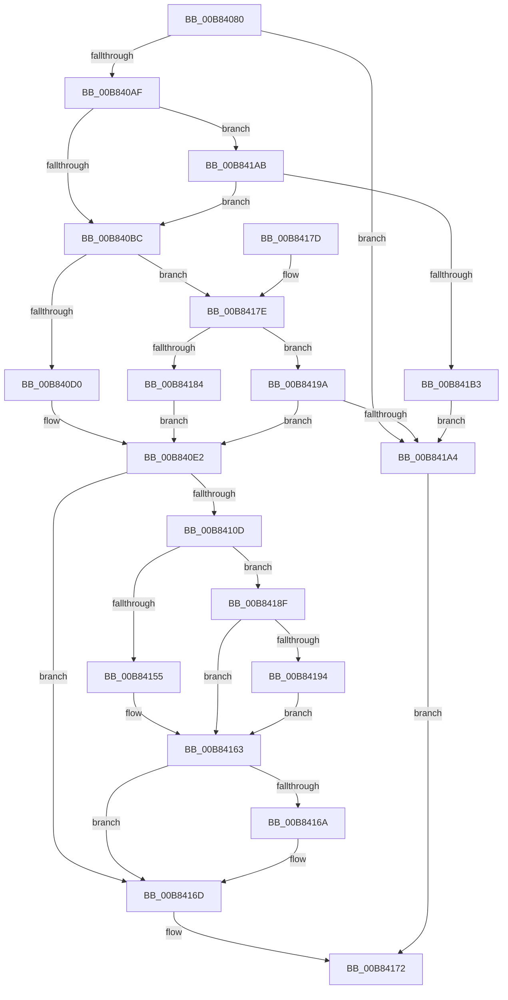

# ExpPoolFlagsToPoolType

- RVA: `0x00B84080`–`0x00B841B5` (길이 `309` bytes)
- VA: `0x0000000140B84080`
- 실행 섹션: `POOLCODE`
- PDB 이름 있음: `예`; PDB Function 태그: `아니요`
- unwind 정보 RVA: `0x0007BEA4`
- 디코드: `83`개 명령, `309/309` bytes 표시
- 미해석 바이트: `0` (있으면 어셈블리에 `.byte`로 보존)

> 이 문서는 커널 이미지의 기계어와 PDB 기호를 분석해 생성했습니다. 4번과 5번은 함수 원형과 자료형을 바이너리 사용 방식에서 추정한 C 해석이며 원본 소스 복구 결과는 아닙니다.

## 1. Dependencies

- 직접 호출 지점: **0**; 고유 호출 대상: **0**
- 직접 호출자로 확인된 함수: **11**
- RIP 상대 이미지 참조: **0**

### Outgoing calls
- 직접 디코드된 call 명령이 없습니다.

### Direct callers
- [ExpFreeHeapSpecialPool](../../text/2E/ExpFreeHeapSpecialPool_function_002EE600.md) at `0x002EE8B7`
- [ExAllocateContiguousHeapPool](../../text/2E/ExAllocateContiguousHeapPool_function_002EE960.md) at `0x002EEC3D`
- [ExpInsertPoolTracker](../../text/2E/ExpInsertPoolTracker_function_002EEFAC.md) at `0x002EF169`
- [ExAllocateHeapPool](../../text/35/ExAllocateHeapPool_function_0035BA30.md) at `0x0035E4DB`
- [ExAllocateHeapPool](../../text/35/ExAllocateHeapPool_function_0035BA30.md) at `0x0035E6DD`
- [ExAllocateHeapPool](../../text/35/ExAllocateHeapPool_function_0035BA30.md) at `0x0035E7D4`
- [ExAllocateHeapPool](../../text/35/ExAllocateHeapPool_function_0035BA30.md) at `0x0035EBDD`
- [ExAllocateHeapPool](../../text/35/ExAllocateHeapPool_function_0035BA30.md) at `0x0035F059`
- [sub_00360968](../../text/36/Unknown_function_00360968.md) at `0x00360DFF`
- [sub_00360968](../../text/36/Unknown_function_00360968.md) at `0x00360EB4`
- [ExRemovePoolTag](../../text/3F/ExRemovePoolTag_function_003F7CBC.md) at `0x003F7F2A`
- [ExPoolCleanupExpansionTable](../../text/65/ExPoolCleanupExpansionTable_function_00656164.md) at `0x006561B7`
- [sub_006DED54](../../text/6D/Unknown_function_006DED54.md) at `0x006DED7A`
- [sub_00B8371E](Unknown_function_00B8371E.md) at `0x00B83BB7`
- [sub_00B8371E](Unknown_function_00B8371E.md) at `0x00B83C6C`
- [VerifierExAllocatePool2](../../pagevrfy/BA/VerifierExAllocatePool2_function_00BA1180.md) at `0x00BA11B4`
- [VfHandlePoolAlloc](../../pagevrfy/BB/VfHandlePoolAlloc_function_00BB8A90.md) at `0x00BB8AE7`

### Static image references
- 디코드된 RIP-relative 메모리 참조가 없습니다.

## 2. Other-region calls and transfers

- 다른 실행 섹션으로 향하는 call: **0**
- 별도 외부 분기/꼬리 이동을 확인하지 못했습니다.

## 3. Assembly (complete function range)

```asm
00B84080  48 89 5C 24 08                  mov qword ptr [rsp + 8], rbx
00B84085  48 89 7C 24 10                  mov qword ptr [rsp + 0x10], rdi
00B8408A  48 8B 5C 24 28                  mov rbx, qword ptr [rsp + 0x28]
00B8408F  45 33 D2                        xor r10d, r10d
00B84092  B8 00 F0 FF FF                  mov eax, 0xfffff000
00B84097  45 89 10                        mov dword ptr [r8], r10d
00B8409A  45 88 11                        mov byte ptr [r9], r10b
00B8409D  49 8B F9                        mov rdi, r9
00B840A0  4D 8B D8                        mov r11, r8
00B840A3  44 88 13                        mov byte ptr [rbx], r10b
00B840A6  48 85 C8                        test rax, rcx
00B840A9  0F 85 F5 00 00 00               jne 0x140b841a4
00B840AF  4C 8B C9                        mov r9, rcx
00B840B2  41 83 E1 10                     and r9d, 0x10
00B840B6  0F 85 EF 00 00 00               jne 0x140b841ab
00B840BC  48 8B C1                        mov rax, rcx
00B840BF  25 C0 01 00 00                  and eax, 0x1c0
00B840C4  48 3D 00 01 00 00               cmp rax, 0x100
00B840CA  0F 85 AE 00 00 00               jne 0x140b8417e
00B840D0  4D 85 C9                        test r9, r9
00B840D3  B8 01 00 00 80                  mov eax, 0x80000001
00B840D8  41 BA 01 00 00 00               mov r10d, 1
00B840DE  44 0F 45 D0                     cmovne r10d, eax
00B840E2  41 8B D2                        mov edx, r10d
00B840E5  48 B8 29 06 00 00 01 00 00 00   movabs rax, 0x100000629
00B840EF  83 CA 20                        or edx, 0x20
00B840F2  F6 C1 04                        test cl, 4
00B840F5  41 0F 44 D2                     cmove edx, r10d
00B840F9  44 8B CA                        mov r9d, edx
00B840FC  41 0F BA E9 0A                  bts r9d, 0xa
00B84101  F6 C1 02                        test cl, 2
00B84104  44 0F 45 CA                     cmovne r9d, edx
00B84108  48 85 C8                        test rax, rcx
00B8410B  74 60                           je 0x140b8416d
00B8410D  41 8B D1                        mov edx, r9d
00B84110  48 8B C1                        mov rax, rcx
00B84113  83 CA 04                        or edx, 4
00B84116  F6 C1 08                        test cl, 8
00B84119  41 0F 44 D1                     cmove edx, r9d
00B8411D  25 00 02 00 00                  and eax, 0x200
00B84122  44 8B C2                        mov r8d, edx
00B84125  41 0F BA E8 07                  bts r8d, 7
00B8412A  48 85 C0                        test rax, rax
00B8412D  48 8B C1                        mov rax, rcx
00B84130  44 0F 44 C2                     cmove r8d, edx
00B84134  25 00 04 00 00                  and eax, 0x400
00B84139  45 8B C8                        mov r9d, r8d
00B8413C  41 83 C9 40                     or r9d, 0x40
00B84140  48 85 C0                        test rax, rax
00B84143  48 8B C1                        mov rax, rcx
00B84146  45 0F 44 C8                     cmove r9d, r8d
00B8414A  83 E0 20                        and eax, 0x20
00B8414D  41 8B D1                        mov edx, r9d
00B84150  F6 C1 01                        test cl, 1
00B84153  74 3A                           je 0x140b8418f
00B84155  41 83 C9 08                     or r9d, 8
00B84159  C6 07 01                        mov byte ptr [rdi], 1
00B8415C  48 85 C0                        test rax, rax
00B8415F  44 0F 45 CA                     cmovne r9d, edx
00B84163  48 0F BA E1 20                  bt rcx, 0x20
00B84168  73 03                           jae 0x140b8416d
00B8416A  C6 03 01                        mov byte ptr [rbx], 1
00B8416D  45 89 0B                        mov dword ptr [r11], r9d
00B84170  33 C0                           xor eax, eax
00B84172  48 8B 5C 24 08                  mov rbx, qword ptr [rsp + 8]
00B84177  48 8B 7C 24 10                  mov rdi, qword ptr [rsp + 0x10]
00B8417C  C3                              ret
00B8417D  CC                              int3
00B8417E  48 83 E8 40                     sub rax, 0x40
00B84182  75 16                           jne 0x140b8419a
00B84184  41 BA 00 02 00 00               mov r10d, 0x200
00B8418A  E9 53 FF FF FF                  jmp 0x140b840e2
00B8418F  48 85 C0                        test rax, rax
00B84192  74 CF                           je 0x140b84163
00B84194  41 83 C9 10                     or r9d, 0x10
00B84198  EB C9                           jmp 0x140b84163
00B8419A  48 83 F8 40                     cmp rax, 0x40
00B8419E  0F 84 3E FF FF FF               je 0x140b840e2
00B841A4  B8 0D 00 00 C0                  mov eax, 0xc000000d
00B841A9  EB C7                           jmp 0x140b84172
00B841AB  85 D2                           test edx, edx
00B841AD  0F 85 09 FF FF FF               jne 0x140b840bc
00B841B3  EB EF                           jmp 0x140b841a4
```

## 4. C-style interpretation (structured pseudocode)

```c
__int64 __fastcall ExpPoolFlagsToPoolType(__int64 a1, __int64 a2, __int64 a3, __int64 a4, __int64 a5)
{
    __int64 result;
    __int64 v_r10;
    unsigned __int64 v_stack_p10;
    unsigned __int64 v_stack_p8;

    v_stack_p8 = v_rbx;
    v_stack_p10 = v_rdi;
    v_r10 = 0;
    *(unsigned int *)(a3) = 0;
    *(unsigned __int8 *)(a4) = 0;
    *(unsigned __int8 *)(a5) = 0;
    if ((((unsigned int)(0xFFFFF000ULL)) & (a1)) != 0) goto loc_00B841A4;
    a4 = (unsigned int)((a1) & (16));
    if (condition_is_not_equal) goto loc_00B841AB;
loc_00B840BC:
    result = (unsigned int)((a1) & (448));
    if (result != 256) goto loc_00B8417E;
    v_r10 = 1;
    if (a4 != 0) { v_r10 = (unsigned int)((unsigned int)(0x80000001ULL)); }
loc_00B840E2:
    a2 = (unsigned int)(((unsigned int)((unsigned int)(v_r10))) | (32));
    if ((((unsigned __int8)(a1)) & (4)) == 0) { a2 = (unsigned int)(v_r10); }
    a4 = (unsigned int)((unsigned int)(a2));
    if ((((unsigned __int8)(a1)) & (2)) != 0) { a4 = (unsigned int)(a2); }
    if ((((unsigned int)(0x80000001ULL)) & (a1)) == 0) goto loc_00B8416D;
    a2 = (unsigned int)(((unsigned int)((unsigned int)(a4))) | (4));
    if ((((unsigned __int8)(a1)) & (8)) == 0) { a2 = (unsigned int)(a4); }
    result = (unsigned int)((a1) & (512));
    a3 = (unsigned int)((unsigned int)(a2));
    if (result == 0) { a3 = (unsigned int)(a2); }
    result = (unsigned int)((a1) & (0x400ULL));
    a4 = (unsigned int)(((unsigned int)((unsigned int)(a3))) | (64));
    if (result == 0) { a4 = (unsigned int)(a3); }
    result = (unsigned int)((a1) & (32));
    if ((((unsigned __int8)(a1)) & (1)) == 0) goto loc_00B8418F;
    a4 = (unsigned int)((a4) | (8));
    *(unsigned __int8 *)(a4) = 1;
    if (result != 0) { a4 = (unsigned int)((unsigned int)((unsigned int)(a4))); }
loc_00B84163:
    if (!(condition_is_above_or_equal)) {
        *(unsigned __int8 *)(a5) = 1;
    }
    *(unsigned int *)(a3) = (unsigned int)(a4);
    result = 0;
loc_00B84172:
    return result;
loc_00B8417E:
    result = (result) - (64);
    if (condition_is_not_equal) goto loc_00B8419A;
    goto loc_00B840E2;
loc_00B8418F:
    if (result == 0) goto loc_00B84163;
    a4 = (unsigned int)((a4) | (16));
    goto loc_00B84163;
loc_00B8419A:
    if (result == 64) goto loc_00B840E2;
loc_00B841A4:
    goto loc_00B84172;
loc_00B841AB:
    if ((unsigned int)((unsigned int)((unsigned int)(a4))) != 0) goto loc_00B840BC;
    goto loc_00B841A4;
}
```

## 5. (Beta) C Style

```c
int64_t ExpPoolFlagsToPoolType(int64_t Arg1, int64_t Arg2, void *Arg3, void *Arg4, void *Arg5)
{
    uint8_t *arg3 = (uint8_t *)Arg3;
    uint8_t *arg4 = (uint8_t *)Arg4;
    uint8_t *arg5 = (uint8_t *)Arg5;

    int64_t result;
    int64_t local_r10;
    uint64_t v_stack_p10;
    uint64_t v_stack_p8;

    v_stack_p8 = local_rbx;
    v_stack_p10 = local_rdi;
    local_r10 = 0;
    *(uint32_t *)(arg3) = 0;
    *(uint8_t *)(arg4) = 0;
    *(uint8_t *)(arg5) = 0;
    if ((((uint32_t)(0xFFFFF000ULL)) & (Arg1)) != 0) goto loc_00B841A4;
    Arg4 = (uint32_t)((Arg1) & (16));
    if (condition_is_not_equal) goto loc_00B841AB;
loc_00B840BC:
    result = (uint32_t)((Arg1) & (448));
    if (result != 256) goto loc_00B8417E;
    local_r10 = 1;
    if (Arg4 != NULL) { local_r10 = (uint32_t)((uint32_t)(0x80000001ULL)); }
loc_00B840E2:
    Arg2 = (uint32_t)(((uint32_t)((uint32_t)(local_r10))) | (32));
    if ((((uint8_t)(Arg1)) & (4)) == 0) { Arg2 = (uint32_t)(local_r10); }
    Arg4 = (uint32_t)((uint32_t)(Arg2));
    if ((((uint8_t)(Arg1)) & (2)) != 0) { Arg4 = (uint32_t)(Arg2); }
    if ((((uint32_t)(0x80000001ULL)) & (Arg1)) == 0) goto loc_00B8416D;
    Arg2 = (uint32_t)(((uint32_t)((uint32_t)(Arg4))) | (4));
    if ((((uint8_t)(Arg1)) & (8)) == 0) { Arg2 = (uint32_t)(Arg4); }
    result = (uint32_t)((Arg1) & (512));
    Arg3 = (uint32_t)((uint32_t)(Arg2));
    if (result == 0) { Arg3 = (uint32_t)(Arg2); }
    result = (uint32_t)((Arg1) & (0x400ULL));
    Arg4 = (uint32_t)(((uint32_t)((uint32_t)(Arg3))) | (64));
    if (result == 0) { Arg4 = (uint32_t)(Arg3); }
    result = (uint32_t)((Arg1) & (32));
    if ((((uint8_t)(Arg1)) & (1)) == 0) goto loc_00B8418F;
    Arg4 = (uint32_t)((Arg4) | (8));
    *(uint8_t *)(arg4) = 1;
    if (result != 0) { Arg4 = (uint32_t)((uint32_t)((uint32_t)(Arg4))); }
loc_00B84163:
    if (!(condition_is_above_or_equal)) {
        *(uint8_t *)(arg5) = 1;
    }
    *(uint32_t *)(arg3) = (uint32_t)(Arg4);
    result = 0;
loc_00B84172:
    return result;
loc_00B8417E:
    result = (result) - (64);
    if (condition_is_not_equal) goto loc_00B8419A;
    goto loc_00B840E2;
loc_00B8418F:
    if (result == 0) goto loc_00B84163;
    Arg4 = (uint32_t)((Arg4) | (16));
    goto loc_00B84163;
loc_00B8419A:
    if (result == 64) goto loc_00B840E2;
loc_00B841A4:
    goto loc_00B84172;
loc_00B841AB:
    if ((uint32_t)((uint32_t)((uint32_t)(Arg4))) != 0) goto loc_00B840BC;
    goto loc_00B841A4;
}
```

### 관측된 메모리 오프셋

구조체 형식이 확인되지 않은 접근은 인자 기준의 오프셋으로만 기록했습니다.

| 기준 인자 | 오프셋 표현 | 폭 (bit) | 접근 |
|---|---:|---:|---|
| `Arg3` | `+ 0x0` | `32` | `W` |
| `Arg4` | `+ 0x0` | `8` | `W` |
| `Arg5` | `+ 0x0` | `8` | `W` |

## 6. Execution-region graph

[열기: 2D/3D 그래프와 함수 탐색 컨트롤 패널](../../../control-panel.html?section=poolcode&rva=0x00B84080&view=graph)

- 2D 그래프는 위에서 아래로 흐르고, 3D 그래프는 빈 공간을 드래그해 회전합니다. Shift+드래그는 이동, 휠은 확대·축소, 함수 노드 선택은 대상 보고서 이동입니다.

### Static fallback


