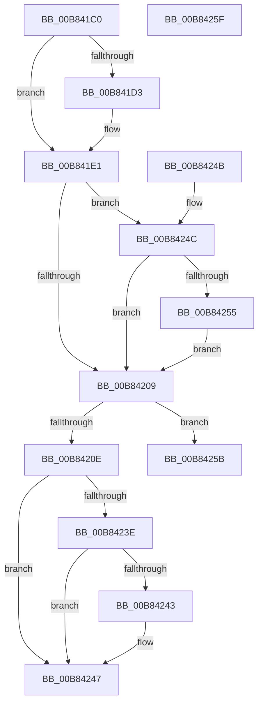

# ExpPoolTypeToPoolFlags

- RVA: `0x00B841C0`–`0x00B84260` (길이 `160` bytes)
- VA: `0x0000000140B841C0`
- 실행 섹션: `POOLCODE`
- PDB 이름 있음: `예`; PDB Function 태그: `아니요`
- unwind 정보 RVA: `0x000DB714`
- 디코드: `50`개 명령, `160/160` bytes 표시
- 미해석 바이트: `0` (있으면 어셈블리에 `.byte`로 보존)

> 이 문서는 커널 이미지의 기계어와 PDB 기호를 분석해 생성했습니다. 4번과 5번은 함수 원형과 자료형을 바이너리 사용 방식에서 추정한 C 해석이며 원본 소스 복구 결과는 아닙니다.

## 1. Dependencies

- 직접 호출 지점: **0**; 고유 호출 대상: **0**
- 직접 호출자로 확인된 함수: **2**
- RIP 상대 이미지 참조: **0**

### Outgoing calls
- 직접 디코드된 call 명령이 없습니다.

### Direct callers
- [ExAllocatePoolWithQuotaTag](../../text/49/ExAllocatePoolWithQuotaTag_function_004987E0.md) at `0x004987F7`
- [ExAllocatePoolWithQuota](../../text/65/ExAllocatePoolWithQuota_function_00655E00.md) at `0x00655E14`

### Static image references
- 디코드된 RIP-relative 메모리 참조가 없습니다.

## 2. Other-region calls and transfers

- 다른 실행 섹션으로 향하는 call: **0**
- 별도 외부 분기/꼬리 이동을 확인하지 못했습니다.

## 3. Assembly (complete function range)

```asm
00B841C0  44 8B CA                        mov r9d, edx
00B841C3  B8 40 00 00 00                  mov eax, 0x40
00B841C8  41 B8 00 01 00 00               mov r8d, 0x100
00B841CE  F6 C1 01                        test cl, 1
00B841D1  75 0E                           jne 0x140b841e1
00B841D3  0F BA E1 09                     bt ecx, 9
00B841D7  41 B8 80 00 00 00               mov r8d, 0x80
00B841DD  44 0F 42 C0                     cmovb r8d, eax
00B841E1  85 C9                           test ecx, ecx
00B841E3  4C 0F 48 C0                     cmovs r8, rax
00B841E7  49 8B D0                        mov rdx, r8
00B841EA  48 83 CA 04                     or rdx, 4
00B841EE  F6 C1 20                        test cl, 0x20
00B841F1  49 0F 44 D0                     cmove rdx, r8
00B841F5  4C 8B C2                        mov r8, rdx
00B841F8  49 83 C8 02                     or r8, 2
00B841FC  0F BA E1 0A                     bt ecx, 0xa
00B84200  4C 0F 42 C2                     cmovb r8, rdx
00B84204  45 85 C9                        test r9d, r9d
00B84207  75 43                           jne 0x140b8424c
00B84209  F6 C1 DE                        test cl, 0xde
00B8420C  74 4D                           je 0x140b8425b
00B8420E  49 8B D0                        mov rdx, r8
00B84211  48 83 CA 08                     or rdx, 8
00B84215  F6 C1 04                        test cl, 4
00B84218  49 0F 44 D0                     cmove rdx, r8
00B8421C  4C 8B C2                        mov r8, rdx
00B8421F  49 0F BA E8 09                  bts r8, 9
00B84224  F6 C1 80                        test cl, 0x80
00B84227  4C 0F 44 C2                     cmove r8, rdx
00B8422B  49 8B D0                        mov rdx, r8
00B8422E  48 0F BA EA 0A                  bts rdx, 0xa
00B84233  84 C8                           test al, cl
00B84235  49 0F 44 D0                     cmove rdx, r8
00B84239  45 85 C9                        test r9d, r9d
00B8423C  75 09                           jne 0x140b84247
00B8423E  F6 C1 10                        test cl, 0x10
00B84241  74 04                           je 0x140b84247
00B84243  48 83 CA 20                     or rdx, 0x20
00B84247  48 8B C2                        mov rax, rdx
00B8424A  C3                              ret
00B8424B  CC                              int3
00B8424C  49 83 C8 01                     or r8, 1
00B84250  F6 C1 08                        test cl, 8
00B84253  75 B4                           jne 0x140b84209
00B84255  49 83 C8 20                     or r8, 0x20
00B84259  EB AE                           jmp 0x140b84209
00B8425B  49 8B C0                        mov rax, r8
00B8425E  C3                              ret
00B8425F  CC                              int3
```

## 4. C-style interpretation (structured pseudocode)

```c
__int64 __fastcall ExpPoolTypeToPoolFlags(int a1, int a2)
{
    if ((((unsigned __int8)(a1)) & (1)) == 0) {
        a3 = 128;
        if (condition_is_below) { a3 = 64; }
    }
    if (sign_flag) { a3 = 64; }
    a2 = (a3) | (4);
    if ((((unsigned __int8)(a1)) & (32)) == 0) { a2 = a3; }
    a3 = (a2) | (2);
    if (condition_is_below) { a3 = a2; }
    if ((unsigned int)((unsigned int)(a2)) != 0) goto loc_00B8424C;
loc_00B84209:
    if ((((unsigned __int8)(a1)) & (222)) == 0) goto loc_00B8425B;
    a2 = (a3) | (8);
    if ((((unsigned __int8)(a1)) & (4)) == 0) { a2 = a3; }
    if ((((unsigned __int8)(a1)) & (128)) == 0) { a2 = a2; }
    if (((64) & ((unsigned __int8)(a1))) == 0) { a2 = a2; }
    if ((unsigned int)((unsigned int)(a2)) != 0) goto loc_00B84247;
    if ((((unsigned __int8)(a1)) & (16)) != 0) {
        a2 = (a2) | (32);
    }
    return a2;
loc_00B8424C:
    a3 = (a2) | (1);
    if ((((unsigned __int8)(a1)) & (8)) != 0) goto loc_00B84209;
    a3 = (a3) | (32);
    goto loc_00B84209;
loc_00B8425B:
    return a3;
}
```

## 5. (Beta) C Style

```c
int64_t ExpPoolTypeToPoolFlags(int32_t Arg1, int32_t Arg2)
{
    if ((((uint8_t)(Arg1)) & (1)) == 0) {
        a3 = 128;
        if (condition_is_below) { a3 = 64; }
    }
    if (sign_flag) { a3 = 64; }
    Arg2 = (a3) | (4);
    if ((((uint8_t)(Arg1)) & (32)) == 0) { Arg2 = a3; }
    a3 = (Arg2) | (2);
    if (condition_is_below) { a3 = Arg2; }
    if ((uint32_t)((uint32_t)(Arg2)) != 0) goto loc_00B8424C;
loc_00B84209:
    if ((((uint8_t)(Arg1)) & (222)) == 0) goto loc_00B8425B;
    Arg2 = (a3) | (8);
    if ((((uint8_t)(Arg1)) & (4)) == 0) { Arg2 = a3; }
    if ((((uint8_t)(Arg1)) & (128)) == 0) { Arg2 = Arg2; }
    if (((64) & ((uint8_t)(Arg1))) == 0) { Arg2 = Arg2; }
    if ((uint32_t)((uint32_t)(Arg2)) != 0) goto loc_00B84247;
    if ((((uint8_t)(Arg1)) & (16)) != 0) {
        Arg2 = (Arg2) | (32);
    }
    return Arg2;
loc_00B8424C:
    a3 = (Arg2) | (1);
    if ((((uint8_t)(Arg1)) & (8)) != 0) goto loc_00B84209;
    a3 = (a3) | (32);
    goto loc_00B84209;
loc_00B8425B:
    return a3;
}
```

## 6. Execution-region graph

[열기: 2D/3D 그래프와 함수 탐색 컨트롤 패널](../../../control-panel.html?section=poolcode&rva=0x00B841C0&view=graph)

- 2D 그래프는 위에서 아래로 흐르고, 3D 그래프는 빈 공간을 드래그해 회전합니다. Shift+드래그는 이동, 휠은 확대·축소, 함수 노드 선택은 대상 보고서 이동입니다.

### Static fallback


