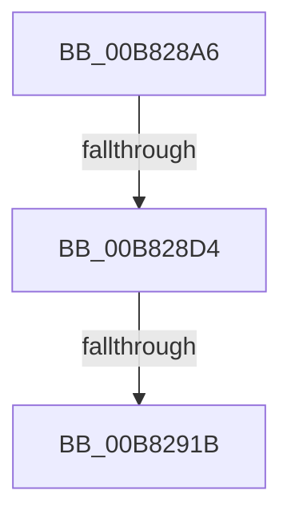

# sub_00B828A6

- RVA: `0x00B828A6`–`0x00B82933` (길이 `141` bytes)
- VA: `0x0000000140B828A6`
- 실행 섹션: `POOLCODE`
- PDB 이름 있음: `아니요`; PDB Function 태그: `아니요`
- unwind 정보 RVA: `0x0007BDE4`
- 디코드: `35`개 명령, `141/141` bytes 표시
- 미해석 바이트: `0` (있으면 어셈블리에 `.byte`로 보존)

> 이 문서는 커널 이미지의 기계어와 PDB 기호를 분석해 생성했습니다. 4번과 5번은 함수 원형과 자료형을 바이너리 사용 방식에서 추정한 C 해석이며 원본 소스 복구 결과는 아닙니다.

## 1. Dependencies

- 직접 호출 지점: **1**; 고유 호출 대상: **1**
- 직접 호출자로 확인된 함수: **0**
- RIP 상대 이미지 참조: **1**

### Outgoing calls
- `0x00B8292D` → [KeBugCheckEx](../../text/4F/KeBugCheckEx_function_004FD660.md) (function, `0x004FD660`)

### Direct callers
- 이 함수 시작 RVA로 연결되는 직접 call은 확인되지 않았습니다. 간접 호출은 완전히 역산할 수 없습니다.

### Static image references
- `0x00B82901` → RVA `0x00E28300` (`.data`; read)

## 2. Other-region calls and transfers

- 다른 실행 섹션으로 향하는 call: **1**
  - `0x00B8292D` → [KeBugCheckEx](../../text/4F/KeBugCheckEx_function_004FD660.md) (`POOLCODE` → `.text`)
- call이 아닌 외부 분기/꼬리 이동: **2**
  - `0x00B828CE` → [sub_00B836C7](Unknown_function_00B836C7.md) (`tail-transfer`)
  - `0x00B82919` → [sub_00B82950](Unknown_function_00B82950.md) (`tail-transfer`)

## 3. Assembly (complete function range)

```asm
00B828A6  4C 89 60 D8                     mov qword ptr [rax - 0x28], r12
00B828AA  0F 57 C0                        xorps xmm0, xmm0
00B828AD  0F 11 45 EF                     movups xmmword ptr [rbp - 0x11], xmm0
00B828B1  45 33 E4                        xor r12d, r12d
00B828B4  66 C7 45 EF 01 01               mov word ptr [rbp - 0x11], 0x101
00B828BA  C6 45 EF 03                     mov byte ptr [rbp - 0x11], 3
00B828BE  C6 45 EF 03                     mov byte ptr [rbp - 0x11], 3
00B828C2  4C 89 78 C8                     mov qword ptr [rax - 0x38], r15
00B828C6  C6 45 F1 00                     mov byte ptr [rbp - 0xf], 0
00B828CA  66 45 85 ED                     test r13w, r13w
00B828CE  0F 84 F3 0D 00 00               je 0x140b836c7
00B828D4  41 8B C4                        mov eax, r12d
00B828D7  48 98                           cdqe
00B828D9  C7 45 DF 00 00 10 00            mov dword ptr [rbp - 0x21], 0x100000
00B828E0  C7 45 E3 00 00 00 01            mov dword ptr [rbp - 0x1d], 0x1000000
00B828E7  44 8B 7C 85 DF                  mov r15d, dword ptr [rbp + rax*4 - 0x21]
00B828EC  48 8D 04 40                     lea rax, [rax + rax*2]
00B828F0  49 FF CF                        dec r15
00B828F3  48 C1 E0 06                     shl rax, 6
00B828F7  49 F7 D7                        not r15
00B828FA  4D 23 FD                        and r15, r13
00B828FD  4D 33 7F 10                     xor r15, qword ptr [r15 + 0x10]
00B82901  4C 33 3D F8 59 2A 00            xor r15, qword ptr [rip + 0x2a59f8]
00B82908  4C 2B F8                        sub r15, rax
00B8290B  49 81 EF 40 01 00 00            sub r15, 0x140
00B82912  4C 89 7D 77                     mov qword ptr [rbp + 0x77], r15
00B82916  4D 85 FF                        test r15, r15
00B82919  75 35                           jne 0x140b82950
00B8291B  4D 8B CD                        mov r9, r13
00B8291E  4C 89 64 24 20                  mov qword ptr [rsp + 0x20], r12
00B82923  45 33 C0                        xor r8d, r8d
00B82926  33 D2                           xor edx, edx
00B82928  B9 C2 00 00 00                  mov ecx, 0xc2
00B8292D  E8 2E AD 97 FF                  call 0x1404fd660
00B82932  CC                              int3
```

## 4. C-style interpretation (structured pseudocode)

```c
__int64 __fastcall sub_00B828A6(__int64 a1, int a2, int a3)
{
    __int64 result;
    __int64 v_r12;
    __int64 v_r15;
    unsigned __int64 v_stack_p20;

    *(unsigned __int64 *)(result - 40) = v_r12;
    *(unsigned __int64 *)(v_rbp - 17) = v_xmm0;
    v_r12 = 0;
    *(unsigned __int16 *)(v_rbp - 17) = 257;
    *(unsigned __int8 *)(v_rbp - 17) = 3;
    *(unsigned __int8 *)(v_rbp - 17) = 3;
    *(unsigned __int64 *)(result - 56) = v_r15;
    *(unsigned __int8 *)(v_rbp - 15) = 0;
    *(unsigned int *)(v_rbp - 33) = 0x100000ULL;
    *(unsigned int *)(v_rbp - 29) = 0x1000000ULL;
    v_r15 = ((unsigned int)(*(unsigned int *)(v_rbp + 0 * 4 - 33))) - 1;
    result = (0 + 0 * 2) << (6);
    v_r15 = ~(v_r15);
    v_r15 = (v_r15) & (v_r13);
    v_r15 = (v_r15) ^ (*(unsigned __int64 *)(v_r15 + 16));
    v_r15 = (v_r15) ^ (*(unsigned __int64 *)(v_rip + 2775544));
    v_r15 = (v_r15) - (result);
    v_r15 = (v_r15) - (320);
    *(unsigned __int64 *)(v_rbp + 119) = v_r15;
    v_stack_p20 = 0;
    a3 = 0;
    a2 = 0;
    result = KeBugCheckEx(194, a2, a3, v_r13);
    return result;
}
```

## 5. (Beta) C Style

```c
int64_t sub_00B828A6(int64_t Arg1, int32_t Arg2, int32_t Arg3)
{
    int64_t result;
    int64_t local_r12;
    int64_t local_r15;
    uint64_t v_stack_p20;

    *(uint64_t *)(result - 0x28) = local_r12;
    *(uint64_t *)(local_rbp - 0x11) = v_xmm0;
    local_r12 = 0;
    *(uint16_t *)(local_rbp - 0x11) = 257;
    *(uint8_t *)(local_rbp - 0x11) = 3;
    *(uint8_t *)(local_rbp - 0x11) = 3;
    *(uint64_t *)(result - 0x38) = local_r15;
    *(uint8_t *)(local_rbp - 0xF) = 0;
    *(uint32_t *)(local_rbp - 0x21) = 0x100000ULL;
    *(uint32_t *)(local_rbp - 0x1D) = 0x1000000ULL;
    local_r15 = ((uint32_t)(*(uint32_t *)(local_rbp + 0x0 * 4 - 0x21))) - 1;
    result = (0 + 0 * 2) << (6);
    local_r15 = ~(local_r15);
    local_r15 = (local_r15) & (local_r13);
    local_r15 = (local_r15) ^ (*(uint64_t *)(local_r15 + 0x10));
    local_r15 = (local_r15) ^ (*(uint64_t *)(v_rip + 0x2A59F8));
    local_r15 = (local_r15) - (result);
    local_r15 = (local_r15) - (320);
    *(uint64_t *)(local_rbp + 0x77) = local_r15;
    v_stack_p20 = 0;
    Arg3 = 0;
    Arg2 = 0;
    result = KeBugCheckEx(194, Arg2, Arg3, local_r13);
    return result;
}
```

## 6. Execution-region graph

[열기: 2D/3D 그래프와 함수 탐색 컨트롤 패널](../../../control-panel.html?section=poolcode&rva=0x00B828A6&view=graph)

- 2D 그래프는 위에서 아래로 흐르고, 3D 그래프는 빈 공간을 드래그해 회전합니다. Shift+드래그는 이동, 휠은 확대·축소, 함수 노드 선택은 대상 보고서 이동입니다.

### Static fallback


