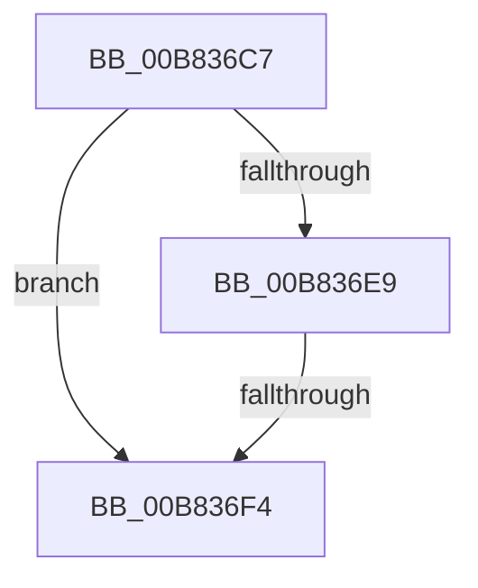

# sub_00B836C7

- RVA: `0x00B836C7`–`0x00B8371E` (길이 `87` bytes)
- VA: `0x0000000140B836C7`
- 실행 섹션: `POOLCODE`
- PDB 이름 있음: `아니요`; PDB Function 태그: `아니요`
- unwind 정보 RVA: `0x0007BE68`
- 디코드: `21`개 명령, `87/87` bytes 표시
- 미해석 바이트: `0` (있으면 어셈블리에 `.byte`로 보존)

> 이 문서는 커널 이미지의 기계어와 PDB 기호를 분석해 생성했습니다. 4번과 5번은 함수 원형과 자료형을 바이너리 사용 방식에서 추정한 C 해석이며 원본 소스 복구 결과는 아닙니다.

## 1. Dependencies

- 직접 호출 지점: **2**; 고유 호출 대상: **2**
- 직접 호출자로 확인된 함수: **0**
- RIP 상대 이미지 참조: **3**

### Outgoing calls
- `0x00B836DF` → [RtlCSparseBitmapBitmaskRead](../../text/36/RtlCSparseBitmapBitmaskRead_function_0036190C.md) (function, `0x0036190C`)
- `0x00B8370D` → [RtlpHpVaMgrCtxQuery](../../text/32/RtlpHpVaMgrCtxQuery_function_003273C0.md) (function, `0x003273C0`)

### Direct callers
- 이 함수 시작 RVA로 연결되는 직접 call은 확인되지 않았습니다. 간접 호출은 완전히 역산할 수 없습니다.

### Static image references
- `0x00B836CA` → RVA `0x00E68610` (`.data`; read)
- `0x00B836D1` → RVA `0x00E68608` (`.data`; read)
- `0x00B836FE` → RVA `0x00E68658` (`.data`; read)

## 2. Other-region calls and transfers

- 다른 실행 섹션으로 향하는 call: **2**
  - `0x00B836DF` → [RtlCSparseBitmapBitmaskRead](../../text/36/RtlCSparseBitmapBitmaskRead_function_0036190C.md) (`POOLCODE` → `.text`)
  - `0x00B8370D` → [RtlpHpVaMgrCtxQuery](../../text/32/RtlpHpVaMgrCtxQuery_function_003273C0.md) (`POOLCODE` → `.text`)
- call이 아닌 외부 분기/꼬리 이동: **2**
  - `0x00B836EE` → [sub_00B828A6 + 0x31](Unknown_function_00B828A6.md) (`tail-transfer`)
  - `0x00B83719` → [sub_00B828A6 + 0x6C](Unknown_function_00B828A6.md) (`tail-transfer`)

## 3. Assembly (complete function range)

```asm
00B836C7  49 8B D5                        mov rdx, r13
00B836CA  48 8D 0D 3F 4F 2E 00            lea rcx, [rip + 0x2e4f3f]
00B836D1  48 2B 15 30 4F 2E 00            sub rdx, qword ptr [rip + 0x2e4f30]
00B836D8  48 C1 EA 14                     shr rdx, 0x14
00B836DC  48 03 D2                        add rdx, rdx
00B836DF  E8 28 E2 7D FF                  call 0x14036190c
00B836E4  48 85 C0                        test rax, rax
00B836E7  74 0B                           je 0x140b836f4
00B836E9  FF C8                           dec eax
00B836EB  83 F8 02                        cmp eax, 2
00B836EE  0F 85 E3 F1 FF FF               jne 0x140b828d7
00B836F4  0F 57 C0                        xorps xmm0, xmm0
00B836F7  4C 8D 45 FF                     lea r8, [rbp - 1]
00B836FB  49 8B D5                        mov rdx, r13
00B836FE  48 8D 0D 53 4F 2E 00            lea rcx, [rip + 0x2e4f53]
00B83705  0F 11 45 FF                     movups xmmword ptr [rbp - 1], xmm0
00B83709  0F 11 45 0F                     movups xmmword ptr [rbp + 0xf], xmm0
00B8370D  E8 AE 3C 7A FF                  call 0x1403273c0
00B83712  48 8B 45 0F                     mov rax, qword ptr [rbp + 0xf]
00B83716  4C 8B 38                        mov r15, qword ptr [rax]
00B83719  E9 F4 F1 FF FF                  jmp 0x140b82912
```

## 4. C-style interpretation (structured pseudocode)

```c
__int64 __fastcall sub_00B836C7(void)
{
    __int64 result;

    a2 = (v_r13) - (*(unsigned __int64 *)(v_rip + 3034928));
    a2 = (a2) >> (20);
    a2 = (a2) + (a2);
    result = RtlCSparseBitmapBitmaskRead(v_rip + 3034943, a2, a3, a4);
    if (result == 0) goto loc_00B836F4;
    result = (unsigned int)((result) - 1);
loc_00B836F4:
    *(unsigned __int64 *)(v_rbp - 1) = v_xmm0;
    *(unsigned __int64 *)(v_rbp + 15) = v_xmm0;
    result = RtlpHpVaMgrCtxQuery(v_rip + 3034963, v_r13, v_rbp - 1, a4);
}
```

## 5. (Beta) C Style

```c
void sub_00B836C7(void)
{
    int64_t result;

    a2 = (local_r13) - (*(uint64_t *)(v_rip + 0x2E4F30));
    a2 = (a2) >> (20);
    a2 = (a2) + (a2);
    result = RtlCSparseBitmapBitmaskRead(v_rip + 3034943, a2, a3, a4);
    if (result == 0) goto loc_00B836F4;
    result = (uint32_t)((result) - 1);
loc_00B836F4:
    *(uint64_t *)(local_rbp - 0x1) = v_xmm0;
    *(uint64_t *)(local_rbp + 0xF) = v_xmm0;
    result = RtlpHpVaMgrCtxQuery(v_rip + 3034963, local_r13, local_rbp - 1, a4);
}
```

## 6. Execution-region graph

[열기: 2D/3D 그래프와 함수 탐색 컨트롤 패널](../../../control-panel.html?section=poolcode&rva=0x00B836C7&view=graph)

- 2D 그래프는 위에서 아래로 흐르고, 3D 그래프는 빈 공간을 드래그해 회전합니다. Shift+드래그는 이동, 휠은 확대·축소, 함수 노드 선택은 대상 보고서 이동입니다.

### Static fallback


