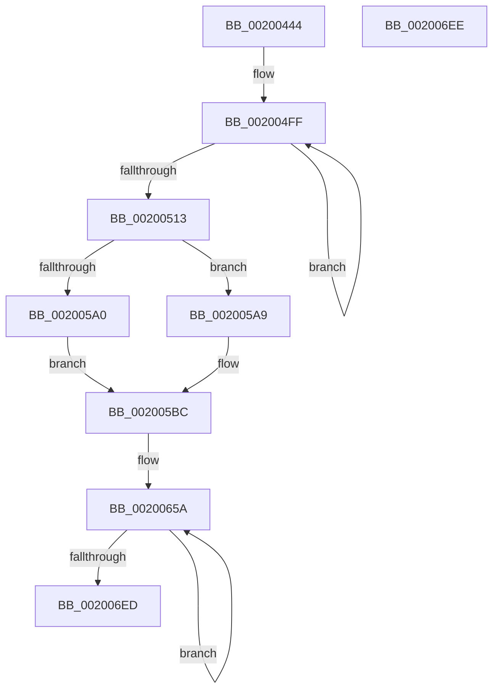

# CcAggregateCumulativeVolumeTelemetry

- RVA: `0x00200444`–`0x002006EF` (길이 `683` bytes)
- VA: `0x0000000140200444`
- 실행 섹션: `.text`
- PDB 이름 있음: `예`; PDB Function 태그: `아니요`
- unwind 정보 RVA: `0x000DB714`
- 디코드: `123`개 명령, `683/683` bytes 표시
- 미해석 바이트: `0` (있으면 어셈블리에 `.byte`로 보존)

> 이 문서는 커널 이미지의 기계어와 PDB 기호를 분석해 생성했습니다. 4번과 5번은 함수 원형과 자료형을 바이너리 사용 방식에서 추정한 C 해석이며 원본 소스 복구 결과는 아닙니다.

## 1. Dependencies

- 직접 호출 지점: **0**; 고유 호출 대상: **0**
- 직접 호출자로 확인된 함수: **1**
- RIP 상대 이미지 참조: **0**

### Outgoing calls
- 직접 디코드된 call 명령이 없습니다.

### Direct callers
- [CcPostVolumeTelemetry](../42/CcPostVolumeTelemetry_function_00420FF8.md) at `0x00421156`

### Static image references
- 디코드된 RIP-relative 메모리 참조가 없습니다.

## 2. Other-region calls and transfers

- 다른 실행 섹션으로 향하는 call: **0**
- 별도 외부 분기/꼬리 이동을 확인하지 못했습니다.

## 3. Assembly (complete function range)

```asm
00200444  48 8B 91 E8 04 00 00            mov rdx, qword ptr [rcx + 0x4e8]
0020044B  4C 8B C1                        mov r8, rcx
0020044E  F3 0F 6F 81 08 05 00 00         movdqu xmm0, xmmword ptr [rcx + 0x508]
00200456  48 8B 41 10                     mov rax, qword ptr [rcx + 0x10]
0020045A  48 01 81 E0 04 00 00            add qword ptr [rcx + 0x4e0], rax
00200461  48 8B 41 18                     mov rax, qword ptr [rcx + 0x18]
00200465  F3 0F 6F 49 38                  movdqu xmm1, xmmword ptr [rcx + 0x38]
0020046A  48 3B D0                        cmp rdx, rax
0020046D  48 0F 46 D0                     cmovbe rdx, rax
00200471  66 0F D4 C8                     paddq xmm1, xmm0
00200475  48 8B 41 20                     mov rax, qword ptr [rcx + 0x20]
00200479  48 01 81 F0 04 00 00            add qword ptr [rcx + 0x4f0], rax
00200480  48 8B 41 28                     mov rax, qword ptr [rcx + 0x28]
00200484  F3 41 0F 6F 80 20 05 00 00      movdqu xmm0, xmmword ptr [r8 + 0x520]
0020048D  48 89 81 F8 04 00 00            mov qword ptr [rcx + 0x4f8], rax
00200494  48 8B 41 30                     mov rax, qword ptr [rcx + 0x30]
00200498  48 89 81 00 05 00 00            mov qword ptr [rcx + 0x500], rax
0020049F  49 8B 40 48                     mov rax, qword ptr [r8 + 0x48]
002004A3  F3 0F 7F 89 08 05 00 00         movdqu xmmword ptr [rcx + 0x508], xmm1
002004AB  48 89 91 E8 04 00 00            mov qword ptr [rcx + 0x4e8], rdx
002004B2  BA 0A 00 00 00                  mov edx, 0xa
002004B7  48 8B 89 18 05 00 00            mov rcx, qword ptr [rcx + 0x518]
002004BE  F3 41 0F 6F 48 50               movdqu xmm1, xmmword ptr [r8 + 0x50]
002004C4  48 3B C8                        cmp rcx, rax
002004C7  48 0F 46 C8                     cmovbe rcx, rax
002004CB  66 0F D4 C8                     paddq xmm1, xmm0
002004CF  49 8B 40 60                     mov rax, qword ptr [r8 + 0x60]
002004D3  49 89 88 18 05 00 00            mov qword ptr [r8 + 0x518], rcx
002004DA  49 8B 88 30 05 00 00            mov rcx, qword ptr [r8 + 0x530]
002004E1  48 3B C8                        cmp rcx, rax
002004E4  F3 41 0F 7F 88 20 05 00 00      movdqu xmmword ptr [r8 + 0x520], xmm1
002004ED  48 0F 46 C8                     cmovbe rcx, rax
002004F1  49 89 88 30 05 00 00            mov qword ptr [r8 + 0x530], rcx
002004F8  49 8D 88 38 05 00 00            lea rcx, [r8 + 0x538]
002004FF  48 8B 81 30 FB FF FF            mov rax, qword ptr [rcx - 0x4d0]
00200506  48 01 01                        add qword ptr [rcx], rax
00200509  48 8D 49 08                     lea rcx, [rcx + 8]
0020050D  48 83 EA 01                     sub rdx, 1
00200511  75 EC                           jne 0x1402004ff
00200513  49 8B 88 A8 05 00 00            mov rcx, qword ptr [r8 + 0x5a8]
0020051A  4D 8D 88 A0 05 00 00            lea r9, [r8 + 0x5a0]
00200521  49 8B 80 D8 00 00 00            mov rax, qword ptr [r8 + 0xd8]
00200528  F3 41 0F 6F 80 38 07 00 00      movdqu xmm0, xmmword ptr [r8 + 0x738]
00200531  49 8B 90 90 05 00 00            mov rdx, qword ptr [r8 + 0x590]
00200538  48 3B C8                        cmp rcx, rax
0020053B  4D 8B 90 C0 00 00 00            mov r10, qword ptr [r8 + 0xc0]
00200542  F3 41 0F 6F 88 68 02 00 00      movdqu xmm1, xmmword ptr [r8 + 0x268]
0020054B  48 0F 46 C8                     cmovbe rcx, rax
0020054F  49 8B 80 E0 00 00 00            mov rax, qword ptr [r8 + 0xe0]
00200556  49 89 88 A8 05 00 00            mov qword ptr [r8 + 0x5a8], rcx
0020055D  49 8B 88 B0 05 00 00            mov rcx, qword ptr [r8 + 0x5b0]
00200564  4D 8D 1C 12                     lea r11, [r10 + rdx]
00200568  48 3B C8                        cmp rcx, rax
0020056B  66 0F D4 C8                     paddq xmm1, xmm0
0020056F  F3 41 0F 7F 88 38 07 00 00      movdqu xmmword ptr [r8 + 0x738], xmm1
00200578  48 0F 46 C8                     cmovbe rcx, rax
0020057C  49 8B 80 78 02 00 00            mov rax, qword ptr [r8 + 0x278]
00200583  49 01 80 48 07 00 00            add qword ptr [r8 + 0x748], rax
0020058A  49 8B 80 D0 00 00 00            mov rax, qword ptr [r8 + 0xd0]
00200591  49 89 88 B0 05 00 00            mov qword ptr [r8 + 0x5b0], rcx
00200598  49 8B 09                        mov rcx, qword ptr [r9]
0020059B  4D 85 DB                        test r11, r11
0020059E  75 09                           jne 0x1402005a9
002005A0  48 3B C8                        cmp rcx, rax
002005A3  48 0F 46 C8                     cmovbe rcx, rax
002005A7  EB 13                           jmp 0x1402005bc
002005A9  48 0F AF D1                     imul rdx, rcx
002005AD  49 0F AF C2                     imul rax, r10
002005B1  48 03 C2                        add rax, rdx
002005B4  33 D2                           xor edx, edx
002005B6  49 F7 F3                        div r11
002005B9  48 8B C8                        mov rcx, rax
002005BC  49 89 09                        mov qword ptr [r9], rcx
002005BF  BA 0C 00 00 00                  mov edx, 0xc
002005C4  49 8B 88 50 07 00 00            mov rcx, qword ptr [r8 + 0x750]
002005CB  49 8B 80 C8 00 00 00            mov rax, qword ptr [r8 + 0xc8]
002005D2  49 01 80 98 05 00 00            add qword ptr [r8 + 0x598], rax
002005D9  49 8B 80 80 02 00 00            mov rax, qword ptr [r8 + 0x280]
002005E0  F3 41 0F 6F 80 88 05 00 00      movdqu xmm0, xmmword ptr [r8 + 0x588]
002005E9  48 3B C8                        cmp rcx, rax
002005EC  F3 41 0F 6F 88 B8 00 00 00      movdqu xmm1, xmmword ptr [r8 + 0xb8]
002005F5  48 0F 46 C8                     cmovbe rcx, rax
002005F9  49 8B 80 88 02 00 00            mov rax, qword ptr [r8 + 0x288]
00200600  49 89 88 50 07 00 00            mov qword ptr [r8 + 0x750], rcx
00200607  49 8B 88 58 07 00 00            mov rcx, qword ptr [r8 + 0x758]
0020060E  66 0F D4 C8                     paddq xmm1, xmm0
00200612  48 3B C8                        cmp rcx, rax
00200615  F3 41 0F 7F 88 88 05 00 00      movdqu xmmword ptr [r8 + 0x588], xmm1
0020061E  48 0F 46 C8                     cmovbe rcx, rax
00200622  49 89 88 58 07 00 00            mov qword ptr [r8 + 0x758], rcx
00200629  49 8B 80 10 04 00 00            mov rax, qword ptr [r8 + 0x410]
00200630  49 8B 88 E8 08 00 00            mov rcx, qword ptr [r8 + 0x8e8]
00200637  49 01 80 E0 08 00 00            add qword ptr [r8 + 0x8e0], rax
0020063E  49 8B 80 18 04 00 00            mov rax, qword ptr [r8 + 0x418]
00200645  48 3B C8                        cmp rcx, rax
00200648  48 0F 46 C8                     cmovbe rcx, rax
0020064C  49 89 88 E8 08 00 00            mov qword ptr [r8 + 0x8e8], rcx
00200653  49 8D 88 B8 05 00 00            lea rcx, [r8 + 0x5b8]
0020065A  48 8B 81 30 FB FF FF            mov rax, qword ptr [rcx - 0x4d0]
00200661  48 01 01                        add qword ptr [rcx], rax
00200664  48 8B 81 90 FB FF FF            mov rax, qword ptr [rcx - 0x470]
0020066B  48 01 41 60                     add qword ptr [rcx + 0x60], rax
0020066F  48 8B 81 F0 FB FF FF            mov rax, qword ptr [rcx - 0x410]
00200676  48 01 81 C0 00 00 00            add qword ptr [rcx + 0xc0], rax
0020067D  48 8B 81 50 FC FF FF            mov rax, qword ptr [rcx - 0x3b0]
00200684  48 01 81 20 01 00 00            add qword ptr [rcx + 0x120], rax
0020068B  48 8B 81 D8 FC FF FF            mov rax, qword ptr [rcx - 0x328]
00200692  48 01 81 A8 01 00 00            add qword ptr [rcx + 0x1a8], rax
00200699  48 8B 81 38 FD FF FF            mov rax, qword ptr [rcx - 0x2c8]
002006A0  48 01 81 08 02 00 00            add qword ptr [rcx + 0x208], rax
002006A7  48 8B 81 98 FD FF FF            mov rax, qword ptr [rcx - 0x268]
002006AE  48 01 81 68 02 00 00            add qword ptr [rcx + 0x268], rax
002006B5  48 8B 81 F8 FD FF FF            mov rax, qword ptr [rcx - 0x208]
002006BC  48 01 81 C8 02 00 00            add qword ptr [rcx + 0x2c8], rax
002006C3  48 8B 81 68 FE FF FF            mov rax, qword ptr [rcx - 0x198]
002006CA  48 01 81 38 03 00 00            add qword ptr [rcx + 0x338], rax
002006D1  48 8B 81 C8 FE FF FF            mov rax, qword ptr [rcx - 0x138]
002006D8  48 01 81 98 03 00 00            add qword ptr [rcx + 0x398], rax
002006DF  48 8D 49 08                     lea rcx, [rcx + 8]
002006E3  48 83 EA 01                     sub rdx, 1
002006E7  0F 85 6D FF FF FF               jne 0x14020065a
002006ED  C3                              ret
002006EE  CC                              int3
```

## 4. C-style interpretation (structured pseudocode)

```c
__int64 __fastcall CcAggregateCumulativeVolumeTelemetry(__int64 a1)
{
    __int64 result;

    a2 = *(unsigned __int64 *)(a1 + 1256);
    if ((*(unsigned __int64 *)(a1 + 1256)) <= (*(unsigned __int64 *)(a1 + 24))) { a2 = *(unsigned __int64 *)(a1 + 24); }
    *(unsigned __int64 *)(a1 + 1272) = *(unsigned __int64 *)(a1 + 40);
    *(unsigned __int64 *)(a1 + 1280) = *(unsigned __int64 *)(a1 + 48);
    *(unsigned __int64 *)(a1 + 1288) = v_xmm1;
    *(unsigned __int64 *)(a1 + 1256) = a2;
    a1 = *(unsigned __int64 *)(a1 + 1304);
    if ((*(unsigned __int64 *)(a1 + 1304)) <= (*(unsigned __int64 *)(a1 + 72))) { a1 = *(unsigned __int64 *)(a1 + 72); }
    *(unsigned __int64 *)(a1 + 1304) = a1;
    *(unsigned __int64 *)(a1 + 1312) = v_xmm1;
    a1 = *(unsigned __int64 *)(a1 + 1328);
    if ((*(unsigned __int64 *)(a1 + 1328)) <= (*(unsigned __int64 *)(a1 + 96))) { a1 = *(unsigned __int64 *)(a1 + 96); }
    *(unsigned __int64 *)(a1 + 1328) = a1;
loc_002004FF:
    a2 = (10) - (1);
    if (condition_is_not_equal) goto loc_002004FF;
    a1 = *(unsigned __int64 *)(a1 + 1448);
    if ((*(unsigned __int64 *)(a1 + 1448)) <= (*(unsigned __int64 *)(a1 + 216))) { a1 = *(unsigned __int64 *)(a1 + 216); }
    *(unsigned __int64 *)(a1 + 1448) = a1;
    *(unsigned __int64 *)(a1 + 1848) = v_xmm1;
    a1 = *(unsigned __int64 *)(a1 + 1456);
    if ((*(unsigned __int64 *)(a1 + 1456)) <= (*(unsigned __int64 *)(a1 + 224))) { a1 = *(unsigned __int64 *)(a1 + 224); }
    *(unsigned __int64 *)(a1 + 1456) = a1;
    if (*(unsigned __int64 *)(a1 + 192) + *(unsigned __int64 *)(a1 + 1424) * 1 != 0) goto loc_002005A9;
    a1 = *(unsigned __int64 *)(a1 + 1440);
    if ((*(unsigned __int64 *)(a1 + 1440)) <= (*(unsigned __int64 *)(a1 + 208))) { a1 = *(unsigned __int64 *)(a1 + 208); }
    goto loc_002005BC;
loc_002005A9:
    a2 = (*(unsigned __int64 *)(a1 + 1424)) * (a1);
    result = (*(unsigned __int64 *)(a1 + 208)) * (*(unsigned __int64 *)(a1 + 192));
    result = (result) + (a2);
    a2 = 0;
loc_002005BC:
    *(unsigned __int64 *)(a1 + 1440) = result;
    a1 = *(unsigned __int64 *)(a1 + 1872);
    if ((*(unsigned __int64 *)(a1 + 1872)) <= (*(unsigned __int64 *)(a1 + 640))) { a1 = *(unsigned __int64 *)(a1 + 640); }
    *(unsigned __int64 *)(a1 + 1872) = a1;
    *(unsigned __int64 *)(a1 + 1416) = v_xmm1;
    a1 = *(unsigned __int64 *)(a1 + 1880);
    if ((*(unsigned __int64 *)(a1 + 1880)) <= (*(unsigned __int64 *)(a1 + 648))) { a1 = *(unsigned __int64 *)(a1 + 648); }
    *(unsigned __int64 *)(a1 + 1880) = a1;
    a1 = *(unsigned __int64 *)(a1 + 2280);
    if ((*(unsigned __int64 *)(a1 + 2280)) <= (*(unsigned __int64 *)(a1 + 1048))) { a1 = *(unsigned __int64 *)(a1 + 1048); }
    *(unsigned __int64 *)(a1 + 2280) = a1;
loc_0020065A:
    a2 = (12) - (1);
    if (condition_is_not_equal) goto loc_0020065A;
    return *(unsigned __int64 *)(a1 + 1464 - 312);
}
```

## 5. (Beta) C Style

```c
int64_t CcAggregateCumulativeVolumeTelemetry(void *Arg1)
{
    uint8_t *arg1 = (uint8_t *)Arg1;

    int64_t result;

    a2 = *(uint64_t *)(arg1 + 0x4E8);
    if ((*(uint64_t *)(arg1 + 0x4E8)) <= (*(uint64_t *)(arg1 + 0x18))) { a2 = *(uint64_t *)(arg1 + 0x18); }
    *(uint64_t *)(arg1 + 0x4F8) = *(uint64_t *)(arg1 + 0x28);
    *(uint64_t *)(arg1 + 0x500) = *(uint64_t *)(arg1 + 0x30);
    *(uint64_t *)(arg1 + 0x508) = v_xmm1;
    *(uint64_t *)(arg1 + 0x4E8) = a2;
    Arg1 = *(uint64_t *)(arg1 + 0x518);
    if ((*(uint64_t *)(arg1 + 0x518)) <= (*(uint64_t *)(arg1 + 0x48))) { Arg1 = *(uint64_t *)(arg1 + 0x48); }
    *(void **)(arg1 + 0x518) = Arg1;
    *(uint64_t *)(arg1 + 0x520) = v_xmm1;
    Arg1 = *(uint64_t *)(arg1 + 0x530);
    if ((*(uint64_t *)(arg1 + 0x530)) <= (*(uint64_t *)(arg1 + 0x60))) { Arg1 = *(uint64_t *)(arg1 + 0x60); }
    *(void **)(arg1 + 0x530) = Arg1;
loc_002004FF:
    a2 = (10) - (1);
    if (condition_is_not_equal) goto loc_002004FF;
    Arg1 = *(uint64_t *)(arg1 + 0x5A8);
    if ((*(uint64_t *)(arg1 + 0x5A8)) <= (*(uint64_t *)(arg1 + 0xD8))) { Arg1 = *(uint64_t *)(arg1 + 0xD8); }
    *(void **)(arg1 + 0x5A8) = Arg1;
    *(uint64_t *)(arg1 + 0x738) = v_xmm1;
    Arg1 = *(uint64_t *)(arg1 + 0x5B0);
    if ((*(uint64_t *)(arg1 + 0x5B0)) <= (*(uint64_t *)(arg1 + 0xE0))) { Arg1 = *(uint64_t *)(arg1 + 0xE0); }
    *(void **)(arg1 + 0x5B0) = Arg1;
    if (*(uint64_t *)(arg1 + 0xC0) + *(uint64_t *)(arg1 + 0x590) * 1 != 0) goto loc_002005A9;
    Arg1 = *(uint64_t *)(arg1 + 0x5A0);
    if ((*(uint64_t *)(arg1 + 0x5A0)) <= (*(uint64_t *)(arg1 + 0xD0))) { Arg1 = *(uint64_t *)(arg1 + 0xD0); }
    goto loc_002005BC;
loc_002005A9:
    a2 = (*(uint64_t *)(arg1 + 0x590)) * (Arg1);
    result = (*(uint64_t *)(arg1 + 0xD0)) * (*(uint64_t *)(arg1 + 0xC0));
    result = (result) + (a2);
    a2 = 0;
loc_002005BC:
    *(uint64_t *)(arg1 + 0x5A0) = result;
    Arg1 = *(uint64_t *)(arg1 + 0x750);
    if ((*(uint64_t *)(arg1 + 0x750)) <= (*(uint64_t *)(arg1 + 0x280))) { Arg1 = *(uint64_t *)(arg1 + 0x280); }
    *(void **)(arg1 + 0x750) = Arg1;
    *(uint64_t *)(arg1 + 0x588) = v_xmm1;
    Arg1 = *(uint64_t *)(arg1 + 0x758);
    if ((*(uint64_t *)(arg1 + 0x758)) <= (*(uint64_t *)(arg1 + 0x288))) { Arg1 = *(uint64_t *)(arg1 + 0x288); }
    *(void **)(arg1 + 0x758) = Arg1;
    Arg1 = *(uint64_t *)(arg1 + 0x8E8);
    if ((*(uint64_t *)(arg1 + 0x8E8)) <= (*(uint64_t *)(arg1 + 0x418))) { Arg1 = *(uint64_t *)(arg1 + 0x418); }
    *(void **)(arg1 + 0x8E8) = Arg1;
loc_0020065A:
    a2 = (12) - (1);
    if (condition_is_not_equal) goto loc_0020065A;
    return *(uint64_t *)(arg1 + 0x5B8 - 0x138);
}
```

### 관측된 메모리 오프셋

구조체 형식이 확인되지 않은 접근은 인자 기준의 오프셋으로만 기록했습니다.

| 기준 인자 | 오프셋 표현 | 폭 (bit) | 접근 |
|---|---:|---:|---|
| `Arg1` | `- 0x4D0` | `64` | `R` |
| `Arg1` | `- 0x470` | `64` | `R` |
| `Arg1` | `- 0x410` | `64` | `R` |
| `Arg1` | `- 0x3B0` | `64` | `R` |
| `Arg1` | `- 0x328` | `64` | `R` |
| `Arg1` | `- 0x2C8` | `64` | `R` |
| `Arg1` | `- 0x268` | `64` | `R` |
| `Arg1` | `- 0x208` | `64` | `R` |
| `Arg1` | `- 0x198` | `64` | `R` |
| `Arg1` | `- 0x138` | `64` | `R` |
| `Arg1` | `+ 0x0` | `64` | `R` |
| `Arg1` | `+ 0x0` | `64` | `R/W` |
| `Arg1` | `+ 0x0` | `64` | `W` |
| `Arg1` | `+ 0x8` | `64` | `R` |
| `Arg1` | `+ 0x10` | `64` | `R` |
| `Arg1` | `+ 0x18` | `64` | `R` |
| `Arg1` | `+ 0x20` | `64` | `R` |
| `Arg1` | `+ 0x28` | `64` | `R` |
| `Arg1` | `+ 0x30` | `64` | `R` |
| `Arg1` | `+ 0x38` | `128` | `R` |
| `Arg1` | `+ 0x48` | `64` | `R` |
| `Arg1` | `+ 0x50` | `128` | `R` |
| `Arg1` | `+ 0x60` | `64` | `R` |
| `Arg1` | `+ 0x60` | `64` | `R/W` |
| `Arg1` | `+ 0xB8` | `128` | `R` |
| `Arg1` | `+ 0xC0` | `64` | `R` |
| `Arg1` | `+ 0xC0` | `64` | `R/W` |
| `Arg1` | `+ 0xC8` | `64` | `R` |
| `Arg1` | `+ 0xD0` | `64` | `R` |
| `Arg1` | `+ 0xD8` | `64` | `R` |
| `Arg1` | `+ 0xE0` | `64` | `R` |
| `Arg1` | `+ 0x120` | `64` | `R/W` |

추가 오프셋 47개는 표에서 생략했습니다.

## 6. Execution-region graph

[열기: 2D/3D 그래프와 함수 탐색 컨트롤 패널](../../../control-panel.html?section=text&rva=0x00200444&view=graph)

- 2D 그래프는 위에서 아래로 흐르고, 3D 그래프는 빈 공간을 드래그해 회전합니다. Shift+드래그는 이동, 휠은 확대·축소, 함수 노드 선택은 대상 보고서 이동입니다.

### Static fallback


