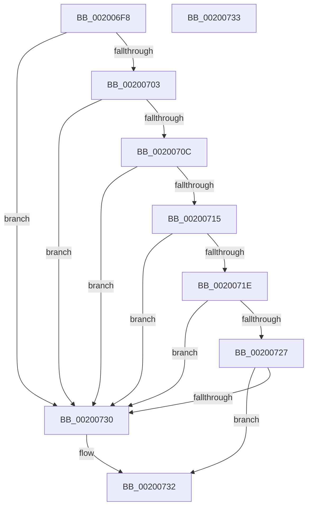

# CcHasVolumeCumulativeTelemetryChanged

- RVA: `0x002006F8`–`0x00200734` (길이 `60` bytes)
- VA: `0x00000001402006F8`
- 실행 섹션: `.text`
- PDB 이름 있음: `예`; PDB Function 태그: `아니요`
- unwind 정보 RVA: `0x000DB714`
- 디코드: `16`개 명령, `60/60` bytes 표시
- 미해석 바이트: `0` (있으면 어셈블리에 `.byte`로 보존)

> 이 문서는 커널 이미지의 기계어와 PDB 기호를 분석해 생성했습니다. 4번과 5번은 함수 원형과 자료형을 바이너리 사용 방식에서 추정한 C 해석이며 원본 소스 복구 결과는 아닙니다.

## 1. Dependencies

- 직접 호출 지점: **0**; 고유 호출 대상: **0**
- 직접 호출자로 확인된 함수: **1**
- RIP 상대 이미지 참조: **0**

### Outgoing calls
- 직접 디코드된 call 명령이 없습니다.

### Direct callers
- [CcPostVolumeTelemetry](../42/CcPostVolumeTelemetry_function_00420FF8.md) at `0x00421141`

### Static image references
- 디코드된 RIP-relative 메모리 참조가 없습니다.

## 2. Other-region calls and transfers

- 다른 실행 섹션으로 향하는 call: **0**
- 별도 외부 분기/꼬리 이동을 확인하지 못했습니다.

## 3. Assembly (complete function range)

```asm
002006F8  33 C0                           xor eax, eax
002006FA  48 39 81 40 06 00 00            cmp qword ptr [rcx + 0x640], rax
00200701  77 2D                           ja 0x140200730
00200703  48 39 81 48 06 00 00            cmp qword ptr [rcx + 0x648], rax
0020070A  77 24                           ja 0x140200730
0020070C  48 39 81 50 06 00 00            cmp qword ptr [rcx + 0x650], rax
00200713  77 1B                           ja 0x140200730
00200715  48 39 81 20 08 00 00            cmp qword ptr [rcx + 0x820], rax
0020071C  77 12                           ja 0x140200730
0020071E  48 39 81 28 08 00 00            cmp qword ptr [rcx + 0x828], rax
00200725  77 09                           ja 0x140200730
00200727  48 39 81 30 08 00 00            cmp qword ptr [rcx + 0x830], rax
0020072E  76 02                           jbe 0x140200732
00200730  B0 01                           mov al, 1
00200732  C3                              ret
00200733  CC                              int3
```

## 4. C-style interpretation (structured pseudocode)

```c
__int64 __fastcall CcHasVolumeCumulativeTelemetryChanged(__int64 a1)
{
    __int64 result;

    result = 0;
    if ((*(unsigned __int64 *)(a1 + 1600)) > 0) goto loc_00200730;
    if ((*(unsigned __int64 *)(a1 + 1608)) > 0) goto loc_00200730;
    if ((*(unsigned __int64 *)(a1 + 1616)) > 0) goto loc_00200730;
    if ((*(unsigned __int64 *)(a1 + 2080)) > 0) goto loc_00200730;
    if ((*(unsigned __int64 *)(a1 + 2088)) > 0) goto loc_00200730;
    if ((*(unsigned __int64 *)(a1 + 2096)) >= = 0) {
        result = 1;
    }
    return result;
}
```

## 5. (Beta) C Style

```c
int64_t CcHasVolumeCumulativeTelemetryChanged(void *Arg1)
{
    uint8_t *arg1 = (uint8_t *)Arg1;

    int64_t result;

    result = 0;
    if ((*(uint64_t *)(arg1 + 0x640)) > 0) goto loc_00200730;
    if ((*(uint64_t *)(arg1 + 0x648)) > 0) goto loc_00200730;
    if ((*(uint64_t *)(arg1 + 0x650)) > 0) goto loc_00200730;
    if ((*(uint64_t *)(arg1 + 0x820)) > 0) goto loc_00200730;
    if ((*(uint64_t *)(arg1 + 0x828)) > 0) goto loc_00200730;
    if ((*(uint64_t *)(arg1 + 0x830)) >= = 0) {
        result = 1;
    }
    return result;
}
```

### 관측된 메모리 오프셋

구조체 형식이 확인되지 않은 접근은 인자 기준의 오프셋으로만 기록했습니다.

| 기준 인자 | 오프셋 표현 | 폭 (bit) | 접근 |
|---|---:|---:|---|
| `Arg1` | `+ 0x640` | `64` | `R` |
| `Arg1` | `+ 0x648` | `64` | `R` |
| `Arg1` | `+ 0x650` | `64` | `R` |
| `Arg1` | `+ 0x820` | `64` | `R` |
| `Arg1` | `+ 0x828` | `64` | `R` |
| `Arg1` | `+ 0x830` | `64` | `R` |

## 6. Execution-region graph

[열기: 2D/3D 그래프와 함수 탐색 컨트롤 패널](../../../control-panel.html?section=text&rva=0x002006F8&view=graph)

- 2D 그래프는 위에서 아래로 흐르고, 3D 그래프는 빈 공간을 드래그해 회전합니다. Shift+드래그는 이동, 휠은 확대·축소, 함수 노드 선택은 대상 보고서 이동입니다.

### Static fallback


