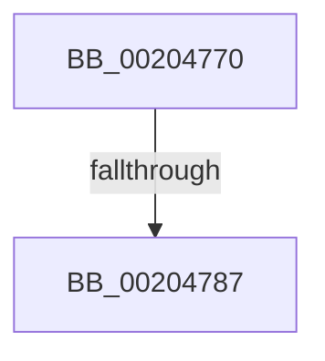

# CmpArmLazyWriter

- RVA: `0x00204770`–`0x00204795` (길이 `37` bytes)
- VA: `0x0000000140204770`
- 실행 섹션: `.text`
- PDB 이름 있음: `예`; PDB Function 태그: `아니요`
- unwind 정보 RVA: `0x0005CBC0`
- 디코드: `8`개 명령, `37/37` bytes 표시
- 미해석 바이트: `0` (있으면 어셈블리에 `.byte`로 보존)

> 이 문서는 커널 이미지의 기계어와 PDB 기호를 분석해 생성했습니다. 4번과 5번은 함수 원형과 자료형을 바이너리 사용 방식에서 추정한 C 해석이며 원본 소스 복구 결과는 아닙니다.

## 1. Dependencies

- 직접 호출 지점: **0**; 고유 호출 대상: **0**
- 직접 호출자로 확인된 함수: **5**
- RIP 상대 이미지 참조: **2**

### Outgoing calls
- 직접 디코드된 call 명령이 없습니다.

### Direct callers
- [CmpRecheckHiveVolumePolicy](../46/CmpRecheckHiveVolumePolicy_function_0046EE14.md) at `0x0046EE72`
- [CmpEnableLazyFlush](../4B/CmpEnableLazyFlush_function_004B7874.md) at `0x004B78A9`
- [sub_008593F9](../../page/85/Unknown_function_008593F9.md) at `0x008594EC`
- [HvMarkBaseBlockDirty](../../page/87/HvMarkBaseBlockDirty_function_0087BD04.md) at `0x0087BD63`
- [CmpFlushHive](../../page/9B/CmpFlushHive_function_009B3DC0.md) at `0x009B4381`
- [CmpFlushHive](../../page/9B/CmpFlushHive_function_009B3DC0.md) at `0x009B4746`

### Static image references
- `0x00204776` → RVA `0x00EEFBD4` (`.data`; read)
- `0x00204787` → RVA `0x00E0ECC0` (`.data`; read)

## 2. Other-region calls and transfers

- 다른 실행 섹션으로 향하는 call: **0**
- call이 아닌 외부 분기/꼬리 이동: **2**
  - `0x00204781` → [sub_0020488E](Unknown_function_0020488E.md) (`tail-transfer`)
  - `0x0020478F` → [sub_0020488E](Unknown_function_0020488E.md) (`tail-transfer`)

## 3. Assembly (complete function range)

```asm
00204770  40 57                           push rdi
00204772  48 83 EC 40                     sub rsp, 0x40
00204776  80 3D 57 B4 CE 00 00            cmp byte ptr [rip + 0xceb457], 0
0020477D  41 0F B6 F8                     movzx edi, r8b
00204781  0F 84 07 01 00 00               je 0x14020488e
00204787  8B 05 33 A5 C0 00               mov eax, dword ptr [rip + 0xc0a533]
0020478D  85 C0                           test eax, eax
0020478F  0F 85 F9 00 00 00               jne 0x14020488e
```

## 4. C-style interpretation (structured pseudocode)

```c
__int64 __fastcall CmpArmLazyWriter(__int64 a1, __int64 a2, unsigned __int8 a3)
{
    __int64 v_rsp;

    v_rsp = (v_rsp) - (64);
}
```

## 5. (Beta) C Style

```c
int64_t CmpArmLazyWriter(int64_t Arg1, int64_t Arg2, uint8_t Arg3)
{
    int64_t local_rsp;

    local_rsp = (local_rsp) - (64);
}
```

## 6. Execution-region graph

[열기: 2D/3D 그래프와 함수 탐색 컨트롤 패널](../../../control-panel.html?section=text&rva=0x00204770&view=graph)

- 2D 그래프는 위에서 아래로 흐르고, 3D 그래프는 빈 공간을 드래그해 회전합니다. Shift+드래그는 이동, 휠은 확대·축소, 함수 노드 선택은 대상 보고서 이동입니다.

### Static fallback


