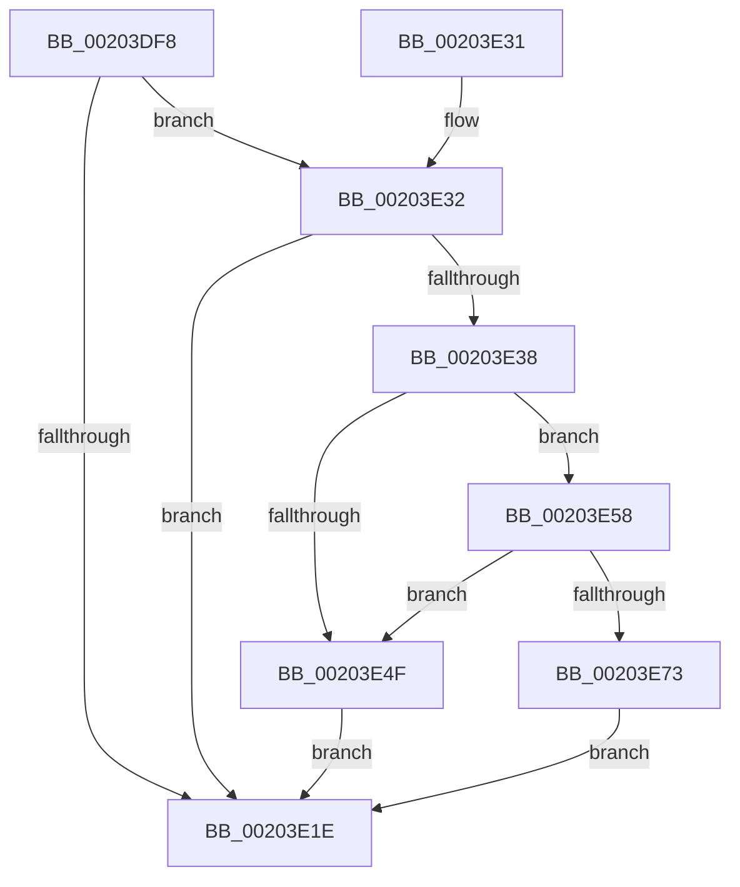

# EtwpPopFreeApcEntry

- RVA: `0x00203DF8`–`0x00203E8D` (길이 `149` bytes)
- VA: `0x0000000140203DF8`
- 실행 섹션: `.text`
- PDB 이름 있음: `예`; PDB Function 태그: `아니요`
- unwind 정보 RVA: `0x0005CAF4`
- 디코드: `40`개 명령, `149/149` bytes 표시
- 미해석 바이트: `0` (있으면 어셈블리에 `.byte`로 보존)

> 이 문서는 커널 이미지의 기계어와 PDB 기호를 분석해 생성했습니다. 4번과 5번은 함수 원형과 자료형을 바이너리 사용 방식에서 추정한 C 해석이며 원본 소스 복구 결과는 아닙니다.

## 1. Dependencies

- 직접 호출 지점: **3**; 고유 호출 대상: **3**
- 직접 호출자로 확인된 함수: **1**
- RIP 상대 이미지 참조: **0**

### Outgoing calls
- `0x00203E11` → [ExpInterlockedPopEntrySList](../6B/ExpInterlockedPopEntrySList_function_006BA570.md) (function, `0x006BA570`)
- `0x00203E66` → [ExAllocatePool2](../../poolcode/B8/ExAllocatePool2_function_00B820F0.md) (function, `0x00B820F0`)
- `0x00203E7B` → [ExpInterlockedPushEntrySList](../6B/ExpInterlockedPushEntrySList_function_006BA5B0.md) (function, `0x006BA5B0`)

### Direct callers
- [EtwpQueueApc](EtwpQueueApc_function_00203B7C.md) at `0x00203C6A`

### Static image references
- 디코드된 RIP-relative 메모리 참조가 없습니다.

## 2. Other-region calls and transfers

- 다른 실행 섹션으로 향하는 call: **1**
  - `0x00203E66` → [ExAllocatePool2](../../poolcode/B8/ExAllocatePool2_function_00B820F0.md) (`.text` → `POOLCODE`)
- 별도 외부 분기/꼬리 이동을 확인하지 못했습니다.

## 3. Assembly (complete function range)

```asm
00203DF8  48 89 5C 24 08                  mov qword ptr [rsp + 8], rbx
00203DFD  48 89 74 24 10                  mov qword ptr [rsp + 0x10], rsi
00203E02  57                              push rdi
00203E03  48 83 EC 20                     sub rsp, 0x20
00203E07  48 8B D9                        mov rbx, rcx
00203E0A  40 8A FA                        mov dil, dl
00203E0D  48 83 C1 20                     add rcx, 0x20
00203E11  E8 5A 67 4B 00                  call 0x1406ba570
00203E16  48 8B F0                        mov rsi, rax
00203E19  48 85 C0                        test rax, rax
00203E1C  74 14                           je 0x140203e32
00203E1E  48 8B 5C 24 30                  mov rbx, qword ptr [rsp + 0x30]
00203E23  48 8B C6                        mov rax, rsi
00203E26  48 8B 74 24 38                  mov rsi, qword ptr [rsp + 0x38]
00203E2B  48 83 C4 20                     add rsp, 0x20
00203E2F  5F                              pop rdi
00203E30  C3                              ret
00203E31  CC                              int3
00203E32  40 80 FF 02                     cmp dil, 2
00203E36  77 E6                           ja 0x140203e1e
00203E38  B9 01 00 00 00                  mov ecx, 1
00203E3D  F0 0F C1 8B A4 00 00 00         lock xadd dword ptr [rbx + 0xa4], ecx
00203E45  FF C1                           inc ecx
00203E47  3B 8B AC 00 00 00               cmp ecx, dword ptr [rbx + 0xac]
00203E4D  76 09                           jbe 0x140203e58
00203E4F  F0 FF 8B A4 00 00 00            lock dec dword ptr [rbx + 0xa4]
00203E56  EB C6                           jmp 0x140203e1e
00203E58  BA A0 00 00 00                  mov edx, 0xa0
00203E5D  41 B8 45 74 77 41               mov r8d, 0x41777445
00203E63  8D 4A A8                        lea ecx, [rdx - 0x58]
00203E66  E8 85 E2 97 00                  call 0x140b820f0
00203E6B  48 8B F8                        mov rdi, rax
00203E6E  48 85 C0                        test rax, rax
00203E71  74 DC                           je 0x140203e4f
00203E73  48 8D 50 60                     lea rdx, [rax + 0x60]
00203E77  48 8D 4B 10                     lea rcx, [rbx + 0x10]
00203E7B  E8 30 67 4B 00                  call 0x1406ba5b0
00203E80  48 89 9F 80 00 00 00            mov qword ptr [rdi + 0x80], rbx
00203E87  48 8D 77 70                     lea rsi, [rdi + 0x70]
00203E8B  EB 91                           jmp 0x140203e1e
```

## 4. C-style interpretation (structured pseudocode)

```c
__int64 __fastcall EtwpPopFreeApcEntry(__int64 a1, unsigned __int8 a2)
{
    __int64 result;
    __int64 v_rsp;
    unsigned __int64 v_stack_p10;
    unsigned __int64 v_stack_p8;

    v_stack_p8 = v_rbx;
    v_stack_p10 = v_rsi;
    v_rsp = (v_rsp) - (32);
    a1 = (a1) + (32);
    result = ExpInterlockedPopEntrySList(a1, a2, a3, a4);
    if (result == 0) goto loc_00203E32;
loc_00203E1E:
    v_rsp = (v_rsp) + (32);
    return result;
loc_00203E32:
    if (a2 > 2) goto loc_00203E1E;
    a1 = (unsigned int)((1) + 1);
    if (((unsigned int)(a1)) <= (*(unsigned int *)(v_stack_p8 + 172))) goto loc_00203E58;
loc_00203E4F:
    goto loc_00203E1E;
loc_00203E58:
    result = ExAllocatePool2(160 - 88, 160, (unsigned int)(0x41777445ULL), a4);
    if (result == 0) goto loc_00203E4F;
    result = ExpInterlockedPushEntrySList(v_stack_p8 + 16, result + 96, (unsigned int)(0x41777445ULL), a4);
    *(unsigned __int64 *)(result + 128) = v_stack_p8;
    goto loc_00203E1E;
}
```

## 5. (Beta) C Style

```c
int64_t EtwpPopFreeApcEntry(void *Arg1, uint8_t Arg2)
{
    uint8_t *arg1 = (uint8_t *)Arg1;

    int64_t result;
    int64_t local_rsp;
    uint64_t v_stack_p10;
    uint64_t v_stack_p8;

    v_stack_p8 = local_rbx;
    v_stack_p10 = local_rsi;
    local_rsp = (local_rsp) - (32);
    Arg1 = (Arg1) + (32);
    result = ExpInterlockedPopEntrySList(Arg1, Arg2, a3, a4);
    if (result == 0) goto loc_00203E32;
loc_00203E1E:
    local_rsp = (local_rsp) + (32);
    return result;
loc_00203E32:
    if (Arg2 > 2) goto loc_00203E1E;
    Arg1 = (uint32_t)((1) + 1);
    if (((uint32_t)(Arg1)) <= (*(uint32_t *)(v_stack_p8 + 0xAC))) goto loc_00203E58;
loc_00203E4F:
    goto loc_00203E1E;
loc_00203E58:
    result = ExAllocatePool2(160 - 88, 160, (uint32_t)(0x41777445ULL), a4);
    if (result == 0) goto loc_00203E4F;
    result = ExpInterlockedPushEntrySList(v_stack_p8 + 16, result + 96, (uint32_t)(0x41777445ULL), a4);
    *(uint64_t *)(result + 0x80) = v_stack_p8;
    goto loc_00203E1E;
}
```

### 관측된 메모리 오프셋

구조체 형식이 확인되지 않은 접근은 인자 기준의 오프셋으로만 기록했습니다.

| 기준 인자 | 오프셋 표현 | 폭 (bit) | 접근 |
|---|---:|---:|---|
| `Arg1` | `+ 0x10` | `64` | `R` |
| `Arg1` | `+ 0xA4` | `32` | `R/W` |
| `Arg1` | `+ 0xAC` | `32` | `R` |

## 6. Execution-region graph

[열기: 2D/3D 그래프와 함수 탐색 컨트롤 패널](../../../control-panel.html?section=text&rva=0x00203DF8&view=graph)

- 2D 그래프는 위에서 아래로 흐르고, 3D 그래프는 빈 공간을 드래그해 회전합니다. Shift+드래그는 이동, 휠은 확대·축소, 함수 노드 선택은 대상 보고서 이동입니다.

### Static fallback


