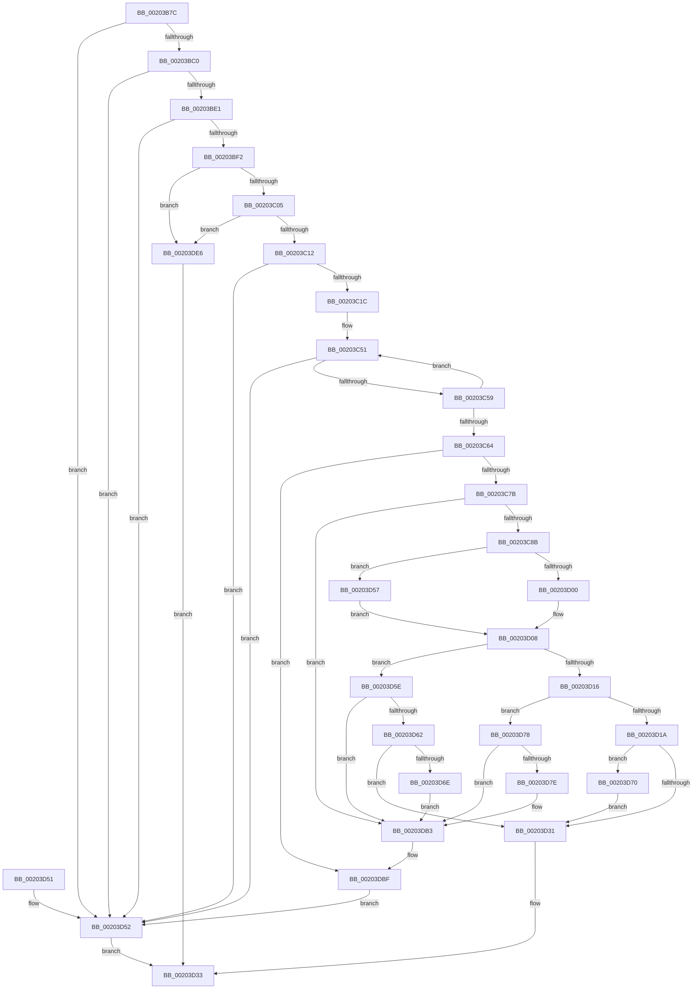

# EtwpQueueApc

- RVA: `0x00203B7C`–`0x00203DF0` (길이 `628` bytes)
- VA: `0x0000000140203B7C`
- 실행 섹션: `.text`
- PDB 이름 있음: `예`; PDB Function 태그: `아니요`
- unwind 정보 RVA: `0x0005CAD4`
- 디코드: `151`개 명령, `628/628` bytes 표시
- 미해석 바이트: `0` (있으면 어셈블리에 `.byte`로 보존)

> 이 문서는 커널 이미지의 기계어와 PDB 기호를 분석해 생성했습니다. 4번과 5번은 함수 원형과 자료형을 바이너리 사용 방식에서 추정한 C 해석이며 원본 소스 복구 결과는 아닙니다.

## 1. Dependencies

- 직접 호출 지점: **7**; 고유 호출 대상: **7**
- 직접 호출자로 확인된 함수: **5**
- RIP 상대 이미지 참조: **2**

### Outgoing calls
- `0x00203C6A` → [EtwpPopFreeApcEntry](EtwpPopFreeApcEntry_function_00203DF8.md) (function, `0x00203DF8`)
- `0x00203D03` → [KeInsertQueueApc](KeInsertQueueApc_function_00203F10.md) (function, `0x00203F10`)
- `0x00203D57` → [KeTryToInsertQueueApc](../4D/KeTryToInsertQueueApc_function_004D72B8.md) (function, `0x004D72B8`)
- `0x00203D65` → [KeRemoveQueueApc](../3C/KeRemoveQueueApc_function_003C4820.md) (function, `0x003C4820`)
- `0x00203DAB` → [EtwpQueueApcPoolDpc](../4D/EtwpQueueApcPoolDpc_function_004DA1A4.md) (function, `0x004DA1A4`)
- `0x00203DBA` → [ExpInterlockedPushEntrySList](../6B/ExpInterlockedPushEntrySList_function_006BA5B0.md) (function, `0x006BA5B0`)
- `0x00203DDC` → [ExReleaseRundownProtectionCacheAwareEx](../25/ExReleaseRundownProtectionCacheAwareEx_function_0025F050.md) (function, `0x0025F050`)

### Direct callers
- [EtwpQueueStackWalkApc](EtwpQueueStackWalkApc_function_00203AA0.md) at `0x00203B2B`
- [EtwpLogKernelEvent](../25/EtwpLogKernelEvent_function_0025CC00.md) at `0x0025D418`
- [sub_002FA5F0](../2F/Unknown_function_002FA5F0.md) at `0x002FA62A`
- [EtwpApcPoolDpc](../4A/EtwpApcPoolDpc_function_004A2700.md) at `0x004A2750`
- [EtwpContextRegisterTracingDispatcher](../4D/EtwpContextRegisterTracingDispatcher_function_004D83F4.md) at `0x004D846A`

### Static image references
- `0x00203C9E` → RVA `0x002FA090` (`EtwpApcPoolThunk`; read)
- `0x00203CAC` → RVA `0x00652CD0` (`EtwpCancelApcThunk`; read)

## 2. Other-region calls and transfers

- 다른 실행 섹션으로 향하는 call: **0**
- 별도 외부 분기/꼬리 이동을 확인하지 못했습니다.

## 3. Assembly (complete function range)

```asm
00203B7C  48 8B C4                        mov rax, rsp
00203B7F  48 89 58 08                     mov qword ptr [rax + 8], rbx
00203B83  48 89 68 10                     mov qword ptr [rax + 0x10], rbp
00203B87  48 89 70 18                     mov qword ptr [rax + 0x18], rsi
00203B8B  4C 89 48 20                     mov qword ptr [rax + 0x20], r9
00203B8F  57                              push rdi
00203B90  41 54                           push r12
00203B92  41 55                           push r13
00203B94  41 56                           push r14
00203B96  41 57                           push r15
00203B98  48 83 EC 40                     sub rsp, 0x40
00203B9C  65 48 8B 04 25 88 01 00 00      mov rax, qword ptr gs:[0x188]
00203BA5  4D 8B F9                        mov r15, r9
00203BA8  45 8A E8                        mov r13b, r8b
00203BAB  48 8B F2                        mov rsi, rdx
00203BAE  48 8B D9                        mov rbx, rcx
00203BB1  41 BE 01 00 00 C0               mov r14d, 0xc0000001
00203BB7  48 3B D0                        cmp rdx, rax
00203BBA  0F 85 92 01 00 00               jne 0x140203d52
00203BC0  4C 8B 92 20 02 00 00            mov r10, qword ptr [rdx + 0x220]
00203BC7  41 8B 82 88 00 00 00            mov eax, dword ptr [r10 + 0x88]
00203BCE  C1 E8 03                        shr eax, 3
00203BD1  83 E0 01                        and eax, 1
00203BD4  41 03 82 50 01 00 00            add eax, dword ptr [r10 + 0x150]
00203BDB  0F 85 71 01 00 00               jne 0x140203d52
00203BE1  8A 82 84 02 00 00               mov al, byte ptr [rdx + 0x284]
00203BE7  45 33 E4                        xor r12d, r12d
00203BEA  84 C0                           test al, al
00203BEC  0F 85 60 01 00 00               jne 0x140203d52
00203BF2  65 48 8B 04 25 20 00 00 00      mov rax, qword ptr gs:[0x20]
00203BFB  48 3B 50 18                     cmp rdx, qword ptr [rax + 0x18]
00203BFF  0F 84 E1 01 00 00               je 0x140203de6
00203C05  8B 42 74                        mov eax, dword ptr [rdx + 0x74]
00203C08  0F BA E0 0A                     bt eax, 0xa
00203C0C  0F 82 D4 01 00 00               jb 0x140203de6
00203C12  0F BA E0 0E                     bt eax, 0xe
00203C16  0F 83 36 01 00 00               jae 0x140203d52
00203C1C  48 8B 01                        mov rax, qword ptr [rcx]
00203C1F  8B 10                           mov edx, dword ptr [rax]
00203C21  48 8B 88 50 05 00 00            mov rcx, qword ptr [rax + 0x550]
00203C28  48 8B 81 C0 02 00 00            mov rax, qword ptr [rcx + 0x2c0]
00203C2F  48 8B 0C D0                     mov rcx, qword ptr [rax + rdx*8]
00203C33  33 D2                           xor edx, edx
00203C35  65 8B 04 25 A4 01 00 00         mov eax, dword ptr gs:[0x1a4]
00203C3D  F7 71 14                        div dword ptr [rcx + 0x14]
00203C40  0F AF 51 10                     imul edx, dword ptr [rcx + 0x10]
00203C44  44 8B C2                        mov r8d, edx
00203C47  4C 03 01                        add r8, qword ptr [rcx]
00203C4A  41 0F 0D 08                     prefetchw byte ptr [r8]
00203C4E  49 8B 00                        mov rax, qword ptr [r8]
00203C51  A8 01                           test al, 1
00203C53  0F 85 F9 00 00 00               jne 0x140203d52
00203C59  48 8D 48 02                     lea rcx, [rax + 2]
00203C5D  F0 49 0F B1 08                  lock cmpxchg qword ptr [r8], rcx
00203C62  75 ED                           jne 0x140203c51
00203C64  41 8A D5                        mov dl, r13b
00203C67  48 8B CB                        mov rcx, rbx
00203C6A  E8 89 01 00 00                  call 0x140203df8
00203C6F  48 8B E8                        mov rbp, rax
00203C72  48 85 C0                        test rax, rax
00203C75  0F 84 44 01 00 00               je 0x140203dbf
00203C7B  48 8B 03                        mov rax, qword ptr [rbx]
00203C7E  44 39 A0 40 01 00 00            cmp dword ptr [rax + 0x140], r12d
00203C85  0F 84 28 01 00 00               je 0x140203db3
00203C8B  48 8B 84 24 90 00 00 00         mov rax, qword ptr [rsp + 0x90]
00203C93  48 8D 7D 90                     lea rdi, [rbp - 0x70]
00203C97  48 89 87 90 00 00 00            mov qword ptr [rdi + 0x90], rax
00203C9E  48 8D 0D EB 63 0F 00            lea rcx, [rip + 0xf63eb]
00203CA5  4C 89 BF 88 00 00 00            mov qword ptr [rdi + 0x88], r15
00203CAC  48 8D 05 1D F0 44 00            lea rax, [rip + 0x44f01d]
00203CB3  4C 8B BC 24 A8 00 00 00         mov r15, qword ptr [rsp + 0xa8]
00203CBB  48 89 47 28                     mov qword ptr [rdi + 0x28], rax
00203CBF  4D 8B C7                        mov r8, r15
00203CC2  48 8B 84 24 98 00 00 00         mov rax, qword ptr [rsp + 0x98]
00203CCA  66 44 89 67 50                  mov word ptr [rdi + 0x50], r12w
00203CCF  48 89 4F 20                     mov qword ptr [rdi + 0x20], rcx
00203CD3  48 89 4F 30                     mov qword ptr [rdi + 0x30], rcx
00203CD7  48 8B CF                        mov rcx, rdi
00203CDA  66 C7 07 12 00                  mov word ptr [rdi], 0x12
00203CDF  C6 47 02 58                     mov byte ptr [rdi + 2], 0x58
00203CE3  48 89 77 08                     mov qword ptr [rdi + 8], rsi
00203CE7  48 89 47 38                     mov qword ptr [rdi + 0x38], rax
00203CEB  44 88 67 52                     mov byte ptr [rdi + 0x52], r12b
00203CEF  4C 8B A4 24 A0 00 00 00         mov r12, qword ptr [rsp + 0xa0]
00203CF7  49 8B D4                        mov rdx, r12
00203CFA  41 80 FD 02                     cmp r13b, 2
00203CFE  77 57                           ja 0x140203d57
00203D00  45 33 C9                        xor r9d, r9d
00203D03  E8 08 02 00 00                  call 0x140203f10
00203D08  8A C8                           mov cl, al
00203D0A  48 8B 03                        mov rax, qword ptr [rbx]
00203D0D  83 B8 40 01 00 00 00            cmp dword ptr [rax + 0x140], 0
00203D14  74 48                           je 0x140203d5e
00203D16  84 C9                           test cl, cl
00203D18  74 5E                           je 0x140203d78
00203D1A  F0 FF 83 B0 00 00 00            lock inc dword ptr [rbx + 0xb0]
00203D21  8B 8B B0 00 00 00               mov ecx, dword ptr [rbx + 0xb0]
00203D27  8B 83 B4 00 00 00               mov eax, dword ptr [rbx + 0xb4]
00203D2D  3B C8                           cmp ecx, eax
00203D2F  7F 3F                           jg 0x140203d70
00203D31  33 C0                           xor eax, eax
00203D33  4C 8D 5C 24 40                  lea r11, [rsp + 0x40]
00203D38  49 8B 5B 30                     mov rbx, qword ptr [r11 + 0x30]
00203D3C  49 8B 6B 38                     mov rbp, qword ptr [r11 + 0x38]
00203D40  49 8B 73 40                     mov rsi, qword ptr [r11 + 0x40]
00203D44  49 8B E3                        mov rsp, r11
00203D47  41 5F                           pop r15
00203D49  41 5E                           pop r14
00203D4B  41 5D                           pop r13
00203D4D  41 5C                           pop r12
00203D4F  5F                              pop rdi
00203D50  C3                              ret
00203D51  CC                              int3
00203D52  41 8B C6                        mov eax, r14d
00203D55  EB DC                           jmp 0x140203d33
00203D57  E8 5C 35 2D 00                  call 0x1404d72b8
00203D5C  EB AA                           jmp 0x140203d08
00203D5E  84 C9                           test cl, cl
00203D60  74 51                           je 0x140203db3
00203D62  48 8B CF                        mov rcx, rdi
00203D65  E8 B6 0A 1C 00                  call 0x1403c4820
00203D6A  84 C0                           test al, al
00203D6C  74 C3                           je 0x140203d31
00203D6E  EB 43                           jmp 0x140203db3
00203D70  87 8B B4 00 00 00               xchg dword ptr [rbx + 0xb4], ecx
00203D76  EB B9                           jmp 0x140203d31
00203D78  41 80 FD 02                     cmp r13b, 2
00203D7C  76 35                           jbe 0x140203db3
00203D7E  48 8B 84 24 98 00 00 00         mov rax, qword ptr [rsp + 0x98]
00203D86  48 8B D6                        mov rdx, rsi
00203D89  4C 8B 8C 24 90 00 00 00         mov r9, qword ptr [rsp + 0x90]
00203D91  48 8B CB                        mov rcx, rbx
00203D94  4C 8B 84 24 88 00 00 00         mov r8, qword ptr [rsp + 0x88]
00203D9C  4C 89 7C 24 30                  mov qword ptr [rsp + 0x30], r15
00203DA1  4C 89 64 24 28                  mov qword ptr [rsp + 0x28], r12
00203DA6  48 89 44 24 20                  mov qword ptr [rsp + 0x20], rax
00203DAB  E8 F4 63 2D 00                  call 0x1404da1a4
00203DB0  44 8B F0                        mov r14d, eax
00203DB3  48 8D 4B 20                     lea rcx, [rbx + 0x20]
00203DB7  48 8B D5                        mov rdx, rbp
00203DBA  E8 F1 67 4B 00                  call 0x1406ba5b0
00203DBF  4C 8B 03                        mov r8, qword ptr [rbx]
00203DC2  BA 01 00 00 00                  mov edx, 1
00203DC7  45 8B 08                        mov r9d, dword ptr [r8]
00203DCA  4D 8B 80 50 05 00 00            mov r8, qword ptr [r8 + 0x550]
00203DD1  49 8B 88 C0 02 00 00            mov rcx, qword ptr [r8 + 0x2c0]
00203DD8  4A 8B 0C C9                     mov rcx, qword ptr [rcx + r9*8]
00203DDC  E8 6F B2 05 00                  call 0x14025f050
00203DE1  E9 6C FF FF FF                  jmp 0x140203d52
00203DE6  B8 0D 00 00 C0                  mov eax, 0xc000000d
00203DEB  E9 43 FF FF FF                  jmp 0x140203d33
```

## 4. C-style interpretation (structured pseudocode)

```c
__int64 __fastcall EtwpQueueApc(__int64 a1, __int64 a2, unsigned __int8 a3, __int64 a4, __int64 a5, __int64 a6, __int64 a7, __int64 a8)
{
    __int64 result;
    __int64 v_r12;
    __int64 v_r14;
    __int64 v_rsp;
    unsigned __int64 v_stack_m10;
    unsigned __int64 v_stack_m18;
    unsigned __int64 v_stack_m20;
    unsigned __int64 v_stack_m28;
    unsigned __int64 v_stack_p48;

    *(unsigned __int64 *)(v_rsp + 8) = v_rbx;
    *(unsigned __int64 *)(v_rsp + 16) = v_rbp;
    *(unsigned __int64 *)(v_rsp + 24) = v_rsi;
    *(unsigned __int64 *)(v_rsp + 32) = a4;
    v_rsp = (v_rsp) - (64);
    if (a2 != (*(unsigned __int64 *)(gs_base + (0 + 392)))) goto loc_00203D52;
    result = (unsigned int)(((unsigned int)(*(unsigned int *)(*(unsigned __int64 *)(a2 + 544) + 136))) >> (3));
    result = (unsigned int)((result) & (1));
    result = (unsigned int)((result) + (*(unsigned int *)(*(unsigned __int64 *)(a2 + 544) + 336)));
    if (condition_is_not_equal) goto loc_00203D52;
    v_r12 = 0;
    if ((unsigned __int8)(*(unsigned __int8 *)(a2 + 644)) != 0) goto loc_00203D52;
    if (a2 == (*(unsigned __int64 *)(*(unsigned __int64 *)(gs_base + (0 + 32)) + 24))) goto loc_00203DE6;
    if (a2 < (*(unsigned __int64 *)(*(unsigned __int64 *)(gs_base + (0 + 32)) + 24))) goto loc_00203DE6;
    if (a2 >= (*(unsigned __int64 *)(*(unsigned __int64 *)(gs_base + (0 + 32)) + 24))) goto loc_00203D52;
    a2 = 0;
    a2 = (unsigned int)((a2) * (*(unsigned int *)(*(unsigned __int64 *)(*(unsigned __int64 *)(*(unsigned __int64 *)(*(unsigned __int64 *)(a1) + 1360) + 704) + (unsigned int)(*(unsigned int *)(*(unsigned __int64 *)(a1))) * 8) + 16)));
    a3 = ((unsigned int)((unsigned int)(a2))) + (*(unsigned __int64 *)(*(unsigned __int64 *)(*(unsigned __int64 *)(*(unsigned __int64 *)(*(unsigned __int64 *)(a1) + 1360) + 704) + (unsigned int)(*(unsigned int *)(*(unsigned __int64 *)(a1))) * 8)));
loc_00203C51:
    if ((((unsigned __int8)(*(unsigned __int64 *)(a3))) & (1)) != 0) goto loc_00203D52;
    if ((((unsigned __int8)(*(unsigned __int64 *)(a3))) & (1)) != 0) goto loc_00203C51;
    result = EtwpPopFreeApcEntry(a1, a3, a3, a4);
    if (result == 0) goto loc_00203DBF;
    if ((*(unsigned int *)(*(unsigned __int64 *)(a1) + 320)) == 0) goto loc_00203DB3;
    *(unsigned __int64 *)(result - 112 + 144) = a5;
    *(unsigned __int64 *)(result - 112 + 136) = a4;
    *(unsigned __int64 *)(result - 112 + 40) = v_rip + 4517917;
    *(unsigned __int16 *)(result - 112 + 80) = 0;
    *(unsigned __int64 *)(result - 112 + 32) = v_rip + 1008619;
    *(unsigned __int64 *)(result - 112 + 48) = v_rip + 1008619;
    *(unsigned __int16 *)(result - 112) = 18;
    *(unsigned __int8 *)(result - 112 + 2) = 88;
    *(unsigned __int64 *)(result - 112 + 8) = a2;
    *(unsigned __int64 *)(result - 112 + 56) = a6;
    *(unsigned __int8 *)(result - 112 + 82) = 0;
    if (a3 > 2) goto loc_00203D57;
    a4 = 0;
    result = KeInsertQueueApc(result - 112, a7, a8, a4);
loc_00203D08:
    if ((*(unsigned int *)(*(unsigned __int64 *)(a1) + 320)) == 0) goto loc_00203D5E;
    if ((unsigned __int8)((unsigned __int8)(result)) == 0) goto loc_00203D78;
    if (((unsigned int)((unsigned int)(*(unsigned int *)(a1 + 176)))) > ((unsigned int)((unsigned int)(*(unsigned int *)(a1 + 180))))) goto loc_00203D70;
loc_00203D31:
    result = 0;
loc_00203D33:
    return result;
loc_00203D52:
    goto loc_00203D33;
loc_00203D57:
    result = KeTryToInsertQueueApc((unsigned int)(*(unsigned int *)(a1 + 176)), a7, a8, a4);
    goto loc_00203D08;
loc_00203D5E:
    if ((unsigned __int8)((unsigned int)(*(unsigned int *)(a1 + 176))) == 0) goto loc_00203DB3;
    result = KeRemoveQueueApc(result - 112, a7, a8, a4);
    if ((unsigned __int8)(result) == 0) goto loc_00203D31;
    goto loc_00203DB3;
loc_00203D70:
    goto loc_00203D31;
loc_00203D78:
    v_r14 = (unsigned int)(0xC0000001ULL);
    if (a3 >= = 2) {
        result = a6;
        a2 = *(unsigned __int64 *)(v_stack_m28 + 64);
        a4 = a5;
        a1 = *(unsigned __int64 *)(v_stack_m28 + 48);
        a3 = v_stack_p48;
        v_stack_m10 = a8;
        v_stack_m18 = a7;
        v_stack_m20 = result;
        result = EtwpQueueApcPoolDpc(a1, a2, a3, a4);
        v_r14 = (unsigned int)(result);
    }
    result = ExpInterlockedPushEntrySList(*(unsigned __int64 *)(v_stack_m28 + 48) + 32, *(unsigned __int64 *)(v_stack_m28 + 56), a3, a4);
loc_00203DBF:
    result = ExReleaseRundownProtectionCacheAwareEx(*(unsigned __int64 *)(*(unsigned __int64 *)(*(unsigned __int64 *)(*(unsigned __int64 *)(*(unsigned __int64 *)(v_stack_m28 + 48)) + 1360) + 704) + (unsigned int)(*(unsigned int *)(*(unsigned __int64 *)(*(unsigned __int64 *)(v_stack_m28 + 48)))) * 8), 1, *(unsigned __int64 *)(*(unsigned __int64 *)(*(unsigned __int64 *)(v_stack_m28 + 48)) + 1360), (unsigned int)(*(unsigned int *)(*(unsigned __int64 *)(*(unsigned __int64 *)(v_stack_m28 + 48)))));
    goto loc_00203D52;
loc_00203DE6:
    goto loc_00203D33;
}
```

## 5. (Beta) C Style

```c
int64_t EtwpQueueApc(void *Arg1, int64_t Arg2, uint8_t Arg3, int64_t Arg4, int64_t Arg5, int64_t Arg6, int64_t Arg7, int64_t Arg8)
{
    uint8_t *arg1 = (uint8_t *)Arg1;

    int64_t result;
    int64_t local_r12;
    int64_t local_r14;
    int64_t local_rsp;
    uint64_t v_stack_m10;
    uint64_t v_stack_m18;
    uint64_t v_stack_m20;
    uint64_t v_stack_m28;
    uint64_t v_stack_p48;

    *(uint64_t *)(local_rsp + 0x8) = local_rbx;
    *(uint64_t *)(local_rsp + 0x10) = local_rbp;
    *(uint64_t *)(local_rsp + 0x18) = local_rsi;
    *(uint64_t *)(local_rsp + 0x20) = Arg4;
    local_rsp = (local_rsp) - (64);
    if (Arg2 != (*(uint64_t *)(gs_base + (0 + 0x188)))) goto loc_00203D52;
    result = (uint32_t)(((uint32_t)(*(uint32_t *)(*(uint64_t *)(Arg2 + 0x220) + 0x88))) >> (3));
    result = (uint32_t)((result) & (1));
    result = (uint32_t)((result) + (*(uint32_t *)(*(uint64_t *)(Arg2 + 0x220) + 0x150)));
    if (condition_is_not_equal) goto loc_00203D52;
    local_r12 = 0;
    if ((uint8_t)(*(uint8_t *)(Arg2 + 0x284)) != 0) goto loc_00203D52;
    if (Arg2 == (*(uint64_t *)(*(uint64_t *)(gs_base + (0 + 0x20)) + 0x18))) goto loc_00203DE6;
    if (Arg2 < (*(uint64_t *)(*(uint64_t *)(gs_base + (0 + 0x20)) + 0x18))) goto loc_00203DE6;
    if (Arg2 >= (*(uint64_t *)(*(uint64_t *)(gs_base + (0 + 0x20)) + 0x18))) goto loc_00203D52;
    Arg2 = 0;
    Arg2 = (uint32_t)((Arg2) * (*(uint32_t *)(*(uint64_t *)(*(uint64_t *)(*(uint64_t *)(*(uint64_t *)(arg1) + 0x550) + 0x2C0) + (uint32_t)(*(uint32_t *)(*(uint64_t *)(arg1))) * 8) + 0x10)));
    Arg3 = ((uint32_t)((uint32_t)(Arg2))) + (*(uint64_t *)(*(uint64_t *)(*(uint64_t *)(*(uint64_t *)(*(uint64_t *)(arg1) + 0x550) + 0x2C0) + (uint32_t)(*(uint32_t *)(*(uint64_t *)(arg1))) * 8)));
loc_00203C51:
    if ((((uint8_t)(*(uint64_t *)(Arg3))) & (1)) != 0) goto loc_00203D52;
    if ((((uint8_t)(*(uint64_t *)(Arg3))) & (1)) != 0) goto loc_00203C51;
    result = EtwpPopFreeApcEntry(Arg1, Arg3, Arg3, Arg4);
    if (result == 0) goto loc_00203DBF;
    if ((*(uint32_t *)(*(uint64_t *)(arg1) + 0x140)) == 0) goto loc_00203DB3;
    *(uint64_t *)(result - 0x70 + 0x90) = Arg5;
    *(uint64_t *)(result - 0x70 + 0x88) = Arg4;
    *(uint64_t *)(result - 0x70 + 0x28) = v_rip + 4517917;
    *(uint16_t *)(result - 0x70 + 0x50) = 0;
    *(uint64_t *)(result - 0x70 + 0x20) = v_rip + 1008619;
    *(uint64_t *)(result - 0x70 + 0x30) = v_rip + 1008619;
    *(uint16_t *)(result - 0x70) = 18;
    *(uint8_t *)(result - 0x70 + 0x2) = 88;
    *(uint64_t *)(result - 0x70 + 0x8) = Arg2;
    *(uint64_t *)(result - 0x70 + 0x38) = Arg6;
    *(uint8_t *)(result - 0x70 + 0x52) = 0;
    if (Arg3 > 2) goto loc_00203D57;
    Arg4 = 0;
    result = KeInsertQueueApc(result - 112, Arg7, Arg8, Arg4);
loc_00203D08:
    if ((*(uint32_t *)(*(uint64_t *)(arg1) + 0x140)) == 0) goto loc_00203D5E;
    if ((uint8_t)((uint8_t)(result)) == 0) goto loc_00203D78;
    if (((uint32_t)((uint32_t)(*(uint32_t *)(arg1 + 0xB0)))) > ((uint32_t)((uint32_t)(*(uint32_t *)(arg1 + 0xB4))))) goto loc_00203D70;
loc_00203D31:
    result = 0;
loc_00203D33:
    return result;
loc_00203D52:
    goto loc_00203D33;
loc_00203D57:
    result = KeTryToInsertQueueApc((uint32_t)(*(uint32_t *)(arg1 + 0xB0)), Arg7, Arg8, Arg4);
    goto loc_00203D08;
loc_00203D5E:
    if ((uint8_t)((uint32_t)(*(uint32_t *)(arg1 + 0xB0))) == 0) goto loc_00203DB3;
    result = KeRemoveQueueApc(result - 112, Arg7, Arg8, Arg4);
    if ((uint8_t)(result) == 0) goto loc_00203D31;
    goto loc_00203DB3;
loc_00203D70:
    goto loc_00203D31;
loc_00203D78:
    local_r14 = (uint32_t)(0xC0000001ULL);
    if (Arg3 >= = 2) {
        result = Arg6;
        Arg2 = *(uint64_t *)(v_stack_m28 + 0x40);
        Arg4 = Arg5;
        Arg1 = *(uint64_t *)(v_stack_m28 + 0x30);
        Arg3 = v_stack_p48;
        v_stack_m10 = Arg8;
        v_stack_m18 = Arg7;
        v_stack_m20 = result;
        result = EtwpQueueApcPoolDpc(Arg1, Arg2, Arg3, Arg4);
        local_r14 = (uint32_t)(result);
    }
    result = ExpInterlockedPushEntrySList(*(uint64_t *)(v_stack_m28 + 0x30) + 32, *(uint64_t *)(v_stack_m28 + 0x38), Arg3, Arg4);
loc_00203DBF:
    result = ExReleaseRundownProtectionCacheAwareEx(*(uint64_t *)(*(uint64_t *)(*(uint64_t *)(*(uint64_t *)(*(uint64_t *)(v_stack_m28 + 0x30)) + 0x550) + 0x2C0) + (uint32_t)(*(uint32_t *)(*(uint64_t *)(*(uint64_t *)(v_stack_m28 + 0x30)))) * 8), 1, *(uint64_t *)(*(uint64_t *)(*(uint64_t *)(v_stack_m28 + 0x30)) + 0x550), (uint32_t)(*(uint32_t *)(*(uint64_t *)(*(uint64_t *)(v_stack_m28 + 0x30)))));
    goto loc_00203D52;
loc_00203DE6:
    goto loc_00203D33;
}
```

### 관측된 메모리 오프셋

구조체 형식이 확인되지 않은 접근은 인자 기준의 오프셋으로만 기록했습니다.

| 기준 인자 | 오프셋 표현 | 폭 (bit) | 접근 |
|---|---:|---:|---|
| `Arg1` | `+ 0x0` | `64` | `R` |
| `Arg1` | `+ 0x20` | `64` | `R` |
| `Arg1` | `+ 0xB0` | `32` | `R` |
| `Arg1` | `+ 0xB0` | `32` | `R/W` |
| `Arg1` | `+ 0xB4` | `32` | `R` |
| `Arg1` | `+ 0xB4` | `32` | `R/W` |

## 6. Execution-region graph

[열기: 2D/3D 그래프와 함수 탐색 컨트롤 패널](../../../control-panel.html?section=text&rva=0x00203B7C&view=graph)

- 2D 그래프는 위에서 아래로 흐르고, 3D 그래프는 빈 공간을 드래그해 회전합니다. Shift+드래그는 이동, 휠은 확대·축소, 함수 노드 선택은 대상 보고서 이동입니다.

### Static fallback


