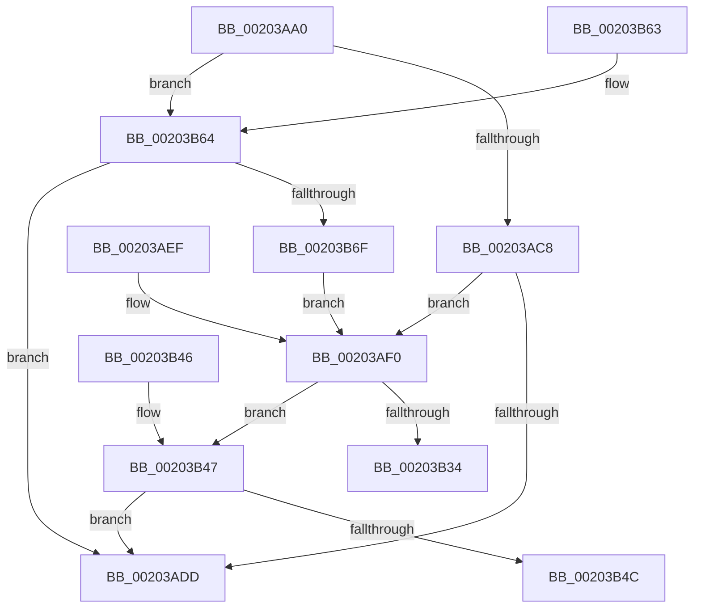

# EtwpQueueStackWalkApc

- RVA: `0x00203AA0`–`0x00203B74` (길이 `212` bytes)
- VA: `0x0000000140203AA0`
- 실행 섹션: `.text`
- PDB 이름 있음: `예`; PDB Function 태그: `아니요`
- unwind 정보 RVA: `0x0005CABC`
- 디코드: `58`개 명령, `212/212` bytes 표시
- 미해석 바이트: `0` (있으면 어셈블리에 `.byte`로 보존)

> 이 문서는 커널 이미지의 기계어와 PDB 기호를 분석해 생성했습니다. 4번과 5번은 함수 원형과 자료형을 바이너리 사용 방식에서 추정한 C 해석이며 원본 소스 복구 결과는 아닙니다.

## 1. Dependencies

- 직접 호출 지점: **1**; 고유 호출 대상: **1**
- 직접 호출자로 확인된 함수: **1**
- RIP 상대 이미지 참조: **2**

### Outgoing calls
- `0x00203B2B` → [EtwpQueueApc](EtwpQueueApc_function_00203B7C.md) (function, `0x00203B7C`)

### Direct callers
- [EtwpEventWriteFull](../22/EtwpEventWriteFull_function_00225C10.md) at `0x00226F3C`

### Static image references
- `0x00203AFC` → RVA `0x00227870` (`EtwpStackWalkApc`; read)
- `0x00203B09` → RVA `0x004B8470` (`EtwpCancelStackWalkApc`; read)

## 2. Other-region calls and transfers

- 다른 실행 섹션으로 향하는 call: **0**
- 별도 외부 분기/꼬리 이동을 확인하지 못했습니다.

## 3. Assembly (complete function range)

```asm
00203AA0  48 89 5C 24 08                  mov qword ptr [rsp + 8], rbx
00203AA5  48 89 74 24 10                  mov qword ptr [rsp + 0x10], rsi
00203AAA  57                              push rdi
00203AAB  48 83 EC 40                     sub rsp, 0x40
00203AAF  41 0F B6 F1                     movzx esi, r9b
00203AB3  33 DB                           xor ebx, ebx
00203AB5  4D 8B C8                        mov r9, r8
00203AB8  44 0F B6 D2                     movzx r10d, dl
00203ABC  48 8B F9                        mov rdi, rcx
00203ABF  40 84 F6                        test sil, sil
00203AC2  0F 85 9C 00 00 00               jne 0x140203b64
00203AC8  41 0F B7 98 32 03 00 00         movzx ebx, word ptr [r8 + 0x332]
00203AD0  83 E3 07                        and ebx, 7
00203AD3  83 C3 18                        add ebx, 0x18
00203AD6  F0 0F AB 59 78                  lock bts dword ptr [rcx + 0x78], ebx
00203ADB  73 13                           jae 0x140203af0
00203ADD  32 C0                           xor al, al
00203ADF  48 8B 5C 24 50                  mov rbx, qword ptr [rsp + 0x50]
00203AE4  48 8B 74 24 58                  mov rsi, qword ptr [rsp + 0x58]
00203AE9  48 83 C4 40                     add rsp, 0x40
00203AED  5F                              pop rdi
00203AEE  C3                              ret
00203AEF  CC                              int3
00203AF0  48 8B 44 24 70                  mov rax, qword ptr [rsp + 0x70]
00203AF5  49 8D 89 40 03 00 00            lea rcx, [r9 + 0x340]
00203AFC  4C 8D 0D 6D 3D 02 00            lea r9, [rip + 0x23d6d]
00203B03  8B 10                           mov edx, dword ptr [rax]
00203B05  44 8B 40 04                     mov r8d, dword ptr [rax + 4]
00203B09  48 8D 05 60 49 2B 00            lea rax, [rip + 0x2b4960]
00203B10  48 89 54 24 38                  mov qword ptr [rsp + 0x38], rdx
00203B15  48 8B D7                        mov rdx, rdi
00203B18  4C 89 44 24 30                  mov qword ptr [rsp + 0x30], r8
00203B1D  45 0F B6 C2                     movzx r8d, r10b
00203B21  48 89 74 24 28                  mov qword ptr [rsp + 0x28], rsi
00203B26  48 89 44 24 20                  mov qword ptr [rsp + 0x20], rax
00203B2B  E8 4C 00 00 00                  call 0x140203b7c
00203B30  85 C0                           test eax, eax
00203B32  78 13                           js 0x140203b47
00203B34  B0 01                           mov al, 1
00203B36  48 8B 5C 24 50                  mov rbx, qword ptr [rsp + 0x50]
00203B3B  48 8B 74 24 58                  mov rsi, qword ptr [rsp + 0x58]
00203B40  48 83 C4 40                     add rsp, 0x40
00203B44  5F                              pop rdi
00203B45  C3                              ret
00203B46  CC                              int3
00203B47  40 84 F6                        test sil, sil
00203B4A  75 91                           jne 0x140203add
00203B4C  F0 0F B3 5F 78                  lock btr dword ptr [rdi + 0x78], ebx
00203B51  48 8B 5C 24 50                  mov rbx, qword ptr [rsp + 0x50]
00203B56  32 C0                           xor al, al
00203B58  48 8B 74 24 58                  mov rsi, qword ptr [rsp + 0x58]
00203B5D  48 83 C4 40                     add rsp, 0x40
00203B61  5F                              pop rdi
00203B62  C3                              ret
00203B63  CC                              int3
00203B64  0F BA 61 78 17                  bt dword ptr [rcx + 0x78], 0x17
00203B69  0F 82 6E FF FF FF               jb 0x140203add
00203B6F  E9 7C FF FF FF                  jmp 0x140203af0
```

## 4. C-style interpretation (structured pseudocode)

```c
__int64 __fastcall EtwpQueueStackWalkApc(__int64 a1, unsigned __int8 a2, __int64 a3, unsigned __int8 a4, __int64 a5)
{
    __int64 result;
    __int64 v_rbx;
    __int64 v_rsp;
    unsigned __int64 v_stack_p10;
    unsigned __int64 v_stack_p20;
    unsigned __int64 v_stack_p28;
    unsigned __int64 v_stack_p30;
    unsigned __int64 v_stack_p38;
    unsigned __int64 v_stack_p50;
    unsigned __int64 v_stack_p58;
    unsigned __int64 v_stack_p8;
    unsigned __int64 v_stack_p98;
    unsigned __int64 v_stack_pA0;

    v_stack_p8 = v_rbx;
    v_stack_p10 = v_rsi;
    v_rsp = (v_rsp) - (64);
    v_rbx = 0;
    if (a4 != 0) goto loc_00203B64;
    v_rbx = (unsigned int)((*(unsigned __int16 *)(a3 + 818)) & (7));
    v_rbx = (unsigned int)((v_rbx) + (24));
    if (condition_is_above_or_equal) goto loc_00203AF0;
loc_00203ADD:
    result = 0;
    v_rsp = (v_rsp) + (64);
    return result;
loc_00203AF0:
    v_stack_p38 = (unsigned int)(*(unsigned int *)(a5));
    v_stack_p30 = (unsigned int)(*(unsigned int *)(a5 + 4));
    v_stack_p28 = v_stack_p10;
    v_stack_p20 = v_rip + 2836832;
    result = EtwpQueueApc(a3 + 832, a1, a2, v_rip + 146797);
    if (sign_flag) goto loc_00203B47;
    v_rsp = (v_rsp) + (64);
    return 1;
loc_00203B47:
    if ((unsigned __int8)(v_stack_p58) != 0) goto loc_00203ADD;
    result = 0;
    v_rsp = (v_rsp) + (64);
    return result;
loc_00203B64:
    if (condition_is_below) goto loc_00203ADD;
    goto loc_00203AF0;
}
```

## 5. (Beta) C Style

```c
int64_t EtwpQueueStackWalkApc(void *Arg1, uint8_t Arg2, void *Arg3, uint8_t Arg4, void *Arg5)
{
    uint8_t *arg1 = (uint8_t *)Arg1;
    uint8_t *arg3 = (uint8_t *)Arg3;
    uint8_t *arg5 = (uint8_t *)Arg5;

    int64_t result;
    int64_t local_rbx;
    int64_t local_rsp;
    uint64_t v_stack_p10;
    uint64_t v_stack_p20;
    uint64_t v_stack_p28;
    uint64_t v_stack_p30;
    uint64_t v_stack_p38;
    uint64_t v_stack_p50;
    uint64_t v_stack_p58;
    uint64_t v_stack_p8;
    uint64_t v_stack_p98;
    uint64_t v_stack_pA0;

    v_stack_p8 = local_rbx;
    v_stack_p10 = local_rsi;
    local_rsp = (local_rsp) - (64);
    local_rbx = 0;
    if (Arg4 != 0) goto loc_00203B64;
    local_rbx = (uint32_t)((*(uint16_t *)(arg3 + 0x332)) & (7));
    local_rbx = (uint32_t)((local_rbx) + (24));
    if (condition_is_above_or_equal) goto loc_00203AF0;
loc_00203ADD:
    result = 0;
    local_rsp = (local_rsp) + (64);
    return result;
loc_00203AF0:
    v_stack_p38 = (uint32_t)(*(uint32_t *)(arg5));
    v_stack_p30 = (uint32_t)(*(uint32_t *)(arg5 + 0x4));
    v_stack_p28 = v_stack_p10;
    v_stack_p20 = v_rip + 2836832;
    result = EtwpQueueApc(Arg3 + 832, Arg1, Arg2, v_rip + 146797);
    if (sign_flag) goto loc_00203B47;
    local_rsp = (local_rsp) + (64);
    return 1;
loc_00203B47:
    if ((uint8_t)(v_stack_p58) != 0) goto loc_00203ADD;
    result = 0;
    local_rsp = (local_rsp) + (64);
    return result;
loc_00203B64:
    if (condition_is_below) goto loc_00203ADD;
    goto loc_00203AF0;
}
```

### 관측된 메모리 오프셋

구조체 형식이 확인되지 않은 접근은 인자 기준의 오프셋으로만 기록했습니다.

| 기준 인자 | 오프셋 표현 | 폭 (bit) | 접근 |
|---|---:|---:|---|
| `Arg1` | `+ 0x78` | `32` | `R` |
| `Arg1` | `+ 0x78` | `32` | `R/W` |
| `Arg3` | `+ 0x332` | `16` | `R` |
| `Arg3` | `+ 0x340` | `64` | `R` |
| `Arg5` | `+ 0x0` | `32` | `R` |
| `Arg5` | `+ 0x4` | `32` | `R` |

## 6. Execution-region graph

[열기: 2D/3D 그래프와 함수 탐색 컨트롤 패널](../../../control-panel.html?section=text&rva=0x00203AA0&view=graph)

- 2D 그래프는 위에서 아래로 흐르고, 3D 그래프는 빈 공간을 드래그해 회전합니다. Shift+드래그는 이동, 휠은 확대·축소, 함수 노드 선택은 대상 보고서 이동입니다.

### Static fallback


