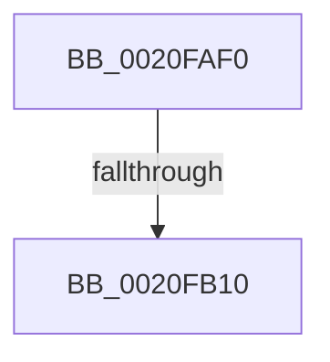

# ExAcquireAutoExpandPushLockShared

- RVA: `0x0020FAF0`–`0x0020FB28` (길이 `56` bytes)
- VA: `0x000000014020FAF0`
- 실행 섹션: `.text`
- PDB 이름 있음: `예`; PDB Function 태그: `아니요`
- unwind 정보 RVA: `0x0005DBB0`
- 디코드: `18`개 명령, `56/56` bytes 표시
- 미해석 바이트: `0` (있으면 어셈블리에 `.byte`로 보존)

> 이 문서는 커널 이미지의 기계어와 PDB 기호를 분석해 생성했습니다. 4번과 5번은 함수 원형과 자료형을 바이너리 사용 방식에서 추정한 C 해석이며 원본 소스 복구 결과는 아닙니다.

## 1. Dependencies

- 직접 호출 지점: **1**; 고유 호출 대상: **1**
- 직접 호출자로 확인된 함수: **4**
- RIP 상대 이미지 참조: **0**

### Outgoing calls
- `0x0020FB22` → [KeBugCheckEx](../4F/KeBugCheckEx_function_004FD660.md) (function, `0x004FD660`)

### Direct callers
- [MiDeletePagablePteRange](../2A/MiDeletePagablePteRange_function_002A96B4.md) at `0x002A98E9`
- [MiLockAwePagesShared](../4B/MiLockAwePagesShared_function_004B9D2C.md) at `0x004B9D3E`
- [MiLockAweVadsShared](../4C/MiLockAweVadsShared_function_004CEE3C.md) at `0x004CEE9A`
- [MiBuildPhysicalPageFreeChain](../68/MiBuildPhysicalPageFreeChain_function_00687C80.md) at `0x00687D59`

### Static image references
- 디코드된 RIP-relative 메모리 참조가 없습니다.

## 2. Other-region calls and transfers

- 다른 실행 섹션으로 향하는 call: **0**
- call이 아닌 외부 분기/꼬리 이동: **1**
  - `0x0020FB0E` → [sub_0020FB28](Unknown_function_0020FB28.md) (`tail-transfer`)

## 3. Assembly (complete function range)

```asm
0020FAF0  48 89 5C 24 20                  mov qword ptr [rsp + 0x20], rbx
0020FAF5  56                              push rsi
0020FAF6  57                              push rdi
0020FAF7  41 56                           push r14
0020FAF9  48 83 EC 30                     sub rsp, 0x30
0020FAFD  45 33 F6                        xor r14d, r14d
0020FB00  8B F2                           mov esi, edx
0020FB02  48 8B D9                        mov rbx, rcx
0020FB05  41 8B FE                        mov edi, r14d
0020FB08  F7 C2 F8 FF FF FF               test edx, 0xfffffff8
0020FB0E  74 18                           je 0x14020fb28
0020FB10  4C 8B C1                        mov r8, rcx
0020FB13  4C 89 74 24 20                  mov qword ptr [rsp + 0x20], r14
0020FB18  B9 52 01 00 00                  mov ecx, 0x152
0020FB1D  8B D6                           mov edx, esi
0020FB1F  45 33 C9                        xor r9d, r9d
0020FB22  E8 39 DB 2E 00                  call 0x1404fd660
0020FB27  CC                              int3
```

## 4. C-style interpretation (structured pseudocode)

```c
__int64 __fastcall ExAcquireAutoExpandPushLockShared(__int64 a1, int a2, __int64 a3, int a4)
{
    __int64 result;
    __int64 v_r14;
    __int64 v_rsp;
    unsigned __int64 v_stack_m28;
    unsigned __int64 v_stack_p20;

    v_stack_p20 = v_rbx;
    v_rsp = (v_rsp) - (48);
    v_r14 = 0;
    v_stack_m28 = 0;
    a4 = 0;
    result = KeBugCheckEx(338, (unsigned int)((unsigned int)((unsigned int)(a2))), a1, a4);
    return result;
}
```

## 5. (Beta) C Style

```c
int64_t ExAcquireAutoExpandPushLockShared(int64_t Arg1, int32_t Arg2, int64_t Arg3, int32_t Arg4)
{
    int64_t result;
    int64_t local_r14;
    int64_t local_rsp;
    uint64_t v_stack_m28;
    uint64_t v_stack_p20;

    v_stack_p20 = local_rbx;
    local_rsp = (local_rsp) - (48);
    local_r14 = 0;
    v_stack_m28 = 0;
    Arg4 = 0;
    result = KeBugCheckEx(338, (uint32_t)((uint32_t)((uint32_t)(Arg2))), Arg1, Arg4);
    return result;
}
```

## 6. Execution-region graph

[열기: 2D/3D 그래프와 함수 탐색 컨트롤 패널](../../../control-panel.html?section=text&rva=0x0020FAF0&view=graph)

- 2D 그래프는 위에서 아래로 흐르고, 3D 그래프는 빈 공간을 드래그해 회전합니다. Shift+드래그는 이동, 휠은 확대·축소, 함수 노드 선택은 대상 보고서 이동입니다.

### Static fallback


