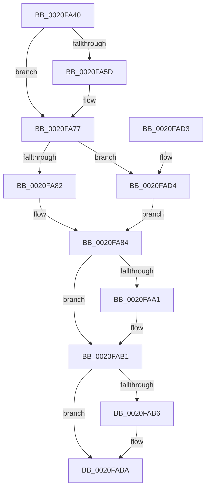

# ExAcquireCacheAwarePushLockSharedEx

- RVA: `0x0020FA40`–`0x0020FAE3` (길이 `163` bytes)
- VA: `0x000000014020FA40`
- 실행 섹션: `.text`
- PDB 이름 있음: `예`; PDB Function 태그: `아니요`
- unwind 정보 RVA: `0x0005DB98`
- 디코드: `48`개 명령, `163/163` bytes 표시
- 미해석 바이트: `0` (있으면 어셈블리에 `.byte`로 보존)

> 이 문서는 커널 이미지의 기계어와 PDB 기호를 분석해 생성했습니다. 4번과 5번은 함수 원형과 자료형을 바이너리 사용 방식에서 추정한 C 해석이며 원본 소스 복구 결과는 아닙니다.

## 1. Dependencies

- 직접 호출 지점: **3**; 고유 호출 대상: **3**
- 직접 호출자로 확인된 함수: **0**
- RIP 상대 이미지 참조: **0**

### Outgoing calls
- `0x0020FA71` → [KeBugCheckEx](../4F/KeBugCheckEx_function_004FD660.md) (function, `0x004FD660`)
- `0x0020FAAC` → [ExfAcquirePushLockSharedEx](../21/ExfAcquirePushLockSharedEx_function_0021044C.md) (function, `0x0021044C`)
- `0x0020FAD9` → [KeAbPreAcquire](../21/KeAbPreAcquire_function_00210230.md) (function, `0x00210230`)

### Direct callers
- 이 함수 시작 RVA로 연결되는 직접 call은 확인되지 않았습니다. 간접 호출은 완전히 역산할 수 없습니다.

### Static image references
- 디코드된 RIP-relative 메모리 참조가 없습니다.

## 2. Other-region calls and transfers

- 다른 실행 섹션으로 향하는 call: **0**
- 별도 외부 분기/꼬리 이동을 확인하지 못했습니다.

## 3. Assembly (complete function range)

```asm
0020FA40  48 89 5C 24 10                  mov qword ptr [rsp + 0x10], rbx
0020FA45  48 89 7C 24 20                  mov qword ptr [rsp + 0x20], rdi
0020FA4A  41 56                           push r14
0020FA4C  48 83 EC 30                     sub rsp, 0x30
0020FA50  8B FA                           mov edi, edx
0020FA52  4C 8B F1                        mov r14, rcx
0020FA55  F7 C2 F8 FF FF FF               test edx, 0xfffffff8
0020FA5B  74 1A                           je 0x14020fa77
0020FA5D  33 DB                           xor ebx, ebx
0020FA5F  4C 8B C1                        mov r8, rcx
0020FA62  B9 52 01 00 00                  mov ecx, 0x152
0020FA67  48 89 5C 24 20                  mov qword ptr [rsp + 0x20], rbx
0020FA6C  8B D7                           mov edx, edi
0020FA6E  45 33 C9                        xor r9d, r9d
0020FA71  E8 EA DB 2E 00                  call 0x1404fd660
0020FA76  CC                              int3
0020FA77  48 89 74 24 40                  mov qword ptr [rsp + 0x40], rsi
0020FA7C  40 F6 C7 02                     test dil, 2
0020FA80  74 52                           je 0x14020fad4
0020FA82  33 DB                           xor ebx, ebx
0020FA84  65 8B 04 25 A4 01 00 00         mov eax, dword ptr gs:[0x1a4]
0020FA8C  B9 11 00 00 00                  mov ecx, 0x11
0020FA91  83 E0 1F                        and eax, 0x1f
0020FA94  49 8B 34 C6                     mov rsi, qword ptr [r14 + rax*8]
0020FA98  33 C0                           xor eax, eax
0020FA9A  F0 48 0F B1 0E                  lock cmpxchg qword ptr [rsi], rcx
0020FA9F  74 10                           je 0x14020fab1
0020FAA1  4D 8B CE                        mov r9, r14
0020FAA4  4C 8B C3                        mov r8, rbx
0020FAA7  8B D7                           mov edx, edi
0020FAA9  48 8B CE                        mov rcx, rsi
0020FAAC  E8 9B 09 00 00                  call 0x14021044c
0020FAB1  48 85 DB                        test rbx, rbx
0020FAB4  74 04                           je 0x14020faba
0020FAB6  C6 43 0A 01                     mov byte ptr [rbx + 0xa], 1
0020FABA  48 8B 5C 24 48                  mov rbx, qword ptr [rsp + 0x48]
0020FABF  48 8B C6                        mov rax, rsi
0020FAC2  48 8B 74 24 40                  mov rsi, qword ptr [rsp + 0x40]
0020FAC7  48 8B 7C 24 58                  mov rdi, qword ptr [rsp + 0x58]
0020FACC  48 83 C4 30                     add rsp, 0x30
0020FAD0  41 5E                           pop r14
0020FAD2  C3                              ret
0020FAD3  CC                              int3
0020FAD4  45 33 C0                        xor r8d, r8d
0020FAD7  33 D2                           xor edx, edx
0020FAD9  E8 52 07 00 00                  call 0x140210230
0020FADE  48 8B D8                        mov rbx, rax
0020FAE1  EB A1                           jmp 0x14020fa84
```

## 4. C-style interpretation (structured pseudocode)

```c
__int64 __fastcall ExAcquireCacheAwarePushLockSharedEx(__int64 a1, int a2, __int64 a3, int a4)
{
    __int64 result;
    __int64 v_rbx;
    __int64 v_rsp;
    unsigned __int64 v_stack_m18;
    unsigned __int64 v_stack_p10;
    unsigned __int64 v_stack_p20;
    unsigned __int64 v_stack_p8;

    v_stack_p10 = v_rbx;
    v_stack_p20 = v_rdi;
    v_rsp = (v_rsp) - (48);
    if (((a2) & (0xFFFFFFF8ULL)) != 0) {
        v_rbx = 0;
        a3 = a1;
        a1 = 338;
        v_stack_m18 = 0;
        a2 = (unsigned int)((unsigned int)(a2));
        a4 = 0;
        result = KeBugCheckEx(a1, a2, a3, a4);
    }
    v_stack_p8 = v_rsi;
    if ((((unsigned __int8)((unsigned int)(a2))) & (2)) == 0) goto loc_0020FAD4;
    v_rbx = 0;
loc_0020FA84:
    result = (unsigned int)(((unsigned int)(*(unsigned int *)(gs_base + (0 + 420)))) & (31));
    result = 0;
    if (!(condition_is_equal)) {
        a4 = a1;
        a3 = 0;
        a2 = (unsigned int)((unsigned int)(a2));
        a1 = *(unsigned __int64 *)(a1 + result * 8);
        result = ExfAcquirePushLockSharedEx(a1, a2, a3, a4);
    }
    if (0 != 0) {
        *(unsigned __int8 *)(v_rbx + 10) = 1;
    }
    v_rsp = (v_rsp) + (48);
    return *(unsigned __int64 *)(a1 + result * 8);
loc_0020FAD4:
    a3 = 0;
    a2 = 0;
    result = KeAbPreAcquire(a1, a2, a3, a4);
    goto loc_0020FA84;
}
```

## 5. (Beta) C Style

```c
int64_t ExAcquireCacheAwarePushLockSharedEx(void *Arg1, int32_t Arg2, int64_t Arg3, int32_t Arg4)
{
    uint8_t *arg1 = (uint8_t *)Arg1;

    int64_t result;
    int64_t local_rbx;
    int64_t local_rsp;
    uint64_t v_stack_m18;
    uint64_t v_stack_p10;
    uint64_t v_stack_p20;
    uint64_t v_stack_p8;

    v_stack_p10 = local_rbx;
    v_stack_p20 = local_rdi;
    local_rsp = (local_rsp) - (48);
    if (((Arg2) & (0xFFFFFFF8ULL)) != 0) {
        local_rbx = 0;
        Arg3 = Arg1;
        Arg1 = 338;
        v_stack_m18 = 0;
        Arg2 = (uint32_t)((uint32_t)(Arg2));
        Arg4 = 0;
        result = KeBugCheckEx(Arg1, Arg2, Arg3, Arg4);
    }
    v_stack_p8 = local_rsi;
    if ((((uint8_t)((uint32_t)(Arg2))) & (2)) == 0) goto loc_0020FAD4;
    local_rbx = 0;
loc_0020FA84:
    result = (uint32_t)(((uint32_t)(*(uint32_t *)(gs_base + (0 + 0x1A4)))) & (31));
    result = 0;
    if (!(condition_is_equal)) {
        Arg4 = Arg1;
        Arg3 = 0;
        Arg2 = (uint32_t)((uint32_t)(Arg2));
        Arg1 = *(uint64_t *)(arg1 + result * 8);
        result = ExfAcquirePushLockSharedEx(Arg1, Arg2, Arg3, Arg4);
    }
    if (0 != 0) {
        *(uint8_t *)(local_rbx + 0xA) = 1;
    }
    local_rsp = (local_rsp) + (48);
    return *(uint64_t *)(arg1 + result * 8);
loc_0020FAD4:
    Arg3 = 0;
    Arg2 = 0;
    result = KeAbPreAcquire(Arg1, Arg2, Arg3, Arg4);
    goto loc_0020FA84;
}
```

### 관측된 메모리 오프셋

구조체 형식이 확인되지 않은 접근은 인자 기준의 오프셋으로만 기록했습니다.

| 기준 인자 | 오프셋 표현 | 폭 (bit) | 접근 |
|---|---:|---:|---|
| `Arg1` | `+ 0x0 + rax*8` | `64` | `R` |

## 6. Execution-region graph

[열기: 2D/3D 그래프와 함수 탐색 컨트롤 패널](../../../control-panel.html?section=text&rva=0x0020FA40&view=graph)

- 2D 그래프는 위에서 아래로 흐르고, 3D 그래프는 빈 공간을 드래그해 회전합니다. Shift+드래그는 이동, 휠은 확대·축소, 함수 노드 선택은 대상 보고서 이동입니다.

### Static fallback


