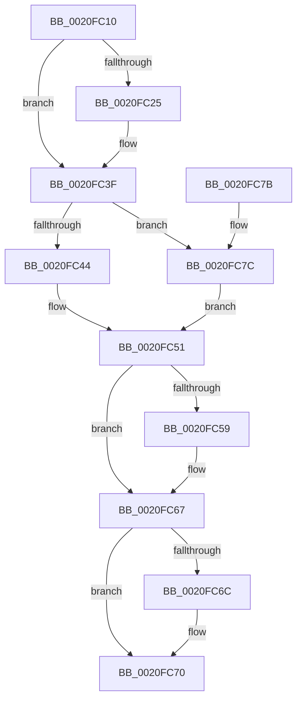

# ExAcquirePushLockExclusiveEx

- RVA: `0x0020FC10`–`0x0020FC80` (길이 `112` bytes)
- VA: `0x000000014020FC10`
- 실행 섹션: `.text`
- PDB 이름 있음: `예`; PDB Function 태그: `아니요`
- unwind 정보 RVA: `0x0005DBFC`
- 디코드: `36`개 명령, `112/112` bytes 표시
- 미해석 바이트: `0` (있으면 어셈블리에 `.byte`로 보존)

> 이 문서는 커널 이미지의 기계어와 PDB 기호를 분석해 생성했습니다. 4번과 5번은 함수 원형과 자료형을 바이너리 사용 방식에서 추정한 C 해석이며 원본 소스 복구 결과는 아닙니다.

## 1. Dependencies

- 직접 호출 지점: **3**; 고유 호출 대상: **3**
- 직접 호출자로 확인된 함수: **0**
- RIP 상대 이미지 참조: **0**

### Outgoing calls
- `0x0020FC39` → [KeBugCheckEx](../4F/KeBugCheckEx_function_004FD660.md) (function, `0x004FD660`)
- `0x0020FC49` → [KeAbPreAcquire](../21/KeAbPreAcquire_function_00210230.md) (function, `0x00210230`)
- `0x0020FC62` → [ExfAcquirePushLockExclusiveEx](ExfAcquirePushLockExclusiveEx_function_0020FC90.md) (function, `0x0020FC90`)

### Direct callers
- 이 함수 시작 RVA로 연결되는 직접 call은 확인되지 않았습니다. 간접 호출은 완전히 역산할 수 없습니다.

### Static image references
- 디코드된 RIP-relative 메모리 참조가 없습니다.

## 2. Other-region calls and transfers

- 다른 실행 섹션으로 향하는 call: **0**
- 별도 외부 분기/꼬리 이동을 확인하지 못했습니다.

## 3. Assembly (complete function range)

```asm
0020FC10  48 89 5C 24 08                  mov qword ptr [rsp + 8], rbx
0020FC15  57                              push rdi
0020FC16  48 83 EC 30                     sub rsp, 0x30
0020FC1A  48 8B D9                        mov rbx, rcx
0020FC1D  F7 C2 F8 FF FF FF               test edx, 0xfffffff8
0020FC23  74 1A                           je 0x14020fc3f
0020FC25  33 FF                           xor edi, edi
0020FC27  8B D2                           mov edx, edx
0020FC29  4C 8B C1                        mov r8, rcx
0020FC2C  48 89 7C 24 20                  mov qword ptr [rsp + 0x20], rdi
0020FC31  B9 52 01 00 00                  mov ecx, 0x152
0020FC36  45 33 C9                        xor r9d, r9d
0020FC39  E8 22 DA 2E 00                  call 0x1404fd660
0020FC3E  CC                              int3
0020FC3F  F6 C2 02                        test dl, 2
0020FC42  75 38                           jne 0x14020fc7c
0020FC44  45 33 C0                        xor r8d, r8d
0020FC47  33 D2                           xor edx, edx
0020FC49  E8 E2 05 00 00                  call 0x140210230
0020FC4E  48 8B F8                        mov rdi, rax
0020FC51  F0 48 0F BA 2B 00               lock bts qword ptr [rbx], 0
0020FC57  73 0E                           jae 0x14020fc67
0020FC59  4C 8B C3                        mov r8, rbx
0020FC5C  48 8B D7                        mov rdx, rdi
0020FC5F  48 8B CB                        mov rcx, rbx
0020FC62  E8 29 00 00 00                  call 0x14020fc90
0020FC67  48 85 FF                        test rdi, rdi
0020FC6A  74 04                           je 0x14020fc70
0020FC6C  C6 47 0A 01                     mov byte ptr [rdi + 0xa], 1
0020FC70  48 8B 5C 24 40                  mov rbx, qword ptr [rsp + 0x40]
0020FC75  48 83 C4 30                     add rsp, 0x30
0020FC79  5F                              pop rdi
0020FC7A  C3                              ret
0020FC7B  CC                              int3
0020FC7C  33 FF                           xor edi, edi
0020FC7E  EB D1                           jmp 0x14020fc51
```

## 4. C-style interpretation (structured pseudocode)

```c
__int64 __fastcall ExAcquirePushLockExclusiveEx(__int64 a1, int a2, __int64 a3, int a4)
{
    __int64 result;
    __int64 v_rdi;
    __int64 v_rsp;
    unsigned __int64 v_stack_m18;
    unsigned __int64 v_stack_p8;

    v_stack_p8 = v_rbx;
    v_rsp = (v_rsp) - (48);
    if (((a2) & (0xFFFFFFF8ULL)) != 0) {
        v_rdi = 0;
        a2 = a2;
        a3 = a1;
        v_stack_m18 = 0;
        a1 = 338;
        a4 = 0;
        result = KeBugCheckEx(a1, a2, a3, a4);
    }
    if ((((unsigned __int8)(a2)) & (2)) != 0) goto loc_0020FC7C;
    a3 = 0;
    a2 = 0;
    result = KeAbPreAcquire(a1, a2, a3, a4);
loc_0020FC51:
    if (!(condition_is_above_or_equal)) {
        a3 = a1;
        a2 = result;
        a1 = a1;
        result = ExfAcquirePushLockExclusiveEx(a1, a2, a3, a4);
    }
    if (result != 0) {
        *(unsigned __int8 *)(result + 10) = 1;
    }
    v_rsp = (v_rsp) + (48);
    return result;
loc_0020FC7C:
    v_rdi = 0;
    goto loc_0020FC51;
}
```

## 5. (Beta) C Style

```c
int64_t ExAcquirePushLockExclusiveEx(void *Arg1, int32_t Arg2, int64_t Arg3, int32_t Arg4)
{
    uint8_t *arg1 = (uint8_t *)Arg1;

    int64_t result;
    int64_t local_rdi;
    int64_t local_rsp;
    uint64_t v_stack_m18;
    uint64_t v_stack_p8;

    v_stack_p8 = local_rbx;
    local_rsp = (local_rsp) - (48);
    if (((Arg2) & (0xFFFFFFF8ULL)) != 0) {
        local_rdi = 0;
        Arg2 = Arg2;
        Arg3 = Arg1;
        v_stack_m18 = 0;
        Arg1 = 338;
        Arg4 = 0;
        result = KeBugCheckEx(Arg1, Arg2, Arg3, Arg4);
    }
    if ((((uint8_t)(Arg2)) & (2)) != 0) goto loc_0020FC7C;
    Arg3 = 0;
    Arg2 = 0;
    result = KeAbPreAcquire(Arg1, Arg2, Arg3, Arg4);
loc_0020FC51:
    if (!(condition_is_above_or_equal)) {
        Arg3 = Arg1;
        Arg2 = result;
        Arg1 = Arg1;
        result = ExfAcquirePushLockExclusiveEx(Arg1, Arg2, Arg3, Arg4);
    }
    if (result != 0) {
        *(uint8_t *)(result + 0xA) = 1;
    }
    local_rsp = (local_rsp) + (48);
    return result;
loc_0020FC7C:
    local_rdi = 0;
    goto loc_0020FC51;
}
```

### 관측된 메모리 오프셋

구조체 형식이 확인되지 않은 접근은 인자 기준의 오프셋으로만 기록했습니다.

| 기준 인자 | 오프셋 표현 | 폭 (bit) | 접근 |
|---|---:|---:|---|
| `Arg1` | `+ 0x0` | `64` | `R/W` |

## 6. Execution-region graph

[열기: 2D/3D 그래프와 함수 탐색 컨트롤 패널](../../../control-panel.html?section=text&rva=0x0020FC10&view=graph)

- 2D 그래프는 위에서 아래로 흐르고, 3D 그래프는 빈 공간을 드래그해 회전합니다. Shift+드래그는 이동, 휠은 확대·축소, 함수 노드 선택은 대상 보고서 이동입니다.

### Static fallback


