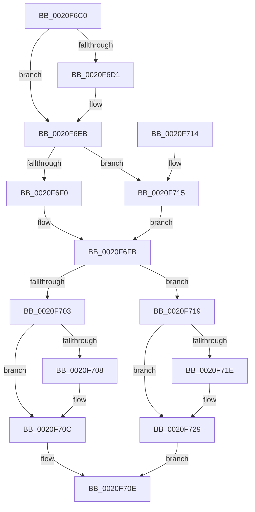

# ExTryAcquirePushLockExclusiveEx

- RVA: `0x0020F6C0`–`0x0020F72D` (길이 `109` bytes)
- VA: `0x000000014020F6C0`
- 실행 섹션: `.text`
- PDB 이름 있음: `예`; PDB Function 태그: `아니요`
- unwind 정보 RVA: `0x0005DB70`
- 디코드: `37`개 명령, `109/109` bytes 표시
- 미해석 바이트: `0` (있으면 어셈블리에 `.byte`로 보존)

> 이 문서는 커널 이미지의 기계어와 PDB 기호를 분석해 생성했습니다. 4번과 5번은 함수 원형과 자료형을 바이너리 사용 방식에서 추정한 C 해석이며 원본 소스 복구 결과는 아닙니다.

## 1. Dependencies

- 직접 호출 지점: **3**; 고유 호출 대상: **3**
- 직접 호출자로 확인된 함수: **0**
- RIP 상대 이미지 참조: **0**

### Outgoing calls
- `0x0020F6E5` → [KeBugCheckEx](../4F/KeBugCheckEx_function_004FD660.md) (function, `0x004FD660`)
- `0x0020F6F6` → [KeAbPreAcquire](../21/KeAbPreAcquire_function_00210230.md) (function, `0x00210230`)
- `0x0020F724` → [KeAbPostReleaseEx](../26/KeAbPostReleaseEx_function_00262210.md) (function, `0x00262210`)

### Direct callers
- 이 함수 시작 RVA로 연결되는 직접 call은 확인되지 않았습니다. 간접 호출은 완전히 역산할 수 없습니다.

### Static image references
- 디코드된 RIP-relative 메모리 참조가 없습니다.

## 2. Other-region calls and transfers

- 다른 실행 섹션으로 향하는 call: **0**
- 별도 외부 분기/꼬리 이동을 확인하지 못했습니다.

## 3. Assembly (complete function range)

```asm
0020F6C0  40 53                           push rbx
0020F6C2  48 83 EC 30                     sub rsp, 0x30
0020F6C6  48 8B D9                        mov rbx, rcx
0020F6C9  F7 C2 F8 FF FF FF               test edx, 0xfffffff8
0020F6CF  74 1A                           je 0x14020f6eb
0020F6D1  33 C0                           xor eax, eax
0020F6D3  8B D2                           mov edx, edx
0020F6D5  4C 8B C1                        mov r8, rcx
0020F6D8  48 89 44 24 20                  mov qword ptr [rsp + 0x20], rax
0020F6DD  B9 52 01 00 00                  mov ecx, 0x152
0020F6E2  45 33 C9                        xor r9d, r9d
0020F6E5  E8 76 DF 2E 00                  call 0x1404fd660
0020F6EA  CC                              int3
0020F6EB  F6 C2 02                        test dl, 2
0020F6EE  75 25                           jne 0x14020f715
0020F6F0  33 D2                           xor edx, edx
0020F6F2  44 8D 42 01                     lea r8d, [rdx + 1]
0020F6F6  E8 35 0B 00 00                  call 0x140210230
0020F6FB  F0 48 0F BA 2B 00               lock bts qword ptr [rbx], 0
0020F701  72 16                           jb 0x14020f719
0020F703  48 85 C0                        test rax, rax
0020F706  74 04                           je 0x14020f70c
0020F708  C6 40 0A 01                     mov byte ptr [rax + 0xa], 1
0020F70C  B0 01                           mov al, 1
0020F70E  48 83 C4 30                     add rsp, 0x30
0020F712  5B                              pop rbx
0020F713  C3                              ret
0020F714  CC                              int3
0020F715  33 C0                           xor eax, eax
0020F717  EB E2                           jmp 0x14020f6fb
0020F719  48 85 C0                        test rax, rax
0020F71C  74 0B                           je 0x14020f729
0020F71E  48 8B D0                        mov rdx, rax
0020F721  48 8B CB                        mov rcx, rbx
0020F724  E8 E7 2A 05 00                  call 0x140262210
0020F729  32 C0                           xor al, al
0020F72B  EB E1                           jmp 0x14020f70e
```

## 4. C-style interpretation (structured pseudocode)

```c
__int64 __fastcall ExTryAcquirePushLockExclusiveEx(__int64 a1, int a2, __int64 a3, int a4)
{
    __int64 result;
    __int64 v_rsp;
    unsigned __int64 v_stack_m18;

    v_rsp = (v_rsp) - (48);
    if (((a2) & (0xFFFFFFF8ULL)) != 0) {
        result = 0;
        a2 = a2;
        a3 = a1;
        v_stack_m18 = 0;
        a1 = 338;
        a4 = 0;
        result = KeBugCheckEx(a1, a2, a3, a4);
    }
    if ((((unsigned __int8)(a2)) & (2)) != 0) goto loc_0020F715;
    a2 = 0;
    result = KeAbPreAcquire(a1, a2, a2 + 1, a4);
loc_0020F6FB:
    if (condition_is_below) goto loc_0020F719;
    if (result != 0) {
        *(unsigned __int8 *)(result + 10) = 1;
    }
loc_0020F70E:
    v_rsp = (v_rsp) + (48);
    return 1;
loc_0020F715:
    result = 0;
    goto loc_0020F6FB;
loc_0020F719:
    if (0 != 0) {
        a2 = 0;
        a1 = a1;
        result = KeAbPostReleaseEx(a1, a2, a2 + 1, a4);
    }
    result = 0;
    goto loc_0020F70E;
}
```

## 5. (Beta) C Style

```c
int64_t ExTryAcquirePushLockExclusiveEx(void *Arg1, int32_t Arg2, int64_t Arg3, int32_t Arg4)
{
    uint8_t *arg1 = (uint8_t *)Arg1;

    int64_t result;
    int64_t local_rsp;
    uint64_t v_stack_m18;

    local_rsp = (local_rsp) - (48);
    if (((Arg2) & (0xFFFFFFF8ULL)) != 0) {
        result = 0;
        Arg2 = Arg2;
        Arg3 = Arg1;
        v_stack_m18 = 0;
        Arg1 = 338;
        Arg4 = 0;
        result = KeBugCheckEx(Arg1, Arg2, Arg3, Arg4);
    }
    if ((((uint8_t)(Arg2)) & (2)) != 0) goto loc_0020F715;
    Arg2 = 0;
    result = KeAbPreAcquire(Arg1, Arg2, Arg2 + 1, Arg4);
loc_0020F6FB:
    if (condition_is_below) goto loc_0020F719;
    if (result != 0) {
        *(uint8_t *)(result + 0xA) = 1;
    }
loc_0020F70E:
    local_rsp = (local_rsp) + (48);
    return 1;
loc_0020F715:
    result = 0;
    goto loc_0020F6FB;
loc_0020F719:
    if (0 != 0) {
        Arg2 = 0;
        Arg1 = Arg1;
        result = KeAbPostReleaseEx(Arg1, Arg2, Arg2 + 1, Arg4);
    }
    result = 0;
    goto loc_0020F70E;
}
```

### 관측된 메모리 오프셋

구조체 형식이 확인되지 않은 접근은 인자 기준의 오프셋으로만 기록했습니다.

| 기준 인자 | 오프셋 표현 | 폭 (bit) | 접근 |
|---|---:|---:|---|
| `Arg1` | `+ 0x0` | `64` | `R/W` |

## 6. Execution-region graph

[열기: 2D/3D 그래프와 함수 탐색 컨트롤 패널](../../../control-panel.html?section=text&rva=0x0020F6C0&view=graph)

- 2D 그래프는 위에서 아래로 흐르고, 3D 그래프는 빈 공간을 드래그해 회전합니다. Shift+드래그는 이동, 휠은 확대·축소, 함수 노드 선택은 대상 보고서 이동입니다.

### Static fallback


