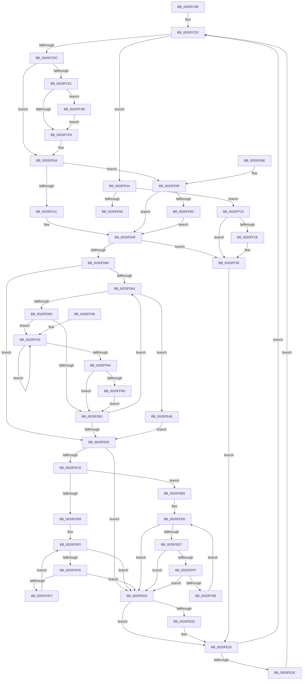

# ExfAcquirePushLockExclusiveEx

- RVA: `0x0020FC90`–`0x0020FF76` (길이 `742` bytes)
- VA: `0x000000014020FC90`
- 실행 섹션: `.text`
- PDB 이름 있음: `예`; PDB Function 태그: `아니요`
- unwind 정보 RVA: `0x0005DC0C`
- 디코드: `206`개 명령, `742/742` bytes 표시
- 미해석 바이트: `0` (있으면 어셈블리에 `.byte`로 보존)

> 이 문서는 커널 이미지의 기계어와 PDB 기호를 분석해 생성했습니다. 4번과 5번은 함수 원형과 자료형을 바이너리 사용 방식에서 추정한 C 해석이며 원본 소스 복구 결과는 아닙니다.

## 1. Dependencies

- 직접 호출 지점: **7**; 고유 호출 대상: **7**
- 직접 호출자로 확인된 함수: **762**
- RIP 상대 이미지 참조: **1**

### Outgoing calls
- `0x0020FCBA` → [memset](../6C/memset_function_006C6C40.md) (function, `0x006C6C40`)
- `0x0020FE20` → [KeWaitForSingleObject](KeWaitForSingleObject_function_0020E6B0.md) (function, `0x0020E6B0`)
- `0x0020FE37` → [KeAbPreAcquire](../21/KeAbPreAcquire_function_00210230.md) (function, `0x00210230`)
- `0x0020FEAB` → [ExpWakePushLock](../34/ExpWakePushLock_function_00341050.md) (function, `0x00341050`)
- `0x0020FF21` → [KeAbPreWait](KeAbPreWait_function_0020E560.md) (function, `0x0020E560`)
- `0x0020FF2A` → [RtlBackoff](RtlBackoff_function_00208620.md) (function, `0x00208620`)
- `0x0020FF3E` → [KiAbEntryRemoveFromTree](../26/KiAbEntryRemoveFromTree_function_00262410.md) (function, `0x00262410`)

### Direct callers
- [ExAcquirePushLockExclusiveEx](ExAcquirePushLockExclusiveEx_function_0020FC10.md) at `0x0020FC62`
- [PspLockProcessListExclusive](../22/PspLockProcessListExclusive_function_0022578C.md) at `0x002257CB`
- [ExpDeleteTimer](../23/ExpDeleteTimer_function_00230C40.md) at `0x00230D12`
- [NtCancelTimer](../23/NtCancelTimer_function_00230D90.md) at `0x00231017`
- [ExpSetTimerObject](../23/ExpSetTimerObject_function_00231730.md) at `0x002322F7`
- [MiPostInsertVad](../26/MiPostInsertVad_function_002643C0.md) at `0x0026443C`
- [sub_00264CE0](../26/Unknown_function_00264CE0.md) at `0x00264D25`
- [sub_00264D2C](../26/Unknown_function_00264D2C.md) at `0x00264D35`
- [sub_00264D3F](../26/Unknown_function_00264D3F.md) at `0x00264D45`
- [FsRtlAcquireAutoExpandPushLockExclusive](../26/FsRtlAcquireAutoExpandPushLockExclusive_function_0026539C.md) at `0x002654E4`
- [FsRtlAcquireAutoExpandPushLockExclusive](../26/FsRtlAcquireAutoExpandPushLockExclusive_function_0026539C.md) at `0x002654F4`
- [FsRtlAcquireAutoExpandPushLockExclusive](../26/FsRtlAcquireAutoExpandPushLockExclusive_function_0026539C.md) at `0x00265504`
- [StLockAcquireExclusive](../26/StLockAcquireExclusive_function_00266FF0.md) at `0x0026702C`
- [CcAcquireBcbLockAndVacbLock](../26/CcAcquireBcbLockAndVacbLock_function_0026FC58.md) at `0x0026FC9A`
- [CcGetVacbMiss](../27/CcGetVacbMiss_function_00272900.md) at `0x00272B27`
- [MiCreatePrototypePtes](../29/MiCreatePrototypePtes_function_002950FC.md) at `0x002953F5`
- [MiLockVad](../29/MiLockVad_function_00295810.md) at `0x0029584F`
- [MiRemoveVad](../29/MiRemoveVad_function_00295C78.md) at `0x00295D45`
- [MiRemoveFromSystemSpace](../29/MiRemoveFromSystemSpace_function_002962FC.md) at `0x002963A3`
- [MiRemoveFromSystemSpace](../29/MiRemoveFromSystemSpace_function_002962FC.md) at `0x0029646D`
- [MiSetVadDeleted](../29/MiSetVadDeleted_function_00296E00.md) at `0x00296E58`
- [VslpLockPagesForTransfer](../29/VslpLockPagesForTransfer_function_0029E0FC.md) at `0x0029E36F`
- [KeSwappablePageDereference](../29/KeSwappablePageDereference_function_0029F540.md) at `0x0029F5CC`
- [MiLockLoaderEntry](../2A/MiLockLoaderEntry_function_002A3EE0.md) at `0x002A3F9A`
- [LOCK_ADDRESS_SPACE](../2A/LOCK_ADDRESS_SPACE_function_002A4944.md) at `0x002A4986`
- [MiLockAddressSpaceToo](../2A/MiLockAddressSpaceToo_function_002A5670.md) at `0x002A5750`
- [MiLockAddressSpaceToo](../2A/MiLockAddressSpaceToo_function_002A5670.md) at `0x002A57CD`
- [LOCK_PAGE_TABLE_COMMITMENT](../2A/LOCK_PAGE_TABLE_COMMITMENT_function_002A6090.md) at `0x002A60CA`
- [MiLockWsSwapExclusive](../2A/MiLockWsSwapExclusive_function_002A8A70.md) at `0x002A8AAA`
- [KiAcquireDpcCorralLock](../2C/KiAcquireDpcCorralLock_function_002C9BDC.md) at `0x002C9C24`
- [sub_002DF8DD](../2D/Unknown_function_002DF8DD.md) at `0x002DF975`
- [SMKM_STORE_MGR&lt;SM_TRAITS&gt;::SmFeAddComplete](../2D/SMKM_STORE_MGR_SM_TRAITS_SmFeAddComplete_function_002DFEE0.md) at `0x002DFFBF`
- [sub_002E03B8](../2E/Unknown_function_002E03B8.md) at `0x002E0452`
- [MiManageSubsectionView](../2E/MiManageSubsectionView_function_002E2570.md) at `0x002E25CA`
- [ExpSaAllocatorFree](../2E/ExpSaAllocatorFree_function_002E2E00.md) at `0x002E2F30`
- [RtlpCSparseBitmapPageDecommit](../2E/RtlpCSparseBitmapPageDecommit_function_002EFAD4.md) at `0x002EFED7`
- [NtTraceEvent](../2F/NtTraceEvent_function_002FA6C0.md) at `0x002FB05A`
- [NtTraceEvent](../2F/NtTraceEvent_function_002FA6C0.md) at `0x002FB299`
- [EtwpEnqueueAvailableBuffer](../2F/EtwpEnqueueAvailableBuffer_function_002FE7DC.md) at `0x002FE930`
- [sub_003167E4](../31/Unknown_function_003167E4.md) at `0x00316808`
- [MiReturnLockedVadOrNextVa](../31/MiReturnLockedVadOrNextVa_function_00316980.md) at `0x00316CC4`
- [sub_00324759](../32/Unknown_function_00324759.md) at `0x00324789`
- [sub_003248D2](../32/Unknown_function_003248D2.md) at `0x0032490D`
- [MiAddViewsForSection](../32/MiAddViewsForSection_function_00324990.md) at `0x00324C16`
- [MiAddViewsForSection](../32/MiAddViewsForSection_function_00324990.md) at `0x00324F4C`
- [MiAddViewsForSection](../32/MiAddViewsForSection_function_00324990.md) at `0x00324FF4`
- [MiCommitExistingVad](../32/MiCommitExistingVad_function_0032A860.md) at `0x0032AB59`
- [CcPinFileData](../33/CcPinFileData_function_0033FB40.md) at `0x003401AC`
- [sub_0034A03B](../34/Unknown_function_0034A03B.md) at `0x0034A05B`
- [CcUnpinFileDataEx](../35/CcUnpinFileDataEx_function_00359DEC.md) at `0x0035A004`
- [MiPrivateFixup](../36/MiPrivateFixup_function_003693E8.md) at `0x00369ACC`
- [KeSwappablePageReference](../36/KeSwappablePageReference_function_0036A864.md) at `0x0036A8F5`
- [PspLockQuotaExpansion](../39/PspLockQuotaExpansion_function_00390774.md) at `0x003907D2`
- [PspReturnQuota](../39/PspReturnQuota_function_00390C40.md) at `0x00390E3B`
- [NtWaitForWorkViaWorkerFactory](../39/NtWaitForWorkViaWorkerFactory_function_00394270.md) at `0x00394F0B`
- [MiUpControlAreaRefs](../3B/MiUpControlAreaRefs_function_003B2BF0.md) at `0x003B2D58`
- [MiInsertInSystemSpace](../3B/MiInsertInSystemSpace_function_003B2F5C.md) at `0x003B31EA`
- [MiInsertInSystemSpace](../3B/MiInsertInSystemSpace_function_003B2F5C.md) at `0x003B32BA`
- [ExpSaPageGroupDescriptorAllocate](../3B/ExpSaPageGroupDescriptorAllocate_function_003B4224.md) at `0x003B433A`
- [ExpSaPageGroupAllocateMemory](../3B/ExpSaPageGroupAllocateMemory_function_003B5FF0.md) at `0x003B6039`
- [EtwpLockBufferList](../3E/EtwpLockBufferList_function_003EB49C.md) at `0x003EB542`
- [MiLockPartitionMappedWriter](../40/MiLockPartitionMappedWriter_function_00403150.md) at `0x0040318A`
- [ExfAcquireReleasePushLockExclusive](../41/ExfAcquireReleasePushLockExclusive_function_00419C2C.md) at `0x00419C4F`
- [CcAllocateInitializeBcb](../41/CcAllocateInitializeBcb_function_0041F5A4.md) at `0x0041F642`
- [PopAcquireRwLockExclusive](../43/PopAcquireRwLockExclusive_function_00430B44.md) at `0x00430B80`
- [RtlInsertDynamicUserFunctionTable](../45/RtlInsertDynamicUserFunctionTable_function_004513C4.md) at `0x00451491`
- [ExAcquireCacheAwarePushLockExclusiveEx](../45/ExAcquireCacheAwarePushLockExclusiveEx_function_00456550.md) at `0x00456599`
- [ExAcquireCacheAwarePushLockExclusive](../45/ExAcquireCacheAwarePushLockExclusive_function_00457550.md) at `0x00457594`
- [CcChangeBackingFileObject](../45/CcChangeBackingFileObject_function_00457E5C.md) at `0x00457EB1`
- [ExpLockHandleTableExclusive](../45/ExpLockHandleTableExclusive_function_00458B08.md) at `0x00458B3F`
- [ExQueryHandleExceptionsPermanency](../45/ExQueryHandleExceptionsPermanency_function_00458CE0.md) at `0x00458D42`
- [ExfAcquirePushLockExclusive](../45/ExfAcquirePushLockExclusive_function_0045D3F0.md) at `0x0045D3F9`
- [CcPostWorkQueueAsyncRead](../45/CcPostWorkQueueAsyncRead_function_0045D624.md) at `0x0045D6B9`
- [CcPostWorkQueueAsyncRead](../45/CcPostWorkQueueAsyncRead_function_0045D624.md) at `0x0045D857`
- [CcPostWorkQueueAsyncRead](../45/CcPostWorkQueueAsyncRead_function_0045D624.md) at `0x0045D9AF`
- [CcCompleteAsyncReadWorker](../45/CcCompleteAsyncReadWorker_function_0045D9C0.md) at `0x0045DA56`
- [CcAsyncReadWorker](../45/CcAsyncReadWorker_function_0045DB10.md) at `0x0045DD45`
- [CcAsyncReadWorker](../45/CcAsyncReadWorker_function_0045DB10.md) at `0x0045DE33`
- [CcAsyncReadWorker](../45/CcAsyncReadWorker_function_0045DB10.md) at `0x0045DFE6`
- [CcShouldSpinAsyncReadWorkerThread](../45/CcShouldSpinAsyncReadWorkerThread_function_0045EB28.md) at `0x0045EC02`
- [CcAmILowPriorityWriter](../45/CcAmILowPriorityWriter_function_0045F784.md) at `0x0045F7C9`
- [PspLockProcessExclusive](../46/PspLockProcessExclusive_function_00460164.md) at `0x0046019E`
- [MI_LOCK_RELOCATIONS_EXCLUSIVE](../46/MI_LOCK_RELOCATIONS_EXCLUSIVE_function_004650F8.md) at `0x0046513F`
- [RtlRemoveDynamicUserFunctionTable](../46/RtlRemoveDynamicUserFunctionTable_function_00466514.md) at `0x004665BD`
- [EtwpFreeCompression](../46/EtwpFreeCompression_function_0046CCD8.md) at `0x0046CD68`
- [PnpDeviceActionWorker](../47/PnpDeviceActionWorker_function_00478400.md) at `0x0047854A`
- [MiModifiedPageWriter](../47/MiModifiedPageWriter_function_0047E5F0.md) at `0x0047E66D`
- [SepDeleteSessionLowboxEntries](../48/SepDeleteSessionLowboxEntries_function_0048C188.md) at `0x0048C1EB`
- [SepDeleteSessionLowboxEntries](../48/SepDeleteSessionLowboxEntries_function_0048C188.md) at `0x0048C249`
- [MiDereferenceExtendInfo](../48/MiDereferenceExtendInfo_function_0048EFA4.md) at `0x0048EFFC`
- [ExpSaPageGroupFreeMemory](../49/ExpSaPageGroupFreeMemory_function_00493E8C.md) at `0x00493ED3`
- [FlushLookUpTableBucket](../49/FlushLookUpTableBucket_function_00497690.md) at `0x004976FB`
- [PopFxClearDirectedDripsCandidateDeviceList](../49/PopFxClearDirectedDripsCandidateDeviceList_function_004988EC.md) at `0x0049893D`
- [PopFxClearDirectedDripsCandidateDeviceList](../49/PopFxClearDirectedDripsCandidateDeviceList_function_004988EC.md) at `0x00498974`
- [PopFxBuildDirectedDripsCandidateDeviceList](../49/PopFxBuildDirectedDripsCandidateDeviceList_function_00499288.md) at `0x004992E8`
- [PopFxBuildDirectedDripsCandidateDeviceList](../49/PopFxBuildDirectedDripsCandidateDeviceList_function_00499288.md) at `0x00499322`
- [EtwpUpdateSelectedGroupMasks](../49/EtwpUpdateSelectedGroupMasks_function_0049B114.md) at `0x0049B1E7`
- [PopFxBuildDripsBlockingDeviceList](../49/PopFxBuildDripsBlockingDeviceList_function_0049B5B0.md) at `0x0049B6A9`
- [PopFxBuildDripsBlockingDeviceList](../49/PopFxBuildDripsBlockingDeviceList_function_0049B5B0.md) at `0x0049B6DF`
- [MiSetPagesModified](../49/MiSetPagesModified_function_0049DC2C.md) at `0x0049E14D`
- [FsRtlAcquirePushLockExclusive](../4A/FsRtlAcquirePushLockExclusive_function_004A05F4.md) at `0x004A0630`
- [PspStorageEmptyArrayNonReadonly](../4A/PspStorageEmptyArrayNonReadonly_function_004A3F6C.md) at `0x004A3FCB`
- [CcApplyLowIoPriorityToThread](../4A/CcApplyLowIoPriorityToThread_function_004A4210.md) at `0x004A42A3`
- [PopDirectedDripsDiagTraceNotifyDevices](../4A/PopDirectedDripsDiagTraceNotifyDevices_function_004A70AC.md) at `0x004A71DE`
- [PopDirectedDripsNotifyResiliencyCompletionWorker](../4A/PopDirectedDripsNotifyResiliencyCompletionWorker_function_004ACAE0.md) at `0x004ACB21`
- [KsepShimDbChanged](../4B/KsepShimDbChanged_function_004B014C.md) at `0x004B019E`
- [IopCleanupNotifications](../4B/IopCleanupNotifications_function_004B044C.md) at `0x004B04A8`
- [RtlpHpAcquireReleaseLockExclusive](../4B/RtlpHpAcquireReleaseLockExclusive_function_004B208C.md) at `0x004B20D5`
- [RtlpAcquireBootStatusLock](../4B/RtlpAcquireBootStatusLock_function_004B26AC.md) at `0x004B26F4`
- [ExpSaPageGroupDescriptorFree](../4B/ExpSaPageGroupDescriptorFree_function_004B5EA8.md) at `0x004B5EF2`
- [PopFxInsertDevice](../4B/PopFxInsertDevice_function_004B95EC.md) at `0x004B9641`
- [MiLockDriverMappings](../4B/MiLockDriverMappings_function_004B9D50.md) at `0x004B9D8F`
- [HalpIommuUnblockDevice](../4C/HalpIommuUnblockDevice_function_004C6250.md) at `0x004C6364`
- [ExWakeTimersPause](../4C/ExWakeTimersPause_function_004C6EB4.md) at `0x004C6EE5`
- [MiLateInitializeSystemCache](../4C/MiLateInitializeSystemCache_function_004C8104.md) at `0x004C8154`
- [HalpIommuBlockDevice](../4C/HalpIommuBlockDevice_function_004CA150.md) at `0x004CA1D4`
- [PsGetProcessEnclaveModuleInfo](../4C/PsGetProcessEnclaveModuleInfo_function_004CA2E0.md) at `0x004CA350`
- [ExGetWakeTimerList](../4C/ExGetWakeTimerList_function_004CB964.md) at `0x004CB9D4`
- [PopPepInsertDevice](../4C/PopPepInsertDevice_function_004CBD58.md) at `0x004CBDAD`
- [PopPepRemoveDevice](../4C/PopPepRemoveDevice_function_004CBE38.md) at `0x004CBE8D`
- [ExpLockCallbackListExclusive](../4D/ExpLockCallbackListExclusive_function_004D7060.md) at `0x004D709F`
- [PspLockQuotaListExclusive](../4D/PspLockQuotaListExclusive_function_004D81A8.md) at `0x004D81DE`
- [PspLockThreadSecurityExclusive](../4E/PspLockThreadSecurityExclusive_function_004E96E0.md) at `0x004E9732`
- [SmFirstTimeInit](../4E/SmFirstTimeInit_function_004EA944.md) at `0x004EA9D0`
- [PopFxPrepareDevicesForShutdown](../4F/PopFxPrepareDevicesForShutdown_function_004F5DF4.md) at `0x004F5E40`
- [HalpIommuCreateDevice](../54/HalpIommuCreateDevice_function_0054ED60.md) at `0x0054EDF3`
- [HalpIommuDeleteDevice](../54/HalpIommuDeleteDevice_function_0054F368.md) at `0x0054F3B1`
- [HalpIommuInvokeInterfaceStateChangeCallbacks](../54/HalpIommuInvokeInterfaceStateChangeCallbacks_function_0054F708.md) at `0x0054F757`
- [IommupDeviceGetPasidDevice](../54/IommupDeviceGetPasidDevice_function_0054F82C.md) at `0x0054F87A`
- [IommupPasidDeviceCreate](../54/IommupPasidDeviceCreate_function_0054FEEC.md) at `0x0054FFAC`
- [IommupPasidDeviceDelete](../55/IommupPasidDeviceDelete_function_00550030.md) at `0x00550096`
- [HalpLeaveDmaDomain](../55/HalpLeaveDmaDomain_function_00552600.md) at `0x00552650`
- [IommuBeginDeviceReset](../56/IommuBeginDeviceReset_function_00564A60.md) at `0x00564AD7`
- [IommuFinalizeDeviceReset](../56/IommuFinalizeDeviceReset_function_005653F0.md) at `0x0056546C`
- [IommupFreeSystemContext](../56/IommupFreeSystemContext_function_00566234.md) at `0x00566281`
- [IommupGetSystemContext](../56/IommupGetSystemContext_function_00566310.md) at `0x0056634E`
- [IommupHvAttachPasidDevice](../56/IommupHvAttachPasidDevice_function_00566AEC.md) at `0x00566B97`
- [IommupHvAttachPasidDevice](../56/IommupHvAttachPasidDevice_function_00566AEC.md) at `0x00566C14`
- [IommupHvAttachPasidDevice](../56/IommupHvAttachPasidDevice_function_00566AEC.md) at `0x00566CA7`
- [IommupHvAttachPasidDeviceDomain](../56/IommupHvAttachPasidDeviceDomain_function_00566E3C.md) at `0x00566EB8`
- [IommupHvCreateSvmPasidSpace](../56/IommupHvCreateSvmPasidSpace_function_0056703C.md) at `0x005670A9`
- [IommupHvDetachPasidDeviceDomain](../56/IommupHvDetachPasidDeviceDomain_function_005671B4.md) at `0x00567221`
- [IommuRegisterInterfaceStateChangeCallback](../56/IommuRegisterInterfaceStateChangeCallback_function_00568200.md) at `0x00568293`
- [IommuRegisterInterfaceStateChangeCallback](../56/IommuRegisterInterfaceStateChangeCallback_function_00568200.md) at `0x0056831E`
- [IommuUnregisterInterfaceStateChangeCallback](../56/IommuUnregisterInterfaceStateChangeCallback_function_00568730.md) at `0x0056877B`
- [IommuUnregisterInterfaceStateChangeCallback](../56/IommuUnregisterInterfaceStateChangeCallback_function_00568730.md) at `0x005687CC`
- [CcBoostLowPriorityWorkerThread](../57/CcBoostLowPriorityWorkerThread_function_0057B704.md) at `0x0057B76F`
- [CcAsyncReadWorkerThread](../57/CcAsyncReadWorkerThread_function_0057F560.md) at `0x0057F60B`
- [EmpQueueRuleUpdateState](../58/EmpQueueRuleUpdateState_function_005809B0.md) at `0x005809F3`
- [EmpRuleUpdateWorkerThread](../58/EmpRuleUpdateWorkerThread_function_00580B20.md) at `0x00580B61`
- [EmpRuleUpdateWorkerThread](../58/EmpRuleUpdateWorkerThread_function_00580B20.md) at `0x00580BDD`
- [EmpRuleUpdateWorkerThread](../58/EmpRuleUpdateWorkerThread_function_00580B20.md) at `0x00580C48`
- [PnpCancelDeviceActionRequest](../5A/PnpCancelDeviceActionRequest_function_005A8330.md) at `0x005A8378`
- [KasaniReportTelemetry](../5A/KasaniReportTelemetry_function_005AB1D0.md) at `0x005AB240`
- [sub_005AF38C](../5A/Unknown_function_005AF38C.md) at `0x005AF3C3`
- [KeUpdateDpcWatchdogConfiguration](../5B/KeUpdateDpcWatchdogConfiguration_function_005B5A34.md) at `0x005B5AB8`
- [PopFxInsertAcpiDevice](../5D/PopFxInsertAcpiDevice_function_005D2C08.md) at `0x005D2C5D`
- [PopFxRegisterPluginEx](../5D/PopFxRegisterPluginEx_function_005D31B8.md) at `0x005D3337`
- [PopFxRemoveAcpiDevice](../5D/PopFxRemoveAcpiDevice_function_005D3468.md) at `0x005D34BD`
- [PopFxRemoveDevice](../5D/PopFxRemoveDevice_function_005D3534.md) at `0x005D3589`
- [PspAcquireSyscallProviderRegistrationLockExclusive](../5E/PspAcquireSyscallProviderRegistrationLockExclusive_function_005E2284.md) at `0x005E22CC`
- [PspLockSyscallProviderExclusive](../5E/PspLockSyscallProviderExclusive_function_005E231C.md) at `0x005E235C`
- [PspEnqueueProcessQosChangeNotification](../5E/PspEnqueueProcessQosChangeNotification_function_005E2ED0.md) at `0x005E2F43`
- [PspRefreshProcessUserPresencePpmPolicyCallback](../5E/PspRefreshProcessUserPresencePpmPolicyCallback_function_005E3100.md) at `0x005E315C`
- [PspAcquirePushLockExclusive](../5E/PspAcquirePushLockExclusive_function_005E3FDC.md) at `0x005E4024`
- [PsAdjustBasicEnclaveThreadList](../5E/PsAdjustBasicEnclaveThreadList_function_005E4BD8.md) at `0x005E4C6F`
- [PsLoadVsmEnclaveData](../5E/PsLoadVsmEnclaveData_function_005E4D5C.md) at `0x005E4E3C`
- [NormalizationList__Lock](../5F/NormalizationList__Lock_function_005F1E80.md) at `0x005F1EC8`
- [SepDeleteSessionAntiTamperEntries](../60/SepDeleteSessionAntiTamperEntries_function_0060AAF8.md) at `0x0060AB5B`
- [SepDeleteSessionAntiTamperEntries](../60/SepDeleteSessionAntiTamperEntries_function_0060AAF8.md) at `0x0060ABB9`
- [SepSetTokenAntiTamperEntry](../60/SepSetTokenAntiTamperEntry_function_0060B28C.md) at `0x0060B3C0`
- [SepSetTokenAntiTamperEntry](../60/SepSetTokenAntiTamperEntry_function_0060B28C.md) at `0x0060B437`
- [SepSetTokenAntiTamperEntry](../60/SepSetTokenAntiTamperEntry_function_0060B28C.md) at `0x0060B4C5`
- [SepSetTokenLowboxNumberEntry](../60/SepSetTokenLowboxNumberEntry_function_0060B594.md) at `0x0060B6C3`
- [SepSetTokenLowboxNumberEntry](../60/SepSetTokenLowboxNumberEntry_function_0060B594.md) at `0x0060B73A`
- [SepSetTokenLowboxNumberEntry](../60/SepSetTokenLowboxNumberEntry_function_0060B594.md) at `0x0060B7C8`
- [SmKmVirtualLockContextIncreaseWsMin](../60/SmKmVirtualLockContextIncreaseWsMin_function_0060FE94.md) at `0x0060FEED`
- [SmKmVirtualLockCtxMemoryUnlocked](../61/SmKmVirtualLockCtxMemoryUnlocked_function_0061015C.md) at `0x006101D8`
- [SmHwAcceleratorMgrHotRemoveAccelerator](../61/SmHwAcceleratorMgrHotRemoveAccelerator_function_006115FC.md) at `0x00611666`
- [SmHwAcceleratorMgrHotRemoveAccelerator](../61/SmHwAcceleratorMgrHotRemoveAccelerator_function_006115FC.md) at `0x00611706`
- [SmHwAcceleratorPartitionMgrInsertAccelerator](../61/SmHwAcceleratorPartitionMgrInsertAccelerator_function_00611944.md) at `0x006119A9`
- [DifExfAcquirePushLockExclusiveWrapper](../62/DifExfAcquirePushLockExclusiveWrapper_function_00623970.md) at `0x00623A3B`
- [EtwpBufferingModeCompressionFlush](../65/EtwpBufferingModeCompressionFlush_function_00652D24.md) at `0x00652D6D`
- [EtwpCompressPendingBuffers](../65/EtwpCompressPendingBuffers_function_00653140.md) at `0x0065317A`
- [EtwpCompressionProc](../65/EtwpCompressionProc_function_00653300.md) at `0x00653379`
- [EtwpDisableCompression](../65/EtwpDisableCompression_function_006534F8.md) at `0x0065355A`
- [EtwpSetCompressionSettings](../65/EtwpSetCompressionSettings_function_00653910.md) at `0x0065397C`
- [ExpQueryBootLoaderMetadata](../65/ExpQueryBootLoaderMetadata_function_00654E8C.md) at `0x00654EF4`
- [ExpSetBootLoaderMetadata](../65/ExpSetBootLoaderMetadata_function_00654F98.md) at `0x00654FFD`
- [ExInitializeDeviceAts](../65/ExInitializeDeviceAts_function_00659B80.md) at `0x00659C71`
- [ExUninitializeDeviceAts](../65/ExUninitializeDeviceAts_function_00659D6C.md) at `0x00659DBD`
- [ExSvmBeginDeviceReset](../65/ExSvmBeginDeviceReset_function_0065ACE0.md) at `0x0065AD38`
- [ExSvmFinalizeDeviceReset](../65/ExSvmFinalizeDeviceReset_function_0065AE00.md) at `0x0065AE51`
- [ExpShareAddressSpaceWithDevice](../65/ExpShareAddressSpaceWithDevice_function_0065B528.md) at `0x0065B64A`
- [ExpShareAddressSpaceWithDevice](../65/ExpShareAddressSpaceWithDevice_function_0065B528.md) at `0x0065B793`
- [ExpSvmDereferenceDevice](../65/ExpSvmDereferenceDevice_function_0065BBCC.md) at `0x0065BC2E`
- [ExpAcquirePoolListLockExclusive](../65/ExpAcquirePoolListLockExclusive_function_0065D804.md) at `0x0065D84C`
- [WheaSelLogError](../65/WheaSelLogError_function_0065D8A8.md) at `0x0065D903`
- [WheaSelLogSetNtSchedulerAvailability](../65/WheaSelLogSetNtSchedulerAvailability_function_0065DB18.md) at `0x0065DB64`
- [WheaRegisterErrorSourceOverride](../66/WheaRegisterErrorSourceOverride_function_00660EE0.md) at `0x00660F98`
- [WheaUnregisterErrorSourceOverride](../66/WheaUnregisterErrorSourceOverride_function_00661140.md) at `0x006611AE`
- [CmpNotifyMachineHiveLoaded](../66/CmpNotifyMachineHiveLoaded_function_0066A43C.md) at `0x0066A490`
- [MiLockDynamicMemoryExclusive](../67/MiLockDynamicMemoryExclusive_function_006730F8.md) at `0x00673132`
- [MiLockDynamicMemoryNestedExclusive](../67/MiLockDynamicMemoryNestedExclusive_function_00673154.md) at `0x0067318B`
- [MiCreateSlabIdentity](../68/MiCreateSlabIdentity_function_0068D2D4.md) at `0x0068D332`
- [MiDeletePendingSlabIdentities](../68/MiDeletePendingSlabIdentities_function_0068DA3C.md) at `0x0068DAA5`
- [MiReturnPartitionPagesToParent](../69/MiReturnPartitionPagesToParent_function_00691B5C.md) at `0x00691C04`
- [sub_006D73CA](../6D/Unknown_function_006D73CA.md) at `0x006D743C`
- [sub_006D969C](../6D/Unknown_function_006D969C.md) at `0x006D97D7`
- [sub_006E362E](../6E/Unknown_function_006E362E.md) at `0x006E3846`
- [sub_006E7298](../6E/Unknown_function_006E7298.md) at `0x006E72C1`
- [sub_006EECE7](../6E/Unknown_function_006EECE7.md) at `0x006EED1B`
- [sub_006F937E](../6F/Unknown_function_006F937E.md) at `0x006F93D3`
- [EtwpTrackProviderBinaryKm](../../page/6F/EtwpTrackProviderBinaryKm_function_006FD8E8.md) at `0x006FD961`
- [EtwpTrackProviderBinaryKm](../../page/6F/EtwpTrackProviderBinaryKm_function_006FD8E8.md) at `0x006FD9C3`
- [EtwpCovSampContextCleanup](../../page/6F/EtwpCovSampContextCleanup_function_006FDF84.md) at `0x006FDFF8`
- [PopBootStatUnlock](../../page/6F/PopBootStatUnlock_function_006FE704.md) at `0x006FE750`
- [CmpLockCallbackListExclusive](../../page/6F/CmpLockCallbackListExclusive_function_006FEDDC.md) at `0x006FEE24`
- [CmFcpManagerOnFeatureUsageDataTransferComplete](../../page/6F/CmFcpManagerOnFeatureUsageDataTransferComplete_function_006FF830.md) at `0x006FF876`
- [EtwQueryProcessTelemetryCoverage](../../page/70/EtwQueryProcessTelemetryCoverage_function_00701B8C.md) at `0x00701C4C`
- [EtwpCoverageEnsureContext](../../page/70/EtwpCoverageEnsureContext_function_007028E4.md) at `0x00702C09`
- [CmpLockFreezeQueue](../../page/70/CmpLockFreezeQueue_function_007048F0.md) at `0x00704927`
- [HalpDmaAllocateChildAdapterV3](../../page/70/HalpDmaAllocateChildAdapterV3_function_007066A0.md) at `0x00706BF6`
- [HalpNotifyActorIfPmuAvailable](../../page/70/HalpNotifyActorIfPmuAvailable_function_00707880.md) at `0x00707902`
- [HalpNotifyActorIfPmuAvailable](../../page/70/HalpNotifyActorIfPmuAvailable_function_00707880.md) at `0x00707A1F`
- [HalpPmuArbiterPeriodicWorkItem](../../page/70/HalpPmuArbiterPeriodicWorkItem_function_00707B90.md) at `0x00707BE8`
- [IommupDeviceDisableSvm](../../page/70/IommupDeviceDisableSvm_function_00708A28.md) at `0x00708B08`
- [HalpRegisterPmuNotification](../../page/70/HalpRegisterPmuNotification_function_0070C38C.md) at `0x0070C445`
- [IommuDeviceDelete](../../page/70/IommuDeviceDelete_function_0070D0D0.md) at `0x0070D128`
- [IommuDeviceDelete](../../page/70/IommuDeviceDelete_function_0070D0D0.md) at `0x0070D1B2`
- [DbgkpRemoveErrorPort](../../page/71/DbgkpRemoveErrorPort_function_00711038.md) at `0x00711096`
- [EmClientRuleDeregisterNotification](../../page/71/EmClientRuleDeregisterNotification_function_00712CB0.md) at `0x00712CF4`
- [EmpClientRuleRegisterNotification](../../page/71/EmpClientRuleRegisterNotification_function_00712DE4.md) at `0x00712E43`
- [EmProviderDeregister](../../page/71/EmProviderDeregister_function_00713060.md) at `0x007130AD`
- [EmProviderDeregisterEntry](../../page/71/EmProviderDeregisterEntry_function_00713230.md) at `0x0071326A`
- [EmProviderRegisterEntry](../../page/71/EmProviderRegisterEntry_function_00713300.md) at `0x0071335D`
- [HvlQuerySetBootPagesInfo](../../page/71/HvlQuerySetBootPagesInfo_function_00717D7C.md) at `0x00717E05`
- [IoRegisterContainerNotification](../../page/71/IoRegisterContainerNotification_function_0071E700.md) at `0x0071E794`
- [IoUnregisterContainerNotification](../../page/71/IoUnregisterContainerNotification_function_0071E9C0.md) at `0x0071EA10`
- [IoRegisterIoTracking](../../page/71/IoRegisterIoTracking_function_0071F600.md) at `0x0071F68D`
- [IoUnregisterIoTracking](../../page/71/IoUnregisterIoTracking_function_0071F750.md) at `0x0071F7B9`
- [KeRegisterAvailableCpusChangeNotification](../../page/74/KeRegisterAvailableCpusChangeNotification_function_00745D7C.md) at `0x00745E33`
- [KeRegisterAvailableCpusChangeNotification](../../page/74/KeRegisterAvailableCpusChangeNotification_function_00745D7C.md) at `0x00745EBF`
- [KeUnregisterAvailableCpusChangeNotification](../../page/74/KeUnregisterAvailableCpusChangeNotification_function_00745FB4.md) at `0x0074600E`
- [KeUnregisterAvailableCpusChangeNotification](../../page/74/KeUnregisterAvailableCpusChangeNotification_function_00745FB4.md) at `0x0074609B`
- [KeSetSystemServiceCallback](../../page/74/KeSetSystemServiceCallback_function_00747A10.md) at `0x00747B01`
- [KeSetTracepoint](../../page/74/KeSetTracepoint_function_00747F80.md) at `0x00748234`
- [KiTpIsExcludedKernelTracepointLocation](../../page/74/KiTpIsExcludedKernelTracepointLocation_function_007487D0.md) at `0x0074881F`
- [KseRegisterShimEx](../../page/74/KseRegisterShimEx_function_007494D0.md) at `0x0074961C`
- [KseUnregisterShim](../../page/74/KseUnregisterShim_function_00749800.md) at `0x0074988A`
- [KsepResolveApplicableShimsForDriver](../../page/74/KsepResolveApplicableShimsForDriver_function_0074A168.md) at `0x0074A1CF`
- [KsepResolveApplicableShimsForDriver](../../page/74/KsepResolveApplicableShimsForDriver_function_0074A168.md) at `0x0074A33F`
- [KsepResolveApplicableShimsForDriver](../../page/74/KsepResolveApplicableShimsForDriver_function_0074A168.md) at `0x0074A4A8`
- [AlpcRegisterLogRoutine](../../page/74/AlpcRegisterLogRoutine_function_0074CE5C.md) at `0x0074CED2`
- [AlpcUnregisterLogRoutine](../../page/74/AlpcUnregisterLogRoutine_function_0074CF84.md) at `0x0074CFC0`
- [ObShutdownSystem](../../page/74/ObShutdownSystem_function_0074DBB0.md) at `0x0074DEBD`
- [ObRevokeHandles](../../page/74/ObRevokeHandles_function_0074E838.md) at `0x0074E885`
- [ObpCreateSymbolicLinkName](../../page/74/ObpCreateSymbolicLinkName_function_0074EB80.md) at `0x0074EEB4`
- [ObDisableEtwReferenceTrace](../../page/74/ObDisableEtwReferenceTrace_function_0074F394.md) at `0x0074F3E0`
- [ObEnableEtwReferenceTrace](../../page/74/ObEnableEtwReferenceTrace_function_0074F434.md) at `0x0074F480`
- [ObQueryRefTraceInformation](../../page/74/ObQueryRefTraceInformation_function_0074F4D4.md) at `0x0074F565`
- [ObpFreeWorkItemBlock](../../page/74/ObpFreeWorkItemBlock_function_0074F940.md) at `0x0074F995`
- [ObpPushRefDerefInfo](../../page/74/ObpPushRefDerefInfo_function_0074FEC4.md) at `0x0074FF31`
- [ObpStartRuntimeStackTrace](../../page/75/ObpStartRuntimeStackTrace_function_00750134.md) at `0x007503FA`
- [ObpStopRuntimeStackTrace](../../page/75/ObpStopRuntimeStackTrace_function_00750574.md) at `0x007505CB`
- [PopFxNotifySxTransitionState](../../page/75/PopFxNotifySxTransitionState_function_007593B0.md) at `0x007593E6`
- [PopFxNotifySxTransitionState](../../page/75/PopFxNotifySxTransitionState_function_007593B0.md) at `0x00759456`
- [PopPowerButtonBugcheckConfigure](../../page/76/PopPowerButtonBugcheckConfigure_function_00768F84.md) at `0x0076902A`
- [PopDirectedDripsDiagBroadcastTreeEnd](../../page/77/PopDirectedDripsDiagBroadcastTreeEnd_function_00770E10.md) at `0x00770E64`
- [PopDirectedDripsDiagTraceBroadcastFailureDevice](../../page/77/PopDirectedDripsDiagTraceBroadcastFailureDevice_function_0077127C.md) at `0x007712BB`
- [PopDirectedDripsDiagTraceProblemDevice](../../page/77/PopDirectedDripsDiagTraceProblemDevice_function_0077135C.md) at `0x007713AE`
- [SshpFreeDataEntry](../../page/77/SshpFreeDataEntry_function_00773614.md) at `0x0077364F`
- [SshSessionManagerFlushBuffers](../../page/77/SshSessionManagerFlushBuffers_function_007736D8.md) at `0x00773719`
- [SshSessionManagerFlushBuffers](../../page/77/SshSessionManagerFlushBuffers_function_007736D8.md) at `0x00773771`
- [SshSessionManagerFlushBuffers](../../page/77/SshSessionManagerFlushBuffers_function_007736D8.md) at `0x0077383F`
- [SshpSessionManagerControlSessionCallback](../../page/77/SshpSessionManagerControlSessionCallback_function_00774360.md) at `0x00774397`
- [SshpSessionManagerOpenControlTrace](../../page/77/SshpSessionManagerOpenControlTrace_function_007744C0.md) at `0x0077460E`
- [SleepstudyHelperDestroyLibrary](../../page/77/SleepstudyHelperDestroyLibrary_function_00774720.md) at `0x00774775`
- [SleepstudyHelperDestroyLibrary](../../page/77/SleepstudyHelperDestroyLibrary_function_00774720.md) at `0x00774821`
- [SshpAlpcCloseTraceSession](../../page/77/SshpAlpcCloseTraceSession_function_00774DE8.md) at `0x00774E1F`
- [SshpAlpcOpenGracePeriodWorker](../../page/77/SshpAlpcOpenGracePeriodWorker_function_00774FC0.md) at `0x00775002`
- [SshpAlpcProcessAlpcMessage](../../page/77/SshpAlpcProcessAlpcMessage_function_0077506C.md) at `0x00775141`
- [SshpAlpcProcessAlpcMessage](../../page/77/SshpAlpcProcessAlpcMessage_function_0077506C.md) at `0x0077524C`
- [PspDxgExtensionHostCallback](../../page/78/PspDxgExtensionHostCallback_function_00781670.md) at `0x007816D2`
- [PspProcessQosChangeNotificationWorker](../../page/78/PspProcessQosChangeNotificationWorker_function_00781740.md) at `0x007817AE`
- [PspProcessQosChangeNotificationWorker](../../page/78/PspProcessQosChangeNotificationWorker_function_00781740.md) at `0x0078197B`
- [PsUpdateActiveProcessAffinity](../../page/78/PsUpdateActiveProcessAffinity_function_00781DA8.md) at `0x00781DFA`
- [PspEnableProcessOptionalXStateFeatures](../../page/78/PspEnableProcessOptionalXStateFeatures_function_00781EF0.md) at `0x00781F80`
- [PspProcessDynamicEHContinuationTargets](../../page/78/PspProcessDynamicEHContinuationTargets_function_00782348.md) at `0x007824AF`
- [PspProcessDynamicEnforcedAddressRanges](../../page/78/PspProcessDynamicEnforcedAddressRanges_function_00782624.md) at `0x007827C9`
- [NtChangeProcessState](../../page/78/NtChangeProcessState_function_00782C00.md) at `0x00782D4E`
- [PsCreateCpuPartition](../../page/78/PsCreateCpuPartition_function_00783A8C.md) at `0x00783BA9`
- [PspDeleteCpuPartition](../../page/78/PspDeleteCpuPartition_function_00784310.md) at `0x00784382`
- [PsRegisterAltSystemCallHandler](../../page/78/PsRegisterAltSystemCallHandler_function_00787110.md) at `0x00787198`
- [PspTeardownPartition](../../page/78/PspTeardownPartition_function_00788480.md) at `0x0078851E`
- [PsDeleteVsmEnclave](../../page/78/PsDeleteVsmEnclave_function_007885F0.md) at `0x0078863D`
- [PsInitializeVsmEnclave](../../page/78/PsInitializeVsmEnclave_function_0078875C.md) at `0x007887C2`
- [PsIsVsmEnclaveTerminated](../../page/78/PsIsVsmEnclaveTerminated_function_00788934.md) at `0x00788985`
- [PsTerminateVsmEnclave](../../page/78/PsTerminateVsmEnclave_function_00788A64.md) at `0x00788B57`
- [PspRemoveEnclaveThreadWait](../../page/78/PspRemoveEnclaveThreadWait_function_00788CB0.md) at `0x00788D09`
- [PspStorageAllocSlot](../../page/78/PspStorageAllocSlot_function_00789B68.md) at `0x00789BC4`
- [PspStorageFreeSlot](../../page/78/PspStorageFreeSlot_function_00789C64.md) at `0x00789CC7`
- [PspStorageRemoveObject](../../page/78/PspStorageRemoveObject_function_00789D68.md) at `0x00789DE9`
- [PspStorageReplaceObject](../../page/78/PspStorageReplaceObject_function_00789EA0.md) at `0x00789F29`
- [RtlpFlsAlloc](../../page/79/RtlpFlsAlloc_function_00795074.md) at `0x007950BD`
- [RtlpFlsFree](../../page/79/RtlpFlsFree_function_0079521C.md) at `0x007952DC`
- [RtlpFlsFree](../../page/79/RtlpFlsFree_function_0079521C.md) at `0x007953F9`
- [PdcAcquireRwLockExclusive](../../page/79/PdcAcquireRwLockExclusive_function_0079B748.md) at `0x0079B784`
- [SepDeReferenceSharedSidEntries](../../page/7A/SepDeReferenceSharedSidEntries_function_007A2D40.md) at `0x007A2D9B`
- [SepDereferenceAntiTamperEntry](../../page/7A/SepDereferenceAntiTamperEntry_function_007A2E50.md) at `0x007A2F5C`
- [SepInsertOrReferenceSharedSidEntries](../../page/7A/SepInsertOrReferenceSharedSidEntries_function_007A32A8.md) at `0x007A330E`
- [SepIsParentOfChildAppContainer](../../page/7A/SepIsParentOfChildAppContainer_function_007A34C0.md) at `0x007A35D4`
- [SepRmCapUpdateWrkr](../../page/7A/SepRmCapUpdateWrkr_function_007A46D0.md) at `0x007A4750`
- [SepRmCapUpdateWrkr](../../page/7A/SepRmCapUpdateWrkr_function_007A46D0.md) at `0x007A4838`
- [SmDeletePartition](../../page/7A/SmDeletePartition_function_007A59C0.md) at `0x007A5A32`
- [SmGetRegistrationInfo](../../page/7A/SmGetRegistrationInfo_function_007A5AC4.md) at `0x007A5B26`
- [SmPartitionJobPaired](../../page/7A/SmPartitionJobPaired_function_007A5E34.md) at `0x007A5E91`
- [SmProcessConfigRequest](../../page/7A/SmProcessConfigRequest_function_007A62E4.md) at `0x007A6479`
- [SmcCacheCreatePrepare](../../page/7A/SmcCacheCreatePrepare_function_007A754C.md) at `0x007A75A7`
- [SmpSystemStoreCreate](../../page/7A/SmpSystemStoreCreate_function_007A8024.md) at `0x007A807C`
- [SmKmKeyGenKeyDelete](../../page/7A/SmKmKeyGenKeyDelete_function_007A870C.md) at `0x007A8759`
- [SmKmKeyGenNewKey](../../page/7A/SmKmKeyGenNewKey_function_007A8990.md) at `0x007A8A9E`
- [SmHwAcceleratorMgrPartitionRegister](../../page/7A/SmHwAcceleratorMgrPartitionRegister_function_007AADDC.md) at `0x007AAE2E`
- [SmHwAcceleratorMgrPartitionUnregister](../../page/7A/SmHwAcceleratorMgrPartitionUnregister_function_007AAEFC.md) at `0x007AAF49`
- [SmcCacheAdd](../../page/7A/SmcCacheAdd_function_007AB670.md) at `0x007AB6EE`
- [SmcCacheRemove](../../page/7A/SmcCacheRemove_function_007ABB68.md) at `0x007ABBD0`
- [SmcStoreDelete](../../page/7A/SmcStoreDelete_function_007AC214.md) at `0x007AC293`
- [SmcStoreDelete](../../page/7A/SmcStoreDelete_function_007AC214.md) at `0x007AC344`
- [SmcStoreResize](../../page/7A/SmcStoreResize_function_007AC500.md) at `0x007AC60F`
- [SmcStoreResize](../../page/7A/SmcStoreResize_function_007AC500.md) at `0x007AC73C`
- [SmcStoreSlotAbort](../../page/7A/SmcStoreSlotAbort_function_007AC7DC.md) at `0x007AC83A`
- [SmcStoreSlotCommit](../../page/7A/SmcStoreSlotCommit_function_007AC8A8.md) at `0x007AC906`
- [SmcStoreSlotReserve](../../page/7A/SmcStoreSlotReserve_function_007AC978.md) at `0x007ACA4D`
- [WdipSemInitialize](../../page/7A/WdipSemInitialize_function_007AEC68.md) at `0x007AECB5`
- [WdipSemUpdate](../../page/7A/WdipSemUpdate_function_007AED28.md) at `0x007AED80`
- [PerfDiagpProxyWorker](../../page/7A/PerfDiagpProxyWorker_function_007AEF20.md) at `0x007AEF89`
- [WdipSemMarkInstanceForDeletion](../../page/7B/WdipSemMarkInstanceForDeletion_function_007B0C84.md) at `0x007B0CDD`
- [WdipSemUpdateFrequentScenarioTable](../../page/7B/WdipSemUpdateFrequentScenarioTable_function_007B0D7C.md) at `0x007B0DD8`
- [EtwpInitializeSiloState](../../page/7B/EtwpInitializeSiloState_function_007B6A3C.md) at `0x007B6C3E`
- [EtwpCoverageCheckCP](../../page/7B/EtwpCoverageCheckCP_function_007B9BC4.md) at `0x007B9C34`
- [EtwpCoverageFlushWorkItemCallback](../../page/7B/EtwpCoverageFlushWorkItemCallback_function_007B9D90.md) at `0x007B9E01`
- [EtwpCoverageReset](../../page/7B/EtwpCoverageReset_function_007B9F4C.md) at `0x007B9FF8`
- [EtwpCoverageResetCP](../../page/7B/EtwpCoverageResetCP_function_007BA154.md) at `0x007BA21B`
- [EtwpFlushCoverage](../../page/7B/EtwpFlushCoverage_function_007BA478.md) at `0x007BA4C4`
- [EtwpSendDbgId](../../page/7B/EtwpSendDbgId_function_007BC1C0.md) at `0x007BC236`
- [EtwpDeleteSessionDemuxObject](../../page/7B/EtwpDeleteSessionDemuxObject_function_007BC480.md) at `0x007BC4F0`
- [EtwpGetPrivateSessionTraceHandle](../../page/7B/EtwpGetPrivateSessionTraceHandle_function_007BC5A8.md) at `0x007BC61E`
- [EtwpRegisterPrivateSession](../../page/7B/EtwpRegisterPrivateSession_function_007BC92C.md) at `0x007BC9F3`
- [EtwpUpdatePeriodicCaptureState](../../page/7B/EtwpUpdatePeriodicCaptureState_function_007BCC4C.md) at `0x007BCD1E`
- [SendCaptureStateNotificationsWorker](../../page/7B/SendCaptureStateNotificationsWorker_function_007BCF30.md) at `0x007BCFBC`
- [SendCaptureStateNotificationsWorker](../../page/7B/SendCaptureStateNotificationsWorker_function_007BCF30.md) at `0x007BD0CF`
- [SendCaptureStateNotificationsWorker](../../page/7B/SendCaptureStateNotificationsWorker_function_007BCF30.md) at `0x007BD23D`
- [EtwpCoverageSamplerClose](../../page/7C/EtwpCoverageSamplerClose_function_007C1F40.md) at `0x007C1FA6`
- [EtwpCoverageSamplerSetBloomFilter](../../page/7C/EtwpCoverageSamplerSetBloomFilter_function_007C2070.md) at `0x007C218C`
- [EtwpCoverageSamplerStart](../../page/7C/EtwpCoverageSamplerStart_function_007C2248.md) at `0x007C23AD`
- [EtwpCoverageSamplerStop](../../page/7C/EtwpCoverageSamplerStop_function_007C2564.md) at `0x007C25C7`
- [EtwpCoverageSamplerStop](../../page/7C/EtwpCoverageSamplerStop_function_007C2564.md) at `0x007C2682`
- [EtwpCoverageSamplerStop](../../page/7C/EtwpCoverageSamplerStop_function_007C2564.md) at `0x007C2784`
- [ExNotifyPlatformBinaryExecuted](../../page/7C/ExNotifyPlatformBinaryExecuted_function_007C3A18.md) at `0x007C3A6A`
- [ExpGetSystemPlatformBinary](../../page/7C/ExpGetSystemPlatformBinary_function_007C3C18.md) at `0x007C3E7A`
- [ExpReadLeapSecondData](../../page/7C/ExpReadLeapSecondData_function_007C5EAC.md) at `0x007C5F39`
- [ExSetLicenseTamperState](../../page/7C/ExSetLicenseTamperState_function_007C7B60.md) at `0x007C7BDD`
- [sub_007C7FB0](../../page/7C/Unknown_function_007C7FB0.md) at `0x007C813A`
- [sub_007C87A4](../../page/7C/Unknown_function_007C87A4.md) at `0x007C88E8`
- [SLGetSubscriptionPfn](../../page/7C/SLGetSubscriptionPfn_function_007C9108.md) at `0x007C924C`
- [SLQueryLicenseValueInternal](../../page/7C/SLQueryLicenseValueInternal_function_007C93EC.md) at `0x007C9A5C`
- [SLUpdateLicenseDataInternal](../../page/7C/SLUpdateLicenseDataInternal_function_007C9C04.md) at `0x007C9F0B`
- [SLUpdateLicenseDataInternal](../../page/7C/SLUpdateLicenseDataInternal_function_007C9C04.md) at `0x007CA56E`
- [SLUpdateLicenseDataInternal](../../page/7C/SLUpdateLicenseDataInternal_function_007C9C04.md) at `0x007CA905`
- [SLUpdateLicenseDataInternal](../../page/7C/SLUpdateLicenseDataInternal_function_007C9C04.md) at `0x007CAA21`
- [ExRegisterExtension](../../page/7D/ExRegisterExtension_function_007D0420.md) at `0x007D0584`
- [ExRegisterHost](../../page/7D/ExRegisterHost_function_007D06CC.md) at `0x007D07B4`
- [ExUnregisterExtension](../../page/7D/ExUnregisterExtension_function_007D0870.md) at `0x007D08C1`
- [NtSetUuidSeed](../../page/7D/NtSetUuidSeed_function_007D0DD0.md) at `0x007D10D4`
- [ExpKdPullRemoteFileForUser](../../page/7D/ExpKdPullRemoteFileForUser_function_007D15AC.md) at `0x007D1852`
- [ExpWnfDeleteScopeInstances](../../page/7D/ExpWnfDeleteScopeInstances_function_007D63A0.md) at `0x007D63F4`
- [ExpWnfDestroyPermanentDataStore](../../page/7D/ExpWnfDestroyPermanentDataStore_function_007D6484.md) at `0x007D64C3`
- [ExpWnfDestroyPermanentDataStore](../../page/7D/ExpWnfDestroyPermanentDataStore_function_007D6484.md) at `0x007D6541`
- [WheaSelLogCheckPoint](../../page/7D/WheaSelLogCheckPoint_function_007D6800.md) at `0x007D685B`
- [WheaRegisterInUsePageOfflineNotification](../../page/7D/WheaRegisterInUsePageOfflineNotification_function_007D76F0.md) at `0x007D7788`
- [WheaUnregisterInUsePageOfflineNotification](../../page/7D/WheaUnregisterInUsePageOfflineNotification_function_007D7890.md) at `0x007D78FE`
- [WheapCallInUsePageNotificationCallbacks](../../page/7D/WheapCallInUsePageNotificationCallbacks_function_007D7C28.md) at `0x007D7CC8`
- [WheapPfaReset](../../page/7D/WheapPfaReset_function_007D93F4.md) at `0x007D9445`
- [CmpFinishSystemHivesLoad](../../page/7D/CmpFinishSystemHivesLoad_function_007DA210.md) at `0x007DA679`
- [CmpFinishSystemHivesLoad](../../page/7D/CmpFinishSystemHivesLoad_function_007DA210.md) at `0x007DA77F`
- [CmpFinishSystemHivesLoad](../../page/7D/CmpFinishSystemHivesLoad_function_007DA210.md) at `0x007DA8A3`
- [CmpFinishSystemHivesLoad](../../page/7D/CmpFinishSystemHivesLoad_function_007DA210.md) at `0x007DA9B9`
- [CmpFinishSystemHivesLoad](../../page/7D/CmpFinishSystemHivesLoad_function_007DA210.md) at `0x007DAB12`
- [CmRegisterMachineHiveLoadedNotification](../../page/7E/CmRegisterMachineHiveLoadedNotification_function_007E1A90.md) at `0x007E1BBC`
- [CmRegisterMachineHiveLoadedNotification](../../page/7E/CmRegisterMachineHiveLoadedNotification_function_007E1A90.md) at `0x007E1C0A`
- [CmUnregisterMachineHiveLoadedNotification](../../page/7E/CmUnregisterMachineHiveLoadedNotification_function_007E1CE0.md) at `0x007E1D5A`
- [CmpVolumeContextLockExclusive](../../page/7E/CmpVolumeContextLockExclusive_function_007E878C.md) at `0x007E87BB`
- [CmpLockGlobalKeyLockTrackerExclusive](../../page/7E/CmpLockGlobalKeyLockTrackerExclusive_function_007EDE78.md) at `0x007EDEC0`
- [CmpLockHashEntryByIndexExclusive](../../page/7F/CmpLockHashEntryByIndexExclusive_function_007F1290.md) at `0x007F12DB`
- [CmFcManagerDrainAllFeatureUsageNotifications](../../page/7F/CmFcManagerDrainAllFeatureUsageNotifications_function_007F439C.md) at `0x007F43E8`
- [CmFcManagerOverwriteFeatureConfigurationSection](../../page/7F/CmFcManagerOverwriteFeatureConfigurationSection_function_007F4450.md) at `0x007F45B3`
- [CmFcManagerOverwriteFeatureConfigurationSection](../../page/7F/CmFcManagerOverwriteFeatureConfigurationSection_function_007F4450.md) at `0x007F47B9`
- [CmFcManagerRegisterFeatureUsageProvider](../../page/7F/CmFcManagerRegisterFeatureUsageProvider_function_007F48D4.md) at `0x007F4945`
- [CmFcManagerUnregisterFeatureConfigurationChangeNotification](../../page/7F/CmFcManagerUnregisterFeatureConfigurationChangeNotification_function_007F49CC.md) at `0x007F4A21`
- [CmFcManagerUnregisterFeatureUsageProvider](../../page/7F/CmFcManagerUnregisterFeatureUsageProvider_function_007F4ABC.md) at `0x007F4B3E`
- [CmFcManagerUnregisterFeatureUsageProvider](../../page/7F/CmFcManagerUnregisterFeatureUsageProvider_function_007F4ABC.md) at `0x007F4C7D`
- [CmFcManagerUpdateFeatureConfigurations](../../page/7F/CmFcManagerUpdateFeatureConfigurations_function_007F4CF4.md) at `0x007F4E36`
- [CmFcManagerUpdateFeatureConfigurations](../../page/7F/CmFcManagerUpdateFeatureConfigurations_function_007F4CF4.md) at `0x007F5176`
- [CmFcpManagerPublishFeatureUsageDataIfNearCapacity](../../page/7F/CmFcpManagerPublishFeatureUsageDataIfNearCapacity_function_007F5548.md) at `0x007F560D`
- [CmFcpManagerRetryUsageNotificationsWorker](../../page/7F/CmFcpManagerRetryUsageNotificationsWorker_function_007F56D0.md) at `0x007F5724`
- [CmFcpManagerSoftwareHiveReady](../../page/7F/CmFcpManagerSoftwareHiveReady_function_007F5790.md) at `0x007F57F9`
- [CmpHiveCacheEntryLockAcquire](../../page/7F/CmpHiveCacheEntryLockAcquire_function_007F5CD8.md) at `0x007F5D1B`
- [MiAllocatePartitionId](../../page/7F/MiAllocatePartitionId_function_007FD040.md) at `0x007FD09C`
- [MiFreePartitionId](../../page/7F/MiFreePartitionId_function_007FD300.md) at `0x007FD351`
- [MiInitializePartition](../../page/7F/MiInitializePartition_function_007FD3E8.md) at `0x007FDA04`
- [MiCreatePagingFile](../../page/7F/MiCreatePagingFile_function_007FEFF4.md) at `0x007FF8D3`
- [MiInsertPageFileInList](../../page/7F/MiInsertPageFileInList_function_007FFF80.md) at `0x00800025`
- [MiInsertPageFileInList](../../page/7F/MiInsertPageFileInList_function_007FFF80.md) at `0x008001DC`
- [MmGetPageFileForCrashDump](../../page/80/MmGetPageFileForCrashDump_function_00800770.md) at `0x008007D9`
- [MiLockFileExtentsExclusive](../../page/80/MiLockFileExtentsExclusive_function_00801298.md) at `0x008012E0`
- [MiApplyImageHotPatchRequest](../../page/80/MiApplyImageHotPatchRequest_function_008025AC.md) at `0x00802E96`
- [MiDeleteHotPatchEntry](../../page/80/MiDeleteHotPatchEntry_function_008033C0.md) at `0x00803441`
- [MiInsertHotPatchRecord](../../page/80/MiInsertHotPatchRecord_function_008041D4.md) at `0x0080423B`
- [MmCreateShadowMapping](../../page/80/MmCreateShadowMapping_function_00807AB0.md) at `0x00807C39`
- [MmDeleteShadowMapping](../../page/80/MmDeleteShadowMapping_function_00807D00.md) at `0x00807E10`
- [MiCreateHardwareEnclave](../../page/80/MiCreateHardwareEnclave_function_00808500.md) at `0x008085DF`
- [MiFindSpecialPurposeMemoryTypeByPartition](../../page/80/MiFindSpecialPurposeMemoryTypeByPartition_function_0080F5D8.md) at `0x0080F65A`
- [MiInitializePartitionSpecialPurposeMemory](../../page/80/MiInitializePartitionSpecialPurposeMemory_function_0080F704.md) at `0x0080F7B3`
- [MiSpecialPurposeMemoryChangePrepare](../../page/80/MiSpecialPurposeMemoryChangePrepare_function_0080FED0.md) at `0x0080FF3A`
- [MiSpecialPurposeMemoryTypeDereference](../../page/81/MiSpecialPurposeMemoryTypeDereference_function_00810154.md) at `0x008101AF`
- [MiCopyLargeVad](../../page/81/MiCopyLargeVad_function_008118A4.md) at `0x0081195B`
- [VrpHandleIoctlLoadDifferencingHiveForHost](../../page/83/VrpHandleIoctlLoadDifferencingHiveForHost_function_0083B464.md) at `0x0083B622`
- [VrpHandleIoctlUnloadDifferencingHiveForHost](../../page/83/VrpHandleIoctlUnloadDifferencingHiveForHost_function_0083B7A4.md) at `0x0083B86F`
- [VrpHandleIoctlUnloadDifferencingHiveForHost](../../page/83/VrpHandleIoctlUnloadDifferencingHiveForHost_function_0083B7A4.md) at `0x0083B953`
- [CmpLockHashEntryExclusiveByKcb](../../page/84/CmpLockHashEntryExclusiveByKcb_function_00849780.md) at `0x008497F2`
- [CmpGetNameControlBlock](../../page/84/CmpGetNameControlBlock_function_0084A750.md) at `0x0084A830`
- [CmLockHiveSecurityExclusive](../../page/84/CmLockHiveSecurityExclusive_function_0084B1A8.md) at `0x0084B1DA`
- [CmpPerformCompleteKcbCacheLookup](../../page/84/CmpPerformCompleteKcbCacheLookup_function_0084FD20.md) at `0x0085048A`
- [CmpPerformCompleteKcbCacheLookup](../../page/84/CmpPerformCompleteKcbCacheLookup_function_0084FD20.md) at `0x008504EC`
- [CmpPerformCompleteKcbCacheLookup](../../page/84/CmpPerformCompleteKcbCacheLookup_function_0084FD20.md) at `0x008509DF`
- [CmpPerformCompleteKcbCacheLookup](../../page/84/CmpPerformCompleteKcbCacheLookup_function_0084FD20.md) at `0x00850A1F`
- [CmpPerformCompleteKcbCacheLookup](../../page/84/CmpPerformCompleteKcbCacheLookup_function_0084FD20.md) at `0x00850DFF`
- [CmpPerformCompleteKcbCacheLookup](../../page/84/CmpPerformCompleteKcbCacheLookup_function_0084FD20.md) at `0x00850E61`
- [CmpPerformCompleteKcbCacheLookup](../../page/84/CmpPerformCompleteKcbCacheLookup_function_0084FD20.md) at `0x0085105C`
- [CmpPerformCompleteKcbCacheLookup](../../page/84/CmpPerformCompleteKcbCacheLookup_function_0084FD20.md) at `0x008510A3`
- [CmLockHive](../../page/85/CmLockHive_function_008512B4.md) at `0x008512E6`
- [sub_008513AF](../../page/85/Unknown_function_008513AF.md) at `0x0085140C`
- [sub_008513AF](../../page/85/Unknown_function_008513AF.md) at `0x00851476`
- [sub_00851966](../../page/85/Unknown_function_00851966.md) at `0x0085199C`
- [sub_00851A5C](../../page/85/Unknown_function_00851A5C.md) at `0x00851A9A`
- [sub_00851A5C](../../page/85/Unknown_function_00851A5C.md) at `0x00851ADB`
- [CmpWalkOneLevel](../../page/85/CmpWalkOneLevel_function_00852BA0.md) at `0x00852CAF`
- [sub_008580BF](../../page/85/Unknown_function_008580BF.md) at `0x008580F3`
- [HvLockHiveWriter](../../page/85/HvLockHiveWriter_function_00859894.md) at `0x008598C3`
- [CmpLockKcbExclusive](../../page/86/CmpLockKcbExclusive_function_00861EB0.md) at `0x00861EE7`
- [CmpDereferenceNameControlBlockWithLock](../../page/86/CmpDereferenceNameControlBlockWithLock_function_00862840.md) at `0x008628B1`
- [ObpDecrementHandleCount](../../page/86/ObpDecrementHandleCount_function_008632E0.md) at `0x00863501`
- [ObpDecrementHandleCount](../../page/86/ObpDecrementHandleCount_function_008632E0.md) at `0x008635AC`
- [ObpDecrementHandleCount](../../page/86/ObpDecrementHandleCount_function_008632E0.md) at `0x008639C9`
- [ObpDecrementHandleCount](../../page/86/ObpDecrementHandleCount_function_008632E0.md) at `0x00863A0E`
- [sub_00865448](../../page/86/Unknown_function_00865448.md) at `0x008654A3`
- [sub_0086560A](../../page/86/Unknown_function_0086560A.md) at `0x008656E8`
- [sub_0086560A](../../page/86/Unknown_function_0086560A.md) at `0x008657E1`
- [sub_00865B4C](../../page/86/Unknown_function_00865B4C.md) at `0x00865BDC`
- [sub_00868255](../../page/86/Unknown_function_00868255.md) at `0x008682DA`
- [ObCloseHandleTableEntry](../../page/86/ObCloseHandleTableEntry_function_00869E20.md) at `0x00869FC6`
- [ObCloseHandleTableEntry](../../page/86/ObCloseHandleTableEntry_function_00869E20.md) at `0x0086A2A6`
- [ObCloseHandleTableEntry](../../page/86/ObCloseHandleTableEntry_function_00869E20.md) at `0x0086A356`
- [ObCloseHandleTableEntry](../../page/86/ObCloseHandleTableEntry_function_00869E20.md) at `0x0086A92B`
- [ObCloseHandleTableEntry](../../page/86/ObCloseHandleTableEntry_function_00869E20.md) at `0x0086A976`
- [sub_0086AD2F](../../page/86/Unknown_function_0086AD2F.md) at `0x0086ADBC`
- [sub_0086AEAF](../../page/86/Unknown_function_0086AEAF.md) at `0x0086AFEE`
- [sub_0086B0A5](../../page/86/Unknown_function_0086B0A5.md) at `0x0086B0FD`
- [ObpCreateHandle](../../page/86/ObpCreateHandle_function_0086B950.md) at `0x0086C09C`
- [ObpCreateHandle](../../page/86/ObpCreateHandle_function_0086B950.md) at `0x0086CC1E`
- [ObpCreateHandle](../../page/86/ObpCreateHandle_function_0086B950.md) at `0x0086D0EA`
- [ObpCreateHandle](../../page/86/ObpCreateHandle_function_0086B950.md) at `0x0086D688`
- [ObpIncrementHandleCountEx](../../page/86/ObpIncrementHandleCountEx_function_0086DA10.md) at `0x0086DAF5`
- [ObpIncrementHandleCountEx](../../page/86/ObpIncrementHandleCountEx_function_0086DA10.md) at `0x0086DE53`
- [ObpIncrementHandleCountEx](../../page/86/ObpIncrementHandleCountEx_function_0086DA10.md) at `0x0086E071`
- [sub_008740E3](../../page/87/Unknown_function_008740E3.md) at `0x0087413E`
- [CmpLockAppHiveLoadList](../../page/87/CmpLockAppHiveLoadList_function_00878768.md) at `0x008787B0`
- [PspLockJobsAndProcessExclusive](../../page/87/PspLockJobsAndProcessExclusive_function_0087D45C.md) at `0x0087D4AF`
- [PspLockJobAssignment](../../page/87/PspLockJobAssignment_function_0087DC18.md) at `0x0087DC5C`
- [PspApplyWorkingSetLimitsToProcess](../../page/87/PspApplyWorkingSetLimitsToProcess_function_0087DE9C.md) at `0x0087DF67`
- [PspSetJobLimitsJobPreCallback](../../page/87/PspSetJobLimitsJobPreCallback_function_0087E6C0.md) at `0x0087E724`
- [sub_0087F08B](../../page/87/Unknown_function_0087F08B.md) at `0x0087F0EA`
- [sub_0087F08B](../../page/87/Unknown_function_0087F08B.md) at `0x0087F17E`
- [MiLockVadRange](../../page/87/MiLockVadRange_function_0087F670.md) at `0x0087F7F5`
- [MiLockVadRange](../../page/87/MiLockVadRange_function_0087F670.md) at `0x0087F838`
- [MiReserveUserMemory](../../page/88/MiReserveUserMemory_function_00884498.md) at `0x00884AFB`
- [sub_008857C1](../../page/88/Unknown_function_008857C1.md) at `0x008857FF`
- [sub_008857C1](../../page/88/Unknown_function_008857C1.md) at `0x008858CB`
- [sub_00887272](../../page/88/Unknown_function_00887272.md) at `0x008872D7`
- [sub_00887272](../../page/88/Unknown_function_00887272.md) at `0x0088731F`
- [MiInitializePartialVad](../../page/88/MiInitializePartialVad_function_00887954.md) at `0x00887A5E`
- [MmLinkJobProcess](../../page/88/MmLinkJobProcess_function_00887C48.md) at `0x00887CC2`
- [AlpcDeleteBlobByHandle](../../page/88/AlpcDeleteBlobByHandle_function_008882A4.md) at `0x008882F9`
- [AlpcpRemoveResourcePort](../../page/88/AlpcpRemoveResourcePort_function_0088836C.md) at `0x008883A7`
- [sub_00888A05](../../page/88/Unknown_function_00888A05.md) at `0x00888A60`
- [sub_00888B41](../../page/88/Unknown_function_00888B41.md) at `0x00888B6E`
- [ExDestroyHandle](../../page/88/ExDestroyHandle_function_00889430.md) at `0x008894F4`
- [AlpcpInsertResourcePort](../../page/88/AlpcpInsertResourcePort_function_008898DC.md) at `0x0088991F`
- [AlpcpDeleteBlob](../../page/88/AlpcpDeleteBlob_function_0088A11C.md) at `0x0088A153`
- [MiUnmapViewOfSection](../../page/88/MiUnmapViewOfSection_function_0088A4C4.md) at `0x0088A858`
- [AlpcpLockForCachedReferenceBlob](../../page/88/AlpcpLockForCachedReferenceBlob_function_0088A8B0.md) at `0x0088A8E7`
- [AlpcpCreateView](../../page/88/AlpcpCreateView_function_0088A9B8.md) at `0x0088AC7D`
- [AlpcViewDestroyProcedure](../../page/88/AlpcViewDestroyProcedure_function_0088B080.md) at `0x0088B15F`
- [AlpcViewDestroyProcedure](../../page/88/AlpcViewDestroyProcedure_function_0088B080.md) at `0x0088B263`
- [AlpcSecurityDestroyProcedure](../../page/88/AlpcSecurityDestroyProcedure_function_0088B330.md) at `0x0088B384`
- [AlpcSecurityDestroyProcedure](../../page/88/AlpcSecurityDestroyProcedure_function_0088B330.md) at `0x0088B3FD`
- [AlpcpEnterAllocationEventMessageLog](../../page/88/AlpcpEnterAllocationEventMessageLog_function_0088B840.md) at `0x0088B87A`
- [AlpcpSendMessage](../../page/88/AlpcpSendMessage_function_0088BD40.md) at `0x0088C153`
- [AlpcpSendMessage](../../page/88/AlpcpSendMessage_function_0088BD40.md) at `0x0088C310`
- [sub_0088D871](../../page/88/Unknown_function_0088D871.md) at `0x0088D8A2`
- [sub_0088D871](../../page/88/Unknown_function_0088D871.md) at `0x0088D9B9`
- [sub_0088E1DC](../../page/88/Unknown_function_0088E1DC.md) at `0x0088E331`
- [sub_0088E1DC](../../page/88/Unknown_function_0088E1DC.md) at `0x0088E46C`
- [sub_0088E1DC](../../page/88/Unknown_function_0088E1DC.md) at `0x0088E632`
- [sub_0088E1DC](../../page/88/Unknown_function_0088E1DC.md) at `0x0088EA61`
- [sub_0088E1DC](../../page/88/Unknown_function_0088E1DC.md) at `0x0088EB92`
- [AlpcpDispatchReplyToPort](../../page/88/AlpcpDispatchReplyToPort_function_0088F880.md) at `0x0088F9EB`
- [AlpcpRemoveMessageFromPendingQueue](../../page/88/AlpcpRemoveMessageFromPendingQueue_function_0088FD70.md) at `0x0088FDB3`
- [AlpcpStartInitialization](../../page/89/AlpcpStartInitialization_function_008920D8.md) at `0x0089210F`
- [AlpcAddHandleTableEntry](../../page/89/AlpcAddHandleTableEntry_function_00892140.md) at `0x00892177`
- [sub_008926FB](../../page/89/Unknown_function_008926FB.md) at `0x0089277E`
- [sub_008926FB](../../page/89/Unknown_function_008926FB.md) at `0x00892835`
- [AlpcpCancelMessage](../../page/89/AlpcpCancelMessage_function_00894120.md) at `0x008944E9`
- [AlpcpCancelMessage](../../page/89/AlpcpCancelMessage_function_00894120.md) at `0x008946D4`
- [AlpcpReceiveDirectMessagePort](../../page/89/AlpcpReceiveDirectMessagePort_function_008950B4.md) at `0x008951AD`
- [AlpcpReceiveDirectMessagePort](../../page/89/AlpcpReceiveDirectMessagePort_function_008950B4.md) at `0x00895371`
- [sub_00895B37](../../page/89/Unknown_function_00895B37.md) at `0x00895B5E`
- [NtAlpcImpersonateClientOfPort](../../page/89/NtAlpcImpersonateClientOfPort_function_008961A0.md) at `0x00896438`
- [sub_008968C3](../../page/89/Unknown_function_008968C3.md) at `0x00896910`
- [AlpcpReceiveMessagePort](../../page/89/AlpcpReceiveMessagePort_function_00896B40.md) at `0x00896C03`
- [AlpcpReceiveMessagePort](../../page/89/AlpcpReceiveMessagePort_function_00896B40.md) at `0x00896D5A`
- [AlpcpReceiveMessagePort](../../page/89/AlpcpReceiveMessagePort_function_00896B40.md) at `0x00896DDF`
- [AlpcpReceiveMessagePort](../../page/89/AlpcpReceiveMessagePort_function_00896B40.md) at `0x00897085`
- [AlpcpReceiveMessagePort](../../page/89/AlpcpReceiveMessagePort_function_00896B40.md) at `0x008970BE`
- [AlpcpEnterStateChangeEventMessageLog](../../page/89/AlpcpEnterStateChangeEventMessageLog_function_00897CF8.md) at `0x00897D38`
- [sub_0089A43D](../../page/89/Unknown_function_0089A43D.md) at `0x0089A48F`
- [sub_0089A511](../../page/89/Unknown_function_0089A511.md) at `0x0089A790`
- [sub_0089A511](../../page/89/Unknown_function_0089A511.md) at `0x0089A7D5`
- [ObpLookupObjectName](../../page/89/ObpLookupObjectName_function_0089BE90.md) at `0x0089CD6A`
- [SepAppendAceToTokenObjectAcl](../../page/8B/SepAppendAceToTokenObjectAcl_function_008B6430.md) at `0x008B6934`
- [ObInsertObjectEx](../../page/8B/ObInsertObjectEx_function_008B97A0.md) at `0x008B9DB1`
- [sub_008BA676](../../page/8B/Unknown_function_008BA676.md) at `0x008BA6C8`
- [sub_008BA74A](../../page/8B/Unknown_function_008BA74A.md) at `0x008BA798`
- [sub_008BAA6F](../../page/8B/Unknown_function_008BAA6F.md) at `0x008BAB5B`
- [ObSetSecurityDescriptorInfo](../../page/8B/ObSetSecurityDescriptorInfo_function_008BAE20.md) at `0x008BAE87`
- [ObSetSecurityDescriptorInfo](../../page/8B/ObSetSecurityDescriptorInfo_function_008BAE20.md) at `0x008BB33B`
- [ObpSetObjectAuditInfo](../../page/8B/ObpSetObjectAuditInfo_function_008BD1F8.md) at `0x008BD28E`
- [ExpWnfAllocateNextPersistentNameSequence](../../page/8B/ExpWnfAllocateNextPersistentNameSequence_function_008BDE84.md) at `0x008BDF34`
- [ExpWnfAllocateNextPersistentNameSequence](../../page/8B/ExpWnfAllocateNextPersistentNameSequence_function_008BDE84.md) at `0x008BE028`
- [EtwpGetLoggerInfoFromContext](../../page/8B/EtwpGetLoggerInfoFromContext_function_008BEF90.md) at `0x008BF10A`
- [ExpWnfCreateNameInstance](../../page/8B/ExpWnfCreateNameInstance_function_008BF590.md) at `0x008BF6AE`
- [ExpWnfCreateNameInstance](../../page/8B/ExpWnfCreateNameInstance_function_008BF590.md) at `0x008BF759`
- [EtwpReceiveNotification](../../page/8B/EtwpReceiveNotification_function_008BF9F0.md) at `0x008BFA75`
- [sub_008BFCE3](../../page/8B/Unknown_function_008BFCE3.md) at `0x008BFD32`
- [EtwpRundownNotifications](../../page/8C/EtwpRundownNotifications_function_008C1284.md) at `0x008C12FB`
- [EtwpClearSessionAndUnreferenceEntry](../../page/8C/EtwpClearSessionAndUnreferenceEntry_function_008C1438.md) at `0x008C14D3`
- [EtwpClearSessionAndUnreferenceEntry](../../page/8C/EtwpClearSessionAndUnreferenceEntry_function_008C1438.md) at `0x008C1727`
- [EtwpDeleteRegistrationObject](../../page/8C/EtwpDeleteRegistrationObject_function_008C1F30.md) at `0x008C1FAC`
- [EtwpDeleteRegistrationObject](../../page/8C/EtwpDeleteRegistrationObject_function_008C1F30.md) at `0x008C2004`
- [EtwpDeleteRegistrationObject](../../page/8C/EtwpDeleteRegistrationObject_function_008C1F30.md) at `0x008C2064`
- [sub_008C2328](../../page/8C/Unknown_function_008C2328.md) at `0x008C2503`
- [sub_008C2DC2](../../page/8C/Unknown_function_008C2DC2.md) at `0x008C2E18`
- [sub_008C3396](../../page/8C/Unknown_function_008C3396.md) at `0x008C33D7`
- [EtwpFreeGuidEntry](../../page/8C/EtwpFreeGuidEntry_function_008C42E4.md) at `0x008C43A7`
- [ObDuplicateObject](../../page/8C/ObDuplicateObject_function_008C4FA0.md) at `0x008C548D`
- [ObDuplicateObject](../../page/8C/ObDuplicateObject_function_008C4FA0.md) at `0x008C5BFF`
- [ObDuplicateObject](../../page/8C/ObDuplicateObject_function_008C4FA0.md) at `0x008C5E37`
- [EtwpNotifyGuid](../../page/8C/EtwpNotifyGuid_function_008C8110.md) at `0x008C8243`
- [EtwpQueueNotification](../../page/8C/EtwpQueueNotification_function_008C870C.md) at `0x008C87C9`
- [MmCommitSessionMappedView](../../page/8C/MmCommitSessionMappedView_function_008CEA60.md) at `0x008CEAF4`
- [MiChargeSegmentCommit](../../page/8C/MiChargeSegmentCommit_function_008CEDE4.md) at `0x008CEE8F`
- [sub_008D0600](../../page/8D/Unknown_function_008D0600.md) at `0x008D065C`
- [sub_008D0720](../../page/8D/Unknown_function_008D0720.md) at `0x008D0779`
- [MiMarkSharedImageCfgBits](../../page/8D/MiMarkSharedImageCfgBits_function_008D0CC4.md) at `0x008D0DA6`
- [MiPopulateCfgBitMap](../../page/8D/MiPopulateCfgBitMap_function_008D0FA4.md) at `0x008D1056`
- [sub_008D18D4](../../page/8D/Unknown_function_008D18D4.md) at `0x008D1932`
- [sub_008D2F2C](../../page/8D/Unknown_function_008D2F2C.md) at `0x008D30D4`
- [sub_008D379C](../../page/8D/Unknown_function_008D379C.md) at `0x008D39E8`
- [sub_008D3CC4](../../page/8D/Unknown_function_008D3CC4.md) at `0x008D3D1A`
- [sub_008D3F58](../../page/8D/Unknown_function_008D3F58.md) at `0x008D3FD5`
- [sub_008D3F58](../../page/8D/Unknown_function_008D3F58.md) at `0x008D4008`
- [EtwpCovSampCaptureBufferMapAddressesAndQueue](../../page/8D/EtwpCovSampCaptureBufferMapAddressesAndQueue_function_008D7430.md) at `0x008D7558`
- [EtwpCovSampProcessMapAddresses](../../page/8D/EtwpCovSampProcessMapAddresses_function_008D7A38.md) at `0x008D7AB1`
- [EtwpCovSampContextGetModule](../../page/8D/EtwpCovSampContextGetModule_function_008D7FEC.md) at `0x008D8512`
- [EtwpCovSampProcessAddModule](../../page/8D/EtwpCovSampProcessAddModule_function_008D8F58.md) at `0x008D8FC0`
- [EtwpCovSampProcessAddModule](../../page/8D/EtwpCovSampProcessAddModule_function_008D8F58.md) at `0x008D90DF`
- [EtwpCovSampHashMakeRoomAndAcquireLock](../../page/8D/EtwpCovSampHashMakeRoomAndAcquireLock_function_008D91F8.md) at `0x008D9258`
- [EtwpCovSampHashMakeRoomAndAcquireLock](../../page/8D/EtwpCovSampHashMakeRoomAndAcquireLock_function_008D91F8.md) at `0x008D9378`
- [EtwpCovSampHashMakeRoomAndAcquireLock](../../page/8D/EtwpCovSampHashMakeRoomAndAcquireLock_function_008D91F8.md) at `0x008D948C`
- [EtwpCovSampContextPruneModules](../../page/8D/EtwpCovSampContextPruneModules_function_008DA03C.md) at `0x008DA228`
- [PiDqQueryLock](../../page/8D/PiDqQueryLock_function_008DDA0C.md) at `0x008DDA4C`
- [CmpLockSiloKeyLockTrackerExclusive](../../page/8F/CmpLockSiloKeyLockTrackerExclusive_function_008F9EF8.md) at `0x008F9F34`
- [ExpRemoveHandleTable](../../page/90/ExpRemoveHandleTable_function_00903A90.md) at `0x00903AE9`
- [PspTerminateProcess](../../page/90/PspTerminateProcess_function_00903FFC.md) at `0x009040A6`
- [ExSweepHandleTable](../../page/90/ExSweepHandleTable_function_00904D3C.md) at `0x00904E73`
- [PspSchedulerSharedDataRegionSlotFree](../../page/90/PspSchedulerSharedDataRegionSlotFree_function_00905AD4.md) at `0x00905BCC`
- [PspExitThread](../../page/90/PspExitThread_function_00905F60.md) at `0x009060D1`
- [PspRundownSingleProcess](../../page/90/PspRundownSingleProcess_function_00906D50.md) at `0x00907195`
- [ObClearProcessDeviceMap](../../page/90/ObClearProcessDeviceMap_function_00907688.md) at `0x009076F4`
- [sub_00907768](../../page/90/Unknown_function_00907768.md) at `0x00907843`
- [AlpcpCleanupProcessViews](../../page/90/AlpcpCleanupProcessViews_function_00907964.md) at `0x009079CD`
- [ExpWnfDeleteScopeById](../../page/90/ExpWnfDeleteScopeById_function_00908168.md) at `0x009081CF`
- [ExpWnfDeleteProcessContext](../../page/90/ExpWnfDeleteProcessContext_function_00908270.md) at `0x009082B3`
- [ExpWnfDeleteProcessContext](../../page/90/ExpWnfDeleteProcessContext_function_00908270.md) at `0x00908325`
- [ExpWnfDeleteProcessContext](../../page/90/ExpWnfDeleteProcessContext_function_00908270.md) at `0x00908374`
- [ExpWnfDeleteProcessContext](../../page/90/ExpWnfDeleteProcessContext_function_00908270.md) at `0x009083DA`
- [ExpWnfDeleteProcessContext](../../page/90/ExpWnfDeleteProcessContext_function_00908270.md) at `0x00908475`
- [ExpWnfDeleteSubscription](../../page/90/ExpWnfDeleteSubscription_function_00908528.md) at `0x0090857A`
- [ExpWnfDeleteSubscription](../../page/90/ExpWnfDeleteSubscription_function_00908528.md) at `0x009085CF`
- [ExpWnfDeleteSubscription](../../page/90/ExpWnfDeleteSubscription_function_00908528.md) at `0x0090866B`
- [ExpWnfDeleteNameInstance](../../page/90/ExpWnfDeleteNameInstance_function_009088C8.md) at `0x00908912`
- [ExpWnfDeleteNameInstance](../../page/90/ExpWnfDeleteNameInstance_function_009088C8.md) at `0x00908952`
- [ExpWnfDeleteNameInstance](../../page/90/ExpWnfDeleteNameInstance_function_009088C8.md) at `0x009089D9`
- [ExpWnfDeleteNameInstance](../../page/90/ExpWnfDeleteNameInstance_function_009088C8.md) at `0x00908A4F`
- [ExpWnfDeleteNameInstance](../../page/90/ExpWnfDeleteNameInstance_function_009088C8.md) at `0x00908AD6`
- [ExpWnfDeleteNameInstance](../../page/90/ExpWnfDeleteNameInstance_function_009088C8.md) at `0x00908B06`
- [ExpWnfDeliverThreadNotifications](../../page/90/ExpWnfDeliverThreadNotifications_function_00909630.md) at `0x009096F1`
- [ExpWnfCompleteThreadSubscriptions](../../page/90/ExpWnfCompleteThreadSubscriptions_function_00909A10.md) at `0x00909AB8`
- [sub_0090B43E](../../page/90/Unknown_function_0090B43E.md) at `0x0090B559`
- [ExpWnfWriteStateData](../../page/90/ExpWnfWriteStateData_function_0090B7B0.md) at `0x0090B944`
- [ExpWnfWriteStateData](../../page/90/ExpWnfWriteStateData_function_0090B7B0.md) at `0x0090BC46`
- [ExpWnfNotifyNameSubscribers](../../page/90/ExpWnfNotifyNameSubscribers_function_0090C160.md) at `0x0090C239`
- [ExpWnfDispatchKernelSubscription](../../page/90/ExpWnfDispatchKernelSubscription_function_0090C520.md) at `0x0090C584`
- [ExpWnfDispatchKernelSubscription](../../page/90/ExpWnfDispatchKernelSubscription_function_0090C520.md) at `0x0090C7F1`
- [ExpWnfDispatchKernelSubscription](../../page/90/ExpWnfDispatchKernelSubscription_function_0090C520.md) at `0x0090C88C`
- [sub_009169AF](../../page/91/Unknown_function_009169AF.md) at `0x009169D9`
- [ExUuidCreate](../../page/91/ExUuidCreate_function_00917500.md) at `0x009175EB`
- [PspLockJobListExclusive](../../page/91/PspLockJobListExclusive_function_00917780.md) at `0x009177BF`
- [EtwpRegisterKMProvider](../../page/92/EtwpRegisterKMProvider_function_009209A4.md) at `0x00920B9E`
- [EtwpRegisterKMProvider](../../page/92/EtwpRegisterKMProvider_function_009209A4.md) at `0x00920CEC`
- [AlpcpReceiveSynchronousReply](../../page/92/AlpcpReceiveSynchronousReply_function_009224F0.md) at `0x00922583`
- [AlpcpInsertMessagePendingQueue](../../page/92/AlpcpInsertMessagePendingQueue_function_00922830.md) at `0x00922873`
- [AlpcpSendLegacySynchronousRequest](../../page/92/AlpcpSendLegacySynchronousRequest_function_0092376C.md) at `0x00923B65`
- [AlpcpInsertMessageMainQueue](../../page/92/AlpcpInsertMessageMainQueue_function_00923EB0.md) at `0x00923EF3`
- [AlpcpCancelMessagesByRequestor](../../page/92/AlpcpCancelMessagesByRequestor_function_00924170.md) at `0x009241DC`
- [AlpcConnectionDestroyProcedure](../../page/92/AlpcConnectionDestroyProcedure_function_00924310.md) at `0x00924364`
- [AlpcpDisconnectPort](../../page/92/AlpcpDisconnectPort_function_00924A68.md) at `0x00924AC8`
- [AlpcpDoPortCleanup](../../page/92/AlpcpDoPortCleanup_function_00924E54.md) at `0x00924E9F`
- [AlpcpDoPortCleanup](../../page/92/AlpcpDoPortCleanup_function_00924E54.md) at `0x00924F35`
- [AlpcpDoPortCleanup](../../page/92/AlpcpDoPortCleanup_function_00924E54.md) at `0x00924F87`
- [AlpcpDestroyPort](../../page/92/AlpcpDestroyPort_function_0092517C.md) at `0x009251BC`
- [AlpcpLockBlobExclusive](../../page/92/AlpcpLockBlobExclusive_function_009253A4.md) at `0x009253D3`
- [AlpcpFlushResourcesPort](../../page/92/AlpcpFlushResourcesPort_function_009253F4.md) at `0x00925437`
- [AlpcpFlushResourcesPort](../../page/92/AlpcpFlushResourcesPort_function_009253F4.md) at `0x00925513`
- [AlpcpFlushMessagesPort](../../page/92/AlpcpFlushMessagesPort_function_00925554.md) at `0x009255A2`
- [AlpcpFlushMessagesPort](../../page/92/AlpcpFlushMessagesPort_function_00925554.md) at `0x0092560D`
- [AlpcpFlushMessagesPort](../../page/92/AlpcpFlushMessagesPort_function_00925554.md) at `0x00925672`
- [AlpcpFlushMessagesPort](../../page/92/AlpcpFlushMessagesPort_function_00925554.md) at `0x009256D7`
- [AlpcpFlushMessagesPort](../../page/92/AlpcpFlushMessagesPort_function_00925554.md) at `0x0092585D`
- [AlpcpFlushMessagesPort](../../page/92/AlpcpFlushMessagesPort_function_00925554.md) at `0x009259CF`
- [AlpcpFlushMessagesPort](../../page/92/AlpcpFlushMessagesPort_function_00925554.md) at `0x00925A55`
- [AlpcpFlushMessagesPort](../../page/92/AlpcpFlushMessagesPort_function_00925554.md) at `0x00925AD0`
- [AlpcpInitializePort](../../page/92/AlpcpInitializePort_function_00925DC4.md) at `0x00925EF6`
- [AlpcpCreateClientPort](../../page/92/AlpcpCreateClientPort_function_009270AC.md) at `0x00927327`
- [AlpcpCreateClientPort](../../page/92/AlpcpCreateClientPort_function_009270AC.md) at `0x00927565`
- [VrpLockJobContextExclusive](../../page/93/VrpLockJobContextExclusive_function_00935A34.md) at `0x00935A74`
- [CmpLockContextListExclusive](../../page/93/CmpLockContextListExclusive_function_00936C7C.md) at `0x00936CC4`
- [VrpLockDiffHiveTableExclusive](../../page/93/VrpLockDiffHiveTableExclusive_function_00936F10.md) at `0x00936F58`
- [VrpLockDiffHiveEntry](../../page/93/VrpLockDiffHiveEntry_function_00936FAC.md) at `0x00936FEC`
- [VrpIncrementSiloCount](../../page/93/VrpIncrementSiloCount_function_00937594.md) at `0x009375E8`
- [ExCreateHandleTable](../../page/94/ExCreateHandleTable_function_0094C7E8.md) at `0x0094C853`
- [sub_0094CCD5](../../page/94/Unknown_function_0094CCD5.md) at `0x0094CD0C`
- [ExpInsertLowLevelTableIntoFreeList](../../page/94/ExpInsertLowLevelTableIntoFreeList_function_0094D470.md) at `0x0094D559`
- [KseDriverUnloadImage](../../page/95/KseDriverUnloadImage_function_009587E0.md) at `0x009588AD`
- [KsepIsModuleShimmed](../../page/95/KsepIsModuleShimmed_function_00958F70.md) at `0x00958FF0`
- [KseShimDatabaseBootRelease](../../page/95/KseShimDatabaseBootRelease_function_00959174.md) at `0x009591C1`
- [KseShimDatabaseClose](../../page/95/KseShimDatabaseClose_function_0095ABCC.md) at `0x0095AC21`
- [KseShimDatabaseOpen](../../page/95/KseShimDatabaseOpen_function_0095AD7C.md) at `0x0095ADD5`
- [EtwpCoverageSamplerQuery](../../page/95/EtwpCoverageSamplerQuery_function_0095C4A0.md) at `0x0095C60D`
- [EtwpCoverageSamplerQuery](../../page/95/EtwpCoverageSamplerQuery_function_0095C4A0.md) at `0x0095CB12`
- [EtwpCoverageSamplerQuery](../../page/95/EtwpCoverageSamplerQuery_function_0095C4A0.md) at `0x0095CBE2`
- [EtwpCoverageSamplerQuery](../../page/95/EtwpCoverageSamplerQuery_function_0095C4A0.md) at `0x0095CE67`
- [sub_009669C4](../../page/96/Unknown_function_009669C4.md) at `0x00966A63`
- [sub_009669C4](../../page/96/Unknown_function_009669C4.md) at `0x00966B1C`
- [sub_009669C4](../../page/96/Unknown_function_009669C4.md) at `0x00966B8D`
- [sub_009669C4](../../page/96/Unknown_function_009669C4.md) at `0x00966C81`
- [sub_009669C4](../../page/96/Unknown_function_009669C4.md) at `0x00966CFF`
- [sub_00966DF0](../../page/96/Unknown_function_00966DF0.md) at `0x00966E60`
- [ObpSetCurrentProcessDeviceMap](../../page/96/ObpSetCurrentProcessDeviceMap_function_0096CF6C.md) at `0x0096D04F`
- [ObDereferenceDeviceMap](../../page/96/ObDereferenceDeviceMap_function_0096D0E8.md) at `0x0096D196`
- [MiInsertChildVads](../../page/97/MiInsertChildVads_function_0097DBB0.md) at `0x0097DCCB`
- [EtwpCoverageEnsureUserModeView](../../page/98/EtwpCoverageEnsureUserModeView_function_00980584.md) at `0x00980693`
- [EtwpCoverageRecord](../../page/98/EtwpCoverageRecord_function_009821BC.md) at `0x0098227D`
- [ObCheckActiveHandles](../../page/98/ObCheckActiveHandles_function_009828EC.md) at `0x00982939`
- [MmExtendSection](../../page/98/MmExtendSection_function_00982C38.md) at `0x00982EB3`
- [MiFinishCreateSection](../../page/98/MiFinishCreateSection_function_009844FC.md) at `0x00984864`
- [MiCreatePagingFileMap](../../page/98/MiCreatePagingFileMap_function_009852F8.md) at `0x0098567F`
- [sub_00988B28](../../page/98/Unknown_function_00988B28.md) at `0x00988BC2`
- [MiObtainRelocationBits](../../page/98/MiObtainRelocationBits_function_0098997C.md) at `0x009899EB`
- [MiCreateFileOnlyImageFixupList](../../page/98/MiCreateFileOnlyImageFixupList_function_00989AD0.md) at `0x00989CB5`
- [RtlLookupAtomInAtomTable](../../page/99/RtlLookupAtomInAtomTable_function_00992DF0.md) at `0x00992E72`
- [ObpMarkDirectoryObjectsTemporary](../../page/99/ObpMarkDirectoryObjectsTemporary_function_0099F00C.md) at `0x0099F13A`
- [ObpLockDirectoryExclusive](../../page/99/ObpLockDirectoryExclusive_function_0099F24C.md) at `0x0099F296`
- [sub_0099FC70](../../page/99/Unknown_function_0099FC70.md) at `0x0099FCF4`
- [sub_009A01EC](../../page/9A/Unknown_function_009A01EC.md) at `0x009A0276`
- [sub_009A02CC](../../page/9A/Unknown_function_009A02CC.md) at `0x009A0356`
- [sub_009A051C](../../page/9A/Unknown_function_009A051C.md) at `0x009A0625`
- [sub_009A09B8](../../page/9A/Unknown_function_009A09B8.md) at `0x009A0B7A`
- [sub_009A17F0](../../page/9A/Unknown_function_009A17F0.md) at `0x009A18EE`
- [ObHandleRevocationBlockAddObject](../../page/9A/ObHandleRevocationBlockAddObject_function_009A9280.md) at `0x009A92F3`
- [SepSetTokenCachedHandles](../../page/9A/SepSetTokenCachedHandles_function_009A939C.md) at `0x009A947D`
- [sub_009A9D17](../../page/9A/Unknown_function_009A9D17.md) at `0x009A9D68`
- [sub_009A9D17](../../page/9A/Unknown_function_009A9D17.md) at `0x009AA01F`
- [LOCK_HIVE_LOAD](../../page/9B/LOCK_HIVE_LOAD_function_009B2300.md) at `0x009B234C`
- [CmpLockDeletedHashEntryExclusiveByKcb](../../page/9B/CmpLockDeletedHashEntryExclusiveByKcb_function_009B3030.md) at `0x009B30A2`
- [PspSetQuotaLimits](../../page/9B/PspSetQuotaLimits_function_009BA8A8.md) at `0x009BAB9D`
- [EtwpBufferingModeFlush](../../page/9B/EtwpBufferingModeFlush_function_009BD8F4.md) at `0x009BDC94`
- [EtwpStopLoggerInstance](../../page/9B/EtwpStopLoggerInstance_function_009BEB94.md) at `0x009BEDF5`
- [EtwpRealtimeUpdateConsumers](../../page/9B/EtwpRealtimeUpdateConsumers_function_009BEF80.md) at `0x009BEFFB`
- [EtwpRealtimeUpdateConsumers](../../page/9B/EtwpRealtimeUpdateConsumers_function_009BEF80.md) at `0x009BF0A0`
- [EtwpRealtimeNotifyConsumers](../../page/9C/EtwpRealtimeNotifyConsumers_function_009C019C.md) at `0x009C01E3`
- [EtwpCreateLogFile](../../page/9C/EtwpCreateLogFile_function_009C035C.md) at `0x009C0439`
- [EtwpCreateLogFile](../../page/9C/EtwpCreateLogFile_function_009C035C.md) at `0x009C057B`
- [EtwpShutdownConsumers](../../page/9C/EtwpShutdownConsumers_function_009C1C94.md) at `0x009C1CD8`
- [EtwpAddDebugInfoEvents](../../page/9C/EtwpAddDebugInfoEvents_function_009C22D0.md) at `0x009C2350`
- [EtwpAddBinaryInfoEvents](../../page/9C/EtwpAddBinaryInfoEvents_function_009C25A4.md) at `0x009C25FC`
- [sub_009C4A34](../../page/9C/Unknown_function_009C4A34.md) at `0x009C4A61`
- [NtSetTimerResolution](../../page/9C/NtSetTimerResolution_function_009C5170.md) at `0x009C5223`
- [ExAcquireTimeRefreshLockExclusive](../../page/9C/ExAcquireTimeRefreshLockExclusive_function_009C5810.md) at `0x009C5858`
- [NtOpenPrivateNamespace](../../page/9C/NtOpenPrivateNamespace_function_009C94E0.md) at `0x009C95DB`
- [NtCreatePrivateNamespace](../../page/9C/NtCreatePrivateNamespace_function_009CA6D0.md) at `0x009CA8A6`
- [ObpRegisterPrivateNamespace](../../page/9C/ObpRegisterPrivateNamespace_function_009CA9F4.md) at `0x009CAA55`
- [ExpWnfSubscribeNameInstance](../../page/9D/ExpWnfSubscribeNameInstance_function_009D50E8.md) at `0x009D52A8`
- [ExpWnfSubscribeNameInstance](../../page/9D/ExpWnfSubscribeNameInstance_function_009D50E8.md) at `0x009D52DD`
- [sub_009D5609](../../page/9D/Unknown_function_009D5609.md) at `0x009D565A`
- [ExpWnfInsertSubscriptionInPendingQueue](../../page/9D/ExpWnfInsertSubscriptionInPendingQueue_function_009D5970.md) at `0x009D59C8`
- [sub_009D61BC](../../page/9D/Unknown_function_009D61BC.md) at `0x009D61D8`
- [sub_009D782E](../../page/9D/Unknown_function_009D782E.md) at `0x009D7896`
- [ObpHandleRevocationBlockRemoveInsertedObject](../../page/9D/ObpHandleRevocationBlockRemoveInsertedObject_function_009D7E58.md) at `0x009D7ED3`
- [ObpDeregisterObject](../../page/9D/ObpDeregisterObject_function_009D7F78.md) at `0x009D7FFD`
- [ObpLockObjectTypeExclusive](../../page/9D/ObpLockObjectTypeExclusive_function_009DB5C4.md) at `0x009DB607`
- [CmpDelayCloseWorker](../../page/9D/CmpDelayCloseWorker_function_009DB8E0.md) at `0x009DBAA2`
- [PspStorageMakeSlotReadOnly](../../page/9E/PspStorageMakeSlotReadOnly_function_009E8350.md) at `0x009E83BD`
- [PspStorageInsertObject](../../page/9E/PspStorageInsertObject_function_009E8420.md) at `0x009E84A1`
- [sub_009E8C24](../../page/9E/Unknown_function_009E8C24.md) at `0x009E8D3E`
- [EtwpUpdateDisallowedGuids](../../page/9E/EtwpUpdateDisallowedGuids_function_009EA8FC.md) at `0x009EAAF8`
- [EtwpNotifyDisallowedGuidChange](../../page/9E/EtwpNotifyDisallowedGuidChange_function_009EAD14.md) at `0x009EAD9F`
- [EtwpNotifyDisallowedGuidChange](../../page/9E/EtwpNotifyDisallowedGuidChange_function_009EAD14.md) at `0x009EB09A`
- [NtQuerySymbolicLinkObject](../../page/9E/NtQuerySymbolicLinkObject_function_009EBA20.md) at `0x009EBB9C`
- [PspAllocateThread](../../page/9E/PspAllocateThread_function_009EF72C.md) at `0x009EFC43`
- [PspInsertThread](../../page/9F/PspInsertThread_function_009F0314.md) at `0x009F03B9`
- [PspInsertThread](../../page/9F/PspInsertThread_function_009F0314.md) at `0x009F0794`
- [ExReferenceHandleDebugInfo](../../page/9F/ExReferenceHandleDebugInfo_function_009F1E18.md) at `0x009F1E6E`
- [EtwpAddRegEntryToGroup](../../page/9F/EtwpAddRegEntryToGroup_function_009F39D4.md) at `0x009F3AA6`
- [EtwpAddRegEntryToGroup](../../page/9F/EtwpAddRegEntryToGroup_function_009F39D4.md) at `0x009F3B06`
- [PspSetJobIoRateControl](../../page/9F/PspSetJobIoRateControl_function_009F78EC.md) at `0x009F7960`
- [NtSetInformationJobObject](../../page/9F/NtSetInformationJobObject_function_009F84C0.md) at `0x009F94D9`
- [SepSetTokenUserAndGroups](../../page/9F/SepSetTokenUserAndGroups_function_009FDCD0.md) at `0x009FDDBE`
- [EtwpTrackGuidEntryRegistrations](../../page/A0/EtwpTrackGuidEntryRegistrations_function_00A03CC0.md) at `0x00A03D2A`
- [EtwpTrackGuidEntryRegistrations](../../page/A0/EtwpTrackGuidEntryRegistrations_function_00A03CC0.md) at `0x00A03DE1`
- [PspSetProcessDefaultHardErrorMode](../../page/A0/PspSetProcessDefaultHardErrorMode_function_00A041A8.md) at `0x00A041FD`
- [PsCallEnclave](../../page/A0/PsCallEnclave_function_00A0CF50.md) at `0x00A0D0E4`
- [PsCallEnclave](../../page/A0/PsCallEnclave_function_00A0CF50.md) at `0x00A0D334`
- [PsCallEnclave](../../page/A0/PsCallEnclave_function_00A0CF50.md) at `0x00A0D3E3`
- [SmProcessCompressionInfoRequest](../../page/A0/SmProcessCompressionInfoRequest_function_00A0E980.md) at `0x00A0EB12`
- [EtwpTrackDebugIdForSession](../../page/A0/EtwpTrackDebugIdForSession_function_00A0EDD4.md) at `0x00A0EE1D`
- [EtwpTrackBinaryForSession](../../page/A1/EtwpTrackBinaryForSession_function_00A11708.md) at `0x00A11751`
- [CmSiRWLockAcquireExclusive](../../page/A1/CmSiRWLockAcquireExclusive_function_00A1679C.md) at `0x00A167C7`
- [SepDereferenceCachedHandlesEntryInternal](../../page/A1/SepDereferenceCachedHandlesEntryInternal_function_00A19424.md) at `0x00A19495`
- [NtAlpcSetInformation](../../page/A1/NtAlpcSetInformation_function_00A19DC0.md) at `0x00A1A0A9`
- [NtAlpcSetInformation](../../page/A1/NtAlpcSetInformation_function_00A19DC0.md) at `0x00A1A11E`
- [NtAlpcSetInformation](../../page/A1/NtAlpcSetInformation_function_00A19DC0.md) at `0x00A1A1E0`
- [AlpcpAssociateIoCompletionPort](../../page/A1/AlpcpAssociateIoCompletionPort_function_00A1A28C.md) at `0x00A1A2DE`
- [AlpcpAssociateIoCompletionPort](../../page/A1/AlpcpAssociateIoCompletionPort_function_00A1A28C.md) at `0x00A1A3C1`
- [AlpcpInitializeCompletionList](../../page/A1/AlpcpInitializeCompletionList_function_00A1A6D0.md) at `0x00A1AA89`
- [AlpcpRegisterCompletionListDatabase](../../page/A1/AlpcpRegisterCompletionListDatabase_function_00A1AC0C.md) at `0x00A1AC4C`
- [AlpcpUnregisterCompletionListDatabase](../../page/A1/AlpcpUnregisterCompletionListDatabase_function_00A1AD64.md) at `0x00A1AD9E`
- [RtlpFlsDataCleanup](../../page/A1/RtlpFlsDataCleanup_function_00A1D998.md) at `0x00A1DB33`
- [ObpRemoveNamespaceFromTable](../../page/A2/ObpRemoveNamespaceFromTable_function_00A2131C.md) at `0x00A2137D`
- [EtwpCoverageSamplerUnloadImage](../../page/A2/EtwpCoverageSamplerUnloadImage_function_00A22400.md) at `0x00A224A0`
- [RtlpFlsSetValueSlot](../../page/A2/RtlpFlsSetValueSlot_function_00A25AB4.md) at `0x00A25B83`
- [RtlpFlsSetValueSlot](../../page/A2/RtlpFlsSetValueSlot_function_00A25AB4.md) at `0x00A25C8C`
- [MiLockNestedVad](../../page/A2/MiLockNestedVad_function_00A25FBC.md) at `0x00A25FEB`
- [PopBlackBoxUpdate](../../page/A2/PopBlackBoxUpdate_function_00A26078.md) at `0x00A2610C`
- [PspSchedulerSharedDataRegionSlotAllocate](../../page/A2/PspSchedulerSharedDataRegionSlotAllocate_function_00A268C8.md) at `0x00A269B0`
- [PspSchedulerSharedDataRegionSlotAllocate](../../page/A2/PspSchedulerSharedDataRegionSlotAllocate_function_00A268C8.md) at `0x00A26BAB`
- [AlpcpFlushCancelQueue](../../page/A2/AlpcpFlushCancelQueue_function_00A270CC.md) at `0x00A2711A`
- [SleepstudyHelperBuildBlocker](../../page/A2/SleepstudyHelperBuildBlocker_function_00A2DAD0.md) at `0x00A2DB7D`
- [SleepstudyHelperBuildBlocker](../../page/A2/SleepstudyHelperBuildBlocker_function_00A2DAD0.md) at `0x00A2DDA7`
- [MiSectionDelete](../../page/A2/MiSectionDelete_function_00A2ECA0.md) at `0x00A2EDBA`
- [MiDereferencePerSessionProtos](../../page/A2/MiDereferencePerSessionProtos_function_00A2EDE8.md) at `0x00A2EE3E`
- [AlpcpInsertMessageLargeMessageQueue](../../page/A2/AlpcpInsertMessageLargeMessageQueue_function_00A2F0A8.md) at `0x00A2F0EB`
- [PopDirectedDripsIdleResiliencyCallback](../../page/A3/PopDirectedDripsIdleResiliencyCallback_function_00A31884.md) at `0x00A318F3`
- [AlpcpAcceptConnectPort](../../page/A3/AlpcpAcceptConnectPort_function_00A34290.md) at `0x00A34898`
- [AlpcpFlushMessagesByRequestor](../../page/A3/AlpcpFlushMessagesByRequestor_function_00A352F0.md) at `0x00A35352`
- [AlpcpFlushMessagesByRequestor](../../page/A3/AlpcpFlushMessagesByRequestor_function_00A352F0.md) at `0x00A354B0`
- [SepAddLuidToIndexEntry](../../page/A4/SepAddLuidToIndexEntry_function_00A425C0.md) at `0x00A42643`
- [CmFcManagerUpdateFeatureUsageSubscriptions](../../page/A4/CmFcManagerUpdateFeatureUsageSubscriptions_function_00A4490C.md) at `0x00A449A0`
- [CmFcManagerUpdateFeatureUsageSubscriptions](../../page/A4/CmFcManagerUpdateFeatureUsageSubscriptions_function_00A4490C.md) at `0x00A44A48`
- [CmFcpManagerDrainUsageNotificationsWorker](../../page/A4/CmFcpManagerDrainUsageNotificationsWorker_function_00A45110.md) at `0x00A45164`
- [AlpcpReferenceMessageByWaitingThread](../../page/A4/AlpcpReferenceMessageByWaitingThread_function_00A47DFC.md) at `0x00A47E52`
- [AlpcpReferenceMessageByWaitingThread](../../page/A4/AlpcpReferenceMessageByWaitingThread_function_00A47DFC.md) at `0x00A47EF1`
- [AlpcpReferenceMessageByWaitingThreadPort](../../page/A4/AlpcpReferenceMessageByWaitingThreadPort_function_00A47F7C.md) at `0x00A48018`
- [AlpcpReferenceMessageByWaitingThreadPort](../../page/A4/AlpcpReferenceMessageByWaitingThreadPort_function_00A47F7C.md) at `0x00A480A2`
- [AlpcpReferenceMessageByWaitingThreadPort](../../page/A4/AlpcpReferenceMessageByWaitingThreadPort_function_00A47F7C.md) at `0x00A48109`
- [ExpWnfCreateProcessContext](../../page/A4/ExpWnfCreateProcessContext_function_00A48B54.md) at `0x00A48BFE`
- [ExpWnfDeleteStateData](../../page/A4/ExpWnfDeleteStateData_function_00A4AC3C.md) at `0x00A4AC73`
- [MiAcquireKernelCfgLock](../../page/A4/MiAcquireKernelCfgLock_function_00A4B9A0.md) at `0x00A4B9E8`
- [PopBootStatGet](../../page/A4/PopBootStatGet_function_00A4C398.md) at `0x00A4C509`
- [PopBootStatSet](../../page/A4/PopBootStatSet_function_00A4C77C.md) at `0x00A4C82B`
- [PopDirectedDripsHandleResiliencyNotification](../../page/A4/PopDirectedDripsHandleResiliencyNotification_function_00A4DC3C.md) at `0x00A4DC80`
- [PopDirectedDripsHandleResiliencyNotification](../../page/A4/PopDirectedDripsHandleResiliencyNotification_function_00A4DC3C.md) at `0x00A4DCEF`
- [SshpPurgeBlockersWorker](../../page/A4/SshpPurgeBlockersWorker_function_00A4DE90.md) at `0x00A4DF1D`
- [SshpPurgeBlockersWorker](../../page/A4/SshpPurgeBlockersWorker_function_00A4DE90.md) at `0x00A4DF6E`
- [SshpPurgeBlockersWorker](../../page/A4/SshpPurgeBlockersWorker_function_00A4DE90.md) at `0x00A4E036`
- [SmKmStoreAdd](../../page/A5/SmKmStoreAdd_function_00A512D0.md) at `0x00A51385`
- [SmKmStoreAdd](../../page/A5/SmKmStoreAdd_function_00A512D0.md) at `0x00A513E4`
- [SepDereferenceLowBoxNumberEntry](../../page/A5/SepDereferenceLowBoxNumberEntry_function_00A55DBC.md) at `0x00A55E41`
- [WdipSemSqmLogInflightLimitExceededDataPoints](../../page/A5/WdipSemSqmLogInflightLimitExceededDataPoints_function_00A5BA80.md) at `0x00A5BAE9`
- [WdipSemDisableScenario](../../page/A5/WdipSemDisableScenario_function_00A5BC00.md) at `0x00A5BDA2`
- [WdipSemDeleteTransitionalInstance](../../page/A5/WdipSemDeleteTransitionalInstance_function_00A5BE28.md) at `0x00A5BE73`
- [WdipSemMarkNextTimedOutInstanceForDeletion](../../page/A5/WdipSemMarkNextTimedOutInstanceForDeletion_function_00A5BF14.md) at `0x00A5BF6D`
- [WdipSemDisableContextProvider](../../page/A5/WdipSemDisableContextProvider_function_00A5C184.md) at `0x00A5C1E1`
- [WdipSemEnableScenario](../../page/A5/WdipSemEnableScenario_function_00A5C424.md) at `0x00A5C5FE`
- [WdipSemEnableContextProvider](../../page/A5/WdipSemEnableContextProvider_function_00A5C66C.md) at `0x00A5C6CA`
- [WdipSemActivateInstance](../../page/A5/WdipSemActivateInstance_function_00A5CAA0.md) at `0x00A5CAEB`
- [EtwpEnableGuid](../../page/A5/EtwpEnableGuid_function_00A5CD28.md) at `0x00A5D0D9`
- [EtwpEnableGuid](../../page/A5/EtwpEnableGuid_function_00A5CD28.md) at `0x00A5D3C9`
- [EtwpEnableGuid](../../page/A5/EtwpEnableGuid_function_00A5CD28.md) at `0x00A5D6A9`
- [WdipSemReserveInstanceTableEntry](../../page/A5/WdipSemReserveInstanceTableEntry_function_00A5DA08.md) at `0x00A5DA65`
- [SshNotifySystemSessionChange](../../page/A6/SshNotifySystemSessionChange_function_00A602BC.md) at `0x00A60472`
- [SshNotifySystemSessionChange](../../page/A6/SshNotifySystemSessionChange_function_00A602BC.md) at `0x00A605A4`
- [SshNotifySystemSessionChange](../../page/A6/SshNotifySystemSessionChange_function_00A602BC.md) at `0x00A605EA`
- [SepSetTokenLowboxNumber](../../page/A6/SepSetTokenLowboxNumber_function_00A64D6C.md) at `0x00A64E0F`
- [SepSetTokenLowboxNumber](../../page/A6/SepSetTokenLowboxNumber_function_00A64D6C.md) at `0x00A64F9A`
- [SepSetTokenLowboxNumber](../../page/A6/SepSetTokenLowboxNumber_function_00A64D6C.md) at `0x00A6502F`
- [PopAcquireUmpoPushLock](../../page/A6/PopAcquireUmpoPushLock_function_00A65460.md) at `0x00A654EE`
- [EtwpRealtimeConnect](../../page/A6/EtwpRealtimeConnect_function_00A65C88.md) at `0x00A66166`
- [MiCreatePerSessionProtos](../../page/A6/MiCreatePerSessionProtos_function_00A666D8.md) at `0x00A66743`
- [WbHeapExecutionUnloadModule](../../page/A6/WbHeapExecutionUnloadModule_function_00A67D74.md) at `0x00A67DD3`
- [sub_00A67E80](../../page/A6/Unknown_function_00A67E80.md) at `0x00A67EE2`
- [SmKmStoreDelete](../../page/A6/SmKmStoreDelete_function_00A6D7D0.md) at `0x00A6D854`
- [SmKmStoreDelete](../../page/A6/SmKmStoreDelete_function_00A6D7D0.md) at `0x00A6D918`
- [AlpcpInsertMessageCanceledQueue](../../page/A6/AlpcpInsertMessageCanceledQueue_function_00A6DC38.md) at `0x00A6DC7A`
- [PspStorageEmptyArray](../../page/A6/PspStorageEmptyArray_function_00A6DFF4.md) at `0x00A6E053`
- [NtReleaseKeyedEvent](../../page/A7/NtReleaseKeyedEvent_function_00A70AF0.md) at `0x00A70BEE`
- [NtWaitForKeyedEvent](../../page/A7/NtWaitForKeyedEvent_function_00A71D50.md) at `0x00A71E1A`
- [NtWaitForKeyedEvent](../../page/A7/NtWaitForKeyedEvent_function_00A71D50.md) at `0x00A71FB6`
- [CmpLockHiveListExclusive](../../page/A7/CmpLockHiveListExclusive_function_00A72240.md) at `0x00A72277`
- [EtwUnregister](../../page/A7/EtwUnregister_function_00A723D0.md) at `0x00A72454`
- [EtwUnregister](../../page/A7/EtwUnregister_function_00A723D0.md) at `0x00A724AF`
- [SshpSessionManagerFlushControlEventBufferWorker](../../page/A7/SshpSessionManagerFlushControlEventBufferWorker_function_00A76CC0.md) at `0x00A76D43`
- [SshpSessionManagerFlushControlEventBufferWorker](../../page/A7/SshpSessionManagerFlushControlEventBufferWorker_function_00A76CC0.md) at `0x00A76E4A`
- [EtwpTrackDecodeGuidForSession](../../page/A7/EtwpTrackDecodeGuidForSession_function_00A79B24.md) at `0x00A79B71`
- [PspThreadDelete](../../page/A7/PspThreadDelete_function_00A79C20.md) at `0x00A79D89`
- [ExpWnfAcquirePermanentDataStoreHandle](../../page/A7/ExpWnfAcquirePermanentDataStoreHandle_function_00A7A210.md) at `0x00A7A2DA`
- [ObpDeleteSymbolicLinkName](../../page/A7/ObpDeleteSymbolicLinkName_function_00A7BC80.md) at `0x00A7BD39`
- [ObMakeTemporaryObject](../../page/A7/ObMakeTemporaryObject_function_00A7F860.md) at `0x00A7F8A9`
- [PopDirectedDripsNotify](../../page/A8/PopDirectedDripsNotify_function_00A80850.md) at `0x00A808EE`
- [PopDirectedDripsNotify](../../page/A8/PopDirectedDripsNotify_function_00A80850.md) at `0x00A8098B`
- [PopDirectedDripsNotify](../../page/A8/PopDirectedDripsNotify_function_00A80850.md) at `0x00A80A1B`
- [PopDirectedDripsDiagNotifySessionStop](../../page/A8/PopDirectedDripsDiagNotifySessionStop_function_00A80ACC.md) at `0x00A80B81`
- [EtwpAcquireTokenAccessInformation](../../page/A8/EtwpAcquireTokenAccessInformation_function_00A83AC0.md) at `0x00A83AFA`
- [SshpSessionManagerSendControlEventSlimEtl](../../page/A8/SshpSessionManagerSendControlEventSlimEtl_function_00A87200.md) at `0x00A87256`
- [PopDirectedDripsDiagDestroyDeviceDiagnostic](../../page/A8/PopDirectedDripsDiagDestroyDeviceDiagnostic_function_00A8AC40.md) at `0x00A8ACA9`
- [EtwpCreateUmReplyObject](../../page/A8/EtwpCreateUmReplyObject_function_00A8DBE4.md) at `0x00A8DCF1`
- [SshpTracingRundownBlockerState](../../page/A8/SshpTracingRundownBlockerState_function_00A8E434.md) at `0x00A8E47E`
- [SshpTracingRundownBlockerState](../../page/A8/SshpTracingRundownBlockerState_function_00A8E434.md) at `0x00A8E4EA`
- [SshpTracingRundownCollectionState](../../page/A8/SshpTracingRundownCollectionState_function_00A8E534.md) at `0x00A8E5B0`
- [ObDestroyHandleRevocationBlock](../../page/A9/ObDestroyHandleRevocationBlock_function_00A924B8.md) at `0x00A92509`
- [PspPostFreezeOperationWorker](../../page/A9/PspPostFreezeOperationWorker_function_00A94CB0.md) at `0x00A94D58`
- [PspPostFreezeOperationWorker](../../page/A9/PspPostFreezeOperationWorker_function_00A94CB0.md) at `0x00A94EC1`
- [PopDirectedDripsDiagBroadcastTreeBegin](../../page/A9/PopDirectedDripsDiagBroadcastTreeBegin_function_00A955E8.md) at `0x00A9563A`
- [AlpcpWaitForPortReferences](../../page/A9/AlpcpWaitForPortReferences_function_00A95A9C.md) at `0x00A95B7F`
- [NtAllocateUuids](../../page/A9/NtAllocateUuids_function_00A963E0.md) at `0x00A964E1`
- [CmFcpManagerPublishFeatureUsageDataBuffers](../../page/A9/CmFcpManagerPublishFeatureUsageDataBuffers_function_00A9677C.md) at `0x00A96873`
- [CmFcpManagerPublishFeatureUsageDataBuffers](../../page/A9/CmFcpManagerPublishFeatureUsageDataBuffers_function_00A9677C.md) at `0x00A968FE`
- [NtMakePermanentObject](../../page/A9/NtMakePermanentObject_function_00A979F0.md) at `0x00A97AAC`
- [PopDirectedDripsDiagTraceMarkDevice](../../page/A9/PopDirectedDripsDiagTraceMarkDevice_function_00A97DE0.md) at `0x00A97E26`
- [PsCreateVsmEnclave](../../page/A9/PsCreateVsmEnclave_function_00A9BCCC.md) at `0x00A9BD56`
- [PsCreateVsmEnclave](../../page/A9/PsCreateVsmEnclave_function_00A9BCCC.md) at `0x00A9BF16`
- [DbgkRegisterErrorPort](../../page/A9/DbgkRegisterErrorPort_function_00A9C39C.md) at `0x00A9C60D`
- [EtwpCoverageProvEnableCallback](../../page/A9/EtwpCoverageProvEnableCallback_function_00A9C6F0.md) at `0x00A9C75C`
- [MiSelectOverflowDllBase](../../page/A9/MiSelectOverflowDllBase_function_00A9E8E0.md) at `0x00A9E9AE`
- [MiApplyImportOptimizationToRuntimeDriver](../../page/A9/MiApplyImportOptimizationToRuntimeDriver_function_00A9F93C.md) at `0x00A9FA90`
- [WdipSemAllocatePool](../../page/AA/WdipSemAllocatePool_function_00AA0B64.md) at `0x00AA0BC3`
- [PopPdcCsDeviceNotification](../../page/AA/PopPdcCsDeviceNotification_function_00AA1B28.md) at `0x00AA1B9A`
- [PspPostFreezeOperationWorkEnqueue](../../page/AA/PspPostFreezeOperationWorkEnqueue_function_00AA6DFC.md) at `0x00AA6E51`
- [PopFxUpdateVetoMaskWork](../../page/AB/PopFxUpdateVetoMaskWork_function_00AB2800.md) at `0x00AB2848`
- [PopFxUpdateVetoMaskWork](../../page/AB/PopFxUpdateVetoMaskWork_function_00AB2800.md) at `0x00AB2947`
- [MiLoadHotPatchForUserSid](../../page/AB/MiLoadHotPatchForUserSid_function_00AB4F08.md) at `0x00AB5039`
- [ExpWnfInvalidateDataStores](../../page/AB/ExpWnfInvalidateDataStores_function_00AB6E08.md) at `0x00AB6EC4`
- [CmFcManagerRegisterFeatureConfigurationChangeNotification](../../page/AB/CmFcManagerRegisterFeatureConfigurationChangeNotification_function_00AB91CC.md) at `0x00AB923D`
- [CmFcpManagerPublishFeatureUsageData](../../page/AB/CmFcpManagerPublishFeatureUsageData_function_00ABC468.md) at `0x00ABC4E6`
- [EtwpTracingProvEnableCallback](../../page/AC/EtwpTracingProvEnableCallback_function_00AC28B0.md) at `0x00AC2960`
- [EtwpTracingProvEnableCallback](../../page/AC/EtwpTracingProvEnableCallback_function_00AC28B0.md) at `0x00AC2A9F`
- [VrpDecrementSiloCount](../../page/AC/VrpDecrementSiloCount_function_00AC33C8.md) at `0x00AC3414`
- [PopBootStatRestoreDefaults](../../page/AC/PopBootStatRestoreDefaults_function_00AC38E8.md) at `0x00AC394F`
- [PopDirectedDripsDiagTraceBroadcastVisit](../../page/AC/PopDirectedDripsDiagTraceBroadcastVisit_function_00ACA95C.md) at `0x00ACA9C2`
- [HalpUnregisterPmuNotification](../../page/AC/HalpUnregisterPmuNotification_function_00ACAB7C.md) at `0x00ACABEA`
- [HalpUnregisterPmuNotification](../../page/AC/HalpUnregisterPmuNotification_function_00ACAB7C.md) at `0x00ACAD08`
- [EmpProviderRegister](../../page/AC/EmpProviderRegister_function_00ACC5D0.md) at `0x00ACC629`
- [AlpcpEnterFreeEventMessageLog](../../page/AC/AlpcpEnterFreeEventMessageLog_function_00ACCBB8.md) at `0x00ACCBF2`
- [SepDeleteCachedHandlesTable](../../page/AC/SepDeleteCachedHandlesTable_function_00ACCE28.md) at `0x00ACCE90`
- [PopBlackBoxDirectAccess](../../page/AC/PopBlackBoxDirectAccess_function_00ACD824.md) at `0x00ACD8B6`
- [EtwpDemuxPrivateTraceHandle](../../page/AC/EtwpDemuxPrivateTraceHandle_function_00ACDB1C.md) at `0x00ACDB90`
- [PopBootStatCheckIntegrity](../../page/AC/PopBootStatCheckIntegrity_function_00ACDF4C.md) at `0x00ACE0CC`
- [EmPowerPagingEnabled](../../page/AC/EmPowerPagingEnabled_function_00ACE36C.md) at `0x00ACE3BD`
- [EmPowerPagingEnabled](../../page/AC/EmPowerPagingEnabled_function_00ACE36C.md) at `0x00ACE46B`
- [PopDirectedDripsDiagNotifySessionStart](../../page/AC/PopDirectedDripsDiagNotifySessionStart_function_00ACE540.md) at `0x00ACE5A1`
- [ObpRegisterObject](../../page/AC/ObpRegisterObject_function_00ACF3EC.md) at `0x00ACF46C`
- [SleepstudyHelperCreateBlockerData](../../page/AD/SleepstudyHelperCreateBlockerData_function_00AD40B0.md) at `0x00AD41E3`
- [HalpRequestPmuAccess](../../page/AD/HalpRequestPmuAccess_function_00ADB340.md) at `0x00ADB3B2`
- [HalpRequestPmuAccess](../../page/AD/HalpRequestPmuAccess_function_00ADB340.md) at `0x00ADB499`
- [TlgRegisterAggregateProviderEx](../../page/AD/TlgRegisterAggregateProviderEx_function_00ADBA94.md) at `0x00ADBB44`
- [PspSetProcessPpmPolicy](../../page/AE/PspSetProcessPpmPolicy_function_00AE34F0.md) at `0x00AE3566`
- [NtChangeThreadState](../../page/AE/NtChangeThreadState_function_00AEA210.md) at `0x00AEA3F0`
- [NtChangeThreadState](../../page/AE/NtChangeThreadState_function_00AEA210.md) at `0x00AEA508`
- [NtChangeThreadState](../../page/AE/NtChangeThreadState_function_00AEA210.md) at `0x00AEA583`
- [NtSetSystemInformation](../../page/AF/NtSetSystemInformation_function_00AF4A60.md) at `0x00AF5D21`
- [sub_00B197CC](../../page/B1/Unknown_function_00B197CC.md) at `0x00B1990B`
- [sub_00B1AE29](../../page/B1/Unknown_function_00B1AE29.md) at `0x00B1AE5D`
- [sub_00B1BC18](../../page/B1/Unknown_function_00B1BC18.md) at `0x00B1BDF7`
- [sub_00B1BF5E](../../page/B1/Unknown_function_00B1BF5E.md) at `0x00B1C145`
- [sub_00B20EEE](../../page/B2/Unknown_function_00B20EEE.md) at `0x00B2101A`
- [sub_00B22892](../../page/B2/Unknown_function_00B22892.md) at `0x00B22924`
- [sub_00B22892](../../page/B2/Unknown_function_00B22892.md) at `0x00B22A91`
- [sub_00B257D0](../../page/B2/Unknown_function_00B257D0.md) at `0x00B25849`
- [sub_00B26EEC](../../page/B2/Unknown_function_00B26EEC.md) at `0x00B26F41`
- [sub_00B2A59A](../../page/B2/Unknown_function_00B2A59A.md) at `0x00B2A668`
- [sub_00B2B51A](../../page/B2/Unknown_function_00B2B51A.md) at `0x00B2B5C3`
- [sub_00B2EB18](../../page/B2/Unknown_function_00B2EB18.md) at `0x00B2EB7D`
- [sub_00B36710](../../page/B3/Unknown_function_00B36710.md) at `0x00B367FB`
- [sub_00B36710](../../page/B3/Unknown_function_00B36710.md) at `0x00B36858`
- [sub_00B36710](../../page/B3/Unknown_function_00B36710.md) at `0x00B3694B`
- [sub_00B3ADEC](../../page/B3/Unknown_function_00B3ADEC.md) at `0x00B3AE2F`
- [sub_00B3B680](../../page/B3/Unknown_function_00B3B680.md) at `0x00B3B6CF`
- [sub_00B3B882](../../page/B3/Unknown_function_00B3B882.md) at `0x00B3B94F`
- [sub_00B3C780](../../page/B3/Unknown_function_00B3C780.md) at `0x00B3C7E8`
- [sub_00B3D756](../../page/B3/Unknown_function_00B3D756.md) at `0x00B3D793`
- [sub_00B3F52A](../../page/B3/Unknown_function_00B3F52A.md) at `0x00B3F57D`
- [sub_00B4018A](../../page/B4/Unknown_function_00B4018A.md) at `0x00B40243`
- [sub_00B414D2](../../page/B4/Unknown_function_00B414D2.md) at `0x00B41557`
- [sub_00B4309E](../../page/B4/Unknown_function_00B4309E.md) at `0x00B43165`
- [sub_00B4309E](../../page/B4/Unknown_function_00B4309E.md) at `0x00B431B8`
- [sub_00B47284](../../page/B4/Unknown_function_00B47284.md) at `0x00B472CD`
- [sub_00B47726](../../page/B4/Unknown_function_00B47726.md) at `0x00B477DF`
- [sub_00B48F36](../../page/B4/Unknown_function_00B48F36.md) at `0x00B48F5E`
- [sub_00B49312](../../page/B4/Unknown_function_00B49312.md) at `0x00B495B8`
- [sub_00B49AA2](../../page/B4/Unknown_function_00B49AA2.md) at `0x00B49B59`
- [sub_00B49FE4](../../page/B4/Unknown_function_00B49FE4.md) at `0x00B4A030`
- [KiStartSavingSupervisorState](../../pagelk/B6/KiStartSavingSupervisorState_function_00B67700.md) at `0x00B6774C`
- [PfpScenCtxPrefetchAbortSet](../../pagelk/B6/PfpScenCtxPrefetchAbortSet_function_00B6B3B0.md) at `0x00B6B416`
- [PfpScenCtxPrefetchStateSet](../../pagelk/B6/PfpScenCtxPrefetchStateSet_function_00B6B4A8.md) at `0x00B6B504`
- [PfpScenCtxPrefetchWait](../../pagelk/B6/PfpScenCtxPrefetchWait_function_00B6B5B0.md) at `0x00B6B629`
- [PfpScenCtxServiceThreadSet](../../pagelk/B6/PfpScenCtxServiceThreadSet_function_00B6B7D8.md) at `0x00B6B850`
- [ExShutdownSystem](../../pagelk/B7/ExShutdownSystem_function_00B7290C.md) at `0x00B729A1`
- [WheaConfigureErrorSource](../../pagelk/B7/WheaConfigureErrorSource_function_00B733A0.md) at `0x00B7345C`
- [WheaUnconfigureErrorSource](../../pagelk/B7/WheaUnconfigureErrorSource_function_00B73560.md) at `0x00B7360F`
- [MiShutdownSystem](../../pagelk/B7/MiShutdownSystem_function_00B73934.md) at `0x00B739AF`
- [MiZeroAllPageFiles](../../pagelk/B7/MiZeroAllPageFiles_function_00B73B2C.md) at `0x00B73BB8`
- [MiDeleteAllHardwareEnclaves](../../pagelk/B7/MiDeleteAllHardwareEnclaves_function_00B74CAC.md) at `0x00B74D2C`
- [MiDeleteAllHardwareEnclaves](../../pagelk/B7/MiDeleteAllHardwareEnclaves_function_00B74CAC.md) at `0x00B74E4D`
- [EmClientQueryRuleState](../../pagelk/B7/EmClientQueryRuleState_function_00B77D70.md) at `0x00B77DDD`
- [EmClientRuleEvaluate](../../pagelk/B7/EmClientRuleEvaluate_function_00B77E90.md) at `0x00B77F1C`
- [EmpAcquirePagingReference](../../pagelk/B7/EmpAcquirePagingReference_function_00B77FC8.md) at `0x00B78001`
- [EmpReleasePagingReference](../../pagelk/B7/EmpReleasePagingReference_function_00B78074.md) at `0x00B780A6`
- [PopAcquireAwaymodeLock](../../pagelk/B7/PopAcquireAwaymodeLock_function_00B7BF60.md) at `0x00B7BFA8`
- [PfpScenCtxScenarioSet](../../pagelk/B7/PfpScenCtxScenarioSet_function_00B7CFF0.md) at `0x00B7D071`
- [PfpScenCtxQueryScenarioInformation](../../pagelk/B7/PfpScenCtxQueryScenarioInformation_function_00B7D400.md) at `0x00B7D44D`
- [MiDeleteEnclavePages](../../pagelk/B7/MiDeleteEnclavePages_function_00B7E228.md) at `0x00B7E344`
- [BgkpLockBgfxCodeSection](../../pagebgfx/BC/BgkpLockBgfxCodeSection_function_00BC04F0.md) at `0x00BC053C`
- [BgkpUnlockBgfxCodeSection](../../pagebgfx/BC/BgkpUnlockBgfxCodeSection_function_00BC4910.md) at `0x00BC495C`
- [EmpParseInfDatabase](../../init/C2/EmpParseInfDatabase_function_00C26934.md) at `0x00C26973`
- [WheaInitialize](../../init/C5/WheaInitialize_function_00C54C08.md) at `0x00C54F08`
- [MiInitializePagedPoolEvents](../../init/C6/MiInitializePagedPoolEvents_function_00C64C44.md) at `0x00C64C8C`

### Static image references
- `0x0020FD92` → RVA `0x00E68588` (`.data`; read)

## 2. Other-region calls and transfers

- 다른 실행 섹션으로 향하는 call: **0**
- 별도 외부 분기/꼬리 이동을 확인하지 못했습니다.

## 3. Assembly (complete function range)

```asm
0020FC90  48 89 5C 24 10                  mov qword ptr [rsp + 0x10], rbx
0020FC95  55                              push rbp
0020FC96  56                              push rsi
0020FC97  57                              push rdi
0020FC98  41 54                           push r12
0020FC9A  41 55                           push r13
0020FC9C  41 56                           push r14
0020FC9E  41 57                           push r15
0020FCA0  48 8B EC                        mov rbp, rsp
0020FCA3  48 83 EC 70                     sub rsp, 0x70
0020FCA7  48 8B F2                        mov rsi, rdx
0020FCAA  4D 8B F8                        mov r15, r8
0020FCAD  33 D2                           xor edx, edx
0020FCAF  4C 8B F1                        mov r14, rcx
0020FCB2  48 8D 4D C0                     lea rcx, [rbp - 0x40]
0020FCB6  44 8D 42 40                     lea r8d, [rdx + 0x40]
0020FCBA  E8 81 6F 4B 00                  call 0x1406c6c40
0020FCBF  45 33 E4                        xor r12d, r12d
0020FCC2  44 89 65 40                     mov dword ptr [rbp + 0x40], r12d
0020FCC6  41 0F 0D 0E                     prefetchw byte ptr [r14]
0020FCCA  49 8B 3E                        mov rdi, qword ptr [r14]
0020FCCD  45 8D 6C 24 03                  lea r13d, [r12 + 3]
0020FCD2  40 F6 C7 01                     test dil, 1
0020FCD6  0F 84 68 01 00 00               je 0x14020fe44
0020FCDC  48 85 F6                        test rsi, rsi
0020FCDF  74 23                           je 0x14020fd04
0020FCE1  0F B6 06                        movzx eax, byte ptr [rsi]
0020FCE4  0C 02                           or al, 2
0020FCE6  88 06                           mov byte ptr [rsi], al
0020FCE8  90                              nop
0020FCE9  48 8B 06                        mov rax, qword ptr [rsi]
0020FCEC  48 C1 E8 3F                     shr rax, 0x3f
0020FCF0  84 C0                           test al, al
0020FCF2  0F 85 43 02 00 00               jne 0x14020ff3b
0020FCF8  C6 46 09 01                     mov byte ptr [rsi + 9], 1
0020FCFC  90                              nop
0020FCFD  0F B6 06                        movzx eax, byte ptr [rsi]
0020FD00  24 FD                           and al, 0xfd
0020FD02  88 06                           mov byte ptr [rsi], al
0020FD04  32 C9                           xor cl, cl
0020FD06  48 89 75 F8                     mov qword ptr [rbp - 8], rsi
0020FD0A  44 89 6D F4                     mov dword ptr [rbp - 0xc], r13d
0020FD0E  4C 89 65 E8                     mov qword ptr [rbp - 0x18], r12
0020FD12  40 F6 C7 02                     test dil, 2
0020FD16  0F 84 53 01 00 00               je 0x14020fe6f
0020FD1C  48 8B D7                        mov rdx, rdi
0020FD1F  4C 89 65 E0                     mov qword ptr [rbp - 0x20], r12
0020FD23  83 E2 08                        and edx, 8
0020FD26  C7 45 F0 FF FF FF FF            mov dword ptr [rbp - 0x10], 0xffffffff
0020FD2D  48 8B C7                        mov rax, rdi
0020FD30  40 0F B6 CF                     movzx ecx, dil
0020FD34  48 83 E0 F0                     and rax, 0xfffffffffffffff0
0020FD38  C0 E9 02                        shr cl, 2
0020FD3B  48 89 45 D8                     mov qword ptr [rbp - 0x28], rax
0020FD3F  F6 D1                           not cl
0020FD41  48 8D 45 C0                     lea rax, [rbp - 0x40]
0020FD45  48 0B D0                        or rdx, rax
0020FD48  48 83 CA 07                     or rdx, 7
0020FD4C  80 E1 01                        and cl, 1
0020FD4F  48 8B C7                        mov rax, rdi
0020FD52  F0 49 0F B1 16                  lock cmpxchg qword ptr [r14], rdx
0020FD57  48 8B F8                        mov rdi, rax
0020FD5A  0F 85 C6 01 00 00               jne 0x14020ff26
0020FD60  84 C9                           test cl, cl
0020FD62  74 2E                           je 0x14020fd92
0020FD64  F6 C2 01                        test dl, 1
0020FD67  0F 84 3B 01 00 00               je 0x14020fea8
0020FD6D  48 8B DA                        mov rbx, rdx
0020FD70  48 83 E3 F0                     and rbx, 0xfffffffffffffff0
0020FD74  48 8B CB                        mov rcx, rbx
0020FD77  4C 39 63 20                     cmp qword ptr [rbx + 0x20], r12
0020FD7B  0F 84 CF 01 00 00               je 0x14020ff50
0020FD81  48 8D 4A FC                     lea rcx, [rdx - 4]
0020FD85  48 8B C2                        mov rax, rdx
0020FD88  F0 49 0F B1 0E                  lock cmpxchg qword ptr [r14], rcx
0020FD8D  48 8B D0                        mov rdx, rax
0020FD90  75 D2                           jne 0x14020fd64
0020FD92  8B 1D F0 87 C5 00               mov ebx, dword ptr [rip + 0xc587f0]
0020FD98  48 8D 45 C8                     lea rax, [rbp - 0x38]
0020FD9C  48 89 45 D0                     mov qword ptr [rbp - 0x30], rax
0020FDA0  48 8D 45 C8                     lea rax, [rbp - 0x38]
0020FDA4  48 89 45 C8                     mov qword ptr [rbp - 0x38], rax
0020FDA8  48 B8 6A 03 00 00 80 F7 FF FF   movabs rax, 0xfffff7800000036a
0020FDB2  66 C7 45 C0 01 00               mov word ptr [rbp - 0x40], 1
0020FDB8  C6 45 C2 06                     mov byte ptr [rbp - 0x3e], 6
0020FDBC  44 89 65 C4                     mov dword ptr [rbp - 0x3c], r12d
0020FDC0  66 83 38 01                     cmp word ptr [rax], 1
0020FDC4  76 3C                           jbe 0x14020fe02
0020FDC6  48 B8 97 02 00 00 80 F7 FF FF   movabs rax, 0xfffff78000000297
0020FDD0  44 38 20                        cmp byte ptr [rax], r12b
0020FDD3  0F 85 DC 00 00 00               jne 0x14020feb5
0020FDD9  48 B8 D6 02 00 00 80 F7 FF FF   movabs rax, 0xfffff780000002d6
0020FDE3  33 D2                           xor edx, edx
0020FDE5  0F B7 08                        movzx ecx, word ptr [rax]
0020FDE8  8B C3                           mov eax, ebx
0020FDEA  F7 F1                           div ecx
0020FDEC  41 8B CC                        mov ecx, r12d
0020FDEF  90                              nop
0020FDF0  8B 55 F4                        mov edx, dword ptr [rbp - 0xc]
0020FDF3  F6 C2 02                        test dl, 2
0020FDF6  74 0A                           je 0x14020fe02
0020FDF8  3B C8                           cmp ecx, eax
0020FDFA  74 06                           je 0x14020fe02
0020FDFC  F3 90                           pause
0020FDFE  FF C1                           inc ecx
0020FE00  EB EE                           jmp 0x14020fdf0
0020FE02  48 8D 45 F4                     lea rax, [rbp - 0xc]
0020FE06  F0 0F BA 30 01                  lock btr dword ptr [rax], 1
0020FE0B  73 18                           jae 0x14020fe25
0020FE0D  45 33 C9                        xor r9d, r9d
0020FE10  4C 89 64 24 20                  mov qword ptr [rsp + 0x20], r12
0020FE15  45 33 C0                        xor r8d, r8d
0020FE18  48 8D 4D C0                     lea rcx, [rbp - 0x40]
0020FE1C  41 8D 51 1C                     lea edx, [r9 + 0x1c]
0020FE20  E8 8B E8 FF FF                  call 0x14020e6b0
0020FE25  48 85 F6                        test rsi, rsi
0020FE28  0F 84 A4 FE FF FF               je 0x14020fcd2
0020FE2E  45 33 C0                        xor r8d, r8d
0020FE31  48 8B D6                        mov rdx, rsi
0020FE34  49 8B CF                        mov rcx, r15
0020FE37  E8 F4 03 00 00                  call 0x140210230
0020FE3C  48 8B F0                        mov rsi, rax
0020FE3F  E9 8E FE FF FF                  jmp 0x14020fcd2
0020FE44  48 8D 4F 01                     lea rcx, [rdi + 1]
0020FE48  48 8B C7                        mov rax, rdi
0020FE4B  F0 49 0F B1 0E                  lock cmpxchg qword ptr [r14], rcx
0020FE50  0F 85 C3 00 00 00               jne 0x14020ff19
0020FE56  48 8B 9C 24 B8 00 00 00         mov rbx, qword ptr [rsp + 0xb8]
0020FE5E  48 83 C4 70                     add rsp, 0x70
0020FE62  41 5F                           pop r15
0020FE64  41 5E                           pop r14
0020FE66  41 5D                           pop r13
0020FE68  41 5C                           pop r12
0020FE6A  5F                              pop rdi
0020FE6B  5E                              pop rsi
0020FE6C  5D                              pop rbp
0020FE6D  C3                              ret
0020FE6E  CC                              int3
0020FE6F  48 8D 45 C0                     lea rax, [rbp - 0x40]
0020FE73  BA 0B 00 00 00                  mov edx, 0xb
0020FE78  48 89 45 E0                     mov qword ptr [rbp - 0x20], rax
0020FE7C  48 8D 5D C0                     lea rbx, [rbp - 0x40]
0020FE80  48 8B C7                        mov rax, rdi
0020FE83  48 C1 E8 04                     shr rax, 4
0020FE87  83 F8 01                        cmp eax, 1
0020FE8A  89 45 F0                        mov dword ptr [rbp - 0x10], eax
0020FE8D  49 0F 4E D5                     cmovle rdx, r13
0020FE91  48 0B D3                        or rdx, rbx
0020FE94  85 C0                           test eax, eax
0020FE96  0F 85 B3 FE FF FF               jne 0x14020fd4f
0020FE9C  C7 45 F0 FE FF FF FF            mov dword ptr [rbp - 0x10], 0xfffffffe
0020FEA3  E9 A7 FE FF FF                  jmp 0x14020fd4f
0020FEA8  49 8B CE                        mov rcx, r14
0020FEAB  E8 A0 11 13 00                  call 0x140341050
0020FEB0  E9 DD FE FF FF                  jmp 0x14020fd92
0020FEB5  0F 31                           rdtsc
0020FEB7  48 C1 E2 20                     shl rdx, 0x20
0020FEBB  48 0B C2                        or rax, rdx
0020FEBE  4C 8B C0                        mov r8, rax
0020FEC1  4C 8D 0C 18                     lea r9, [rax + rbx]
0020FEC5  66 66 66 0F 1F 84 00 00 00 00 00  nop word ptr [rax + rax]
0020FED0  33 C9                           xor ecx, ecx
0020FED2  48 8D 45 F4                     lea rax, [rbp - 0xc]
0020FED6  33 D2                           xor edx, edx
0020FED8  0F 01 FA                        monitorx
0020FEDB  8B 4D F4                        mov ecx, dword ptr [rbp - 0xc]
0020FEDE  F6 C1 02                        test cl, 2
0020FEE1  0F 84 1B FF FF FF               je 0x14020fe02
0020FEE7  49 8B C8                        mov rcx, r8
0020FEEA  0F 31                           rdtsc
0020FEEC  48 C1 E2 20                     shl rdx, 0x20
0020FEF0  48 0B C2                        or rax, rdx
0020FEF3  4C 8B C0                        mov r8, rax
0020FEF6  48 3B C1                        cmp rax, rcx
0020FEF9  0F 82 03 FF FF FF               jb 0x14020fe02
0020FEFF  49 3B C1                        cmp rax, r9
0020FF02  0F 83 FA FE FF FF               jae 0x14020fe02
0020FF08  41 8B D9                        mov ebx, r9d
0020FF0B  B9 02 00 00 00                  mov ecx, 2
0020FF10  2B D8                           sub ebx, eax
0020FF12  33 C0                           xor eax, eax
0020FF14  0F 01 FB                        mwaitx
0020FF17  EB B7                           jmp 0x14020fed0
0020FF19  48 85 F6                        test rsi, rsi
0020FF1C  74 08                           je 0x14020ff26
0020FF1E  48 8B CE                        mov rcx, rsi
0020FF21  E8 3A E6 FF FF                  call 0x14020e560
0020FF26  48 8D 4D 40                     lea rcx, [rbp + 0x40]
0020FF2A  E8 F1 86 FF FF                  call 0x140208620
0020FF2F  49 8B 3E                        mov rdi, qword ptr [r14]
0020FF32  41 0F 0D 0E                     prefetchw byte ptr [r14]
0020FF36  E9 EA FE FF FF                  jmp 0x14020fe25
0020FF3B  48 8B CE                        mov rcx, rsi
0020FF3E  E8 CD 24 05 00                  call 0x140262410
0020FF43  E9 B0 FD FF FF                  jmp 0x14020fcf8
0020FF48  0F 1F 84 00 00 00 00 00         nop dword ptr [rax + rax]
0020FF50  48 8B C1                        mov rax, rcx
0020FF53  48 8B 49 18                     mov rcx, qword ptr [rcx + 0x18]
0020FF57  48 89 41 28                     mov qword ptr [rcx + 0x28], rax
0020FF5B  48 8B 41 20                     mov rax, qword ptr [rcx + 0x20]
0020FF5F  48 85 C0                        test rax, rax
0020FF62  74 EC                           je 0x14020ff50
0020FF64  48 3B CB                        cmp rcx, rbx
0020FF67  0F 84 14 FE FF FF               je 0x14020fd81
0020FF6D  48 89 43 20                     mov qword ptr [rbx + 0x20], rax
0020FF71  E9 0B FE FF FF                  jmp 0x14020fd81
```

## 4. C-style interpretation (structured pseudocode)

```c
__int64 __fastcall ExfAcquirePushLockExclusiveEx(__int64 a1, __int64 a2, __int64 a3, int a4)
{
    __int64 result;
    __int64 v_r12;
    __int64 v_rbx;
    __int64 v_rsp;
    unsigned __int64 v_stack_m40;
    unsigned int v_stack_m44;
    unsigned int v_stack_m48;
    unsigned __int64 v_stack_m50;
    unsigned __int64 v_stack_m58;
    unsigned __int64 v_stack_m60;
    unsigned __int64 v_stack_m68;
    unsigned __int64 v_stack_m70;
    unsigned int v_stack_m74;
    unsigned __int8 v_stack_m76;
    unsigned __int64 v_stack_m78;
    unsigned __int64 v_stack_m88;
    unsigned __int64 v_stack_p10;
    unsigned int v_stack_p8;

    v_stack_p10 = v_rbx;
    v_rsp = (v_rsp) - (112);
    a2 = 0;
    result = memset(v_stack_m78, a2, a2 + 64, a4);
    v_r12 = 0;
    v_stack_p8 = 0;
loc_0020FCD2:
    if ((((unsigned __int8)(*(unsigned __int64 *)(a1))) & (1)) == 0) goto loc_0020FE44;
    if (0 == 0) goto loc_0020FD04;
    result = (unsigned __int8)((*(unsigned __int8 *)(a2)) | (2));
    *(unsigned __int8 *)(a2) = (unsigned __int8)(result);
    result = (*(unsigned __int64 *)(a2)) >> (63);
    if ((unsigned __int8)(result) != 0) goto loc_0020FF3B;
loc_0020FCF8:
    *(unsigned __int8 *)(a2 + 9) = 1;
    result = (unsigned __int8)((*(unsigned __int8 *)(a2)) & (253));
    *(unsigned __int8 *)(a2) = (unsigned __int8)(result);
loc_0020FD04:
    a1 = 0;
    v_stack_m40 = 0;
    v_stack_m44 = (unsigned int)(v_r12 + 3);
    v_stack_m50 = 0;
    if ((((unsigned __int8)(*(unsigned __int64 *)(a1))) & (2)) == 0) goto loc_0020FE6F;
    v_stack_m58 = 0;
    a2 = (unsigned int)((*(unsigned __int64 *)(a1)) & (8));
    v_stack_m48 = 0xFFFFFFFFULL;
    result = (*(unsigned __int64 *)(a1)) & (-16);
    a1 = (unsigned __int8)(((unsigned __int8)(*(unsigned __int64 *)(a1))) >> (2));
    v_stack_m60 = result;
    a1 = (unsigned __int8)(~(a1));
    a2 = (a2) | (v_stack_m78);
    a2 = (a2) | (7);
    a1 = (unsigned __int8)((a1) & (1));
loc_0020FD4F:
    if (condition_is_not_equal) goto loc_0020FF26;
    if ((unsigned __int8)(a1) == 0) goto loc_0020FD92;
loc_0020FD64:
    if ((((unsigned __int8)(a2)) & (1)) == 0) goto loc_0020FEA8;
    v_rbx = (a2) & (-16);
    if ((*(unsigned __int64 *)(v_rbx + 32)) == 0) goto loc_0020FF50;
loc_0020FD81:
    if ((*(unsigned __int64 *)(v_rbx + 32)) != 0) goto loc_0020FD64;
loc_0020FD92:
    v_stack_m68 = v_stack_m70;
    v_stack_m70 = v_stack_m70;
    v_stack_m78 = 1;
    v_stack_m76 = 6;
    v_stack_m74 = 0;
    if ((*(unsigned __int16 *)(v_stack_m70)) <= 1) goto loc_0020FE02;
    if ((*(unsigned __int8 *)(v_stack_m70)) != 0) goto loc_0020FEB5;
    a2 = 0;
loc_0020FDF0:
    if ((((unsigned __int8)((unsigned int)(v_stack_m44))) & (2)) == 0) goto loc_0020FE02;
    if (0 == ((unsigned int)((unsigned int)((unsigned int)((unsigned int)(*(unsigned int *)(v_rip + 12945392))))))) goto loc_0020FE02;
    a1 = (unsigned int)((0) + 1);
    goto loc_0020FDF0;
loc_0020FE02:
    result = v_stack_m44;
    if (0 < ((unsigned int)((unsigned int)((unsigned int)((unsigned int)(*(unsigned int *)(v_rip + 12945392))))))) {
        a4 = 0;
        v_stack_m88 = 0;
        a3 = 0;
        a1 = v_stack_m78;
        a2 = a4 + 28;
        result = KeWaitForSingleObject(a1, a2, a3, a4);
    }
    if (a2 == 0) goto loc_0020FCD2;
    a3 = 0;
    result = KeAbPreAcquire(0, a2, a3, a4);
    goto loc_0020FCD2;
loc_0020FE44:
    if (condition_is_not_equal) goto loc_0020FF19;
    v_rsp = (v_rsp) + (112);
    return *(unsigned __int64 *)(a1);
loc_0020FE6F:
    v_stack_m58 = v_stack_m78;
    result = (*(unsigned __int64 *)(a1)) >> (4);
    v_stack_m48 = (unsigned int)(result);
    a2 = 11;
    if (((unsigned int)(result)) <= 1) { a2 = v_r12 + 3; }
    a2 = (a2) | (v_stack_m78);
    if ((unsigned int)(result) != 0) goto loc_0020FD4F;
    v_stack_m48 = 0xFFFFFFFEULL;
    goto loc_0020FD4F;
loc_0020FEA8:
    result = ExpWakePushLock(a1, a2, a3, a4);
    goto loc_0020FD92;
loc_0020FEB5:
    a2 = (a2) << (32);
    result = (result) | (a2);
loc_0020FED0:
    a1 = 0;
    a2 = 0;
    if ((((unsigned __int8)((unsigned int)(v_stack_m44))) & (2)) == 0) goto loc_0020FE02;
    a2 = (a2) << (32);
    result = (v_stack_m44) | (a2);
    if (result < result) goto loc_0020FE02;
    if (result >= (result + v_stack_m78 * 1)) goto loc_0020FE02;
    v_rbx = (unsigned int)(((unsigned int)((unsigned int)(result + v_stack_m78 * 1))) - ((unsigned int)(result)));
    result = 0;
    goto loc_0020FED0;
loc_0020FF19:
    if (0 != 0) {
        a1 = 0;
        result = KeAbPreWait(a1, a2, result, result + v_stack_m78 * 1);
    }
    result = RtlBackoff(v_stack_p8, a2, result, result + v_stack_m78 * 1);
    goto loc_0020FE25;
loc_0020FF3B:
    result = KiAbEntryRemoveFromTree(result, a2, result, result + v_stack_m78 * 1);
    goto loc_0020FCF8;
loc_0020FF50:
    *(unsigned __int64 *)(*(unsigned __int64 *)(result + 24) + 40) = result;
    if (*(unsigned __int64 *)(*(unsigned __int64 *)(result + 24) + 32) == 0) goto loc_0020FF50;
    if ((*(unsigned __int64 *)(result + 24)) == v_rbx) goto loc_0020FD81;
    *(unsigned __int64 *)(v_rbx + 32) = *(unsigned __int64 *)(*(unsigned __int64 *)(result + 24) + 32);
    goto loc_0020FD81;
}
```

## 5. (Beta) C Style

```c
int64_t ExfAcquirePushLockExclusiveEx(void *Arg1, int64_t Arg2, int64_t Arg3, int32_t Arg4)
{
    uint8_t *arg1 = (uint8_t *)Arg1;

    int64_t result;
    int64_t local_r12;
    int64_t local_rbx;
    int64_t local_rsp;
    uint64_t v_stack_m40;
    uint32_t v_stack_m44;
    uint32_t v_stack_m48;
    uint64_t v_stack_m50;
    uint64_t v_stack_m58;
    uint64_t v_stack_m60;
    uint64_t v_stack_m68;
    uint64_t v_stack_m70;
    uint32_t v_stack_m74;
    uint8_t v_stack_m76;
    uint64_t v_stack_m78;
    uint64_t v_stack_m88;
    uint64_t v_stack_p10;
    uint32_t v_stack_p8;

    v_stack_p10 = local_rbx;
    local_rsp = (local_rsp) - (112);
    Arg2 = 0;
    result = memset(v_stack_m78, Arg2, Arg2 + 64, Arg4);
    local_r12 = 0;
    v_stack_p8 = 0;
loc_0020FCD2:
    if ((((uint8_t)(*(uint64_t *)(arg1))) & (1)) == 0) goto loc_0020FE44;
    if (0 == 0) goto loc_0020FD04;
    result = (uint8_t)((*(uint8_t *)(Arg2)) | (2));
    *(uint8_t *)(Arg2) = (uint8_t)(result);
    result = (*(uint64_t *)(Arg2)) >> (63);
    if ((uint8_t)(result) != 0) goto loc_0020FF3B;
loc_0020FCF8:
    *(uint8_t *)(Arg2 + 0x9) = 1;
    result = (uint8_t)((*(uint8_t *)(Arg2)) & (253));
    *(uint8_t *)(Arg2) = (uint8_t)(result);
loc_0020FD04:
    Arg1 = 0;
    v_stack_m40 = 0;
    v_stack_m44 = (uint32_t)(local_r12 + 3);
    v_stack_m50 = 0;
    if ((((uint8_t)(*(uint64_t *)(arg1))) & (2)) == 0) goto loc_0020FE6F;
    v_stack_m58 = 0;
    Arg2 = (uint32_t)((*(uint64_t *)(arg1)) & (8));
    v_stack_m48 = 0xFFFFFFFFULL;
    result = (*(uint64_t *)(arg1)) & (-16);
    Arg1 = (uint8_t)(((uint8_t)(*(uint64_t *)(arg1))) >> (2));
    v_stack_m60 = result;
    Arg1 = (uint8_t)(~(Arg1));
    Arg2 = (Arg2) | (v_stack_m78);
    Arg2 = (Arg2) | (7);
    Arg1 = (uint8_t)((Arg1) & (1));
loc_0020FD4F:
    if (condition_is_not_equal) goto loc_0020FF26;
    if ((uint8_t)(Arg1) == 0) goto loc_0020FD92;
loc_0020FD64:
    if ((((uint8_t)(Arg2)) & (1)) == 0) goto loc_0020FEA8;
    local_rbx = (Arg2) & (-16);
    if ((*(uint64_t *)(local_rbx + 0x20)) == 0) goto loc_0020FF50;
loc_0020FD81:
    if ((*(uint64_t *)(local_rbx + 0x20)) != 0) goto loc_0020FD64;
loc_0020FD92:
    v_stack_m68 = v_stack_m70;
    v_stack_m70 = v_stack_m70;
    v_stack_m78 = 1;
    v_stack_m76 = 6;
    v_stack_m74 = 0;
    if ((*(uint16_t *)(v_stack_m70)) <= 1) goto loc_0020FE02;
    if ((*(uint8_t *)(v_stack_m70)) != 0) goto loc_0020FEB5;
    Arg2 = 0;
loc_0020FDF0:
    if ((((uint8_t)((uint32_t)(v_stack_m44))) & (2)) == 0) goto loc_0020FE02;
    if (0 == ((uint32_t)((uint32_t)((uint32_t)((uint32_t)(*(uint32_t *)(v_rip + 0xC587F0))))))) goto loc_0020FE02;
    Arg1 = (uint32_t)((0) + 1);
    goto loc_0020FDF0;
loc_0020FE02:
    result = v_stack_m44;
    if (0 < ((uint32_t)((uint32_t)((uint32_t)((uint32_t)(*(uint32_t *)(v_rip + 0xC587F0))))))) {
        Arg4 = 0;
        v_stack_m88 = 0;
        Arg3 = 0;
        Arg1 = v_stack_m78;
        Arg2 = Arg4 + 28;
        result = KeWaitForSingleObject(Arg1, Arg2, Arg3, Arg4);
    }
    if (Arg2 == 0) goto loc_0020FCD2;
    Arg3 = 0;
    result = KeAbPreAcquire(0, Arg2, Arg3, Arg4);
    goto loc_0020FCD2;
loc_0020FE44:
    if (condition_is_not_equal) goto loc_0020FF19;
    local_rsp = (local_rsp) + (112);
    return *(uint64_t *)(arg1);
loc_0020FE6F:
    v_stack_m58 = v_stack_m78;
    result = (*(uint64_t *)(arg1)) >> (4);
    v_stack_m48 = (uint32_t)(result);
    Arg2 = 11;
    if (((uint32_t)(result)) <= 1) { Arg2 = local_r12 + 3; }
    Arg2 = (Arg2) | (v_stack_m78);
    if ((uint32_t)(result) != 0) goto loc_0020FD4F;
    v_stack_m48 = 0xFFFFFFFEULL;
    goto loc_0020FD4F;
loc_0020FEA8:
    result = ExpWakePushLock(Arg1, Arg2, Arg3, Arg4);
    goto loc_0020FD92;
loc_0020FEB5:
    Arg2 = (Arg2) << (32);
    result = (result) | (Arg2);
loc_0020FED0:
    Arg1 = 0;
    Arg2 = 0;
    if ((((uint8_t)((uint32_t)(v_stack_m44))) & (2)) == 0) goto loc_0020FE02;
    Arg2 = (Arg2) << (32);
    result = (v_stack_m44) | (Arg2);
    if (result < result) goto loc_0020FE02;
    if (result >= (result + v_stack_m78 * 1)) goto loc_0020FE02;
    local_rbx = (uint32_t)(((uint32_t)((uint32_t)(result + v_stack_m78 * 1))) - ((uint32_t)(result)));
    result = 0;
    goto loc_0020FED0;
loc_0020FF19:
    if (0 != 0) {
        Arg1 = 0;
        result = KeAbPreWait(Arg1, Arg2, result, result + v_stack_m78 * 1);
    }
    result = RtlBackoff(v_stack_p8, Arg2, result, result + v_stack_m78 * 1);
    goto loc_0020FE25;
loc_0020FF3B:
    result = KiAbEntryRemoveFromTree(result, Arg2, result, result + v_stack_m78 * 1);
    goto loc_0020FCF8;
loc_0020FF50:
    *(uint64_t *)(*(uint64_t *)(result + 0x18) + 0x28) = result;
    if (*(uint64_t *)(*(uint64_t *)(result + 0x18) + 0x20) == 0) goto loc_0020FF50;
    if ((*(uint64_t *)(result + 0x18)) == local_rbx) goto loc_0020FD81;
    *(uint64_t *)(local_rbx + 0x20) = *(uint64_t *)(*(uint64_t *)(result + 0x18) + 0x20);
    goto loc_0020FD81;
}
```

### 관측된 메모리 오프셋

구조체 형식이 확인되지 않은 접근은 인자 기준의 오프셋으로만 기록했습니다.

| 기준 인자 | 오프셋 표현 | 폭 (bit) | 접근 |
|---|---:|---:|---|
| `Arg1` | `+ 0x0` | `8` | `R` |
| `Arg1` | `+ 0x0` | `64` | `R` |

## 6. Execution-region graph

[열기: 2D/3D 그래프와 함수 탐색 컨트롤 패널](../../../control-panel.html?section=text&rva=0x0020FC90&view=graph)

- 2D 그래프는 위에서 아래로 흐르고, 3D 그래프는 빈 공간을 드래그해 회전합니다. Shift+드래그는 이동, 휠은 확대·축소, 함수 노드 선택은 대상 보고서 이동입니다.

### Static fallback


