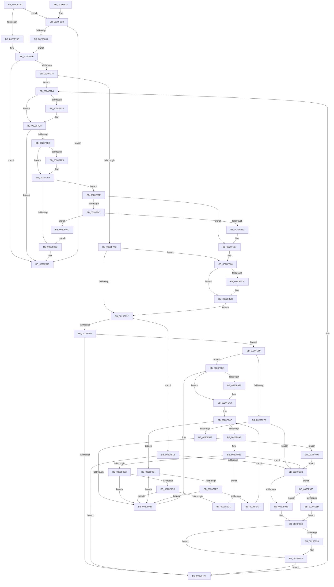

# ExpFreeOwnerEntry

- RVA: `0x0020F740`–`0x0020FA19` (길이 `729` bytes)
- VA: `0x000000014020F740`
- 실행 섹션: `.text`
- PDB 이름 있음: `예`; PDB Function 태그: `아니요`
- unwind 정보 RVA: `0x0005DB7C`
- 디코드: `183`개 명령, `729/729` bytes 표시
- 미해석 바이트: `0` (있으면 어셈블리에 `.byte`로 보존)

> 이 문서는 커널 이미지의 기계어와 PDB 기호를 분석해 생성했습니다. 4번과 5번은 함수 원형과 자료형을 바이너리 사용 방식에서 추정한 C 해석이며 원본 소스 복구 결과는 아닙니다.

## 1. Dependencies

- 직접 호출 지점: **12**; 고유 호출 대상: **9**
- 직접 호출자로 확인된 함수: **1**
- RIP 상대 이미지 참조: **7**

### Outgoing calls
- `0x0020F7F5` → [ObpPushStackInfo](../21/ObpPushStackInfo_function_002109E4.md) (function, `0x002109E4`)
- `0x0020F861` → [KeBugCheckEx](../4F/KeBugCheckEx_function_004FD660.md) (function, `0x004FD660`)
- `0x0020F8A0` → [KeBugCheckEx](../4F/KeBugCheckEx_function_004FD660.md) (function, `0x004FD660`)
- `0x0020F8B7` → [ExAllocatePool2](../../poolcode/B8/ExAllocatePool2_function_00B820F0.md) (function, `0x00B820F0`)
- `0x0020F8D2` → [RtlCaptureStackBackTrace](../2F/RtlCaptureStackBackTrace_function_002F9FF0.md) (function, `0x002F9FF0`)
- `0x0020F8F3` → [KeAcquireSpinLockRaiseToDpc](KeAcquireSpinLockRaiseToDpc_function_00208470.md) (function, `0x00208470`)
- `0x0020F904` → [ObpDeferObjectDeletion](../3A/ObpDeferObjectDeletion_function_003A2394.md) (function, `0x003A2394`)
- `0x0020F941` → [KiLowerIrqlProcessIrqlFlags](../4F/KiLowerIrqlProcessIrqlFlags_function_004F5698.md) (function, `0x004F5698`)
- `0x0020F962` → [KiReleaseSpinLockInstrumented](../39/KiReleaseSpinLockInstrumented_function_00392EF0.md) (function, `0x00392EF0`)
- `0x0020F99B` → [ExFreePoolWithTag](../../poolcode/B8/ExFreePoolWithTag_function_00B82870.md) (function, `0x00B82870`)
- `0x0020F9DD` → [ExFreePoolWithTag](../../poolcode/B8/ExFreePoolWithTag_function_00B82870.md) (function, `0x00B82870`)
- `0x0020F9FF` → [ExFreePoolWithTag](../../poolcode/B8/ExFreePoolWithTag_function_00B82870.md) (function, `0x00B82870`)

### Direct callers
- [sub_0025D903](../25/Unknown_function_0025D903.md) at `0x0025E1A8`

### Static image references
- `0x0020F785` → RVA `0x00FC6F88` (`ALMOSTRO`; read)
- `0x0020F7DC` → RVA `0x00FC5010` (`ALMOSTRO`; read)
- `0x0020F88B` → RVA `0x00FC6E4C` (`ALMOSTRO`; read)
- `0x0020F895` → RVA `0x00FC7800` (`ALMOSTRO`; read)
- `0x0020F91B` → RVA `0x00FC6B06` (`ALMOSTRO`; read)
- `0x0020F930` → RVA `0x00FC6D20` (`ALMOSTRO`; read)
- `0x0020F953` → RVA `0x00F0DE58` (`.data`; read)

## 2. Other-region calls and transfers

- 다른 실행 섹션으로 향하는 call: **4**
  - `0x0020F8B7` → [ExAllocatePool2](../../poolcode/B8/ExAllocatePool2_function_00B820F0.md) (`.text` → `POOLCODE`)
  - `0x0020F99B` → [ExFreePoolWithTag](../../poolcode/B8/ExFreePoolWithTag_function_00B82870.md) (`.text` → `POOLCODE`)
  - `0x0020F9DD` → [ExFreePoolWithTag](../../poolcode/B8/ExFreePoolWithTag_function_00B82870.md) (`.text` → `POOLCODE`)
  - `0x0020F9FF` → [ExFreePoolWithTag](../../poolcode/B8/ExFreePoolWithTag_function_00B82870.md) (`.text` → `POOLCODE`)
- 별도 외부 분기/꼬리 이동을 확인하지 못했습니다.

## 3. Assembly (complete function range)

```asm
0020F740  48 89 5C 24 08                  mov qword ptr [rsp + 8], rbx
0020F745  48 89 6C 24 10                  mov qword ptr [rsp + 0x10], rbp
0020F74A  48 89 74 24 18                  mov qword ptr [rsp + 0x18], rsi
0020F74F  48 89 7C 24 20                  mov qword ptr [rsp + 0x20], rdi
0020F754  41 56                           push r14
0020F756  48 83 EC 30                     sub rsp, 0x30
0020F75A  8B 41 08                        mov eax, dword ptr [rcx + 8]
0020F75D  48 8B D9                        mov rbx, rcx
0020F760  48 8B 39                        mov rdi, qword ptr [rcx]
0020F763  A8 02                           test al, 2
0020F765  0F 84 C8 00 00 00               je 0x14020f833
0020F76B  48 83 E7 FC                     and rdi, 0xfffffffffffffffc
0020F76F  48 85 FF                        test rdi, rdi
0020F772  0F 84 98 00 00 00               je 0x14020f810
0020F778  A8 01                           test al, 1
0020F77A  74 3C                           je 0x14020f7b8
0020F77C  40 32 F6                        xor sil, sil
0020F77F  40 32 ED                        xor bpl, bpl
0020F782  45 33 F6                        xor r14d, r14d
0020F785  44 39 35 FC 77 DB 00            cmp dword ptr [rip + 0xdb77fc], r14d
0020F78C  0F 85 14 01 00 00               jne 0x14020f8a6
0020F792  83 BF E0 05 00 00 00            cmp dword ptr [rdi + 0x5e0], 0
0020F799  0F 84 73 01 00 00               je 0x14020f912
0020F79F  F0 FF 8F E0 05 00 00            lock dec dword ptr [rdi + 0x5e0]
0020F7A6  40 84 F6                        test sil, sil
0020F7A9  0F 85 BA 01 00 00               jne 0x14020f969
0020F7AF  8B 43 08                        mov eax, dword ptr [rbx + 8]
0020F7B2  83 E0 FE                        and eax, 0xfffffffe
0020F7B5  89 43 08                        mov dword ptr [rbx + 8], eax
0020F7B8  B9 08 00 00 00                  mov ecx, 8
0020F7BD  48 8B D3                        mov rdx, rbx
0020F7C0  48 8D 34 0B                     lea rsi, [rbx + rcx]
0020F7C4  A8 04                           test al, 4
0020F7C6  74 10                           je 0x14020f7d8
0020F7C8  F0 FF 8F E4 05 00 00            lock dec dword ptr [rdi + 0x5e4]
0020F7CF  83 26 FB                        and dword ptr [rsi], 0xfffffffb
0020F7D2  8B 06                           mov eax, dword ptr [rsi]
0020F7D4  48 8D 73 08                     lea rsi, [rbx + 8]
0020F7D8  A8 02                           test al, 2
0020F7DA  74 34                           je 0x14020f810
0020F7DC  83 3D 2D 58 DB 00 00            cmp dword ptr [rip + 0xdb582d], 0
0020F7E3  74 15                           je 0x14020f7fa
0020F7E5  33 D2                           xor edx, edx
0020F7E7  48 8D 4F D0                     lea rcx, [rdi - 0x30]
0020F7EB  41 B9 44 66 6C 74               mov r9d, 0x746c6644
0020F7F1  44 8D 42 01                     lea r8d, [rdx + 1]
0020F7F5  E8 EA 11 00 00                  call 0x1402109e4
0020F7FA  48 C7 C0 FF FF FF FF            mov rax, 0xffffffffffffffff
0020F801  F0 48 0F C1 47 D0               lock xadd qword ptr [rdi - 0x30], rax
0020F807  48 83 E8 01                     sub rax, 1
0020F80B  7E 31                           jle 0x14020f83e
0020F80D  83 26 FD                        and dword ptr [rsi], 0xfffffffd
0020F810  48 8B 6C 24 48                  mov rbp, qword ptr [rsp + 0x48]
0020F815  48 8B 74 24 50                  mov rsi, qword ptr [rsp + 0x50]
0020F81A  48 8B 7C 24 58                  mov rdi, qword ptr [rsp + 0x58]
0020F81F  48 C7 03 00 00 00 00            mov qword ptr [rbx], 0
0020F826  48 8B 5C 24 40                  mov rbx, qword ptr [rsp + 0x40]
0020F82B  48 83 C4 30                     add rsp, 0x30
0020F82F  41 5E                           pop r14
0020F831  C3                              ret
0020F832  CC                              int3
0020F833  40 F6 C7 03                     test dil, 3
0020F837  75 D7                           jne 0x14020f810
0020F839  E9 31 FF FF FF                  jmp 0x14020f76f
0020F83E  48 8B 4F D8                     mov rcx, qword ptr [rdi - 0x28]
0020F842  48 85 C9                        test rcx, rcx
0020F845  75 20                           jne 0x14020f867
0020F847  48 85 C0                        test rax, rax
0020F84A  0F 89 B0 00 00 00               jns 0x14020f900
0020F850  33 D2                           xor edx, edx
0020F852  48 89 44 24 20                  mov qword ptr [rsp + 0x20], rax
0020F857  44 8D 49 04                     lea r9d, [rcx + 4]
0020F85B  4C 8B C7                        mov r8, rdi
0020F85E  8D 4A 18                        lea ecx, [rdx + 0x18]
0020F861  E8 FA DD 2E 00                  call 0x1404fd660
0020F866  CC                              int3
0020F867  41 B9 03 00 00 00               mov r9d, 3
0020F86D  48 89 4C 24 20                  mov qword ptr [rsp + 0x20], rcx
0020F872  48 8D 47 D0                     lea rax, [rdi - 0x30]
0020F876  4C 8B C7                        mov r8, rdi
0020F879  48 C1 E8 08                     shr rax, 8
0020F87D  0F B6 D0                        movzx edx, al
0020F880  0F B6 47 E8                     movzx eax, byte ptr [rdi - 0x18]
0020F884  41 8D 49 15                     lea ecx, [r9 + 0x15]
0020F888  48 33 D0                        xor rdx, rax
0020F88B  0F B6 05 BA 75 DB 00            movzx eax, byte ptr [rip + 0xdb75ba]
0020F892  48 33 D0                        xor rdx, rax
0020F895  48 8D 05 64 7F DB 00            lea rax, [rip + 0xdb7f64]
0020F89C  48 8B 14 D0                     mov rdx, qword ptr [rax + rdx*8]
0020F8A0  E8 BB DD 2E 00                  call 0x1404fd660
0020F8A5  CC                              int3
0020F8A6  BA 70 00 00 00                  mov edx, 0x70
0020F8AB  41 B8 42 6F 6F 73               mov r8d, 0x736f6f42
0020F8B1  40 B6 01                        mov sil, 1
0020F8B4  8D 4A D0                        lea ecx, [rdx - 0x30]
0020F8B7  E8 34 28 97 00                  call 0x140b820f0
0020F8BC  4C 8B F0                        mov r14, rax
0020F8BF  48 85 C0                        test rax, rax
0020F8C2  74 28                           je 0x14020f8ec
0020F8C4  45 33 C9                        xor r9d, r9d
0020F8C7  4C 8D 40 10                     lea r8, [rax + 0x10]
0020F8CB  41 8D 51 0A                     lea edx, [r9 + 0xa]
0020F8CF  8D 4A F7                        lea ecx, [rdx - 9]
0020F8D2  E8 19 A7 0E 00                  call 0x1402f9ff0
0020F8D7  65 48 8B 04 25 88 01 00 00      mov rax, qword ptr gs:[0x188]
0020F8E0  49 89 46 60                     mov qword ptr [r14 + 0x60], rax
0020F8E4  49 C7 46 68 00 00 00 00         mov qword ptr [r14 + 0x68], 0
0020F8EC  48 8D 8F 10 06 00 00            lea rcx, [rdi + 0x610]
0020F8F3  E8 78 8B FF FF                  call 0x140208470
0020F8F8  0F B6 E8                        movzx ebp, al
0020F8FB  E9 92 FE FF FF                  jmp 0x14020f792
0020F900  48 8D 4F D0                     lea rcx, [rdi - 0x30]
0020F904  E8 8B 2A 19 00                  call 0x1403a2394
0020F909  48 8D 73 08                     lea rsi, [rbx + 8]
0020F90D  E9 FB FE FF FF                  jmp 0x14020f80d
0020F912  40 84 F6                        test sil, sil
0020F915  0F 84 94 FE FF FF               je 0x14020f7af
0020F91B  F6 05 E4 71 DB 00 01            test byte ptr [rip + 0xdb71e4], 1
0020F922  48 8D 8F 10 06 00 00            lea rcx, [rdi + 0x610]
0020F929  75 28                           jne 0x14020f953
0020F92B  F0 48 83 21 00                  lock and qword ptr [rcx], 0
0020F930  83 3D E9 73 DB 00 00            cmp dword ptr [rip + 0xdb73e9], 0
0020F937  74 0D                           je 0x14020f946
0020F939  44 0F 20 C1                     mov rcx, cr8
0020F93D  40 0F B6 D5                     movzx edx, bpl
0020F941  E8 52 5D 2E 00                  call 0x1404f5698
0020F946  40 0F B6 C5                     movzx eax, bpl
0020F94A  44 0F 22 C0                     mov cr8, rax
0020F94E  E9 5C FE FF FF                  jmp 0x14020f7af
0020F953  8B 05 FF E4 CF 00               mov eax, dword ptr [rip + 0xcfe4ff]
0020F959  85 C0                           test eax, eax
0020F95B  75 CE                           jne 0x14020f92b
0020F95D  48 8B 54 24 38                  mov rdx, qword ptr [rsp + 0x38]
0020F962  E8 89 35 18 00                  call 0x140392ef0
0020F967  EB C7                           jmp 0x14020f930
0020F969  83 BF E0 05 00 00 00            cmp dword ptr [rdi + 0x5e0], 0
0020F970  74 1C                           je 0x14020f98e
0020F972  4D 85 F6                        test r14, r14
0020F975  74 A4                           je 0x14020f91b
0020F977  48 8D 87 00 06 00 00            lea rax, [rdi + 0x600]
0020F97E  48 8B 48 08                     mov rcx, qword ptr [rax + 8]
0020F982  48 39 01                        cmp qword ptr [rcx], rax
0020F985  74 7F                           je 0x14020fa06
0020F987  B9 03 00 00 00                  mov ecx, 3
0020F98C  CD 29                           int 0x29
0020F98E  4D 85 F6                        test r14, r14
0020F991  74 0D                           je 0x14020f9a0
0020F993  BA 42 6F 6F 73                  mov edx, 0x736f6f42
0020F998  49 8B CE                        mov rcx, r14
0020F99B  E8 D0 2E 97 00                  call 0x140b82870
0020F9A0  48 8D B7 F0 05 00 00            lea rsi, [rdi + 0x5f0]
0020F9A7  48 8B 0E                        mov rcx, qword ptr [rsi]
0020F9AA  48 3B CE                        cmp rcx, rsi
0020F9AD  75 35                           jne 0x14020f9e4
0020F9AF  48 8D B7 00 06 00 00            lea rsi, [rdi + 0x600]
0020F9B6  48 8B 0E                        mov rcx, qword ptr [rsi]
0020F9B9  48 3B CE                        cmp rcx, rsi
0020F9BC  0F 84 59 FF FF FF               je 0x14020f91b
0020F9C2  48 8B 01                        mov rax, qword ptr [rcx]
0020F9C5  48 39 71 08                     cmp qword ptr [rcx + 8], rsi
0020F9C9  75 BC                           jne 0x14020f987
0020F9CB  48 39 48 08                     cmp qword ptr [rax + 8], rcx
0020F9CF  75 B6                           jne 0x14020f987
0020F9D1  48 89 06                        mov qword ptr [rsi], rax
0020F9D4  BA 42 6F 6F 73                  mov edx, 0x736f6f42
0020F9D9  48 89 70 08                     mov qword ptr [rax + 8], rsi
0020F9DD  E8 8E 2E 97 00                  call 0x140b82870
0020F9E2  EB D2                           jmp 0x14020f9b6
0020F9E4  48 8B 01                        mov rax, qword ptr [rcx]
0020F9E7  48 39 71 08                     cmp qword ptr [rcx + 8], rsi
0020F9EB  75 9A                           jne 0x14020f987
0020F9ED  48 39 48 08                     cmp qword ptr [rax + 8], rcx
0020F9F1  75 94                           jne 0x14020f987
0020F9F3  48 89 06                        mov qword ptr [rsi], rax
0020F9F6  BA 42 6F 6F 73                  mov edx, 0x736f6f42
0020F9FB  48 89 70 08                     mov qword ptr [rax + 8], rsi
0020F9FF  E8 6C 2E 97 00                  call 0x140b82870
0020FA04  EB A1                           jmp 0x14020f9a7
0020FA06  49 89 06                        mov qword ptr [r14], rax
0020FA09  49 89 4E 08                     mov qword ptr [r14 + 8], rcx
0020FA0D  4C 89 31                        mov qword ptr [rcx], r14
0020FA10  4C 89 70 08                     mov qword ptr [rax + 8], r14
0020FA14  E9 02 FF FF FF                  jmp 0x14020f91b
```

## 4. C-style interpretation (structured pseudocode)

```c
__int64 __fastcall ExpFreeOwnerEntry(__int64 a1)
{
    __int64 result;
    __int64 v_r14;
    __int64 v_rbp;
    __int64 v_rdi;
    __int64 v_rsi;
    __int64 v_rsp;
    unsigned __int64 v_stack_p10;
    unsigned __int64 v_stack_p18;
    unsigned __int64 v_stack_p20;
    unsigned __int64 v_stack_p38;
    unsigned __int64 v_stack_p8;

    v_stack_p8 = v_rbx;
    v_stack_p10 = v_rbp;
    v_stack_p18 = v_rsi;
    v_stack_p20 = v_rdi;
    v_rsp = (v_rsp) - (48);
    if ((((unsigned __int8)((unsigned int)(*(unsigned int *)(a1 + 8)))) & (2)) == 0) goto loc_0020F833;
    v_rdi = (*(unsigned __int64 *)(a1)) & (-4);
loc_0020F76F:
    if (v_rdi == 0) goto loc_0020F810;
    if ((((unsigned __int8)((unsigned int)(*(unsigned int *)(a1 + 8)))) & (1)) == 0) goto loc_0020F7B8;
    v_rsi = 0;
    v_rbp = 0;
    v_r14 = 0;
    if ((*(unsigned int *)(v_rip + 14383100)) != 0) goto loc_0020F8A6;
loc_0020F792:
    if ((*(unsigned int *)(v_rdi + 1504)) == 0) goto loc_0020F912;
    if (0 != 0) goto loc_0020F969;
loc_0020F7AF:
    result = (unsigned int)(((unsigned int)(*(unsigned int *)(a1 + 8))) & (0xFFFFFFFEULL));
    *(unsigned int *)(a1 + 8) = (unsigned int)(result);
loc_0020F7B8:
    v_rsi = a1 + 8 * 1;
    if ((((unsigned __int8)(result)) & (4)) != 0) {
        result = *(unsigned int *)(a1 + 8 * 1);
        v_rsi = a1 + 8;
    }
    if ((((unsigned __int8)(result)) & (2)) == 0) goto loc_0020F810;
    if ((*(unsigned int *)(v_rip + 14374957)) != 0) {
        a2 = 0;
        a1 = v_rdi - 48;
        a4 = 0x746C6644ULL;
        a3 = a2 + 1;
        result = ObpPushStackInfo(a1, a2, a3, a4);
    }
    result = (-1) - (1);
    if (condition_is_less_or_equal) goto loc_0020F83E;
loc_0020F80D:
loc_0020F810:
    *(unsigned __int64 *)(a1) = 0;
    v_rsp = (v_rsp) + (48);
    return result;
loc_0020F833:
    if ((((unsigned __int8)(v_stack_p20)) & (3)) != 0) goto loc_0020F810;
    goto loc_0020F76F;
loc_0020F83E:
    if (*(unsigned __int64 *)(v_stack_p20 - 40) != 0) goto loc_0020F867;
    if (!sign_flag) goto loc_0020F900;
    a2 = 0;
    v_stack_p20 = result;
    result = KeBugCheckEx(a2 + 24, a2, v_stack_p20, *(unsigned __int64 *)(v_stack_p20 - 40) + 4);
loc_0020F867:
    v_stack_p20 = a2 + 24;
    result = (v_stack_p20 - 48) >> (8);
    a2 = ((unsigned __int8)(result)) ^ (*(unsigned __int8 *)(v_stack_p20 - 24));
    a2 = (a2) ^ (*(unsigned __int8 *)(v_rip + 14382522));
    result = KeBugCheckEx(3 + 21, *(unsigned __int64 *)(v_rip + 14384996 + a2 * 8), v_stack_p20, 3);
loc_0020F8A6:
    result = ExAllocatePool2(112 - 48, 112, (unsigned int)(0x736F6F42ULL), 3);
    if (result != 0) {
        a4 = 0;
        a3 = result + 16;
        a2 = a4 + 10;
        a1 = a2 - 9;
        result = RtlCaptureStackBackTrace(a1, a2, a3, a4);
        result = *(unsigned __int64 *)(gs_base + (0 + 392));
        *(unsigned __int64 *)(result + 96) = result;
        *(unsigned __int64 *)(result + 104) = 0;
    }
    result = KeAcquireSpinLockRaiseToDpc(v_stack_p20 + 1552, a2, a3, a4);
    goto loc_0020F792;
loc_0020F900:
    result = ObpDeferObjectDeletion(v_stack_p20 - 48, a2, a3, a4);
    goto loc_0020F80D;
loc_0020F912:
    if ((unsigned __int8)(v_stack_p8 + 8) == 0) goto loc_0020F7AF;
loc_0020F91B:
    if (((*(unsigned __int8 *)(v_rip + 14381540)) & (1)) != 0) goto loc_0020F953;
loc_0020F92B:
loc_0020F930:
    if ((*(unsigned int *)(v_rip + 14382057)) != 0) {
        a1 = v_cr8;
        a2 = (unsigned __int8)((unsigned __int8)(result));
        result = KiLowerIrqlProcessIrqlFlags(a1, a2, a3, a4);
    }
    goto loc_0020F7AF;
loc_0020F953:
    if ((unsigned int)((unsigned int)(*(unsigned int *)(v_rip + 13624575))) != 0) goto loc_0020F92B;
    result = KiReleaseSpinLockInstrumented(a1, v_stack_p38, a3, a4);
    goto loc_0020F930;
loc_0020F969:
    if ((*(unsigned int *)(v_stack_p20 + 1504)) == 0) goto loc_0020F98E;
    if (result == 0) goto loc_0020F91B;
    if ((*(unsigned __int64 *)(*(unsigned __int64 *)(v_stack_p20 + 1536 + 8))) == (v_stack_p20 + 1536)) goto loc_0020FA06;
loc_0020F987:
loc_0020F98E:
    result = v_stack_p20 + 1536;
    if (result != 0) {
        a2 = 0x736F6F42ULL;
        a1 = result;
        result = ExFreePoolWithTag(a1, a2, a3, a4);
    }
loc_0020F9A7:
    if ((*(unsigned __int64 *)(v_stack_p20 + 1520)) != (v_stack_p20 + 1520)) goto loc_0020F9E4;
loc_0020F9B6:
    if ((*(unsigned __int64 *)(v_stack_p20 + 1536)) == (v_stack_p20 + 1536)) goto loc_0020F91B;
    if ((*(unsigned __int64 *)(*(unsigned __int64 *)(v_stack_p20 + 1536) + 8)) != (v_stack_p20 + 1536)) goto loc_0020F987;
    if ((*(unsigned __int64 *)(*(unsigned __int64 *)(*(unsigned __int64 *)(v_stack_p20 + 1536)) + 8)) != (*(unsigned __int64 *)(v_stack_p20 + 1536))) goto loc_0020F987;
    *(unsigned __int64 *)(v_stack_p20 + 1536) = *(unsigned __int64 *)(*(unsigned __int64 *)(v_stack_p20 + 1536));
    *(unsigned __int64 *)(*(unsigned __int64 *)(*(unsigned __int64 *)(v_stack_p20 + 1536)) + 8) = v_stack_p20 + 1536;
    result = ExFreePoolWithTag(*(unsigned __int64 *)(v_stack_p20 + 1536), (unsigned int)(0x736F6F42ULL), a3, a4);
    goto loc_0020F9B6;
loc_0020F9E4:
    if ((*(unsigned __int64 *)(*(unsigned __int64 *)(v_stack_p20 + 1536) + 8)) != (v_stack_p20 + 1536)) goto loc_0020F987;
    if ((*(unsigned __int64 *)(*(unsigned __int64 *)(*(unsigned __int64 *)(v_stack_p20 + 1536)) + 8)) != (*(unsigned __int64 *)(v_stack_p20 + 1536))) goto loc_0020F987;
    *(unsigned __int64 *)(v_stack_p20 + 1536) = *(unsigned __int64 *)(*(unsigned __int64 *)(v_stack_p20 + 1536));
    *(unsigned __int64 *)(*(unsigned __int64 *)(*(unsigned __int64 *)(v_stack_p20 + 1536)) + 8) = v_stack_p20 + 1536;
    result = ExFreePoolWithTag(*(unsigned __int64 *)(v_stack_p20 + 1536), (unsigned int)(0x736F6F42ULL), a3, a4);
    goto loc_0020F9A7;
loc_0020FA06:
    *(unsigned __int64 *)(result) = result;
    *(unsigned __int64 *)(result + 8) = *(unsigned __int64 *)(v_stack_p20 + 1536);
    *(unsigned __int64 *)(*(unsigned __int64 *)(v_stack_p20 + 1536)) = result;
    *(unsigned __int64 *)(result + 8) = result;
    goto loc_0020F91B;
}
```

## 5. (Beta) C Style

```c
int64_t ExpFreeOwnerEntry(void *Arg1)
{
    uint8_t *arg1 = (uint8_t *)Arg1;

    int64_t result;
    int64_t local_r14;
    int64_t local_rbp;
    int64_t local_rdi;
    int64_t local_rsi;
    int64_t local_rsp;
    uint64_t v_stack_p10;
    uint64_t v_stack_p18;
    uint64_t v_stack_p20;
    uint64_t v_stack_p38;
    uint64_t v_stack_p8;

    v_stack_p8 = local_rbx;
    v_stack_p10 = local_rbp;
    v_stack_p18 = local_rsi;
    v_stack_p20 = local_rdi;
    local_rsp = (local_rsp) - (48);
    if ((((uint8_t)((uint32_t)(*(uint32_t *)(arg1 + 0x8)))) & (2)) == 0) goto loc_0020F833;
    local_rdi = (*(uint64_t *)(arg1)) & (-4);
loc_0020F76F:
    if (local_rdi == 0) goto loc_0020F810;
    if ((((uint8_t)((uint32_t)(*(uint32_t *)(arg1 + 0x8)))) & (1)) == 0) goto loc_0020F7B8;
    local_rsi = 0;
    local_rbp = 0;
    local_r14 = 0;
    if ((*(uint32_t *)(v_rip + 0xDB77FC)) != 0) goto loc_0020F8A6;
loc_0020F792:
    if ((*(uint32_t *)(local_rdi + 0x5E0)) == 0) goto loc_0020F912;
    if (0 != 0) goto loc_0020F969;
loc_0020F7AF:
    result = (uint32_t)(((uint32_t)(*(uint32_t *)(arg1 + 0x8))) & (0xFFFFFFFEULL));
    *(uint32_t *)(arg1 + 0x8) = (uint32_t)(result);
loc_0020F7B8:
    local_rsi = Arg1 + 8 * 1;
    if ((((uint8_t)(result)) & (4)) != 0) {
        result = *(uint32_t *)(arg1 + 0x8 * 1);
        local_rsi = Arg1 + 8;
    }
    if ((((uint8_t)(result)) & (2)) == 0) goto loc_0020F810;
    if ((*(uint32_t *)(v_rip + 0xDB582D)) != 0) {
        a2 = 0;
        Arg1 = local_rdi - 48;
        a4 = 0x746C6644ULL;
        a3 = a2 + 1;
        result = ObpPushStackInfo(Arg1, a2, a3, a4);
    }
    result = (-1) - (1);
    if (condition_is_less_or_equal) goto loc_0020F83E;
loc_0020F80D:
loc_0020F810:
    *(uint64_t *)(arg1) = 0;
    local_rsp = (local_rsp) + (48);
    return result;
loc_0020F833:
    if ((((uint8_t)(v_stack_p20)) & (3)) != 0) goto loc_0020F810;
    goto loc_0020F76F;
loc_0020F83E:
    if (*(uint64_t *)(v_stack_p20 - 0x28) != 0) goto loc_0020F867;
    if (!sign_flag) goto loc_0020F900;
    a2 = 0;
    v_stack_p20 = result;
    result = KeBugCheckEx(a2 + 24, a2, v_stack_p20, *(uint64_t *)(v_stack_p20 - 0x28) + 4);
loc_0020F867:
    v_stack_p20 = a2 + 24;
    result = (v_stack_p20 - 48) >> (8);
    a2 = ((uint8_t)(result)) ^ (*(uint8_t *)(v_stack_p20 - 0x18));
    a2 = (a2) ^ (*(uint8_t *)(v_rip + 0xDB75BA));
    result = KeBugCheckEx(3 + 21, *(uint64_t *)(v_rip + 0xDB7F64 + a2 * 8), v_stack_p20, 3);
loc_0020F8A6:
    result = ExAllocatePool2(112 - 48, 112, (uint32_t)(0x736F6F42ULL), 3);
    if (result != 0) {
        a4 = 0;
        a3 = result + 16;
        a2 = a4 + 10;
        Arg1 = a2 - 9;
        result = RtlCaptureStackBackTrace(Arg1, a2, a3, a4);
        result = *(uint64_t *)(gs_base + (0 + 0x188));
        *(uint64_t *)(result + 0x60) = result;
        *(uint64_t *)(result + 0x68) = 0;
    }
    result = KeAcquireSpinLockRaiseToDpc(v_stack_p20 + 1552, a2, a3, a4);
    goto loc_0020F792;
loc_0020F900:
    result = ObpDeferObjectDeletion(v_stack_p20 - 48, a2, a3, a4);
    goto loc_0020F80D;
loc_0020F912:
    if ((uint8_t)(v_stack_p8 + 8) == 0) goto loc_0020F7AF;
loc_0020F91B:
    if (((*(uint8_t *)(v_rip + 0xDB71E4)) & (1)) != 0) goto loc_0020F953;
loc_0020F92B:
loc_0020F930:
    if ((*(uint32_t *)(v_rip + 0xDB73E9)) != 0) {
        Arg1 = v_cr8;
        a2 = (uint8_t)((uint8_t)(result));
        result = KiLowerIrqlProcessIrqlFlags(Arg1, a2, a3, a4);
    }
    goto loc_0020F7AF;
loc_0020F953:
    if ((uint32_t)((uint32_t)(*(uint32_t *)(v_rip + 0xCFE4FF))) != 0) goto loc_0020F92B;
    result = KiReleaseSpinLockInstrumented(Arg1, v_stack_p38, a3, a4);
    goto loc_0020F930;
loc_0020F969:
    if ((*(uint32_t *)(v_stack_p20 + 0x5E0)) == 0) goto loc_0020F98E;
    if (result == 0) goto loc_0020F91B;
    if ((*(uint64_t *)(*(uint64_t *)(v_stack_p20 + 0x600 + 0x8))) == (v_stack_p20 + 1536)) goto loc_0020FA06;
loc_0020F987:
loc_0020F98E:
    result = v_stack_p20 + 1536;
    if (result != 0) {
        a2 = 0x736F6F42ULL;
        Arg1 = result;
        result = ExFreePoolWithTag(Arg1, a2, a3, a4);
    }
loc_0020F9A7:
    if ((*(uint64_t *)(v_stack_p20 + 0x5F0)) != (v_stack_p20 + 1520)) goto loc_0020F9E4;
loc_0020F9B6:
    if ((*(uint64_t *)(v_stack_p20 + 0x600)) == (v_stack_p20 + 1536)) goto loc_0020F91B;
    if ((*(uint64_t *)(*(uint64_t *)(v_stack_p20 + 0x600) + 0x8)) != (v_stack_p20 + 1536)) goto loc_0020F987;
    if ((*(uint64_t *)(*(uint64_t *)(*(uint64_t *)(v_stack_p20 + 0x600)) + 0x8)) != (*(uint64_t *)(v_stack_p20 + 0x600))) goto loc_0020F987;
    *(uint64_t *)(v_stack_p20 + 0x600) = *(uint64_t *)(*(uint64_t *)(v_stack_p20 + 0x600));
    *(uint64_t *)(*(uint64_t *)(*(uint64_t *)(v_stack_p20 + 0x600)) + 0x8) = v_stack_p20 + 1536;
    result = ExFreePoolWithTag(*(uint64_t *)(v_stack_p20 + 0x600), (uint32_t)(0x736F6F42ULL), a3, a4);
    goto loc_0020F9B6;
loc_0020F9E4:
    if ((*(uint64_t *)(*(uint64_t *)(v_stack_p20 + 0x600) + 0x8)) != (v_stack_p20 + 1536)) goto loc_0020F987;
    if ((*(uint64_t *)(*(uint64_t *)(*(uint64_t *)(v_stack_p20 + 0x600)) + 0x8)) != (*(uint64_t *)(v_stack_p20 + 0x600))) goto loc_0020F987;
    *(uint64_t *)(v_stack_p20 + 0x600) = *(uint64_t *)(*(uint64_t *)(v_stack_p20 + 0x600));
    *(uint64_t *)(*(uint64_t *)(*(uint64_t *)(v_stack_p20 + 0x600)) + 0x8) = v_stack_p20 + 1536;
    result = ExFreePoolWithTag(*(uint64_t *)(v_stack_p20 + 0x600), (uint32_t)(0x736F6F42ULL), a3, a4);
    goto loc_0020F9A7;
loc_0020FA06:
    *(uint64_t *)(result) = result;
    *(uint64_t *)(result + 0x8) = *(uint64_t *)(v_stack_p20 + 0x600);
    *(uint64_t *)(*(uint64_t *)(v_stack_p20 + 0x600)) = result;
    *(uint64_t *)(result + 0x8) = result;
    goto loc_0020F91B;
}
```

### 관측된 메모리 오프셋

구조체 형식이 확인되지 않은 접근은 인자 기준의 오프셋으로만 기록했습니다.

| 기준 인자 | 오프셋 표현 | 폭 (bit) | 접근 |
|---|---:|---:|---|
| `Arg1` | `+ 0x0` | `32` | `R` |
| `Arg1` | `+ 0x0` | `32` | `R/W` |
| `Arg1` | `+ 0x0` | `64` | `R` |
| `Arg1` | `+ 0x0` | `64` | `W` |
| `Arg1` | `+ 0x0 + rcx*1` | `64` | `R` |
| `Arg1` | `+ 0x8` | `32` | `R` |
| `Arg1` | `+ 0x8` | `32` | `W` |
| `Arg1` | `+ 0x8` | `64` | `R` |

## 6. Execution-region graph

[열기: 2D/3D 그래프와 함수 탐색 컨트롤 패널](../../../control-panel.html?section=text&rva=0x0020F740&view=graph)

- 2D 그래프는 위에서 아래로 흐르고, 3D 그래프는 빈 공간을 드래그해 회전합니다. Shift+드래그는 이동, 휠은 확대·축소, 함수 노드 선택은 대상 보고서 이동입니다.

### Static fallback


