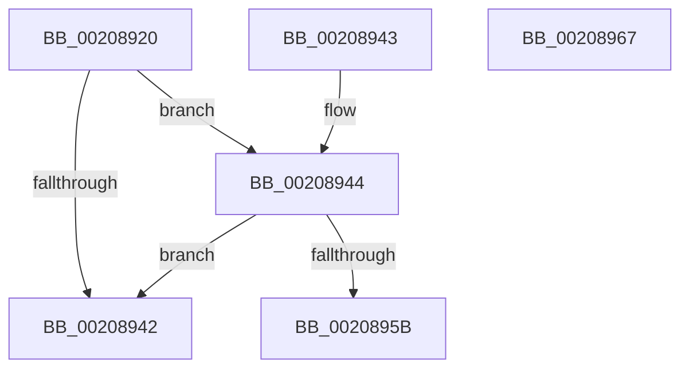

# HalpHvTimerAcknowledgeInterrupt

- RVA: `0x00208920`–`0x00208968` (길이 `72` bytes)
- VA: `0x0000000140208920`
- 실행 섹션: `.text`
- PDB 이름 있음: `예`; PDB Function 태그: `아니요`
- unwind 정보 RVA: `0x000DB714`
- 디코드: `20`개 명령, `72/72` bytes 표시
- 미해석 바이트: `0` (있으면 어셈블리에 `.byte`로 보존)

> 이 문서는 커널 이미지의 기계어와 PDB 기호를 분석해 생성했습니다. 4번과 5번은 함수 원형과 자료형을 바이너리 사용 방식에서 추정한 C 해석이며 원본 소스 복구 결과는 아닙니다.

## 1. Dependencies

- 직접 호출 지점: **0**; 고유 호출 대상: **0**
- 직접 호출자로 확인된 함수: **3**
- RIP 상대 이미지 참조: **0**

### Outgoing calls
- 직접 디코드된 call 명령이 없습니다.

### Direct callers
- [HalpTimerClockInterrupt](HalpTimerClockInterrupt_function_002086A0.md) at `0x002086EC`
- [sub_00208A9F](Unknown_function_00208A9F.md) at `0x00208B00`
- [HalpHvTimerInitialize](../56/HalpHvTimerInitialize_function_00560810.md) at `0x00560832`

### Static image references
- 디코드된 RIP-relative 메모리 참조가 없습니다.

## 2. Other-region calls and transfers

- 다른 실행 섹션으로 향하는 call: **0**
- 별도 외부 분기/꼬리 이동을 확인하지 못했습니다.

## 3. Assembly (complete function range)

```asm
00208920  65 8B 04 25 A4 01 00 00         mov eax, dword ptr gs:[0x1a4]
00208928  48 8D 04 40                     lea rax, [rax + rax*2]
0020892C  48 8B 44 C1 08                  mov rax, qword ptr [rcx + rax*8 + 8]
00208931  0F 0D 88 00 03 00 00            prefetchw byte ptr [rax + 0x300]
00208938  8B 88 00 03 00 00               mov ecx, dword ptr [rax + 0x300]
0020893E  85 C9                           test ecx, ecx
00208940  75 02                           jne 0x140208944
00208942  C3                              ret
00208943  CC                              int3
00208944  C7 80 00 03 00 00 00 00 00 00   mov dword ptr [rax + 0x300], 0
0020894E  90                              nop
0020894F  0F B6 88 05 03 00 00            movzx ecx, byte ptr [rax + 0x305]
00208956  F6 C1 01                        test cl, 1
00208959  74 E7                           je 0x140208942
0020895B  33 C0                           xor eax, eax
0020895D  B9 84 00 00 40                  mov ecx, 0x40000084
00208962  33 D2                           xor edx, edx
00208964  0F 30                           wrmsr
00208966  C3                              ret
00208967  CC                              int3
```

## 4. C-style interpretation (structured pseudocode)

```c
__int64 __fastcall HalpHvTimerAcknowledgeInterrupt(__int64 a1, int a2)
{
    __int64 result;

    if ((unsigned int)((unsigned int)(*(unsigned int *)(*(unsigned __int64 *)(a1 + (unsigned int)(*(unsigned int *)(gs_base + (0 + 420))) + (unsigned int)(*(unsigned int *)(gs_base + (0 + 420))) * 2 * 8 + 8) + 768))) != 0) goto loc_00208944;
loc_00208942:
    return *(unsigned __int64 *)(a1 + (unsigned int)(*(unsigned int *)(gs_base + (0 + 420))) + (unsigned int)(*(unsigned int *)(gs_base + (0 + 420))) * 2 * 8 + 8);
loc_00208944:
    *(unsigned int *)(*(unsigned __int64 *)(a1 + (unsigned int)(*(unsigned int *)(gs_base + (0 + 420))) + (unsigned int)(*(unsigned int *)(gs_base + (0 + 420))) * 2 * 8 + 8) + 768) = 0;
    if ((((unsigned __int8)(*(unsigned __int8 *)(*(unsigned __int64 *)(a1 + (unsigned int)(*(unsigned int *)(gs_base + (0 + 420))) + (unsigned int)(*(unsigned int *)(gs_base + (0 + 420))) * 2 * 8 + 8) + 773))) & (1)) == 0) goto loc_00208942;
    result = 0;
    a2 = 0;
    return result;
}
```

## 5. (Beta) C Style

```c
int64_t HalpHvTimerAcknowledgeInterrupt(void *Arg1, int32_t Arg2)
{
    uint8_t *arg1 = (uint8_t *)Arg1;

    int64_t result;

    if ((uint32_t)((uint32_t)(*(uint32_t *)(*(uint64_t *)(arg1 + (uint32_t)(*(uint32_t *)(gs_base + (0 + 0x1A4))) + (uint32_t)(*(uint32_t *)(gs_base + (0 + 0x1A4))) * 2 * 8 + 0x8) + 0x300))) != 0) goto loc_00208944;
loc_00208942:
    return *(uint64_t *)(arg1 + (uint32_t)(*(uint32_t *)(gs_base + (0 + 0x1A4))) + (uint32_t)(*(uint32_t *)(gs_base + (0 + 0x1A4))) * 2 * 8 + 0x8);
loc_00208944:
    *(uint32_t *)(*(uint64_t *)(arg1 + (uint32_t)(*(uint32_t *)(gs_base + (0 + 0x1A4))) + (uint32_t)(*(uint32_t *)(gs_base + (0 + 0x1A4))) * 2 * 8 + 0x8) + 0x300) = 0;
    if ((((uint8_t)(*(uint8_t *)(*(uint64_t *)(arg1 + (uint32_t)(*(uint32_t *)(gs_base + (0 + 0x1A4))) + (uint32_t)(*(uint32_t *)(gs_base + (0 + 0x1A4))) * 2 * 8 + 0x8) + 0x305))) & (1)) == 0) goto loc_00208942;
    result = 0;
    Arg2 = 0;
    return result;
}
```

### 관측된 메모리 오프셋

구조체 형식이 확인되지 않은 접근은 인자 기준의 오프셋으로만 기록했습니다.

| 기준 인자 | 오프셋 표현 | 폭 (bit) | 접근 |
|---|---:|---:|---|
| `Arg1` | `+ 0x8 + rax*8` | `64` | `R` |

## 6. Execution-region graph

[열기: 2D/3D 그래프와 함수 탐색 컨트롤 패널](../../../control-panel.html?section=text&rva=0x00208920&view=graph)

- 2D 그래프는 위에서 아래로 흐르고, 3D 그래프는 빈 공간을 드래그해 회전합니다. Shift+드래그는 이동, 휠은 확대·축소, 함수 노드 선택은 대상 보고서 이동입니다.

### Static fallback


