# HalpTimerClockInterrupt

- RVA: `0x002086A0`–`0x00208918` (길이 `632` bytes)
- VA: `0x00000001402086A0`
- 실행 섹션: `.text`
- PDB 이름 있음: `예`; PDB Function 태그: `아니요`
- unwind 정보 RVA: `0x0005D3A4`
- 디코드: `136`개 명령, `632/632` bytes 표시
- 미해석 바이트: `0` (있으면 어셈블리에 `.byte`로 보존)

> 이 문서는 커널 이미지의 기계어와 PDB 기호를 분석해 생성했습니다. 4번과 5번은 함수 원형과 자료형을 바이너리 사용 방식에서 추정한 C 해석이며 원본 소스 복구 결과는 아닙니다.

## 1. Dependencies

- 직접 호출 지점: **11**; 고유 호출 대상: **9**
- 직접 호출자로 확인된 함수: **0**
- RIP 상대 이미지 참조: **15**

### Outgoing calls
- `0x002086EC` → [HalpHvTimerAcknowledgeInterrupt](HalpHvTimerAcknowledgeInterrupt_function_00208920.md) (function, `0x00208920`)
- `0x00208717` → [RtlGetInterruptTimePrecise](RtlGetInterruptTimePrecise_function_0020A4C0.md) (function, `0x0020A4C0`)
- `0x002087A3` → [KeClockInterruptNotify](../39/KeClockInterruptNotify_function_0039A970.md) (function, `0x0039A970`)
- `0x002087F0` → [HalpTimerClockInterruptWork](../39/HalpTimerClockInterruptWork_function_0039B310.md) (function, `0x0039B310`)
- `0x00208868` → [guard_dispatch_icall](../6B/guard_dispatch_icall_function_006BAAD0.md) (function, `0x006BAAD0`)
- `0x0020886F` → [HalpScanForProfilingCorruption](../44/HalpScanForProfilingCorruption_function_00445A00.md) (function, `0x00445A00`)
- `0x002088B7` → [HalpTimerWatchdogResetCountdown](../39/HalpTimerWatchdogResetCountdown_function_0039B3B0.md) (function, `0x0039B3B0`)
- `0x002088CC` → [HalpTimerWatchdogTriggerSystemReset](../39/HalpTimerWatchdogTriggerSystemReset_function_0039B410.md) (function, `0x0039B410`)
- `0x002088E5` → [HalpVpptAcknowledgeInterrupt](../2D/HalpVpptAcknowledgeInterrupt_function_002D2230.md) (function, `0x002D2230`)
- `0x002088F2` → [guard_dispatch_icall](../6B/guard_dispatch_icall_function_006BAAD0.md) (function, `0x006BAAD0`)
- `0x00208911` → [guard_dispatch_icall](../6B/guard_dispatch_icall_function_006BAAD0.md) (function, `0x006BAAD0`)

### Direct callers
- 이 함수 시작 RVA로 연결되는 직접 call은 확인되지 않았습니다. 간접 호출은 완전히 역산할 수 없습니다.

### Static image references
- `0x002086B6` → RVA `0x00FC40F0` (`.data`; read)
- `0x002086D9` → RVA `0x00208920` (`HalpHvTimerAcknowledgeInterrupt`; read)
- `0x002086F6` → RVA `0x00E0A838` (`.data`; read/write)
- `0x00208700` → RVA `0x00F8FC60` (`.data`; read)
- `0x0020872A` → RVA `0x00F21FB0` (`.data`; read)
- `0x002087DD` → RVA `0x00FC22E1` (`.data`; write)
- `0x002087E7` → RVA `0x00FC22E0` (`.data`; read)
- `0x002087FE` → RVA `0x00FC4028` (`.data`; read)
- `0x00208836` → RVA `0x00FC2C30` (`.data`; read)
- `0x0020885D` → RVA `0x00E00A38` (`.data`; read)
- `0x00208894` → RVA `0x00FC2188` (`.data`; read)
- `0x0020889B` → RVA `0x00FC2178` (`.data`; read)
- `0x002088A4` → RVA `0x00E00B20` (`.data`; read)
- `0x002088AB` → RVA `0x0039B3B0` (`HalpTimerWatchdogResetCountdown`; read)
- `0x002088D6` → RVA `0x002D2230` (`HalpVpptAcknowledgeInterrupt`; read)

## 2. Other-region calls and transfers

- 다른 실행 섹션으로 향하는 call: **0**
- 별도 외부 분기/꼬리 이동을 확인하지 못했습니다.

## 3. Assembly (complete function range)

```asm
002086A0  48 89 5C 24 10                  mov qword ptr [rsp + 0x10], rbx
002086A5  48 89 74 24 18                  mov qword ptr [rsp + 0x18], rsi
002086AA  57                              push rdi
002086AB  48 83 EC 20                     sub rsp, 0x20
002086AF  48 8B B9 88 00 00 00            mov rdi, qword ptr [rcx + 0x88]
002086B6  48 8B 0D 33 BA DB 00            mov rcx, qword ptr [rip + 0xdbba33]
002086BD  0F B6 77 29                     movzx esi, byte ptr [rdi + 0x29]
002086C1  F7 81 E0 00 00 00 00 00 01 00   test dword ptr [rcx + 0xe0], 0x10000
002086CB  0F 85 2B 02 00 00               jne 0x1402088fc
002086D1  48 8B 41 48                     mov rax, qword ptr [rcx + 0x48]
002086D5  48 8B 51 78                     mov rdx, qword ptr [rcx + 0x78]
002086D9  48 8D 0D 40 02 00 00            lea rcx, [rip + 0x240]
002086E0  48 3B D1                        cmp rdx, rcx
002086E3  0F 85 ED 01 00 00               jne 0x1402088d6
002086E9  48 8B C8                        mov rcx, rax
002086EC  E8 2F 02 00 00                  call 0x140208920
002086F1  B8 01 00 00 00                  mov eax, 1
002086F6  F0 0F C1 05 3A 21 C0 00         lock xadd dword ptr [rip + 0xc0213a], eax
002086FE  FF C0                           inc eax
00208700  48 8D 0D 59 75 D8 00            lea rcx, [rip + 0xd87559]
00208707  83 E0 0F                        and eax, 0xf
0020870A  48 8D 04 40                     lea rax, [rax + rax*2]
0020870E  48 8D 1C C1                     lea rbx, [rcx + rax*8]
00208712  48 8D 4C 24 30                  lea rcx, [rsp + 0x30]
00208717  E8 A4 1D 00 00                  call 0x14020a4c0
0020871C  48 89 03                        mov qword ptr [rbx], rax
0020871F  65 8B 04 25 A4 01 00 00         mov eax, dword ptr gs:[0x1a4]
00208727  89 43 08                        mov dword ptr [rbx + 8], eax
0020872A  8B 05 80 98 D1 00               mov eax, dword ptr [rip + 0xd19880]
00208730  89 43 0C                        mov dword ptr [rbx + 0xc], eax
00208733  C6 43 10 00                     mov byte ptr [rbx + 0x10], 0
00208737  65 48 8B 04 25 20 00 00 00      mov rax, qword ptr gs:[0x20]
00208740  0F B6 48 22                     movzx ecx, byte ptr [rax + 0x22]
00208744  0F B6 C1                        movzx eax, cl
00208747  80 E1 01                        and cl, 1
0020874A  24 01                           and al, 1
0020874C  88 43 10                        mov byte ptr [rbx + 0x10], al
0020874F  65 48 8B 04 25 20 00 00 00      mov rax, qword ptr gs:[0x20]
00208758  0F B6 40 22                     movzx eax, byte ptr [rax + 0x22]
0020875C  24 02                           and al, 2
0020875E  0A C1                           or al, cl
00208760  88 43 10                        mov byte ptr [rbx + 0x10], al
00208763  65 48 8B 0C 25 20 00 00 00      mov rcx, qword ptr gs:[0x20]
0020876C  80 79 21 00                     cmp byte ptr [rcx + 0x21], 0
00208770  74 05                           je 0x140208777
00208772  0C 04                           or al, 4
00208774  88 43 10                        mov byte ptr [rbx + 0x10], al
00208777  65 48 8B 04 25 20 00 00 00      mov rax, qword ptr gs:[0x20]
00208780  F6 40 22 01                     test byte ptr [rax + 0x22], 1
00208784  75 13                           jne 0x140208799
00208786  48 8B 5C 24 38                  mov rbx, qword ptr [rsp + 0x38]
0020878B  B0 01                           mov al, 1
0020878D  48 8B 74 24 40                  mov rsi, qword ptr [rsp + 0x40]
00208792  48 83 C4 20                     add rsp, 0x20
00208796  5F                              pop rdi
00208797  C3                              ret
00208798  CC                              int3
00208799  45 33 C0                        xor r8d, r8d
0020879C  40 0F B6 D6                     movzx edx, sil
002087A0  48 8B CF                        mov rcx, rdi
002087A3  E8 C8 21 19 00                  call 0x14039a970
002087A8  65 48 8B 04 25 20 00 00 00      mov rax, qword ptr gs:[0x20]
002087B1  80 78 21 00                     cmp byte ptr [rax + 0x21], 0
002087B5  74 CF                           je 0x140208786
002087B7  48 8B 0D 32 B9 DB 00            mov rcx, qword ptr [rip + 0xdbb932]
002087BE  48 BE 08 00 00 00 80 F7 FF FF   movabs rsi, 0xfffff78000000008
002087C8  48 8B 16                        mov rdx, qword ptr [rsi]
002087CB  8B 41 3C                        mov eax, dword ptr [rcx + 0x3c]
002087CE  2B C2                           sub eax, edx
002087D0  3D 00 8C 86 47                  cmp eax, 0x47868c00
002087D5  76 10                           jbe 0x1402087e7
002087D7  8D 82 00 8C 86 47               lea eax, [rdx + 0x47868c00]
002087DD  C6 05 FD 9A DB 00 01            mov byte ptr [rip + 0xdb9afd], 1
002087E4  89 41 3C                        mov dword ptr [rcx + 0x3c], eax
002087E7  83 3D F2 9A DB 00 00            cmp dword ptr [rip + 0xdb9af2], 0
002087EE  74 05                           je 0x1402087f5
002087F0  E8 1B 2B 19 00                  call 0x14039b310
002087F5  65 48 8B 04 25 20 00 00 00      mov rax, qword ptr gs:[0x20]
002087FE  48 83 3D 22 B8 DB 00 00         cmp qword ptr [rip + 0xdbb822], 0
00208806  75 7F                           jne 0x140208887
00208808  65 48 8B 04 25 20 00 00 00      mov rax, qword ptr gs:[0x20]
00208811  83 78 60 00                     cmp dword ptr [rax + 0x60], 0
00208815  0F 8E 6B FF FF FF               jle 0x140208786
0020881B  65 48 8B 04 25 20 00 00 00      mov rax, qword ptr gs:[0x20]
00208824  F6 40 60 01                     test byte ptr [rax + 0x60], 1
00208828  0F 85 58 FF FF FF               jne 0x140208786
0020882E  65 8B 3C 25 A4 01 00 00         mov edi, dword ptr gs:[0x1a4]
00208836  48 8B 05 F3 A3 DB 00            mov rax, qword ptr [rip + 0xdba3f3]
0020883D  48 8D 0C 7F                     lea rcx, [rdi + rdi*2]
00208841  48 8D 1C C8                     lea rbx, [rax + rcx*8]
00208845  48 8B 06                        mov rax, qword ptr [rsi]
00208848  48 2B 43 10                     sub rax, qword ptr [rbx + 0x10]
0020884C  48 3D 40 4B 4C 00               cmp rax, 0x4c4b40
00208852  0F 82 2E FF FF FF               jb 0x140208786
00208858  48 39 1B                        cmp qword ptr [rbx], rbx
0020885B  74 10                           je 0x14020886d
0020885D  48 8B 05 D4 81 BF 00            mov rax, qword ptr [rip + 0xbf81d4]
00208864  33 D2                           xor edx, edx
00208866  33 C9                           xor ecx, ecx
00208868  E8 63 22 4B 00                  call 0x1406baad0
0020886D  8B CF                           mov ecx, edi
0020886F  E8 8C D1 23 00                  call 0x140445a00
00208874  48 A1 08 00 00 00 80 F7 FF FF   movabs rax, qword ptr [0xfffff78000000008]
0020887E  48 89 43 10                     mov qword ptr [rbx + 0x10], rax
00208882  E9 FF FE FF FF                  jmp 0x140208786
00208887  80 78 21 00                     cmp byte ptr [rax + 0x21], 0
0020888B  0F 84 77 FF FF FF               je 0x140208808
00208891  48 8B 06                        mov rax, qword ptr [rsi]
00208894  48 2B 05 ED 98 DB 00            sub rax, qword ptr [rip + 0xdb98ed]
0020889B  48 3B 05 D6 98 DB 00            cmp rax, qword ptr [rip + 0xdb98d6]
002088A2  76 18                           jbe 0x1402088bc
002088A4  48 8B 05 75 82 BF 00            mov rax, qword ptr [rip + 0xbf8275]
002088AB  48 8D 0D FE 2A 19 00            lea rcx, [rip + 0x192afe]
002088B2  48 3B C1                        cmp rax, rcx
002088B5  75 5A                           jne 0x140208911
002088B7  E8 F4 2A 19 00                  call 0x14039b3b0
002088BC  48 83 3D B4 98 DB 00 FF         cmp qword ptr [rip + 0xdb98b4], -1
002088C4  0F 85 3E FF FF FF               jne 0x140208808
002088CA  33 C9                           xor ecx, ecx
002088CC  E8 3F 2B 19 00                  call 0x14039b410
002088D1  E9 32 FF FF FF                  jmp 0x140208808
002088D6  48 8D 0D 53 99 0C 00            lea rcx, [rip + 0xc9953]
002088DD  48 3B D1                        cmp rdx, rcx
002088E0  48 8B C8                        mov rcx, rax
002088E3  75 0A                           jne 0x1402088ef
002088E5  E8 46 99 0C 00                  call 0x1402d2230
002088EA  E9 02 FE FF FF                  jmp 0x1402086f1
002088EF  48 8B C2                        mov rax, rdx
002088F2  E8 D9 21 4B 00                  call 0x1406baad0
002088F7  E9 F5 FD FF FF                  jmp 0x1402086f1
002088FC  65 8B 04 25 A4 01 00 00         mov eax, dword ptr gs:[0x1a4]
00208904  0F AF 41 50                     imul eax, dword ptr [rcx + 0x50]
00208908  48 03 41 48                     add rax, qword ptr [rcx + 0x48]
0020890C  E9 C4 FD FF FF                  jmp 0x1402086d5
00208911  E8 BA 21 4B 00                  call 0x1406baad0
00208916  EB A4                           jmp 0x1402088bc
```

## 4. C-style interpretation (structured pseudocode)

```c
__int64 __fastcall HalpTimerClockInterrupt(__int64 a1, __int64 a2, int a3)
{
    __int64 result;
    __int64 v_rsp;
    unsigned __int64 v_stack_p10;
    unsigned __int64 v_stack_p18;
    unsigned __int64 v_stack_p8;

    v_stack_p10 = v_rbx;
    v_stack_p18 = v_rsi;
    v_rsp = (v_rsp) - (32);
    if (((*(unsigned int *)(*(unsigned __int64 *)(v_rip + 14400051) + 224)) & (0x10000ULL)) != 0) goto loc_002088FC;
loc_002086D5:
    if ((*(unsigned __int64 *)(*(unsigned __int64 *)(v_rip + 14400051) + 120)) != (v_rip + 576)) goto loc_002088D6;
    result = HalpHvTimerAcknowledgeInterrupt(*(unsigned __int64 *)(*(unsigned __int64 *)(v_rip + 14400051) + 72), *(unsigned __int64 *)(*(unsigned __int64 *)(v_rip + 14400051) + 120), a3, a4);
loc_002086F1:
    result = (unsigned int)((1) + 1);
    result = (unsigned int)((result) & (15));
    result = RtlGetInterruptTimePrecise(v_stack_p8, *(unsigned __int64 *)(*(unsigned __int64 *)(v_rip + 14400051) + 120), a3, a4);
    *(unsigned __int64 *)(v_rip + 14185817 + result + result * 2 * 8) = result;
    *(unsigned int *)(v_rip + 14185817 + result + result * 2 * 8 + 8) = (unsigned int)((unsigned int)(*(unsigned int *)(gs_base + (0 + 420))));
    *(unsigned int *)(v_rip + 14185817 + result + result * 2 * 8 + 12) = (unsigned int)((unsigned int)(*(unsigned int *)(v_rip + 13736064)));
    *(unsigned __int8 *)(v_rip + 14185817 + result + result * 2 * 8 + 16) = 0;
    a1 = (unsigned __int8)((*(unsigned __int8 *)(*(unsigned __int64 *)(gs_base + (0 + 32)) + 34)) & (1));
    result = (unsigned __int8)(((unsigned __int8)(*(unsigned __int8 *)(*(unsigned __int64 *)(gs_base + (0 + 32)) + 34))) & (1));
    *(unsigned __int8 *)(v_rip + 14185817 + result + result * 2 * 8 + 16) = (unsigned __int8)(result);
    result = (unsigned __int8)((*(unsigned __int8 *)(*(unsigned __int64 *)(gs_base + (0 + 32)) + 34)) & (2));
    result = (unsigned __int8)((result) | ((unsigned __int8)(a1)));
    *(unsigned __int8 *)(v_rip + 14185817 + result + result * 2 * 8 + 16) = (unsigned __int8)(result);
    if ((*(unsigned __int8 *)(*(unsigned __int64 *)(gs_base + (0 + 32)) + 33)) != 0) {
        result = (unsigned __int8)((result) | (4));
        *(unsigned __int8 *)(v_rip + 14185817 + result + result * 2 * 8 + 16) = (unsigned __int8)(result);
    }
    if (((*(unsigned __int8 *)(*(unsigned __int64 *)(gs_base + (0 + 32)) + 34)) & (1)) != 0) goto loc_00208799;
loc_00208786:
    v_rsp = (v_rsp) + (32);
    return 1;
loc_00208799:
    a3 = 0;
    result = KeClockInterruptNotify(*(unsigned __int64 *)(a1 + 136), (unsigned __int8)(v_stack_p18), a3, a4);
    if ((*(unsigned __int8 *)(*(unsigned __int64 *)(gs_base + (0 + 32)) + 33)) == 0) goto loc_00208786;
    result = (unsigned int)(((unsigned int)(*(unsigned int *)(*(unsigned __int64 *)(v_rip + 14399794) + 60))) - ((unsigned int)(*(unsigned __int64 *)(v_stack_p18))));
    if (((unsigned int)(result)) >= = 0x47868C00ULL) {
        result = *(unsigned __int64 *)(v_stack_p18) + 1200000000;
        *(unsigned __int8 *)(v_rip + 14392061) = 1;
        *(unsigned int *)(*(unsigned __int64 *)(v_rip + 14399794) + 60) = (unsigned int)(result);
    }
    if ((*(unsigned int *)(v_rip + 14392050)) != 0) {
        result = HalpTimerClockInterruptWork(*(unsigned __int64 *)(v_rip + 14399794), *(unsigned __int64 *)(v_stack_p18), a3, a4);
    }
    if ((*(unsigned __int64 *)(v_rip + 14399522)) != 0) goto loc_00208887;
loc_00208808:
    if ((*(unsigned int *)(*(unsigned __int64 *)(gs_base + (0 + 32)) + 96)) <= 0) goto loc_00208786;
    if (((*(unsigned __int8 *)(*(unsigned __int64 *)(gs_base + (0 + 32)) + 96)) & (1)) != 0) goto loc_00208786;
    result = (*(unsigned __int64 *)(v_stack_p18)) - (*(unsigned __int64 *)(*(unsigned __int64 *)(v_rip + 14394355) + (unsigned int)(*(unsigned int *)(gs_base + (0 + 420))) + (unsigned int)(*(unsigned int *)(gs_base + (0 + 420))) * 2 * 8 + 16));
    if (result < 0x4C4B40ULL) goto loc_00208786;
    if ((*(unsigned __int64 *)(*(unsigned __int64 *)(v_rip + 14394355) + (unsigned int)(*(unsigned int *)(gs_base + (0 + 420))) + (unsigned int)(*(unsigned int *)(gs_base + (0 + 420))) * 2 * 8)) != (*(unsigned __int64 *)(v_rip + 14394355) + (unsigned int)(*(unsigned int *)(gs_base + (0 + 420))) + (unsigned int)(*(unsigned int *)(gs_base + (0 + 420))) * 2 * 8)) {
        result = *(unsigned __int64 *)(v_rip + 12550612);
        a2 = 0;
        a1 = 0;
        result = guard_dispatch_icall(a1, a2, a3, a4);
    }
    result = HalpScanForProfilingCorruption((unsigned int)((unsigned int)((unsigned int)(*(unsigned int *)(gs_base + (0 + 420))))), a2, a3, a4);
    *(unsigned __int64 *)(*(unsigned __int64 *)(v_rip + 14394355) + (unsigned int)(*(unsigned int *)(gs_base + (0 + 420))) + (unsigned int)(*(unsigned int *)(gs_base + (0 + 420))) * 2 * 8 + 16) = result;
    goto loc_00208786;
loc_00208887:
    if ((*(unsigned __int8 *)(result + 33)) == 0) goto loc_00208808;
    result = (*(unsigned __int64 *)(v_stack_p18)) - (*(unsigned __int64 *)(v_rip + 14391533));
    if (result <= (*(unsigned __int64 *)(v_rip + 14391510))) goto loc_002088BC;
    if ((*(unsigned __int64 *)(v_rip + 12550773)) != (v_rip + 1649406)) goto loc_00208911;
    result = HalpTimerWatchdogResetCountdown(v_rip + 1649406, a2, a3, a4);
loc_002088BC:
    if ((*(unsigned __int64 *)(v_rip + 14391476)) != -1) goto loc_00208808;
    a1 = 0;
    result = HalpTimerWatchdogTriggerSystemReset(a1, a2, a3, a4);
    goto loc_00208808;
loc_002088D6:
    if (0 != (v_rip + 825683)) goto loc_002088EF;
    result = HalpVpptAcknowledgeInterrupt(result, a2, a3, a4);
    goto loc_002086F1;
loc_002088EF:
    result = guard_dispatch_icall(result, a2, a3, a4);
    goto loc_002086F1;
loc_002088FC:
    result = (unsigned int)(((unsigned int)(*(unsigned int *)(gs_base + (0 + 420)))) * (*(unsigned int *)(result + 80)));
    result = (result) + (*(unsigned __int64 *)(result + 72));
    goto loc_002086D5;
loc_00208911:
    result = guard_dispatch_icall(result, a2, a3, a4);
    goto loc_002088BC;
}
```

## 5. (Beta) C Style

```c
int64_t HalpTimerClockInterrupt(void *Arg1, int64_t Arg2, int32_t Arg3)
{
    uint8_t *arg1 = (uint8_t *)Arg1;

    int64_t result;
    int64_t local_rsp;
    uint64_t v_stack_p10;
    uint64_t v_stack_p18;
    uint64_t v_stack_p8;

    v_stack_p10 = local_rbx;
    v_stack_p18 = local_rsi;
    local_rsp = (local_rsp) - (32);
    if (((*(uint32_t *)(*(uint64_t *)(v_rip + 0xDBBA33) + 0xE0)) & (0x10000ULL)) != 0) goto loc_002088FC;
loc_002086D5:
    if ((*(uint64_t *)(*(uint64_t *)(v_rip + 0xDBBA33) + 0x78)) != (v_rip + 576)) goto loc_002088D6;
    result = HalpHvTimerAcknowledgeInterrupt(*(uint64_t *)(*(uint64_t *)(v_rip + 0xDBBA33) + 0x48), *(uint64_t *)(*(uint64_t *)(v_rip + 0xDBBA33) + 0x78), Arg3, a4);
loc_002086F1:
    result = (uint32_t)((1) + 1);
    result = (uint32_t)((result) & (15));
    result = RtlGetInterruptTimePrecise(v_stack_p8, *(uint64_t *)(*(uint64_t *)(v_rip + 0xDBBA33) + 0x78), Arg3, a4);
    *(uint64_t *)(v_rip + 0xD87559 + result + result * 2 * 8) = result;
    *(uint32_t *)(v_rip + 0xD87559 + result + result * 2 * 8 + 0x8) = (uint32_t)((uint32_t)(*(uint32_t *)(gs_base + (0 + 0x1A4))));
    *(uint32_t *)(v_rip + 0xD87559 + result + result * 2 * 8 + 0xC) = (uint32_t)((uint32_t)(*(uint32_t *)(v_rip + 0xD19880)));
    *(uint8_t *)(v_rip + 0xD87559 + result + result * 2 * 8 + 0x10) = 0;
    Arg1 = (uint8_t)((*(uint8_t *)(*(uint64_t *)(gs_base + (0 + 0x20)) + 0x22)) & (1));
    result = (uint8_t)(((uint8_t)(*(uint8_t *)(*(uint64_t *)(gs_base + (0 + 0x20)) + 0x22))) & (1));
    *(uint8_t *)(v_rip + 0xD87559 + result + result * 2 * 8 + 0x10) = (uint8_t)(result);
    result = (uint8_t)((*(uint8_t *)(*(uint64_t *)(gs_base + (0 + 0x20)) + 0x22)) & (2));
    result = (uint8_t)((result) | ((uint8_t)(Arg1)));
    *(uint8_t *)(v_rip + 0xD87559 + result + result * 2 * 8 + 0x10) = (uint8_t)(result);
    if ((*(uint8_t *)(*(uint64_t *)(gs_base + (0 + 0x20)) + 0x21)) != 0) {
        result = (uint8_t)((result) | (4));
        *(uint8_t *)(v_rip + 0xD87559 + result + result * 2 * 8 + 0x10) = (uint8_t)(result);
    }
    if (((*(uint8_t *)(*(uint64_t *)(gs_base + (0 + 0x20)) + 0x22)) & (1)) != 0) goto loc_00208799;
loc_00208786:
    local_rsp = (local_rsp) + (32);
    return 1;
loc_00208799:
    Arg3 = 0;
    result = KeClockInterruptNotify(*(uint64_t *)(arg1 + 0x88), (uint8_t)(v_stack_p18), Arg3, a4);
    if ((*(uint8_t *)(*(uint64_t *)(gs_base + (0 + 0x20)) + 0x21)) == 0) goto loc_00208786;
    result = (uint32_t)(((uint32_t)(*(uint32_t *)(*(uint64_t *)(v_rip + 0xDBB932) + 0x3C))) - ((uint32_t)(*(uint64_t *)(v_stack_p18))));
    if (((uint32_t)(result)) >= = 0x47868C00ULL) {
        result = *(uint64_t *)(v_stack_p18) + 1200000000;
        *(uint8_t *)(v_rip + 0xDB9AFD) = 1;
        *(uint32_t *)(*(uint64_t *)(v_rip + 0xDBB932) + 0x3C) = (uint32_t)(result);
    }
    if ((*(uint32_t *)(v_rip + 0xDB9AF2)) != 0) {
        result = HalpTimerClockInterruptWork(*(uint64_t *)(v_rip + 0xDBB932), *(uint64_t *)(v_stack_p18), Arg3, a4);
    }
    if ((*(uint64_t *)(v_rip + 0xDBB822)) != 0) goto loc_00208887;
loc_00208808:
    if ((*(uint32_t *)(*(uint64_t *)(gs_base + (0 + 0x20)) + 0x60)) <= 0) goto loc_00208786;
    if (((*(uint8_t *)(*(uint64_t *)(gs_base + (0 + 0x20)) + 0x60)) & (1)) != 0) goto loc_00208786;
    result = (*(uint64_t *)(v_stack_p18)) - (*(uint64_t *)(*(uint64_t *)(v_rip + 0xDBA3F3) + (uint32_t)(*(uint32_t *)(gs_base + (0 + 0x1A4))) + (uint32_t)(*(uint32_t *)(gs_base + (0 + 0x1A4))) * 2 * 8 + 0x10));
    if (result < 0x4C4B40ULL) goto loc_00208786;
    if ((*(uint64_t *)(*(uint64_t *)(v_rip + 0xDBA3F3) + (uint32_t)(*(uint32_t *)(gs_base + (0 + 0x1A4))) + (uint32_t)(*(uint32_t *)(gs_base + (0 + 0x1A4))) * 2 * 8)) != (*(uint64_t *)(v_rip + 0xDBA3F3) + (uint32_t)(*(uint32_t *)(gs_base + (0 + 0x1A4))) + (uint32_t)(*(uint32_t *)(gs_base + (0 + 0x1A4))) * 2 * 8)) {
        result = *(uint64_t *)(v_rip + 0xBF81D4);
        Arg2 = 0;
        Arg1 = 0;
        result = guard_dispatch_icall(Arg1, Arg2, Arg3, a4);
    }
    result = HalpScanForProfilingCorruption((uint32_t)((uint32_t)((uint32_t)(*(uint32_t *)(gs_base + (0 + 0x1A4))))), Arg2, Arg3, a4);
    *(uint64_t *)(*(uint64_t *)(v_rip + 0xDBA3F3) + (uint32_t)(*(uint32_t *)(gs_base + (0 + 0x1A4))) + (uint32_t)(*(uint32_t *)(gs_base + (0 + 0x1A4))) * 2 * 8 + 0x10) = result;
    goto loc_00208786;
loc_00208887:
    if ((*(uint8_t *)(result + 0x21)) == 0) goto loc_00208808;
    result = (*(uint64_t *)(v_stack_p18)) - (*(uint64_t *)(v_rip + 0xDB98ED));
    if (result <= (*(uint64_t *)(v_rip + 0xDB98D6))) goto loc_002088BC;
    if ((*(uint64_t *)(v_rip + 0xBF8275)) != (v_rip + 1649406)) goto loc_00208911;
    result = HalpTimerWatchdogResetCountdown(v_rip + 1649406, Arg2, Arg3, a4);
loc_002088BC:
    if ((*(uint64_t *)(v_rip + 0xDB98B4)) != -1) goto loc_00208808;
    Arg1 = 0;
    result = HalpTimerWatchdogTriggerSystemReset(Arg1, Arg2, Arg3, a4);
    goto loc_00208808;
loc_002088D6:
    if (0 != (v_rip + 825683)) goto loc_002088EF;
    result = HalpVpptAcknowledgeInterrupt(result, Arg2, Arg3, a4);
    goto loc_002086F1;
loc_002088EF:
    result = guard_dispatch_icall(result, Arg2, Arg3, a4);
    goto loc_002086F1;
loc_002088FC:
    result = (uint32_t)(((uint32_t)(*(uint32_t *)(gs_base + (0 + 0x1A4)))) * (*(uint32_t *)(result + 0x50)));
    result = (result) + (*(uint64_t *)(result + 0x48));
    goto loc_002086D5;
loc_00208911:
    result = guard_dispatch_icall(result, Arg2, Arg3, a4);
    goto loc_002088BC;
}
```

### 관측된 메모리 오프셋

구조체 형식이 확인되지 않은 접근은 인자 기준의 오프셋으로만 기록했습니다.

| 기준 인자 | 오프셋 표현 | 폭 (bit) | 접근 |
|---|---:|---:|---|
| `Arg1` | `+ 0x88` | `64` | `R` |

## 6. Execution-region graph

[열기: 2D/3D 그래프와 함수 탐색 컨트롤 패널](../../../control-panel.html?section=text&rva=0x002086A0&view=graph)

- 2D 그래프는 위에서 아래로 흐르고, 3D 그래프는 빈 공간을 드래그해 회전합니다. Shift+드래그는 이동, 휠은 확대·축소, 함수 노드 선택은 대상 보고서 이동입니다.

### Static fallback

```mermaid
flowchart TD
  bb_002086A0[BB_002086A0]
  bb_002086D1[BB_002086D1]
  bb_002086D5[BB_002086D5]
  bb_002086E9[BB_002086E9]
  bb_002086F1[BB_002086F1]
  bb_00208772[BB_00208772]
  bb_00208777[BB_00208777]
  bb_00208786[BB_00208786]
  bb_00208798[BB_00208798]
  bb_00208799[BB_00208799]
  bb_002087B7[BB_002087B7]
  bb_002087D7[BB_002087D7]
  bb_002087E7[BB_002087E7]
  bb_002087F0[BB_002087F0]
  bb_002087F5[BB_002087F5]
  bb_00208808[BB_00208808]
  bb_0020881B[BB_0020881B]
  bb_0020882E[BB_0020882E]
  bb_00208858[BB_00208858]
  bb_0020885D[BB_0020885D]
  bb_0020886D[BB_0020886D]
  bb_00208887[BB_00208887]
  bb_00208891[BB_00208891]
  bb_002088A4[BB_002088A4]
  bb_002088B7[BB_002088B7]
  bb_002088BC[BB_002088BC]
  bb_002088CA[BB_002088CA]
  bb_002088D6[BB_002088D6]
  bb_002088E5[BB_002088E5]
  bb_002088EF[BB_002088EF]
  bb_002088FC[BB_002088FC]
  bb_00208911[BB_00208911]
  bb_002086A0 -->|branch| bb_002088FC
  bb_002086A0 -->|fallthrough| bb_002086D1
  bb_002086D1 -->|flow| bb_002086D5
  bb_002086D5 -->|branch| bb_002088D6
  bb_002086D5 -->|fallthrough| bb_002086E9
  bb_002086E9 -->|flow| bb_002086F1
  bb_002086F1 -->|branch| bb_00208777
  bb_002086F1 -->|fallthrough| bb_00208772
  bb_00208772 -->|flow| bb_00208777
  bb_00208777 -->|branch| bb_00208799
  bb_00208777 -->|fallthrough| bb_00208786
  bb_00208798 -->|flow| bb_00208799
  bb_00208799 -->|branch| bb_00208786
  bb_00208799 -->|fallthrough| bb_002087B7
  bb_002087B7 -->|branch| bb_002087E7
  bb_002087B7 -->|fallthrough| bb_002087D7
  bb_002087D7 -->|flow| bb_002087E7
  bb_002087E7 -->|branch| bb_002087F5
  bb_002087E7 -->|fallthrough| bb_002087F0
  bb_002087F0 -->|flow| bb_002087F5
  bb_002087F5 -->|branch| bb_00208887
  bb_002087F5 -->|fallthrough| bb_00208808
  bb_00208808 -->|branch| bb_00208786
  bb_00208808 -->|fallthrough| bb_0020881B
  bb_0020881B -->|branch| bb_00208786
  bb_0020881B -->|fallthrough| bb_0020882E
  bb_0020882E -->|branch| bb_00208786
  bb_0020882E -->|fallthrough| bb_00208858
  bb_00208858 -->|branch| bb_0020886D
  bb_00208858 -->|fallthrough| bb_0020885D
  bb_0020885D -->|flow| bb_0020886D
  bb_0020886D -->|branch| bb_00208786
  bb_00208887 -->|branch| bb_00208808
  bb_00208887 -->|fallthrough| bb_00208891
  bb_00208891 -->|branch| bb_002088BC
  bb_00208891 -->|fallthrough| bb_002088A4
  bb_002088A4 -->|branch| bb_00208911
  bb_002088A4 -->|fallthrough| bb_002088B7
  bb_002088B7 -->|flow| bb_002088BC
  bb_002088BC -->|branch| bb_00208808
  bb_002088BC -->|fallthrough| bb_002088CA
  bb_002088CA -->|branch| bb_00208808
  bb_002088D6 -->|branch| bb_002088EF
  bb_002088D6 -->|fallthrough| bb_002088E5
  bb_002088E5 -->|branch| bb_002086F1
  bb_002088EF -->|branch| bb_002086F1
  bb_002088FC -->|branch| bb_002086D5
  bb_00208911 -->|branch| bb_002088BC
```


