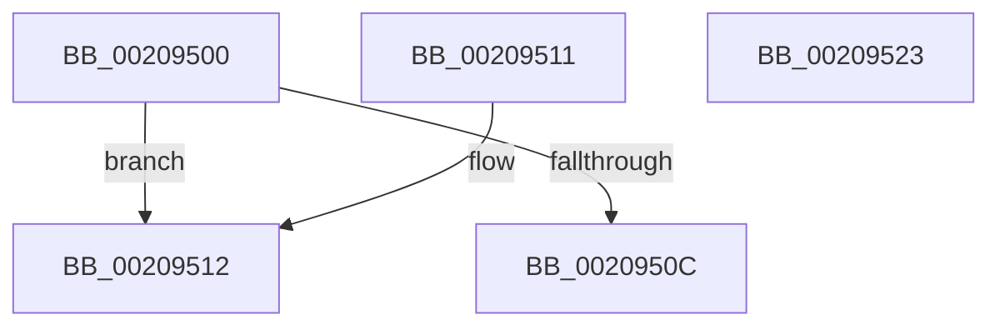

# HalpTimerGetInternalData

- RVA: `0x00209500`–`0x00209524` (길이 `36` bytes)
- VA: `0x0000000140209500`
- 실행 섹션: `.text`
- PDB 이름 있음: `예`; PDB Function 태그: `아니요`
- unwind 정보 RVA: `0x000DB714`
- 디코드: `10`개 명령, `36/36` bytes 표시
- 미해석 바이트: `0` (있으면 어셈블리에 `.byte`로 보존)

> 이 문서는 커널 이미지의 기계어와 PDB 기호를 분석해 생성했습니다. 4번과 5번은 함수 원형과 자료형을 바이너리 사용 방식에서 추정한 C 해석이며 원본 소스 복구 결과는 아닙니다.

## 1. Dependencies

- 직접 호출 지점: **0**; 고유 호출 대상: **0**
- 직접 호출자로 확인된 함수: **55**
- RIP 상대 이미지 참조: **0**

### Outgoing calls
- 직접 디코드된 call 명령이 없습니다.

### Direct callers
- [sub_00208A9F](Unknown_function_00208A9F.md) at `0x00208AE4`
- [sub_00208F87](Unknown_function_00208F87.md) at `0x002091E1`
- [sub_0020A643](Unknown_function_0020A643.md) at `0x0020A73B`
- [sub_0020A643](Unknown_function_0020A643.md) at `0x0020A854`
- [sub_0020A8E8](Unknown_function_0020A8E8.md) at `0x0020A9EF`
- [HalpVpptAcknowledgeInterrupt](../2D/HalpVpptAcknowledgeInterrupt_function_002D2230.md) at `0x002D2259`
- [HalpVpptAcknowledgeInterrupt](../2D/HalpVpptAcknowledgeInterrupt_function_002D2230.md) at `0x002D2370`
- [HalpVpptUpdatePhysicalTimer](../2D/HalpVpptUpdatePhysicalTimer_function_002D23D8.md) at `0x002D248F`
- [HalpVpptUpdatePhysicalTimer](../2D/HalpVpptUpdatePhysicalTimer_function_002D23D8.md) at `0x002D24B9`
- [KiStartThreadCycleAccumulationContextSwap](../30/KiStartThreadCycleAccumulationContextSwap_function_00309C10.md) at `0x0030A1BE`
- [KiStartThreadCycleAccumulationContextSwap](../30/KiStartThreadCycleAccumulationContextSwap_function_00309C10.md) at `0x0030A2DC`
- [KiStartThreadCycleAccumulationContextSwap](../30/KiStartThreadCycleAccumulationContextSwap_function_00309C10.md) at `0x0030A46C`
- [sub_0037AE18](../37/Unknown_function_0037AE18.md) at `0x0037AF31`
- [sub_0037AE18](../37/Unknown_function_0037AE18.md) at `0x0037B04D`
- [sub_0037AE18](../37/Unknown_function_0037AE18.md) at `0x0037B1CB`
- [sub_0037BB03](../37/Unknown_function_0037BB03.md) at `0x0037BB14`
- [sub_0037BC17](../37/Unknown_function_0037BC17.md) at `0x0037BC33`
- [sub_0037BC17](../37/Unknown_function_0037BC17.md) at `0x0037BDC4`
- [KiEndThreadCycleAccumulation](../37/KiEndThreadCycleAccumulation_function_0037BFF0.md) at `0x0037C6A2`
- [KiEndThreadCycleAccumulation](../37/KiEndThreadCycleAccumulation_function_0037BFF0.md) at `0x0037C7C1`
- [KiEndThreadCycleAccumulation](../37/KiEndThreadCycleAccumulation_function_0037BFF0.md) at `0x0037C95E`
- [sub_0037D298](../37/Unknown_function_0037D298.md) at `0x0037D2A9`
- [sub_0037D3AC](../37/Unknown_function_0037D3AC.md) at `0x0037D3C8`
- [sub_0037D3AC](../37/Unknown_function_0037D3AC.md) at `0x0037D560`
- [sub_0037E8B6](../37/Unknown_function_0037E8B6.md) at `0x0037E99E`
- [sub_0037EAAA](../37/Unknown_function_0037EAAA.md) at `0x0037EAC2`
- [sub_0037EAAA](../37/Unknown_function_0037EAAA.md) at `0x0037EC43`
- [KeStallExecutionProcessor](../44/KeStallExecutionProcessor_function_0044F620.md) at `0x0044F68B`
- [HalpTimerCaptureCurrentAuxiliaryQpcPair](../48/HalpTimerCaptureCurrentAuxiliaryQpcPair_function_0048E0D4.md) at `0x0048E122`
- [HalpTimerCalibratePerformanceCounter](../4A/HalpTimerCalibratePerformanceCounter_function_004AB874.md) at `0x004AB897`
- [HalpTimerCalibratePerformanceCounter](../4A/HalpTimerCalibratePerformanceCounter_function_004AB874.md) at `0x004AB90A`
- [HalpTimerDpcRoutine](../4B/HalpTimerDpcRoutine_function_004B2870.md) at `0x004B28A7`
- [HalpTimerDpcRoutine](../4B/HalpTimerDpcRoutine_function_004B2870.md) at `0x004B2953`
- [HalpTimerSavePerformanceCounter](../4B/HalpTimerSavePerformanceCounter_function_004B37F0.md) at `0x004B383B`
- [HalpTimerSavePerformanceCounter](../4B/HalpTimerSavePerformanceCounter_function_004B37F0.md) at `0x004B38A3`
- [HalpTimerSavePerformanceCounter](../4B/HalpTimerSavePerformanceCounter_function_004B37F0.md) at `0x004B38E2`
- [HalpTimerSavePerformanceCounter](../4B/HalpTimerSavePerformanceCounter_function_004B37F0.md) at `0x004B3966`
- [HalpTimerClockStop](../4C/HalpTimerClockStop_function_004C0690.md) at `0x004C06AF`
- [HalpTimerClockStop](../4C/HalpTimerClockStop_function_004C0690.md) at `0x004C06D4`
- [HalpTimerSwitchStallSource](../4F/HalpTimerSwitchStallSource_function_004F9FF0.md) at `0x004FA022`
- [HalpInitializePnTimers](../53/HalpInitializePnTimers_function_0053C120.md) at `0x0053C15F`
- [HalpInitializeTimers](../53/HalpInitializeTimers_function_0053C1E0.md) at `0x0053C21F`
- [HalpTimerCaptureCloestAuxiliaryQpcPair](../53/HalpTimerCaptureCloestAuxiliaryQpcPair_function_0053C428.md) at `0x0053C473`
- [HalpTimerInitialize](../53/HalpTimerInitialize_function_0053CF38.md) at `0x0053CF53`
- [HalpTimerInitialize](../53/HalpTimerInitialize_function_0053CF38.md) at `0x0053CF98`
- [HalpTimerQueryCycleCounter](../53/HalpTimerQueryCycleCounter_function_0053D1D0.md) at `0x0053D20B`
- [HalpTimerReinitializeThisProcessor](../53/HalpTimerReinitializeThisProcessor_function_0053D2F0.md) at `0x0053D322`
- [HalpInterruptRestoreClock](../54/HalpInterruptRestoreClock_function_00544580.md) at `0x00544667`
- [HalpTimerClockActivate](../54/HalpTimerClockActivate_function_005480B0.md) at `0x00548104`
- [HalpTimerClockInitialize](../54/HalpTimerClockInitialize_function_00548130.md) at `0x00548140`
- [HalpTimerClockPowerChange](../54/HalpTimerClockPowerChange_function_005481A0.md) at `0x00548270`
- [HalpTimerInitializeClockPn](../54/HalpTimerInitializeClockPn_function_00548614.md) at `0x00548677`
- [HalpTimerInitializeClockPn](../54/HalpTimerInitializeClockPn_function_00548614.md) at `0x005486D0`
- [HalpTimerSwitchToNormalClock](../54/HalpTimerSwitchToNormalClock_function_00548814.md) at `0x0054885A`
- [HalpTimerConfigureInterrupt](../54/HalpTimerConfigureInterrupt_function_00548AB0.md) at `0x00548B79`
- [HalpTimerConfigureInterrupt](../54/HalpTimerConfigureInterrupt_function_00548AB0.md) at `0x00548C7C`
- [HalpTimerConfigureInterrupt](../54/HalpTimerConfigureInterrupt_function_00548AB0.md) at `0x00548D82`
- [HalpTimerDelayedQueryCounter](../54/HalpTimerDelayedQueryCounter_function_00548F20.md) at `0x00548FA2`
- [HalpTimerDelayedQueryCounter](../54/HalpTimerDelayedQueryCounter_function_00548F20.md) at `0x0054907A`
- [HalpTimerDetermineValidTimerPairReadLatency](../54/HalpTimerDetermineValidTimerPairReadLatency_function_00549100.md) at `0x0054915D`
- [HalpTimerDetermineValidTimerPairReadLatency](../54/HalpTimerDetermineValidTimerPairReadLatency_function_00549100.md) at `0x00549192`
- [HalpTimerMeasureFrequencies](../54/HalpTimerMeasureFrequencies_function_005493C0.md) at `0x00549491`
- [HalpTimerMeasureFrequencies](../54/HalpTimerMeasureFrequencies_function_005493C0.md) at `0x005494BE`
- [HalpTimerMeasureFrequencies](../54/HalpTimerMeasureFrequencies_function_005493C0.md) at `0x00549535`
- [HalpTimerMeasureFrequencies](../54/HalpTimerMeasureFrequencies_function_005493C0.md) at `0x00549575`
- [HalpTimerMeasureFrequencies](../54/HalpTimerMeasureFrequencies_function_005493C0.md) at `0x005495F7`
- [HalpTimerMeasureFrequencies](../54/HalpTimerMeasureFrequencies_function_005493C0.md) at `0x005496F6`
- [HalpTimerPerformanceCounterPowerChange](../54/HalpTimerPerformanceCounterPowerChange_function_00549738.md) at `0x0054977A`
- [HalpTimerPerformanceCounterPowerChange](../54/HalpTimerPerformanceCounterPowerChange_function_00549738.md) at `0x005497FD`
- [HalpTimerPerformanceCounterPowerChange](../54/HalpTimerPerformanceCounterPowerChange_function_00549738.md) at `0x005498C3`
- [HalpTimerPerformanceCounterPowerChange](../54/HalpTimerPerformanceCounterPowerChange_function_00549738.md) at `0x005499E0`
- [HalpTimerPerformanceCounterPowerChange](../54/HalpTimerPerformanceCounterPowerChange_function_00549738.md) at `0x00549A9F`
- [HalpTimerPerformanceCounterPowerChange](../54/HalpTimerPerformanceCounterPowerChange_function_00549738.md) at `0x00549B09`
- [HalpTimerPerformanceCounterPowerChange](../54/HalpTimerPerformanceCounterPowerChange_function_00549738.md) at `0x00549BC6`
- [HalpTimerPerformanceCounterPowerChange](../54/HalpTimerPerformanceCounterPowerChange_function_00549738.md) at `0x00549C60`
- [HalpTimerPerformanceCounterPowerChange](../54/HalpTimerPerformanceCounterPowerChange_function_00549738.md) at `0x00549D1A`
- [HalpTimerPowerChange](../54/HalpTimerPowerChange_function_00549DF0.md) at `0x00549E91`
- [HalpTimerReadTimerPairWithLatencyLimit](../54/HalpTimerReadTimerPairWithLatencyLimit_function_00549F28.md) at `0x00549F87`
- [HalpTimerReadTimerPairWithLatencyLimit](../54/HalpTimerReadTimerPairWithLatencyLimit_function_00549F28.md) at `0x00549FBF`
- [HalpTimerStallCounterPowerChange](../54/HalpTimerStallCounterPowerChange_function_0054A078.md) at `0x0054A0A9`
- [HalpVpptInitializePhysicalTimer](../54/HalpVpptInitializePhysicalTimer_function_0054A2F4.md) at `0x0054A345`
- [HalpVpptStop](../54/HalpVpptStop_function_0054A380.md) at `0x0054A3DC`
- [HalpTimerInitializeProfiling](../54/HalpTimerInitializeProfiling_function_0054B4FC.md) at `0x0054B610`
- [HalpTimerInitializeProfiling](../54/HalpTimerInitializeProfiling_function_0054B4FC.md) at `0x0054B62A`
- [HalpTimerRestartProfileInterrupt](../54/HalpTimerRestartProfileInterrupt_function_0054B6A4.md) at `0x0054B6DB`
- [HalpTimerRestartProfileInterrupt](../54/HalpTimerRestartProfileInterrupt_function_0054B6A4.md) at `0x0054B71D`
- [HalpTimerStopProfileInterrupt](../54/HalpTimerStopProfileInterrupt_function_0054B8A4.md) at `0x0054B8CD`
- [HalpTimerWatchdogStart](../54/HalpTimerWatchdogStart_function_0054C710.md) at `0x0054C73A`
- [HalpTimerWatchdogStop](../54/HalpTimerWatchdogStop_function_0054C7A0.md) at `0x0054C7C2`
- [HalpTimerAlwaysOnClockInterrupt](../56/HalpTimerAlwaysOnClockInterrupt_function_00560240.md) at `0x0056026A`
- [HalpTimerClockInterruptStub](../56/HalpTimerClockInterruptStub_function_005604C0.md) at `0x005604CE`
- [HalpTimerHypervisorInterruptStub](../56/HalpTimerHypervisorInterruptStub_function_00560510.md) at `0x0056051E`
- [HalpTimerProfileInterrupt](../56/HalpTimerProfileInterrupt_function_00560560.md) at `0x00560577`
- [HalpTimerWatchdogPreResetInterrupt](../56/HalpTimerWatchdogPreResetInterrupt_function_005605C0.md) at `0x005605D0`
- [sub_006F11D4](../6F/Unknown_function_006F11D4.md) at `0x006F11E5`

### Static image references
- 디코드된 RIP-relative 메모리 참조가 없습니다.

## 2. Other-region calls and transfers

- 다른 실행 섹션으로 향하는 call: **0**
- 별도 외부 분기/꼬리 이동을 확인하지 못했습니다.

## 3. Assembly (complete function range)

```asm
00209500  F7 81 E0 00 00 00 00 00 01 00   test dword ptr [rcx + 0xe0], 0x10000
0020950A  75 06                           jne 0x140209512
0020950C  48 8B 41 48                     mov rax, qword ptr [rcx + 0x48]
00209510  C3                              ret
00209511  CC                              int3
00209512  65 8B 04 25 A4 01 00 00         mov eax, dword ptr gs:[0x1a4]
0020951A  0F AF 41 50                     imul eax, dword ptr [rcx + 0x50]
0020951E  48 03 41 48                     add rax, qword ptr [rcx + 0x48]
00209522  C3                              ret
00209523  CC                              int3
```

## 4. C-style interpretation (structured pseudocode)

```c
__int64 __fastcall HalpTimerGetInternalData(__int64 a1)
{
    __int64 result;

    if (((*(unsigned int *)(a1 + 224)) & (0x10000ULL)) != 0) goto loc_00209512;
    return *(unsigned __int64 *)(a1 + 72);
loc_00209512:
    result = (unsigned int)(((unsigned int)(*(unsigned int *)(gs_base + (0 + 420)))) * (*(unsigned int *)(a1 + 80)));
    result = (result) + (*(unsigned __int64 *)(a1 + 72));
    return result;
}
```

## 5. (Beta) C Style

```c
int64_t HalpTimerGetInternalData(void *Arg1)
{
    uint8_t *arg1 = (uint8_t *)Arg1;

    int64_t result;

    if (((*(uint32_t *)(arg1 + 0xE0)) & (0x10000ULL)) != 0) goto loc_00209512;
    return *(uint64_t *)(arg1 + 0x48);
loc_00209512:
    result = (uint32_t)(((uint32_t)(*(uint32_t *)(gs_base + (0 + 0x1A4)))) * (*(uint32_t *)(arg1 + 0x50)));
    result = (result) + (*(uint64_t *)(arg1 + 0x48));
    return result;
}
```

### 관측된 메모리 오프셋

구조체 형식이 확인되지 않은 접근은 인자 기준의 오프셋으로만 기록했습니다.

| 기준 인자 | 오프셋 표현 | 폭 (bit) | 접근 |
|---|---:|---:|---|
| `Arg1` | `+ 0x48` | `64` | `R` |
| `Arg1` | `+ 0x50` | `32` | `R` |
| `Arg1` | `+ 0xE0` | `32` | `R` |

## 6. Execution-region graph

[열기: 2D/3D 그래프와 함수 탐색 컨트롤 패널](../../../control-panel.html?section=text&rva=0x00209500&view=graph)

- 2D 그래프는 위에서 아래로 흐르고, 3D 그래프는 빈 공간을 드래그해 회전합니다. Shift+드래그는 이동, 휠은 확대·축소, 함수 노드 선택은 대상 보고서 이동입니다.

### Static fallback


