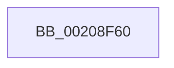

# HalpTimerStallExecutionProcessor

- RVA: `0x00208F60`–`0x00208F87` (길이 `39` bytes)
- VA: `0x0000000140208F60`
- 실행 섹션: `.text`
- PDB 이름 있음: `예`; PDB Function 태그: `예`
- unwind 정보 RVA: `0x0005D540`
- 디코드: `8`개 명령, `39/39` bytes 표시
- 미해석 바이트: `0` (있으면 어셈블리에 `.byte`로 보존)

> 이 문서는 커널 이미지의 기계어와 PDB 기호를 분석해 생성했습니다. 4번과 5번은 함수 원형과 자료형을 바이너리 사용 방식에서 추정한 C 해석이며 원본 소스 복구 결과는 아닙니다.

## 1. Dependencies

- 직접 호출 지점: **0**; 고유 호출 대상: **0**
- 직접 호출자로 확인된 함수: **2**
- RIP 상대 이미지 참조: **1**

### Outgoing calls
- 직접 디코드된 call 명령이 없습니다.

### Direct callers
- [KeStallExecutionProcessor](../44/KeStallExecutionProcessor_function_0044F620.md) at `0x0044F650`
- [HalpTimerMeasureFrequencies](../54/HalpTimerMeasureFrequencies_function_005493C0.md) at `0x0054956E`

### Static image references
- `0x00208F6C` → RVA `0x00E0A740` (`.data`; read)

## 2. Other-region calls and transfers

- 다른 실행 섹션으로 향하는 call: **0**
- 별도 외부 분기/꼬리 이동을 확인하지 못했습니다.

## 3. Assembly (complete function range)

```asm
00208F60  4C 8B DC                        mov r11, rsp
00208F63  48 9C                           pushfq
00208F65  48 81 EC C0 00 00 00            sub rsp, 0xc0
00208F6C  48 8B 05 CD 17 C0 00            mov rax, qword ptr [rip + 0xc017cd]
00208F73  48 33 C4                        xor rax, rsp
00208F76  48 89 84 24 80 00 00 00         mov qword ptr [rsp + 0x80], rax
00208F7E  8B 81 E0 00 00 00               mov eax, dword ptr [rcx + 0xe0]
00208F84  0F 57 C0                        xorps xmm0, xmm0
```

## 4. C-style interpretation (structured pseudocode)

```c
__int64 __fastcall HalpTimerStallExecutionProcessor(__int64 a1)
{
    __int64 result;
    __int64 v_rsp;
    unsigned __int64 v_stack_m48;

    v_rsp = (v_rsp) - (192);
    result = (*(unsigned __int64 *)(v_rip + 12589005)) ^ (v_rsp);
    v_stack_m48 = result;
    return (unsigned int)(*(unsigned int *)(a1 + 224));
}
```

## 5. (Beta) C Style

```c
int64_t HalpTimerStallExecutionProcessor(void *Arg1)
{
    uint8_t *arg1 = (uint8_t *)Arg1;

    int64_t result;
    int64_t local_rsp;
    uint64_t v_stack_m48;

    local_rsp = (local_rsp) - (192);
    result = (*(uint64_t *)(v_rip + 0xC017CD)) ^ (local_rsp);
    v_stack_m48 = result;
    return (uint32_t)(*(uint32_t *)(arg1 + 0xE0));
}
```

### 관측된 메모리 오프셋

구조체 형식이 확인되지 않은 접근은 인자 기준의 오프셋으로만 기록했습니다.

| 기준 인자 | 오프셋 표현 | 폭 (bit) | 접근 |
|---|---:|---:|---|
| `Arg1` | `+ 0xE0` | `32` | `R` |

## 6. Execution-region graph

[열기: 2D/3D 그래프와 함수 탐색 컨트롤 패널](../../../control-panel.html?section=text&rva=0x00208F60&view=graph)

- 2D 그래프는 위에서 아래로 흐르고, 3D 그래프는 빈 공간을 드래그해 회전합니다. Shift+드래그는 이동, 휠은 확대·축소, 함수 노드 선택은 대상 보고서 이동입니다.

### Static fallback


