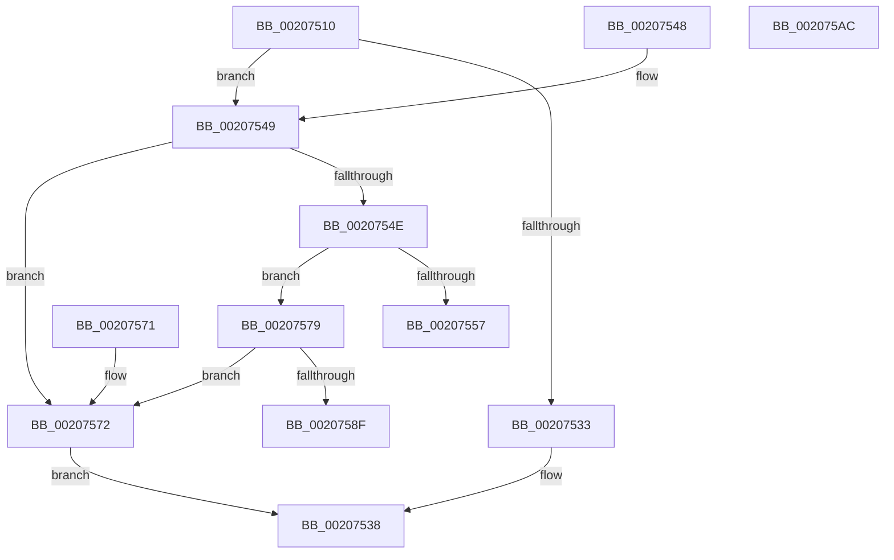

# IoAllocateIrpEx

- RVA: `0x00207510`–`0x002075AD` (길이 `157` bytes)
- VA: `0x0000000140207510`
- 실행 섹션: `.text`
- PDB 이름 있음: `예`; PDB Function 태그: `아니요`
- unwind 정보 RVA: `0x0005D1E0`
- 디코드: `46`개 명령, `157/157` bytes 표시
- 미해석 바이트: `0` (있으면 어셈블리에 `.byte`로 보존)

> 이 문서는 커널 이미지의 기계어와 PDB 기호를 분석해 생성했습니다. 4번과 5번은 함수 원형과 자료형을 바이너리 사용 방식에서 추정한 C 해석이며 원본 소스 복구 결과는 아닙니다.

## 1. Dependencies

- 직접 호출 지점: **5**; 고유 호출 대상: **4**
- 직접 호출자로 확인된 함수: **9**
- RIP 상대 이미지 참조: **2**

### Outgoing calls
- `0x00207533` → [IopAllocateIrpPrivate](IopAllocateIrpPrivate_function_00207770.md) (function, `0x00207770`)
- `0x0020755C` → [IovAllocateIrp](../../pagevrfy/BB/IovAllocateIrp_function_00BB9540.md) (function, `0x00BB9540`)
- `0x00207572` → [IopAllocateIrpWithExtension](../29/IopAllocateIrpWithExtension_function_0029DF38.md) (function, `0x0029DF38`)
- `0x0020757E` → [VfTargetDriversIsEnabled](../../pagevrfy/BB/VfTargetDriversIsEnabled_function_00BB7F20.md) (function, `0x00BB7F20`)
- `0x00207597` → [IovAllocateIrp](../../pagevrfy/BB/IovAllocateIrp_function_00BB9540.md) (function, `0x00BB9540`)

### Direct callers
- [FsRtlGetFileExtents](../58/FsRtlGetFileExtents_function_00580F40.md) at `0x00580F8C`
- [FsRtlSetFileSize](../../page/98/FsRtlSetFileSize_function_00982B04.md) at `0x00982B59`
- [FsRtlGetFileSize](../../page/98/FsRtlGetFileSize_function_00985150.md) at `0x00985227`
- [FsRtlQueryKernelEaFile](../../page/A0/FsRtlQueryKernelEaFile_function_00A0C680.md) at `0x00A0C6EB`
- [FsRtlSetKernelEaFile](../../page/A0/FsRtlSetKernelEaFile_function_00A0C8B0.md) at `0x00A0C914`
- [FsRtlKernelFsControlFile](../../page/A0/FsRtlKernelFsControlFile_function_00A0CA70.md) at `0x00A0CAE2`
- [FsRtlQueryInformationFile](../../page/A3/FsRtlQueryInformationFile_function_00A38780.md) at `0x00A387EB`
- [FsRtlGetDirectImageOriginalBase](../../page/AC/FsRtlGetDirectImageOriginalBase_function_00AC9C70.md) at `0x00AC9CBB`
- [VfIrpSendSynchronousIrp](../../pagevrfy/B9/VfIrpSendSynchronousIrp_function_00B9DEF0.md) at `0x00B9DF4C`

### Static image references
- `0x0020751F` → RVA `0x00FC6D24` (`ALMOSTRO`; read)
- `0x0020754E` → RVA `0x00F04A04` (`.data`; read)

## 2. Other-region calls and transfers

- 다른 실행 섹션으로 향하는 call: **3**
  - `0x0020755C` → [IovAllocateIrp](../../pagevrfy/BB/IovAllocateIrp_function_00BB9540.md) (`.text` → `PAGEVRFY`)
  - `0x0020757E` → [VfTargetDriversIsEnabled](../../pagevrfy/BB/VfTargetDriversIsEnabled_function_00BB7F20.md) (`.text` → `PAGEVRFY`)
  - `0x00207597` → [IovAllocateIrp](../../pagevrfy/BB/IovAllocateIrp_function_00BB9540.md) (`.text` → `PAGEVRFY`)
- 별도 외부 분기/꼬리 이동을 확인하지 못했습니다.

## 3. Assembly (complete function range)

```asm
00207510  48 89 5C 24 08                  mov qword ptr [rsp + 8], rbx
00207515  48 89 74 24 10                  mov qword ptr [rsp + 0x10], rsi
0020751A  57                              push rdi
0020751B  48 83 EC 20                     sub rsp, 0x20
0020751F  8B 05 FF F7 DB 00               mov eax, dword ptr [rip + 0xdbf7ff]
00207525  41 0F B6 D8                     movzx ebx, r8b
00207529  0F B6 FA                        movzx edi, dl
0020752C  48 8B F1                        mov rsi, rcx
0020752F  85 C0                           test eax, eax
00207531  75 16                           jne 0x140207549
00207533  E8 38 02 00 00                  call 0x140207770
00207538  48 8B 5C 24 30                  mov rbx, qword ptr [rsp + 0x30]
0020753D  48 8B 74 24 38                  mov rsi, qword ptr [rsp + 0x38]
00207542  48 83 C4 20                     add rsp, 0x20
00207546  5F                              pop rdi
00207547  C3                              ret
00207548  CC                              int3
00207549  83 F8 02                        cmp eax, 2
0020754C  74 24                           je 0x140207572
0020754E  83 3D AF D4 CF 00 01            cmp dword ptr [rip + 0xcfd4af], 1
00207555  75 22                           jne 0x140207579
00207557  4C 8B 4C 24 28                  mov r9, qword ptr [rsp + 0x28]
0020755C  E8 DF 1F 9B 00                  call 0x140bb9540
00207561  48 8B 5C 24 30                  mov rbx, qword ptr [rsp + 0x30]
00207566  48 8B 74 24 38                  mov rsi, qword ptr [rsp + 0x38]
0020756B  48 83 C4 20                     add rsp, 0x20
0020756F  5F                              pop rdi
00207570  C3                              ret
00207571  CC                              int3
00207572  E8 C1 69 09 00                  call 0x14029df38
00207577  EB BF                           jmp 0x140207538
00207579  48 8B 4C 24 28                  mov rcx, qword ptr [rsp + 0x28]
0020757E  E8 9D 09 9B 00                  call 0x140bb7f20
00207583  44 0F B6 C3                     movzx r8d, bl
00207587  40 0F B6 D7                     movzx edx, dil
0020758B  85 C0                           test eax, eax
0020758D  74 E3                           je 0x140207572
0020758F  4C 8B 4C 24 28                  mov r9, qword ptr [rsp + 0x28]
00207594  48 8B CE                        mov rcx, rsi
00207597  E8 A4 1F 9B 00                  call 0x140bb9540
0020759C  48 8B 5C 24 30                  mov rbx, qword ptr [rsp + 0x30]
002075A1  48 8B 74 24 38                  mov rsi, qword ptr [rsp + 0x38]
002075A6  48 83 C4 20                     add rsp, 0x20
002075AA  5F                              pop rdi
002075AB  C3                              ret
002075AC  CC                              int3
```

## 4. C-style interpretation (structured pseudocode)

```c
__int64 __fastcall IoAllocateIrpEx(__int64 a1, unsigned __int8 a2, unsigned __int8 a3)
{
    __int64 result;
    __int64 v_rsp;
    unsigned __int64 v_stack_p10;
    unsigned __int64 v_stack_p28;
    unsigned __int64 v_stack_p30;
    unsigned __int64 v_stack_p38;
    unsigned __int64 v_stack_p50;
    unsigned __int64 v_stack_p58;
    unsigned __int64 v_stack_p60;
    unsigned __int64 v_stack_p8;

    v_stack_p8 = v_rbx;
    v_stack_p10 = v_rsi;
    v_rsp = (v_rsp) - (32);
    if ((unsigned int)((unsigned int)(*(unsigned int *)(v_rip + 14415871))) != 0) goto loc_00207549;
    result = IopAllocateIrpPrivate(a1, a2, a3, a4);
loc_00207538:
    v_rsp = (v_rsp) + (32);
    return result;
loc_00207549:
    if (((unsigned int)(result)) == 2) goto loc_00207572;
    if ((*(unsigned int *)(v_rip + 13620399)) != 1) goto loc_00207579;
    result = IovAllocateIrp(a1, a2, a3, v_stack_p28);
    v_rsp = (v_rsp) + (32);
    return result;
loc_00207572:
    result = IopAllocateIrpWithExtension(a1, a2, a3, v_stack_p28);
    goto loc_00207538;
loc_00207579:
    result = VfTargetDriversIsEnabled(v_stack_p50, a2, a3, v_stack_p28);
    if ((unsigned int)(result) == 0) goto loc_00207572;
    result = IovAllocateIrp(v_stack_p38, a2, (unsigned __int8)(v_stack_p30), v_stack_p50);
    v_rsp = (v_rsp) + (32);
    return result;
}
```

## 5. (Beta) C Style

```c
int64_t IoAllocateIrpEx(int64_t Arg1, uint8_t Arg2, uint8_t Arg3)
{
    int64_t result;
    int64_t local_rsp;
    uint64_t v_stack_p10;
    uint64_t v_stack_p28;
    uint64_t v_stack_p30;
    uint64_t v_stack_p38;
    uint64_t v_stack_p50;
    uint64_t v_stack_p58;
    uint64_t v_stack_p60;
    uint64_t v_stack_p8;

    v_stack_p8 = local_rbx;
    v_stack_p10 = local_rsi;
    local_rsp = (local_rsp) - (32);
    if ((uint32_t)((uint32_t)(*(uint32_t *)(v_rip + 0xDBF7FF))) != 0) goto loc_00207549;
    result = IopAllocateIrpPrivate(Arg1, Arg2, Arg3, a4);
loc_00207538:
    local_rsp = (local_rsp) + (32);
    return result;
loc_00207549:
    if (((uint32_t)(result)) == 2) goto loc_00207572;
    if ((*(uint32_t *)(v_rip + 0xCFD4AF)) != 1) goto loc_00207579;
    result = IovAllocateIrp(Arg1, Arg2, Arg3, v_stack_p28);
    local_rsp = (local_rsp) + (32);
    return result;
loc_00207572:
    result = IopAllocateIrpWithExtension(Arg1, Arg2, Arg3, v_stack_p28);
    goto loc_00207538;
loc_00207579:
    result = VfTargetDriversIsEnabled(v_stack_p50, Arg2, Arg3, v_stack_p28);
    if ((uint32_t)(result) == 0) goto loc_00207572;
    result = IovAllocateIrp(v_stack_p38, Arg2, (uint8_t)(v_stack_p30), v_stack_p50);
    local_rsp = (local_rsp) + (32);
    return result;
}
```

## 6. Execution-region graph

[열기: 2D/3D 그래프와 함수 탐색 컨트롤 패널](../../../control-panel.html?section=text&rva=0x00207510&view=graph)

- 2D 그래프는 위에서 아래로 흐르고, 3D 그래프는 빈 공간을 드래그해 회전합니다. Shift+드래그는 이동, 휠은 확대·축소, 함수 노드 선택은 대상 보고서 이동입니다.

### Static fallback


