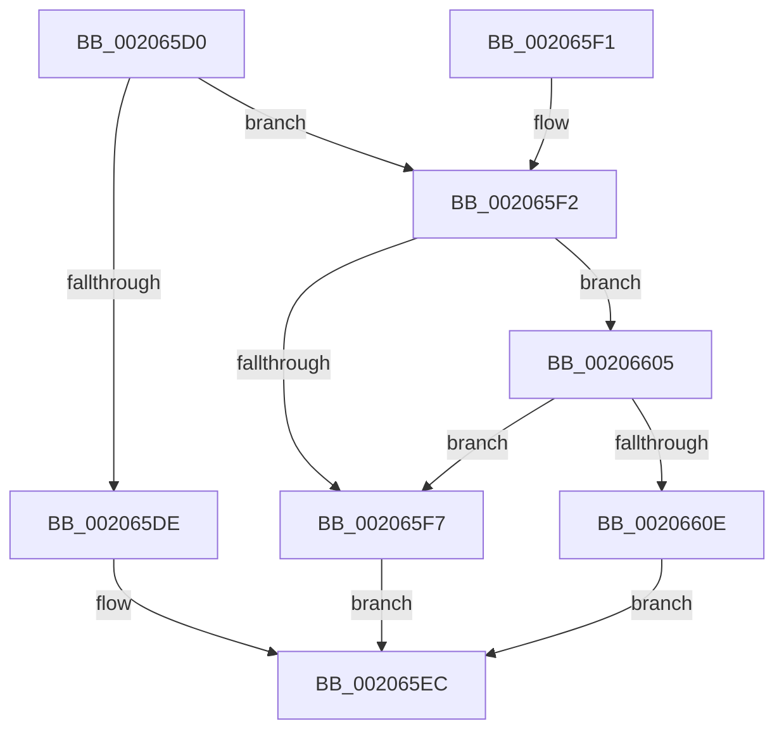

# IoAllocateIrp

- RVA: `0x002065D0`–`0x00206623` (길이 `83` bytes)
- VA: `0x00000001402065D0`
- 실행 섹션: `.text`
- PDB 이름 있음: `예`; PDB Function 태그: `아니요`
- unwind 정보 RVA: `0x0005CEF4`
- 디코드: `25`개 명령, `83/83` bytes 표시
- 미해석 바이트: `0` (있으면 어셈블리에 `.byte`로 보존)

> 이 문서는 커널 이미지의 기계어와 PDB 기호를 분석해 생성했습니다. 4번과 5번은 함수 원형과 자료형을 바이너리 사용 방식에서 추정한 C 해석이며 원본 소스 복구 결과는 아닙니다.

## 1. Dependencies

- 직접 호출 지점: **3**; 고유 호출 대상: **3**
- 직접 호출자로 확인된 함수: **19**
- RIP 상대 이미지 참조: **2**

### Outgoing calls
- `0x002065E7` → [IopAllocateIrpPrivate](IopAllocateIrpPrivate_function_00207770.md) (function, `0x00207770`)
- `0x002065FE` → [IopAllocateIrpWithExtension](../29/IopAllocateIrpWithExtension_function_0029DF38.md) (function, `0x0029DF38`)
- `0x0020661C` → [IovAllocateIrp](../../pagevrfy/BB/IovAllocateIrp_function_00BB9540.md) (function, `0x00BB9540`)

### Direct callers
- [PopAllocateIrp](../27/PopAllocateIrp_function_0027116C.md) at `0x00271457`
- [CcSetValidData](../29/CcSetValidData_function_00299420.md) at `0x0029948B`
- [SmKmIssueVolumeIo](../60/SmKmIssueVolumeIo_function_0060F9BC.md) at `0x0060F9FC`
- [IopEjectDevice](../../page/73/IopEjectDevice_function_0073DC84.md) at `0x0073DD43`
- [PpIrpAllocateDeviceUsageNotification](../../page/73/PpIrpAllocateDeviceUsageNotification_function_0073E1DC.md) at `0x0073E202`
- [PopAcquirePowerLimitInterface](../../page/75/PopAcquirePowerLimitInterface_function_00755E10.md) at `0x00755E2B`
- [PopAcquireCoolingInterface](../../page/75/PopAcquireCoolingInterface_function_00756DF0.md) at `0x00756E06`
- [PopFxRegisterDeviceWorker](../../page/75/PopFxRegisterDeviceWorker_function_00759E20.md) at `0x0075A528`
- [PopConnectToPolicyDevice](../../page/76/PopConnectToPolicyDevice_function_00765D20.md) at `0x00765DEB`
- [SmKmIsVolumeIoPossible](../../page/7A/SmKmIsVolumeIoPossible_function_007A84BC.md) at `0x007A855C`
- [CmpGetVolumeClusterSize](../../page/87/CmpGetVolumeClusterSize_function_0087B3D4.md) at `0x0087B49A`
- [IopSynchronousCall](../../page/8F/IopSynchronousCall_function_008FB018.md) at `0x008FB06A`
- [CmpFileFlushAndPurge](../../page/9B/CmpFileFlushAndPurge_function_009B2BAC.md) at `0x009B2C5B`
- [WmipSendWmiIrp](../../page/9E/WmipSendWmiIrp_function_009E0484.md) at `0x009E04CA`
- [WmipSendWmiIrpToTraceDeviceList](../../page/9E/WmipSendWmiIrpToTraceDeviceList_function_009E2988.md) at `0x009E29EC`
- [PnpAsynchronousCall](../../page/A6/PnpAsynchronousCall_function_00A635D0.md) at `0x00A63606`
- [IopFilterResourceRequirementsCall](../../page/A9/IopFilterResourceRequirementsCall_function_00A92388.md) at `0x00A923C3`
- [WmipGetFilePDO](../../page/AA/WmipGetFilePDO_function_00AAF454.md) at `0x00AAF4B0`
- [WmipSetTraceNotify](../../page/AB/WmipSetTraceNotify_function_00ABF0E0.md) at `0x00ABF18B`

### Static image references
- `0x002065D4` → RVA `0x00FC6D24` (`ALMOSTRO`; read)
- `0x00206605` → RVA `0x00F04A04` (`.data`; read)

## 2. Other-region calls and transfers

- 다른 실행 섹션으로 향하는 call: **1**
  - `0x0020661C` → [IovAllocateIrp](../../pagevrfy/BB/IovAllocateIrp_function_00BB9540.md) (`.text` → `PAGEVRFY`)
- 별도 외부 분기/꼬리 이동을 확인하지 못했습니다.

## 3. Assembly (complete function range)

```asm
002065D0  48 83 EC 28                     sub rsp, 0x28
002065D4  8B 05 4A 07 DC 00               mov eax, dword ptr [rip + 0xdc074a]
002065DA  85 C0                           test eax, eax
002065DC  75 14                           jne 0x1402065f2
002065DE  44 0F B6 C2                     movzx r8d, dl
002065E2  0F B6 D1                        movzx edx, cl
002065E5  33 C9                           xor ecx, ecx
002065E7  E8 84 11 00 00                  call 0x140207770
002065EC  48 83 C4 28                     add rsp, 0x28
002065F0  C3                              ret
002065F1  CC                              int3
002065F2  83 F8 02                        cmp eax, 2
002065F5  75 0E                           jne 0x140206605
002065F7  44 0F B6 C2                     movzx r8d, dl
002065FB  0F B6 D1                        movzx edx, cl
002065FE  E8 35 79 09 00                  call 0x14029df38
00206603  EB E7                           jmp 0x1402065ec
00206605  83 3D F8 E3 CF 00 01            cmp dword ptr [rip + 0xcfe3f8], 1
0020660C  75 E9                           jne 0x1402065f7
0020660E  4C 8B 4C 24 28                  mov r9, qword ptr [rsp + 0x28]
00206613  44 0F B6 C2                     movzx r8d, dl
00206617  0F B6 D1                        movzx edx, cl
0020661A  33 C9                           xor ecx, ecx
0020661C  E8 1F 2F 9B 00                  call 0x140bb9540
00206621  EB C9                           jmp 0x1402065ec
```

## 4. C-style interpretation (structured pseudocode)

```c
__int64 __fastcall IoAllocateIrp(int a1, unsigned __int8 a2)
{
    __int64 result;
    __int64 v_rsp;
    unsigned __int64 v_stack_p28;

    v_rsp = (v_rsp) - (40);
    if ((unsigned int)((unsigned int)(*(unsigned int *)(v_rip + 14419786))) != 0) goto loc_002065F2;
    a1 = 0;
    result = IopAllocateIrpPrivate(a1, (unsigned __int8)(a1), a2, a4);
loc_002065EC:
    v_rsp = (v_rsp) + (40);
    return result;
loc_002065F2:
    if (((unsigned int)(result)) != 2) goto loc_00206605;
loc_002065F7:
    result = IopAllocateIrpWithExtension(a1, 0, (unsigned __int8)((unsigned __int8)(a1)), a4);
    goto loc_002065EC;
loc_00206605:
    if ((*(unsigned int *)(v_rip + 13624312)) != 1) goto loc_002065F7;
    a1 = 0;
    result = IovAllocateIrp(a1, 0, 0, v_stack_p28);
    goto loc_002065EC;
}
```

## 5. (Beta) C Style

```c
int64_t IoAllocateIrp(int32_t Arg1, uint8_t Arg2)
{
    int64_t result;
    int64_t local_rsp;
    uint64_t v_stack_p28;

    local_rsp = (local_rsp) - (40);
    if ((uint32_t)((uint32_t)(*(uint32_t *)(v_rip + 0xDC074A))) != 0) goto loc_002065F2;
    Arg1 = 0;
    result = IopAllocateIrpPrivate(Arg1, (uint8_t)(Arg1), Arg2, a4);
loc_002065EC:
    local_rsp = (local_rsp) + (40);
    return result;
loc_002065F2:
    if (((uint32_t)(result)) != 2) goto loc_00206605;
loc_002065F7:
    result = IopAllocateIrpWithExtension(Arg1, 0, (uint8_t)((uint8_t)(Arg1)), a4);
    goto loc_002065EC;
loc_00206605:
    if ((*(uint32_t *)(v_rip + 0xCFE3F8)) != 1) goto loc_002065F7;
    Arg1 = 0;
    result = IovAllocateIrp(Arg1, 0, 0, v_stack_p28);
    goto loc_002065EC;
}
```

## 6. Execution-region graph

[열기: 2D/3D 그래프와 함수 탐색 컨트롤 패널](../../../control-panel.html?section=text&rva=0x002065D0&view=graph)

- 2D 그래프는 위에서 아래로 흐르고, 3D 그래프는 빈 공간을 드래그해 회전합니다. Shift+드래그는 이동, 휠은 확대·축소, 함수 노드 선택은 대상 보고서 이동입니다.

### Static fallback


