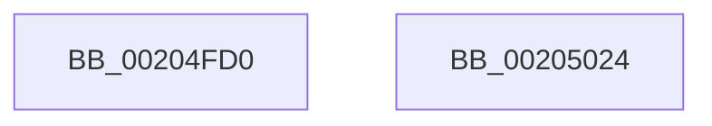

# IoBuildDeviceIoControlRequest

- RVA: `0x00204FD0`–`0x00205025` (길이 `85` bytes)
- VA: `0x0000000140204FD0`
- 실행 섹션: `.text`
- PDB 이름 있음: `예`; PDB Function 태그: `아니요`
- unwind 정보 RVA: `0x0005CC98`
- 디코드: `18`개 명령, `85/85` bytes 표시
- 미해석 바이트: `0` (있으면 어셈블리에 `.byte`로 보존)

> 이 문서는 커널 이미지의 기계어와 PDB 기호를 분석해 생성했습니다. 4번과 5번은 함수 원형과 자료형을 바이너리 사용 방식에서 추정한 C 해석이며 원본 소스 복구 결과는 아닙니다.

## 1. Dependencies

- 직접 호출 지점: **1**; 고유 호출 대상: **1**
- 직접 호출자로 확인된 함수: **35**
- RIP 상대 이미지 참조: **0**

### Outgoing calls
- `0x0020501A` → [IopBuildDeviceIoControlRequest](IopBuildDeviceIoControlRequest_function_00205B00.md) (function, `0x00205B00`)

### Direct callers
- [FsRtlGetVirtualDiskNestingLevel](../4A/FsRtlGetVirtualDiskNestingLevel_function_004A4530.md) at `0x004A4613`
- [HalpSetAcpiRealTimeClock](../../page/70/HalpSetAcpiRealTimeClock_function_00705BFC.md) at `0x00705C8A`
- [HalpQueryAcpiWakeAlarmSystemPowerState](../../page/70/HalpQueryAcpiWakeAlarmSystemPowerState_function_0070B634.md) at `0x0070B6B8`
- [FsRtlBalanceReads](../../page/71/FsRtlBalanceReads_function_00714110.md) at `0x00714171`
- [FsRtlIssueFileNotificationFsctl](../../page/71/FsRtlIssueFileNotificationFsctl_function_007161D8.md) at `0x00716269`
- [NT_DISK::Control](../../page/71/NT_DISK_Control_function_00716FC0.md) at `0x0071704B`
- [IopLoadFileSystemDriver](../../page/71/IopLoadFileSystemDriver_function_0071BB1C.md) at `0x0071BB95`
- [IopSetRemoteLink](../../page/71/IopSetRemoteLink_function_0071C690.md) at `0x0071C735`
- [IopIssueSystemEnvironmentRequest](../../page/72/IopIssueSystemEnvironmentRequest_function_00722878.md) at `0x007228F7`
- [PopPolicyDeviceHandleWakeAlarmNotification](../../page/76/PopPolicyDeviceHandleWakeAlarmNotification_function_007660A4.md) at `0x007661B9`
- [PopEtDeferredInitDxgContext](../../page/76/PopEtDeferredInitDxgContext_function_00769B40.md) at `0x00769C16`
- [RawPerformDevIoCtrl](../../page/78/RawPerformDevIoCtrl_function_0078A154.md) at `0x0078A1C7`
- [SmKmSendDeviceControl](../../page/7A/SmKmSendDeviceControl_function_007A8D84.md) at `0x007A8DF2`
- [VhdVerifyBootDisk](../../page/83/VhdVerifyBootDisk_function_0083BB84.md) at `0x0083BC46`
- [VhdiMountVhdFile](../../page/83/VhdiMountVhdFile_function_0083BED0.md) at `0x0083C0C4`
- [VhdiMountVhdFile](../../page/83/VhdiMountVhdFile_function_0083BED0.md) at `0x0083C34B`
- [VhdiMountVhdFile](../../page/83/VhdiMountVhdFile_function_0083BED0.md) at `0x0083C418`
- [IoVolumeDeviceToDosName](../../page/8A/IoVolumeDeviceToDosName_function_008A63F0.md) at `0x008A64C7`
- [IoVolumeDeviceToDosName](../../page/8A/IoVolumeDeviceToDosName_function_008A63F0.md) at `0x008A656D`
- [IoVolumeDeviceToDosName](../../page/8A/IoVolumeDeviceToDosName_function_008A63F0.md) at `0x008A6614`
- [IoVolumeDeviceToGuidPath](../../page/95/IoVolumeDeviceToGuidPath_function_00952B20.md) at `0x00952BDA`
- [IoVolumeDeviceNameToGuidPath](../../page/95/IoVolumeDeviceNameToGuidPath_function_00952CC0.md) at `0x00952E01`
- [IoVolumeDeviceNameToGuidPath](../../page/95/IoVolumeDeviceNameToGuidPath_function_00952CC0.md) at `0x00952EA7`
- [NtApphelpCacheControl](../../page/95/NtApphelpCacheControl_function_00953050.md) at `0x0095311F`
- [IopInvalidateVolumesForDevice](../../page/9A/IopInvalidateVolumesForDevice_function_009A5E74.md) at `0x009A6030`
- [IopGetSetObjectId](../../page/A3/IopGetSetObjectId_function_00A37190.md) at `0x00A37215`
- [IopGetVolumeId](../../page/A3/IopGetVolumeId_function_00A372CC.md) at `0x00A37363`
- [FsRtlQueryCachedVdl](../../page/A4/FsRtlQueryCachedVdl_function_00A45570.md) at `0x00A455F2`
- [FsRtlGetSectorSizeInformation](../../page/A6/FsRtlGetSectorSizeInformation_function_00A62EB0.md) at `0x00A62FF0`
- [FsRtlGetSectorSizeInformation](../../page/A6/FsRtlGetSectorSizeInformation_function_00A62EB0.md) at `0x00A63129`
- [FsRtlGetSectorSizeInformation](../../page/A6/FsRtlGetSectorSizeInformation_function_00A62EB0.md) at `0x00A631E1`
- [FsRtlGetSectorSizeInformation](../../page/A6/FsRtlGetSectorSizeInformation_function_00A62EB0.md) at `0x00A63296`
- [FsRtlGetSectorSizeInformation](../../page/A6/FsRtlGetSectorSizeInformation_function_00A62EB0.md) at `0x00A63376`
- [FsRtlIssueDeviceIoControl](../../page/A6/FsRtlIssueDeviceIoControl_function_00A634C0.md) at `0x00A63544`
- [IopCreateArcName](../../page/A8/IopCreateArcName_function_00A8D580.md) at `0x00A8D64F`
- [IopCreateArcName](../../page/A8/IopCreateArcName_function_00A8D580.md) at `0x00A8D6CD`
- [IopCreateArcName](../../page/A8/IopCreateArcName_function_00A8D580.md) at `0x00A8D878`
- [HalpQueryAcpiRealTimeClock](../../page/A9/HalpQueryAcpiRealTimeClock_function_00A98230.md) at `0x00A982D0`
- [RawQueryFsSizeInfo](../../page/AA/RawQueryFsSizeInfo_function_00AA1DC8.md) at `0x00AA1E94`
- [RawQueryFsSizeInfo](../../page/AA/RawQueryFsSizeInfo_function_00AA1DC8.md) at `0x00AA1F73`
- [HalpCallWakeAlarmDriver](../../page/AA/HalpCallWakeAlarmDriver_function_00AAF5E0.md) at `0x00AAF665`
- [sub_00B49880](../../page/B4/Unknown_function_00B49880.md) at `0x00B498BF`
- [IopCreateArcNamesCd](../../init/C2/IopCreateArcNamesCd_function_00C2C060.md) at `0x00C2C25A`
- [IopStoreBootDriveLetter](../../init/C2/IopStoreBootDriveLetter_function_00C2D5CC.md) at `0x00C2D689`
- [IopGetBootDiskInformation](../../init/C2/IopGetBootDiskInformation_function_00C2DAAC.md) at `0x00C2DC5D`
- [IopGetBootDiskInformation](../../init/C2/IopGetBootDiskInformation_function_00C2DAAC.md) at `0x00C2DD26`
- [SbpAddTransportToInstance](../../init/C6/SbpAddTransportToInstance_function_00C6F314.md) at `0x00C6F46E`
- [SbpStartLanman](../../init/C6/SbpStartLanman_function_00C6F500.md) at `0x00C6F6B4`
- [SbpStartLanman](../../init/C6/SbpStartLanman_function_00C6F500.md) at `0x00C6F81E`

### Static image references
- 디코드된 RIP-relative 메모리 참조가 없습니다.

## 2. Other-region calls and transfers

- 다른 실행 섹션으로 향하는 call: **0**
- 별도 외부 분기/꼬리 이동을 확인하지 못했습니다.

## 3. Assembly (complete function range)

```asm
00204FD0  4C 8B DC                        mov r11, rsp
00204FD3  48 83 EC 58                     sub rsp, 0x58
00204FD7  48 8B 44 24 58                  mov rax, qword ptr [rsp + 0x58]
00204FDC  49 89 43 F0                     mov qword ptr [r11 - 0x10], rax
00204FE0  48 8B 84 24 A0 00 00 00         mov rax, qword ptr [rsp + 0xa0]
00204FE8  49 89 43 E8                     mov qword ptr [r11 - 0x18], rax
00204FEC  48 8B 84 24 98 00 00 00         mov rax, qword ptr [rsp + 0x98]
00204FF4  49 89 43 E0                     mov qword ptr [r11 - 0x20], rax
00204FF8  8A 84 24 90 00 00 00            mov al, byte ptr [rsp + 0x90]
00204FFF  88 44 24 30                     mov byte ptr [rsp + 0x30], al
00205003  8B 84 24 88 00 00 00            mov eax, dword ptr [rsp + 0x88]
0020500A  89 44 24 28                     mov dword ptr [rsp + 0x28], eax
0020500E  48 8B 84 24 80 00 00 00         mov rax, qword ptr [rsp + 0x80]
00205016  49 89 43 C8                     mov qword ptr [r11 - 0x38], rax
0020501A  E8 E1 0A 00 00                  call 0x140205b00
0020501F  48 83 C4 58                     add rsp, 0x58
00205023  C3                              ret
00205024  CC                              int3
```

## 4. C-style interpretation (structured pseudocode)

```c
__int64 __fastcall IoBuildDeviceIoControlRequest(__int64 a1, __int64 a2, __int64 a3, __int64 a4, __int64 a5, unsigned int a6, unsigned __int8 a7, __int64 a8, __int64 a9)
{
    __int64 result;
    __int64 v_rsp;
    unsigned __int8 v_stack_m28;
    unsigned int v_stack_m30;
    unsigned __int64 v_stack_p0;

    v_rsp = (v_rsp) - (88);
    *(unsigned __int64 *)(v_rsp - 16) = v_stack_p0;
    *(unsigned __int64 *)(v_rsp - 24) = a9;
    *(unsigned __int64 *)(v_rsp - 32) = a8;
    v_stack_m28 = a7;
    v_stack_m30 = (unsigned int)((unsigned int)(a6));
    *(unsigned __int64 *)(v_rsp - 56) = a5;
    result = IopBuildDeviceIoControlRequest(a1, a2, a3, a4);
    v_rsp = (v_rsp) + (88);
    return result;
}
```

## 5. (Beta) C Style

```c
int64_t IoBuildDeviceIoControlRequest(int64_t Arg1, int64_t Arg2, int64_t Arg3, int64_t Arg4, int64_t Arg5, uint32_t Arg6, uint8_t Arg7, int64_t Arg8, int64_t Arg9)
{
    int64_t result;
    int64_t local_rsp;
    uint8_t v_stack_m28;
    uint32_t v_stack_m30;
    uint64_t v_stack_p0;

    local_rsp = (local_rsp) - (88);
    *(uint64_t *)(local_rsp - 0x10) = v_stack_p0;
    *(uint64_t *)(local_rsp - 0x18) = Arg9;
    *(uint64_t *)(local_rsp - 0x20) = Arg8;
    v_stack_m28 = Arg7;
    v_stack_m30 = (uint32_t)((uint32_t)(Arg6));
    *(uint64_t *)(local_rsp - 0x38) = Arg5;
    result = IopBuildDeviceIoControlRequest(Arg1, Arg2, Arg3, Arg4);
    local_rsp = (local_rsp) + (88);
    return result;
}
```

## 6. Execution-region graph

[열기: 2D/3D 그래프와 함수 탐색 컨트롤 패널](../../../control-panel.html?section=text&rva=0x00204FD0&view=graph)

- 2D 그래프는 위에서 아래로 흐르고, 3D 그래프는 빈 공간을 드래그해 회전합니다. Shift+드래그는 이동, 휠은 확대·축소, 함수 노드 선택은 대상 보고서 이동입니다.

### Static fallback


