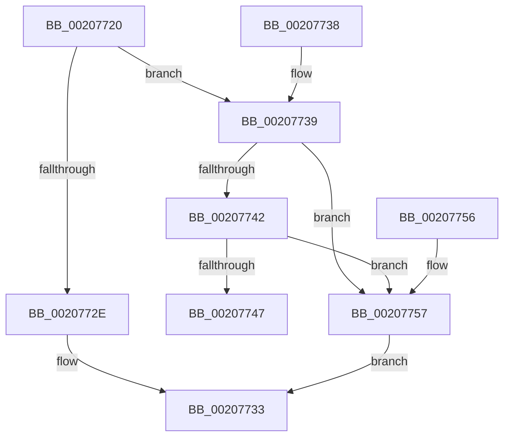

# IopAllocateIrpExReturn

- RVA: `0x00207720`–`0x0020775E` (길이 `62` bytes)
- VA: `0x0000000140207720`
- 실행 섹션: `.text`
- PDB 이름 있음: `예`; PDB Function 태그: `아니요`
- unwind 정보 RVA: `0x0005D220`
- 디코드: `19`개 명령, `62/62` bytes 표시
- 미해석 바이트: `0` (있으면 어셈블리에 `.byte`로 보존)

> 이 문서는 커널 이미지의 기계어와 PDB 기호를 분석해 생성했습니다. 4번과 5번은 함수 원형과 자료형을 바이너리 사용 방식에서 추정한 C 해석이며 원본 소스 복구 결과는 아닙니다.

## 1. Dependencies

- 직접 호출 지점: **3**; 고유 호출 대상: **3**
- 직접 호출자로 확인된 함수: **35**
- RIP 상대 이미지 참조: **2**

### Outgoing calls
- `0x0020772E` → [IopAllocateIrpPrivate](IopAllocateIrpPrivate_function_00207770.md) (function, `0x00207770`)
- `0x0020774C` → [IovAllocateIrp](../../pagevrfy/BB/IovAllocateIrp_function_00BB9540.md) (function, `0x00BB9540`)
- `0x00207757` → [IopAllocateIrpWithExtension](../29/IopAllocateIrpWithExtension_function_0029DF38.md) (function, `0x0029DF38`)

### Direct callers
- [IopBuildDeviceIoControlRequest](IopBuildDeviceIoControlRequest_function_00205B00.md) at `0x00205B39`
- [IopAllocateIrpMustSucceed](IopAllocateIrpMustSucceed_function_002076C0.md) at `0x002076D3`
- [IopAllocateIrpMustSucceed](IopAllocateIrpMustSucceed_function_002076C0.md) at `0x0020770C`
- [MiIssueAsynchronousFlush](../29/MiIssueAsynchronousFlush_function_00299898.md) at `0x00299946`
- [IoAsynchronousPageWrite](../29/IoAsynchronousPageWrite_function_00299C08.md) at `0x00299C6C`
- [MiSynchronousPageWrite](../29/MiSynchronousPageWrite_function_0029A2E4.md) at `0x0029A344`
- [MiIssueSynchronousFlush](../29/MiIssueSynchronousFlush_function_0029A588.md) at `0x0029A60A`
- [IoSynchronousPageWriteEx](../29/IoSynchronousPageWriteEx_function_0029A860.md) at `0x0029A8C1`
- [IoPageReadEx](../29/IoPageReadEx_function_0029ABF0.md) at `0x0029AC9A`
- [NtSetInformationFile](../29/NtSetInformationFile_function_0029C5E0.md) at `0x0029CB53`
- [IopBuildAsynchronousFsdRequest](../29/IopBuildAsynchronousFsdRequest_function_0029DD40.md) at `0x0029DD79`
- [IopAllocateAndPopulateWriteIrp](../40/IopAllocateAndPopulateWriteIrp_function_004011F4.md) at `0x0040124F`
- [IopAllocateBackpocketIrp](../59/IopAllocateBackpocketIrp_function_00596CE0.md) at `0x00596D63`
- [IopAllocateBackpocketIrp](../59/IopAllocateBackpocketIrp_function_00596CE0.md) at `0x00596E90`
- [IopSetEaOrQuotaInformationFile](../../page/71/IopSetEaOrQuotaInformationFile_function_0071BD70.md) at `0x0071BF57`
- [IoSetInformation](../../page/71/IoSetInformation_function_0071DBF0.md) at `0x0071DD3B`
- [NtQueryQuotaInformationFile](../../page/72/NtQueryQuotaInformationFile_function_00720FE0.md) at `0x00721475`
- [NtSetVolumeInformationFile](../../page/72/NtSetVolumeInformationFile_function_00721750.md) at `0x00721A2E`
- [IopGetSetSecurityObject](../../page/87/IopGetSetSecurityObject_function_00873A80.md) at `0x00873B65`
- [IopParseDevice](../../page/89/IopParseDevice_function_0089E510.md) at `0x0089F1C7`
- [IopQueryNameInternal](../../page/8A/IopQueryNameInternal_function_008A6770.md) at `0x008A694B`
- [sub_008A8A27](../../page/8A/Unknown_function_008A8A27.md) at `0x008A8A5F`
- [NtQueryEaFile](../../page/8A/NtQueryEaFile_function_008AC1B0.md) at `0x008AC535`
- [NtQueryVolumeInformationFile](../../page/8A/NtQueryVolumeInformationFile_function_008AC8C0.md) at `0x008ACB20`
- [IopFlushBuffersFile](../../page/8A/IopFlushBuffersFile_function_008ACFA4.md) at `0x008AD12F`
- [IopGetFileInformation](../../page/8A/IopGetFileInformation_function_008AD4D0.md) at `0x008AD533`
- [NtQueryInformationFile](../../page/8A/NtQueryInformationFile_function_008AD630.md) at `0x008AD88F`
- [IopReadFile](../../page/8A/IopReadFile_function_008AEFF0.md) at `0x008AF645`
- [IopXxxControlFile](../../page/8E/IopXxxControlFile_function_008E9AD0.md) at `0x008EA228`
- [BuildQueryDirectoryIrp](../../page/8E/BuildQueryDirectoryIrp_function_008EC770.md) at `0x008ECBF4`
- [NtLockFile](../../page/9D/NtLockFile_function_009D86D0.md) at `0x009D8A60`
- [NtUnlockFile](../../page/9E/NtUnlockFile_function_009E5DA0.md) at `0x009E6075`
- [NtNotifyChangeDirectoryFileEx](../../page/A1/NtNotifyChangeDirectoryFileEx_function_00A1DEA0.md) at `0x00A1E054`
- [NtSetEaFile](../../page/A7/NtSetEaFile_function_00A788A0.md) at `0x00A78A14`
- [IopReadFileScatter](../../page/AA/IopReadFileScatter_function_00AA5D78.md) at `0x00AA61D1`
- [IopWriteFileGather](../../page/AA/IopWriteFileGather_function_00AAA95C.md) at `0x00AAADBC`
- [IoVerifyVolume](../../page/AC/IoVerifyVolume_function_00ACF200.md) at `0x00ACF2B3`

### Static image references
- `0x00207724` → RVA `0x00FC6D24` (`ALMOSTRO`; read)
- `0x00207739` → RVA `0x00F04A04` (`.data`; read)

## 2. Other-region calls and transfers

- 다른 실행 섹션으로 향하는 call: **1**
  - `0x0020774C` → [IovAllocateIrp](../../pagevrfy/BB/IovAllocateIrp_function_00BB9540.md) (`.text` → `PAGEVRFY`)
- 별도 외부 분기/꼬리 이동을 확인하지 못했습니다.

## 3. Assembly (complete function range)

```asm
00207720  48 83 EC 28                     sub rsp, 0x28
00207724  8B 05 FA F5 DB 00               mov eax, dword ptr [rip + 0xdbf5fa]
0020772A  85 C0                           test eax, eax
0020772C  75 0B                           jne 0x140207739
0020772E  E8 3D 00 00 00                  call 0x140207770
00207733  48 83 C4 28                     add rsp, 0x28
00207737  C3                              ret
00207738  CC                              int3
00207739  83 3D C4 D2 CF 00 01            cmp dword ptr [rip + 0xcfd2c4], 1
00207740  75 15                           jne 0x140207757
00207742  83 F8 02                        cmp eax, 2
00207745  74 10                           je 0x140207757
00207747  4C 8B 4C 24 28                  mov r9, qword ptr [rsp + 0x28]
0020774C  E8 EF 1D 9B 00                  call 0x140bb9540
00207751  48 83 C4 28                     add rsp, 0x28
00207755  C3                              ret
00207756  CC                              int3
00207757  E8 DC 67 09 00                  call 0x14029df38
0020775C  EB D5                           jmp 0x140207733
```

## 4. C-style interpretation (structured pseudocode)

```c
__int64 __fastcall IopAllocateIrpExReturn(void)
{
    __int64 result;
    __int64 v_rsp;
    unsigned __int64 v_stack_p28;

    v_rsp = (v_rsp) - (40);
    if ((unsigned int)((unsigned int)(*(unsigned int *)(v_rip + 14415354))) != 0) goto loc_00207739;
    result = IopAllocateIrpPrivate(a1, a2, a3, a4);
loc_00207733:
    v_rsp = (v_rsp) + (40);
    return result;
loc_00207739:
    if ((*(unsigned int *)(v_rip + 13619908)) != 1) goto loc_00207757;
    if (((unsigned int)(result)) == 2) goto loc_00207757;
    result = IovAllocateIrp(a1, a2, a3, v_stack_p28);
    v_rsp = (v_rsp) + (40);
    return result;
loc_00207757:
    result = IopAllocateIrpWithExtension(a1, a2, a3, v_stack_p28);
    goto loc_00207733;
}
```

## 5. (Beta) C Style

```c
void IopAllocateIrpExReturn(void)
{
    int64_t result;
    int64_t local_rsp;
    uint64_t v_stack_p28;

    local_rsp = (local_rsp) - (40);
    if ((uint32_t)((uint32_t)(*(uint32_t *)(v_rip + 0xDBF5FA))) != 0) goto loc_00207739;
    result = IopAllocateIrpPrivate(a1, a2, a3, a4);
loc_00207733:
    local_rsp = (local_rsp) + (40);
    return result;
loc_00207739:
    if ((*(uint32_t *)(v_rip + 0xCFD2C4)) != 1) goto loc_00207757;
    if (((uint32_t)(result)) == 2) goto loc_00207757;
    result = IovAllocateIrp(a1, a2, a3, v_stack_p28);
    local_rsp = (local_rsp) + (40);
    return result;
loc_00207757:
    result = IopAllocateIrpWithExtension(a1, a2, a3, v_stack_p28);
    goto loc_00207733;
}
```

## 6. Execution-region graph

[열기: 2D/3D 그래프와 함수 탐색 컨트롤 패널](../../../control-panel.html?section=text&rva=0x00207720&view=graph)

- 2D 그래프는 위에서 아래로 흐르고, 3D 그래프는 빈 공간을 드래그해 회전합니다. Shift+드래그는 이동, 휠은 확대·축소, 함수 노드 선택은 대상 보고서 이동입니다.

### Static fallback


