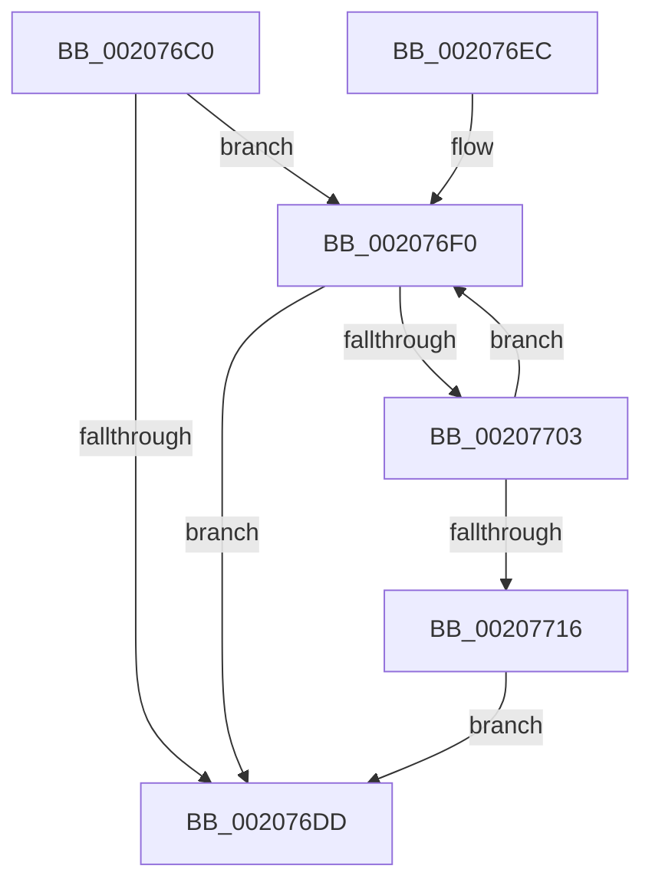

# IopAllocateIrpMustSucceed

- RVA: `0x002076C0`–`0x00207718` (길이 `88` bytes)
- VA: `0x00000001402076C0`
- 실행 섹션: `.text`
- PDB 이름 있음: `예`; PDB Function 태그: `아니요`
- unwind 정보 RVA: `0x0005D210`
- 디코드: `28`개 명령, `88/88` bytes 표시
- 미해석 바이트: `0` (있으면 어셈블리에 `.byte`로 보존)

> 이 문서는 커널 이미지의 기계어와 PDB 기호를 분석해 생성했습니다. 4번과 5번은 함수 원형과 자료형을 바이너리 사용 방식에서 추정한 C 해석이며 원본 소스 복구 결과는 아닙니다.

## 1. Dependencies

- 직접 호출 지점: **3**; 고유 호출 대상: **2**
- 직접 호출자로 확인된 함수: **5**
- RIP 상대 이미지 참조: **0**

### Outgoing calls
- `0x002076D3` → [IopAllocateIrpExReturn](IopAllocateIrpExReturn_function_00207720.md) (function, `0x00207720`)
- `0x002076F9` → [IopAllocateReserveIrp](../29/IopAllocateReserveIrp_function_0029C218.md) (function, `0x0029C218`)
- `0x0020770C` → [IopAllocateIrpExReturn](IopAllocateIrpExReturn_function_00207720.md) (function, `0x00207720`)

### Direct callers
- [IoCancelFileOpen](../../page/70/IoCancelFileOpen_function_007034A0.md) at `0x00703501`
- [sub_00863E45](../../page/86/Unknown_function_00863E45.md) at `0x00863EA7`
- [IopCloseFile](../../page/86/IopCloseFile_function_008640C0.md) at `0x00864184`
- [IopFreeBandwidthContract](../../page/AD/IopFreeBandwidthContract_function_00ADC7B4.md) at `0x00ADC83C`
- [sub_00B174A6](../../page/B1/Unknown_function_00B174A6.md) at `0x00B175C1`

### Static image references
- 디코드된 RIP-relative 메모리 참조가 없습니다.

## 2. Other-region calls and transfers

- 다른 실행 섹션으로 향하는 call: **0**
- 별도 외부 분기/꼬리 이동을 확인하지 못했습니다.

## 3. Assembly (complete function range)

```asm
002076C0  48 89 5C 24 08                  mov qword ptr [rsp + 8], rbx
002076C5  57                              push rdi
002076C6  48 83 EC 20                     sub rsp, 0x20
002076CA  45 33 C0                        xor r8d, r8d
002076CD  0F B6 DA                        movzx ebx, dl
002076D0  48 8B F9                        mov rdi, rcx
002076D3  E8 48 00 00 00                  call 0x140207720
002076D8  48 85 C0                        test rax, rax
002076DB  74 13                           je 0x1402076f0
002076DD  80 48 47 20                     or byte ptr [rax + 0x47], 0x20
002076E1  48 8B 5C 24 30                  mov rbx, qword ptr [rsp + 0x30]
002076E6  48 83 C4 20                     add rsp, 0x20
002076EA  5F                              pop rdi
002076EB  C3                              ret
002076EC  CC                              int3
002076ED  0F 1F 00                        nop dword ptr [rax]
002076F0  41 B8 03 00 00 00               mov r8d, 3
002076F6  0F B6 D3                        movzx edx, bl
002076F9  E8 1A 4B 09 00                  call 0x14029c218
002076FE  48 85 C0                        test rax, rax
00207701  75 DA                           jne 0x1402076dd
00207703  45 33 C0                        xor r8d, r8d
00207706  0F B6 D3                        movzx edx, bl
00207709  48 8B CF                        mov rcx, rdi
0020770C  E8 0F 00 00 00                  call 0x140207720
00207711  48 85 C0                        test rax, rax
00207714  74 DA                           je 0x1402076f0
00207716  EB C5                           jmp 0x1402076dd
```

## 4. C-style interpretation (structured pseudocode)

```c
__int64 __fastcall IopAllocateIrpMustSucceed(__int64 a1, unsigned __int8 a2, int a3)
{
    __int64 result;
    __int64 v_rsp;
    unsigned __int64 v_stack_p8;

    v_stack_p8 = v_rbx;
    v_rsp = (v_rsp) - (32);
    a3 = 0;
    result = IopAllocateIrpExReturn(a1, a2, a3, a4);
    if (result == 0) goto loc_002076F0;
loc_002076DD:
    v_rsp = (v_rsp) + (32);
    return result;
loc_002076F0:
    result = IopAllocateReserveIrp(a1, (unsigned __int8)(v_stack_p8), 3, a4);
    if (result != 0) goto loc_002076DD;
    a3 = 0;
    result = IopAllocateIrpExReturn(a1, (unsigned __int8)(v_stack_p8), a3, a4);
    if (result == 0) goto loc_002076F0;
    goto loc_002076DD;
}
```

## 5. (Beta) C Style

```c
int64_t IopAllocateIrpMustSucceed(int64_t Arg1, uint8_t Arg2, int32_t Arg3)
{
    int64_t result;
    int64_t local_rsp;
    uint64_t v_stack_p8;

    v_stack_p8 = local_rbx;
    local_rsp = (local_rsp) - (32);
    Arg3 = 0;
    result = IopAllocateIrpExReturn(Arg1, Arg2, Arg3, a4);
    if (result == 0) goto loc_002076F0;
loc_002076DD:
    local_rsp = (local_rsp) + (32);
    return result;
loc_002076F0:
    result = IopAllocateReserveIrp(Arg1, (uint8_t)(v_stack_p8), 3, a4);
    if (result != 0) goto loc_002076DD;
    Arg3 = 0;
    result = IopAllocateIrpExReturn(Arg1, (uint8_t)(v_stack_p8), Arg3, a4);
    if (result == 0) goto loc_002076F0;
    goto loc_002076DD;
}
```

## 6. Execution-region graph

[열기: 2D/3D 그래프와 함수 탐색 컨트롤 패널](../../../control-panel.html?section=text&rva=0x002076C0&view=graph)

- 2D 그래프는 위에서 아래로 흐르고, 3D 그래프는 빈 공간을 드래그해 회전합니다. Shift+드래그는 이동, 휠은 확대·축소, 함수 노드 선택은 대상 보고서 이동입니다.

### Static fallback


