# IopAllocateIrpPrivate

- RVA: `0x00207770`–`0x00207B12` (길이 `930` bytes)
- VA: `0x0000000140207770`
- 실행 섹션: `.text`
- PDB 이름 있음: `예`; PDB Function 태그: `아니요`
- unwind 정보 RVA: `0x0005D230`
- 디코드: `218`개 명령, `930/930` bytes 표시
- 미해석 바이트: `0` (있으면 어셈블리에 `.byte`로 보존)

> 이 문서는 커널 이미지의 기계어와 PDB 기호를 분석해 생성했습니다. 4번과 5번은 함수 원형과 자료형을 바이너리 사용 방식에서 추정한 C 해석이며 원본 소스 복구 결과는 아닙니다.

## 1. Dependencies

- 직접 호출 지점: **7**; 고유 호출 대상: **6**
- 직접 호출자로 확인된 함수: **5**
- RIP 상대 이미지 참조: **9**

### Outgoing calls
- `0x002078A1` → [ExpInterlockedPopEntrySList](../6B/ExpInterlockedPopEntrySList_function_006BA570.md) (function, `0x006BA570`)
- `0x00207902` → [memset](../6C/memset_function_006C6C40.md) (function, `0x006C6C40`)
- `0x002079A0` → [ExFreePoolWithTag](../../poolcode/B8/ExFreePoolWithTag_function_00B82870.md) (function, `0x00B82870`)
- `0x002079BC` → [ExAllocatePool2](../../poolcode/B8/ExAllocatePool2_function_00B820F0.md) (function, `0x00B820F0`)
- `0x00207A12` → [KeInsertQueueDpc](KeInsertQueueDpc_function_00207C50.md) (function, `0x00207C50`)
- `0x00207A81` → [IopInitActivityIdIrp](../45/IopInitActivityIdIrp_function_0045B014.md) (function, `0x0045B014`)
- `0x00207AF1` → [ExpInterlockedPopEntrySList](../6B/ExpInterlockedPopEntrySList_function_006BA570.md) (function, `0x006BA570`)

### Direct callers
- [IoAllocateIrp](IoAllocateIrp_function_002065D0.md) at `0x002065E7`
- [IoAllocateIrpEx](IoAllocateIrpEx_function_00207510.md) at `0x00207533`
- [IopAllocateIrpExReturn](IopAllocateIrpExReturn_function_00207720.md) at `0x0020772E`
- [IopAllocateIrpWithExtension](../29/IopAllocateIrpWithExtension_function_0029DF38.md) at `0x0029DF43`
- [IovAllocateIrp](../../pagevrfy/BB/IovAllocateIrp_function_00BB9540.md) at `0x00BB95B2`
- [IovAllocateIrp](../../pagevrfy/BB/IovAllocateIrp_function_00BB9540.md) at `0x00BB960E`

### Static image references
- `0x002077B8` → RVA `0x00F8D210` (`.data`; read)
- `0x00207800` → RVA `0x00F8D564` (`.data`; read)
- `0x0020782E` → RVA `0x00F8D40C` (`.data`; read)
- `0x00207835` → RVA `0x00F8D408` (`.data`; read)
- `0x002079D6` → RVA `0x00F8D560` (`.data`; read)
- `0x00207A09` → RVA `0x00F8D520` (`.data`; read)
- `0x00207A62` → RVA `0x00E66114` (`.data`; read)
- `0x00207A70` → RVA `0x00E66108` (`.data`; read)
- `0x00207A9A` → RVA `0x00E660C0` (`.data`; read)

## 2. Other-region calls and transfers

- 다른 실행 섹션으로 향하는 call: **2**
  - `0x002079A0` → [ExFreePoolWithTag](../../poolcode/B8/ExFreePoolWithTag_function_00B82870.md) (`.text` → `POOLCODE`)
  - `0x002079BC` → [ExAllocatePool2](../../poolcode/B8/ExAllocatePool2_function_00B820F0.md) (`.text` → `POOLCODE`)
- 별도 외부 분기/꼬리 이동을 확인하지 못했습니다.

## 3. Assembly (complete function range)

```asm
00207770  48 89 5C 24 18                  mov qword ptr [rsp + 0x18], rbx
00207775  4C 89 4C 24 20                  mov qword ptr [rsp + 0x20], r9
0020777A  55                              push rbp
0020777B  56                              push rsi
0020777C  57                              push rdi
0020777D  41 54                           push r12
0020777F  41 55                           push r13
00207781  41 56                           push r14
00207783  41 57                           push r15
00207785  48 83 EC 30                     sub rsp, 0x30
00207789  45 32 ED                        xor r13b, r13b
0020778C  45 0F B6 E0                     movzx r12d, r8b
00207790  0F B6 F2                        movzx esi, dl
00207793  48 85 C9                        test rcx, rcx
00207796  74 17                           je 0x1402077af
00207798  48 83 F9 FF                     cmp rcx, -1
0020779C  0F 84 7A 02 00 00               je 0x140207a1c
002077A2  F7 41 30 00 00 00 08            test dword ptr [rcx + 0x30], 0x8000000
002077A9  0F 85 6D 02 00 00               jne 0x140207a1c
002077AF  65 4C 8B 34 25 20 00 00 00      mov r14, qword ptr gs:[0x20]
002077B8  8B 05 52 5A D8 00               mov eax, dword ptr [rip + 0xd85a52]
002077BE  A8 03                           test al, 3
002077C0  0F 95 C1                        setne cl
002077C3  A8 04                           test al, 4
002077C5  0F 95 C0                        setne al
002077C8  84 C8                           test al, cl
002077CA  74 40                           je 0x14020780c
002077CC  40 80 FE 14                     cmp sil, 0x14
002077D0  7D 3A                           jge 0x14020780c
002077D2  48 0F BE CE                     movsx rcx, sil
002077D6  41 FF 84 8E 40 93 00 00         inc dword ptr [r14 + rcx*4 + 0x9340]
002077DE  41 8B 96 90 93 00 00            mov edx, dword ptr [r14 + 0x9390]
002077E5  FF C2                           inc edx
002077E7  41 89 96 90 93 00 00            mov dword ptr [r14 + 0x9390], edx
002077EE  41 8B 84 8E 94 93 00 00         mov eax, dword ptr [r14 + rcx*4 + 0x9394]
002077F6  41 8B 8C 8E 40 93 00 00         mov ecx, dword ptr [r14 + rcx*4 + 0x9340]
002077FE  2B C8                           sub ecx, eax
00207800  3B 0D 5E 5D D8 00               cmp ecx, dword ptr [rip + 0xd85d5e]
00207806  0F 87 C3 01 00 00               ja 0x1402079cf
0020780C  48 0F BE CE                     movsx rcx, sil
00207810  45 33 FF                        xor r15d, r15d
00207813  0F B7 C1                        movzx eax, cx
00207816  48 89 4C 24 20                  mov qword ptr [rsp + 0x20], rcx
0020781B  66 C1 E0 03                     shl ax, 3
0020781F  BA D0 00 00 00                  mov edx, 0xd0
00207824  41 8B DF                        mov ebx, r15d
00207827  88 5C 24 78                     mov byte ptr [rsp + 0x78], bl
0020782B  8D 3C 08                        lea edi, [rax + rcx]
0020782E  0F BE 05 D7 5B D8 00            movsx eax, byte ptr [rip + 0xd85bd7]
00207835  0F BE 0D CC 5B D8 00            movsx ecx, byte ptr [rip + 0xd85bcc]
0020783C  66 C1 E7 03                     shl di, 3
00207840  66 03 FA                        add di, dx
00207843  0F B7 EF                        movzx ebp, di
00207846  40 3A F0                        cmp sil, al
00207849  0F 8F 92 00 00 00               jg 0x1402078e1
0020784F  45 84 E4                        test r12b, r12b
00207852  0F 85 61 02 00 00               jne 0x140207ab9
00207858  C6 44 24 78 04                  mov byte ptr [rsp + 0x78], 4
0020785D  40 80 FE 01                     cmp sil, 1
00207861  0F 84 24 02 00 00               je 0x140207a8b
00207867  40 3A F1                        cmp sil, cl
0020786A  0F 8E B8 01 00 00               jle 0x140207a28
00207870  0F B7 E8                        movzx ebp, ax
00207873  48 C7 44 24 70 20 00 00 00      mov qword ptr [rsp + 0x70], 0x20
0020787C  66 C1 E0 03                     shl ax, 3
00207880  66 03 E8                        add bp, ax
00207883  B8 20 08 00 00                  mov eax, 0x820
00207888  66 C1 E5 03                     shl bp, 3
0020788C  66 03 EA                        add bp, dx
0020788F  4A 8B 04 30                     mov rax, qword ptr [rax + r14]
00207893  48 8B C8                        mov rcx, rax
00207896  48 89 84 24 88 00 00 00         mov qword ptr [rsp + 0x88], rax
0020789E  FF 40 14                        inc dword ptr [rax + 0x14]
002078A1  E8 CA 2C 4B 00                  call 0x1406ba570
002078A6  48 8B D8                        mov rbx, rax
002078A9  48 85 C0                        test rax, rax
002078AC  0F 84 19 02 00 00               je 0x140207acb
002078B2  48 8B 94 24 88 00 00 00         mov rdx, qword ptr [rsp + 0x88]
002078BA  8B 05 50 59 D8 00               mov eax, dword ptr [rip + 0xd85950]
002078C0  A8 03                           test al, 3
002078C2  74 1D                           je 0x1402078e1
002078C4  48 85 DB                        test rbx, rbx
002078C7  74 18                           je 0x1402078e1
002078C9  48 8B 4B 38                     mov rcx, qword ptr [rbx + 0x38]
002078CD  0F B7 C7                        movzx eax, di
002078D0  48 3B C8                        cmp rcx, rax
002078D3  0F 82 BF 00 00 00               jb 0x140207998
002078D9  0F B7 E9                        movzx ebp, cx
002078DC  40 32 FF                        xor dil, dil
002078DF  EB 0C                           jmp 0x1402078ed
002078E1  40 32 FF                        xor dil, dil
002078E4  48 85 DB                        test rbx, rbx
002078E7  0F 84 BB 00 00 00               je 0x1402079a8
002078ED  45 84 E4                        test r12b, r12b
002078F0  0F 85 A4 01 00 00               jne 0x140207a9a
002078F6  45 32 E4                        xor r12b, r12b
002078F9  44 0F B7 C5                     movzx r8d, bp
002078FD  33 D2                           xor edx, edx
002078FF  48 8B CB                        mov rcx, rbx
00207902  E8 39 F3 4B 00                  call 0x1406c6c40
00207907  40 0A 7C 24 78                  or dil, byte ptr [rsp + 0x78]
0020790C  40 88 73 42                     mov byte ptr [rbx + 0x42], sil
00207910  40 FE C6                        inc sil
00207913  40 88 73 43                     mov byte ptr [rbx + 0x43], sil
00207917  66 C7 03 06 00                  mov word ptr [rbx], 6
0020791C  66 89 6B 02                     mov word ptr [rbx + 2], bp
00207920  65 48 8B 04 25 88 01 00 00      mov rax, qword ptr gs:[0x188]
00207929  0F B6 88 4A 02 00 00            movzx ecx, byte ptr [rax + 0x24a]
00207930  48 8D 43 20                     lea rax, [rbx + 0x20]
00207934  88 4B 46                        mov byte ptr [rbx + 0x46], cl
00207937  48 89 40 08                     mov qword ptr [rax + 8], rax
0020793B  48 89 00                        mov qword ptr [rax], rax
0020793E  48 8B 44 24 20                  mov rax, qword ptr [rsp + 0x20]
00207943  48 8D 0C C5 1A 00 00 00         lea rcx, [rax*8 + 0x1a]
0020794B  48 03 C8                        add rcx, rax
0020794E  48 8D 0C CB                     lea rcx, [rbx + rcx*8]
00207952  48 89 8B B8 00 00 00            mov qword ptr [rbx + 0xb8], rcx
00207959  41 0F B7 46 24                  movzx eax, word ptr [r14 + 0x24]
0020795E  66 89 43 04                     mov word ptr [rbx + 4], ax
00207962  40 88 7B 47                     mov byte ptr [rbx + 0x47], dil
00207966  45 84 E4                        test r12b, r12b
00207969  74 08                           je 0x140207973
0020796B  40 80 CF 01                     or dil, 1
0020796F  40 88 7B 47                     mov byte ptr [rbx + 0x47], dil
00207973  45 84 ED                        test r13b, r13b
00207976  0F 85 C9 00 00 00               jne 0x140207a45
0020797C  48 8B C3                        mov rax, rbx
0020797F  48 8B 9C 24 80 00 00 00         mov rbx, qword ptr [rsp + 0x80]
00207987  48 83 C4 30                     add rsp, 0x30
0020798B  41 5F                           pop r15
0020798D  41 5E                           pop r14
0020798F  41 5D                           pop r13
00207991  41 5C                           pop r12
00207993  5F                              pop rdi
00207994  5E                              pop rsi
00207995  5D                              pop rbp
00207996  C3                              ret
00207997  CC                              int3
00207998  FF 42 1C                        inc dword ptr [rdx + 0x1c]
0020799B  48 8B CB                        mov rcx, rbx
0020799E  33 D2                           xor edx, edx
002079A0  E8 CB AE 97 00                  call 0x140b82870
002079A5  40 32 FF                        xor dil, dil
002079A8  45 84 E4                        test r12b, r12b
002079AB  0F B7 D5                        movzx edx, bp
002079AE  41 B8 49 72 70 20               mov r8d, 0x20707249
002079B4  41 0F 95 C7                     setne r15b
002079B8  49 8D 4F 42                     lea rcx, [r15 + 0x42]
002079BC  E8 2F A7 97 00                  call 0x140b820f0
002079C1  48 8B D8                        mov rbx, rax
002079C4  48 85 C0                        test rax, rax
002079C7  0F 85 2C FF FF FF               jne 0x1402078f9
002079CD  EB B0                           jmp 0x14020797f
002079CF  41 2B 96 E4 93 00 00            sub edx, dword ptr [r14 + 0x93e4]
002079D6  3B 15 84 5B D8 00               cmp edx, dword ptr [rip + 0xd85b84]
002079DC  0F 86 2A FE FF FF               jbe 0x14020780c
002079E2  0F 0D 0D 27 58 D8 00            prefetchw byte ptr [rip + 0xd85827]
002079E9  8B 05 21 58 D8 00               mov eax, dword ptr [rip + 0xd85821]
002079EF  8B C8                           mov ecx, eax
002079F1  83 E1 FB                        and ecx, 0xfffffffb
002079F4  F0 0F B1 0D 14 58 D8 00         lock cmpxchg dword ptr [rip + 0xd85814], ecx
002079FC  75 F1                           jne 0x1402079ef
002079FE  A8 04                           test al, 4
00207A00  0F 84 06 FE FF FF               je 0x14020780c
00207A06  45 33 C0                        xor r8d, r8d
00207A09  48 8D 0D 10 5B D8 00            lea rcx, [rip + 0xd85b10]
00207A10  33 D2                           xor edx, edx
00207A12  E8 39 02 00 00                  call 0x140207c50
00207A17  E9 F0 FD FF FF                  jmp 0x14020780c
00207A1C  40 80 C6 02                     add sil, 2
00207A20  41 B5 01                        mov r13b, 1
00207A23  E9 87 FD FF FF                  jmp 0x1402077af
00207A28  0F B7 C1                        movzx eax, cx
00207A2B  48 C7 44 24 70 10 00 00 00      mov qword ptr [rsp + 0x70], 0x10
00207A34  66 C1 E0 03                     shl ax, 3
00207A38  8D 2C 08                        lea ebp, [rax + rcx]
00207A3B  B8 10 08 00 00                  mov eax, 0x810
00207A40  E9 43 FE FF FF                  jmp 0x140207888
00207A45  80 43 43 FE                     add byte ptr [rbx + 0x43], 0xfe
00207A49  48 8D 81 70 FF FF FF            lea rax, [rcx - 0x90]
00207A50  80 43 42 FE                     add byte ptr [rbx + 0x42], 0xfe
00207A54  48 89 83 B8 00 00 00            mov qword ptr [rbx + 0xb8], rax
00207A5B  48 89 83 C8 00 00 00            mov qword ptr [rbx + 0xc8], rax
00207A62  8B 05 AC E6 C5 00               mov eax, dword ptr [rip + 0xc5e6ac]
00207A68  A8 04                           test al, 4
00207A6A  0F 84 0C FF FF FF               je 0x14020797c
00207A70  8B 05 92 E6 C5 00               mov eax, dword ptr [rip + 0xc5e692]
00207A76  A8 01                           test al, 1
00207A78  0F 84 FE FE FF FF               je 0x14020797c
00207A7E  48 8B CB                        mov rcx, rbx
00207A81  E8 8E 35 25 00                  call 0x14045b014
00207A86  E9 F1 FE FF FF                  jmp 0x14020797c
00207A8B  4C 89 7C 24 70                  mov qword ptr [rsp + 0x70], r15
00207A90  B8 00 08 00 00                  mov eax, 0x800
00207A95  E9 F5 FD FF FF                  jmp 0x14020788f
00207A9A  8B 05 20 E6 C5 00               mov eax, dword ptr [rip + 0xc5e620]
00207AA0  83 F8 01                        cmp eax, 1
00207AA3  0F 8E 4D FE FF FF               jle 0x1402078f6
00207AA9  F0 41 FF 8E 9C 2D 00 00         lock dec dword ptr [r14 + 0x2d9c]
00207AB1  40 B7 08                        mov dil, 8
00207AB4  E9 3D FE FF FF                  jmp 0x1402078f6
00207AB9  41 39 9E 9C 2D 00 00            cmp dword ptr [r14 + 0x2d9c], ebx
00207AC0  0F 8F 92 FD FF FF               jg 0x140207858
00207AC6  E9 16 FE FF FF                  jmp 0x1402078e1
00207ACB  48 8B 84 24 88 00 00 00         mov rax, qword ptr [rsp + 0x88]
00207AD3  48 8B 4C 24 70                  mov rcx, qword ptr [rsp + 0x70]
00207AD8  FF 40 18                        inc dword ptr [rax + 0x18]
00207ADB  4A 8B 84 31 08 08 00 00         mov rax, qword ptr [rcx + r14 + 0x808]
00207AE3  48 8B C8                        mov rcx, rax
00207AE6  48 89 84 24 88 00 00 00         mov qword ptr [rsp + 0x88], rax
00207AEE  FF 40 14                        inc dword ptr [rax + 0x14]
00207AF1  E8 7A 2A 4B 00                  call 0x1406ba570
00207AF6  48 8B 94 24 88 00 00 00         mov rdx, qword ptr [rsp + 0x88]
00207AFE  48 8B D8                        mov rbx, rax
00207B01  48 85 C0                        test rax, rax
00207B04  0F 85 B0 FD FF FF               jne 0x1402078ba
00207B0A  FF 42 18                        inc dword ptr [rdx + 0x18]
00207B0D  E9 A8 FD FF FF                  jmp 0x1402078ba
```

## 4. C-style interpretation (structured pseudocode)

```c
__int64 __fastcall IopAllocateIrpPrivate(__int64 a1, unsigned __int8 a2, unsigned __int8 a3, __int64 a4)
{
    __int64 result;
    __int64 v_r12;
    __int64 v_r13;
    __int64 v_r15;
    __int64 v_rbp;
    __int64 v_rdi;
    __int64 v_rsi;
    __int64 v_rsp;
    unsigned __int64 v_stack_m48;
    unsigned __int8 v_stack_p10;
    unsigned __int64 v_stack_p18;
    unsigned __int64 v_stack_p20;
    unsigned __int64 v_stack_p70;
    unsigned __int64 v_stack_p8;
    unsigned __int64 v_stack_p88;

    v_stack_p18 = v_rbx;
    v_stack_p20 = a4;
    v_rsp = (v_rsp) - (48);
    v_r13 = 0;
    if (a1 == 0) goto loc_002077AF;
    if (a1 == -1) goto loc_00207A1C;
    if (((*(unsigned int *)(a1 + 48)) & (0x8000000ULL)) != 0) goto loc_00207A1C;
loc_002077AF:
    a1 = ((((unsigned __int8)((unsigned int)(*(unsigned int *)(v_rip + 14178898)))) & (3)) != 0) ? 1 : 0;
    result = ((((unsigned __int8)((unsigned int)(*(unsigned int *)(v_rip + 14178898)))) & (4)) != 0) ? 1 : 0;
    if ((((unsigned __int8)(result)) & ((unsigned __int8)(a1))) == 0) goto loc_0020780C;
    if (a2 >= 20) goto loc_0020780C;
    a2 = (unsigned int)(((unsigned int)(*(unsigned int *)(*(unsigned __int64 *)(gs_base + (0 + 32)) + 37776))) + 1);
    *(unsigned int *)(*(unsigned __int64 *)(gs_base + (0 + 32)) + 37776) = a2;
    a1 = (unsigned int)(((unsigned int)(*(unsigned int *)(*(unsigned __int64 *)(gs_base + (0 + 32)) + (__int8)(a2) * 4 + 37696))) - ((unsigned int)((unsigned int)(*(unsigned int *)(*(unsigned __int64 *)(gs_base + (0 + 32)) + (__int8)(a2) * 4 + 37780)))));
    if (((unsigned int)(a1)) > (*(unsigned int *)(v_rip + 14179678))) goto loc_002079CF;
loc_0020780C:
    v_r15 = 0;
    v_stack_m48 = (__int8)(a2);
    result = (unsigned __int16)(((unsigned __int16)((__int8)(a2))) << (3));
    v_stack_p10 = 0;
    v_rdi = (unsigned __int16)((result + (__int8)(a2) * 1) << (3));
    v_rdi = (unsigned __int16)((v_rdi) + (208));
    if (a2 > ((unsigned __int8)((__int8)(*(unsigned __int8 *)(v_rip + 14179287))))) goto loc_002078E1;
    if (a3 != 0) goto loc_00207AB9;
loc_00207858:
    v_stack_p10 = 4;
    if (a2 == 1) goto loc_00207A8B;
    if (a2 <= ((unsigned __int8)((__int8)(*(unsigned __int8 *)(v_rip + 14179276))))) goto loc_00207A28;
    v_stack_p8 = 32;
    result = (unsigned __int16)(((__int8)(*(unsigned __int8 *)(v_rip + 14179287))) << (3));
    v_rbp = (unsigned __int16)(((unsigned __int16)((__int8)(*(unsigned __int8 *)(v_rip + 14179287)))) + ((unsigned __int16)(result)));
loc_00207888:
    v_rbp = (unsigned __int16)((v_rbp) << (3));
    v_rbp = (unsigned __int16)((v_rbp) + (208));
loc_0020788F:
    v_stack_p20 = *(unsigned __int64 *)((unsigned int)(0x820ULL) + *(unsigned __int64 *)(gs_base + (0 + 32)) * 1);
    result = ExpInterlockedPopEntrySList(*(unsigned __int64 *)((unsigned int)(0x820ULL) + *(unsigned __int64 *)(gs_base + (0 + 32)) * 1), 208, a3, a4);
    if (result == 0) goto loc_00207ACB;
loc_002078BA:
    if ((((unsigned __int8)((unsigned int)(*(unsigned int *)(v_rip + 14178640)))) & (3)) == 0) goto loc_002078E1;
    if (result == 0) goto loc_002078E1;
    if ((*(unsigned __int64 *)(result + 56)) < ((unsigned __int16)(v_rdi))) goto loc_00207998;
    v_rdi = 0;
    goto loc_002078ED;
loc_002078E1:
    v_rdi = 0;
    if (result == 0) goto loc_002079A8;
loc_002078ED:
    if (a3 != 0) goto loc_00207A9A;
loc_002078F6:
    v_r12 = 0;
loc_002078F9:
    a2 = 0;
    result = memset(result, a2, (unsigned __int16)((unsigned __int16)(*(unsigned __int64 *)(result + 56))), a4);
    v_rdi = (unsigned __int8)((v_rdi) | (v_stack_p10));
    *(unsigned __int8 *)(result + 66) = 0;
    v_rsi = (unsigned __int8)((a2) + 1);
    *(unsigned __int8 *)(result + 67) = (unsigned __int8)(v_rsi);
    *(unsigned __int16 *)(result) = 6;
    *(unsigned __int16 *)(result + 2) = (unsigned __int16)((unsigned __int16)(*(unsigned __int64 *)(result + 56)));
    *(unsigned __int8 *)(result + 70) = (unsigned __int8)(*(unsigned __int8 *)(*(unsigned __int64 *)(gs_base + (0 + 392)) + 586));
    *(unsigned __int64 *)(result + 32 + 8) = result + 32;
    *(unsigned __int64 *)(result + 32) = result + 32;
    a1 = (v_stack_m48 * 8 + 26) + (v_stack_m48);
    *(unsigned __int64 *)(result + 184) = result + a1 * 8;
    *(unsigned __int16 *)(result + 4) = (unsigned __int16)(*(unsigned __int16 *)(*(unsigned __int64 *)(gs_base + (0 + 32)) + 36));
    *(unsigned __int8 *)(result + 71) = (unsigned __int8)(v_rdi);
    if (0 != 0) {
        v_rdi = (unsigned __int8)((v_rdi) | (1));
        *(unsigned __int8 *)(result + 71) = (unsigned __int8)(v_rdi);
    }
    if (0 != 0) goto loc_00207A45;
loc_0020797C:
loc_0020797F:
    v_rsp = (v_rsp) + (48);
    return result;
loc_00207998:
    a2 = 0;
    result = ExFreePoolWithTag(v_stack_p18, a2, (unsigned __int16)((unsigned __int16)(*(unsigned __int64 *)(result + 56))), a4);
    v_rdi = 0;
loc_002079A8:
    v_r15 = (0 != 0) ? 1 : 0;
    result = ExAllocatePool2(v_r15 + 66, (unsigned __int16)((unsigned __int16)(*(unsigned __int64 *)(result + 56))), (unsigned int)(0x20707249ULL), a4);
    if (result != 0) goto loc_002078F9;
    goto loc_0020797F;
loc_002079CF:
    a2 = (unsigned int)(((unsigned __int16)((unsigned __int16)(*(unsigned __int64 *)(result + 56)))) - (*(unsigned int *)(*(unsigned __int64 *)(gs_base + (0 + 32)) + 37860)));
    if (a2 <= (*(unsigned int *)(v_rip + 14179204))) goto loc_0020780C;
loc_002079EF:
    a1 = (unsigned int)(((unsigned int)((unsigned int)((unsigned int)(*(unsigned int *)(v_rip + 14178337))))) & (0xFFFFFFFBULL));
    if (condition_is_not_equal) goto loc_002079EF;
    if ((((unsigned __int8)((unsigned int)(*(unsigned int *)(v_rip + 14178337)))) & (4)) == 0) goto loc_0020780C;
    a3 = 0;
    a2 = 0;
    result = KeInsertQueueDpc(v_rip + 14179088, a2, a3, a4);
    goto loc_0020780C;
loc_00207A1C:
    v_rsi = (unsigned __int8)((v_rsi) + (2));
    goto loc_002077AF;
loc_00207A28:
    v_stack_p70 = 16;
    result = (unsigned __int16)(((unsigned __int16)(v_rip + 14179088)) << (3));
    goto loc_00207888;
loc_00207A45:
    *(unsigned __int64 *)(result + 184) = v_rip + 14179088 - 144;
    *(unsigned __int64 *)(result + 200) = v_rip + 14179088 - 144;
    if ((((unsigned __int8)((unsigned int)(*(unsigned int *)(v_rip + 12969644)))) & (4)) == 0) goto loc_0020797C;
    if ((((unsigned __int8)((unsigned int)(*(unsigned int *)(v_rip + 12969618)))) & (1)) == 0) goto loc_0020797C;
    result = IopInitActivityIdIrp(result, a2, a3, a4);
    goto loc_0020797C;
loc_00207A8B:
    v_stack_p70 = v_r15;
    goto loc_0020788F;
loc_00207A9A:
    if (((unsigned int)((unsigned int)(*(unsigned int *)(v_rip + 12969504)))) <= 1) goto loc_002078F6;
    goto loc_002078F6;
loc_00207AB9:
    if ((*(unsigned int *)(*(unsigned __int64 *)(gs_base + (0 + 32)) + 11676)) > ((unsigned int)(result))) goto loc_00207858;
    goto loc_002078E1;
loc_00207ACB:
    v_stack_p88 = *(unsigned __int64 *)(v_stack_p70 + *(unsigned __int64 *)(gs_base + (0 + 32)) * 1 + 2056);
    result = ExpInterlockedPopEntrySList(*(unsigned __int64 *)(v_stack_p70 + *(unsigned __int64 *)(gs_base + (0 + 32)) * 1 + 2056), a2, a3, a4);
    if (result != 0) goto loc_002078BA;
    goto loc_002078BA;
}
```

## 5. (Beta) C Style

```c
int64_t IopAllocateIrpPrivate(int64_t Arg1, uint8_t Arg2, uint8_t Arg3, int64_t Arg4)
{
    int64_t result;
    int64_t local_r12;
    int64_t local_r13;
    int64_t local_r15;
    int64_t local_rbp;
    int64_t local_rdi;
    int64_t local_rsi;
    int64_t local_rsp;
    uint64_t v_stack_m48;
    uint8_t v_stack_p10;
    uint64_t v_stack_p18;
    uint64_t v_stack_p20;
    uint64_t v_stack_p70;
    uint64_t v_stack_p8;
    uint64_t v_stack_p88;

    v_stack_p18 = local_rbx;
    v_stack_p20 = Arg4;
    local_rsp = (local_rsp) - (48);
    local_r13 = 0;
    if (Arg1 == 0) goto loc_002077AF;
    if (Arg1 == -1) goto loc_00207A1C;
    if (((*(uint32_t *)(Arg1 + 0x30)) & (0x8000000ULL)) != 0) goto loc_00207A1C;
loc_002077AF:
    Arg1 = ((((uint8_t)((uint32_t)(*(uint32_t *)(v_rip + 0xD85A52)))) & (3)) != 0) ? 1 : 0;
    result = ((((uint8_t)((uint32_t)(*(uint32_t *)(v_rip + 0xD85A52)))) & (4)) != 0) ? 1 : 0;
    if ((((uint8_t)(result)) & ((uint8_t)(Arg1))) == 0) goto loc_0020780C;
    if (Arg2 >= 20) goto loc_0020780C;
    Arg2 = (uint32_t)(((uint32_t)(*(uint32_t *)(*(uint64_t *)(gs_base + (0 + 0x20)) + 0x9390))) + 1);
    *(uint32_t *)(*(uint64_t *)(gs_base + (0 + 0x20)) + 0x9390) = Arg2;
    Arg1 = (uint32_t)(((uint32_t)(*(uint32_t *)(*(uint64_t *)(gs_base + (0 + 0x20)) + (int8_t)(Arg2) * 4 + 0x9340))) - ((uint32_t)((uint32_t)(*(uint32_t *)(*(uint64_t *)(gs_base + (0 + 0x20)) + (int8_t)(Arg2) * 4 + 0x9394)))));
    if (((uint32_t)(Arg1)) > (*(uint32_t *)(v_rip + 0xD85D5E))) goto loc_002079CF;
loc_0020780C:
    local_r15 = 0;
    v_stack_m48 = (int8_t)(Arg2);
    result = (uint16_t)(((uint16_t)((int8_t)(Arg2))) << (3));
    v_stack_p10 = 0;
    local_rdi = (uint16_t)((result + (int8_t)(Arg2) * 1) << (3));
    local_rdi = (uint16_t)((local_rdi) + (208));
    if (Arg2 > ((uint8_t)((int8_t)(*(uint8_t *)(v_rip + 0xD85BD7))))) goto loc_002078E1;
    if (Arg3 != 0) goto loc_00207AB9;
loc_00207858:
    v_stack_p10 = 4;
    if (Arg2 == 1) goto loc_00207A8B;
    if (Arg2 <= ((uint8_t)((int8_t)(*(uint8_t *)(v_rip + 0xD85BCC))))) goto loc_00207A28;
    v_stack_p8 = 32;
    result = (uint16_t)(((int8_t)(*(uint8_t *)(v_rip + 0xD85BD7))) << (3));
    local_rbp = (uint16_t)(((uint16_t)((int8_t)(*(uint8_t *)(v_rip + 0xD85BD7)))) + ((uint16_t)(result)));
loc_00207888:
    local_rbp = (uint16_t)((local_rbp) << (3));
    local_rbp = (uint16_t)((local_rbp) + (208));
loc_0020788F:
    v_stack_p20 = *(uint64_t *)((uint32_t)(0x820ULL) + *(uint64_t *)(gs_base + (0 + 0x20)) * 1);
    result = ExpInterlockedPopEntrySList(*(uint64_t *)((uint32_t)(0x820ULL) + *(uint64_t *)(gs_base + (0 + 0x20)) * 1), 208, Arg3, Arg4);
    if (result == 0) goto loc_00207ACB;
loc_002078BA:
    if ((((uint8_t)((uint32_t)(*(uint32_t *)(v_rip + 0xD85950)))) & (3)) == 0) goto loc_002078E1;
    if (result == 0) goto loc_002078E1;
    if ((*(uint64_t *)(result + 0x38)) < ((uint16_t)(local_rdi))) goto loc_00207998;
    local_rdi = 0;
    goto loc_002078ED;
loc_002078E1:
    local_rdi = 0;
    if (result == 0) goto loc_002079A8;
loc_002078ED:
    if (Arg3 != 0) goto loc_00207A9A;
loc_002078F6:
    local_r12 = 0;
loc_002078F9:
    Arg2 = 0;
    result = memset(result, Arg2, (uint16_t)((uint16_t)(*(uint64_t *)(result + 0x38))), Arg4);
    local_rdi = (uint8_t)((local_rdi) | (v_stack_p10));
    *(uint8_t *)(result + 0x42) = 0;
    local_rsi = (uint8_t)((Arg2) + 1);
    *(uint8_t *)(result + 0x43) = (uint8_t)(local_rsi);
    *(uint16_t *)(result) = 6;
    *(uint16_t *)(result + 0x2) = (uint16_t)((uint16_t)(*(uint64_t *)(result + 0x38)));
    *(uint8_t *)(result + 0x46) = (uint8_t)(*(uint8_t *)(*(uint64_t *)(gs_base + (0 + 0x188)) + 0x24A));
    *(uint64_t *)(result + 0x20 + 0x8) = result + 32;
    *(uint64_t *)(result + 0x20) = result + 32;
    Arg1 = (v_stack_m48 * 8 + 26) + (v_stack_m48);
    *(uint64_t *)(result + 0xB8) = result + Arg1 * 8;
    *(uint16_t *)(result + 0x4) = (uint16_t)(*(uint16_t *)(*(uint64_t *)(gs_base + (0 + 0x20)) + 0x24));
    *(uint8_t *)(result + 0x47) = (uint8_t)(local_rdi);
    if (0 != 0) {
        local_rdi = (uint8_t)((local_rdi) | (1));
        *(uint8_t *)(result + 0x47) = (uint8_t)(local_rdi);
    }
    if (0 != 0) goto loc_00207A45;
loc_0020797C:
loc_0020797F:
    local_rsp = (local_rsp) + (48);
    return result;
loc_00207998:
    Arg2 = 0;
    result = ExFreePoolWithTag(v_stack_p18, Arg2, (uint16_t)((uint16_t)(*(uint64_t *)(result + 0x38))), Arg4);
    local_rdi = 0;
loc_002079A8:
    local_r15 = (0 != 0) ? 1 : 0;
    result = ExAllocatePool2(local_r15 + 66, (uint16_t)((uint16_t)(*(uint64_t *)(result + 0x38))), (uint32_t)(0x20707249ULL), Arg4);
    if (result != 0) goto loc_002078F9;
    goto loc_0020797F;
loc_002079CF:
    Arg2 = (uint32_t)(((uint16_t)((uint16_t)(*(uint64_t *)(result + 0x38)))) - (*(uint32_t *)(*(uint64_t *)(gs_base + (0 + 0x20)) + 0x93E4)));
    if (Arg2 <= (*(uint32_t *)(v_rip + 0xD85B84))) goto loc_0020780C;
loc_002079EF:
    Arg1 = (uint32_t)(((uint32_t)((uint32_t)((uint32_t)(*(uint32_t *)(v_rip + 0xD85821))))) & (0xFFFFFFFBULL));
    if (condition_is_not_equal) goto loc_002079EF;
    if ((((uint8_t)((uint32_t)(*(uint32_t *)(v_rip + 0xD85821)))) & (4)) == 0) goto loc_0020780C;
    Arg3 = 0;
    Arg2 = 0;
    result = KeInsertQueueDpc(v_rip + 14179088, Arg2, Arg3, Arg4);
    goto loc_0020780C;
loc_00207A1C:
    local_rsi = (uint8_t)((local_rsi) + (2));
    goto loc_002077AF;
loc_00207A28:
    v_stack_p70 = 16;
    result = (uint16_t)(((uint16_t)(v_rip + 14179088)) << (3));
    goto loc_00207888;
loc_00207A45:
    *(uint64_t *)(result + 0xB8) = v_rip + 14179088 - 144;
    *(uint64_t *)(result + 0xC8) = v_rip + 14179088 - 144;
    if ((((uint8_t)((uint32_t)(*(uint32_t *)(v_rip + 0xC5E6AC)))) & (4)) == 0) goto loc_0020797C;
    if ((((uint8_t)((uint32_t)(*(uint32_t *)(v_rip + 0xC5E692)))) & (1)) == 0) goto loc_0020797C;
    result = IopInitActivityIdIrp(result, Arg2, Arg3, Arg4);
    goto loc_0020797C;
loc_00207A8B:
    v_stack_p70 = local_r15;
    goto loc_0020788F;
loc_00207A9A:
    if (((uint32_t)((uint32_t)(*(uint32_t *)(v_rip + 0xC5E620)))) <= 1) goto loc_002078F6;
    goto loc_002078F6;
loc_00207AB9:
    if ((*(uint32_t *)(*(uint64_t *)(gs_base + (0 + 0x20)) + 0x2D9C)) > ((uint32_t)(result))) goto loc_00207858;
    goto loc_002078E1;
loc_00207ACB:
    v_stack_p88 = *(uint64_t *)(v_stack_p70 + *(uint64_t *)(gs_base + (0 + 0x20)) * 1 + 0x808);
    result = ExpInterlockedPopEntrySList(*(uint64_t *)(v_stack_p70 + *(uint64_t *)(gs_base + (0 + 0x20)) * 1 + 0x808), Arg2, Arg3, Arg4);
    if (result != 0) goto loc_002078BA;
    goto loc_002078BA;
}
```

## 6. Execution-region graph

[열기: 2D/3D 그래프와 함수 탐색 컨트롤 패널](../../../control-panel.html?section=text&rva=0x00207770&view=graph)

- 2D 그래프는 위에서 아래로 흐르고, 3D 그래프는 빈 공간을 드래그해 회전합니다. Shift+드래그는 이동, 휠은 확대·축소, 함수 노드 선택은 대상 보고서 이동입니다.

### Static fallback

```mermaid
flowchart TD
  bb_00207770[BB_00207770]
  bb_00207798[BB_00207798]
  bb_002077A2[BB_002077A2]
  bb_002077AF[BB_002077AF]
  bb_002077CC[BB_002077CC]
  bb_002077D2[BB_002077D2]
  bb_0020780C[BB_0020780C]
  bb_0020784F[BB_0020784F]
  bb_00207858[BB_00207858]
  bb_00207867[BB_00207867]
  bb_00207870[BB_00207870]
  bb_00207888[BB_00207888]
  bb_0020788F[BB_0020788F]
  bb_002078B2[BB_002078B2]
  bb_002078BA[BB_002078BA]
  bb_002078C4[BB_002078C4]
  bb_002078C9[BB_002078C9]
  bb_002078D9[BB_002078D9]
  bb_002078E1[BB_002078E1]
  bb_002078ED[BB_002078ED]
  bb_002078F6[BB_002078F6]
  bb_002078F9[BB_002078F9]
  bb_0020796B[BB_0020796B]
  bb_00207973[BB_00207973]
  bb_0020797C[BB_0020797C]
  bb_0020797F[BB_0020797F]
  bb_00207997[BB_00207997]
  bb_00207998[BB_00207998]
  bb_002079A8[BB_002079A8]
  bb_002079CD[BB_002079CD]
  bb_002079CF[BB_002079CF]
  bb_002079E2[BB_002079E2]
  bb_002079EF[BB_002079EF]
  bb_002079FE[BB_002079FE]
  bb_00207A06[BB_00207A06]
  bb_00207A1C[BB_00207A1C]
  bb_00207A28[BB_00207A28]
  bb_00207A45[BB_00207A45]
  bb_00207A70[BB_00207A70]
  bb_00207A7E[BB_00207A7E]
  bb_00207A8B[BB_00207A8B]
  bb_00207A9A[BB_00207A9A]
  bb_00207AA9[BB_00207AA9]
  bb_00207AB9[BB_00207AB9]
  bb_00207AC6[BB_00207AC6]
  bb_00207ACB[BB_00207ACB]
  bb_00207B0A[BB_00207B0A]
  bb_00207770 -->|branch| bb_002077AF
  bb_00207770 -->|fallthrough| bb_00207798
  bb_00207798 -->|branch| bb_00207A1C
  bb_00207798 -->|fallthrough| bb_002077A2
  bb_002077A2 -->|branch| bb_00207A1C
  bb_002077A2 -->|fallthrough| bb_002077AF
  bb_002077AF -->|branch| bb_0020780C
  bb_002077AF -->|fallthrough| bb_002077CC
  bb_002077CC -->|branch| bb_0020780C
  bb_002077CC -->|fallthrough| bb_002077D2
  bb_002077D2 -->|branch| bb_002079CF
  bb_002077D2 -->|fallthrough| bb_0020780C
  bb_0020780C -->|branch| bb_002078E1
  bb_0020780C -->|fallthrough| bb_0020784F
  bb_0020784F -->|branch| bb_00207AB9
  bb_0020784F -->|fallthrough| bb_00207858
  bb_00207858 -->|branch| bb_00207A8B
  bb_00207858 -->|fallthrough| bb_00207867
  bb_00207867 -->|branch| bb_00207A28
  bb_00207867 -->|fallthrough| bb_00207870
  bb_00207870 -->|flow| bb_00207888
  bb_00207888 -->|flow| bb_0020788F
  bb_0020788F -->|branch| bb_00207ACB
  bb_0020788F -->|fallthrough| bb_002078B2
  bb_002078B2 -->|flow| bb_002078BA
  bb_002078BA -->|branch| bb_002078E1
  bb_002078BA -->|fallthrough| bb_002078C4
  bb_002078C4 -->|branch| bb_002078E1
  bb_002078C4 -->|fallthrough| bb_002078C9
  bb_002078C9 -->|branch| bb_00207998
  bb_002078C9 -->|fallthrough| bb_002078D9
  bb_002078D9 -->|branch| bb_002078ED
  bb_002078E1 -->|branch| bb_002079A8
  bb_002078E1 -->|fallthrough| bb_002078ED
  bb_002078ED -->|branch| bb_00207A9A
  bb_002078ED -->|fallthrough| bb_002078F6
  bb_002078F6 -->|flow| bb_002078F9
  bb_002078F9 -->|branch| bb_00207973
  bb_002078F9 -->|fallthrough| bb_0020796B
  bb_0020796B -->|flow| bb_00207973
  bb_00207973 -->|branch| bb_00207A45
  bb_00207973 -->|fallthrough| bb_0020797C
  bb_0020797C -->|flow| bb_0020797F
  bb_00207997 -->|flow| bb_00207998
  bb_00207998 -->|flow| bb_002079A8
  bb_002079A8 -->|branch| bb_002078F9
  bb_002079A8 -->|fallthrough| bb_002079CD
  bb_002079CD -->|branch| bb_0020797F
  bb_002079CF -->|branch| bb_0020780C
  bb_002079CF -->|fallthrough| bb_002079E2
  bb_002079E2 -->|flow| bb_002079EF
  bb_002079EF -->|branch| bb_002079EF
  bb_002079EF -->|fallthrough| bb_002079FE
  bb_002079FE -->|branch| bb_0020780C
  bb_002079FE -->|fallthrough| bb_00207A06
  bb_00207A06 -->|branch| bb_0020780C
  bb_00207A1C -->|branch| bb_002077AF
  bb_00207A28 -->|branch| bb_00207888
  bb_00207A45 -->|branch| bb_0020797C
  bb_00207A45 -->|fallthrough| bb_00207A70
  bb_00207A70 -->|branch| bb_0020797C
  bb_00207A70 -->|fallthrough| bb_00207A7E
  bb_00207A7E -->|branch| bb_0020797C
  bb_00207A8B -->|branch| bb_0020788F
  bb_00207A9A -->|branch| bb_002078F6
  bb_00207A9A -->|fallthrough| bb_00207AA9
  bb_00207AA9 -->|branch| bb_002078F6
  bb_00207AB9 -->|branch| bb_00207858
  bb_00207AB9 -->|fallthrough| bb_00207AC6
  bb_00207AC6 -->|branch| bb_002078E1
  bb_00207ACB -->|branch| bb_002078BA
  bb_00207ACB -->|fallthrough| bb_00207B0A
  bb_00207B0A -->|branch| bb_002078BA
```


