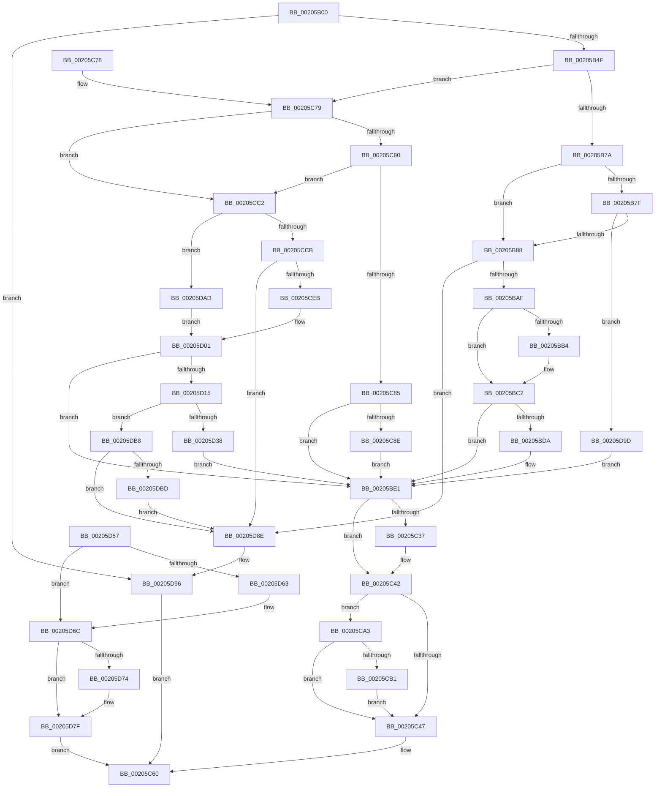

# IopBuildDeviceIoControlRequest

- RVA: `0x00205B00`–`0x00205DCA` (길이 `714` bytes)
- VA: `0x0000000140205B00`
- 실행 섹션: `.text`
- PDB 이름 있음: `예`; PDB Function 태그: `아니요`
- unwind 정보 RVA: `0x0005CDBC`
- 디코드: `180`개 명령, `714/714` bytes 표시
- 미해석 바이트: `0` (있으면 어셈블리에 `.byte`로 보존)

> 이 문서는 커널 이미지의 기계어와 PDB 기호를 분석해 생성했습니다. 4번과 5번은 함수 원형과 자료형을 바이너리 사용 방식에서 추정한 C 해석이며 원본 소스 복구 결과는 아닙니다.

## 1. Dependencies

- 직접 호출 지점: **13**; 고유 호출 대상: **9**
- 직접 호출자로 확인된 함수: **1**
- RIP 상대 이미지 참조: **0**

### Outgoing calls
- `0x00205B39` → [IopAllocateIrpExReturn](IopAllocateIrpExReturn_function_00207720.md) (function, `0x00207720`)
- `0x00205B9D` → [ExAllocatePool2](../../poolcode/B8/ExAllocatePool2_function_00B820F0.md) (function, `0x00B820F0`)
- `0x00205BBD` → [memcpy](../6C/memcpy_function_006C6840.md) (function, `0x006C6840`)
- `0x00205C0C` → [IopQueueThreadIrp](IopQueueThreadIrp_function_002075C0.md) (function, `0x002075C0`)
- `0x00205CD9` → [ExAllocatePool2](../../poolcode/B8/ExAllocatePool2_function_00B820F0.md) (function, `0x00B820F0`)
- `0x00205CF4` → [memcpy](../6C/memcpy_function_006C6840.md) (function, `0x006C6840`)
- `0x00205D23` → [IoAllocateMdl](../29/IoAllocateMdl_function_0029EBF0.md) (function, `0x0029EBF0`)
- `0x00205D4D` → [IopProbeAndLockPages](../29/IopProbeAndLockPages_function_0029F1B0.md) (function, `0x0029F1B0`)
- `0x00205D67` → [IoFreeMdl](../29/IoFreeMdl_function_0029EA80.md) (function, `0x0029EA80`)
- `0x00205D7A` → [ExFreePoolWithTag](../../poolcode/B8/ExFreePoolWithTag_function_00B82870.md) (function, `0x00B82870`)
- `0x00205D82` → [IoFreeIrp](../24/IoFreeIrp_function_0024DF70.md) (function, `0x0024DF70`)
- `0x00205D91` → [IoFreeIrp](../24/IoFreeIrp_function_0024DF70.md) (function, `0x0024DF70`)
- `0x00205DC3` → [ExFreePoolWithTag](../../poolcode/B8/ExFreePoolWithTag_function_00B82870.md) (function, `0x00B82870`)

### Direct callers
- [IoBuildDeviceIoControlRequest](IoBuildDeviceIoControlRequest_function_00204FD0.md) at `0x0020501A`

### Static image references
- 디코드된 RIP-relative 메모리 참조가 없습니다.

## 2. Other-region calls and transfers

- 다른 실행 섹션으로 향하는 call: **4**
  - `0x00205B9D` → [ExAllocatePool2](../../poolcode/B8/ExAllocatePool2_function_00B820F0.md) (`.text` → `POOLCODE`)
  - `0x00205CD9` → [ExAllocatePool2](../../poolcode/B8/ExAllocatePool2_function_00B820F0.md) (`.text` → `POOLCODE`)
  - `0x00205D7A` → [ExFreePoolWithTag](../../poolcode/B8/ExFreePoolWithTag_function_00B82870.md) (`.text` → `POOLCODE`)
  - `0x00205DC3` → [ExFreePoolWithTag](../../poolcode/B8/ExFreePoolWithTag_function_00B82870.md) (`.text` → `POOLCODE`)
- 별도 외부 분기/꼬리 이동을 확인하지 못했습니다.

## 3. Assembly (complete function range)

```asm
00205B00  48 89 5C 24 08                  mov qword ptr [rsp + 8], rbx
00205B05  48 89 74 24 20                  mov qword ptr [rsp + 0x20], rsi
00205B0A  4C 89 44 24 18                  mov qword ptr [rsp + 0x18], r8
00205B0F  57                              push rdi
00205B10  41 54                           push r12
00205B12  41 55                           push r13
00205B14  41 56                           push r14
00205B16  41 57                           push r15
00205B18  48 83 EC 30                     sub rsp, 0x30
00205B1C  45 8B F1                        mov r14d, r9d
00205B1F  4D 8B E0                        mov r12, r8
00205B22  4C 8B EA                        mov r13, rdx
00205B25  8B F1                           mov esi, ecx
00205B27  44 8B BC 24 88 00 00 00         mov r15d, dword ptr [rsp + 0x88]
00205B2F  45 33 C0                        xor r8d, r8d
00205B32  0F B6 52 4C                     movzx edx, byte ptr [rdx + 0x4c]
00205B36  49 8B CD                        mov rcx, r13
00205B39  E8 E2 1B 00 00                  call 0x140207720
00205B3E  48 8B D8                        mov rbx, rax
00205B41  48 89 44 24 68                  mov qword ptr [rsp + 0x68], rax
00205B46  48 85 C0                        test rax, rax
00205B49  0F 84 47 02 00 00               je 0x140205d96
00205B4F  48 8B B8 B8 00 00 00            mov rdi, qword ptr [rax + 0xb8]
00205B56  80 BC 24 90 00 00 00 00         cmp byte ptr [rsp + 0x90], 0
00205B5E  0F 95 C0                        setne al
00205B61  04 0E                           add al, 0xe
00205B63  88 47 B8                        mov byte ptr [rdi - 0x48], al
00205B66  44 89 7F C0                     mov dword ptr [rdi - 0x40], r15d
00205B6A  44 89 77 C8                     mov dword ptr [rdi - 0x38], r14d
00205B6E  89 77 D0                        mov dword ptr [rdi - 0x30], esi
00205B71  83 E6 03                        and esi, 3
00205B74  0F 85 FF 00 00 00               jne 0x140205c79
00205B7A  45 85 F6                        test r14d, r14d
00205B7D  75 09                           jne 0x140205b88
00205B7F  45 85 FF                        test r15d, r15d
00205B82  0F 84 15 02 00 00               je 0x140205d9d
00205B88  41 8B D6                        mov edx, r14d
00205B8B  45 3B F7                        cmp r14d, r15d
00205B8E  41 0F 46 D7                     cmovbe edx, r15d
00205B92  B9 48 00 00 00                  mov ecx, 0x48
00205B97  41 B8 49 6F 53 42               mov r8d, 0x42536f49
00205B9D  E8 4E C5 97 00                  call 0x140b820f0
00205BA2  48 89 43 18                     mov qword ptr [rbx + 0x18], rax
00205BA6  48 85 C0                        test rax, rax
00205BA9  0F 84 DF 01 00 00               je 0x140205d8e
00205BAF  4D 85 E4                        test r12, r12
00205BB2  74 0E                           je 0x140205bc2
00205BB4  4D 8B C6                        mov r8, r14
00205BB7  49 8B D4                        mov rdx, r12
00205BBA  48 8B C8                        mov rcx, rax
00205BBD  E8 7E 0C 4C 00                  call 0x1406c6840
00205BC2  C7 43 10 30 00 00 00            mov dword ptr [rbx + 0x10], 0x30
00205BC9  48 8B 84 24 80 00 00 00         mov rax, qword ptr [rsp + 0x80]
00205BD1  48 89 43 70                     mov qword ptr [rbx + 0x70], rax
00205BD5  48 85 C0                        test rax, rax
00205BD8  74 07                           je 0x140205be1
00205BDA  C7 43 10 70 00 00 00            mov dword ptr [rbx + 0x10], 0x70
00205BE1  48 8B 84 24 A0 00 00 00         mov rax, qword ptr [rsp + 0xa0]
00205BE9  48 89 43 48                     mov qword ptr [rbx + 0x48], rax
00205BED  48 8B 84 24 98 00 00 00         mov rax, qword ptr [rsp + 0x98]
00205BF5  48 89 43 50                     mov qword ptr [rbx + 0x50], rax
00205BF9  65 48 8B 04 25 88 01 00 00      mov rax, qword ptr gs:[0x188]
00205C02  48 89 83 98 00 00 00            mov qword ptr [rbx + 0x98], rax
00205C09  48 8B CB                        mov rcx, rbx
00205C0C  E8 AF 19 00 00                  call 0x1402075c0
00205C11  48 8B 93 98 00 00 00            mov rdx, qword ptr [rbx + 0x98]
00205C18  8B 82 A0 05 00 00               mov eax, dword ptr [rdx + 0x5a0]
00205C1E  C1 E8 09                        shr eax, 9
00205C21  83 E0 07                        and eax, 7
00205C24  48 8B 8A 20 02 00 00            mov rcx, qword ptr [rdx + 0x220]
00205C2B  48 8B 89 A0 02 00 00            mov rcx, qword ptr [rcx + 0x2a0]
00205C32  48 85 C9                        test rcx, rcx
00205C35  74 0B                           je 0x140205c42
00205C37  8B 89 3C 04 00 00               mov ecx, dword ptr [rcx + 0x43c]
00205C3D  3B C1                           cmp eax, ecx
00205C3F  0F 4D C1                        cmovge eax, ecx
00205C42  83 F8 02                        cmp eax, 2
00205C45  7C 5C                           jl 0x140205ca3
00205C47  C1 E0 11                        shl eax, 0x11
00205C4A  05 00 00 02 00                  add eax, 0x20000
00205C4F  8B 4B 10                        mov ecx, dword ptr [rbx + 0x10]
00205C52  81 E1 FF FF F1 FF               and ecx, 0xfff1ffff
00205C58  0B C1                           or eax, ecx
00205C5A  89 43 10                        mov dword ptr [rbx + 0x10], eax
00205C5D  48 8B C3                        mov rax, rbx
00205C60  48 8B 5C 24 60                  mov rbx, qword ptr [rsp + 0x60]
00205C65  48 8B 74 24 78                  mov rsi, qword ptr [rsp + 0x78]
00205C6A  48 83 C4 30                     add rsp, 0x30
00205C6E  41 5F                           pop r15
00205C70  41 5E                           pop r14
00205C72  41 5D                           pop r13
00205C74  41 5C                           pop r12
00205C76  5F                              pop rdi
00205C77  C3                              ret
00205C78  CC                              int3
00205C79  8B C6                           mov eax, esi
00205C7B  83 E8 01                        sub eax, 1
00205C7E  74 42                           je 0x140205cc2
00205C80  83 E8 01                        sub eax, 1
00205C83  74 3D                           je 0x140205cc2
00205C85  83 F8 01                        cmp eax, 1
00205C88  0F 85 53 FF FF FF               jne 0x140205be1
00205C8E  48 8B 84 24 80 00 00 00         mov rax, qword ptr [rsp + 0x80]
00205C96  48 89 43 70                     mov qword ptr [rbx + 0x70], rax
00205C9A  4C 89 67 D8                     mov qword ptr [rdi - 0x28], r12
00205C9E  E9 3E FF FF FF                  jmp 0x140205be1
00205CA3  65 48 8B 0C 25 88 01 00 00      mov rcx, qword ptr gs:[0x188]
00205CAC  48 3B D1                        cmp rdx, rcx
00205CAF  75 96                           jne 0x140205c47
00205CB1  B9 02 00 00 00                  mov ecx, 2
00205CB6  83 BA E0 05 00 00 00            cmp dword ptr [rdx + 0x5e0], 0
00205CBD  0F 45 C1                        cmovne eax, ecx
00205CC0  EB 85                           jmp 0x140205c47
00205CC2  4D 85 E4                        test r12, r12
00205CC5  0F 84 E2 00 00 00               je 0x140205dad
00205CCB  41 B8 49 6F 53 42               mov r8d, 0x42536f49
00205CD1  49 8B D6                        mov rdx, r14
00205CD4  B9 4A 00 00 00                  mov ecx, 0x4a
00205CD9  E8 12 C4 97 00                  call 0x140b820f0
00205CDE  48 89 43 18                     mov qword ptr [rbx + 0x18], rax
00205CE2  48 85 C0                        test rax, rax
00205CE5  0F 84 A3 00 00 00               je 0x140205d8e
00205CEB  4D 8B C6                        mov r8, r14
00205CEE  49 8B D4                        mov rdx, r12
00205CF1  48 8B C8                        mov rcx, rax
00205CF4  E8 47 0B 4C 00                  call 0x1406c6840
00205CF9  B8 30 00 00 00                  mov eax, 0x30
00205CFE  45 33 F6                        xor r14d, r14d
00205D01  89 43 10                        mov dword ptr [rbx + 0x10], eax
00205D04  48 8B 8C 24 80 00 00 00         mov rcx, qword ptr [rsp + 0x80]
00205D0C  48 85 C9                        test rcx, rcx
00205D0F  0F 84 CC FE FF FF               je 0x140205be1
00205D15  4C 89 74 24 20                  mov qword ptr [rsp + 0x20], r14
00205D1A  45 33 C9                        xor r9d, r9d
00205D1D  45 33 C0                        xor r8d, r8d
00205D20  41 8B D7                        mov edx, r15d
00205D23  E8 C8 8E 09 00                  call 0x14029ebf0
00205D28  48 8B C8                        mov rcx, rax
00205D2B  48 89 43 08                     mov qword ptr [rbx + 8], rax
00205D2F  48 85 C0                        test rax, rax
00205D32  0F 84 80 00 00 00               je 0x140205db8
00205D38  0F B6 47 B8                     movzx eax, byte ptr [rdi - 0x48]
00205D3C  83 FE 01                        cmp esi, 1
00205D3F  41 0F 95 C6                     setne r14b
00205D43  89 44 24 20                     mov dword ptr [rsp + 0x20], eax
00205D47  4D 8B CD                        mov r9, r13
00205D4A  45 8B C6                        mov r8d, r14d
00205D4D  E8 5E 94 09 00                  call 0x14029f1b0
00205D52  E9 8A FE FF FF                  jmp 0x140205be1
00205D57  48 8B 5C 24 68                  mov rbx, qword ptr [rsp + 0x68]
00205D5C  48 83 7B 08 00                  cmp qword ptr [rbx + 8], 0
00205D61  74 09                           je 0x140205d6c
00205D63  48 8B 4B 08                     mov rcx, qword ptr [rbx + 8]
00205D67  E8 14 8D 09 00                  call 0x14029ea80
00205D6C  48 83 7C 24 70 00               cmp qword ptr [rsp + 0x70], 0
00205D72  74 0B                           je 0x140205d7f
00205D74  33 D2                           xor edx, edx
00205D76  48 8B 4B 18                     mov rcx, qword ptr [rbx + 0x18]
00205D7A  E8 F1 CA 97 00                  call 0x140b82870
00205D7F  48 8B CB                        mov rcx, rbx
00205D82  E8 E9 81 04 00                  call 0x14024df70
00205D87  33 C0                           xor eax, eax
00205D89  E9 D2 FE FF FF                  jmp 0x140205c60
00205D8E  48 8B CB                        mov rcx, rbx
00205D91  E8 DA 81 04 00                  call 0x14024df70
00205D96  33 C0                           xor eax, eax
00205D98  E9 C3 FE FF FF                  jmp 0x140205c60
00205D9D  45 33 F6                        xor r14d, r14d
00205DA0  44 89 73 10                     mov dword ptr [rbx + 0x10], r14d
00205DA4  4C 89 73 70                     mov qword ptr [rbx + 0x70], r14
00205DA8  E9 34 FE FF FF                  jmp 0x140205be1
00205DAD  45 33 F6                        xor r14d, r14d
00205DB0  41 8B C6                        mov eax, r14d
00205DB3  E9 49 FF FF FF                  jmp 0x140205d01
00205DB8  4D 85 E4                        test r12, r12
00205DBB  74 D1                           je 0x140205d8e
00205DBD  33 D2                           xor edx, edx
00205DBF  48 8B 4B 18                     mov rcx, qword ptr [rbx + 0x18]
00205DC3  E8 A8 CA 97 00                  call 0x140b82870
00205DC8  EB C4                           jmp 0x140205d8e
```

## 4. C-style interpretation (structured pseudocode)

```c
__int64 __fastcall IopBuildDeviceIoControlRequest(int a1, __int64 a2, __int64 a3, int a4, __int64 a5, unsigned int a6, unsigned __int8 a7, __int64 a8, __int64 a9)
{
    __int64 result;
    __int64 v_r14;
    __int64 v_rsi;
    __int64 v_rsp;
    unsigned __int64 v_stack_p10;
    unsigned __int64 v_stack_p18;
    unsigned __int64 v_stack_p20;
    unsigned __int64 v_stack_p68;
    unsigned __int64 v_stack_p70;
    unsigned __int64 v_stack_p8;

    v_stack_p8 = v_rbx;
    v_stack_p20 = v_rsi;
    v_stack_p18 = a3;
    v_rsp = (v_rsp) - (48);
    a3 = 0;
    result = IopAllocateIrpExReturn(a2, *(unsigned __int8 *)(a2 + 76), a3, a4);
    v_stack_p10 = result;
    if (result == 0) goto loc_00205D96;
    result = (a7 != 0) ? 1 : 0;
    result = (unsigned __int8)((result) + (14));
    *(unsigned __int8 *)(*(unsigned __int64 *)(result + 184) - 72) = (unsigned __int8)(result);
    *(unsigned int *)(*(unsigned __int64 *)(result + 184) - 64) = (unsigned int)((unsigned int)(a6));
    *(unsigned int *)(*(unsigned __int64 *)(result + 184) - 56) = (unsigned int)((unsigned int)(a4));
    *(unsigned int *)(*(unsigned __int64 *)(result + 184) - 48) = (unsigned int)((unsigned int)(a1));
    v_rsi = (unsigned int)(((unsigned int)(a1)) & (3));
    if (condition_is_not_equal) goto loc_00205C79;
    if ((unsigned int)((unsigned int)(a4)) != 0) goto loc_00205B88;
    if ((unsigned int)((unsigned int)(a6)) == 0) goto loc_00205D9D;
loc_00205B88:
    a2 = (unsigned int)((unsigned int)((unsigned int)(a4)));
    if (((unsigned int)((unsigned int)(a4))) <= ((unsigned int)((unsigned int)(a6)))) { a2 = (unsigned int)((unsigned int)(a6)); }
    result = ExAllocatePool2(72, a2, (unsigned int)(0x42536F49ULL), a4);
    *(unsigned __int64 *)(result + 24) = result;
    if (result == 0) goto loc_00205D8E;
    if (0 != 0) {
        a3 = (unsigned int)(a4);
        a2 = a3;
        a1 = result;
        result = memcpy(a1, a2, a3, a4);
    }
    *(unsigned int *)(result + 16) = 48;
    *(unsigned __int64 *)(result + 112) = a5;
    if (a5 != 0) {
        *(unsigned int *)(result + 16) = 112;
    }
    *(unsigned __int64 *)(result + 72) = a9;
    *(unsigned __int64 *)(result + 80) = a8;
    *(unsigned __int64 *)(result + 152) = *(unsigned __int64 *)(gs_base + (0 + 392));
    result = IopQueueThreadIrp(result, a2, a3, a4);
    result = (unsigned int)(((unsigned int)(*(unsigned int *)(*(unsigned __int64 *)(result + 152) + 1440))) >> (9));
    result = (unsigned int)((result) & (7));
    if (*(unsigned __int64 *)(*(unsigned __int64 *)(*(unsigned __int64 *)(result + 152) + 544) + 672) != 0) {
        a1 = *(unsigned int *)(*(unsigned __int64 *)(*(unsigned __int64 *)(*(unsigned __int64 *)(result + 152) + 544) + 672) + 1084);
        if (((unsigned int)(result)) >= a1) { result = a1; }
    }
    if (((unsigned int)(result)) < 2) goto loc_00205CA3;
loc_00205C47:
    result = (unsigned int)((result) << (17));
    result = (unsigned int)((result) + (0x20000ULL));
    a1 = (unsigned int)(((unsigned int)(*(unsigned int *)(result + 16))) & (0xFFF1FFFFULL));
    result = (unsigned int)((result) | (a1));
    *(unsigned int *)(result + 16) = (unsigned int)(result);
loc_00205C60:
    v_rsp = (v_rsp) + (48);
    return result;
loc_00205C79:
    result = (unsigned int)(((unsigned int)((unsigned int)(v_stack_p20))) - (1));
    if (condition_is_equal) goto loc_00205CC2;
    result = (unsigned int)((result) - (1));
    if (condition_is_equal) goto loc_00205CC2;
    if (((unsigned int)(result)) != 1) goto loc_00205BE1;
    *(unsigned __int64 *)(v_stack_p8 + 112) = a5;
    *(unsigned __int64 *)(*(unsigned __int64 *)(result + 184) - 40) = a3;
    goto loc_00205BE1;
loc_00205CA3:
    if ((*(unsigned __int64 *)(result + 152)) != (*(unsigned __int64 *)(gs_base + (0 + 392)))) goto loc_00205C47;
    if ((*(unsigned int *)(*(unsigned __int64 *)(result + 152) + 1504)) != 0) { a5 = 2; }
    goto loc_00205C47;
loc_00205CC2:
    if (a3 == 0) goto loc_00205DAD;
    result = ExAllocatePool2(74, (unsigned int)(a4), (unsigned int)(0x42536F49ULL), a4);
    *(unsigned __int64 *)(v_stack_p8 + 24) = result;
    if (result == 0) goto loc_00205D8E;
    result = memcpy(result, a3, (unsigned int)(a4), a4);
    v_r14 = 0;
loc_00205D01:
    *(unsigned int *)(v_stack_p8 + 16) = 48;
    if (a5 == 0) goto loc_00205BE1;
    v_stack_p20 = 0;
    a4 = 0;
    a3 = 0;
    result = IoAllocateMdl(a5, (unsigned int)((unsigned int)((unsigned int)(a6))), a3, a4);
    *(unsigned __int64 *)(v_stack_p8 + 8) = result;
    if (result == 0) goto loc_00205DB8;
    v_r14 = (((unsigned int)(v_stack_p20)) != 1) ? 1 : 0;
    v_stack_p20 = (unsigned int)(*(unsigned __int8 *)(*(unsigned __int64 *)(result + 184) - 72));
    result = IopProbeAndLockPages(result, (unsigned int)((unsigned int)((unsigned int)(a6))), (unsigned int)((unsigned int)(v_r14)), a2);
    goto loc_00205BE1;
loc_00205D8E:
    result = IoFreeIrp(v_stack_p8, (unsigned int)((unsigned int)((unsigned int)(a6))), (unsigned int)((unsigned int)(v_r14)), a2);
loc_00205D96:
    result = 0;
    goto loc_00205C60;
loc_00205D9D:
    v_r14 = 0;
    *(unsigned int *)(v_stack_p8 + 16) = 0;
    *(unsigned __int64 *)(v_stack_p8 + 112) = 0;
    goto loc_00205BE1;
loc_00205DAD:
    v_r14 = 0;
    goto loc_00205D01;
loc_00205DB8:
    if (0 == 0) goto loc_00205D8E;
    a2 = 0;
    result = ExFreePoolWithTag(*(unsigned __int64 *)(v_stack_p8 + 24), a2, (unsigned int)((unsigned int)(v_r14)), a2);
    goto loc_00205D8E;
}
```

## 5. (Beta) C Style

```c
int64_t IopBuildDeviceIoControlRequest(int32_t Arg1, void *Arg2, int64_t Arg3, int32_t Arg4, int64_t Arg5, uint32_t Arg6, uint8_t Arg7, int64_t Arg8, int64_t Arg9)
{
    uint8_t *arg2 = (uint8_t *)Arg2;

    int64_t result;
    int64_t local_r14;
    int64_t local_rsi;
    int64_t local_rsp;
    uint64_t v_stack_p10;
    uint64_t v_stack_p18;
    uint64_t v_stack_p20;
    uint64_t v_stack_p68;
    uint64_t v_stack_p70;
    uint64_t v_stack_p8;

    v_stack_p8 = local_rbx;
    v_stack_p20 = local_rsi;
    v_stack_p18 = Arg3;
    local_rsp = (local_rsp) - (48);
    Arg3 = 0;
    result = IopAllocateIrpExReturn(Arg2, *(uint8_t *)(arg2 + 0x4C), Arg3, Arg4);
    v_stack_p10 = result;
    if (result == 0) goto loc_00205D96;
    result = (Arg7 != 0) ? 1 : 0;
    result = (uint8_t)((result) + (14));
    *(uint8_t *)(*(uint64_t *)(result + 0xB8) - 0x48) = (uint8_t)(result);
    *(uint32_t *)(*(uint64_t *)(result + 0xB8) - 0x40) = (uint32_t)((uint32_t)(Arg6));
    *(uint32_t *)(*(uint64_t *)(result + 0xB8) - 0x38) = (uint32_t)((uint32_t)(Arg4));
    *(uint32_t *)(*(uint64_t *)(result + 0xB8) - 0x30) = (uint32_t)((uint32_t)(Arg1));
    local_rsi = (uint32_t)(((uint32_t)(Arg1)) & (3));
    if (condition_is_not_equal) goto loc_00205C79;
    if ((uint32_t)((uint32_t)(Arg4)) != 0) goto loc_00205B88;
    if ((uint32_t)((uint32_t)(Arg6)) == 0) goto loc_00205D9D;
loc_00205B88:
    Arg2 = (uint32_t)((uint32_t)((uint32_t)(Arg4)));
    if (((uint32_t)((uint32_t)(Arg4))) <= ((uint32_t)((uint32_t)(Arg6)))) { Arg2 = (uint32_t)((uint32_t)(Arg6)); }
    result = ExAllocatePool2(72, Arg2, (uint32_t)(0x42536F49ULL), Arg4);
    *(uint64_t *)(result + 0x18) = result;
    if (result == 0) goto loc_00205D8E;
    if (0 != 0) {
        Arg3 = (uint32_t)(Arg4);
        Arg2 = Arg3;
        Arg1 = result;
        result = memcpy(Arg1, Arg2, Arg3, Arg4);
    }
    *(uint32_t *)(result + 0x10) = 48;
    *(uint64_t *)(result + 0x70) = Arg5;
    if (Arg5 != 0) {
        *(uint32_t *)(result + 0x10) = 112;
    }
    *(uint64_t *)(result + 0x48) = Arg9;
    *(uint64_t *)(result + 0x50) = Arg8;
    *(uint64_t *)(result + 0x98) = *(uint64_t *)(gs_base + (0 + 0x188));
    result = IopQueueThreadIrp(result, Arg2, Arg3, Arg4);
    result = (uint32_t)(((uint32_t)(*(uint32_t *)(*(uint64_t *)(result + 0x98) + 0x5A0))) >> (9));
    result = (uint32_t)((result) & (7));
    if (*(uint64_t *)(*(uint64_t *)(*(uint64_t *)(result + 0x98) + 0x220) + 0x2A0) != 0) {
        Arg1 = *(uint32_t *)(*(uint64_t *)(*(uint64_t *)(*(uint64_t *)(result + 0x98) + 0x220) + 0x2A0) + 0x43C);
        if (((uint32_t)(result)) >= Arg1) { result = Arg1; }
    }
    if (((uint32_t)(result)) < 2) goto loc_00205CA3;
loc_00205C47:
    result = (uint32_t)((result) << (17));
    result = (uint32_t)((result) + (0x20000ULL));
    Arg1 = (uint32_t)(((uint32_t)(*(uint32_t *)(result + 0x10))) & (0xFFF1FFFFULL));
    result = (uint32_t)((result) | (Arg1));
    *(uint32_t *)(result + 0x10) = (uint32_t)(result);
loc_00205C60:
    local_rsp = (local_rsp) + (48);
    return result;
loc_00205C79:
    result = (uint32_t)(((uint32_t)((uint32_t)(v_stack_p20))) - (1));
    if (condition_is_equal) goto loc_00205CC2;
    result = (uint32_t)((result) - (1));
    if (condition_is_equal) goto loc_00205CC2;
    if (((uint32_t)(result)) != 1) goto loc_00205BE1;
    *(uint64_t *)(v_stack_p8 + 0x70) = Arg5;
    *(uint64_t *)(*(uint64_t *)(result + 0xB8) - 0x28) = Arg3;
    goto loc_00205BE1;
loc_00205CA3:
    if ((*(uint64_t *)(result + 0x98)) != (*(uint64_t *)(gs_base + (0 + 0x188)))) goto loc_00205C47;
    if ((*(uint32_t *)(*(uint64_t *)(result + 0x98) + 0x5E0)) != 0) { Arg5 = 2; }
    goto loc_00205C47;
loc_00205CC2:
    if (Arg3 == 0) goto loc_00205DAD;
    result = ExAllocatePool2(74, (uint32_t)(Arg4), (uint32_t)(0x42536F49ULL), Arg4);
    *(uint64_t *)(v_stack_p8 + 0x18) = result;
    if (result == 0) goto loc_00205D8E;
    result = memcpy(result, Arg3, (uint32_t)(Arg4), Arg4);
    local_r14 = 0;
loc_00205D01:
    *(uint32_t *)(v_stack_p8 + 0x10) = 48;
    if (Arg5 == 0) goto loc_00205BE1;
    v_stack_p20 = 0;
    Arg4 = 0;
    Arg3 = 0;
    result = IoAllocateMdl(Arg5, (uint32_t)((uint32_t)((uint32_t)(Arg6))), Arg3, Arg4);
    *(uint64_t *)(v_stack_p8 + 0x8) = result;
    if (result == 0) goto loc_00205DB8;
    local_r14 = (((uint32_t)(v_stack_p20)) != 1) ? 1 : 0;
    v_stack_p20 = (uint32_t)(*(uint8_t *)(*(uint64_t *)(result + 0xB8) - 0x48));
    result = IopProbeAndLockPages(result, (uint32_t)((uint32_t)((uint32_t)(Arg6))), (uint32_t)((uint32_t)(local_r14)), Arg2);
    goto loc_00205BE1;
loc_00205D8E:
    result = IoFreeIrp(v_stack_p8, (uint32_t)((uint32_t)((uint32_t)(Arg6))), (uint32_t)((uint32_t)(local_r14)), Arg2);
loc_00205D96:
    result = 0;
    goto loc_00205C60;
loc_00205D9D:
    local_r14 = 0;
    *(uint32_t *)(v_stack_p8 + 0x10) = 0;
    *(uint64_t *)(v_stack_p8 + 0x70) = 0;
    goto loc_00205BE1;
loc_00205DAD:
    local_r14 = 0;
    goto loc_00205D01;
loc_00205DB8:
    if (0 == 0) goto loc_00205D8E;
    Arg2 = 0;
    result = ExFreePoolWithTag(*(uint64_t *)(v_stack_p8 + 0x18), Arg2, (uint32_t)((uint32_t)(local_r14)), Arg2);
    goto loc_00205D8E;
}
```

### 관측된 메모리 오프셋

구조체 형식이 확인되지 않은 접근은 인자 기준의 오프셋으로만 기록했습니다.

| 기준 인자 | 오프셋 표현 | 폭 (bit) | 접근 |
|---|---:|---:|---|
| `Arg2` | `+ 0x4C` | `8` | `R` |

## 6. Execution-region graph

[열기: 2D/3D 그래프와 함수 탐색 컨트롤 패널](../../../control-panel.html?section=text&rva=0x00205B00&view=graph)

- 2D 그래프는 위에서 아래로 흐르고, 3D 그래프는 빈 공간을 드래그해 회전합니다. Shift+드래그는 이동, 휠은 확대·축소, 함수 노드 선택은 대상 보고서 이동입니다.

### Static fallback


