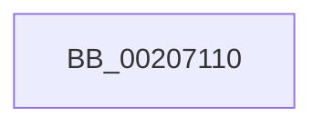

# IopCancelIrpsInFileObjectList

- RVA: `0x00207110`–`0x0020715A` (길이 `74` bytes)
- VA: `0x0000000140207110`
- 실행 섹션: `.text`
- PDB 이름 있음: `예`; PDB Function 태그: `아니요`
- unwind 정보 RVA: `0x0005D0C0`
- 디코드: `20`개 명령, `74/74` bytes 표시
- 미해석 바이트: `0` (있으면 어셈블리에 `.byte`로 보존)

> 이 문서는 커널 이미지의 기계어와 PDB 기호를 분석해 생성했습니다. 4번과 5번은 함수 원형과 자료형을 바이너리 사용 방식에서 추정한 C 해석이며 원본 소스 복구 결과는 아닙니다.

## 1. Dependencies

- 직접 호출 지점: **0**; 고유 호출 대상: **0**
- 직접 호출자로 확인된 함수: **4**
- RIP 상대 이미지 참조: **0**

### Outgoing calls
- 직접 디코드된 call 명령이 없습니다.

### Direct callers
- [IopCheckHandleForRevocation](../59/IopCheckHandleForRevocation_function_00598340.md) at `0x005983C9`
- [IopCleanupProcessResources](../../page/9E/IopCleanupProcessResources_function_009E8850.md) at `0x009E8870`
- [NtCancelIoFile](../../page/9E/NtCancelIoFile_function_009E93E0.md) at `0x009E956F`
- [IopCancelIoFile](../../page/A4/IopCancelIoFile_function_00A4481C.md) at `0x00A44869`

### Static image references
- 디코드된 RIP-relative 메모리 참조가 없습니다.

## 2. Other-region calls and transfers

- 다른 실행 섹션으로 향하는 call: **0**
- call이 아닌 외부 분기/꼬리 이동: **1**
  - `0x00207154` → [sub_00207274](Unknown_function_00207274.md) (`tail-transfer`)

## 3. Assembly (complete function range)

```asm
00207110  4C 8B DC                        mov r11, rsp
00207113  4D 89 43 18                     mov qword ptr [r11 + 0x18], r8
00207117  49 89 53 10                     mov qword ptr [r11 + 0x10], rdx
0020711B  55                              push rbp
0020711C  57                              push rdi
0020711D  41 55                           push r13
0020711F  41 56                           push r14
00207121  41 57                           push r15
00207123  48 83 EC 60                     sub rsp, 0x60
00207127  33 C0                           xor eax, eax
00207129  C7 84 24 90 00 00 00 01 00 00 00  mov dword ptr [rsp + 0x90], 1
00207134  48 8D A9 C0 00 00 00            lea rbp, [rcx + 0xc0]
0020713B  49 89 43 A8                     mov qword ptr [r11 - 0x58], rax
0020713F  4D 8B E9                        mov r13, r9
00207142  48 89 44 24 38                  mov qword ptr [rsp + 0x38], rax
00207147  48 8B F9                        mov rdi, rcx
0020714A  44 8B F8                        mov r15d, eax
0020714D  44 8B F0                        mov r14d, eax
00207150  48 39 45 00                     cmp qword ptr [rbp], rax
00207154  0F 84 1A 01 00 00               je 0x140207274
```

## 4. C-style interpretation (structured pseudocode)

```c
__int64 __fastcall IopCancelIrpsInFileObjectList(__int64 a1, __int64 a2, __int64 a3, __int64 a4)
{
    __int64 result;
    __int64 v_rsp;
    unsigned __int64 v_stack_m50;
    unsigned int v_stack_p8;

    *(unsigned __int64 *)(v_rsp + 24) = a3;
    *(unsigned __int64 *)(v_rsp + 16) = a2;
    v_rsp = (v_rsp) - (96);
    result = 0;
    v_stack_p8 = 1;
    *(unsigned __int64 *)(v_rsp - 88) = 0;
    v_stack_m50 = 0;
}
```

## 5. (Beta) C Style

```c
int64_t IopCancelIrpsInFileObjectList(void *Arg1, int64_t Arg2, int64_t Arg3, int64_t Arg4)
{
    uint8_t *arg1 = (uint8_t *)Arg1;

    int64_t result;
    int64_t local_rsp;
    uint64_t v_stack_m50;
    uint32_t v_stack_p8;

    *(uint64_t *)(local_rsp + 0x18) = Arg3;
    *(uint64_t *)(local_rsp + 0x10) = Arg2;
    local_rsp = (local_rsp) - (96);
    result = 0;
    v_stack_p8 = 1;
    *(uint64_t *)(local_rsp - 0x58) = 0;
    v_stack_m50 = 0;
}
```

### 관측된 메모리 오프셋

구조체 형식이 확인되지 않은 접근은 인자 기준의 오프셋으로만 기록했습니다.

| 기준 인자 | 오프셋 표현 | 폭 (bit) | 접근 |
|---|---:|---:|---|
| `Arg1` | `+ 0x0` | `64` | `R` |
| `Arg1` | `+ 0xC0` | `64` | `R` |

## 6. Execution-region graph

[열기: 2D/3D 그래프와 함수 탐색 컨트롤 패널](../../../control-panel.html?section=text&rva=0x00207110&view=graph)

- 2D 그래프는 위에서 아래로 흐르고, 3D 그래프는 빈 공간을 드래그해 회전합니다. Shift+드래그는 이동, 휠은 확대·축소, 함수 노드 선택은 대상 보고서 이동입니다.

### Static fallback


