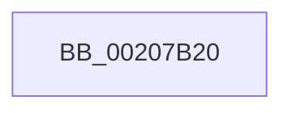

# IopDequeueIrpFromThread

- RVA: `0x00207B20`–`0x00207B34` (길이 `20` bytes)
- VA: `0x0000000140207B20`
- 실행 섹션: `.text`
- PDB 이름 있음: `예`; PDB Function 태그: `아니요`
- unwind 정보 RVA: `0x0005D24C`
- 디코드: `5`개 명령, `20/20` bytes 표시
- 미해석 바이트: `0` (있으면 어셈블리에 `.byte`로 보존)

> 이 문서는 커널 이미지의 기계어와 PDB 기호를 분석해 생성했습니다. 4번과 5번은 함수 원형과 자료형을 바이너리 사용 방식에서 추정한 C 해석이며 원본 소스 복구 결과는 아닙니다.

## 1. Dependencies

- 직접 호출 지점: **0**; 고유 호출 대상: **0**
- 직접 호출자로 확인된 함수: **8**
- RIP 상대 이미지 참조: **0**

### Outgoing calls
- 직접 디코드된 call 명령이 없습니다.

### Direct callers
- [IopCompleteRequest](IopCompleteRequest_function_0020AF50.md) at `0x0020B123`
- [IopCompleteRequest](IopCompleteRequest_function_0020AF50.md) at `0x0020B16D`
- [IopfCompleteRequest](../29/IopfCompleteRequest_function_0029B5F8.md) at `0x0029B967`
- [IopfCompleteRequest](../29/IopfCompleteRequest_function_0029B5F8.md) at `0x0029B999`
- [IopIoRingCompleteIrp](../3E/IopIoRingCompleteIrp_function_003ED13C.md) at `0x003ED1A9`
- [IopCopyCompleteReadRequest](../4E/IopCopyCompleteReadRequest_function_004E8760.md) at `0x004E87F0`
- [IoCancelFileOpen](../../page/70/IoCancelFileOpen_function_007034A0.md) at `0x00703587`
- [sub_00863F57](../../page/86/Unknown_function_00863F57.md) at `0x00863F81`
- [IopCloseFile](../../page/86/IopCloseFile_function_008640C0.md) at `0x00864230`
- [IopParseDevice](../../page/89/IopParseDevice_function_0089E510.md) at `0x0089ED23`

### Static image references
- 디코드된 RIP-relative 메모리 참조가 없습니다.

## 2. Other-region calls and transfers

- 다른 실행 섹션으로 향하는 call: **0**
- 별도 외부 분기/꼬리 이동을 확인하지 못했습니다.

## 3. Assembly (complete function range)

```asm
00207B20  48 89 5C 24 18                  mov qword ptr [rsp + 0x18], rbx
00207B25  57                              push rdi
00207B26  48 83 EC 20                     sub rsp, 0x20
00207B2A  48 8B 99 98 00 00 00            mov rbx, qword ptr [rcx + 0x98]
00207B31  40 32 FF                        xor dil, dil
```

## 4. C-style interpretation (structured pseudocode)

```c
void __fastcall IopDequeueIrpFromThread(__int64 a1)
{
    __int64 v_rdi;
    __int64 v_rsp;
    unsigned __int64 v_stack_p18;

    v_stack_p18 = v_rbx;
    v_rsp = (v_rsp) - (32);
    v_rdi = 0;
    return;
}
```

## 5. (Beta) C Style

```c
void IopDequeueIrpFromThread(void *Arg1)
{
    uint8_t *arg1 = (uint8_t *)Arg1;

    int64_t local_rdi;
    int64_t local_rsp;
    uint64_t v_stack_p18;

    v_stack_p18 = local_rbx;
    local_rsp = (local_rsp) - (32);
    local_rdi = 0;
    return;
}
```

### 관측된 메모리 오프셋

구조체 형식이 확인되지 않은 접근은 인자 기준의 오프셋으로만 기록했습니다.

| 기준 인자 | 오프셋 표현 | 폭 (bit) | 접근 |
|---|---:|---:|---|
| `Arg1` | `+ 0x98` | `64` | `R` |

## 6. Execution-region graph

[열기: 2D/3D 그래프와 함수 탐색 컨트롤 패널](../../../control-panel.html?section=text&rva=0x00207B20&view=graph)

- 2D 그래프는 위에서 아래로 흐르고, 3D 그래프는 빈 공간을 드래그해 회전합니다. Shift+드래그는 이동, 휠은 확대·축소, 함수 노드 선택은 대상 보고서 이동입니다.

### Static fallback


