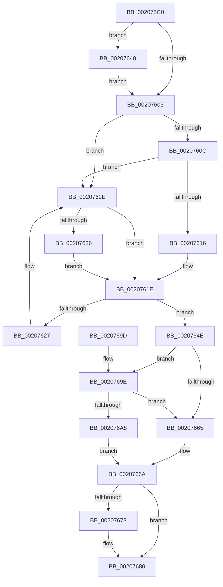

# IopQueueThreadIrp

- RVA: `0x002075C0`–`0x002076B7` (길이 `247` bytes)
- VA: `0x00000001402075C0`
- 실행 섹션: `.text`
- PDB 이름 있음: `예`; PDB Function 태그: `아니요`
- unwind 정보 RVA: `0x0005D1F8`
- 디코드: `63`개 명령, `247/247` bytes 표시
- 미해석 바이트: `0` (있으면 어셈블리에 `.byte`로 보존)

> 이 문서는 커널 이미지의 기계어와 PDB 기호를 분석해 생성했습니다. 4번과 5번은 함수 원형과 자료형을 바이너리 사용 방식에서 추정한 C 해석이며 원본 소스 복구 결과는 아닙니다.

## 1. Dependencies

- 직접 호출 지점: **5**; 고유 호출 대상: **5**
- 직접 호출자로 확인된 함수: **30**
- RIP 상대 이미지 참조: **3**

### Outgoing calls
- `0x00207619` → [KiAcquireSpinLockInstrumented](KiAcquireSpinLockInstrumented_function_002084F0.md) (function, `0x002084F0`)
- `0x00207639` → [KxWaitForSpinLockAndAcquire](KxWaitForSpinLockAndAcquire_function_002085C0.md) (function, `0x002085C0`)
- `0x00207647` → [KiRaiseIrqlProcessIrqlFlags](../4F/KiRaiseIrqlProcessIrqlFlags_function_004F56FC.md) (function, `0x004F56FC`)
- `0x0020767B` → [KiLowerIrqlProcessIrqlFlags](../4F/KiLowerIrqlProcessIrqlFlags_function_004F5698.md) (function, `0x004F5698`)
- `0x002076B0` → [KiReleaseSpinLockInstrumented](../39/KiReleaseSpinLockInstrumented_function_00392EF0.md) (function, `0x00392EF0`)

### Direct callers
- [IopBuildDeviceIoControlRequest](IopBuildDeviceIoControlRequest_function_00205B00.md) at `0x00205C0C`
- [MiIssueAsynchronousFlush](../29/MiIssueAsynchronousFlush_function_00299898.md) at `0x00299A0B`
- [IoAsynchronousPageWrite](../29/IoAsynchronousPageWrite_function_00299C08.md) at `0x00299D3A`
- [MiSynchronousPageWrite](../29/MiSynchronousPageWrite_function_0029A2E4.md) at `0x0029A40B`
- [MiIssueSynchronousFlush](../29/MiIssueSynchronousFlush_function_0029A588.md) at `0x0029A6F9`
- [IoSynchronousPageWriteEx](../29/IoSynchronousPageWriteEx_function_0029A860.md) at `0x0029A9AC`
- [IoPageReadEx](../29/IoPageReadEx_function_0029ABF0.md) at `0x0029AE6F`
- [NtSetInformationFile](../29/NtSetInformationFile_function_0029C5E0.md) at `0x0029CCB0`
- [IoQueueThreadIrp](../4B/IoQueueThreadIrp_function_004BBFC0.md) at `0x004BBFC4`
- [IoCancelFileOpen](../../page/70/IoCancelFileOpen_function_007034A0.md) at `0x00703553`
- [IopQueueIrpForServiceTail](../../page/71/IopQueueIrpForServiceTail_function_0071BCC0.md) at `0x0071BD5B`
- [IoEnqueueIrp](../../page/71/IoEnqueueIrp_function_0071D430.md) at `0x0071D434`
- [IoSetInformation](../../page/71/IoSetInformation_function_0071DBF0.md) at `0x0071DDDE`
- [sub_00863E45](../../page/86/Unknown_function_00863E45.md) at `0x00863EF5`
- [IopCloseFile](../../page/86/IopCloseFile_function_008640C0.md) at `0x008641D5`
- [IopGetSetSecurityObject](../../page/87/IopGetSetSecurityObject_function_00873A80.md) at `0x00873BF5`
- [IopParseDevice](../../page/89/IopParseDevice_function_0089E510.md) at `0x0089F43F`
- [IopQueryNameInternal](../../page/8A/IopQueryNameInternal_function_008A6770.md) at `0x008A69CD`
- [sub_008A8A27](../../page/8A/Unknown_function_008A8A27.md) at `0x008A8AFF`
- [sub_008AD582](../../page/8A/Unknown_function_008AD582.md) at `0x008AD5A9`
- [NtQueryInformationFile](../../page/8A/NtQueryInformationFile_function_008AD630.md) at `0x008AD9A4`
- [IopSynchronousServiceTail](../../page/8E/IopSynchronousServiceTail_function_008EB440.md) at `0x008EB5AF`
- [IopSynchronousCall](../../page/8F/IopSynchronousCall_function_008FB018.md) at `0x008FB0D0`
- [PnpQueryInterface](../../page/A2/PnpQueryInterface_function_00A28D38.md) at `0x00A28DFE`
- [IopBuildSynchronousFsdRequest](../../page/A4/IopBuildSynchronousFsdRequest_function_00A498C0.md) at `0x00A49903`
- [IopCreateArcName](../../page/A8/IopCreateArcName_function_00A8D580.md) at `0x00A8D795`
- [IopFilterResourceRequirementsCall](../../page/A9/IopFilterResourceRequirementsCall_function_00A92388.md) at `0x00A9244B`
- [IoVerifyVolume](../../page/AC/IoVerifyVolume_function_00ACF200.md) at `0x00ACF327`
- [IopFreeBandwidthContract](../../page/AD/IopFreeBandwidthContract_function_00ADC7B4.md) at `0x00ADC8BD`
- [sub_00B174A6](../../page/B1/Unknown_function_00B174A6.md) at `0x00B1761C`

### Static image references
- `0x002075FA` → RVA `0x00FC6D20` (`ALMOSTRO`; read)
- `0x00207603` → RVA `0x00FC6B06` (`ALMOSTRO`; read)
- `0x0020760C` → RVA `0x00F0DE58` (`.data`; read)

## 2. Other-region calls and transfers

- 다른 실행 섹션으로 향하는 call: **0**
- 별도 외부 분기/꼬리 이동을 확인하지 못했습니다.

## 3. Assembly (complete function range)

```asm
002075C0  48 89 5C 24 08                  mov qword ptr [rsp + 8], rbx
002075C5  48 89 6C 24 10                  mov qword ptr [rsp + 0x10], rbp
002075CA  48 89 74 24 18                  mov qword ptr [rsp + 0x18], rsi
002075CF  57                              push rdi
002075D0  48 83 EC 20                     sub rsp, 0x20
002075D4  48 8B 99 98 00 00 00            mov rbx, qword ptr [rcx + 0x98]
002075DB  48 8D 71 20                     lea rsi, [rcx + 0x20]
002075DF  48 8D BB 40 05 00 00            lea rdi, [rbx + 0x540]
002075E6  48 81 C3 18 06 00 00            add rbx, 0x618
002075ED  44 0F 20 C5                     mov rbp, cr8
002075F1  B8 02 00 00 00                  mov eax, 2
002075F6  44 0F 22 C0                     mov cr8, rax
002075FA  83 3D 1F F7 DB 00 00            cmp dword ptr [rip + 0xdbf71f], 0
00207601  75 3D                           jne 0x140207640
00207603  F6 05 FC F4 DB 00 21            test byte ptr [rip + 0xdbf4fc], 0x21
0020760A  74 22                           je 0x14020762e
0020760C  8B 05 46 68 D0 00               mov eax, dword ptr [rip + 0xd06846]
00207612  85 C0                           test eax, eax
00207614  75 18                           jne 0x14020762e
00207616  48 8B CB                        mov rcx, rbx
00207619  E8 D2 0E 00 00                  call 0x1402084f0
0020761E  48 8B 07                        mov rax, qword ptr [rdi]
00207621  48 39 78 08                     cmp qword ptr [rax + 8], rdi
00207625  74 27                           je 0x14020764e
00207627  B9 03 00 00 00                  mov ecx, 3
0020762C  CD 29                           int 0x29
0020762E  F0 48 0F BA 2B 00               lock bts qword ptr [rbx], 0
00207634  73 E8                           jae 0x14020761e
00207636  48 8B CB                        mov rcx, rbx
00207639  E8 82 0F 00 00                  call 0x1402085c0
0020763E  EB DE                           jmp 0x14020761e
00207640  0F B6 D0                        movzx edx, al
00207643  40 0F B6 CD                     movzx ecx, bpl
00207647  E8 B0 E0 2E 00                  call 0x1404f56fc
0020764C  EB B5                           jmp 0x140207603
0020764E  48 89 06                        mov qword ptr [rsi], rax
00207651  48 89 7E 08                     mov qword ptr [rsi + 8], rdi
00207655  48 89 70 08                     mov qword ptr [rax + 8], rsi
00207659  48 89 37                        mov qword ptr [rdi], rsi
0020765C  F6 05 A3 F4 DB 00 01            test byte ptr [rip + 0xdbf4a3], 1
00207663  75 39                           jne 0x14020769e
00207665  F0 48 83 23 00                  lock and qword ptr [rbx], 0
0020766A  83 3D AF F6 DB 00 00            cmp dword ptr [rip + 0xdbf6af], 0
00207671  74 0D                           je 0x140207680
00207673  44 0F 20 C1                     mov rcx, cr8
00207677  40 0F B6 D5                     movzx edx, bpl
0020767B  E8 18 E0 2E 00                  call 0x1404f5698
00207680  40 0F B6 C5                     movzx eax, bpl
00207684  44 0F 22 C0                     mov cr8, rax
00207688  48 8B 5C 24 30                  mov rbx, qword ptr [rsp + 0x30]
0020768D  48 8B 6C 24 38                  mov rbp, qword ptr [rsp + 0x38]
00207692  48 8B 74 24 40                  mov rsi, qword ptr [rsp + 0x40]
00207697  48 83 C4 20                     add rsp, 0x20
0020769B  5F                              pop rdi
0020769C  C3                              ret
0020769D  CC                              int3
0020769E  8B 05 B4 67 D0 00               mov eax, dword ptr [rip + 0xd067b4]
002076A4  85 C0                           test eax, eax
002076A6  75 BD                           jne 0x140207665
002076A8  48 8B 54 24 28                  mov rdx, qword ptr [rsp + 0x28]
002076AD  48 8B CB                        mov rcx, rbx
002076B0  E8 3B B8 18 00                  call 0x140392ef0
002076B5  EB B3                           jmp 0x14020766a
```

## 4. C-style interpretation (structured pseudocode)

```c
__int64 __fastcall IopQueueThreadIrp(__int64 a1)
{
    __int64 result;
    __int64 v_rbx;
    __int64 v_rsp;
    unsigned __int64 v_stack_p10;
    unsigned __int64 v_stack_p18;
    unsigned __int64 v_stack_p28;
    unsigned __int64 v_stack_p8;

    v_stack_p8 = v_rbx;
    v_stack_p10 = v_rbp;
    v_stack_p18 = v_rsi;
    v_rsp = (v_rsp) - (32);
    v_rbx = (*(unsigned __int64 *)(a1 + 152)) + (0x618ULL);
    if ((*(unsigned int *)(v_rip + 14415647)) != 0) goto loc_00207640;
loc_00207603:
    if (((*(unsigned __int8 *)(v_rip + 14415100)) & (33)) == 0) goto loc_0020762E;
    if ((unsigned int)((unsigned int)(*(unsigned int *)(v_rip + 13658182))) != 0) goto loc_0020762E;
    result = KiAcquireSpinLockInstrumented(v_rbx, a2, a3, a4);
loc_0020761E:
    if ((*(unsigned __int64 *)(*(unsigned __int64 *)(*(unsigned __int64 *)(a1 + 152) + 1344) + 8)) == (*(unsigned __int64 *)(a1 + 152) + 1344)) goto loc_0020764E;
loc_0020762E:
    if ((*(unsigned __int64 *)(*(unsigned __int64 *)(*(unsigned __int64 *)(a1 + 152) + 1344) + 8)) >= (*(unsigned __int64 *)(a1 + 152) + 1344)) goto loc_0020761E;
    result = KxWaitForSpinLockAndAcquire(v_rbx, a2, a3, a4);
    goto loc_0020761E;
loc_00207640:
    result = KiRaiseIrqlProcessIrqlFlags((unsigned __int8)(v_cr8), (unsigned __int8)(result), a3, a4);
    goto loc_00207603;
loc_0020764E:
    *(unsigned __int64 *)(a1 + 32) = result;
    *(unsigned __int64 *)(a1 + 32 + 8) = *(unsigned __int64 *)(a1 + 152) + 1344;
    *(unsigned __int64 *)(result + 8) = a1 + 32;
    *(unsigned __int64 *)(*(unsigned __int64 *)(a1 + 152) + 1344) = a1 + 32;
    if (((*(unsigned __int8 *)(v_rip + 14415011)) & (1)) != 0) goto loc_0020769E;
loc_00207665:
loc_0020766A:
    if ((*(unsigned int *)(v_rip + 14415535)) != 0) {
        a1 = 2;
        a2 = (unsigned __int8)(v_cr8);
        result = KiLowerIrqlProcessIrqlFlags(a1, a2, a3, a4);
    }
    v_rsp = (v_rsp) + (32);
    return (unsigned __int8)(v_cr8);
loc_0020769E:
    if ((unsigned int)((unsigned int)(*(unsigned int *)(v_rip + 13658036))) != 0) goto loc_00207665;
    result = KiReleaseSpinLockInstrumented(v_stack_p8, v_stack_p28, a3, a4);
    goto loc_0020766A;
}
```

## 5. (Beta) C Style

```c
int64_t IopQueueThreadIrp(void *Arg1)
{
    uint8_t *arg1 = (uint8_t *)Arg1;

    int64_t result;
    int64_t local_rbx;
    int64_t local_rsp;
    uint64_t v_stack_p10;
    uint64_t v_stack_p18;
    uint64_t v_stack_p28;
    uint64_t v_stack_p8;

    v_stack_p8 = local_rbx;
    v_stack_p10 = local_rbp;
    v_stack_p18 = local_rsi;
    local_rsp = (local_rsp) - (32);
    local_rbx = (*(uint64_t *)(arg1 + 0x98)) + (0x618ULL);
    if ((*(uint32_t *)(v_rip + 0xDBF71F)) != 0) goto loc_00207640;
loc_00207603:
    if (((*(uint8_t *)(v_rip + 0xDBF4FC)) & (33)) == 0) goto loc_0020762E;
    if ((uint32_t)((uint32_t)(*(uint32_t *)(v_rip + 0xD06846))) != 0) goto loc_0020762E;
    result = KiAcquireSpinLockInstrumented(local_rbx, a2, a3, a4);
loc_0020761E:
    if ((*(uint64_t *)(*(uint64_t *)(*(uint64_t *)(arg1 + 0x98) + 0x540) + 0x8)) == (*(uint64_t *)(arg1 + 0x98) + 1344)) goto loc_0020764E;
loc_0020762E:
    if ((*(uint64_t *)(*(uint64_t *)(*(uint64_t *)(arg1 + 0x98) + 0x540) + 0x8)) >= (*(uint64_t *)(arg1 + 0x98) + 1344)) goto loc_0020761E;
    result = KxWaitForSpinLockAndAcquire(local_rbx, a2, a3, a4);
    goto loc_0020761E;
loc_00207640:
    result = KiRaiseIrqlProcessIrqlFlags((uint8_t)(v_cr8), (uint8_t)(result), a3, a4);
    goto loc_00207603;
loc_0020764E:
    *(uint64_t *)(arg1 + 0x20) = result;
    *(uint64_t *)(arg1 + 0x20 + 0x8) = *(uint64_t *)(arg1 + 0x98) + 1344;
    *(void **)(result + 0x8) = Arg1 + 32;
    *(void **)(*(uint64_t *)(arg1 + 0x98) + 0x540) = Arg1 + 32;
    if (((*(uint8_t *)(v_rip + 0xDBF4A3)) & (1)) != 0) goto loc_0020769E;
loc_00207665:
loc_0020766A:
    if ((*(uint32_t *)(v_rip + 0xDBF6AF)) != 0) {
        Arg1 = 2;
        a2 = (uint8_t)(v_cr8);
        result = KiLowerIrqlProcessIrqlFlags(Arg1, a2, a3, a4);
    }
    local_rsp = (local_rsp) + (32);
    return (uint8_t)(v_cr8);
loc_0020769E:
    if ((uint32_t)((uint32_t)(*(uint32_t *)(v_rip + 0xD067B4))) != 0) goto loc_00207665;
    result = KiReleaseSpinLockInstrumented(v_stack_p8, v_stack_p28, a3, a4);
    goto loc_0020766A;
}
```

### 관측된 메모리 오프셋

구조체 형식이 확인되지 않은 접근은 인자 기준의 오프셋으로만 기록했습니다.

| 기준 인자 | 오프셋 표현 | 폭 (bit) | 접근 |
|---|---:|---:|---|
| `Arg1` | `+ 0x0` | `64` | `W` |
| `Arg1` | `+ 0x8` | `64` | `W` |
| `Arg1` | `+ 0x20` | `64` | `R` |
| `Arg1` | `+ 0x98` | `64` | `R` |

## 6. Execution-region graph

[열기: 2D/3D 그래프와 함수 탐색 컨트롤 패널](../../../control-panel.html?section=text&rva=0x002075C0&view=graph)

- 2D 그래프는 위에서 아래로 흐르고, 3D 그래프는 빈 공간을 드래그해 회전합니다. Shift+드래그는 이동, 휠은 확대·축소, 함수 노드 선택은 대상 보고서 이동입니다.

### Static fallback


