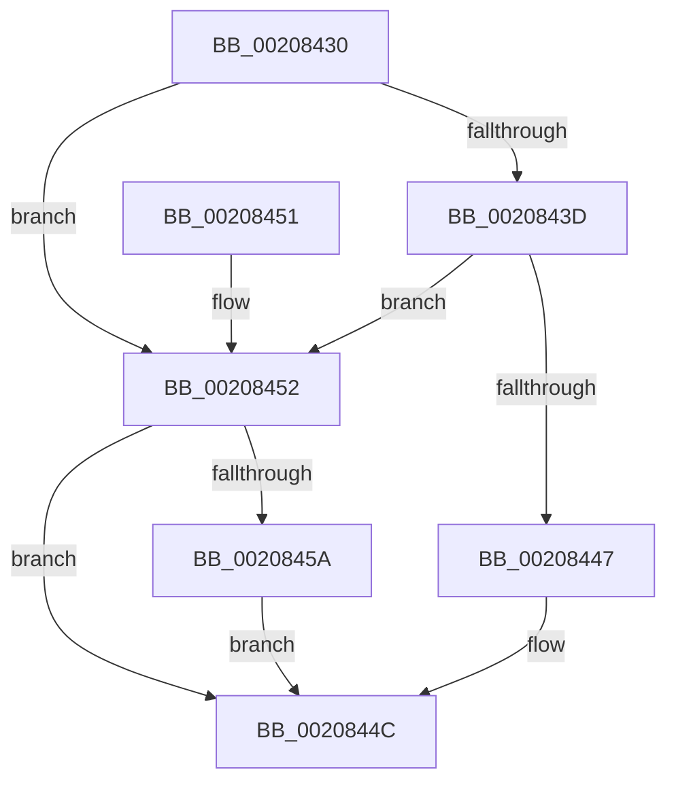

# KeAcquireSpinLockAtDpcLevel

- RVA: `0x00208430`–`0x00208461` (길이 `49` bytes)
- VA: `0x0000000140208430`
- 실행 섹션: `.text`
- PDB 이름 있음: `예`; PDB Function 태그: `아니요`
- unwind 정보 RVA: `0x0005D35C`
- 디코드: `14`개 명령, `49/49` bytes 표시
- 미해석 바이트: `0` (있으면 어셈블리에 `.byte`로 보존)

> 이 문서는 커널 이미지의 기계어와 PDB 기호를 분석해 생성했습니다. 4번과 5번은 함수 원형과 자료형을 바이너리 사용 방식에서 추정한 C 해석이며 원본 소스 복구 결과는 아닙니다.

## 1. Dependencies

- 직접 호출 지점: **2**; 고유 호출 대상: **2**
- 직접 호출자로 확인된 함수: **154**
- RIP 상대 이미지 참조: **2**

### Outgoing calls
- `0x00208447` → [KiAcquireSpinLockInstrumented](KiAcquireSpinLockInstrumented_function_002084F0.md) (function, `0x002084F0`)
- `0x0020845A` → [KxWaitForSpinLockAndAcquire](KxWaitForSpinLockAndAcquire_function_002085C0.md) (function, `0x002085C0`)

### Direct callers
- [PpmIdleSnapConcurrency](PpmIdleSnapConcurrency_function_00204694.md) at `0x002046C3`
- [sub_00211104](../21/Unknown_function_00211104.md) at `0x0021121F`
- [ExpAcquireFastResourceSharedSlow](../21/ExpAcquireFastResourceSharedSlow_function_00211260.md) at `0x00211B1A`
- [ExpAcquireFastResourceSharedSlow](../21/ExpAcquireFastResourceSharedSlow_function_00211260.md) at `0x00211B61`
- [sub_00211E87](../21/Unknown_function_00211E87.md) at `0x00211F70`
- [sub_00215166](../21/Unknown_function_00215166.md) at `0x00215AE0`
- [sub_00218E7C](../21/Unknown_function_00218E7C.md) at `0x00218EA3`
- [KiUpdateVpBackingThreadPriorityOnReadyQueueInsertion](../21/KiUpdateVpBackingThreadPriorityOnReadyQueueInsertion_function_0021D360.md) at `0x0021D397`
- [ExRemoveVirtualizedTimer](../22/ExRemoveVirtualizedTimer_function_0022FCEC.md) at `0x0022FD15`
- [PsRemoveVirtualizedTimer](../23/PsRemoveVirtualizedTimer_function_00230B5C.md) at `0x00230BA3`
- [PsRemoveVirtualizedTimer](../23/PsRemoveVirtualizedTimer_function_00230B5C.md) at `0x00230BAB`
- [ExpSetTimerObject](../23/ExpSetTimerObject_function_00231730.md) at `0x00232450`
- [ExpCancelTimer](../23/ExpCancelTimer_function_00232700.md) at `0x00232747`
- [PopFxNextParentRelationSafe](../26/PopFxNextParentRelationSafe_function_0026EAC0.md) at `0x0026EB27`
- [PopFxActivateComponentDependents](../2B/PopFxActivateComponentDependents_function_002BE9F0.md) at `0x002BECDF`
- [PpmPerfSetProcessorIdle](../2C/PpmPerfSetProcessorIdle_function_002CFD7C.md) at `0x002CFDFA`
- [HalpAcquireHighLevelLock](../2D/HalpAcquireHighLevelLock_function_002D2390.md) at `0x002D23B6`
- [KiConfigureCpuSetSchedulingInformation](../2D/KiConfigureCpuSetSchedulingInformation_function_002D2E1C.md) at `0x002D2E56`
- [PopFxActivateComponentDependencies](../2D/PopFxActivateComponentDependencies_function_002D9B10.md) at `0x002D9C52`
- [PpmPerfApplyProcessorState](../2D/PpmPerfApplyProcessorState_function_002DA4BC.md) at `0x002DA638`
- [EtwpEnqueueAvailableBuffer](../2F/EtwpEnqueueAvailableBuffer_function_002FE7DC.md) at `0x002FE85C`
- [KiAcquireCpuPartitionLock](../30/KiAcquireCpuPartitionLock_function_00303374.md) at `0x003033AC`
- [KiUpdateVpBackingThreadPriorityDpcRoutine](../30/KiUpdateVpBackingThreadPriorityDpcRoutine_function_00303790.md) at `0x003037AE`
- [KiModifySystemAllowedCpuSetsWithLock](../30/KiModifySystemAllowedCpuSetsWithLock_function_00304278.md) at `0x003042D2`
- [KeCpuSetReportParkedProcessors](../30/KeCpuSetReportParkedProcessors_function_003052B0.md) at `0x00305316`
- [KeTransitionProcessorParkState](../35/KeTransitionProcessorParkState_function_003527EC.md) at `0x00352AF6`
- [FsRtlUninitializeFileLock](../38/FsRtlUninitializeFileLock_function_00386F50.md) at `0x00386FA0`
- [sub_00391AFF](../39/Unknown_function_00391AFF.md) at `0x00391B13`
- [sub_00391D5F](../39/Unknown_function_00391D5F.md) at `0x00391D8D`
- [PpmExecutePeriodicPerfCheck](../39/PpmExecutePeriodicPerfCheck_function_0039D0CC.md) at `0x0039D145`
- [KiInterruptDispatchCommon](../39/KiInterruptDispatchCommon_function_0039F3D0.md) at `0x0039F499`
- [KiInterruptDispatchCommon](../39/KiInterruptDispatchCommon_function_0039F3D0.md) at `0x0039F5FF`
- [KiInsertTimer2](../3A/KiInsertTimer2_function_003A244C.md) at `0x003A2470`
- [KiExpireTimer2](../3A/KiExpireTimer2_function_003A24E0.md) at `0x003A2821`
- [ExAcquireFastResourceSharedStarveExclusive](../3B/ExAcquireFastResourceSharedStarveExclusive_function_003BDC80.md) at `0x003BDFA8`
- [sub_003BE29A](../3B/Unknown_function_003BE29A.md) at `0x003BE2A1`
- [ExpAcquireFastResourceExclusiveSlow](../3B/ExpAcquireFastResourceExclusiveSlow_function_003BE2E0.md) at `0x003BE6F8`
- [KiQueryCpuPartitionAffinityProcess](../3C/KiQueryCpuPartitionAffinityProcess_function_003C01A0.md) at `0x003C020F`
- [ExpTimerPause](../3D/ExpTimerPause_function_003D38C4.md) at `0x003D38F5`
- [HalpFreeDmaChannels](../3D/HalpFreeDmaChannels_function_003D9F80.md) at `0x003D9FDA`
- [HalpDmaControllerQueryMaxFragments](../3D/HalpDmaControllerQueryMaxFragments_function_003DA0C0.md) at `0x003DA113`
- [HalpAllocateDmaChannels](../3D/HalpAllocateDmaChannels_function_003DA3C8.md) at `0x003DA41A`
- [HalpDmaControllerFlushChannel](../3D/HalpDmaControllerFlushChannel_function_003DB25C.md) at `0x003DB30E`
- [HalpDmaControllerProgramChannel](../3D/HalpDmaControllerProgramChannel_function_003DB990.md) at `0x003DB9EE`
- [EtwpStackRundown](../3F/EtwpStackRundown_function_003FC8B4.md) at `0x003FC926`
- [KiInsertNewDpcRuntime](../3F/KiInsertNewDpcRuntime_function_003FE4CC.md) at `0x003FE544`
- [PpmParkSnapNodeStatistics](../41/PpmParkSnapNodeStatistics_function_0041419C.md) at `0x00414200`
- [ExpMoveSharedFastResourceOwnershipWithFlags](../41/ExpMoveSharedFastResourceOwnershipWithFlags_function_00415C4C.md) at `0x00415FA7`
- [ExpReleaseDisownedFastResourceShared](../41/ExpReleaseDisownedFastResourceShared_function_00416338.md) at `0x004163D1`
- [ExpReleaseDisownedFastResourceExclusive](../41/ExpReleaseDisownedFastResourceExclusive_function_00416470.md) at `0x004164E9`
- [EtwpLockUnlockBufferList](../41/EtwpLockUnlockBufferList_function_00419B88.md) at `0x00419BE9`
- [EtwpCovSampTryAcquireBufferLock](../43/EtwpCovSampTryAcquireBufferLock_function_0043C5CC.md) at `0x0043C5EF`
- [PopFxDeactivateComponentDependencies](../43/PopFxDeactivateComponentDependencies_function_0043CF70.md) at `0x0043D040`
- [KiAcquireCpuPartitionAssignmentLock](../43/KiAcquireCpuPartitionAssignmentLock_function_0043F974.md) at `0x0043F9A0`
- [PpmInstallNewIdleStates](../44/PpmInstallNewIdleStates_function_00446E80.md) at `0x004471B6`
- [sub_00450C96](../45/Unknown_function_00450C96.md) at `0x00450CCB`
- [IopDereferencePassiveInterruptBlock](../45/IopDereferencePassiveInterruptBlock_function_0045F52C.md) at `0x0045F569`
- [IopAcquireGlobalPassiveInterruptListLock](../45/IopAcquireGlobalPassiveInterruptListLock_function_0045F664.md) at `0x0045F690`
- [IopAcquirePassiveInterruptBlockLock](../45/IopAcquirePassiveInterruptBlockLock_function_0045F6B0.md) at `0x0045F6E1`
- [PsInsertVirtualizedTimer](../46/PsInsertVirtualizedTimer_function_0046C130.md) at `0x0046C17D`
- [KeIpiGenericCall](../47/KeIpiGenericCall_function_00471720.md) at `0x0047177D`
- [KeRegisterBugCheckReasonCallback](../47/KeRegisterBugCheckReasonCallback_function_004720A0.md) at `0x004720E9`
- [KiAcquireSecondaryInterruptConnectLock](../47/KiAcquireSecondaryInterruptConnectLock_function_00479E58.md) at `0x00479E88`
- [IopCancelIrpsInCurrentThreadList](../47/IopCancelIrpsInCurrentThreadList_function_0047AB14.md) at `0x0047AC0E`
- [PoNotifyMediaBuffering](../48/PoNotifyMediaBuffering_function_00481FC0.md) at `0x00481FD6`
- [KiDpcRuntimeHistoryHashTableCleanupDpcRoutine](../48/KiDpcRuntimeHistoryHashTableCleanupDpcRoutine_function_00482F60.md) at `0x0048301C`
- [PpmIdleUpdateConcurrency](../48/PpmIdleUpdateConcurrency_function_004854C0.md) at `0x004854F7`
- [PfSnTraceTimerRoutine](../48/PfSnTraceTimerRoutine_function_0048AEC0.md) at `0x0048AFA5`
- [CcPerformReadAhead](../48/CcPerformReadAhead_function_0048F738.md) at `0x0048F944`
- [CcPerformReadAhead](../48/CcPerformReadAhead_function_0048F738.md) at `0x0048FCB2`
- [KiIdealProcessorRebalancerTimerCallback](../49/KiIdealProcessorRebalancerTimerCallback_function_004951C0.md) at `0x004951CF`
- [ExpTimerApcRoutine](../49/ExpTimerApcRoutine_function_0049A5E0.md) at `0x0049A634`
- [IopQueueInvalidateBusRelationsRequest](../49/IopQueueInvalidateBusRelationsRequest_function_0049E28C.md) at `0x0049E33E`
- [PpmIdleSnapConcurrencyIdleTime](../4A/PpmIdleSnapConcurrencyIdleTime_function_004A0BD4.md) at `0x004A0C0B`
- [ExpTimerDpcRoutine](../4A/ExpTimerDpcRoutine_function_004A1570.md) at `0x004A15CA`
- [ExDisownFastResource](../4A/ExDisownFastResource_function_004A2C10.md) at `0x004A2D15`
- [PopDeepSleepResiliencyPhaseAccountingBegin](../4A/PopDeepSleepResiliencyPhaseAccountingBegin_function_004A72B4.md) at `0x004A7337`
- [CmpLazyFlushDpcRoutine](../4A/CmpLazyFlushDpcRoutine_function_004A8900.md) at `0x004A8955`
- [HalConfigureAdapterChannel](../4A/HalConfigureAdapterChannel_function_004AB140.md) at `0x004AB1AA`
- [KeDeregisterBugCheckReasonCallback](../4A/KeDeregisterBugCheckReasonCallback_function_004AB240.md) at `0x004AB273`
- [PopPepUpdateDripsDeviceVetoMask](../4B/PopPepUpdateDripsDeviceVetoMask_function_004B079C.md) at `0x004B0887`
- [HalpDmaControllerReadDmaCounter](../4B/HalpDmaControllerReadDmaCounter_function_004BF470.md) at `0x004BF4C5`
- [HalpIommuTraceFault](../4C/HalpIommuTraceFault_function_004C031C.md) at `0x004C0359`
- [KiProcessPendingForegroundBoosts](../4C/KiProcessPendingForegroundBoosts_function_004C5A80.md) at `0x004C5ABC`
- [ExWakeTimersPause](../4C/ExWakeTimersPause_function_004C6EB4.md) at `0x004C6F3F`
- [KeRegisterBugCheckCallback](../4C/KeRegisterBugCheckCallback_function_004C8530.md) at `0x004C8579`
- [PopPepInitializeVetoMasks](../4C/PopPepInitializeVetoMasks_function_004C9350.md) at `0x004C9607`
- [PopPepInitializeVetoMasks](../4C/PopPepInitializeVetoMasks_function_004C9350.md) at `0x004C979F`
- [PopFxBeginDeviceIRPhaseAccounting](../4C/PopFxBeginDeviceIRPhaseAccounting_function_004CDD80.md) at `0x004CDDA3`
- [PiDrvDbUnloadNodeDpcRoutine](../4C/PiDrvDbUnloadNodeDpcRoutine_function_004CFF40.md) at `0x004CFF57`
- [PpmInstallFeedbackCounters](../4D/PpmInstallFeedbackCounters_function_004D477C.md) at `0x004D4841`
- [FsRtlPrivateCancelFileLockIrp](../4D/FsRtlPrivateCancelFileLockIrp_function_004D4B70.md) at `0x004D4BEC`
- [EtwpGetCrimsonStackKey](../4D/EtwpGetCrimsonStackKey_function_004D68CC.md) at `0x004D69C3`
- [KdPowerTransitionEx](../4D/KdPowerTransitionEx_function_004D9150.md) at `0x004D91F8`
- [KeFreezeExecution](../4D/KeFreezeExecution_function_004DFA40.md) at `0x004DFB30`
- [PspSetProcessFreezeStateCallback](../4E/PspSetProcessFreezeStateCallback_function_004E98E0.md) at `0x004E99B4`
- [sub_0051AC80](../51/Unknown_function_0051AC80.md) at `0x0051AC99`
- [HalpAddAdapterToSystemList](../55/HalpAddAdapterToSystemList_function_00553FE0.md) at `0x00554023`
- [HalpDmaControllerCancelTransfer](../55/HalpDmaControllerCancelTransfer_function_00554090.md) at `0x005540F9`
- [HalpDmaControllerValidateRequestLineBinding](../55/HalpDmaControllerValidateRequestLineBinding_function_00554274.md) at `0x005542D0`
- [HalpDmaRemoveAdapterFromChannelQueue](../55/HalpDmaRemoveAdapterFromChannelQueue_function_00554374.md) at `0x005543CC`
- [HalpFindAdapterByRequestLine](../55/HalpFindAdapterByRequestLine_function_00554460.md) at `0x005544A9`
- [HalpReadWriteWheaPhysicalMemory](../56/HalpReadWriteWheaPhysicalMemory_function_005648B0.md) at `0x00564980`
- [IommuBeginDeviceReset](../56/IommuBeginDeviceReset_function_00564A60.md) at `0x00564B0A`
- [IommuDisableDevicePasid](../56/IommuDisableDevicePasid_function_00564E80.md) at `0x00564EF3`
- [IommuDisableDevicePasid](../56/IommuDisableDevicePasid_function_00564E80.md) at `0x00565020`
- [IommuDisableDevicePasid](../56/IommuDisableDevicePasid_function_00564E80.md) at `0x005650A9`
- [IommuEnableDevicePasid](../56/IommuEnableDevicePasid_function_00565150.md) at `0x0056530A`
- [IommuEnableDevicePasid](../56/IommuEnableDevicePasid_function_00565150.md) at `0x00565313`
- [IommuFinalizeDeviceReset](../56/IommuFinalizeDeviceReset_function_005653F0.md) at `0x005654B4`
- [IommuFinalizeDeviceReset](../56/IommuFinalizeDeviceReset_function_005653F0.md) at `0x005654D3`
- [IommuFlushAllPasid](../56/IommuFlushAllPasid_function_005655C0.md) at `0x00565614`
- [IommuFlushTb](../56/IommuFlushTb_function_005656B0.md) at `0x0056571F`
- [IommuProcessPageRequestQueue](../56/IommuProcessPageRequestQueue_function_00565BA0.md) at `0x00565CF5`
- [IommuSetAddressSpace](../56/IommuSetAddressSpace_function_00566060.md) at `0x005660CA`
- [IommupMapDeviceInternal](../56/IommupMapDeviceInternal_function_00566478.md) at `0x005666FF`
- [IommupUnmapDeviceInternal](../56/IommupUnmapDeviceInternal_function_005667D8.md) at `0x00566871`
- [IommuDomainAttachDevice](../56/IommuDomainAttachDevice_function_00567960.md) at `0x00567AB2`
- [IommuDomainAttachDeviceEx](../56/IommuDomainAttachDeviceEx_function_00567B60.md) at `0x00567CCF`
- [IommuDomainDetachDevice](../56/IommuDomainDetachDevice_function_00567D40.md) at `0x00567D8F`
- [IommuSetDeviceFaultReporting](../56/IommuSetDeviceFaultReporting_function_00568540.md) at `0x005685AA`
- [IommupFindAndPopCachedDevice](../56/IommupFindAndPopCachedDevice_function_005688DC.md) at `0x00568921`
- [BvgaAcquireLock](../59/BvgaAcquireLock_function_005913A0.md) at `0x005913EA`
- [IopLiveDumpGetCapturePages](../59/IopLiveDumpGetCapturePages_function_0059C254.md) at `0x0059C27F`
- [KdDeregisterPowerHandler](../5B/KdDeregisterPowerHandler_function_005B05E0.md) at `0x005B061C`
- [KdRegisterPowerHandler](../5B/KdRegisterPowerHandler_function_005B0720.md) at `0x005B078D`
- [KdAcquireDebuggerLock](../5B/KdAcquireDebuggerLock_function_005B07F0.md) at `0x005B0823`
- [KdCallPowerHandlers](../5B/KdCallPowerHandlers_function_005B083C.md) at `0x005B088A`
- [KdDisableDebuggerWithLock](../5B/KdDisableDebuggerWithLock_function_005B0918.md) at `0x005B096C`
- [KdEnableDebuggerWithLock](../5B/KdEnableDebuggerWithLock_function_005B0A7C.md) at `0x005B0AD8`
- [KeDeregisterBugCheckCallback](../5B/KeDeregisterBugCheckCallback_function_005B37D0.md) at `0x005B3807`
- [KeAcquireSpinLockForDpc](../5B/KeAcquireSpinLockForDpc_function_005BD590.md) at `0x005BD5B6`
- [KeAcquireSpinLockRaiseToSynch](../5B/KeAcquireSpinLockRaiseToSynch_function_005BD610.md) at `0x005BD63D`
- [KiAcquireSecondarySignalListLock](../5B/KiAcquireSecondarySignalListLock_function_005BD9B8.md) at `0x005BD9EB`
- [KeEnumerateProcessorDpcs](../5B/KeEnumerateProcessorDpcs_function_005BE1AC.md) at `0x005BE202`
- [KeCpuPartitionMoveCpus](../5C/KeCpuPartitionMoveCpus_function_005C0B70.md) at `0x005C0C74`
- [KeCpuPartitionMoveCpus](../5C/KeCpuPartitionMoveCpus_function_005C0B70.md) at `0x005C0CC4`
- [KeSetTagCpuSets](../5C/KeSetTagCpuSets_function_005C11BC.md) at `0x005C120F`
- [KiAcquireCpuPartitionLockAtDpcLevel](../5C/KiAcquireCpuPartitionLockAtDpcLevel_function_005C12C0.md) at `0x005C12C8`
- [KiCpuPartitionCheckAffinitization](../5C/KiCpuPartitionCheckAffinitization_function_005C1420.md) at `0x005C151B`
- [KiEpfComplete](../5C/KiEpfComplete_function_005C4958.md) at `0x005C49A5`
- [KiEpfDrainCompletionQueue](../5C/KiEpfDrainCompletionQueue_function_005C4A6C.md) at `0x005C4A88`
- [KiEpfStart](../5C/KiEpfStart_function_005C4B14.md) at `0x005C4B9F`
- [KiScheduleNextForegroundBoost](../5C/KiScheduleNextForegroundBoost_function_005C6670.md) at `0x005C6691`
- [KiAcquireReleaseDpcData](../5C/KiAcquireReleaseDpcData_function_005C8404.md) at `0x005C8429`
- [PfpPowerActionDpcRoutine](../5C/PfpPowerActionDpcRoutine_function_005CDAE0.md) at `0x005CDAFA`
- [PpmRemoveIdleStates](../5D/PpmRemoveIdleStates_function_005D0730.md) at `0x005D07C1`
- [PopPowerButtonTimerCallback](../5D/PopPowerButtonTimerCallback_function_005D9A00.md) at `0x005D9A10`
- [DifKeAcquireSpinLockAtDpcLevelWrapper](../62/DifKeAcquireSpinLockAtDpcLevelWrapper_function_0062EB50.md) at `0x0062EC16`
- [ExAcquireFastResourceWithFlags](../65/ExAcquireFastResourceWithFlags_function_00658120.md) at `0x0065828A`
- [ExAcquireFastResourceWithFlags](../65/ExAcquireFastResourceWithFlags_function_00658120.md) at `0x006585A3`
- [ExWakeTimersResume](../65/ExWakeTimersResume_function_00659270.md) at `0x006592DA`
- [ExpTimerAdjust](../65/ExpTimerAdjust_function_006593CC.md) at `0x00659401`
- [BgfxGrowDirtyRect](../69/BgfxGrowDirtyRect_function_0069F0E0.md) at `0x0069F0FF`
- [CcPerformReadAhead$fin$1](../6D/CcPerformReadAhead_fin_1_function_006D3929.md) at `0x006D39B5`
- [sub_006D73CA](../6D/Unknown_function_006D73CA.md) at `0x006D747F`
- [sub_006D73CA](../6D/Unknown_function_006D73CA.md) at `0x006D7488`
- [sub_006DD630](../6D/Unknown_function_006DD630.md) at `0x006DD63C`
- [sub_006E4D86](../6E/Unknown_function_006E4D86.md) at `0x006E4E2E`
- [sub_006EBEFC](../6E/Unknown_function_006EBEFC.md) at `0x006EBF30`
- [sub_006F322E](../6F/Unknown_function_006F322E.md) at `0x006F323B`
- [KiCreateCpuSetForProcessor](../../pagelk/B6/KiCreateCpuSetForProcessor_function_00B681A0.md) at `0x00B681EC`
- [PopBroadcastBlameBugcheckCallback](../../pagelk/B7/PopBroadcastBlameBugcheckCallback_function_00B70B40.md) at `0x00B70BF1`
- [ViWdBeforeCancelIrp](../../pagevrfy/BA/ViWdBeforeCancelIrp_function_00BACA68.md) at `0x00BACAA5`
- [ViWdIrpBeforeCompletionRoutine](../../pagevrfy/BA/ViWdIrpBeforeCompletionRoutine_function_00BACB7C.md) at `0x00BACB9F`
- [ViWdIrpTimerDpcRoutine](../../pagevrfy/BA/ViWdIrpTimerDpcRoutine_function_00BACC10.md) at `0x00BACC3A`

### Static image references
- `0x00208434` → RVA `0x00FC6B06` (`ALMOSTRO`; read)
- `0x0020843D` → RVA `0x00F0DE58` (`.data`; read)

## 2. Other-region calls and transfers

- 다른 실행 섹션으로 향하는 call: **0**
- 별도 외부 분기/꼬리 이동을 확인하지 못했습니다.

## 3. Assembly (complete function range)

```asm
00208430  48 83 EC 28                     sub rsp, 0x28
00208434  F6 05 CB E6 DB 00 21            test byte ptr [rip + 0xdbe6cb], 0x21
0020843B  74 15                           je 0x140208452
0020843D  8B 05 15 5A D0 00               mov eax, dword ptr [rip + 0xd05a15]
00208443  85 C0                           test eax, eax
00208445  75 0B                           jne 0x140208452
00208447  E8 A4 00 00 00                  call 0x1402084f0
0020844C  48 83 C4 28                     add rsp, 0x28
00208450  C3                              ret
00208451  CC                              int3
00208452  F0 48 0F BA 29 00               lock bts qword ptr [rcx], 0
00208458  73 F2                           jae 0x14020844c
0020845A  E8 61 01 00 00                  call 0x1402085c0
0020845F  EB EB                           jmp 0x14020844c
```

## 4. C-style interpretation (structured pseudocode)

```c
__int64 __fastcall KeAcquireSpinLockAtDpcLevel(__int64 a1)
{
    __int64 result;
    __int64 v_rsp;

    v_rsp = (v_rsp) - (40);
    if (((*(unsigned __int8 *)(v_rip + 14411467)) & (33)) == 0) goto loc_00208452;
    if ((unsigned int)((unsigned int)(*(unsigned int *)(v_rip + 13654549))) != 0) goto loc_00208452;
    result = KiAcquireSpinLockInstrumented(a1, a2, a3, a4);
loc_0020844C:
    v_rsp = (v_rsp) + (40);
    return result;
loc_00208452:
    if (condition_is_above_or_equal) goto loc_0020844C;
    result = KxWaitForSpinLockAndAcquire(a1, a2, a3, a4);
    goto loc_0020844C;
}
```

## 5. (Beta) C Style

```c
int64_t KeAcquireSpinLockAtDpcLevel(void *Arg1)
{
    uint8_t *arg1 = (uint8_t *)Arg1;

    int64_t result;
    int64_t local_rsp;

    local_rsp = (local_rsp) - (40);
    if (((*(uint8_t *)(v_rip + 0xDBE6CB)) & (33)) == 0) goto loc_00208452;
    if ((uint32_t)((uint32_t)(*(uint32_t *)(v_rip + 0xD05A15))) != 0) goto loc_00208452;
    result = KiAcquireSpinLockInstrumented(Arg1, a2, a3, a4);
loc_0020844C:
    local_rsp = (local_rsp) + (40);
    return result;
loc_00208452:
    if (condition_is_above_or_equal) goto loc_0020844C;
    result = KxWaitForSpinLockAndAcquire(Arg1, a2, a3, a4);
    goto loc_0020844C;
}
```

### 관측된 메모리 오프셋

구조체 형식이 확인되지 않은 접근은 인자 기준의 오프셋으로만 기록했습니다.

| 기준 인자 | 오프셋 표현 | 폭 (bit) | 접근 |
|---|---:|---:|---|
| `Arg1` | `+ 0x0` | `64` | `R/W` |

## 6. Execution-region graph

[열기: 2D/3D 그래프와 함수 탐색 컨트롤 패널](../../../control-panel.html?section=text&rva=0x00208430&view=graph)

- 2D 그래프는 위에서 아래로 흐르고, 3D 그래프는 빈 공간을 드래그해 회전합니다. Shift+드래그는 이동, 휠은 확대·축소, 함수 노드 선택은 대상 보고서 이동입니다.

### Static fallback


