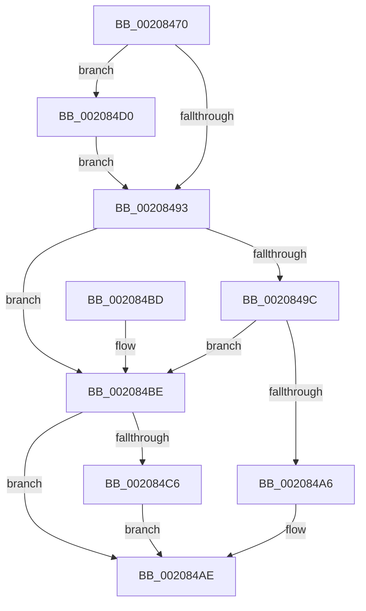

# KeAcquireSpinLockRaiseToDpc

- RVA: `0x00208470`–`0x002084DE` (길이 `110` bytes)
- VA: `0x0000000140208470`
- 실행 섹션: `.text`
- PDB 이름 있음: `예`; PDB Function 태그: `아니요`
- unwind 정보 RVA: `0x0005D368`
- 디코드: `31`개 명령, `110/110` bytes 표시
- 미해석 바이트: `0` (있으면 어셈블리에 `.byte`로 보존)

> 이 문서는 커널 이미지의 기계어와 PDB 기호를 분석해 생성했습니다. 4번과 5번은 함수 원형과 자료형을 바이너리 사용 방식에서 추정한 C 해석이며 원본 소스 복구 결과는 아닙니다.

## 1. Dependencies

- 직접 호출 지점: **3**; 고유 호출 대상: **3**
- 직접 호출자로 확인된 함수: **513**
- RIP 상대 이미지 참조: **3**

### Outgoing calls
- `0x002084A9` → [KiAcquireSpinLockInstrumented](KiAcquireSpinLockInstrumented_function_002084F0.md) (function, `0x002084F0`)
- `0x002084C9` → [KxWaitForSpinLockAndAcquire](KxWaitForSpinLockAndAcquire_function_002085C0.md) (function, `0x002085C0`)
- `0x002084D7` → [KiRaiseIrqlProcessIrqlFlags](../4F/KiRaiseIrqlProcessIrqlFlags_function_004F56FC.md) (function, `0x004F56FC`)

### Direct callers
- [SMKM_STORE&lt;SM_TRAITS&gt;::SmStReadThread](SMKM_STORE_SM_TRAITS_SmStReadThread_function_00203230.md) at `0x0020331E`
- [sub_00204795](Unknown_function_00204795.md) at `0x00204822`
- [sub_00206865](Unknown_function_00206865.md) at `0x00206919`
- [sub_002072CB](Unknown_function_002072CB.md) at `0x002072F4`
- [sub_002072CB](Unknown_function_002072CB.md) at `0x002073B0`
- [KiRcuFlushCompleted](KiRcuFlushCompleted_function_0020AD38.md) at `0x0020ADAC`
- [ExpFreeOwnerEntry](ExpFreeOwnerEntry_function_0020F740.md) at `0x0020F8F3`
- [sub_00210801](../21/Unknown_function_00210801.md) at `0x00210817`
- [ExEnterPriorityRegionAndAcquireResourceShared](../21/ExEnterPriorityRegionAndAcquireResourceShared_function_00213870.md) at `0x002139A2`
- [sub_002142F9](../21/Unknown_function_002142F9.md) at `0x00214BF6`
- [sub_002142F9](../21/Unknown_function_002142F9.md) at `0x00214C91`
- [IoBoostThreadIoPriority](../21/IoBoostThreadIoPriority_function_00216110.md) at `0x00216188`
- [IoBoostThreadIoPriority](../21/IoBoostThreadIoPriority_function_00216110.md) at `0x00216457`
- [CmpCompleteLazyWrite](../22/CmpCompleteLazyWrite_function_0022FA10.md) at `0x0022FA39`
- [PspProcessUnbindVirtualizedTimers](../22/PspProcessUnbindVirtualizedTimers_function_0022FC3C.md) at `0x0022FC7D`
- [ExpDeleteTimer](../23/ExpDeleteTimer_function_00230C40.md) at `0x00230C74`
- [NtCancelTimer](../23/NtCancelTimer_function_00230D90.md) at `0x00230E59`
- [NtCancelTimer](../23/NtCancelTimer_function_00230D90.md) at `0x00231032`
- [ExpUpdateTimerConfigurationWorker](../23/ExpUpdateTimerConfigurationWorker_function_00235410.md) at `0x0023542C`
- [IopCompleteIrpInFileObjectList](../24/IopCompleteIrpInFileObjectList_function_0024F330.md) at `0x0024F7F6`
- [sub_0025EB5D](../25/Unknown_function_0025EB5D.md) at `0x0025ECCA`
- [sub_00260D5A](../26/Unknown_function_00260D5A.md) at `0x00260F12`
- [sub_00260D5A](../26/Unknown_function_00260D5A.md) at `0x00260F99`
- [PnpDeviceCompletionQueueDispatchedEntryCompleted](../26/PnpDeviceCompletionQueueDispatchedEntryCompleted_function_0026E778.md) at `0x0026E78C`
- [PopFxNotifyPostDIrpCompletion](../26/PopFxNotifyPostDIrpCompletion_function_0026EA18.md) at `0x0026EA3E`
- [PopCompleteIrpWatchdog](../26/PopCompleteIrpWatchdog_function_0026EB94.md) at `0x0026EBC6`
- [PopDequeueQuerySetIrp](../26/PopDequeueQuerySetIrp_function_0026EC34.md) at `0x0026ED50`
- [PopFxNotifyPreDIrpCompletion](../26/PopFxNotifyPreDIrpCompletion_function_0026F1F4.md) at `0x0026F27D`
- [PopDiagTraceIrpFinishTelemetry](../26/PopDiagTraceIrpFinishTelemetry_function_0026F46C.md) at `0x0026F4CF`
- [PopFxNotifyPreDIrpIssue](../26/PopFxNotifyPreDIrpIssue_function_0026FD40.md) at `0x0026FDAB`
- [PopFxNotifyPreDIrpIssue](../26/PopFxNotifyPreDIrpIssue_function_0026FD40.md) at `0x0026FDF0`
- [PoRunDownDeviceObject](../26/PoRunDownDeviceObject_function_0026FFFC.md) at `0x00270058`
- [PoRegisterDeviceForIdleDetection](../27/PoRegisterDeviceForIdleDetection_function_002700E0.md) at `0x00270116`
- [PoRegisterDeviceForIdleDetection](../27/PoRegisterDeviceForIdleDetection_function_002700E0.md) at `0x00270192`
- [sub_0027475D](../27/Unknown_function_0027475D.md) at `0x00275393`
- [sub_0027475D](../27/Unknown_function_0027475D.md) at `0x0027541C`
- [IopfCompleteRequest](../29/IopfCompleteRequest_function_0029B5F8.md) at `0x0029BB80`
- [NtSetInformationFile](../29/NtSetInformationFile_function_0029C5E0.md) at `0x0029CFC9`
- [KeDeleteThread](../2A/KeDeleteThread_function_002A12D4.md) at `0x002A131F`
- [KeDeleteThread](../2A/KeDeleteThread_function_002A12D4.md) at `0x002A136C`
- [PfSnDeactivateTrace](../2A/PfSnDeactivateTrace_function_002A50CC.md) at `0x002A50EF`
- [PfSnDeactivateTrace](../2A/PfSnDeactivateTrace_function_002A50CC.md) at `0x002A5127`
- [PfSnDeactivateTrace](../2A/PfSnDeactivateTrace_function_002A50CC.md) at `0x002A516B`
- [PfSnRemoveProcessTrace](../2A/PfSnRemoveProcessTrace_function_002A51CC.md) at `0x002A51FA`
- [PopFxDispatchPluginWorkOnce](../2B/PopFxDispatchPluginWorkOnce_function_002BC69C.md) at `0x002BC7BD`
- [PopFxDisableWorkOrderWatchdog](../2B/PopFxDisableWorkOrderWatchdog_function_002BC858.md) at `0x002BC886`
- [PopFxEnableWorkOrderWatchdog](../2B/PopFxEnableWorkOrderWatchdog_function_002BD268.md) at `0x002BD2E0`
- [sub_002BD41B](../2B/Unknown_function_002BD41B.md) at `0x002BD4DD`
- [sub_002BD41B](../2B/Unknown_function_002BD41B.md) at `0x002BD5D2`
- [sub_002BD6E6](../2B/Unknown_function_002BD6E6.md) at `0x002BD7DB`
- [PopFxUpdateComponentAccountingEnhanced](../2B/PopFxUpdateComponentAccountingEnhanced_function_002BE924.md) at `0x002BE955`
- [PopFxActivateComponentDependents](../2B/PopFxActivateComponentDependents_function_002BE9F0.md) at `0x002BEB97`
- [PopFxActivateComponentDependents](../2B/PopFxActivateComponentDependents_function_002BE9F0.md) at `0x002BEE5B`
- [PopFxActivateComponentDependents](../2B/PopFxActivateComponentDependents_function_002BE9F0.md) at `0x002BEE95`
- [PopFxActivateComponentDependents](../2B/PopFxActivateComponentDependents_function_002BE9F0.md) at `0x002BEECD`
- [PopQueueQuerySetIrp](../2B/PopQueueQuerySetIrp_function_002BEF18.md) at `0x002BEF97`
- [PopPepCompleteComponentIdleStateChangeActivity](../2B/PopPepCompleteComponentIdleStateChangeActivity_function_002BF1B0.md) at `0x002BF29D`
- [PopFxIdleWorker](../2C/PopFxIdleWorker_function_002C04A0.md) at `0x002C04D8`
- [KiIntSteerConnect](../2D/KiIntSteerConnect_function_002D44F0.md) at `0x002D460B`
- [KeIntSteerPeriodic](../2D/KeIntSteerPeriodic_function_002D6D04.md) at `0x002D6D44`
- [KeIntSteerSnapPerf](../2D/KeIntSteerSnapPerf_function_002D76C0.md) at `0x002D77D5`
- [PopFxActivateComponentDependencies](../2D/PopFxActivateComponentDependencies_function_002D9B10.md) at `0x002D9B3D`
- [PopFxActivateComponent](../2D/PopFxActivateComponent_function_002D9DBC.md) at `0x002D9F48`
- [PpmMediaBufferingWorker](../2D/PpmMediaBufferingWorker_function_002DA680.md) at `0x002DA691`
- [CcGetDirtyPages](../2F/CcGetDirtyPages_function_002F0720.md) at `0x002F0768`
- [CcForEachPartition](../2F/CcForEachPartition_function_002F0828.md) at `0x002F086F`
- [PpmIdleStartCsVetoAccounting](../30/PpmIdleStartCsVetoAccounting_function_0030326C.md) at `0x00303287`
- [PopIdleWakeNotifyDevicesActive](../30/PopIdleWakeNotifyDevicesActive_function_00303EC0.md) at `0x00303EDF`
- [PopFxPlatformStateAvailable](../30/PopFxPlatformStateAvailable_function_00303F6C.md) at `0x00303F87`
- [PpmIdleCsVetoAccountingResiliencyUpdate](../30/PpmIdleCsVetoAccountingResiliencyUpdate_function_00304028.md) at `0x0030404C`
- [PopFxSetDripsBlockedByDeviceActivity](../30/PopFxSetDripsBlockedByDeviceActivity_function_00304154.md) at `0x00304167`
- [PopFxUpdateDeviceIRPhaseAccounting](../30/PopFxUpdateDeviceIRPhaseAccounting_function_003041D8.md) at `0x003041EC`
- [PopUpdateNonAttributedCpuTimeReference](../30/PopUpdateNonAttributedCpuTimeReference_function_00304720.md) at `0x00304733`
- [PpmUpdatePlatformIdleVeto](../30/PpmUpdatePlatformIdleVeto_function_003047E0.md) at `0x00304850`
- [HalpIommuMapLogical](../30/HalpIommuMapLogical_function_00308290.md) at `0x003084E2`
- [HalpIommuFlushDmaDomain](../30/HalpIommuFlushDmaDomain_function_003093B4.md) at `0x003093E9`
- [SMKM_STORE&lt;SM_TRAITS&gt;::SmStWorkItemQueue](../31/SMKM_STORE_SM_TRAITS_SmStWorkItemQueue_function_00317A34.md) at `0x00317AA6`
- [SMKM_STORE&lt;SM_TRAITS&gt;::SmStWorkItemQueue](../31/SMKM_STORE_SM_TRAITS_SmStWorkItemQueue_function_00317A34.md) at `0x00317BF6`
- [sub_0033D37A](../33/Unknown_function_0033D37A.md) at `0x0033D395`
- [sub_003422B4](../34/Unknown_function_003422B4.md) at `0x003424E0`
- [PfSnTraceGetLogEntry](../34/PfSnTraceGetLogEntry_function_003437A0.md) at `0x00343848`
- [sub_00344B40](../34/Unknown_function_00344B40.md) at `0x00344B48`
- [sub_0034FEB1](../34/Unknown_function_0034FEB1.md) at `0x0035001D`
- [CcPostDeferredWrites](../35/CcPostDeferredWrites_function_003590FC.md) at `0x00359141`
- [IoWMIWriteEvent](../38/IoWMIWriteEvent_function_00386480.md) at `0x0038652C`
- [WmipFindRegEntryByProviderId](../38/WmipFindRegEntryByProviderId_function_00386908.md) at `0x00386935`
- [FsRtlUninitializeFileLock](../38/FsRtlUninitializeFileLock_function_00386F50.md) at `0x00386F91`
- [CcScheduleReadAheadNuma](../38/CcScheduleReadAheadNuma_function_0038883C.md) at `0x00388954`
- [CcScheduleReadAheadNuma](../38/CcScheduleReadAheadNuma_function_0038883C.md) at `0x00388CF6`
- [sub_0038C58B](../38/Unknown_function_0038C58B.md) at `0x0038C801`
- [FsRtlFastUnlockSingleExclusive](../38/FsRtlFastUnlockSingleExclusive_function_0038C8E0.md) at `0x0038C90C`
- [FsRtlFastUnlockSingleExclusive](../38/FsRtlFastUnlockSingleExclusive_function_0038C8E0.md) at `0x0038CB69`
- [sub_0038CBC6](../38/Unknown_function_0038CBC6.md) at `0x0038CBD4`
- [sub_0038CBC6](../38/Unknown_function_0038CBC6.md) at `0x0038CC2A`
- [sub_0038D07B](../38/Unknown_function_0038D07B.md) at `0x0038D15B`
- [sub_0038D07B](../38/Unknown_function_0038D07B.md) at `0x0038D1BE`
- [FsRtlFastUnlockSingleShared](../38/FsRtlFastUnlockSingleShared_function_0038D1F0.md) at `0x0038D216`
- [FsRtlPrivateCheckWaitingLocks](../38/FsRtlPrivateCheckWaitingLocks_function_0038DCBC.md) at `0x0038DE54`
- [FsRtlPrivateLock](../38/FsRtlPrivateLock_function_0038DF90.md) at `0x0038E09E`
- [PopIncrementPowerSettingPendingUpdates](../38/PopIncrementPowerSettingPendingUpdates_function_0038FE38.md) at `0x0038FE4B`
- [PopDeepSleepSetDisengageReason](../38/PopDeepSleepSetDisengageReason_function_0038FEC4.md) at `0x0038FEDC`
- [PopDecrementPowerSettingPendingUpdates](../39/PopDecrementPowerSettingPendingUpdates_function_0039007C.md) at `0x0039008F`
- [PopDeepSleepClearDisengageReason](../39/PopDeepSleepClearDisengageReason_function_0039010C.md) at `0x0039011F`
- [PopDeepSleepResiliencyPhaseAccountingUpdate](../39/PopDeepSleepResiliencyPhaseAccountingUpdate_function_003901D0.md) at `0x00390206`
- [PspLockQuotaExpansion](../39/PspLockQuotaExpansion_function_00390774.md) at `0x0039078D`
- [PspReturnQuota](../39/PspReturnQuota_function_00390C40.md) at `0x00390D87`
- [PsLeavePriorityRegion](../39/PsLeavePriorityRegion_function_00390F00.md) at `0x00390FB1`
- [FsRtlFastCheckLockForWrite](../39/FsRtlFastCheckLockForWrite_function_003910D0.md) at `0x00391128`
- [SMKM_STORE_MGR&lt;SM_TRAITS&gt;::SmAsyncReadQueueInsert](../39/SMKM_STORE_MGR_SM_TRAITS_SmAsyncReadQueueInsert_function_0039120C.md) at `0x0039127D`
- [ExTimerRundown](../39/ExTimerRundown_function_00391394.md) at `0x003913C4`
- [ExTimerRundown](../39/ExTimerRundown_function_00391394.md) at `0x0039142E`
- [ExTimerRundown](../39/ExTimerRundown_function_00391394.md) at `0x0039145E`
- [ExNotifyCallback](../39/ExNotifyCallback_function_003926B0.md) at `0x003926E7`
- [ExNotifyCallback](../39/ExNotifyCallback_function_003926B0.md) at `0x00392776`
- [PsBoostThreadIo](../39/PsBoostThreadIo_function_003927C0.md) at `0x0039293F`
- [PsBoostThreadIoEx](../39/PsBoostThreadIoEx_function_00392C00.md) at `0x00392D8C`
- [IopTimerDispatch](../3A/IopTimerDispatch_function_003A3900.md) at `0x003A39C0`
- [PsAdjustWin32kPriorityFloor](../3C/PsAdjustWin32kPriorityFloor_function_003C2D00.md) at `0x003C2D2D`
- [CcNotifyEnhancedExternalCaches](../3C/CcNotifyEnhancedExternalCaches_function_003C9294.md) at `0x003C92D8`
- [CcNotifyExternalCachesInternal](../3C/CcNotifyExternalCachesInternal_function_003C9E00.md) at `0x003C9E4F`
- [CcCoalescingCallBack](../3C/CcCoalescingCallBack_function_003CA040.md) at `0x003CA076`
- [HalpDmaStartWcb](../3D/HalpDmaStartWcb_function_003DA6EC.md) at `0x003DA718`
- [HalpDmaGetNextWcb](../3D/HalpDmaGetNextWcb_function_003DABF8.md) at `0x003DAC14`
- [HalpMmAllocCtxAlloc](../3E/HalpMmAllocCtxAlloc_function_003E10B8.md) at `0x003E110E`
- [HalpMmAllocCtxAlloc](../3E/HalpMmAllocCtxAlloc_function_003E10B8.md) at `0x003E12E2`
- [HalpMmAllocCtxFree](../3E/HalpMmAllocCtxFree_function_003E1904.md) at `0x003E1927`
- [PspIumFreePhysicalPages](../3E/PspIumFreePhysicalPages_function_003E7874.md) at `0x003E7996`
- [HalpAllocateCommonBufferVectorInternal](../3E/HalpAllocateCommonBufferVectorInternal_function_003E848C.md) at `0x003E8681`
- [HalpAllocateCommonBufferEntry](../3E/HalpAllocateCommonBufferEntry_function_003E99F4.md) at `0x003E9A5D`
- [HalpDmaReferenceDomainObject](../3E/HalpDmaReferenceDomainObject_function_003E9B08.md) at `0x003E9B1E`
- [IopCompleteIoRingEntry](../3E/IopCompleteIoRingEntry_function_003ED2C0.md) at `0x003ED2F6`
- [IopDequeueIrpFromFileObject](../3E/IopDequeueIrpFromFileObject_function_003ED548.md) at `0x003ED564`
- [PnpMapActivatingDeviceNodeToThread](../3E/PnpMapActivatingDeviceNodeToThread_function_003EE1D4.md) at `0x003EE1EF`
- [PnpUnmapActivatingDeviceNodeToThread](../3E/PnpUnmapActivatingDeviceNodeToThread_function_003EE4C0.md) at `0x003EE4D8`
- [HalpPopCommonBufferEntry](../3F/HalpPopCommonBufferEntry_function_003F68D4.md) at `0x003F6906`
- [HalpPopCommonBufferEntry](../3F/HalpPopCommonBufferEntry_function_003F68D4.md) at `0x003F6999`
- [HalpDmaDereferenceDomainObject](../3F/HalpDmaDereferenceDomainObject_function_003F69DC.md) at `0x003F69FB`
- [HalFreeCommonBufferVector](../3F/HalFreeCommonBufferVector_function_003F87C0.md) at `0x003F880A`
- [PsEnterPriorityRegion](../3F/PsEnterPriorityRegion_function_003F8CD0.md) at `0x003F8D7D`
- [sub_003FD3BC](../3F/Unknown_function_003FD3BC.md) at `0x003FD3EB`
- [FsRtlPrivateFastUnlockAll](../3F/FsRtlPrivateFastUnlockAll_function_003FD554.md) at `0x003FD594`
- [FsRtlPrivateFastUnlockAll](../3F/FsRtlPrivateFastUnlockAll_function_003FD554.md) at `0x003FD881`
- [IopQueueIrpToFileObject](../40/IopQueueIrpToFileObject_function_00409864.md) at `0x0040988F`
- [ExpScanGeneralLookasideList](../40/ExpScanGeneralLookasideList_function_0040FDF0.md) at `0x0040FE03`
- [PfSnActivateTrace](../41/PfSnActivateTrace_function_0041BDAC.md) at `0x0041BDE1`
- [PopFxStopDeviceAccounting](../42/PopFxStopDeviceAccounting_function_004261D8.md) at `0x004262FB`
- [PopFxStopDeviceAccounting](../42/PopFxStopDeviceAccounting_function_004261D8.md) at `0x0042634C`
- [PopFxStopDeviceAccounting](../42/PopFxStopDeviceAccounting_function_004261D8.md) at `0x004263D0`
- [IoIncrementKeepAliveCount](../42/IoIncrementKeepAliveCount_function_0042EAD0.md) at `0x0042EB30`
- [IopAdjustFileObjectKeepAliveCount](../42/IopAdjustFileObjectKeepAliveCount_function_0042EBE8.md) at `0x0042EC7C`
- [IopGetSetStreamIdentifier](../42/IopGetSetStreamIdentifier_function_0042ED7C.md) at `0x0042EDEA`
- [NtCancelWaitCompletionPacket](../42/NtCancelWaitCompletionPacket_function_0042F100.md) at `0x0042F175`
- [NtCancelWaitCompletionPacket](../42/NtCancelWaitCompletionPacket_function_0042F100.md) at `0x0042F1B4`
- [NtAssociateWaitCompletionPacket](../42/NtAssociateWaitCompletionPacket_function_0042F270.md) at `0x0042F3D0`
- [IopCloseWaitCompletionPacket](../42/IopCloseWaitCompletionPacket_function_0042F520.md) at `0x0042F556`
- [IopCloseWaitCompletionPacket](../42/IopCloseWaitCompletionPacket_function_0042F520.md) at `0x0042F5C5`
- [sub_00433495](../43/Unknown_function_00433495.md) at `0x004334C7`
- [PspInsertProperty](../43/PspInsertProperty_function_00434B2C.md) at `0x00434B71`
- [PspRemoveProperty](../43/PspRemoveProperty_function_00434C10.md) at `0x00434C31`
- [SMKM_STORE_MGR&lt;SM_TRAITS&gt;::SmAsyncReadQueueWorker](../43/SMKM_STORE_MGR_SM_TRAITS_SmAsyncReadQueueWorker_function_004382D0.md) at `0x00438328`
- [SMKM_STORE_MGR&lt;SM_TRAITS&gt;::SmAsyncReadQueueWorker](../43/SMKM_STORE_MGR_SM_TRAITS_SmAsyncReadQueueWorker_function_004382D0.md) at `0x00438390`
- [PopCaptureSleepStudyStatistics](../43/PopCaptureSleepStudyStatistics_function_004399F4.md) at `0x00439C0E`
- [PopCaptureSleepStudyStatistics](../43/PopCaptureSleepStudyStatistics_function_004399F4.md) at `0x00439FA8`
- [PopCaptureSleepStudyStatistics](../43/PopCaptureSleepStudyStatistics_function_004399F4.md) at `0x00439FD6`
- [PopCalculateCsSummary](../43/PopCalculateCsSummary_function_0043A1B0.md) at `0x0043A3D1`
- [PopCalculateCsSummary](../43/PopCalculateCsSummary_function_0043A1B0.md) at `0x0043A669`
- [PopDiagTraceCsResiliencyExit](../43/PopDiagTraceCsResiliencyExit_function_0043AB34.md) at `0x0043AB6A`
- [PpmIdleCaptureCsVetoAccounting](../43/PpmIdleCaptureCsVetoAccounting_function_0043B6CC.md) at `0x0043B756`
- [EtwpCovSampCaptureContextStop](../43/EtwpCovSampCaptureContextStop_function_0043BE5C.md) at `0x0043BE8E`
- [EtwpCovSampCaptureCleanupLookasides](../43/EtwpCovSampCaptureCleanupLookasides_function_0043BFE0.md) at `0x0043C00B`
- [PopFxIdleWorkerTail](../43/PopFxIdleWorkerTail_function_0043CDA0.md) at `0x0043CDE7`
- [PopFxIdleWorkerTail](../43/PopFxIdleWorkerTail_function_0043CDA0.md) at `0x0043CEE1`
- [PopFxDeactivateComponentDependencies](../43/PopFxDeactivateComponentDependencies_function_0043CF70.md) at `0x0043CF9A`
- [PopFxPauseDeviceAccounting](../43/PopFxPauseDeviceAccounting_function_0043D0C8.md) at `0x0043D169`
- [PopFxPauseDeviceAccounting](../43/PopFxPauseDeviceAccounting_function_0043D0C8.md) at `0x0043D1BB`
- [PopFxUpdateDeviceAccountingEnhanced](../43/PopFxUpdateDeviceAccountingEnhanced_function_0043D250.md) at `0x0043D26E`
- [PopFxResumeDeviceAccounting](../43/PopFxResumeDeviceAccounting_function_0043D4D8.md) at `0x0043D584`
- [PopFxResumeDeviceAccounting](../43/PopFxResumeDeviceAccounting_function_0043D4D8.md) at `0x0043D5C0`
- [PopFxSetGlobalDeviceAccountingEnabled](../43/PopFxSetGlobalDeviceAccountingEnabled_function_0043D678.md) at `0x0043D687`
- [IopIncrementCompletionContextUsageCountAndReadData](../44/IopIncrementCompletionContextUsageCountAndReadData_function_00443C60.md) at `0x00443C96`
- [EtwpCovSampCaptureApc](../44/EtwpCovSampCaptureApc_function_004440D0.md) at `0x00444110`
- [PoQueryWatchdogTime](../44/PoQueryWatchdogTime_function_004479B0.md) at `0x00447B4D`
- [PoQueryWatchdogTime](../44/PoQueryWatchdogTime_function_004479B0.md) at `0x00447BA6`
- [PopEnableIrpWatchdog](../44/PopEnableIrpWatchdog_function_00447BFC.md) at `0x00447C26`
- [IopSessionChangeWorker](../45/IopSessionChangeWorker_function_004522B0.md) at `0x004522E8`
- [IopSessionChangeWorker](../45/IopSessionChangeWorker_function_004522B0.md) at `0x004523AC`
- [ExNotifyWithProcessing](../45/ExNotifyWithProcessing_function_004523F4.md) at `0x00452437`
- [ExNotifyWithProcessing](../45/ExNotifyWithProcessing_function_004523F4.md) at `0x00452512`
- [IopDecrementCompletionContextUsageCount](../45/IopDecrementCompletionContextUsageCount_function_00452678.md) at `0x00452699`
- [SleepstudyHelper_ComponentActive](../45/SleepstudyHelper_ComponentActive_function_00453730.md) at `0x00453768`
- [SleepstudyHelperBlockerActiveDereference](../45/SleepstudyHelperBlockerActiveDereference_function_00453830.md) at `0x00453847`
- [SleepstudyHelperBlockerActiveReference](../45/SleepstudyHelperBlockerActiveReference_function_004538D0.md) at `0x004538E9`
- [SshpIterateParentBlockers](../45/SshpIterateParentBlockers_function_0045394C.md) at `0x00453980`
- [IopCancelApcRequired](../45/IopCancelApcRequired_function_00456BB0.md) at `0x00456BD9`
- [EtwTelemetryCoverageReport](../46/EtwTelemetryCoverageReport_function_00460430.md) at `0x004604DD`
- [PopSetWatchdog](../46/PopSetWatchdog_function_00460CAC.md) at `0x00460CFB`
- [PopSetWatchdog](../46/PopSetWatchdog_function_00460CAC.md) at `0x00460F8F`
- [PopSetWatchdog](../46/PopSetWatchdog_function_00460CAC.md) at `0x00461053`
- [HalpBuddyAllocatorBltFindAndPop](../46/HalpBuddyAllocatorBltFindAndPop_function_0046746C.md) at `0x004674B1`
- [HalpBuddyAllocatorBltPopBuddy](../46/HalpBuddyAllocatorBltPopBuddy_function_0046754C.md) at `0x00467565`
- [ExInitializePagedLookasideListInternal](../46/ExInitializePagedLookasideListInternal_function_00468040.md) at `0x004680C9`
- [ExInitializeNPagedLookasideListInternal](../46/ExInitializeNPagedLookasideListInternal_function_00468720.md) at `0x004687A6`
- [ExInitializeLookasideListExInternal](../46/ExInitializeLookasideListExInternal_function_00468890.md) at `0x004689CE`
- [PopDeepSleepEvaluateCallback](../46/PopDeepSleepEvaluateCallback_function_00469F10.md) at `0x00469F21`
- [PsInsertVirtualizedTimer](../46/PsInsertVirtualizedTimer_function_0046C130.md) at `0x0046C172`
- [WmipFindRegEntryByDevice](../46/WmipFindRegEntryByDevice_function_0046C22C.md) at `0x0046C256`
- [IoWMIDeviceObjectToProviderId](../46/IoWMIDeviceObjectToProviderId_function_0046C2B0.md) at `0x0046C2C0`
- [PipSetDevNodeState](../47/PipSetDevNodeState_function_00470708.md) at `0x00470734`
- [IopPowerDispatch](../47/IopPowerDispatch_function_00470BF0.md) at `0x00470C56`
- [PpmEndHighPerfRequest](../47/PpmEndHighPerfRequest_function_00477490.md) at `0x004774A4`
- [PnpRequestDeviceAction](../47/PnpRequestDeviceAction_function_00477FF8.md) at `0x0047818C`
- [PnpRequestDeviceAction](../47/PnpRequestDeviceAction_function_00477FF8.md) at `0x004781CB`
- [PnpRequestDeviceAction](../47/PnpRequestDeviceAction_function_00477FF8.md) at `0x00478212`
- [PnpDeviceActionWorker](../47/PnpDeviceActionWorker_function_00478400.md) at `0x0047848F`
- [PnpDeviceActionWorker](../47/PnpDeviceActionWorker_function_00478400.md) at `0x0047859F`
- [PnpDeviceActionWorker](../47/PnpDeviceActionWorker_function_00478400.md) at `0x004785B9`
- [PnpDeviceActionWorker](../47/PnpDeviceActionWorker_function_00478400.md) at `0x004786EA`
- [PnpDeviceActionWorker](../47/PnpDeviceActionWorker_function_00478400.md) at `0x00478704`
- [PnpDeviceActionWorker](../47/PnpDeviceActionWorker_function_00478400.md) at `0x00478780`
- [PnpDeviceActionWorker](../47/PnpDeviceActionWorker_function_00478400.md) at `0x004787AB`
- [HalpBuddyAllocatorBltAdd](../47/HalpBuddyAllocatorBltAdd_function_0047A968.md) at `0x0047A98E`
- [IopCancelIrpsInCurrentThreadList](../47/IopCancelIrpsInCurrentThreadList_function_0047AB14.md) at `0x0047AB4C`
- [WmipDeregisterRegEntry](../47/WmipDeregisterRegEntry_function_0047B568.md) at `0x0047B5B9`
- [WmipDeregisterRegEntry](../47/WmipDeregisterRegEntry_function_0047B568.md) at `0x0047B645`
- [PoSetPowerState](../48/PoSetPowerState_function_004803E0.md) at `0x00480409`
- [ExpRemoveGeneralLookaside](../48/ExpRemoveGeneralLookaside_function_00481E10.md) at `0x00481E25`
- [PopUserPresentSet](../48/PopUserPresentSet_function_00482B90.md) at `0x00482BC4`
- [PopCheckForWork](../48/PopCheckForWork_function_00482CAC.md) at `0x00482CE0`
- [PopGetPolicyWorker](../48/PopGetPolicyWorker_function_00482D24.md) at `0x00482D33`
- [IoGetSfioStreamIdentifier](../48/IoGetSfioStreamIdentifier_function_004831E0.md) at `0x00483224`
- [KiIdealProcessorRebalancerWorker](../48/KiIdealProcessorRebalancerWorker_function_00484BB0.md) at `0x00484BDC`
- [SshpQueryAndResetBlockerAccounting](../48/SshpQueryAndResetBlockerAccounting_function_00484F4C.md) at `0x00484F71`
- [SshpSetCollectionActive](../48/SshpSetCollectionActive_function_0048507C.md) at `0x00485109`
- [SshpDereferenceBlocker](../48/SshpDereferenceBlocker_function_00486960.md) at `0x00486988`
- [SshpDereferenceBlocker](../48/SshpDereferenceBlocker_function_00486960.md) at `0x00486A2F`
- [IoDecrementKeepAliveCount](../48/IoDecrementKeepAliveCount_function_004898E0.md) at `0x00489928`
- [IoDecrementKeepAliveCount](../48/IoDecrementKeepAliveCount_function_004898E0.md) at `0x00489972`
- [PnpDeviceCompletionQueueIsEmpty](../48/PnpDeviceCompletionQueueIsEmpty_function_0048A070.md) at `0x0048A07F`
- [CcIsThereDirtyData](../48/CcIsThereDirtyData_function_0048BE30.md) at `0x0048BE72`
- [PipFindDependencyNodePath](../48/PipFindDependencyNodePath_function_0048D0AC.md) at `0x0048D0DD`
- [PpmEventPlatformVetoRundown](../49/PpmEventPlatformVetoRundown_function_00490C38.md) at `0x00490D0E`
- [PpmEventProcessorVetoRundown](../49/PpmEventProcessorVetoRundown_function_00490D88.md) at `0x00490EB0`
- [PpmEventTracePreVetoAccounting](../49/PpmEventTracePreVetoAccounting_function_00490F88.md) at `0x00491033`
- [SshpReferenceBlocker](../49/SshpReferenceBlocker_function_0049164C.md) at `0x0049165B`
- [SshpTracingWriteBlockerStateRundown](../49/SshpTracingWriteBlockerStateRundown_function_00491A20.md) at `0x00491A8F`
- [PopPolicyWorkerThread](../49/PopPolicyWorkerThread_function_00491FD0.md) at `0x00491FEE`
- [PopPolicyWorkerThread](../49/PopPolicyWorkerThread_function_00491FD0.md) at `0x00492057`
- [PopFxIdleTimeoutDpcRoutine](../49/PopFxIdleTimeoutDpcRoutine_function_00492B80.md) at `0x00492B9C`
- [WmipBuildTraceDeviceList](../49/WmipBuildTraceDeviceList_function_00494050.md) at `0x00494096`
- [IopKeepAliveWorker](../49/IopKeepAliveWorker_function_00494FD0.md) at `0x00494FEF`
- [IopKeepAliveWorker](../49/IopKeepAliveWorker_function_00494FD0.md) at `0x0049508B`
- [IopKeepAliveWorker](../49/IopKeepAliveWorker_function_00494FD0.md) at `0x004950C0`
- [RtlpStdGetRecordedStackTraceIndex](../49/RtlpStdGetRecordedStackTraceIndex_function_00495C84.md) at `0x00495CD4`
- [RtlStdReleaseStackTrace](../49/RtlStdReleaseStackTrace_function_00495D58.md) at `0x00495DB8`
- [PnpDeviceCompletionQueueAddDispatchedRequest](../49/PnpDeviceCompletionQueueAddDispatchedRequest_function_0049619C.md) at `0x004961B0`
- [KiIntSteerDisable](../49/KiIntSteerDisable_function_00497144.md) at `0x00497184`
- [ExpEnumerateCallback](../49/ExpEnumerateCallback_function_00497430.md) at `0x00497451`
- [IopCancelIrpsInCurrentThreadListSpecialApc](../49/IopCancelIrpsInCurrentThreadListSpecialApc_function_00497B40.md) at `0x00497B75`
- [EtwpCancelPendingApcs](../49/EtwpCancelPendingApcs_function_00497D88.md) at `0x00497DC1`
- [PopScanIdleList](../49/PopScanIdleList_function_00497F04.md) at `0x00497FB6`
- [PfSnStartTraceTimer](../49/PfSnStartTraceTimer_function_00499BEC.md) at `0x00499C25`
- [ExpTimerApcRoutine](../49/ExpTimerApcRoutine_function_0049A5E0.md) at `0x0049A60D`
- [SshpQueryBlockerPendingDelete](../49/SshpQueryBlockerPendingDelete_function_0049A814.md) at `0x0049A821`
- [PopFxIsDripsBlockingDevice](../49/PopFxIsDripsBlockingDevice_function_0049BA24.md) at `0x0049BA65`
- [PopFxIsDripsBlockingDevice](../49/PopFxIsDripsBlockingDevice_function_0049BA24.md) at `0x0049BA96`
- [PopUserPresentSetWorker](../49/PopUserPresentSetWorker_function_0049D4F0.md) at `0x0049D506`
- [PopUserPresentSetWorker](../49/PopUserPresentSetWorker_function_0049D4F0.md) at `0x0049D594`
- [PnpDeviceCompletionQueueRemoveCompletedRequest](../49/PnpDeviceCompletionQueueRemoveCompletedRequest_function_0049D73C.md) at `0x0049D766`
- [ExSetTimerResolution](../49/ExSetTimerResolution_function_0049E7D0.md) at `0x0049E800`
- [PopAccumulateNonDripsIdleCpuTime](../4A/PopAccumulateNonDripsIdleCpuTime_function_004A09B0.md) at `0x004A0A07`
- [PopAccumulateNonActivatedCpuTime](../4A/PopAccumulateNonActivatedCpuTime_function_004A0AA4.md) at `0x004A0AD2`
- [WmiQueryTraceProviderCount](../4A/WmiQueryTraceProviderCount_function_004A24C8.md) at `0x004A24F0`
- [FsRtlCheckLockForOplockRequest](../4A/FsRtlCheckLockForOplockRequest_function_004A25E0.md) at `0x004A2640`
- [PopFxStartDeviceAccounting](../4A/PopFxStartDeviceAccounting_function_004A384C.md) at `0x004A3912`
- [PopFxStartDeviceAccounting](../4A/PopFxStartDeviceAccounting_function_004A384C.md) at `0x004A399A`
- [PopFxStartDeviceAccounting](../4A/PopFxStartDeviceAccounting_function_004A384C.md) at `0x004A39DE`
- [PoFxCompleteDevicePowerNotRequired](../4A/PoFxCompleteDevicePowerNotRequired_function_004A3BE0.md) at `0x004A3C31`
- [PopDevicePowerTransitionInProgressWorker](../4A/PopDevicePowerTransitionInProgressWorker_function_004A3EB0.md) at `0x004A3EBB`
- [PopDevicePowerTransitionInProgressWorker](../4A/PopDevicePowerTransitionInProgressWorker_function_004A3EB0.md) at `0x004A3F0C`
- [PnpUnlockDeviceActionQueue](../4A/PnpUnlockDeviceActionQueue_function_004A42F4.md) at `0x004A4301`
- [PnpLockDeviceActionQueue](../4A/PnpLockDeviceActionQueue_function_004A4388.md) at `0x004A439F`
- [PopDisksRegisteredForIdle](../4A/PopDisksRegisteredForIdle_function_004A527C.md) at `0x004A52A0`
- [ExpCheckForLookasideList](../4A/ExpCheckForLookasideList_function_004A5348.md) at `0x004A5378`
- [PoFxSetDeviceIdleTimeout](../4A/PoFxSetDeviceIdleTimeout_function_004A5C10.md) at `0x004A5C34`
- [PopDeepSleepResiliencyPhaseAccountingBegin](../4A/PopDeepSleepResiliencyPhaseAccountingBegin_function_004A72B4.md) at `0x004A7328`
- [PopDirectedDripsDiagPnpActionQueueAccountingUpdate](../4A/PopDirectedDripsDiagPnpActionQueueAccountingUpdate_function_004A7EEC.md) at `0x004A7EFF`
- [PopDisableIrpWatchdog](../4A/PopDisableIrpWatchdog_function_004A95E8.md) at `0x004A961A`
- [PpDevNodeRemoveFromTree](../4A/PpDevNodeRemoveFromTree_function_004AD5A0.md) at `0x004AD5C4`
- [PopAcquireUserPresentSpinLock](../4A/PopAcquireUserPresentSpinLock_function_004ADF98.md) at `0x004ADFA8`
- [PopDirectedDripsDiagQueryAndResetPnpAccounting](../4A/PopDirectedDripsDiagQueryAndResetPnpAccounting_function_004AEF34.md) at `0x004AEF5D`
- [PopDeepSleepResiliencyPhaseAccountingEnd](../4A/PopDeepSleepResiliencyPhaseAccountingEnd_function_004AF6C8.md) at `0x004AF763`
- [PopDeepSleepResiliencyPhaseAccountingEnd](../4A/PopDeepSleepResiliencyPhaseAccountingEnd_function_004AF6C8.md) at `0x004AF772`
- [PopFxClearDeviceConstraints](../4B/PopFxClearDeviceConstraints_function_004B05F8.md) at `0x004B06AF`
- [PopFxClearDeviceConstraints](../4B/PopFxClearDeviceConstraints_function_004B05F8.md) at `0x004B0700`
- [ExCleanTimerResolutionRequest](../4B/ExCleanTimerResolutionRequest_function_004B0C58.md) at `0x004B0C8F`
- [ExpInsertTimerResolutionEntry](../4B/ExpInsertTimerResolutionEntry_function_004B1898.md) at `0x004B18A8`
- [IopErrorLogGetEntry](../4B/IopErrorLogGetEntry_function_004B2554.md) at `0x004B2561`
- [PopIdleWakeNotifyModernStandbyEnter](../4B/PopIdleWakeNotifyModernStandbyEnter_function_004B30A0.md) at `0x004B31C1`
- [ExTraceTimerResolution](../4B/ExTraceTimerResolution_function_004B348C.md) at `0x004B34B0`
- [PopIdleWakeNotifyModernStandbyExit](../4B/PopIdleWakeNotifyModernStandbyExit_function_004B4034.md) at `0x004B405B`
- [PopIdleWakeNotifyIdleResiliencyState](../4B/PopIdleWakeNotifyIdleResiliencyState_function_004B476C.md) at `0x004B478E`
- [SleepstudyHelper_ComponentInactive](../4B/SleepstudyHelper_ComponentInactive_function_004B5AB0.md) at `0x004B5AE8`
- [IoWriteErrorLogEntry](../4B/IoWriteErrorLogEntry_function_004B5B30.md) at `0x004B5B60`
- [WmipAllocRegEntry](../4B/WmipAllocRegEntry_function_004B6D24.md) at `0x004B6DA7`
- [ExUnregisterCallback](../4B/ExUnregisterCallback_function_004B7F80.md) at `0x004B7FD9`
- [PopUpdateAcDcState](../4B/PopUpdateAcDcState_function_004B8C68.md) at `0x004B8C9D`
- [PpmDisableHighPerfRequestDeferredExpiration](../4B/PpmDisableHighPerfRequestDeferredExpiration_function_004BA678.md) at `0x004BA691`
- [PopIdleCancelAoAcDozeS4Timer](../4B/PopIdleCancelAoAcDozeS4Timer_function_004BC9C4.md) at `0x004BC9DE`
- [IopReplaceCompletionPort](../4B/IopReplaceCompletionPort_function_004BCA58.md) at `0x004BCA88`
- [PopDiagTraceDeepSleepConstraintRundown](../4B/PopDiagTraceDeepSleepConstraintRundown_function_004BCDDC.md) at `0x004BCE52`
- [PopGetModernStandbyTransitionReason](../4B/PopGetModernStandbyTransitionReason_function_004BDF6C.md) at `0x004BDF80`
- [ExRegisterCallback](../4B/ExRegisterCallback_function_004BDFC0.md) at `0x004BE01D`
- [PopNetEvaluationWorkerCallback](../4B/PopNetEvaluationWorkerCallback_function_004BE0B0.md) at `0x004BE193`
- [PnpDeviceCompletionQueueGetCompletedRequest](../4B/PnpDeviceCompletionQueueGetCompletedRequest_function_004BE224.md) at `0x004BE24B`
- [PopLockGetDoDevicePowerState](../4B/PopLockGetDoDevicePowerState_function_004BE7E8.md) at `0x004BE7F8`
- [HalpIommuLeaveDmaDomain](../4B/HalpIommuLeaveDmaDomain_function_004BF220.md) at `0x004BF29E`
- [PopSetModernStandbyTransitionReason](../4B/PopSetModernStandbyTransitionReason_function_004BFFCC.md) at `0x004BFFF4`
- [KasanDriverLoadImageInternal](../4C/KasanDriverLoadImageInternal_function_004C2840.md) at `0x004C2CDD`
- [PopSetPowerActionWatchdogState](../4C/PopSetPowerActionWatchdogState_function_004C86B8.md) at `0x004C86DE`
- [IopInvalidateBusRelationsWorker](../4C/IopInvalidateBusRelationsWorker_function_004C8900.md) at `0x004C8939`
- [PopFxEndDeviceIRPhaseAccounting](../4C/PopFxEndDeviceIRPhaseAccounting_function_004C9AB0.md) at `0x004C9AC0`
- [PpDevNodeInsertIntoTree](../4C/PpDevNodeInsertIntoTree_function_004CA274.md) at `0x004CA28B`
- [PopGetDope](../4C/PopGetDope_function_004CB77C.md) at `0x004CB7D5`
- [ExGetWakeTimerList](../4C/ExGetWakeTimerList_function_004CB964.md) at `0x004CBAA8`
- [PopFxBeginDeviceIRPhaseAccounting](../4C/PopFxBeginDeviceIRPhaseAccounting_function_004CDD80.md) at `0x004CDD94`
- [PopNetUpdateDsAccounting](../4C/PopNetUpdateDsAccounting_function_004CE000.md) at `0x004CE00F`
- [PopRecordPoIrpBlackboxInformation](../4C/PopRecordPoIrpBlackboxInformation_function_004CE14C.md) at `0x004CE1E5`
- [IopIoRingSetupCompletionWait](../4C/IopIoRingSetupCompletionWait_function_004CFCA0.md) at `0x004CFCE9`
- [PopCacheDisplayOnPhaseDuration](../4D/PopCacheDisplayOnPhaseDuration_function_004D291C.md) at `0x004D2932`
- [PopDripsWatchdogGetDeviceActiveTime](../4D/PopDripsWatchdogGetDeviceActiveTime_function_004D2D34.md) at `0x004D2D50`
- [PopRecordPowerWatchdogBlackboxInformation](../4D/PopRecordPowerWatchdogBlackboxInformation_function_004D3A18.md) at `0x004D3A42`
- [FsRtlPrivateCancelFileLockIrp](../4D/FsRtlPrivateCancelFileLockIrp_function_004D4B70.md) at `0x004D4BB6`
- [PopUpdatePowerButtonHoldState](../4D/PopUpdatePowerButtonHoldState_function_004D4EB4.md) at `0x004D4EC7`
- [PopDirectedDripsDiagGetDeviceActiveStamp](../4D/PopDirectedDripsDiagGetDeviceActiveStamp_function_004D5C78.md) at `0x004D5C9B`
- [PipFreeDependencyEdge](../4D/PipFreeDependencyEdge_function_004D7658.md) at `0x004D76A5`
- [HalpIommuGetHardwareDomain](../4D/HalpIommuGetHardwareDomain_function_004D7BCC.md) at `0x004D7C16`
- [IopErrorLogRequeueEntry](../4D/IopErrorLogRequeueEntry_function_004D88E0.md) at `0x004D88F0`
- [PopShutdownListenerInsertCallback](../4D/PopShutdownListenerInsertCallback_function_004D94C4.md) at `0x004D9518`
- [HalpDmaMarkHiberAdapter](../4D/HalpDmaMarkHiberAdapter_function_004DA56C.md) at `0x004DA62E`
- [KiRcuProcessorInitialize](../4D/KiRcuProcessorInitialize_function_004DF7E8.md) at `0x004DF85A`
- [KiRcuProcessorInitialize](../4D/KiRcuProcessorInitialize_function_004DF7E8.md) at `0x004DF88D`
- [KiRcuProcessorInitialize](../4D/KiRcuProcessorInitialize_function_004DF7E8.md) at `0x004DF8DC`
- [PopHaltDeviceIdle](../4D/PopHaltDeviceIdle_function_004DFFAC.md) at `0x004DFFCF`
- [PopDiagTraceCsResiliencyEnter](../4E/PopDiagTraceCsResiliencyEnter_function_004E0194.md) at `0x004E01C4`
- [PopIdleArmAoAcDozeS4Timer](../4E/PopIdleArmAoAcDozeS4Timer_function_004E03A8.md) at `0x004E0430`
- [PopThermalEventTransitionDisableDeepSleep](../4E/PopThermalEventTransitionDisableDeepSleep_function_004E1284.md) at `0x004E12A0`
- [HalpExtEnvMarkHiberRegions](../4E/HalpExtEnvMarkHiberRegions_function_004E17D0.md) at `0x004E1829`
- [ExpGetLookasideInformation](../4E/ExpGetLookasideInformation_function_004E2468.md) at `0x004E25A3`
- [ExpGetLookasideInformation](../4E/ExpGetLookasideInformation_function_004E2468.md) at `0x004E261D`
- [PopResumeDeviceIdle](../4E/PopResumeDeviceIdle_function_004E37D8.md) at `0x004E37E3`
- [PiDrvDbUnloadNodeReset](../4E/PiDrvDbUnloadNodeReset_function_004E3F84.md) at `0x004E3F9B`
- [PopPlUnregisterDevice](../4E/PopPlUnregisterDevice_function_004E3FF4.md) at `0x004E4043`
- [IopCopyCompleteReadIrp](../4E/IopCopyCompleteReadIrp_function_004E83F0.md) at `0x004E846D`
- [PiCollapseEnumRequests](../4E/PiCollapseEnumRequests_function_004E8890.md) at `0x004E88B2`
- [PnpRemoveDeviceActionRequests](../4E/PnpRemoveDeviceActionRequests_function_004E89A4.md) at `0x004E89DD`
- [PnpRemoveDeviceActionRequests](../4E/PnpRemoveDeviceActionRequests_function_004E89A4.md) at `0x004E8A61`
- [PnpRemoveDeviceActionRequests](../4E/PnpRemoveDeviceActionRequests_function_004E89A4.md) at `0x004E8A92`
- [PspSetProcessFreezeStateCallback](../4E/PspSetProcessFreezeStateCallback_function_004E98E0.md) at `0x004E9957`
- [IopRemoveHardErrorPacket](../4F/IopRemoveHardErrorPacket_function_004F70E0.md) at `0x004F70ED`
- [HalpCmcStartPolling](../4F/HalpCmcStartPolling_function_004F8D40.md) at `0x004F8D63`
- [KiSrcuProcessorInitialize](../4F/KiSrcuProcessorInitialize_function_004FA6C4.md) at `0x004FA6E4`
- [KiSrcuProcessorInitialize](../4F/KiSrcuProcessorInitialize_function_004FA6C4.md) at `0x004FA719`
- [PopFxCompleteDirectedPowerTransition](../4F/PopFxCompleteDirectedPowerTransition_function_004FB330.md) at `0x004FB3A6`
- [PopThermalEventTransitionEnableDeepSleep](../4F/PopThermalEventTransitionEnableDeepSleep_function_004FB584.md) at `0x004FB599`
- [HalpDmaFindAdapterByDeviceId](../53/HalpDmaFindAdapterByDeviceId_function_0053E0CC.md) at `0x0053E0F5`
- [HalpDmaRemoveFromEmergencyLogicalAddressQueue](../53/HalpDmaRemoveFromEmergencyLogicalAddressQueue_function_0053E3B8.md) at `0x0053E3DF`
- [HalpDmaRemoveWcb](../53/HalpDmaRemoveWcb_function_0053E450.md) at `0x0053E477`
- [HalpDmaReturnEmergencyLogicalAddressResources](../53/HalpDmaReturnEmergencyLogicalAddressResources_function_0053E4E8.md) at `0x0053E50B`
- [HalpDmaUseEmergencyLogicalAddressResources](../53/HalpDmaUseEmergencyLogicalAddressResources_function_0053E5C4.md) at `0x0053E5F0`
- [HalDmaAllocateCrashDumpRegistersEx](../53/HalDmaAllocateCrashDumpRegistersEx_function_0053F6D0.md) at `0x0053FA62`
- [HalDmaAllocateCrashDumpRegistersEx](../53/HalDmaAllocateCrashDumpRegistersEx_function_0053F6D0.md) at `0x0053FADA`
- [HalpAddAdapterToList](../53/HalpAddAdapterToList_function_0053FBD0.md) at `0x0053FBE0`
- [HalpDmaFindAdapterByDeviceObject](../53/HalpDmaFindAdapterByDeviceObject_function_0053FC8C.md) at `0x0053FCB5`
- [HalpDmaFindDeviceObjectByToken](../53/HalpDmaFindDeviceObjectByToken_function_0053FD28.md) at `0x0053FD57`
- [HalpDmaInsertDeviceObjectByToken](../53/HalpDmaInsertDeviceObjectByToken_function_0053FEAC.md) at `0x0053FED6`
- [HalpCmcInitializePolling](../54/HalpCmcInitializePolling_function_005408E4.md) at `0x005408FD`
- [HalpTscFallbackToPlatformSource](../54/HalpTscFallbackToPlatformSource_function_0054AD14.md) at `0x0054AD5C`
- [HalpTimerConfigureQpcBypass](../54/HalpTimerConfigureQpcBypass_function_0054BDAC.md) at `0x0054BE43`
- [HalpDmaFreeChildAdapter](../55/HalpDmaFreeChildAdapter_function_00550E30.md) at `0x00550E74`
- [HalpFlushMapBuffers](../55/HalpFlushMapBuffers_function_00551358.md) at `0x00551465`
- [HalpFlushMapBuffers](../55/HalpFlushMapBuffers_function_00551358.md) at `0x0055156C`
- [HalpDmaAllocateDomain](../55/HalpDmaAllocateDomain_function_00551C10.md) at `0x00551C74`
- [HalpIommuFreeDomainId](../55/HalpIommuFreeDomainId_function_00553658.md) at `0x0055367F`
- [HalpIommuGetDomainId](../55/HalpIommuGetDomainId_function_005537E4.md) at `0x0055381F`
- [HalpIommuDereferenceHardwareDomain](../55/HalpIommuDereferenceHardwareDomain_function_00554E58.md) at `0x00554E7E`
- [HalpIommuLogEarlyFault](../55/HalpIommuLogEarlyFault_function_00555640.md) at `0x005556DA`
- [EmonAllocateResources](../55/EmonAllocateResources_function_0055C40C.md) at `0x0055C500`
- [EmonReleaseProfileResources](../55/EmonReleaseProfileResources_function_0055EEC0.md) at `0x0055EEF8`
- [ExtEnvAllocatePhysicalMemory](../56/ExtEnvAllocatePhysicalMemory_function_00561124.md) at `0x0056129E`
- [ExtEnvFreePhysicalMemory](../56/ExtEnvFreePhysicalMemory_function_00561360.md) at `0x005613A8`
- [ExtEnvInitializeSpinLock](../56/ExtEnvInitializeSpinLock_function_00561434.md) at `0x00561444`
- [HalpRegisterProcessorTraceInterruptHandler](../56/HalpRegisterProcessorTraceInterruptHandler_function_00563F10.md) at `0x00563F26`
- [HalpRegisterProfileSourceInterruptHandler](../56/HalpRegisterProfileSourceInterruptHandler_function_00563FB0.md) at `0x00563FC6`
- [HalpRegisterTimerInterruptHandler](../56/HalpRegisterTimerInterruptHandler_function_00564050.md) at `0x00564066`
- [IommuDisableDevicePasid](../56/IommuDisableDevicePasid_function_00564E80.md) at `0x00564EBF`
- [IommuEnableDevicePasid](../56/IommuEnableDevicePasid_function_00565150.md) at `0x00565192`
- [IommuProcessPageRequestQueue](../56/IommuProcessPageRequestQueue_function_00565BA0.md) at `0x00565C5A`
- [IommuProcessPageRequestQueue](../56/IommuProcessPageRequestQueue_function_00565BA0.md) at `0x00565EEF`
- [IommuSetAddressSpace](../56/IommuSetAddressSpace_function_00566060.md) at `0x00566094`
- [HalpIommuMapLogicalRange](../56/HalpIommuMapLogicalRange_function_005690DC.md) at `0x005691FA`
- [HalpBlkPoReadPerfIoPort](../56/HalpBlkPoReadPerfIoPort_function_0056E2E0.md) at `0x0056E31E`
- [HalpBlkPoReadPerfMsr](../56/HalpBlkPoReadPerfMsr_function_0056E3F0.md) at `0x0056E429`
- [HalpBlkPoRegisterIdleState](../56/HalpBlkPoRegisterIdleState_function_0056E4F0.md) at `0x0056E525`
- [HalpBlkPoWritePerfIoPort](../56/HalpBlkPoWritePerfIoPort_function_0056E5C0.md) at `0x0056E600`
- [HalpBlkPoWritePerfMsr](../56/HalpBlkPoWritePerfMsr_function_0056E6B0.md) at `0x0056E6EE`
- [IvtFreeDomain](../56/IvtFreeDomain_function_0056F8E0.md) at `0x0056F930`
- [HsaAllocatePasidTables](../57/HsaAllocatePasidTables_function_005735DC.md) at `0x0057372E`
- [HsaFreePasidTables](../57/HsaFreePasidTables_function_0057401C.md) at `0x005740C1`
- [HalpBuddyAllocatorBltRemove](../57/HalpBuddyAllocatorBltRemove_function_00575AC0.md) at `0x00575AD4`
- [CcAddExternalCacheInternal](../57/CcAddExternalCacheInternal_function_0057B304.md) at `0x0057B31B`
- [CcAddExternalCacheInternalEx](../57/CcAddExternalCacheInternalEx_function_0057B398.md) at `0x0057B3AF`
- [CcRemoveExternalCache](../57/CcRemoveExternalCache_function_0057C228.md) at `0x0057C23C`
- [CcRemoveExternalCacheEx](../57/CcRemoveExternalCacheEx_function_0057C2D4.md) at `0x0057C2F1`
- [CcDeletePartition](../57/CcDeletePartition_function_0057DE9C.md) at `0x0057DF3A`
- [CcExitPartition](../57/CcExitPartition_function_0057E340.md) at `0x0057E3CD`
- [CcExitPartition](../57/CcExitPartition_function_0057E340.md) at `0x0057E44E`
- [FsRtlGetNextFileLock](../58/FsRtlGetNextFileLock_function_00581850.md) at `0x005818C7`
- [HvlpInitializeHvCrashdump](../58/HvlpInitializeHvCrashdump_function_0058BCCC.md) at `0x0058BE89`
- [HvlpInitializeHvCrashdump](../58/HvlpInitializeHvCrashdump_function_0058BCCC.md) at `0x0058BFAB`
- [IopCheckHardErrorEmpty](../59/IopCheckHardErrorEmpty_function_00596F90.md) at `0x00596F9D`
- [IopDisableTimer](../59/IopDisableTimer_function_00597000.md) at `0x0059701D`
- [IopEnableTimer](../59/IopEnableTimer_function_00597240.md) at `0x00597254`
- [IoFreeSfioStreamIdentifier](../59/IoFreeSfioStreamIdentifier_function_00597AA0.md) at `0x00597AE0`
- [IopRemoveTimerFromTimerList](../59/IopRemoveTimerFromTimerList_function_00597F8C.md) at `0x00597F9C`
- [IopIoRingGetAvailableCqSlots](../59/IopIoRingGetAvailableCqSlots_function_00598810.md) at `0x00598824`
- [IopIoRingUpdateCompletionUserEvent](../59/IopIoRingUpdateCompletionUserEvent_function_0059886C.md) at `0x005988BC`
- [IopIoRingWaitForCompletionEvent](../59/IopIoRingWaitForCompletionEvent_function_0059890C.md) at `0x00598953`
- [IopMcCreateBufferEntry](../5A/IopMcCreateBufferEntry_function_005A3AEC.md) at `0x005A3BA8`
- [IopMcWaitAndCleanupBufferEntry](../5A/IopMcWaitAndCleanupBufferEntry_function_005A3F44.md) at `0x005A3FB1`
- [PipCreateNewDependencyEdge](../5A/PipCreateNewDependencyEdge_function_005A55BC.md) at `0x005A565E`
- [PipMergeDependencyTypes](../5A/PipMergeDependencyTypes_function_005A56CC.md) at `0x005A56E2`
- [PnpGetCurrentlyActiveWorkerThread](../5A/PnpGetCurrentlyActiveWorkerThread_function_005A6AA0.md) at `0x005A6B1E`
- [PipRestoreDevNodeState](../5A/PipRestoreDevNodeState_function_005A7100.md) at `0x005A711E`
- [PnpRemoveDeviceActionRequestFromQueue](../5A/PnpRemoveDeviceActionRequestFromQueue_function_005A83E0.md) at `0x005A8406`
- [PnpRemoveDeviceActionRequestFromQueue](../5A/PnpRemoveDeviceActionRequestFromQueue_function_005A83E0.md) at `0x005A8446`
- [PnpRemoveDeviceActionRequestFromQueue](../5A/PnpRemoveDeviceActionRequestFromQueue_function_005A83E0.md) at `0x005A8477`
- [PiCollapseRebalanceRequests](../5A/PiCollapseRebalanceRequests_function_005AA590.md) at `0x005AA5A9`
- [sub_005AA9CD](../5A/Unknown_function_005AA9CD.md) at `0x005AA9FC`
- [KdUpdateTimeSlipEvent](../5B/KdUpdateTimeSlipEvent_function_005B0C1C.md) at `0x005B0C39`
- [KeRegisterNmiCallback](../5B/KeRegisterNmiCallback_function_005B1BE0.md) at `0x005B1C25`
- [KiDeregisterNmiSxCallback](../5B/KiDeregisterNmiSxCallback_function_005B1D4C.md) at `0x005B1D7E`
- [KiRcuStartGracePeriod](../5B/KiRcuStartGracePeriod_function_005BD2F4.md) at `0x005BD308`
- [KeAcquireSpinLockForDpc](../5B/KeAcquireSpinLockForDpc_function_005BD590.md) at `0x005BD5AB`
- [KeSrcuAllocate](../5C/KeSrcuAllocate_function_005C1C40.md) at `0x005C1EF2`
- [KeSrcuFree](../5C/KeSrcuFree_function_005C1F60.md) at `0x005C1F85`
- [KiSrcuFlushCompleted](../5C/KiSrcuFlushCompleted_function_005C22B4.md) at `0x005C232C`
- [KiSrcuInitializeTopology](../5C/KiSrcuInitializeTopology_function_005C2408.md) at `0x005C246D`
- [KiSrcuStartGracePeriod](../5C/KiSrcuStartGracePeriod_function_005C2E3C.md) at `0x005C2E55`
- [KeIntSteerAssignCpuSet](../5C/KeIntSteerAssignCpuSet_function_005C5668.md) at `0x005C56A4`
- [KeIntSteerAssignCpuSetForGsiv](../5C/KeIntSteerAssignCpuSetForGsiv_function_005C5700.md) at `0x005C5729`
- [PfpServiceMainThreadBoost](../5C/PfpServiceMainThreadBoost_function_005CDBB0.md) at `0x005CDBF2`
- [PfpServiceMainThreadUnboost](../5C/PfpServiceMainThreadUnboost_function_005CDCB0.md) at `0x005CDCCB`
- [PfSnUpdatePrefetcherFlags](../5C/PfSnUpdatePrefetcherFlags_function_005CDDF0.md) at `0x005CDE0A`
- [PpmIdleInstallNewVetoList](../5C/PpmIdleInstallNewVetoList_function_005CFE90.md) at `0x005CFEEC`
- [PpmIdlePrevetoWatchdog](../5D/PpmIdlePrevetoWatchdog_function_005D0010.md) at `0x005D0062`
- [PpmUpdateProcessorIdleVeto](../5D/PpmUpdateProcessorIdleVeto_function_005D0C50.md) at `0x005D0CBB`
- [PopDirectedDripsDisengageTimerCallback](../5D/PopDirectedDripsDisengageTimerCallback_function_005D11E0.md) at `0x005D11F6`
- [PopDirectedDripsStartDisengageTimer](../5D/PopDirectedDripsStartDisengageTimer_function_005D1230.md) at `0x005D125D`
- [PopWnfAirplaneModeCallback](../5D/PopWnfAirplaneModeCallback_function_005D13D0.md) at `0x005D1422`
- [PopWnfBluetoothChargingCallback](../5D/PopWnfBluetoothChargingCallback_function_005D1460.md) at `0x005D149C`
- [PopDeviceIdleCompletion](../5D/PopDeviceIdleCompletion_function_005D1580.md) at `0x005D158D`
- [PoFxAddComponentRelation](../5D/PoFxAddComponentRelation_function_005D15E0.md) at `0x005D178A`
- [PoFxAddComponentRelation](../5D/PoFxAddComponentRelation_function_005D15E0.md) at `0x005D17C3`
- [PoFxRemoveComponentRelation](../5D/PoFxRemoveComponentRelation_function_005D1C90.md) at `0x005D1DAD`
- [PoFxRemoveComponentRelation](../5D/PoFxRemoveComponentRelation_function_005D1C90.md) at `0x005D1E4F`
- [PoFxRemoveDeviceRelation](../5D/PoFxRemoveDeviceRelation_function_005D1EF0.md) at `0x005D1FE2`
- [PoFxRemoveDeviceRelation](../5D/PoFxRemoveDeviceRelation_function_005D1EF0.md) at `0x005D2078`
- [PopFxComponentRelationsCleanup](../5D/PopFxComponentRelationsCleanup_function_005D221C.md) at `0x005D2241`
- [PopFxDeviceRelationsCleanup](../5D/PopFxDeviceRelationsCleanup_function_005D2660.md) at `0x005D2689`
- [PopFxDeviceWork](../5D/PopFxDeviceWork_function_005D27B0.md) at `0x005D27CC`
- [PopFxDisableBasicAccountingWorker](../5D/PopFxDisableBasicAccountingWorker_function_005D28D0.md) at `0x005D2974`
- [PopFxInsertDeviceRelation](../5D/PopFxInsertDeviceRelation_function_005D2CE0.md) at `0x005D2D49`
- [PopFxInsertDeviceRelation](../5D/PopFxInsertDeviceRelation_function_005D2CE0.md) at `0x005D2D80`
- [PopFxIssueDirectedPowerTransition](../5D/PopFxIssueDirectedPowerTransition_function_005D2E2C.md) at `0x005D2E7E`
- [PopPowerSettingPendingUpdateWatchdog](../5D/PopPowerSettingPendingUpdateWatchdog_function_005D47A8.md) at `0x005D47BE`
- [PoRegisterSstNotificationHandler](../5D/PoRegisterSstNotificationHandler_function_005D4820.md) at `0x005D48B0`
- [PoUnregisterSstNotificationHandler](../5D/PoUnregisterSstNotificationHandler_function_005D4920.md) at `0x005D4941`
- [PopThermalEventTransitionTimerCallback](../5D/PopThermalEventTransitionTimerCallback_function_005D5550.md) at `0x005D555D`
- [PopThermalSxExit](../5D/PopThermalSxExit_function_005D55F8.md) at `0x005D569F`
- [PpmHighPerfRequestExpiration](../5D/PpmHighPerfRequestExpiration_function_005D90F0.md) at `0x005D9101`
- [PopShutdownListenerRemoveCallback](../5D/PopShutdownListenerRemoveCallback_function_005D9310.md) at `0x005D9332`
- [PopGetDozeTimerSource](../5D/PopGetDozeTimerSource_function_005D97F8.md) at `0x005D9807`
- [PopIdleAoAcDozeS4TimerCallback](../5D/PopIdleAoAcDozeS4TimerCallback_function_005D9840.md) at `0x005D984B`
- [PopPowerButtonWorkCallback](../5D/PopPowerButtonWorkCallback_function_005D9A70.md) at `0x005D9AD4`
- [PopPowerButtonWorkCallback](../5D/PopPowerButtonWorkCallback_function_005D9A70.md) at `0x005D9D04`
- [PopEsUpdateState](../5D/PopEsUpdateState_function_005DA018.md) at `0x005DA0C6`
- [PopWatchdogDpc](../5D/PopWatchdogDpc_function_005DA160.md) at `0x005DA195`
- [PopWatchdogWorker](../5D/PopWatchdogWorker_function_005DA200.md) at `0x005DA230`
- [PopWatchdogWorker](../5D/PopWatchdogWorker_function_005DA200.md) at `0x005DA37C`
- [PpmParkRegisterParking](../5D/PpmParkRegisterParking_function_005DB508.md) at `0x005DBCFF`
- [PopPlCommitPowerPlaneRegistration](../5D/PopPlCommitPowerPlaneRegistration_function_005DDA00.md) at `0x005DDA15`
- [PopRecordPepWorkorderBlackboxInformation](../5D/PopRecordPepWorkorderBlackboxInformation_function_005DF8F8.md) at `0x005DF927`
- [PpmParkRegisterParkingEx](../5E/PpmParkRegisterParkingEx_function_005E183C.md) at `0x005E1CE6`
- [SleepstudyHelperQueryBlockerStatistics](../5E/SleepstudyHelperQueryBlockerStatistics_function_005E1EB0.md) at `0x005E1EDF`
- [SleepstudyHelper_AcquireComponentLock](../5E/SleepstudyHelper_AcquireComponentLock_function_005E1F50.md) at `0x005E1F9A`
- [SleepstudyHelper_ResetComponentsStartTime](../5E/SleepstudyHelper_ResetComponentsStartTime_function_005E2030.md) at `0x005E2057`
- [PspSetProcessTimerDelayForKTimers](../5E/PspSetProcessTimerDelayForKTimers_function_005E3C40.md) at `0x005E3C75`
- [RtlpStdExtendLowerWatermark](../5E/RtlpStdExtendLowerWatermark_function_005E6664.md) at `0x005E6683`
- [RtlpStdExtendUpperWatermark](../5E/RtlpStdExtendUpperWatermark_function_005E674C.md) at `0x005E6769`
- [RtlpStdLogCapturedStackTrace](../5E/RtlpStdLogCapturedStackTrace_function_005E68F4.md) at `0x005E694A`
- [RtlpTraceDatabaseAcquireLock](../5E/RtlpTraceDatabaseAcquireLock_function_005EE938.md) at `0x005EE94C`
- [ViFlushZeroMapRegisterBaseWcbs](../61/ViFlushZeroMapRegisterBaseWcbs_function_00612D2C.md) at `0x00612D4D`
- [ViIsActiveChannelWcb](../61/ViIsActiveChannelWcb_function_00612DE0.md) at `0x00612E07`
- [ViRemoveChannelWcb](../61/ViRemoveChannelWcb_function_00612E5C.md) at `0x00612E9E`
- [DifKeAcquireSpinLockRaiseToDpcWrapper](../62/DifKeAcquireSpinLockRaiseToDpcWrapper_function_0062ECB0.md) at `0x0062ED7D`
- [DifKeRegisterNmiCallbackWrapper](../63/DifKeRegisterNmiCallbackWrapper_function_00630F30.md) at `0x0063102C`
- [EtwpCoverageHighIrqlCPWorkItemCallback](../65/EtwpCoverageHighIrqlCPWorkItemCallback_function_00651B00.md) at `0x00651B3A`
- [EtwpCovSampCaptureCancelApcs](../65/EtwpCovSampCaptureCancelApcs_function_00653B44.md) at `0x00653B85`
- [EtwpCovSampLookasideGrow](../65/EtwpCovSampLookasideGrow_function_0065410C.md) at `0x00654167`
- [ExRegisterBootDevice](../65/ExRegisterBootDevice_function_00657B90.md) at `0x00657D24`
- [ExpWaitForBootDevices](../65/ExpWaitForBootDevices_function_00657D90.md) at `0x00657DD0`
- [ExDisableAllLookasideLists](../65/ExDisableAllLookasideLists_function_0065911C.md) at `0x00659136`
- [ExDisableAllLookasideLists](../65/ExDisableAllLookasideLists_function_0065911C.md) at `0x0065916F`
- [ExInterlockedExtendZone](../65/ExInterlockedExtendZone_function_00659790.md) at `0x006597B8`
- [WheapDeferredRecoveryServiceDpcRoutine](../66/WheapDeferredRecoveryServiceDpcRoutine_function_006601C0.md) at `0x00660235`
- [WheapDeferredRecoveryServiceWorker](../66/WheapDeferredRecoveryServiceWorker_function_006602B0.md) at `0x006602BD`
- [WheapProcessOfflineList](../66/WheapProcessOfflineList_function_00661D70.md) at `0x00661DAD`
- [CmpLazyWriteWorker](../66/CmpLazyWriteWorker_function_0066ADF0.md) at `0x0066AE45`
- [UcInitialize](../69/UcInitialize_function_0069AD9C.md) at `0x0069AE47`
- [UcOnUnexpectedCodePath](../69/UcOnUnexpectedCodePath_function_0069AED0.md) at `0x0069AF37`
- [sub_006DBF86](../6D/Unknown_function_006DBF86.md) at `0x006DBFA5`
- [sub_006E4D86](../6E/Unknown_function_006E4D86.md) at `0x006E4E23`
- [sub_006E5574](../6E/Unknown_function_006E5574.md) at `0x006E5663`
- [sub_006E8790](../6E/Unknown_function_006E8790.md) at `0x006E87B9`
- [sub_006EB8E8](../6E/Unknown_function_006EB8E8.md) at `0x006EB8EC`
- [sub_006EBD42](../6E/Unknown_function_006EBD42.md) at `0x006EBD6A`
- [sub_006EBD42](../6E/Unknown_function_006EBD42.md) at `0x006EBE39`
- [sub_006EE790](../6E/Unknown_function_006EE790.md) at `0x006EE7BA`
- [sub_006F23BA](../6F/Unknown_function_006F23BA.md) at `0x006F2426`
- [sub_006F52A6](../6F/Unknown_function_006F52A6.md) at `0x006F52A9`
- [sub_006F5DD8](../6F/Unknown_function_006F5DD8.md) at `0x006F5DEB`
- [sub_006FBB10](../6F/Unknown_function_006FBB10.md) at `0x006FBB28`
- [sub_006FBF78](../6F/Unknown_function_006FBF78.md) at `0x006FBF82`
- [sub_006FC1F6](../6F/Unknown_function_006FC1F6.md) at `0x006FC29E`
- [sub_006FC1F6](../6F/Unknown_function_006FC1F6.md) at `0x006FC2F4`
- [PfpStartLoggingHardFaultEvents](../../pagelk/B7/PfpStartLoggingHardFaultEvents_function_00B7D9EC.md) at `0x00B7DA2C`
- [ExGetNextWakeTime](../../pagelk/B7/ExGetNextWakeTime_function_00B7E018.md) at `0x00B7E093`
- [KdRegisterDebuggerDataBlock](../../pagekd/B8/KdRegisterDebuggerDataBlock_function_00B86578.md) at `0x00B86588`
- [KdpTimeSlipWork](../../pagekd/B8/KdpTimeSlipWork_function_00B88650.md) at `0x00B88674`
- [IovpCallDriverWithStackBuffer](../../pagevrfy/B9/IovpCallDriverWithStackBuffer_function_00B92940.md) at `0x00B929A0`
- [IovpCallDriverWithStackBuffer](../../pagevrfy/B9/IovpCallDriverWithStackBuffer_function_00B92940.md) at `0x00B929D6`
- [IovpCallDriverWithStackBuffer](../../pagevrfy/B9/IovpCallDriverWithStackBuffer_function_00B92940.md) at `0x00B92A40`
- [ViDdiDispatchWmiQueryAllData](../../pagevrfy/B9/ViDdiDispatchWmiQueryAllData_function_00B944D4.md) at `0x00B9456D`
- [VF_FIND_DEVICE_INFORMATION_AND_REMOVE](../../pagevrfy/B9/VF_FIND_DEVICE_INFORMATION_AND_REMOVE_function_00B9502C.md) at `0x00B95042`
- [VF_FIND_INACTIVE_ADAPTER_AND_REMOVE](../../pagevrfy/B9/VF_FIND_INACTIVE_ADAPTER_AND_REMOVE_function_00B950B0.md) at `0x00B950C6`
- [VfAllocateAdapterChannel](../../pagevrfy/B9/VfAllocateAdapterChannel_function_00B95180.md) at `0x00B952CA`
- [VfAllocateAdapterChannelEx](../../pagevrfy/B9/VfAllocateAdapterChannelEx_function_00B95360.md) at `0x00B95505`
- [VfBuildMdlFromScatterGatherList](../../pagevrfy/B9/VfBuildMdlFromScatterGatherList_function_00B95940.md) at `0x00B9599C`
- [VfBuildScatterGatherList](../../pagevrfy/B9/VfBuildScatterGatherList_function_00B95AA0.md) at `0x00B95D1F`
- [VfFreeAdapterObject](../../pagevrfy/B9/VfFreeAdapterObject_function_00B96530.md) at `0x00B9658E`
- [VfGetScatterGatherList](../../pagevrfy/B9/VfGetScatterGatherList_function_00B96BD0.md) at `0x00B96EA8`
- [VfHalDeleteDevice](../../pagevrfy/B9/VfHalDeleteDevice_function_00B97190.md) at `0x00B971D9`
- [VfPutDmaAdapter](../../pagevrfy/B9/VfPutDmaAdapter_function_00B97680.md) at `0x00B97895`
- [VfPutScatterGatherList](../../pagevrfy/B9/VfPutScatterGatherList_function_00B97970.md) at `0x00B979CF`
- [ViAdapterCallback](../../pagevrfy/B9/ViAdapterCallback_function_00B97B40.md) at `0x00B97C75`
- [ViAllocateFromContiguousMemory](../../pagevrfy/B9/ViAllocateFromContiguousMemory_function_00B97E00.md) at `0x00B97E39`
- [ViAllocateMapRegistersFromFile](../../pagevrfy/B9/ViAllocateMapRegistersFromFile_function_00B980A8.md) at `0x00B98103`
- [ViCheckAdapterBuffers](../../pagevrfy/B9/ViCheckAdapterBuffers_function_00B98358.md) at `0x00B98386`
- [ViFreeMapRegisterFile](../../pagevrfy/B9/ViFreeMapRegisterFile_function_00B98B8C.md) at `0x00B98BC9`
- [ViFreeToContiguousMemory](../../pagevrfy/B9/ViFreeToContiguousMemory_function_00B98DD8.md) at `0x00B98E24`
- [ViGetAdapterInformationInternal](../../pagevrfy/B9/ViGetAdapterInformationInternal_function_00B98E88.md) at `0x00B98EDC`
- [ViHalFreeDomainCommonBuffer](../../pagevrfy/B9/ViHalFreeDomainCommonBuffer_function_00B99168.md) at `0x00B99185`
- [ViHalTrackDomainCommonBuffer](../../pagevrfy/B9/ViHalTrackDomainCommonBuffer_function_00B99300.md) at `0x00B99310`
- [ViMapDoubleBuffer](../../pagevrfy/B9/ViMapDoubleBuffer_function_00B99640.md) at `0x00B99789`
- [ViMapDoubleBuffer](../../pagevrfy/B9/ViMapDoubleBuffer_function_00B99640.md) at `0x00B9995E`
- [ViReleaseDmaAdapter](../../pagevrfy/B9/ViReleaseDmaAdapter_function_00B99A0C.md) at `0x00B99A3E`
- [ViSpecialFreeCommonBuffer](../../pagevrfy/B9/ViSpecialFreeCommonBuffer_function_00B99D2C.md) at `0x00B99D5D`
- [ViSpecialFreeCommonBuffer](../../pagevrfy/B9/ViSpecialFreeCommonBuffer_function_00B99D2C.md) at `0x00B99DD5`
- [IovpCallDriver2](../../pagevrfy/B9/IovpCallDriver2_function_00B9D270.md) at `0x00B9D2A7`
- [VfAfterCallDriver](../../pagevrfy/B9/VfAfterCallDriver_function_00B9DA84.md) at `0x00B9DABE`
- [VfAfterCallDriver](../../pagevrfy/B9/VfAfterCallDriver_function_00B9DA84.md) at `0x00B9DB14`
- [VfAfterCallDriver](../../pagevrfy/B9/VfAfterCallDriver_function_00B9DA84.md) at `0x00B9DB8F`
- [VfBeforeCallDriver](../../pagevrfy/B9/VfBeforeCallDriver_function_00B9DC58.md) at `0x00B9DCC7`
- [ViPendingCompleteAfterWait](../../pagevrfy/BA/ViPendingCompleteAfterWait_function_00BA1D18.md) at `0x00BA1D59`
- [VerifierPortKeAcquireSpinLockNoXdv](../../pagevrfy/BA/VerifierPortKeAcquireSpinLockNoXdv_function_00BA5E80.md) at `0x00BA5F54`
- [VfFaultsInitPhase0](../../pagevrfy/BA/VfFaultsInitPhase0_function_00BA6328.md) at `0x00BA6394`
- [VfFaultsInitPhase0](../../pagevrfy/BA/VfFaultsInitPhase0_function_00BA6328.md) at `0x00BA63F2`
- [VfFaultsInjectPoolAllocationFailure](../../pagevrfy/BA/VfFaultsInjectPoolAllocationFailure_function_00BA6480.md) at `0x00BA64C6`
- [VfFaultsRemoveAllApps](../../pagevrfy/BA/VfFaultsRemoveAllApps_function_00BA66AC.md) at `0x00BA66DA`
- [VfFaultsRemoveAllTags](../../pagevrfy/BA/VfFaultsRemoveAllTags_function_00BA6744.md) at `0x00BA6772`
- [ViCreateProcessCallbackInternal](../../pagevrfy/BA/ViCreateProcessCallbackInternal_function_00BA68C0.md) at `0x00BA697E`
- [ViFaultsAddAppNoDuplicates](../../pagevrfy/BA/ViFaultsAddAppNoDuplicates_function_00BA69E8.md) at `0x00BA6A67`
- [ViFaultsAddTagNoDuplicates](../../pagevrfy/BA/ViFaultsAddTagNoDuplicates_function_00BA6AE4.md) at `0x00BA6B58`
- [ViFaultsIsCurrentAppTarget](../../pagevrfy/BA/ViFaultsIsCurrentAppTarget_function_00BA6D54.md) at `0x00BA6D6A`
- [VfIrpLogDeleteDeviceLogs](../../pagevrfy/BA/VfIrpLogDeleteDeviceLogs_function_00BAB58C.md) at `0x00BAB5A6`
- [VfIrpLogRecordEvent](../../pagevrfy/BA/VfIrpLogRecordEvent_function_00BAB674.md) at `0x00BAB71B`
- [VfIrpLogUnlockDatabase](../../pagevrfy/BA/VfIrpLogUnlockDatabase_function_00BABB44.md) at `0x00BABB75`
- [sub_00BACF40](../../pagevrfy/BA/Unknown_function_00BACF40.md) at `0x00BACF45`
- [IovpCompleteRequest2](../../pagevrfy/BB/IovpCompleteRequest2_function_00BB6DD4.md) at `0x00BB6E14`
- [IovpCompleteRequest5](../../pagevrfy/BB/IovpCompleteRequest5_function_00BB6E40.md) at `0x00BB6E66`
- [IovpCompleteRequest3](../../pagevrfy/BB/IovpCompleteRequest3_function_00BB6E8C.md) at `0x00BB6ED9`
- [IovCallDriver](../../pagevrfy/BB/IovCallDriver_function_00BB7D30.md) at `0x00BB7DBD`
- [sub_00BBBD62](../../pagevrfy/BB/Unknown_function_00BBBD62.md) at `0x00BBBD6A`
- [sub_00BBC208](../../pagevrfy/BB/Unknown_function_00BBC208.md) at `0x00BBC241`
- [sub_00BBC2B4](../../pagevrfy/BB/Unknown_function_00BBC2B4.md) at `0x00BBC2C7`
- [sub_00BBC34E](../../pagevrfy/BB/Unknown_function_00BBC34E.md) at `0x00BBC3C1`
- [sub_00BBC34E](../../pagevrfy/BB/Unknown_function_00BBC34E.md) at `0x00BBC3FD`
- [sub_00BBC34E](../../pagevrfy/BB/Unknown_function_00BBC34E.md) at `0x00BBC471`
- [HdlspAddLogEntry](../../pagehdls/BB/HdlspAddLogEntry_function_00BBD008.md) at `0x00BBD0DB`
- [HdlspDispatch](../../pagehdls/BB/HdlspDispatch_function_00BBD320.md) at `0x00BBD38B`
- [HdlspGetLine](../../pagehdls/BB/HdlspGetLine_function_00BBDAA4.md) at `0x00BBDACC`
- [HdlspProcessDumpCommand](../../pagehdls/BB/HdlspProcessDumpCommand_function_00BBDFDC.md) at `0x00BBE01F`
- [HdlspProcessDumpCommand](../../pagehdls/BB/HdlspProcessDumpCommand_function_00BBDFDC.md) at `0x00BBE11E`
- [HdlspProcessDumpCommand](../../pagehdls/BB/HdlspProcessDumpCommand_function_00BBDFDC.md) at `0x00BBE193`
- [sub_00BF16D0](../../init/BF/Unknown_function_00BF16D0.md) at `0x00BF7905`
- [IoInitSystemPreDrivers](../../init/C2/IoInitSystemPreDrivers_function_00C2AC3C.md) at `0x00C2B72E`
- [sub_00C368E9](../../init/C3/Unknown_function_00C368E9.md) at `0x00C36A1E`
- [Phase1InitializationIoReady](../../init/C7/Phase1InitializationIoReady_function_00C70458.md) at `0x00C706AA`
- [Phase1InitializationIoReady](../../init/C7/Phase1InitializationIoReady_function_00C70458.md) at `0x00C70719`
- [KiRcuSystemInitialize](../../init/C7/KiRcuSystemInitialize_function_00C733A8.md) at `0x00C73510`
- [KiRcuSystemInitialize](../../init/C7/KiRcuSystemInitialize_function_00C733A8.md) at `0x00C73545`

### Static image references
- `0x0020848A` → RVA `0x00FC6D20` (`ALMOSTRO`; read)
- `0x00208493` → RVA `0x00FC6B06` (`ALMOSTRO`; read)
- `0x0020849C` → RVA `0x00F0DE58` (`.data`; read)

## 2. Other-region calls and transfers

- 다른 실행 섹션으로 향하는 call: **0**
- 별도 외부 분기/꼬리 이동을 확인하지 못했습니다.

## 3. Assembly (complete function range)

```asm
00208470  48 89 5C 24 08                  mov qword ptr [rsp + 8], rbx
00208475  57                              push rdi
00208476  48 83 EC 20                     sub rsp, 0x20
0020847A  48 8B D9                        mov rbx, rcx
0020847D  44 0F 20 C7                     mov rdi, cr8
00208481  B8 02 00 00 00                  mov eax, 2
00208486  44 0F 22 C0                     mov cr8, rax
0020848A  83 3D 8F E8 DB 00 00            cmp dword ptr [rip + 0xdbe88f], 0
00208491  75 3D                           jne 0x1402084d0
00208493  F6 05 6C E6 DB 00 21            test byte ptr [rip + 0xdbe66c], 0x21
0020849A  74 22                           je 0x1402084be
0020849C  8B 0D B6 59 D0 00               mov ecx, dword ptr [rip + 0xd059b6]
002084A2  85 C9                           test ecx, ecx
002084A4  75 18                           jne 0x1402084be
002084A6  48 8B CB                        mov rcx, rbx
002084A9  E8 42 00 00 00                  call 0x1402084f0
002084AE  48 8B 5C 24 30                  mov rbx, qword ptr [rsp + 0x30]
002084B3  40 0F B6 C7                     movzx eax, dil
002084B7  48 83 C4 20                     add rsp, 0x20
002084BB  5F                              pop rdi
002084BC  C3                              ret
002084BD  CC                              int3
002084BE  F0 48 0F BA 2B 00               lock bts qword ptr [rbx], 0
002084C4  73 E8                           jae 0x1402084ae
002084C6  48 8B CB                        mov rcx, rbx
002084C9  E8 F2 00 00 00                  call 0x1402085c0
002084CE  EB DE                           jmp 0x1402084ae
002084D0  0F B6 D0                        movzx edx, al
002084D3  40 0F B6 CF                     movzx ecx, dil
002084D7  E8 20 D2 2E 00                  call 0x1404f56fc
002084DC  EB B5                           jmp 0x140208493
```

## 4. C-style interpretation (structured pseudocode)

```c
__int64 __fastcall KeAcquireSpinLockRaiseToDpc(__int64 a1)
{
    __int64 result;
    __int64 v_rsp;
    unsigned __int64 v_stack_p8;

    v_stack_p8 = v_rbx;
    v_rsp = (v_rsp) - (32);
    if ((*(unsigned int *)(v_rip + 14411919)) != 0) goto loc_002084D0;
loc_00208493:
    if (((*(unsigned __int8 *)(v_rip + 14411372)) & (33)) == 0) goto loc_002084BE;
    if ((unsigned int)((unsigned int)(*(unsigned int *)(v_rip + 13654454))) != 0) goto loc_002084BE;
    result = KiAcquireSpinLockInstrumented(a1, a2, a3, a4);
loc_002084AE:
    v_rsp = (v_rsp) + (32);
    return (unsigned __int8)(v_cr8);
loc_002084BE:
    if (condition_is_above_or_equal) goto loc_002084AE;
    result = KxWaitForSpinLockAndAcquire(v_stack_p8, a2, a3, a4);
    goto loc_002084AE;
loc_002084D0:
    result = KiRaiseIrqlProcessIrqlFlags((unsigned __int8)(v_cr8), (unsigned __int8)(result), a3, a4);
    goto loc_00208493;
}
```

## 5. (Beta) C Style

```c
int64_t KeAcquireSpinLockRaiseToDpc(void *Arg1)
{
    uint8_t *arg1 = (uint8_t *)Arg1;

    int64_t result;
    int64_t local_rsp;
    uint64_t v_stack_p8;

    v_stack_p8 = local_rbx;
    local_rsp = (local_rsp) - (32);
    if ((*(uint32_t *)(v_rip + 0xDBE88F)) != 0) goto loc_002084D0;
loc_00208493:
    if (((*(uint8_t *)(v_rip + 0xDBE66C)) & (33)) == 0) goto loc_002084BE;
    if ((uint32_t)((uint32_t)(*(uint32_t *)(v_rip + 0xD059B6))) != 0) goto loc_002084BE;
    result = KiAcquireSpinLockInstrumented(Arg1, a2, a3, a4);
loc_002084AE:
    local_rsp = (local_rsp) + (32);
    return (uint8_t)(v_cr8);
loc_002084BE:
    if (condition_is_above_or_equal) goto loc_002084AE;
    result = KxWaitForSpinLockAndAcquire(v_stack_p8, a2, a3, a4);
    goto loc_002084AE;
loc_002084D0:
    result = KiRaiseIrqlProcessIrqlFlags((uint8_t)(v_cr8), (uint8_t)(result), a3, a4);
    goto loc_00208493;
}
```

### 관측된 메모리 오프셋

구조체 형식이 확인되지 않은 접근은 인자 기준의 오프셋으로만 기록했습니다.

| 기준 인자 | 오프셋 표현 | 폭 (bit) | 접근 |
|---|---:|---:|---|
| `Arg1` | `+ 0x0` | `64` | `R/W` |

## 6. Execution-region graph

[열기: 2D/3D 그래프와 함수 탐색 컨트롤 패널](../../../control-panel.html?section=text&rva=0x00208470&view=graph)

- 2D 그래프는 위에서 아래로 흐르고, 3D 그래프는 빈 공간을 드래그해 회전합니다. Shift+드래그는 이동, 휠은 확대·축소, 함수 노드 선택은 대상 보고서 이동입니다.

### Static fallback


