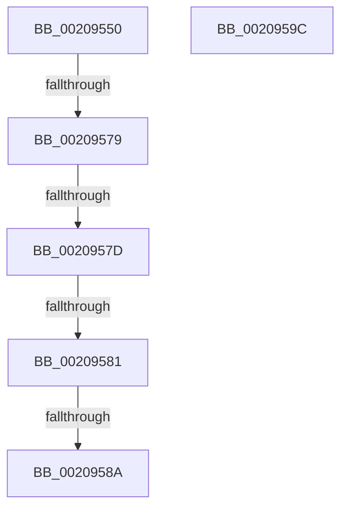

# KeDelayExecutionThread

- RVA: `0x00209550`–`0x0020959D` (길이 `77` bytes)
- VA: `0x0000000140209550`
- 실행 섹션: `.text`
- PDB 이름 있음: `예`; PDB Function 태그: `예`
- unwind 정보 RVA: `0x0005D5F8`
- 디코드: `27`개 명령, `77/77` bytes 표시
- 미해석 바이트: `0` (있으면 어셈블리에 `.byte`로 보존)

> 이 문서는 커널 이미지의 기계어와 PDB 기호를 분석해 생성했습니다. 4번과 5번은 함수 원형과 자료형을 바이너리 사용 방식에서 추정한 C 해석이며 원본 소스 복구 결과는 아닙니다.

## 1. Dependencies

- 직접 호출 지점: **1**; 고유 호출 대상: **1**
- 직접 호출자로 확인된 함수: **87**
- RIP 상대 이미지 참조: **0**

### Outgoing calls
- `0x0020958C` → [KeYieldExecution](KeYieldExecution_function_00209FA0.md) (function, `0x00209FA0`)

### Direct callers
- [sub_00206D40](Unknown_function_00206D40.md) at `0x00206D4C`
- [sub_002072CB](Unknown_function_002072CB.md) at `0x00207385`
- [MmFlushSection](../23/MmFlushSection_function_002375E4.md) at `0x0023786C`
- [PopAllocateIrp](../27/PopAllocateIrp_function_0027116C.md) at `0x002715BE`
- [PopAllocateIrp](../27/PopAllocateIrp_function_0027116C.md) at `0x002715DF`
- [MiDelayFaultingThread](../2A/MiDelayFaultingThread_function_002A3054.md) at `0x002A30E4`
- [MiCheckSystemTrimEndCriteria](../34/MiCheckSystemTrimEndCriteria_function_0034EDC8.md) at `0x0034EEA5`
- [MiWalkEntireImage](../36/MiWalkEntireImage_function_00365D70.md) at `0x00366C2D`
- [MiGatherPagefilePages](../37/MiGatherPagefilePages_function_00372B08.md) at `0x003734E2`
- [CcCanIWrite](../38/CcCanIWrite_function_00388250.md) at `0x0038850A`
- [CcPurgeCacheSection](../38/CcPurgeCacheSection_function_0038B130.md) at `0x0038B409`
- [MiFlushAllStoreSwapPages](../3B/MiFlushAllStoreSwapPages_function_003BC890.md) at `0x003BC941`
- [MiFlushAllPagesWorker](../3B/MiFlushAllPagesWorker_function_003BCED4.md) at `0x003BCF95`
- [CcMapAndCopyInToCache](../3C/CcMapAndCopyInToCache_function_003CA7F0.md) at `0x003CB37A`
- [CcInitializeCacheMapInternal](../3C/CcInitializeCacheMapInternal_function_003CC720.md) at `0x003CD2FC`
- [CcDeletePrivateVolumeCacheMap](../3C/CcDeletePrivateVolumeCacheMap_function_003CE950.md) at `0x003CEA4E`
- [ExpExpandResourceOwnerTable](../3D/ExpExpandResourceOwnerTable_function_003D489C.md) at `0x003D49B9`
- [MiAllocatePagesForMdl](../3E/MiAllocatePagesForMdl_function_003EABEC.md) at `0x003EAD48`
- [MiFlushSection](../40/MiFlushSection_function_004036B0.md) at `0x0040447B`
- [MiFlushSection](../40/MiFlushSection_function_004036B0.md) at `0x004045AF`
- [MiGatherMappedPages](../40/MiGatherMappedPages_function_00404E80.md) at `0x00404EEC`
- [MiCreateSystemSection](../45/MiCreateSystemSection_function_00453158.md) at `0x00453283`
- [FsRtlCreateSectionForDataScan](../45/FsRtlCreateSectionForDataScan_function_00453330.md) at `0x00453551`
- [MiDeleteEmptySubsectionProtoPool](../48/MiDeleteEmptySubsectionProtoPool_function_004842B8.md) at `0x00484301`
- [IopKeepAliveWorker](../49/IopKeepAliveWorker_function_00494FD0.md) at `0x004950B8`
- [MiFlushAllFilesystemPages](../4E/MiFlushAllFilesystemPages_function_004E141C.md) at `0x004E14F8`
- [CcWaitForCurrentLazyWriterActivityOnNode](../57/CcWaitForCurrentLazyWriterActivityOnNode_function_0057C618.md) at `0x0057C780`
- [CcErrorCallbackRoutine](../57/CcErrorCallbackRoutine_function_0057C9D0.md) at `0x0057CA02`
- [CcDeletePartition](../57/CcDeletePartition_function_0057DE9C.md) at `0x0057DFDC`
- [CcDeleteSectionsForPartition](../57/CcDeleteSectionsForPartition_function_0057E0F8.md) at `0x0057E1F7`
- [InbvRotateGuiBootDisplay](../59/InbvRotateGuiBootDisplay_function_00590680.md) at `0x00590696`
- [PnpBootDeviceWait](../5A/PnpBootDeviceWait_function_005A4D68.md) at `0x005A4E6A`
- [KasaniTelemetryThread](../5A/KasaniTelemetryThread_function_005ABEC0.md) at `0x005ABED6`
- [KcsaniTelemetryThread](../5B/KcsaniTelemetryThread_function_005B0410.md) at `0x005B0426`
- [ST_STORE&lt;SM_TRAITS&gt;::StNpLeafPageIn](../60/ST_STORE_SM_TRAITS_StNpLeafPageIn_function_0060E610.md) at `0x0060E692`
- [MdlInvariantPostProcessing1](../61/MdlInvariantPostProcessing1_function_00613AE0.md) at `0x00613C7D`
- [DifKeDelayExecutionThreadWrapper](../62/DifKeDelayExecutionThreadWrapper_function_0062F0F0.md) at `0x0062F1D7`
- [ExpPrmWaitForForZeroActiveCount](../65/ExpPrmWaitForForZeroActiveCount_function_00659850.md) at `0x00659868`
- [MiReadPagefilePage](../66/MiReadPagefilePage_function_0066F78C.md) at `0x0066FA64`
- [MiMarkHugePfnBad](../67/MiMarkHugePfnBad_function_00676744.md) at `0x00676B40`
- [MiDeleteCachedEntries](../67/MiDeleteCachedEntries_function_00677A28.md) at `0x00677BA2`
- [sub_0069B640](../69/Unknown_function_0069B640.md) at `0x0069B9BF`
- [sub_0069B640](../69/Unknown_function_0069B640.md) at `0x0069BA02`
- [IpmiLibpDelay](../6A/IpmiLibpDelay_function_006A6E04.md) at `0x006A6E30`
- [sub_006D715C](../6D/Unknown_function_006D715C.md) at `0x006D71C7`
- [sub_006EC370](../6E/Unknown_function_006EC370.md) at `0x006EC37B`
- [sub_006EEE68](../6E/Unknown_function_006EEE68.md) at `0x006EEE71`
- [ExpWatchProductTypeWork](../../page/6F/ExpWatchProductTypeWork_function_006FFCA0.md) at `0x006FFDCD`
- [ExpWatchProductTypeWork](../../page/6F/ExpWatchProductTypeWork_function_006FFCA0.md) at `0x006FFE81`
- [ExpWatchProductTypeWork](../../page/6F/ExpWatchProductTypeWork_function_006FFCA0.md) at `0x00700065`
- [ExpWatchProductTypeWork](../../page/6F/ExpWatchProductTypeWork_function_006FFCA0.md) at `0x00700122`
- [ExpWatchProductTypeWork](../../page/6F/ExpWatchProductTypeWork_function_006FFCA0.md) at `0x0070023A`
- [sub_00703ECC](../../page/70/Unknown_function_00703ECC.md) at `0x00703F66`
- [PipSendQueryRemoveIrpAndCheckOpenHandles](../../page/74/PipSendQueryRemoveIrpAndCheckOpenHandles_function_007443E8.md) at `0x007444D7`
- [PoShutdownBugCheck](../../page/75/PoShutdownBugCheck_function_0075E580.md) at `0x0075E5C7`
- [ExpNodeHotAddProcessorWorker](../../page/7C/ExpNodeHotAddProcessorWorker_function_007CF820.md) at `0x007CF873`
- [WheaRemoveErrorSource](../../page/7D/WheaRemoveErrorSource_function_007D6C70.md) at `0x007D6D8E`
- [CmSetValueKey](../../page/84/CmSetValueKey_function_008457C0.md) at `0x008466D9`
- [CmpInitCmRM](../../page/87/CmpInitCmRM_function_0087C700.md) at `0x0087C819`
- [CmpInitCmRM](../../page/87/CmpInitCmRM_function_0087C700.md) at `0x0087C865`
- [NtDelayExecution](../../page/89/NtDelayExecution_function_00899EE0.md) at `0x00899F39`
- [MiCreateSectionCommon](../../page/8A/MiCreateSectionCommon_function_008A9AA4.md) at `0x008A9CC1`
- [PfpOpenHandleCreate](../../page/8A/PfpOpenHandleCreate_function_008A9EDC.md) at `0x008AA050`
- [MmManagePartitionMemoryInformation](../../page/90/MmManagePartitionMemoryInformation_function_0090343C.md) at `0x009037AB`
- [MmManagePartitionMemoryInformation](../../page/90/MmManagePartitionMemoryInformation_function_0090343C.md) at `0x009037D6`
- [PspExitThread](../../page/90/PspExitThread_function_00905F60.md) at `0x009065C9`
- [PspExitThread](../../page/90/PspExitThread_function_00905F60.md) at `0x0090676F`
- [IoCancelThreadIo](../../page/90/IoCancelThreadIo_function_00906830.md) at `0x00906937`
- [MmGetSystemRoutineAddress](../../page/90/MmGetSystemRoutineAddress_function_0090EFE0.md) at `0x0090F016`
- [NtCreateJobObject](../../page/91/NtCreateJobObject_function_009177E0.md) at `0x00917B64`
- [CmpRetryBackOff](../../page/94/CmpRetryBackOff_function_0094B474.md) at `0x0094B496`
- [PnpCompleteDeviceEvent](../../page/95/PnpCompleteDeviceEvent_function_00955548.md) at `0x00955654`
- [PfTLoggingWorker](../../page/97/PfTLoggingWorker_function_0097B140.md) at `0x0097B371`
- [PfTLoggingWorker](../../page/97/PfTLoggingWorker_function_0097B140.md) at `0x0097B3A9`
- [CmpTransMgrCommit](../../page/9A/CmpTransMgrCommit_function_009AE8AC.md) at `0x009AE9C6`
- [CmUnloadKey](../../page/9A/CmUnloadKey_function_009AF2FC.md) at `0x009AF6E3`
- [EtwpWaitForBufferReferenceCount](../../page/9B/EtwpWaitForBufferReferenceCount_function_009BDEC0.md) at `0x009BDEE2`
- [MmFlushVirtualMemory](../../page/9D/MmFlushVirtualMemory_function_009D6F5C.md) at `0x009D724A`
- [NtCancelIoFile](../../page/9E/NtCancelIoFile_function_009E93E0.md) at `0x009E9538`
- [PopAcquireAdaptiveLock](../../page/A3/PopAcquireAdaptiveLock_function_00A3B0E8.md) at `0x00A3B171`
- [PopPolicyWorkerNotify](../../page/A6/PopPolicyWorkerNotify_function_00A6C6C0.md) at `0x00A6C734`
- [NtNotifyChangeSession](../../page/A7/NtNotifyChangeSession_function_00A7E630.md) at `0x00A7E88F`
- [IopCancelAlertedRequest](../../page/A9/IopCancelAlertedRequest_function_00A948F8.md) at `0x00A9497D`
- [CmFcpConnectToAlpcServer](../../page/A9/CmFcpConnectToAlpcServer_function_00A969A8.md) at `0x00A96B54`
- [MmCreateSpecialImageSection](../../page/AB/MmCreateSpecialImageSection_function_00AB7360.md) at `0x00AB744A`
- [CmpUuidCreate](../../page/AB/CmpUuidCreate_function_00AB81F8.md) at `0x00AB8229`
- [MiGetReadyInPageBlock](../../page/AB/MiGetReadyInPageBlock_function_00ABB398.md) at `0x00ABB3DF`
- [IopFreeBandwidthContract](../../page/AD/IopFreeBandwidthContract_function_00ADC7B4.md) at `0x00ADC917`
- [NtSetInformationProcess](../../page/AE/NtSetInformationProcess_function_00AE5370.md) at `0x00AE6103`
- [sub_00B269B8](../../page/B2/Unknown_function_00B269B8.md) at `0x00B269C1`
- [sub_00B29CFA](../../page/B2/Unknown_function_00B29CFA.md) at `0x00B29D38`
- [sub_00B344A6](../../page/B3/Unknown_function_00B344A6.md) at `0x00B34515`
- [sub_00B346BA](../../page/B3/Unknown_function_00B346BA.md) at `0x00B346D5`
- [sub_00B80364](../../pagelk/B8/Unknown_function_00B80364.md) at `0x00B804BE`
- [sub_00B80364](../../pagelk/B8/Unknown_function_00B80364.md) at `0x00B8051D`
- [ViThunkHookExportAddress](../../pagevrfy/BA/ViThunkHookExportAddress_function_00BA78E8.md) at `0x00BA7947`
- [HdlspPutMore](../../pagehdls/BB/HdlspPutMore_function_00BBE214.md) at `0x00BBE277`
- [PiCreateDriverDataDirectoryRoot](../../init/C3/PiCreateDriverDataDirectoryRoot_function_00C329A8.md) at `0x00C32AC1`
- [StartFirstUserProcess](../../init/C7/StartFirstUserProcess_function_00C70848.md) at `0x00C70AE2`

### Static image references
- 디코드된 RIP-relative 메모리 참조가 없습니다.

## 2. Other-region calls and transfers

- 다른 실행 섹션으로 향하는 call: **0**
- call이 아닌 외부 분기/꼬리 이동: **4**
  - `0x00209577` → [sub_0020959D](Unknown_function_0020959D.md) (`tail-transfer`)
  - `0x0020957B` → [sub_0020959D](Unknown_function_0020959D.md) (`tail-transfer`)
  - `0x0020957F` → [sub_0020959D](Unknown_function_0020959D.md) (`tail-transfer`)
  - `0x00209588` → [sub_0020959D](Unknown_function_0020959D.md) (`tail-transfer`)

## 3. Assembly (complete function range)

```asm
00209550  4C 89 44 24 18                  mov qword ptr [rsp + 0x18], r8
00209555  55                              push rbp
00209556  57                              push rdi
00209557  41 54                           push r12
00209559  41 56                           push r14
0020955B  48 83 EC 78                     sub rsp, 0x78
0020955F  65 48 8B 3C 25 88 01 00 00      mov rdi, qword ptr gs:[0x188]
00209568  4D 8B E0                        mov r12, r8
0020956B  49 83 38 00                     cmp qword ptr [r8], 0
0020956F  44 0F B6 F2                     movzx r14d, dl
00209573  48 0F BE E9                     movsx rbp, cl
00209577  75 24                           jne 0x14020959d
00209579  84 C9                           test cl, cl
0020957B  74 20                           je 0x14020959d
0020957D  84 D2                           test dl, dl
0020957F  75 1C                           jne 0x14020959d
00209581  F6 87 C2 00 00 00 02            test byte ptr [rdi + 0xc2], 2
00209588  75 13                           jne 0x14020959d
0020958A  33 C9                           xor ecx, ecx
0020958C  E8 0F 0A 00 00                  call 0x140209fa0
00209591  48 83 C4 78                     add rsp, 0x78
00209595  41 5E                           pop r14
00209597  41 5C                           pop r12
00209599  5F                              pop rdi
0020959A  5D                              pop rbp
0020959B  C3                              ret
0020959C  CC                              int3
```

## 4. C-style interpretation (structured pseudocode)

```c
__int64 __fastcall KeDelayExecutionThread(int a1, unsigned __int8 a2, __int64 a3)
{
    __int64 result;
    __int64 v_rsp;
    unsigned __int64 v_stack_p18;

    v_stack_p18 = a3;
    v_rsp = (v_rsp) - (120);
    a1 = 0;
    result = KeYieldExecution(a1, a2, a3, a4);
    v_rsp = (v_rsp) + (120);
    return result;
}
```

## 5. (Beta) C Style

```c
int64_t KeDelayExecutionThread(int32_t WaitMode, uint8_t Alertable, void *Interval)
{
    uint8_t *interval = (uint8_t *)Interval;

    int64_t result;
    int64_t local_rsp;
    uint64_t v_stack_p18;

    v_stack_p18 = Interval;
    local_rsp = (local_rsp) - (120);
    WaitMode = 0;
    result = KeYieldExecution(WaitMode, Alertable, Interval, a4);
    local_rsp = (local_rsp) + (120);
    return result;
}
```

### 관측된 메모리 오프셋

구조체 형식이 확인되지 않은 접근은 인자 기준의 오프셋으로만 기록했습니다.

| 기준 인자 | 오프셋 표현 | 폭 (bit) | 접근 |
|---|---:|---:|---|
| `Interval` | `+ 0x0` | `64` | `R` |

## 6. Execution-region graph

[열기: 2D/3D 그래프와 함수 탐색 컨트롤 패널](../../../control-panel.html?section=text&rva=0x00209550&view=graph)

- 2D 그래프는 위에서 아래로 흐르고, 3D 그래프는 빈 공간을 드래그해 회전합니다. Shift+드래그는 이동, 휠은 확대·축소, 함수 노드 선택은 대상 보고서 이동입니다.

### Static fallback


