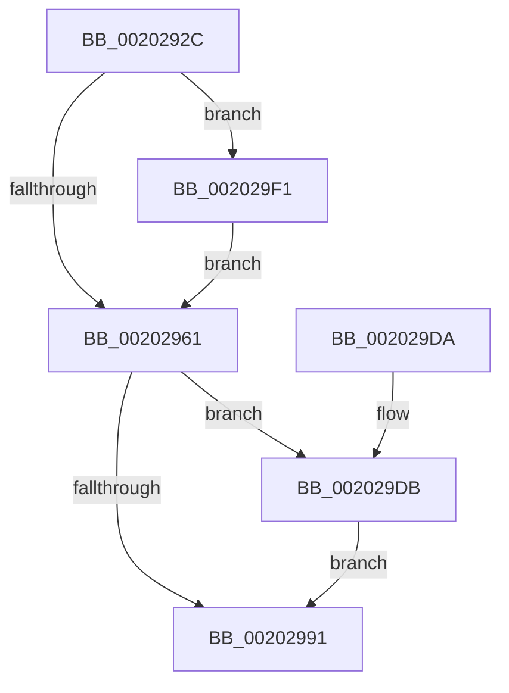

# KeForceResumeThread

- RVA: `0x0020292C`–`0x002029FE` (길이 `210` bytes)
- VA: `0x000000014020292C`
- 실행 섹션: `.text`
- PDB 이름 있음: `예`; PDB Function 태그: `아니요`
- unwind 정보 RVA: `0x0005C988`
- 디코드: `52`개 명령, `210/210` bytes 표시
- 미해석 바이트: `0` (있으면 어셈블리에 `.byte`로 보존)

> 이 문서는 커널 이미지의 기계어와 PDB 기호를 분석해 생성했습니다. 4번과 5번은 함수 원형과 자료형을 바이너리 사용 방식에서 추정한 C 해석이며 원본 소스 복구 결과는 아닙니다.

## 1. Dependencies

- 직접 호출 지점: **4**; 고유 호출 대상: **4**
- 직접 호출자로 확인된 함수: **4**
- RIP 상대 이미지 참조: **1**

### Outgoing calls
- `0x00202974` → [KiAcquireKobjectLockSafe](../25/KiAcquireKobjectLockSafe_function_00251C90.md) (function, `0x00251C90`)
- `0x0020299A` → [KiResumeThread](KiResumeThread_function_00203644.md) (function, `0x00203644`)
- `0x002029B8` → [KiExitDispatcher](../25/KiExitDispatcher_function_00251CF0.md) (function, `0x00251CF0`)
- `0x002029F4` → [KiRaiseIrqlProcessIrqlFlags](../4F/KiRaiseIrqlProcessIrqlFlags_function_004F56FC.md) (function, `0x004F56FC`)

### Direct callers
- [KeRequestTerminationThread](../48/KeRequestTerminationThread_function_00489A58.md) at `0x00489B16`
- [KeRundownApcQueues](../../page/90/KeRundownApcQueues_function_00905C44.md) at `0x00905C6B`
- [PspInsertThread](../../page/9F/PspInsertThread_function_009F0314.md) at `0x009F08E3`
- [PspInsertThread](../../page/9F/PspInsertThread_function_009F0314.md) at `0x009F0AC7`
- [PspInsertThread](../../page/9F/PspInsertThread_function_009F0314.md) at `0x009F0CD3`
- [NtTerminateProcess](../../page/AE/NtTerminateProcess_function_00AEC320.md) at `0x00AEC577`

### Static image references
- `0x00202954` → RVA `0x00FC6D20` (`ALMOSTRO`; read)

## 2. Other-region calls and transfers

- 다른 실행 섹션으로 향하는 call: **0**
- 별도 외부 분기/꼬리 이동을 확인하지 못했습니다.

## 3. Assembly (complete function range)

```asm
0020292C  48 89 5C 24 08                  mov qword ptr [rsp + 8], rbx
00202931  48 89 6C 24 10                  mov qword ptr [rsp + 0x10], rbp
00202936  48 89 74 24 18                  mov qword ptr [rsp + 0x18], rsi
0020293B  57                              push rdi
0020293C  41 56                           push r14
0020293E  41 57                           push r15
00202940  48 83 EC 30                     sub rsp, 0x30
00202944  48 8B D9                        mov rbx, rcx
00202947  44 0F 20 C7                     mov rdi, cr8
0020294B  BA 02 00 00 00                  mov edx, 2
00202950  44 0F 22 C2                     mov cr8, rdx
00202954  83 3D C5 43 DC 00 00            cmp dword ptr [rip + 0xdc43c5], 0
0020295B  0F 85 90 00 00 00               jne 0x1402029f1
00202961  65 4C 8B 34 25 20 00 00 00      mov r14, qword ptr gs:[0x20]
0020296A  48 8D AB E0 02 00 00            lea rbp, [rbx + 0x2e0]
00202971  48 8B CD                        mov rcx, rbp
00202974  E8 17 F3 04 00                  call 0x140251c90
00202979  8B 73 78                        mov esi, dword ptr [rbx + 0x78]
0020297C  44 0F BE BB 84 02 00 00         movsx r15d, byte ptr [rbx + 0x284]
00202984  C1 EE 0E                        shr esi, 0xe
00202987  83 E6 01                        and esi, 1
0020298A  8B C6                           mov eax, esi
0020298C  41 0B C7                        or eax, r15d
0020298F  75 4A                           jne 0x1402029db
00202991  41 B0 01                        mov r8b, 1
00202994  49 8B D6                        mov rdx, r14
00202997  48 8B CB                        mov rcx, rbx
0020299A  E8 A5 0C 00 00                  call 0x140203644
0020299F  F0 81 65 00 7F FF FF FF         lock and dword ptr [rbp], 0xffffff7f
002029A7  45 33 C9                        xor r9d, r9d
002029AA  40 88 7C 24 20                  mov byte ptr [rsp + 0x20], dil
002029AF  33 D2                           xor edx, edx
002029B1  49 8B CE                        mov rcx, r14
002029B4  45 8D 41 01                     lea r8d, [r9 + 1]
002029B8  E8 33 F3 04 00                  call 0x140251cf0
002029BD  48 8B 5C 24 50                  mov rbx, qword ptr [rsp + 0x50]
002029C2  42 8D 04 3E                     lea eax, [rsi + r15]
002029C6  48 8B 74 24 60                  mov rsi, qword ptr [rsp + 0x60]
002029CB  48 8B 6C 24 58                  mov rbp, qword ptr [rsp + 0x58]
002029D0  48 83 C4 30                     add rsp, 0x30
002029D4  41 5F                           pop r15
002029D6  41 5E                           pop r14
002029D8  5F                              pop rdi
002029D9  C3                              ret
002029DA  CC                              int3
002029DB  80 A3 1A 03 00 00 F9            and byte ptr [rbx + 0x31a], 0xf9
002029E2  C6 83 84 02 00 00 00            mov byte ptr [rbx + 0x284], 0
002029E9  F0 0F BA 73 78 0E               lock btr dword ptr [rbx + 0x78], 0xe
002029EF  EB A0                           jmp 0x140202991
002029F1  40 8A CF                        mov cl, dil
002029F4  E8 03 2D 2F 00                  call 0x1404f56fc
002029F9  E9 63 FF FF FF                  jmp 0x140202961
```

## 4. C-style interpretation (structured pseudocode)

```c
__int64 __fastcall KeForceResumeThread(__int64 a1, __int64 a2, __int64 a3, int a4)
{
    __int64 result;
    __int64 v_rsi;
    __int64 v_rsp;
    unsigned __int8 v_stack_m28;
    unsigned __int64 v_stack_p10;
    unsigned __int64 v_stack_p18;
    unsigned __int64 v_stack_p8;

    v_stack_p8 = v_rbx;
    v_stack_p10 = v_rbp;
    v_stack_p18 = v_rsi;
    v_rsp = (v_rsp) - (48);
    if ((*(unsigned int *)(v_rip + 14435269)) != 0) goto loc_002029F1;
loc_00202961:
    result = KiAcquireKobjectLockSafe(a1 + 736, 2, a3, a4);
    v_rsi = (unsigned int)(((unsigned int)(*(unsigned int *)(a1 + 120))) >> (14));
    v_rsi = (unsigned int)((v_rsi) & (1));
    result = (unsigned int)(((unsigned int)((unsigned int)(v_rsi))) | ((unsigned int)((__int8)(*(unsigned __int8 *)(a1 + 644)))));
    if (condition_is_not_equal) goto loc_002029DB;
loc_00202991:
    result = KiResumeThread(a1, *(unsigned __int64 *)(gs_base + (0 + 32)), 1, a4);
    a4 = 0;
    v_stack_m28 = (unsigned __int8)(v_cr8);
    a2 = 0;
    result = KiExitDispatcher(*(unsigned __int64 *)(gs_base + (0 + 32)), a2, a4 + 1, a4);
    v_rsp = (v_rsp) + (48);
    return v_rsi + (__int8)(*(unsigned __int8 *)(a1 + 644)) * 1;
loc_002029DB:
    *(unsigned __int8 *)(v_stack_p8 + 644) = 0;
    goto loc_00202991;
loc_002029F1:
    result = KiRaiseIrqlProcessIrqlFlags((unsigned __int8)(v_cr8), a2, a4 + 1, a4);
    goto loc_00202961;
}
```

## 5. (Beta) C Style

```c
int64_t KeForceResumeThread(void *Arg1, int64_t Arg2, int64_t Arg3, int32_t Arg4)
{
    uint8_t *arg1 = (uint8_t *)Arg1;

    int64_t result;
    int64_t local_rsi;
    int64_t local_rsp;
    uint8_t v_stack_m28;
    uint64_t v_stack_p10;
    uint64_t v_stack_p18;
    uint64_t v_stack_p8;

    v_stack_p8 = local_rbx;
    v_stack_p10 = local_rbp;
    v_stack_p18 = local_rsi;
    local_rsp = (local_rsp) - (48);
    if ((*(uint32_t *)(v_rip + 0xDC43C5)) != 0) goto loc_002029F1;
loc_00202961:
    result = KiAcquireKobjectLockSafe(Arg1 + 736, 2, Arg3, Arg4);
    local_rsi = (uint32_t)(((uint32_t)(*(uint32_t *)(arg1 + 0x78))) >> (14));
    local_rsi = (uint32_t)((local_rsi) & (1));
    result = (uint32_t)(((uint32_t)((uint32_t)(local_rsi))) | ((uint32_t)((int8_t)(*(uint8_t *)(arg1 + 0x284)))));
    if (condition_is_not_equal) goto loc_002029DB;
loc_00202991:
    result = KiResumeThread(Arg1, *(uint64_t *)(gs_base + (0 + 0x20)), 1, Arg4);
    Arg4 = 0;
    v_stack_m28 = (uint8_t)(v_cr8);
    Arg2 = 0;
    result = KiExitDispatcher(*(uint64_t *)(gs_base + (0 + 0x20)), Arg2, Arg4 + 1, Arg4);
    local_rsp = (local_rsp) + (48);
    return local_rsi + (int8_t)(*(uint8_t *)(arg1 + 0x284)) * 1;
loc_002029DB:
    *(uint8_t *)(v_stack_p8 + 0x284) = 0;
    goto loc_00202991;
loc_002029F1:
    result = KiRaiseIrqlProcessIrqlFlags((uint8_t)(v_cr8), Arg2, Arg4 + 1, Arg4);
    goto loc_00202961;
}
```

### 관측된 메모리 오프셋

구조체 형식이 확인되지 않은 접근은 인자 기준의 오프셋으로만 기록했습니다.

| 기준 인자 | 오프셋 표현 | 폭 (bit) | 접근 |
|---|---:|---:|---|
| `Arg1` | `+ 0x0` | `32` | `R/W` |
| `Arg1` | `+ 0x78` | `32` | `R` |
| `Arg1` | `+ 0x78` | `32` | `R/W` |
| `Arg1` | `+ 0x284` | `8` | `R` |
| `Arg1` | `+ 0x284` | `8` | `W` |
| `Arg1` | `+ 0x2E0` | `64` | `R` |
| `Arg1` | `+ 0x31A` | `8` | `R/W` |

## 6. Execution-region graph

[열기: 2D/3D 그래프와 함수 탐색 컨트롤 패널](../../../control-panel.html?section=text&rva=0x0020292C&view=graph)

- 2D 그래프는 위에서 아래로 흐르고, 3D 그래프는 빈 공간을 드래그해 회전합니다. Shift+드래그는 이동, 휠은 확대·축소, 함수 노드 선택은 대상 보고서 이동입니다.

### Static fallback


