# KeInsertQueueApc

- RVA: `0x00203F10`–`0x002041E5` (길이 `725` bytes)
- VA: `0x0000000140203F10`
- 실행 섹션: `.text`
- PDB 이름 있음: `예`; PDB Function 태그: `아니요`
- unwind 정보 RVA: `0x0005CB08`
- 디코드: `174`개 명령, `725/725` bytes 표시
- 미해석 바이트: `0` (있으면 어셈블리에 `.byte`로 보존)

> 이 문서는 커널 이미지의 기계어와 PDB 기호를 분석해 생성했습니다. 4번과 5번은 함수 원형과 자료형을 바이너리 사용 방식에서 추정한 C 해석이며 원본 소스 복구 결과는 아닙니다.

## 1. Dependencies

- 직접 호출 지점: **9**; 고유 호출 대상: **9**
- 직접 호출자로 확인된 함수: **28**
- RIP 상대 이미지 참조: **5**

### Outgoing calls
- `0x0020406C` → [KiInsertQueueApc](KiInsertQueueApc_function_002041F0.md) (function, `0x002041F0`)
- `0x0020407E` → [KiSignalThreadForApc](KiSignalThreadForApc_function_00204360.md) (function, `0x00204360`)
- `0x0020409F` → [KiExitDispatcher](../25/KiExitDispatcher_function_00251CF0.md) (function, `0x00251CF0`)
- `0x002040E8` → [ObfReferenceObjectWithTag](../21/ObfReferenceObjectWithTag_function_00210710.md) (function, `0x00210710`)
- `0x002040F9` → [KiRaiseIrqlProcessIrqlFlags](../4F/KiRaiseIrqlProcessIrqlFlags_function_004F56FC.md) (function, `0x004F56FC`)
- `0x00204121` → [KiCheckVpBackingLongSpinWaitHypercall](../30/KiCheckVpBackingLongSpinWaitHypercall_function_0030F490.md) (function, `0x0030F490`)
- `0x00204130` → [HvlNotifyLongSpinWait](../30/HvlNotifyLongSpinWait_function_0030F460.md) (function, `0x0030F460`)
- `0x002041CE` → [EtwTiLogInsertQueueUserApc](../3B/EtwTiLogInsertQueueUserApc_function_003B8FC4.md) (function, `0x003B8FC4`)
- `0x002041DB` → [ObfDereferenceObjectWithTag](../2F/ObfDereferenceObjectWithTag_function_002F78E0.md) (function, `0x002F78E0`)

### Direct callers
- [EtwpQueueApc](EtwpQueueApc_function_00203B7C.md) at `0x00203D03`
- [MiStoreModifiedWriteDereference](MiStoreModifiedWriteDereference_function_00203E94.md) at `0x00203EFC`
- [IopCompleteRequest](IopCompleteRequest_function_0020AF50.md) at `0x0020B2A1`
- [IopfCompleteRequest](../29/IopfCompleteRequest_function_0029B5F8.md) at `0x0029B9E3`
- [IopfCompleteRequest](../29/IopfCompleteRequest_function_0029B5F8.md) at `0x0029BD01`
- [MiTrimUnusedPageFileRegionsWorker](../2A/MiTrimUnusedPageFileRegionsWorker_function_002AA320.md) at `0x002AA55D`
- [MiStoreAttemptContractPageFile](../3A/MiStoreAttemptContractPageFile_function_003A4584.md) at `0x003A465D`
- [MiAttemptPageFileReduction](../48/MiAttemptPageFileReduction_function_004813E4.md) at `0x004814F6`
- [ExpTimerDpcRoutine](../4A/ExpTimerDpcRoutine_function_004A1570.md) at `0x004A15F3`
- [EtwpTraceThreadRundownWithStack](../4A/EtwpTraceThreadRundownWithStack_function_004AB5A0.md) at `0x004AB6AB`
- [MiQueueSyncModifiedWriterApc](../4B/MiQueueSyncModifiedWriterApc_function_004B70B8.md) at `0x004B710B`
- [IoRaiseInformationalHardError](../4B/IoRaiseInformationalHardError_function_004B82B0.md) at `0x004B83CA`
- [IopCopyCompleteReadIrp](../4E/IopCopyCompleteReadIrp_function_004E83F0.md) at `0x004E859B`
- [IopCopyCompleteReadIrp](../4E/IopCopyCompleteReadIrp_function_004E83F0.md) at `0x004E8647`
- [EtwpCovSampCaptureQueueApc](../65/EtwpCovSampCaptureQueueApc_function_00653CF0.md) at `0x00653E89`
- [UcOnUnexpectedCodePath](../69/UcOnUnexpectedCodePath_function_0069AED0.md) at `0x0069B0A7`
- [sub_006D6A04](../6D/Unknown_function_006D6A04.md) at `0x006D6A68`
- [DbgkpLkmdLaunchSnapApc](../../page/71/DbgkpLkmdLaunchSnapApc_function_00711844.md) at `0x007118EC`
- [PsUpdateSvmProcessPasidAllThreads](../../page/78/PsUpdateSvmProcessPasidAllThreads_function_00781404.md) at `0x0078154F`
- [PspEnableProcessOptionalXStateFeatures](../../page/78/PspEnableProcessOptionalXStateFeatures_function_00781EF0.md) at `0x00782212`
- [CmpPostNotify](../../page/86/CmpPostNotify_function_008645D8.md) at `0x0086492D`
- [IopCancelIrpsInThreadList](../../page/8C/IopCancelIrpsInThreadList_function_008C9E18.md) at `0x008C9E9F`
- [IopCancelIrpsInThreadList](../../page/8C/IopCancelIrpsInThreadList_function_008C9E18.md) at `0x008C9F1E`
- [PspSetContextThreadInternal](../../page/8D/PspSetContextThreadInternal_function_008D4420.md) at `0x008D46DF`
- [PspGetContextThreadInternal](../../page/8D/PspGetContextThreadInternal_function_008D4770.md) at `0x008D4958`
- [NtQueueApcThreadEx2](../../page/9F/NtQueueApcThreadEx2_function_009FE980.md) at `0x009FEAD8`
- [PerfLogImageUnload](../../page/A2/PerfLogImageUnload_function_00A2216C.md) at `0x00A2230A`
- [ExSwapinWorkerThreads](../../page/A6/ExSwapinWorkerThreads_function_00A68C40.md) at `0x00A68D62`
- [KeSpecialUserApcKernelRoutine](../../page/AA/KeSpecialUserApcKernelRoutine_function_00AADF90.md) at `0x00AAE008`
- [sub_00B39158](../../page/B3/Unknown_function_00B39158.md) at `0x00B39201`
- [sub_00B3E0C2](../../page/B3/Unknown_function_00B3E0C2.md) at `0x00B3E108`

### Static image references
- `0x00203F2E` → RVA `0x00EFFA30` (`.data`; read)
- `0x00203F90` → RVA `0x00AADF90` (`KeSpecialUserApcKernelRoutine`; read)
- `0x00203FFA` → RVA `0x00FC6D20` (`ALMOSTRO`; read)
- `0x0020401D` → RVA `0x00FC52AC` (`ALMOSTRO`; reference)
- `0x00204113` → RVA `0x00FC6AB8` (`ALMOSTRO`; read)

## 2. Other-region calls and transfers

- 다른 실행 섹션으로 향하는 call: **0**
- 별도 외부 분기/꼬리 이동을 확인하지 못했습니다.

## 3. Assembly (complete function range)

```asm
00203F10  48 89 5C 24 20                  mov qword ptr [rsp + 0x20], rbx
00203F15  4C 89 44 24 18                  mov qword ptr [rsp + 0x18], r8
00203F1A  48 89 54 24 10                  mov qword ptr [rsp + 0x10], rdx
00203F1F  55                              push rbp
00203F20  56                              push rsi
00203F21  57                              push rdi
00203F22  41 54                           push r12
00203F24  41 55                           push r13
00203F26  41 56                           push r14
00203F28  41 57                           push r15
00203F2A  48 83 EC 50                     sub rsp, 0x50
00203F2E  4C 8B 15 FB BA CF 00            mov r10, qword ptr [rip + 0xcfbafb]
00203F35  45 8B E1                        mov r12d, r9d
00203F38  48 8B F9                        mov rdi, rcx
00203F3B  4D 85 D2                        test r10, r10
00203F3E  74 24                           je 0x140203f64
00203F40  49 8B 4A 20                     mov rcx, qword ptr [r10 + 0x20]
00203F44  83 79 60 00                     cmp dword ptr [rcx + 0x60], 0
00203F48  74 0E                           je 0x140203f58
00203F4A  8B 41 68                        mov eax, dword ptr [rcx + 0x68]
00203F4D  8B 41 70                        mov eax, dword ptr [rcx + 0x70]
00203F50  48 A9 00 30 00 00               test rax, 0x3000
00203F56  75 11                           jne 0x140203f69
00203F58  66 41 83 7A 66 00               cmp word ptr [r10 + 0x66], 0
00203F5E  0F 85 D6 01 00 00               jne 0x14020413a
00203F64  45 32 D2                        xor r10b, r10b
00203F67  EB 14                           jmp 0x140203f7d
00203F69  48 8B 49 78                     mov rcx, qword ptr [rcx + 0x78]
00203F6D  48 8B C1                        mov rax, rcx
00203F70  25 00 30 00 00                  and eax, 0x3000
00203F75  48 3B C1                        cmp rax, rcx
00203F78  75 DE                           jne 0x140203f58
00203F7A  41 B2 01                        mov r10b, 1
00203F7D  48 8B 47 30                     mov rax, qword ptr [rdi + 0x30]
00203F81  0F B6 4F 51                     movzx ecx, byte ptr [rdi + 0x51]
00203F85  4C 8B 6F 38                     mov r13, qword ptr [rdi + 0x38]
00203F89  84 C9                           test cl, cl
00203F8B  48 89 44 24 40                  mov qword ptr [rsp + 0x40], rax
00203F90  48 8D 05 F9 9F 8A 00            lea rax, [rip + 0x8a9ff9]
00203F97  0F 95 84 24 90 00 00 00         setne byte ptr [rsp + 0x90]
00203F9F  48 39 47 20                     cmp qword ptr [rdi + 0x20], rax
00203FA3  0F 84 CB 01 00 00               je 0x140204174
00203FA9  48 8B 5F 08                     mov rbx, qword ptr [rdi + 8]
00203FAD  32 D2                           xor dl, dl
00203FAF  65 4C 8B 04 25 88 01 00 00      mov r8, qword ptr gs:[0x188]
00203FB8  84 C9                           test cl, cl
00203FBA  0F 85 0A 01 00 00               jne 0x1402040ca
00203FC0  48 8B 83 20 02 00 00            mov rax, qword ptr [rbx + 0x220]
00203FC7  49 39 80 B8 00 00 00            cmp qword ptr [r8 + 0xb8], rax
00203FCE  0F 95 C0                        setne al
00203FD1  45 84 D2                        test r10b, r10b
00203FD4  74 14                           je 0x140203fea
00203FD6  84 C0                           test al, al
00203FD8  74 10                           je 0x140203fea
00203FDA  84 C9                           test cl, cl
00203FDC  0F 85 FB 00 00 00               jne 0x1402040dd
00203FE2  84 D2                           test dl, dl
00203FE4  0F 85 F3 00 00 00               jne 0x1402040dd
00203FEA  40 32 ED                        xor bpl, bpl
00203FED  45 0F 20 C6                     mov r14, cr8
00203FF1  B8 02 00 00 00                  mov eax, 2
00203FF6  44 0F 22 C0                     mov cr8, rax
00203FFA  83 3D 1F 2D DC 00 00            cmp dword ptr [rip + 0xdc2d1f], 0
00204001  0F 85 EB 00 00 00               jne 0x1402040f2
00204007  65 4C 8B 3C 25 20 00 00 00      mov r15, qword ptr gs:[0x20]
00204010  33 F6                           xor esi, esi
00204012  F0 48 0F BA 6B 40 00            lock bts qword ptr [rbx + 0x40], 0
00204019  73 1B                           jae 0x140204036
0020401B  FF C6                           inc esi
0020401D  85 35 89 12 DC 00               test dword ptr [rip + 0xdc1289], esi
00204023  0F 84 EA 00 00 00               je 0x140204113
00204029  F3 90                           pause
0020402B  48 8B 43 40                     mov rax, qword ptr [rbx + 0x40]
0020402F  48 85 C0                        test rax, rax
00204032  74 DE                           je 0x140204012
00204034  EB E5                           jmp 0x14020401b
00204036  F7 43 74 00 40 00 00            test dword ptr [rbx + 0x74], 0x4000
0020403D  0F 84 C0 00 00 00               je 0x140204103
00204043  80 7F 52 00                     cmp byte ptr [rdi + 0x52], 0
00204047  0F 85 B6 00 00 00               jne 0x140204103
0020404D  48 8B 84 24 98 00 00 00         mov rax, qword ptr [rsp + 0x98]
00204055  48 8B CF                        mov rcx, rdi
00204058  48 8B B4 24 A0 00 00 00         mov rsi, qword ptr [rsp + 0xa0]
00204060  48 89 47 40                     mov qword ptr [rdi + 0x40], rax
00204064  48 89 77 48                     mov qword ptr [rdi + 0x48], rsi
00204068  C6 47 52 01                     mov byte ptr [rdi + 0x52], 1
0020406C  E8 7F 01 00 00                  call 0x1402041f0
00204071  45 33 C9                        xor r9d, r9d
00204074  45 0F B6 C6                     movzx r8d, r14b
00204078  48 8B D7                        mov rdx, rdi
0020407B  49 8B CF                        mov rcx, r15
0020407E  E8 DD 02 00 00                  call 0x140204360
00204083  40 B7 01                        mov dil, 1
00204086  33 D2                           xor edx, edx
00204088  48 C7 43 40 00 00 00 00         mov qword ptr [rbx + 0x40], 0
00204090  45 8B CC                        mov r9d, r12d
00204093  44 88 74 24 20                  mov byte ptr [rsp + 0x20], r14b
00204098  49 8B CF                        mov rcx, r15
0020409B  44 8D 42 01                     lea r8d, [rdx + 1]
0020409F  E8 4C DC 04 00                  call 0x140251cf0
002040A4  40 84 ED                        test bpl, bpl
002040A7  0F 85 E3 00 00 00               jne 0x140204190
002040AD  48 8B 9C 24 A8 00 00 00         mov rbx, qword ptr [rsp + 0xa8]
002040B5  40 0F B6 C7                     movzx eax, dil
002040B9  48 83 C4 50                     add rsp, 0x50
002040BD  41 5F                           pop r15
002040BF  41 5E                           pop r14
002040C1  41 5D                           pop r13
002040C3  41 5C                           pop r12
002040C5  5F                              pop rdi
002040C6  5E                              pop rsi
002040C7  5D                              pop rbp
002040C8  C3                              ret
002040C9  CC                              int3
002040CA  48 8B 83 20 02 00 00            mov rax, qword ptr [rbx + 0x220]
002040D1  49 39 80 20 02 00 00            cmp qword ptr [r8 + 0x220], rax
002040D8  E9 F1 FE FF FF                  jmp 0x140203fce
002040DD  BA 4B 65 49 51                  mov edx, 0x5149654b
002040E2  48 8B CB                        mov rcx, rbx
002040E5  40 B5 01                        mov bpl, 1
002040E8  E8 23 C6 00 00                  call 0x140210710
002040ED  E9 FB FE FF FF                  jmp 0x140203fed
002040F2  0F B6 D0                        movzx edx, al
002040F5  41 0F B6 CE                     movzx ecx, r14b
002040F9  E8 FE 15 2F 00                  call 0x1404f56fc
002040FE  E9 04 FF FF FF                  jmp 0x140204007
00204103  48 8B B4 24 A0 00 00 00         mov rsi, qword ptr [rsp + 0xa0]
0020410B  40 32 FF                        xor dil, dil
0020410E  E9 73 FF FF FF                  jmp 0x140204086
00204113  8B 05 9F 29 DC 00               mov eax, dword ptr [rip + 0xdc299f]
00204119  A8 40                           test al, 0x40
0020411B  0F 84 08 FF FF FF               je 0x140204029
00204121  E8 6A B3 10 00                  call 0x14030f490
00204126  84 C0                           test al, al
00204128  0F 84 FB FE FF FF               je 0x140204029
0020412E  8B CE                           mov ecx, esi
00204130  E8 2B B3 10 00                  call 0x14030f460
00204135  E9 F1 FE FF FF                  jmp 0x14020402b
0020413A  49 8B 4A 28                     mov rcx, qword ptr [r10 + 0x28]
0020413E  83 79 60 00                     cmp dword ptr [rcx + 0x60], 0
00204142  0F 84 1C FE FF FF               je 0x140203f64
00204148  8B 41 68                        mov eax, dword ptr [rcx + 0x68]
0020414B  8B 41 70                        mov eax, dword ptr [rcx + 0x70]
0020414E  48 A9 00 30 00 00               test rax, 0x3000
00204154  0F 84 0A FE FF FF               je 0x140203f64
0020415A  48 8B 49 78                     mov rcx, qword ptr [rcx + 0x78]
0020415E  48 8B C1                        mov rax, rcx
00204161  25 00 30 00 00                  and eax, 0x3000
00204166  48 3B C1                        cmp rax, rcx
00204169  0F 85 F5 FD FF FF               jne 0x140203f64
0020416F  E9 06 FE FF FF                  jmp 0x140203f7a
00204174  84 C9                           test cl, cl
00204176  0F 85 2D FE FF FF               jne 0x140203fa9
0020417C  48 8B 5F 08                     mov rbx, qword ptr [rdi + 8]
00204180  B2 01                           mov dl, 1
00204182  65 4C 8B 04 25 88 01 00 00      mov r8, qword ptr gs:[0x188]
0020418B  E9 30 FE FF FF                  jmp 0x140203fc0
00204190  40 84 FF                        test dil, dil
00204193  74 3E                           je 0x1402041d3
00204195  65 48 8B 0C 25 88 01 00 00      mov rcx, qword ptr gs:[0x188]
0020419E  4D 8B CD                        mov r9, r13
002041A1  0F B6 84 24 90 00 00 00         movzx eax, byte ptr [rsp + 0x90]
002041A9  48 8B D3                        mov rdx, rbx
002041AC  4C 8B 44 24 40                  mov r8, qword ptr [rsp + 0x40]
002041B1  88 44 24 30                     mov byte ptr [rsp + 0x30], al
002041B5  48 8B 84 24 98 00 00 00         mov rax, qword ptr [rsp + 0x98]
002041BD  0F B6 89 32 02 00 00            movzx ecx, byte ptr [rcx + 0x232]
002041C4  48 89 74 24 28                  mov qword ptr [rsp + 0x28], rsi
002041C9  48 89 44 24 20                  mov qword ptr [rsp + 0x20], rax
002041CE  E8 F1 4D 1B 00                  call 0x1403b8fc4
002041D3  BA 4B 65 49 51                  mov edx, 0x5149654b
002041D8  48 8B CB                        mov rcx, rbx
002041DB  E8 00 37 0F 00                  call 0x1402f78e0
002041E0  E9 C8 FE FF FF                  jmp 0x1402040ad
```

## 4. C-style interpretation (structured pseudocode)

```c
__int64 __fastcall KeInsertQueueApc(__int64 a1, __int64 a2, __int64 a3, int a4)
{
    __int64 result;
    __int64 v_r10;
    __int64 v_rbp;
    __int64 v_rdi;
    __int64 v_rsi;
    __int64 v_rsp;
    unsigned __int64 v_stack_m48;
    unsigned __int8 v_stack_m68;
    unsigned __int64 v_stack_p10;
    unsigned __int64 v_stack_p18;
    unsigned __int64 v_stack_p20;
    unsigned __int64 v_stack_p28;
    unsigned __int8 v_stack_p30;
    unsigned __int64 v_stack_p40;
    unsigned __int8 v_stack_p8;
    unsigned __int8 v_stack_p90;
    unsigned __int64 v_stack_p98;
    unsigned __int64 v_stack_pA0;

    v_stack_p20 = v_rbx;
    v_stack_p18 = a3;
    v_stack_p10 = a2;
    v_rsp = (v_rsp) - (80);
    if (*(unsigned __int64 *)(v_rip + 13613819) == 0) goto loc_00203F64;
    if ((*(unsigned int *)(*(unsigned __int64 *)(*(unsigned __int64 *)(v_rip + 13613819) + 32) + 96)) == 0) goto loc_00203F58;
    if ((((unsigned int)(*(unsigned int *)(*(unsigned __int64 *)(*(unsigned __int64 *)(v_rip + 13613819) + 32) + 112))) & (0x3000ULL)) != 0) goto loc_00203F69;
loc_00203F58:
    if ((*(unsigned __int16 *)(*(unsigned __int64 *)(v_rip + 13613819) + 102)) != 0) goto loc_0020413A;
loc_00203F64:
    v_r10 = 0;
    goto loc_00203F7D;
loc_00203F69:
    result = (unsigned int)((*(unsigned __int64 *)(*(unsigned __int64 *)(*(unsigned __int64 *)(v_rip + 13613819) + 32) + 120)) & (0x3000ULL));
    if (result != (*(unsigned __int64 *)(*(unsigned __int64 *)(*(unsigned __int64 *)(v_rip + 13613819) + 32) + 120))) goto loc_00203F58;
loc_00203F7A:
loc_00203F7D:
    v_stack_m48 = *(unsigned __int64 *)(a1 + 48);
    if ((*(unsigned __int64 *)(a1 + 32)) == (v_rip + 9084921)) goto loc_00204174;
loc_00203FA9:
    a2 = 0;
    if ((unsigned __int8)(*(unsigned __int8 *)(a1 + 81)) != 0) goto loc_002040CA;
loc_00203FC0:
loc_00203FCE:
    result = ((*(unsigned __int64 *)(*(unsigned __int64 *)(gs_base + (0 + 392)) + 184)) != (*(unsigned __int64 *)(*(unsigned __int64 *)(a1 + 8) + 544))) ? 1 : 0;
    if (1 == 0) goto loc_00203FEA;
    if ((unsigned __int8)(result) == 0) goto loc_00203FEA;
    if ((unsigned __int8)(*(unsigned __int8 *)(a1 + 81)) != 0) goto loc_002040DD;
    if (0 != 0) goto loc_002040DD;
loc_00203FEA:
    v_rbp = 0;
loc_00203FED:
    if ((*(unsigned int *)(v_rip + 14429471)) != 0) goto loc_002040F2;
loc_00204007:
    v_rsi = 0;
loc_00204012:
    if (condition_is_above_or_equal) goto loc_00204036;
loc_0020401B:
    v_rsi = (unsigned int)((v_rsi) + 1);
    if (((*(unsigned int *)(v_rip + 14422665)) & ((unsigned int)(v_rsi))) == 0) goto loc_00204113;
loc_00204029:
loc_0020402B:
    if (*(unsigned __int64 *)(*(unsigned __int64 *)(a1 + 8) + 64) == 0) goto loc_00204012;
    goto loc_0020401B;
loc_00204036:
    if (((*(unsigned int *)(*(unsigned __int64 *)(a1 + 8) + 116)) & (0x4000ULL)) == 0) goto loc_00204103;
    if ((*(unsigned __int8 *)(a1 + 82)) != 0) goto loc_00204103;
    *(unsigned __int64 *)(a1 + 64) = v_stack_p10;
    *(unsigned __int64 *)(a1 + 72) = v_stack_p18;
    *(unsigned __int8 *)(a1 + 82) = 1;
    result = KiInsertQueueApc(a1, a2, *(unsigned __int64 *)(gs_base + (0 + 392)), a4);
    a4 = 0;
    result = KiSignalThreadForApc(*(unsigned __int64 *)(gs_base + (0 + 32)), a1, (unsigned __int8)(v_cr8), a4);
loc_00204086:
    a2 = 0;
    *(unsigned __int64 *)(*(unsigned __int64 *)(a1 + 8) + 64) = 0;
    v_stack_m68 = (unsigned __int8)(v_cr8);
    result = KiExitDispatcher(*(unsigned __int64 *)(gs_base + (0 + 32)), a2, a2 + 1, (unsigned int)((unsigned int)((unsigned int)(a4))));
    if (0 != 0) goto loc_00204190;
loc_002040AD:
    v_rsp = (v_rsp) + (80);
    return 1;
loc_002040CA:
    goto loc_00203FCE;
loc_002040DD:
    result = ObfReferenceObjectWithTag(v_stack_p20, (unsigned int)(0x5149654BULL), a2 + 1, (unsigned int)((unsigned int)((unsigned int)(a4))));
    goto loc_00203FED;
loc_002040F2:
    result = KiRaiseIrqlProcessIrqlFlags((unsigned __int8)(v_cr8), (unsigned __int8)(result), a2 + 1, (unsigned int)((unsigned int)((unsigned int)(a4))));
    goto loc_00204007;
loc_00204103:
    v_rdi = 0;
    goto loc_00204086;
loc_00204113:
    if ((((unsigned __int8)((unsigned int)(*(unsigned int *)(v_rip + 14428575)))) & (64)) == 0) goto loc_00204029;
    result = KiCheckVpBackingLongSpinWaitHypercall((unsigned __int8)(v_cr8), (unsigned __int8)(result), a2 + 1, (unsigned int)((unsigned int)((unsigned int)(a4))));
    if ((unsigned __int8)(result) == 0) goto loc_00204029;
    result = HvlNotifyLongSpinWait((unsigned int)((unsigned int)(v_stack_pA0)), (unsigned __int8)(result), a2 + 1, (unsigned int)((unsigned int)((unsigned int)(a4))));
    goto loc_0020402B;
loc_0020413A:
    if ((*(unsigned int *)(*(unsigned __int64 *)(1 + 40) + 96)) == 0) goto loc_00203F64;
    if ((((unsigned int)(*(unsigned int *)(*(unsigned __int64 *)(1 + 40) + 112))) & (0x3000ULL)) == 0) goto loc_00203F64;
    result = (unsigned int)((*(unsigned __int64 *)(*(unsigned __int64 *)(1 + 40) + 120)) & (0x3000ULL));
    if (result != (*(unsigned __int64 *)(*(unsigned __int64 *)(1 + 40) + 120))) goto loc_00203F64;
    goto loc_00203F7A;
loc_00204174:
    if ((unsigned __int8)(*(unsigned __int64 *)(*(unsigned __int64 *)(1 + 40) + 120)) != 0) goto loc_00203FA9;
    goto loc_00203FC0;
loc_00204190:
    if (0 != 0) {
        a1 = *(unsigned __int64 *)(gs_base + (0 + 392));
        a4 = *(unsigned __int64 *)(a1 + 56);
        result = v_stack_p90;
        a2 = *(unsigned __int64 *)(v_rdi + 8);
        a3 = v_stack_p40;
        v_stack_p30 = (unsigned __int8)(result);
        result = v_stack_p98;
        a1 = *(unsigned __int8 *)(a1 + 562);
        v_stack_p28 = v_stack_pA0;
        v_stack_p20 = result;
        result = EtwTiLogInsertQueueUserApc(a1, a2, a3, a4);
    }
    result = ObfDereferenceObjectWithTag(*(unsigned __int64 *)(v_rdi + 8), (unsigned int)(0x5149654BULL), a3, a4);
    goto loc_002040AD;
}
```

## 5. (Beta) C Style

```c
int64_t KeInsertQueueApc(void *Apc, void *SystemArgument1, void *SystemArgument2, int32_t Increment)
{
    uint8_t *apc = (uint8_t *)Apc;

    int64_t result;
    int64_t local_r10;
    int64_t local_rbp;
    int64_t local_rdi;
    int64_t local_rsi;
    int64_t local_rsp;
    uint64_t v_stack_m48;
    uint8_t v_stack_m68;
    uint64_t v_stack_p10;
    uint64_t v_stack_p18;
    uint64_t v_stack_p20;
    uint64_t v_stack_p28;
    uint8_t v_stack_p30;
    uint64_t v_stack_p40;
    uint8_t v_stack_p8;
    uint8_t v_stack_p90;
    uint64_t v_stack_p98;
    uint64_t v_stack_pA0;

    v_stack_p20 = local_rbx;
    v_stack_p18 = SystemArgument2;
    v_stack_p10 = SystemArgument1;
    local_rsp = (local_rsp) - (80);
    if (*(uint64_t *)(v_rip + 0xCFBAFB) == 0) goto loc_00203F64;
    if ((*(uint32_t *)(*(uint64_t *)(*(uint64_t *)(v_rip + 0xCFBAFB) + 0x20) + 0x60)) == 0) goto loc_00203F58;
    if ((((uint32_t)(*(uint32_t *)(*(uint64_t *)(*(uint64_t *)(v_rip + 0xCFBAFB) + 0x20) + 0x70))) & (0x3000ULL)) != 0) goto loc_00203F69;
loc_00203F58:
    if ((*(uint16_t *)(*(uint64_t *)(v_rip + 0xCFBAFB) + 0x66)) != 0) goto loc_0020413A;
loc_00203F64:
    local_r10 = 0;
    goto loc_00203F7D;
loc_00203F69:
    result = (uint32_t)((*(uint64_t *)(*(uint64_t *)(*(uint64_t *)(v_rip + 0xCFBAFB) + 0x20) + 0x78)) & (0x3000ULL));
    if (result != (*(uint64_t *)(*(uint64_t *)(*(uint64_t *)(v_rip + 0xCFBAFB) + 0x20) + 0x78))) goto loc_00203F58;
loc_00203F7A:
loc_00203F7D:
    v_stack_m48 = *(uint64_t *)(apc + 0x30); // NormalRoutine @ 0x30
    if ((*(uint64_t *)(apc + 0x20)) == (v_rip + 9084921)) goto loc_00204174; // KernelRoutine @ 0x20
loc_00203FA9:
    SystemArgument1 = 0;
    if ((uint8_t)(*(uint8_t *)(apc + 0x51)) != 0) goto loc_002040CA; // ApcMode @ 0x51
loc_00203FC0:
loc_00203FCE:
    result = ((*(uint64_t *)(*(uint64_t *)(gs_base + (0 + 0x188)) + 0xB8)) != (*(uint64_t *)(*(uint64_t *)(apc + 0x8) + 0x220))) ? 1 : 0; // Thread @ 0x08
    if (1 == 0) goto loc_00203FEA;
    if ((uint8_t)(result) == 0) goto loc_00203FEA;
    if ((uint8_t)(*(uint8_t *)(apc + 0x51)) != 0) goto loc_002040DD; // ApcMode @ 0x51
    if (0 != 0) goto loc_002040DD;
loc_00203FEA:
    local_rbp = 0;
loc_00203FED:
    if ((*(uint32_t *)(v_rip + 0xDC2D1F)) != 0) goto loc_002040F2;
loc_00204007:
    local_rsi = 0;
loc_00204012:
    if (condition_is_above_or_equal) goto loc_00204036;
loc_0020401B:
    local_rsi = (uint32_t)((local_rsi) + 1);
    if (((*(uint32_t *)(v_rip + 0xDC1289)) & ((uint32_t)(local_rsi))) == 0) goto loc_00204113;
loc_00204029:
loc_0020402B:
    if (*(uint64_t *)(*(uint64_t *)(apc + 0x8) + 0x40) == 0) goto loc_00204012; // Thread @ 0x08
    goto loc_0020401B;
loc_00204036:
    if (((*(uint32_t *)(*(uint64_t *)(apc + 0x8) + 0x74)) & (0x4000ULL)) == 0) goto loc_00204103; // Thread @ 0x08
    if ((*(uint8_t *)(apc + 0x52)) != 0) goto loc_00204103; // Inserted @ 0x52
    *(uint64_t *)(apc + 0x40) = v_stack_p10; // SystemArgument1 @ 0x40
    *(uint64_t *)(apc + 0x48) = v_stack_p18; // SystemArgument2 @ 0x48
    *(uint8_t *)(apc + 0x52) = 1; // Inserted @ 0x52
    result = KiInsertQueueApc(Apc, SystemArgument1, *(uint64_t *)(gs_base + (0 + 0x188)), Increment);
    Increment = 0;
    result = KiSignalThreadForApc(*(uint64_t *)(gs_base + (0 + 0x20)), Apc, (uint8_t)(v_cr8), Increment);
loc_00204086:
    SystemArgument1 = 0;
    *(uint64_t *)(*(uint64_t *)(apc + 0x8) + 0x40) = 0; // Thread @ 0x08
    v_stack_m68 = (uint8_t)(v_cr8);
    result = KiExitDispatcher(*(uint64_t *)(gs_base + (0 + 0x20)), SystemArgument1, SystemArgument1 + 1, (uint32_t)((uint32_t)((uint32_t)(Increment))));
    if (0 != 0) goto loc_00204190;
loc_002040AD:
    local_rsp = (local_rsp) + (80);
    return 1;
loc_002040CA:
    goto loc_00203FCE;
loc_002040DD:
    result = ObfReferenceObjectWithTag(v_stack_p20, (uint32_t)(0x5149654BULL), SystemArgument1 + 1, (uint32_t)((uint32_t)((uint32_t)(Increment))));
    goto loc_00203FED;
loc_002040F2:
    result = KiRaiseIrqlProcessIrqlFlags((uint8_t)(v_cr8), (uint8_t)(result), SystemArgument1 + 1, (uint32_t)((uint32_t)((uint32_t)(Increment))));
    goto loc_00204007;
loc_00204103:
    local_rdi = 0;
    goto loc_00204086;
loc_00204113:
    if ((((uint8_t)((uint32_t)(*(uint32_t *)(v_rip + 0xDC299F)))) & (64)) == 0) goto loc_00204029;
    result = KiCheckVpBackingLongSpinWaitHypercall((uint8_t)(v_cr8), (uint8_t)(result), SystemArgument1 + 1, (uint32_t)((uint32_t)((uint32_t)(Increment))));
    if ((uint8_t)(result) == 0) goto loc_00204029;
    result = HvlNotifyLongSpinWait((uint32_t)((uint32_t)(v_stack_pA0)), (uint8_t)(result), SystemArgument1 + 1, (uint32_t)((uint32_t)((uint32_t)(Increment))));
    goto loc_0020402B;
loc_0020413A:
    if ((*(uint32_t *)(*(uint64_t *)(1 + 0x28) + 0x60)) == 0) goto loc_00203F64;
    if ((((uint32_t)(*(uint32_t *)(*(uint64_t *)(1 + 0x28) + 0x70))) & (0x3000ULL)) == 0) goto loc_00203F64;
    result = (uint32_t)((*(uint64_t *)(*(uint64_t *)(1 + 0x28) + 0x78)) & (0x3000ULL));
    if (result != (*(uint64_t *)(*(uint64_t *)(1 + 0x28) + 0x78))) goto loc_00203F64;
    goto loc_00203F7A;
loc_00204174:
    if ((uint8_t)(*(uint64_t *)(*(uint64_t *)(1 + 0x28) + 0x78)) != 0) goto loc_00203FA9;
    goto loc_00203FC0;
loc_00204190:
    if (0 != 0) {
        Apc = *(uint64_t *)(gs_base + (0 + 0x188));
        Increment = *(uint64_t *)(apc + 0x38); // NormalContext @ 0x38
        result = v_stack_p90;
        SystemArgument1 = *(uint64_t *)(local_rdi + 0x8);
        SystemArgument2 = v_stack_p40;
        v_stack_p30 = (uint8_t)(result);
        result = v_stack_p98;
        Apc = *(uint8_t *)(apc + 0x232);
        v_stack_p28 = v_stack_pA0;
        v_stack_p20 = result;
        result = EtwTiLogInsertQueueUserApc(Apc, SystemArgument1, SystemArgument2, Increment);
    }
    result = ObfDereferenceObjectWithTag(*(uint64_t *)(local_rdi + 0x8), (uint32_t)(0x5149654BULL), SystemArgument2, Increment);
    goto loc_002040AD;
}
```

### KAPC 구조체와 오프셋 대응

| 오프셋 | KAPC 필드 |
|---:|---|
| `0x00` | `Type` |
| `0x01` | `SpareByte0` |
| `0x02` | `Size` |
| `0x08` | `Thread` |
| `0x20` | `KernelRoutine` |
| `0x28` | `RundownRoutine` |
| `0x30` | `NormalRoutine` |
| `0x38` | `NormalContext` |
| `0x40` | `SystemArgument1` |
| `0x48` | `SystemArgument2` |
| `0x50` | `ApcStateIndex` |
| `0x51` | `ApcMode` |
| `0x52` | `Inserted` |

필드 이름은 KAPC 배치에 맞춘 것이며, 해당 함수가 실행 중 접근한 오프셋은 위 C 코드와 어셈블리에서 확인할 수 있습니다.

## 6. Execution-region graph

[열기: 2D/3D 그래프와 함수 탐색 컨트롤 패널](../../../control-panel.html?section=text&rva=0x00203F10&view=graph)

- 2D 그래프는 위에서 아래로 흐르고, 3D 그래프는 빈 공간을 드래그해 회전합니다. Shift+드래그는 이동, 휠은 확대·축소, 함수 노드 선택은 대상 보고서 이동입니다.

### Static fallback

```mermaid
flowchart TD
  bb_00203F10[BB_00203F10]
  bb_00203F40[BB_00203F40]
  bb_00203F4A[BB_00203F4A]
  bb_00203F58[BB_00203F58]
  bb_00203F64[BB_00203F64]
  bb_00203F69[BB_00203F69]
  bb_00203F7A[BB_00203F7A]
  bb_00203F7D[BB_00203F7D]
  bb_00203FA9[BB_00203FA9]
  bb_00203FC0[BB_00203FC0]
  bb_00203FCE[BB_00203FCE]
  bb_00203FD6[BB_00203FD6]
  bb_00203FDA[BB_00203FDA]
  bb_00203FE2[BB_00203FE2]
  bb_00203FEA[BB_00203FEA]
  bb_00203FED[BB_00203FED]
  bb_00204007[BB_00204007]
  bb_00204012[BB_00204012]
  bb_0020401B[BB_0020401B]
  bb_00204029[BB_00204029]
  bb_0020402B[BB_0020402B]
  bb_00204034[BB_00204034]
  bb_00204036[BB_00204036]
  bb_00204043[BB_00204043]
  bb_0020404D[BB_0020404D]
  bb_00204086[BB_00204086]
  bb_002040AD[BB_002040AD]
  bb_002040C9[BB_002040C9]
  bb_002040CA[BB_002040CA]
  bb_002040DD[BB_002040DD]
  bb_002040F2[BB_002040F2]
  bb_00204103[BB_00204103]
  bb_00204113[BB_00204113]
  bb_00204121[BB_00204121]
  bb_0020412E[BB_0020412E]
  bb_0020413A[BB_0020413A]
  bb_00204148[BB_00204148]
  bb_0020415A[BB_0020415A]
  bb_0020416F[BB_0020416F]
  bb_00204174[BB_00204174]
  bb_0020417C[BB_0020417C]
  bb_00204190[BB_00204190]
  bb_00204195[BB_00204195]
  bb_002041D3[BB_002041D3]
  bb_00203F10 -->|branch| bb_00203F64
  bb_00203F10 -->|fallthrough| bb_00203F40
  bb_00203F40 -->|branch| bb_00203F58
  bb_00203F40 -->|fallthrough| bb_00203F4A
  bb_00203F4A -->|branch| bb_00203F69
  bb_00203F4A -->|fallthrough| bb_00203F58
  bb_00203F58 -->|branch| bb_0020413A
  bb_00203F58 -->|fallthrough| bb_00203F64
  bb_00203F64 -->|branch| bb_00203F7D
  bb_00203F69 -->|branch| bb_00203F58
  bb_00203F69 -->|fallthrough| bb_00203F7A
  bb_00203F7A -->|flow| bb_00203F7D
  bb_00203F7D -->|branch| bb_00204174
  bb_00203F7D -->|fallthrough| bb_00203FA9
  bb_00203FA9 -->|branch| bb_002040CA
  bb_00203FA9 -->|fallthrough| bb_00203FC0
  bb_00203FC0 -->|flow| bb_00203FCE
  bb_00203FCE -->|branch| bb_00203FEA
  bb_00203FCE -->|fallthrough| bb_00203FD6
  bb_00203FD6 -->|branch| bb_00203FEA
  bb_00203FD6 -->|fallthrough| bb_00203FDA
  bb_00203FDA -->|branch| bb_002040DD
  bb_00203FDA -->|fallthrough| bb_00203FE2
  bb_00203FE2 -->|branch| bb_002040DD
  bb_00203FE2 -->|fallthrough| bb_00203FEA
  bb_00203FEA -->|flow| bb_00203FED
  bb_00203FED -->|branch| bb_002040F2
  bb_00203FED -->|fallthrough| bb_00204007
  bb_00204007 -->|flow| bb_00204012
  bb_00204012 -->|branch| bb_00204036
  bb_00204012 -->|fallthrough| bb_0020401B
  bb_0020401B -->|branch| bb_00204113
  bb_0020401B -->|fallthrough| bb_00204029
  bb_00204029 -->|flow| bb_0020402B
  bb_0020402B -->|branch| bb_00204012
  bb_0020402B -->|fallthrough| bb_00204034
  bb_00204034 -->|branch| bb_0020401B
  bb_00204036 -->|branch| bb_00204103
  bb_00204036 -->|fallthrough| bb_00204043
  bb_00204043 -->|branch| bb_00204103
  bb_00204043 -->|fallthrough| bb_0020404D
  bb_0020404D -->|flow| bb_00204086
  bb_00204086 -->|branch| bb_00204190
  bb_00204086 -->|fallthrough| bb_002040AD
  bb_002040C9 -->|flow| bb_002040CA
  bb_002040CA -->|branch| bb_00203FCE
  bb_002040DD -->|branch| bb_00203FED
  bb_002040F2 -->|branch| bb_00204007
  bb_00204103 -->|branch| bb_00204086
  bb_00204113 -->|branch| bb_00204029
  bb_00204113 -->|fallthrough| bb_00204121
  bb_00204121 -->|branch| bb_00204029
  bb_00204121 -->|fallthrough| bb_0020412E
  bb_0020412E -->|branch| bb_0020402B
  bb_0020413A -->|branch| bb_00203F64
  bb_0020413A -->|fallthrough| bb_00204148
  bb_00204148 -->|branch| bb_00203F64
  bb_00204148 -->|fallthrough| bb_0020415A
  bb_0020415A -->|branch| bb_00203F64
  bb_0020415A -->|fallthrough| bb_0020416F
  bb_0020416F -->|branch| bb_00203F7A
  bb_00204174 -->|branch| bb_00203FA9
  bb_00204174 -->|fallthrough| bb_0020417C
  bb_0020417C -->|branch| bb_00203FC0
  bb_00204190 -->|branch| bb_002041D3
  bb_00204190 -->|fallthrough| bb_00204195
  bb_00204195 -->|flow| bb_002041D3
  bb_002041D3 -->|branch| bb_002040AD
```


