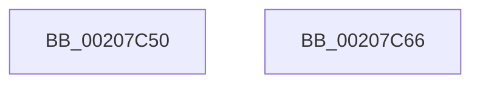

# KeInsertQueueDpc

- RVA: `0x00207C50`–`0x00207C67` (길이 `23` bytes)
- VA: `0x0000000140207C50`
- 실행 섹션: `.text`
- PDB 이름 있음: `예`; PDB Function 태그: `아니요`
- unwind 정보 RVA: `0x0005D2F4`
- 디코드: `7`개 명령, `23/23` bytes 표시
- 미해석 바이트: `0` (있으면 어셈블리에 `.byte`로 보존)

> 이 문서는 커널 이미지의 기계어와 PDB 기호를 분석해 생성했습니다. 4번과 5번은 함수 원형과 자료형을 바이너리 사용 방식에서 추정한 C 해석이며 원본 소스 복구 결과는 아닙니다.

## 1. Dependencies

- 직접 호출 지점: **1**; 고유 호출 대상: **1**
- 직접 호출자로 확인된 함수: **134**
- RIP 상대 이미지 참조: **0**

### Outgoing calls
- `0x00207C5C` → [KiInsertQueueDpc](KiInsertQueueDpc_function_00207C70.md) (function, `0x00207C70`)

### Direct callers
- [KiResumeThread](KiResumeThread_function_00203644.md) at `0x00203A25`
- [KiAbQueueAutoBoostDpc](KiAbQueueAutoBoostDpc_function_002074D0.md) at `0x002074F0`
- [IopAllocateIrpPrivate](IopAllocateIrpPrivate_function_00207770.md) at `0x00207A12`
- [KiRcuFlushCompleted](KiRcuFlushCompleted_function_0020AD38.md) at `0x0020AF1A`
- [sub_00218E7C](../21/Unknown_function_00218E7C.md) at `0x00218F07`
- [KiUpdateSoftParkElectionStatisticsOnInsertion](../21/KiUpdateSoftParkElectionStatisticsOnInsertion_function_00218F40.md) at `0x002190D4`
- [sub_0021A01D](../21/Unknown_function_0021A01D.md) at `0x0021A08F`
- [KiRetireDpcList](../21/KiRetireDpcList_function_0021A0B0.md) at `0x0021B00E`
- [KiUpdateVpBackingThreadPriorityOnReadyQueueInsertion](../21/KiUpdateVpBackingThreadPriorityOnReadyQueueInsertion_function_0021D360.md) at `0x0021D3FC`
- [KiComputeGroupSchedulingRank](../21/KiComputeGroupSchedulingRank_function_0021EB84.md) at `0x0021ED9F`
- [ExReleaseFastMutexUnsafe](../25/ExReleaseFastMutexUnsafe_function_002503A0.md) at `0x00250635`
- [IopReleaseFileObjectLock](../25/IopReleaseFileObjectLock_function_00250A90.md) at `0x00250E9F`
- [IopReleaseFileObjectLock](../25/IopReleaseFileObjectLock_function_00250A90.md) at `0x00250F0F`
- [FsRtlReleaseHeaderMutex](../25/FsRtlReleaseHeaderMutex_function_002516C0.md) at `0x002519A2`
- [ExReleaseFastMutex](../25/ExReleaseFastMutex_function_002519C0.md) at `0x00251C73`
- [sub_00257A07](../25/Unknown_function_00257A07.md) at `0x00257A54`
- [sub_0025EB5D](../25/Unknown_function_0025EB5D.md) at `0x0025ECEA`
- [sub_0025EB5D](../25/Unknown_function_0025EB5D.md) at `0x0025ED15`
- [sub_00260D5A](../26/Unknown_function_00260D5A.md) at `0x00260F32`
- [sub_00260D5A](../26/Unknown_function_00260D5A.md) at `0x00260FBE`
- [ExReleaseFastResource](../26/ExReleaseFastResource_function_002613D0.md) at `0x00261BDC`
- [sub_00261DFE](../26/Unknown_function_00261DFE.md) at `0x002621F3`
- [sub_002630C6](../26/Unknown_function_002630C6.md) at `0x002631BE`
- [sub_0027475D](../27/Unknown_function_0027475D.md) at `0x002753B7`
- [sub_0027475D](../27/Unknown_function_0027475D.md) at `0x0027543E`
- [sub_00286720](../28/Unknown_function_00286720.md) at `0x002867BE`
- [KeSignalGate](../2C/KeSignalGate_function_002C748C.md) at `0x002C75D2`
- [KeGenericCallDpcEx](../2C/KeGenericCallDpcEx_function_002C99F4.md) at `0x002C9AB5`
- [KiInitiateGenericCallDpc](../2C/KiInitiateGenericCallDpc_function_002C9C40.md) at `0x002C9CA3`
- [sub_002D7D27](../2D/Unknown_function_002D7D27.md) at `0x002D7DCB`
- [PpmCheckContinueExecution](../2D/PpmCheckContinueExecution_function_002D836C.md) at `0x002D8407`
- [PpmPerfQueueAction](../2D/PpmPerfQueueAction_function_002D91B0.md) at `0x002D91F1`
- [PopQueueTargetDpc](../2D/PopQueueTargetDpc_function_002DD8F0.md) at `0x002DD98C`
- [ObfDereferenceObjectWithTag](../2F/ObfDereferenceObjectWithTag_function_002F78E0.md) at `0x002F7AA1`
- [sub_002F8BF2](../2F/Unknown_function_002F8BF2.md) at `0x002F8D2D`
- [ObfDereferenceObject](../2F/ObfDereferenceObject_function_002F9350.md) at `0x002F9509`
- [NtTraceEvent](../2F/NtTraceEvent_function_002FA6C0.md) at `0x002FB20B`
- [EtwpReserveTraceBuffer](../2F/EtwpReserveTraceBuffer_function_002FC8C0.md) at `0x002FCCB5`
- [EtwpRequestFlushTimer](../2F/EtwpRequestFlushTimer_function_002FE6B0.md) at `0x002FE743`
- [KiTransitionSchedulingGroupGeneration](../30/KiTransitionSchedulingGroupGeneration_function_003094C8.md) at `0x0030995A`
- [sub_0033F9A3](../33/Unknown_function_0033F9A3.md) at `0x0033FA2F`
- [sub_0033F9A3](../33/Unknown_function_0033F9A3.md) at `0x0033FA6F`
- [KeReleaseSemaphoreEx](../34/KeReleaseSemaphoreEx_function_003468C0.md) at `0x00346C37`
- [KeWakeWaitChain](../34/KeWakeWaitChain_function_0034F8C0.md) at `0x0034FB2F`
- [KeSetEventBoostPriorityEx](../35/KeSetEventBoostPriorityEx_function_00350148.md) at `0x0035030C`
- [MiReturnWsToExpansionList](../35/MiReturnWsToExpansionList_function_003504E0.md) at `0x003506BE`
- [KeRundownQueueCommon](../35/KeRundownQueueCommon_function_003515F4.md) at `0x0035175A`
- [KeDeleteMutant](../35/KeDeleteMutant_function_00351788.md) at `0x003519C5`
- [KePulseEvent](../35/KePulseEvent_function_00351EF0.md) at `0x0035209E`
- [KePulseEvent](../35/KePulseEvent_function_00351EF0.md) at `0x003520BF`
- [KeSetProcess](../35/KeSetProcess_function_003520E8.md) at `0x00352201`
- [KiCheckMaxOverQuotaTransition](../35/KiCheckMaxOverQuotaTransition_function_00354884.md) at `0x0035490F`
- [KeTerminateThread](../35/KeTerminateThread_function_00355138.md) at `0x00355453`
- [sub_00356086](../35/Unknown_function_00356086.md) at `0x003562AD`
- [CmFcManagerNotifyFeatureUsage](../37/CmFcManagerNotifyFeatureUsage_function_00378598.md) at `0x00378664`
- [WheapWorkQueueAddItem](../38/WheapWorkQueueAddItem_function_0038662C.md) at `0x00386661`
- [AlpcpSignal](../39/AlpcpSignal_function_003955E0.md) at `0x00396209`
- [AlpcpSignal](../39/AlpcpSignal_function_003955E0.md) at `0x0039623A`
- [KeReleaseMutantEx](../39/KeReleaseMutantEx_function_00396850.md) at `0x00396D80`
- [sub_0039737C](../39/Unknown_function_0039737C.md) at `0x003973F2`
- [HalpTimerClockInterruptWork](../39/HalpTimerClockInterruptWork_function_0039B310.md) at `0x0039B395`
- [KiUpdateTime](../39/KiUpdateTime_function_0039B530.md) at `0x0039BA00`
- [KiUpdateTime](../39/KiUpdateTime_function_0039B530.md) at `0x0039BB0F`
- [KeAccumulateTicks](../39/KeAccumulateTicks_function_0039C140.md) at `0x0039C5D5`
- [KeAccumulateTicks](../39/KeAccumulateTicks_function_0039C140.md) at `0x0039C75E`
- [PpmExecutePeriodicPerfCheck](../39/PpmExecutePeriodicPerfCheck_function_0039D0CC.md) at `0x0039D1D1`
- [IoProcessPassiveInterrupts](../39/IoProcessPassiveInterrupts_function_0039F85C.md) at `0x0039F8BA`
- [ObpDeferObjectDeletion](../3A/ObpDeferObjectDeletion_function_003A2394.md) at `0x003A23FB`
- [KiExpireTimer2](../3A/KiExpireTimer2_function_003A24E0.md) at `0x003A2C1E`
- [KiExpireTimer2](../3A/KiExpireTimer2_function_003A24E0.md) at `0x003A2C58`
- [KiInitializeUserApc](../3D/KiInitializeUserApc_function_003D8D38.md) at `0x003D92B2`
- [EtwpCovSampCaptureBufferQueue](../43/EtwpCovSampCaptureBufferQueue_function_0043C234.md) at `0x0043C338`
- [EtwpCovSampCaptureBufferRelease](../43/EtwpCovSampCaptureBufferRelease_function_0043C4B4.md) at `0x0043C4F0`
- [EtwpCovSampLookasidePop](../43/EtwpCovSampLookasidePop_function_0043C528.md) at `0x0043C5BD`
- [EtwpCovSampCaptureReleaseToLookaside](../43/EtwpCovSampCaptureReleaseToLookaside_function_0043C630.md) at `0x0043C66E`
- [EtwpCovSampCaptureApcRelease](../44/EtwpCovSampCaptureApcRelease_function_00444214.md) at `0x00444275`
- [HvlSharedIsr](../44/HvlSharedIsr_function_0044B020.md) at `0x0044B0B3`
- [KiChargeSchedulingGroupCycleTime](../45/KiChargeSchedulingGroupCycleTime_function_00453074.md) at `0x004530CE`
- [EtwpCovSampCaptureQueueBuffer](../46/EtwpCovSampCaptureQueueBuffer_function_004620D0.md) at `0x0046212B`
- [MiLogStandbyRepurpose](../46/MiLogStandbyRepurpose_function_0046BD14.md) at `0x0046BD5C`
- [KiRegisterBugcheckRecoveryCallback](../47/KiRegisterBugcheckRecoveryCallback_function_00472214.md) at `0x00472253`
- [KiDpcRuntimeHistoryHashTableCleanupTimerCallback](../48/KiDpcRuntimeHistoryHashTableCleanupTimerCallback_function_00482EA0.md) at `0x00482F0B`
- [HalpCmciInitProcessor](../48/HalpCmciInitProcessor_function_004875E4.md) at `0x0048771A`
- [KiForceIdleUpdateSchedulerParkState](../48/KiForceIdleUpdateSchedulerParkState_function_0048D874.md) at `0x0048DB85`
- [KiForceIdleUpdateSchedulerParkState](../48/KiForceIdleUpdateSchedulerParkState_function_0048D874.md) at `0x0048DBF8`
- [CmFcpManagerArmFeatureUsageProviderFlushNotification](../49/CmFcpManagerArmFeatureUsageProviderFlushNotification_function_0049C978.md) at `0x0049C9CC`
- [HalpTimerDpcRoutine](../4B/HalpTimerDpcRoutine_function_004B2870.md) at `0x004B2A68`
- [HalpDmaControllerInterruptRoutine](../4B/HalpDmaControllerInterruptRoutine_function_004BE3D0.md) at `0x004BE442`
- [PpmHeteroDispatchHgsInterrupt](../4B/PpmHeteroDispatchHgsInterrupt_function_004BE5E0.md) at `0x004BE625`
- [HalpIommuTraceFault](../4C/HalpIommuTraceFault_function_004C031C.md) at `0x004C03A8`
- [KiRollbackSlistPops](../4C/KiRollbackSlistPops_function_004CDDF0.md) at `0x004CDE5F`
- [EtwpQueueApcPoolDpc](../4D/EtwpQueueApcPoolDpc_function_004DA1A4.md) at `0x004DA25C`
- [KiDisarmForceParkDutyCyclingIfNecessary](../4F/KiDisarmForceParkDutyCyclingIfNecessary_function_004FA9E4.md) at `0x004FAB33`
- [KiArmForceParkDutyCyclingForLocalReadyQueue](../4F/KiArmForceParkDutyCyclingForLocalReadyQueue_function_004FAB54.md) at `0x004FAC70`
- [KiArmForceParkDutyCyclingForSharedReadyQueue](../4F/KiArmForceParkDutyCyclingForSharedReadyQueue_function_004FB604.md) at `0x004FB655`
- [HalpCmciHandler](../54/HalpCmciHandler_function_00545168.md) at `0x005452B3`
- [HalpCmciHandler](../54/HalpCmciHandler_function_00545168.md) at `0x0054534C`
- [HalpPmuReservedResourcesProcessorCallback](../54/HalpPmuReservedResourcesProcessorCallback_function_00547608.md) at `0x0054771D`
- [HalpDmaControllerCancelTransfer](../55/HalpDmaControllerCancelTransfer_function_00554090.md) at `0x00554142`
- [HalpInsertSecondarySignalList](../55/HalpInsertSecondarySignalList_function_00556EFC.md) at `0x00556F66`
- [IopLiveDumpCorralProcessors](../59/IopLiveDumpCorralProcessors_function_0059B720.md) at `0x0059B8BE`
- [KeRegisterObjectDpc](../5B/KeRegisterObjectDpc_function_005B2544.md) at `0x005B25C5`
- [KiSrcuFlushCompleted](../5C/KiSrcuFlushCompleted_function_005C22B4.md) at `0x005C2310`
- [KiSrcuNotifyWorkerSelectAndQueue](../5C/KiSrcuNotifyWorkerSelectAndQueue_function_005C29D4.md) at `0x005C2A67`
- [KiForegroundTimerCallback](../5C/KiForegroundTimerCallback_function_005C4280.md) at `0x005C4290`
- [KeAbCrossThreadDelete](../5C/KeAbCrossThreadDelete_function_005C517C.md) at `0x005C5530`
- [KiScheduleNextForegroundBoost](../5C/KiScheduleNextForegroundBoost_function_005C6670.md) at `0x005C66EF`
- [KiBugCheckRecoveryFreezeOtherProcessors](../5C/KiBugCheckRecoveryFreezeOtherProcessors_function_005C7120.md) at `0x005C724B`
- [KiScheduleBugcheckRecovery](../5C/KiScheduleBugcheckRecovery_function_005C7B20.md) at `0x005C7BA1`
- [KiFlushScbReferences](../5C/KiFlushScbReferences_function_005C89E8.md) at `0x005C8AB5`
- [KiStartForceParkSingleDutyCycleTimerCallback](../5C/KiStartForceParkSingleDutyCycleTimerCallback_function_005C99F0.md) at `0x005C9A50`
- [KiStopForceParkSingleDutyCycleTimerCallback](../5C/KiStopForceParkSingleDutyCycleTimerCallback_function_005C9A70.md) at `0x005C9AD1`
- [KiAltContextWorkQueueAddItem](../5C/KiAltContextWorkQueueAddItem_function_005CB028.md) at `0x005CB0DB`
- [PopIdleWakeAssignAccountingToSource](../5D/PopIdleWakeAssignAccountingToSource_function_005DBFA8.md) at `0x005DC069`
- [DifKeInsertQueueDpcWrapper](../63/DifKeInsertQueueDpcWrapper_function_006303F0.md) at `0x006304D5`
- [EtwSendTraceBuffer](../65/EtwSendTraceBuffer_function_00651560.md) at `0x00651690`
- [ExpTimeRefreshCallback](../65/ExpTimeRefreshCallback_function_006556E0.md) at `0x006556F0`
- [ExQueueDebuggerWorker](../65/ExQueueDebuggerWorker_function_0065A358.md) at `0x0065A37A`
- [ExpSvmFaultRoutine](../65/ExpSvmFaultRoutine_function_0065BDA0.md) at `0x0065BDD3`
- [WheaDeferredRecoveryService](../66/WheaDeferredRecoveryService_function_006600F0.md) at `0x0066010D`
- [WheapDeferredRecoveryServiceDpcRoutine](../66/WheapDeferredRecoveryServiceDpcRoutine_function_006601C0.md) at `0x00660293`
- [WheaFlushETWEventsAddWorkRtn](../66/WheaFlushETWEventsAddWorkRtn_function_0066031C.md) at `0x006603C1`
- [MmSetAccessLogging](../68/MmSetAccessLogging_function_0068A188.md) at `0x0068A1EB`
- [sub_006D6552](../6D/Unknown_function_006D6552.md) at `0x006D65CB`
- [sub_006DDA8E](../6D/Unknown_function_006DDA8E.md) at `0x006DDAF1`
- [sub_006DFB24](../6D/Unknown_function_006DFB24.md) at `0x006DFBFA`
- [sub_006DFE7E](../6D/Unknown_function_006DFE7E.md) at `0x006DFEC7`
- [sub_006E57E2](../6E/Unknown_function_006E57E2.md) at `0x006E5837`
- [sub_006E638A](../6E/Unknown_function_006E638A.md) at `0x006E63FD`
- [sub_006E650A](../6E/Unknown_function_006E650A.md) at `0x006E6580`
- [sub_006F0BD0](../6F/Unknown_function_006F0BD0.md) at `0x006F0C3A`
- [sub_006F4E68](../6F/Unknown_function_006F4E68.md) at `0x006F4ED5`
- [sub_006F59B4](../6F/Unknown_function_006F59B4.md) at `0x006F5BEE`
- [sub_006F7E00](../6F/Unknown_function_006F7E00.md) at `0x006F7E66`
- [EtwInitialize](../../page/7B/EtwInitialize_function_007B4D40.md) at `0x007B4E72`
- [PspProcessDelete](../../page/90/PspProcessDelete_function_00907B90.md) at `0x00908046`
- [EtwpStopLoggerInstance](../../page/9B/EtwpStopLoggerInstance_function_009BEB94.md) at `0x009BEF36`
- [ObpProcessRemoveObjectQueue](../../page/9D/ObpProcessRemoveObjectQueue_function_009D7B40.md) at `0x009D7C97`
- [EtwpSynchronizeWithLogger](../../page/A6/EtwpSynchronizeWithLogger_function_00A66250.md) at `0x00A662E3`
- [sub_00B41FE2](../../page/B4/Unknown_function_00B41FE2.md) at `0x00B42002`
- [PnprQuiesceProcessors](../../pagelk/B6/PnprQuiesceProcessors_function_00B64FB4.md) at `0x00B65132`
- [PopEndMirroring](../../pagelk/B7/PopEndMirroring_function_00B75E50.md) at `0x00B760A1`
- [PopInvokeSystemStateHandler](../../pagelk/B7/PopInvokeSystemStateHandler_function_00B76A6C.md) at `0x00B76C5D`
- [KiCalibrateTimeAdjustment](../../pagelk/B7/KiCalibrateTimeAdjustment_function_00B797E0.md) at `0x00B7993F`
- [KdExitDebugger](../../pagekd/B8/KdExitDebugger_function_00B85008.md) at `0x00B85137`
- [KiComputeDispatchInterruptCost](../../init/C3/KiComputeDispatchInterruptCost_function_00C377C0.md) at `0x00C37991`

### Static image references
- 디코드된 RIP-relative 메모리 참조가 없습니다.

## 2. Other-region calls and transfers

- 다른 실행 섹션으로 향하는 call: **0**
- 별도 외부 분기/꼬리 이동을 확인하지 못했습니다.

## 3. Assembly (complete function range)

```asm
00207C50  48 83 EC 38                     sub rsp, 0x38
00207C54  45 33 C9                        xor r9d, r9d
00207C57  C6 44 24 20 00                  mov byte ptr [rsp + 0x20], 0
00207C5C  E8 0F 00 00 00                  call 0x140207c70
00207C61  48 83 C4 38                     add rsp, 0x38
00207C65  C3                              ret
00207C66  CC                              int3
```

## 4. C-style interpretation (structured pseudocode)

```c
__int64 __fastcall KeInsertQueueDpc(__int64 a1, __int64 a2, __int64 a3, int a4)
{
    __int64 result;
    __int64 v_rsp;
    unsigned __int8 v_stack_m18;

    v_rsp = (v_rsp) - (56);
    a4 = 0;
    v_stack_m18 = 0;
    result = KiInsertQueueDpc(a1, a2, a3, a4);
    v_rsp = (v_rsp) + (56);
    return result;
}
```

## 5. (Beta) C Style

```c
int64_t KeInsertQueueDpc(void *Dpc, void *SystemArgument1, void *SystemArgument2, int32_t Arg4)
{
    int64_t result;
    int64_t local_rsp;
    uint8_t v_stack_m18;

    local_rsp = (local_rsp) - (56);
    Arg4 = 0;
    v_stack_m18 = 0;
    result = KiInsertQueueDpc(Dpc, SystemArgument1, SystemArgument2, Arg4);
    local_rsp = (local_rsp) + (56);
    return result;
}
```

## 6. Execution-region graph

[열기: 2D/3D 그래프와 함수 탐색 컨트롤 패널](../../../control-panel.html?section=text&rva=0x00207C50&view=graph)

- 2D 그래프는 위에서 아래로 흐르고, 3D 그래프는 빈 공간을 드래그해 회전합니다. Shift+드래그는 이동, 휠은 확대·축소, 함수 노드 선택은 대상 보고서 이동입니다.

### Static fallback


