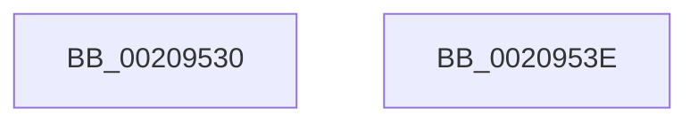

# KeQueryInterruptTimePrecise

- RVA: `0x00209530`–`0x0020953F` (길이 `15` bytes)
- VA: `0x0000000140209530`
- 실행 섹션: `.text`
- PDB 이름 있음: `예`; PDB Function 태그: `아니요`
- unwind 정보 RVA: `0x0005C788`
- 디코드: `5`개 명령, `15/15` bytes 표시
- 미해석 바이트: `0` (있으면 어셈블리에 `.byte`로 보존)

> 이 문서는 커널 이미지의 기계어와 PDB 기호를 분석해 생성했습니다. 4번과 5번은 함수 원형과 자료형을 바이너리 사용 방식에서 추정한 C 해석이며 원본 소스 복구 결과는 아닙니다.

## 1. Dependencies

- 직접 호출 지점: **1**; 고유 호출 대상: **1**
- 직접 호출자로 확인된 함수: **8**
- RIP 상대 이미지 참조: **0**

### Outgoing calls
- `0x00209534` → [RtlGetInterruptTimePrecise](RtlGetInterruptTimePrecise_function_0020A4C0.md) (function, `0x0020A4C0`)

### Direct callers
- [PsSessionCreate](../../page/70/PsSessionCreate_function_00700438.md) at `0x007004C4`
- [PopPowerAggregatorRecordIntent](../../page/91/PopPowerAggregatorRecordIntent_function_00914850.md) at `0x0091490C`
- [PopPowerAggregatorAllocateLogEntry](../../page/91/PopPowerAggregatorAllocateLogEntry_function_00915F7C.md) at `0x00915FD2`
- [ExProcessCounterSetCallback](../../page/91/ExProcessCounterSetCallback_function_0091CDF0.md) at `0x0091CE5F`
- [PopIdleWakeNotifyModernStandbyExitWorker](../../page/AA/PopIdleWakeNotifyModernStandbyExitWorker_function_00AA55E0.md) at `0x00AA5657`
- [PopIdleWakeNotifyModernStandbyExitWorker](../../page/AA/PopIdleWakeNotifyModernStandbyExitWorker_function_00AA55E0.md) at `0x00AA56E5`
- [PopSleepstudyStartNextSession](../../page/AC/PopSleepstudyStartNextSession_function_00AC4720.md) at `0x00AC4874`
- [PopSleepstudyStartNextSession](../../page/AC/PopSleepstudyStartNextSession_function_00AC4720.md) at `0x00AC49F5`
- [PopEnableSystemSleepCheckpoint](../../page/AC/PopEnableSystemSleepCheckpoint_function_00AC4F50.md) at `0x00AC501D`
- [PopEnableSystemSleepCheckpoint](../../page/AC/PopEnableSystemSleepCheckpoint_function_00AC4F50.md) at `0x00AC5047`
- [PopSleepstudySnapModernStandbySessionData](../../page/AD/PopSleepstudySnapModernStandbySessionData_function_00AD529C.md) at `0x00AD52F9`

### Static image references
- 디코드된 RIP-relative 메모리 참조가 없습니다.

## 2. Other-region calls and transfers

- 다른 실행 섹션으로 향하는 call: **0**
- 별도 외부 분기/꼬리 이동을 확인하지 못했습니다.

## 3. Assembly (complete function range)

```asm
00209530  48 83 EC 28                     sub rsp, 0x28
00209534  E8 87 0F 00 00                  call 0x14020a4c0
00209539  48 83 C4 28                     add rsp, 0x28
0020953D  C3                              ret
0020953E  CC                              int3
```

## 4. C-style interpretation (structured pseudocode)

```c
__int64 __fastcall KeQueryInterruptTimePrecise(void)
{
    __int64 result;
    __int64 v_rsp;

    v_rsp = (v_rsp) - (40);
    result = RtlGetInterruptTimePrecise(a1, a2, a3, a4);
    v_rsp = (v_rsp) + (40);
    return result;
}
```

## 5. (Beta) C Style

```c
void KeQueryInterruptTimePrecise(void)
{
    int64_t result;
    int64_t local_rsp;

    local_rsp = (local_rsp) - (40);
    result = RtlGetInterruptTimePrecise(a1, a2, a3, a4);
    local_rsp = (local_rsp) + (40);
    return result;
}
```

## 6. Execution-region graph

[열기: 2D/3D 그래프와 함수 탐색 컨트롤 패널](../../../control-panel.html?section=text&rva=0x00209530&view=graph)

- 2D 그래프는 위에서 아래로 흐르고, 3D 그래프는 빈 공간을 드래그해 회전합니다. Shift+드래그는 이동, 휠은 확대·축소, 함수 노드 선택은 대상 보고서 이동입니다.

### Static fallback


