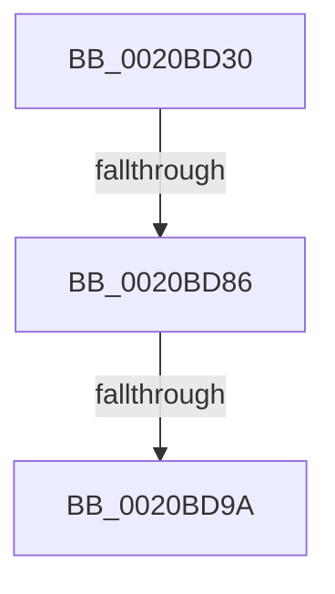

# KeRemoveQueueEx

- RVA: `0x0020BD30`–`0x0020BDAA` (길이 `122` bytes)
- VA: `0x000000014020BD30`
- 실행 섹션: `.text`
- PDB 이름 있음: `예`; PDB Function 태그: `예`
- unwind 정보 RVA: `0x0005D870`
- 디코드: `31`개 명령, `122/122` bytes 표시
- 미해석 바이트: `0` (있으면 어셈블리에 `.byte`로 보존)

> 이 문서는 커널 이미지의 기계어와 PDB 기호를 분석해 생성했습니다. 4번과 5번은 함수 원형과 자료형을 바이너리 사용 방식에서 추정한 C 해석이며 원본 소스 복구 결과는 아닙니다.

## 1. Dependencies

- 직접 호출 지점: **0**; 고유 호출 대상: **0**
- 직접 호출자로 확인된 함수: **6**
- RIP 상대 이미지 참조: **1**

### Outgoing calls
- 직접 디코드된 call 명령이 없습니다.

### Direct callers
- [IoRemoveIoCompletion](IoRemoveIoCompletion_function_0020B580.md) at `0x0020B60D`
- [KeRemoveQueue](../46/KeRemoveQueue_function_00467700.md) at `0x00467722`
- [FsRtlWorkerThread](../58/FsRtlWorkerThread_function_00583480.md) at `0x005834CE`
- [IopPassiveInterruptRealtimeWorker](../5A/IopPassiveInterruptRealtimeWorker_function_005A6850.md) at `0x005A687C`
- [ExpWorkerFactoryManagerThread](../65/ExpWorkerFactoryManagerThread_function_0065CCC0.md) at `0x0065CD11`
- [EtwpReceiveReplyDataBlock](../../page/A8/EtwpReceiveReplyDataBlock_function_00A87954.md) at `0x00A87A05`

### Static image references
- `0x0020BD8E` → RVA `0x00FC6D20` (`ALMOSTRO`; read)

## 2. Other-region calls and transfers

- 다른 실행 섹션으로 향하는 call: **0**
- call이 아닌 외부 분기/꼬리 이동: **2**
  - `0x0020BD80` → [sub_0020C2BF](Unknown_function_0020C2BF.md) (`tail-transfer`)
  - `0x0020BD94` → [sub_0020C20E](Unknown_function_0020C20E.md) (`tail-transfer`)

## 3. Assembly (complete function range)

```asm
0020BD30  44 88 44 24 18                  mov byte ptr [rsp + 0x18], r8b
0020BD35  88 54 24 10                     mov byte ptr [rsp + 0x10], dl
0020BD39  48 89 4C 24 08                  mov qword ptr [rsp + 8], rcx
0020BD3E  53                              push rbx
0020BD3F  55                              push rbp
0020BD40  56                              push rsi
0020BD41  57                              push rdi
0020BD42  41 55                           push r13
0020BD44  41 56                           push r14
0020BD46  41 57                           push r15
0020BD48  48 83 EC 60                     sub rsp, 0x60
0020BD4C  4D 8B F9                        mov r15, r9
0020BD4F  4C 8B F1                        mov r14, rcx
0020BD52  45 33 C9                        xor r9d, r9d
0020BD55  45 0F B6 E8                     movzx r13d, r8b
0020BD59  4C 89 4C 24 48                  mov qword ptr [rsp + 0x48], r9
0020BD5E  0F B6 EA                        movzx ebp, dl
0020BD61  65 48 8B 3C 25 88 01 00 00      mov rdi, qword ptr gs:[0x188]
0020BD6A  41 8B D9                        mov ebx, r9d
0020BD6D  4C 89 4C 24 58                  mov qword ptr [rsp + 0x58], r9
0020BD72  41 8D 49 02                     lea ecx, [r9 + 2]
0020BD76  0F BA 77 74 02                  btr dword ptr [rdi + 0x74], 2
0020BD7B  0F 92 C0                        setb al
0020BD7E  84 C0                           test al, al
0020BD80  0F 85 39 05 00 00               jne 0x14020c2bf
0020BD86  44 0F 20 C6                     mov rsi, cr8
0020BD8A  44 0F 22 C1                     mov cr8, rcx
0020BD8E  39 1D 8C AF DB 00               cmp dword ptr [rip + 0xdbaf8c], ebx
0020BD94  0F 85 74 04 00 00               jne 0x14020c20e
0020BD9A  40 88 B7 86 01 00 00            mov byte ptr [rdi + 0x186], sil
0020BDA1  65 48 8B 34 25 20 00 00 00      mov rsi, qword ptr gs:[0x20]
```

## 4. C-style interpretation (structured pseudocode)

```c
__int64 __fastcall KeRemoveQueueEx(__int64 a1, unsigned __int8 a2, unsigned __int8 a3, __int64 a4)
{
    __int64 result;
    __int64 v_rsp;
    unsigned __int64 v_stack_m40;
    unsigned __int64 v_stack_m50;
    unsigned __int8 v_stack_p10;
    unsigned __int8 v_stack_p18;
    unsigned __int64 v_stack_p8;

    v_stack_p18 = a3;
    v_stack_p10 = a2;
    v_stack_p8 = a1;
    v_rsp = (v_rsp) - (96);
    a4 = 0;
    v_stack_m50 = 0;
    v_stack_m40 = 0;
    result = (condition_is_below) ? 1 : 0;
    *(unsigned __int8 *)(*(unsigned __int64 *)(gs_base + (0 + 392)) + 390) = (unsigned __int8)(v_cr8);
    return result;
}
```

## 5. (Beta) C Style

```c
int64_t KeRemoveQueueEx(int64_t Arg1, uint8_t Arg2, uint8_t Arg3, int64_t Arg4)
{
    int64_t result;
    int64_t local_rsp;
    uint64_t v_stack_m40;
    uint64_t v_stack_m50;
    uint8_t v_stack_p10;
    uint8_t v_stack_p18;
    uint64_t v_stack_p8;

    v_stack_p18 = Arg3;
    v_stack_p10 = Arg2;
    v_stack_p8 = Arg1;
    local_rsp = (local_rsp) - (96);
    Arg4 = 0;
    v_stack_m50 = 0;
    v_stack_m40 = 0;
    result = (condition_is_below) ? 1 : 0;
    *(uint8_t *)(*(uint64_t *)(gs_base + (0 + 0x188)) + 0x186) = (uint8_t)(v_cr8);
    return result;
}
```

## 6. Execution-region graph

[열기: 2D/3D 그래프와 함수 탐색 컨트롤 패널](../../../control-panel.html?section=text&rva=0x0020BD30&view=graph)

- 2D 그래프는 위에서 아래로 흐르고, 3D 그래프는 빈 공간을 드래그해 회전합니다. Shift+드래그는 이동, 휠은 확대·축소, 함수 노드 선택은 대상 보고서 이동입니다.

### Static fallback


