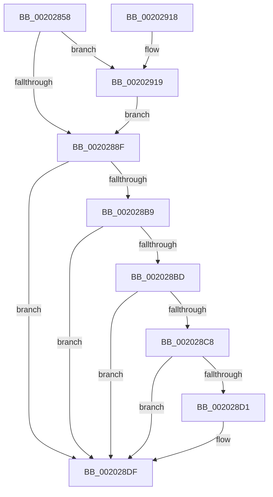

# KeResumeThread

- RVA: `0x00202858`–`0x00202926` (길이 `206` bytes)
- VA: `0x0000000140202858`
- 실행 섹션: `.text`
- PDB 이름 있음: `예`; PDB Function 태그: `아니요`
- unwind 정보 RVA: `0x0005C96C`
- 디코드: `55`개 명령, `206/206` bytes 표시
- 미해석 바이트: `0` (있으면 어셈블리에 `.byte`로 보존)

> 이 문서는 커널 이미지의 기계어와 PDB 기호를 분석해 생성했습니다. 4번과 5번은 함수 원형과 자료형을 바이너리 사용 방식에서 추정한 C 해석이며 원본 소스 복구 결과는 아닙니다.

## 1. Dependencies

- 직접 호출 지점: **4**; 고유 호출 대상: **4**
- 직접 호출자로 확인된 함수: **3**
- RIP 상대 이미지 참조: **1**

### Outgoing calls
- `0x002028A2` → [KiAcquireKobjectLockSafe](../25/KiAcquireKobjectLockSafe_function_00251C90.md) (function, `0x00251C90`)
- `0x002028DA` → [KiResumeThread](KiResumeThread_function_00203644.md) (function, `0x00203644`)
- `0x002028F8` → [KiExitDispatcher](../25/KiExitDispatcher_function_00251CF0.md) (function, `0x00251CF0`)
- `0x0020291C` → [KiRaiseIrqlProcessIrqlFlags](../4F/KiRaiseIrqlProcessIrqlFlags_function_004F56FC.md) (function, `0x004F56FC`)

### Direct callers
- [PsMultiResumeThread](PsMultiResumeThread_function_002027C4.md) at `0x002027E4`
- [PsMultiResumeProcess](../4A/PsMultiResumeProcess_function_004A2B3C.md) at `0x004A2BD8`
- [KeAlertResumeThread](../5B/KeAlertResumeThread_function_005B8E60.md) at `0x005B8E9C`

### Static image references
- `0x00202882` → RVA `0x00FC6D20` (`ALMOSTRO`; read)

## 2. Other-region calls and transfers

- 다른 실행 섹션으로 향하는 call: **0**
- 별도 외부 분기/꼬리 이동을 확인하지 못했습니다.

## 3. Assembly (complete function range)

```asm
00202858  48 89 5C 24 08                  mov qword ptr [rsp + 8], rbx
0020285D  48 89 6C 24 10                  mov qword ptr [rsp + 0x10], rbp
00202862  48 89 74 24 18                  mov qword ptr [rsp + 0x18], rsi
00202867  57                              push rdi
00202868  41 56                           push r14
0020286A  41 57                           push r15
0020286C  48 83 EC 30                     sub rsp, 0x30
00202870  8B FA                           mov edi, edx
00202872  48 8B D9                        mov rbx, rcx
00202875  44 0F 20 C5                     mov rbp, cr8
00202879  BA 02 00 00 00                  mov edx, 2
0020287E  44 0F 22 C2                     mov cr8, rdx
00202882  83 3D 97 44 DC 00 00            cmp dword ptr [rip + 0xdc4497], 0
00202889  0F 85 8A 00 00 00               jne 0x140202919
0020288F  65 4C 8B 3C 25 20 00 00 00      mov r15, qword ptr gs:[0x20]
00202898  4C 8D B3 E0 02 00 00            lea r14, [rbx + 0x2e0]
0020289F  49 8B CE                        mov rcx, r14
002028A2  E8 E9 F3 04 00                  call 0x140251c90
002028A7  0F BE 83 84 02 00 00            movsx eax, byte ptr [rbx + 0x284]
002028AE  3B F8                           cmp edi, eax
002028B0  8B F0                           mov esi, eax
002028B2  0F 47 F8                        cmova edi, eax
002028B5  85 FF                           test edi, edi
002028B7  74 26                           je 0x1402028df
002028B9  84 C0                           test al, al
002028BB  74 22                           je 0x1402028df
002028BD  40 2A C7                        sub al, dil
002028C0  88 83 84 02 00 00               mov byte ptr [rbx + 0x284], al
002028C6  75 17                           jne 0x1402028df
002028C8  F7 43 78 00 40 00 00            test dword ptr [rbx + 0x78], 0x4000
002028CF  75 0E                           jne 0x1402028df
002028D1  45 33 C0                        xor r8d, r8d
002028D4  49 8B D7                        mov rdx, r15
002028D7  48 8B CB                        mov rcx, rbx
002028DA  E8 65 0D 00 00                  call 0x140203644
002028DF  F0 41 81 26 7F FF FF FF         lock and dword ptr [r14], 0xffffff7f
002028E7  45 33 C9                        xor r9d, r9d
002028EA  40 88 6C 24 20                  mov byte ptr [rsp + 0x20], bpl
002028EF  33 D2                           xor edx, edx
002028F1  49 8B CF                        mov rcx, r15
002028F4  45 8D 41 01                     lea r8d, [r9 + 1]
002028F8  E8 F3 F3 04 00                  call 0x140251cf0
002028FD  48 8B 5C 24 50                  mov rbx, qword ptr [rsp + 0x50]
00202902  8B C6                           mov eax, esi
00202904  48 8B 74 24 60                  mov rsi, qword ptr [rsp + 0x60]
00202909  48 8B 6C 24 58                  mov rbp, qword ptr [rsp + 0x58]
0020290E  48 83 C4 30                     add rsp, 0x30
00202912  41 5F                           pop r15
00202914  41 5E                           pop r14
00202916  5F                              pop rdi
00202917  C3                              ret
00202918  CC                              int3
00202919  40 8A CD                        mov cl, bpl
0020291C  E8 DB 2D 2F 00                  call 0x1404f56fc
00202921  E9 69 FF FF FF                  jmp 0x14020288f
```

## 4. C-style interpretation (structured pseudocode)

```c
__int64 __fastcall KeResumeThread(__int64 a1, int a2, int a3, int a4)
{
    __int64 result;
    __int64 v_rdi;
    __int64 v_rsp;
    unsigned __int8 v_stack_m28;
    unsigned __int64 v_stack_p10;
    unsigned __int64 v_stack_p18;
    unsigned __int64 v_stack_p8;

    v_stack_p8 = v_rbx;
    v_stack_p10 = v_rbp;
    v_stack_p18 = v_rsi;
    v_rsp = (v_rsp) - (48);
    if ((*(unsigned int *)(v_rip + 14435479)) != 0) goto loc_00202919;
loc_0020288F:
    result = KiAcquireKobjectLockSafe(a1 + 736, 2, a3, a4);
    v_rdi = (unsigned int)(a2);
    if (((unsigned int)((unsigned int)(a2))) > ((unsigned int)((__int8)(*(unsigned __int8 *)(a1 + 644))))) { v_rdi = (unsigned int)((__int8)(*(unsigned __int8 *)(a1 + 644))); }
    if ((unsigned int)(v_rdi) == 0) goto loc_002028DF;
    if ((unsigned __int8)((__int8)(*(unsigned __int8 *)(a1 + 644))) == 0) goto loc_002028DF;
    result = (unsigned __int8)(((__int8)(*(unsigned __int8 *)(a1 + 644))) - ((unsigned __int8)(v_rdi)));
    *(unsigned __int8 *)(a1 + 644) = (unsigned __int8)(result);
    if (condition_is_not_equal) goto loc_002028DF;
    if (((*(unsigned int *)(a1 + 120)) & (0x4000ULL)) == 0) {
        a3 = 0;
        a2 = *(unsigned __int64 *)(gs_base + (0 + 32));
        a1 = a1;
        result = KiResumeThread(a1, a2, a3, a4);
    }
    a4 = 0;
    v_stack_m28 = (unsigned __int8)(v_cr8);
    a2 = 0;
    result = KiExitDispatcher(*(unsigned __int64 *)(gs_base + (0 + 32)), a2, a4 + 1, a4);
    v_rsp = (v_rsp) + (48);
    return (unsigned int)((unsigned int)((unsigned int)((unsigned int)((__int8)(*(unsigned __int8 *)(a1 + 644))))));
loc_00202919:
    result = KiRaiseIrqlProcessIrqlFlags((unsigned __int8)(v_stack_p10), a2, a4 + 1, a4);
    goto loc_0020288F;
}
```

## 5. (Beta) C Style

```c
int64_t KeResumeThread(void *Arg1, int32_t Arg2, int32_t Arg3, int32_t Arg4)
{
    uint8_t *arg1 = (uint8_t *)Arg1;

    int64_t result;
    int64_t local_rdi;
    int64_t local_rsp;
    uint8_t v_stack_m28;
    uint64_t v_stack_p10;
    uint64_t v_stack_p18;
    uint64_t v_stack_p8;

    v_stack_p8 = local_rbx;
    v_stack_p10 = local_rbp;
    v_stack_p18 = local_rsi;
    local_rsp = (local_rsp) - (48);
    if ((*(uint32_t *)(v_rip + 0xDC4497)) != 0) goto loc_00202919;
loc_0020288F:
    result = KiAcquireKobjectLockSafe(Arg1 + 736, 2, Arg3, Arg4);
    local_rdi = (uint32_t)(Arg2);
    if (((uint32_t)((uint32_t)(Arg2))) > ((uint32_t)((int8_t)(*(uint8_t *)(arg1 + 0x284))))) { local_rdi = (uint32_t)((int8_t)(*(uint8_t *)(arg1 + 0x284))); }
    if ((uint32_t)(local_rdi) == 0) goto loc_002028DF;
    if ((uint8_t)((int8_t)(*(uint8_t *)(arg1 + 0x284))) == 0) goto loc_002028DF;
    result = (uint8_t)(((int8_t)(*(uint8_t *)(arg1 + 0x284))) - ((uint8_t)(local_rdi)));
    *(uint8_t *)(arg1 + 0x284) = (uint8_t)(result);
    if (condition_is_not_equal) goto loc_002028DF;
    if (((*(uint32_t *)(arg1 + 0x78)) & (0x4000ULL)) == 0) {
        Arg3 = 0;
        Arg2 = *(uint64_t *)(gs_base + (0 + 0x20));
        Arg1 = Arg1;
        result = KiResumeThread(Arg1, Arg2, Arg3, Arg4);
    }
    Arg4 = 0;
    v_stack_m28 = (uint8_t)(v_cr8);
    Arg2 = 0;
    result = KiExitDispatcher(*(uint64_t *)(gs_base + (0 + 0x20)), Arg2, Arg4 + 1, Arg4);
    local_rsp = (local_rsp) + (48);
    return (uint32_t)((uint32_t)((uint32_t)((uint32_t)((int8_t)(*(uint8_t *)(arg1 + 0x284))))));
loc_00202919:
    result = KiRaiseIrqlProcessIrqlFlags((uint8_t)(v_stack_p10), Arg2, Arg4 + 1, Arg4);
    goto loc_0020288F;
}
```

### 관측된 메모리 오프셋

구조체 형식이 확인되지 않은 접근은 인자 기준의 오프셋으로만 기록했습니다.

| 기준 인자 | 오프셋 표현 | 폭 (bit) | 접근 |
|---|---:|---:|---|
| `Arg1` | `+ 0x0` | `32` | `R/W` |
| `Arg1` | `+ 0x78` | `32` | `R` |
| `Arg1` | `+ 0x284` | `8` | `R` |
| `Arg1` | `+ 0x284` | `8` | `W` |
| `Arg1` | `+ 0x2E0` | `64` | `R` |

## 6. Execution-region graph

[열기: 2D/3D 그래프와 함수 탐색 컨트롤 패널](../../../control-panel.html?section=text&rva=0x00202858&view=graph)

- 2D 그래프는 위에서 아래로 흐르고, 3D 그래프는 빈 공간을 드래그해 회전합니다. Shift+드래그는 이동, 휠은 확대·축소, 함수 노드 선택은 대상 보고서 이동입니다.

### Static fallback


