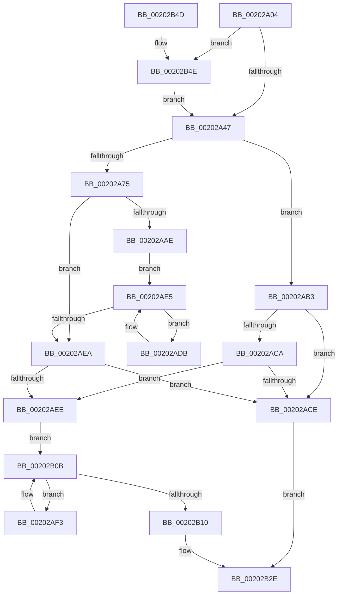

# KeThawMultiProcess

- RVA: `0x00202A04`–`0x00202B5B` (길이 `343` bytes)
- VA: `0x0000000140202A04`
- 실행 섹션: `.text`
- PDB 이름 있음: `예`; PDB Function 태그: `아니요`
- unwind 정보 RVA: `0x0005C9A4`
- 디코드: `96`개 명령, `343/343` bytes 표시
- 미해석 바이트: `0` (있으면 어셈블리에 `.byte`로 보존)

> 이 문서는 커널 이미지의 기계어와 PDB 기호를 분석해 생성했습니다. 4번과 5번은 함수 원형과 자료형을 바이너리 사용 방식에서 추정한 C 해석이며 원본 소스 복구 결과는 아닙니다.

## 1. Dependencies

- 직접 호출 지점: **6**; 고유 호출 대상: **6**
- 직접 호출자로 확인된 함수: **1**
- RIP 상대 이미지 참조: **1**

### Outgoing calls
- `0x00202A57` → [ExAcquireSpinLockExclusiveAtDpcLevel](../24/ExAcquireSpinLockExclusiveAtDpcLevel_function_00248E80.md) (function, `0x00248E80`)
- `0x00202AD4` → [KiReleaseProcessLockExclusive](../3C/KiReleaseProcessLockExclusive_function_003C2660.md) (function, `0x003C2660`)
- `0x00202B03` → [KiThawSingleThread](KiThawSingleThread_function_00203560.md) (function, `0x00203560`)
- `0x00202B13` → [ExReleaseSpinLockExclusiveFromDpcLevel](../24/ExReleaseSpinLockExclusiveFromDpcLevel_function_002497E0.md) (function, `0x002497E0`)
- `0x00202B29` → [KiExitDispatcher](../25/KiExitDispatcher_function_00251CF0.md) (function, `0x00251CF0`)
- `0x00202B51` → [KiRaiseIrqlProcessIrqlFlags](../4F/KiRaiseIrqlProcessIrqlFlags_function_004F56FC.md) (function, `0x004F56FC`)

### Direct callers
- [PsThawMultiProcess](../45/PsThawMultiProcess_function_0045FFE0.md) at `0x00460086`

### Static image references
- `0x00202A3A` → RVA `0x00FC6D20` (`ALMOSTRO`; read)

## 2. Other-region calls and transfers

- 다른 실행 섹션으로 향하는 call: **0**
- 별도 외부 분기/꼬리 이동을 확인하지 못했습니다.

## 3. Assembly (complete function range)

```asm
00202A04  48 89 5C 24 08                  mov qword ptr [rsp + 8], rbx
00202A09  48 89 6C 24 10                  mov qword ptr [rsp + 0x10], rbp
00202A0E  48 89 74 24 18                  mov qword ptr [rsp + 0x18], rsi
00202A13  57                              push rdi
00202A14  41 54                           push r12
00202A16  41 55                           push r13
00202A18  41 56                           push r14
00202A1A  41 57                           push r15
00202A1C  48 83 EC 30                     sub rsp, 0x30
00202A20  45 8B F0                        mov r14d, r8d
00202A23  48 8D 79 30                     lea rdi, [rcx + 0x30]
00202A27  44 8A E2                        mov r12b, dl
00202A2A  48 8B D9                        mov rbx, rcx
00202A2D  44 0F 20 C5                     mov rbp, cr8
00202A31  BA 02 00 00 00                  mov edx, 2
00202A36  44 0F 22 C2                     mov cr8, rdx
00202A3A  83 3D DF 42 DC 00 00            cmp dword ptr [rip + 0xdc42df], 0
00202A41  0F 85 07 01 00 00               jne 0x140202b4e
00202A47  65 4C 8B 3C 25 20 00 00 00      mov r15, qword ptr gs:[0x20]
00202A50  4C 8D 6B 40                     lea r13, [rbx + 0x40]
00202A54  49 8B CD                        mov rcx, r13
00202A57  E8 24 64 04 00                  call 0x140248e80
00202A5C  8B B3 88 00 00 00               mov esi, dword ptr [rbx + 0x88]
00202A62  8B 93 50 01 00 00               mov edx, dword ptr [rbx + 0x150]
00202A68  C1 EE 03                        shr esi, 3
00202A6B  83 E6 01                        and esi, 1
00202A6E  03 F2                           add esi, edx
00202A70  45 84 E4                        test r12b, r12b
00202A73  74 3E                           je 0x140202ab3
00202A75  F0 0F BA B3 88 00 00 00 03      lock btr dword ptr [rbx + 0x88], 3
00202A7E  48 B8 B0 03 00 00 80 F7 FF FF   movabs rax, 0xfffff780000003b0
00202A88  49 B8 08 00 00 00 80 F7 FF FF   movabs r8, 0xfffff78000000008
00202A92  0F 92 C2                        setb dl
00202A95  8A CA                           mov cl, dl
00202A97  48 8B 00                        mov rax, qword ptr [rax]
00202A9A  4D 8B 00                        mov r8, qword ptr [r8]
00202A9D  4C 2B 43 48                     sub r8, qword ptr [rbx + 0x48]
00202AA1  4C 2B C0                        sub r8, rax
00202AA4  8B 83 88 00 00 00               mov eax, dword ptr [rbx + 0x88]
00202AAA  A8 10                           test al, 0x10
00202AAC  74 3C                           je 0x140202aea
00202AAE  48 8B 07                        mov rax, qword ptr [rdi]
00202AB1  EB 32                           jmp 0x140202ae5
00202AB3  33 C9                           xor ecx, ecx
00202AB5  8B C2                           mov eax, edx
00202AB7  41 2B C6                        sub eax, r14d
00202ABA  44 3B F2                        cmp r14d, edx
00202ABD  0F 46 C8                        cmovbe ecx, eax
00202AC0  89 8B 50 01 00 00               mov dword ptr [rbx + 0x150], ecx
00202AC6  85 D2                           test edx, edx
00202AC8  74 04                           je 0x140202ace
00202ACA  85 C9                           test ecx, ecx
00202ACC  74 20                           je 0x140202aee
00202ACE  40 8A D5                        mov dl, bpl
00202AD1  48 8B CB                        mov rcx, rbx
00202AD4  E8 87 FB 1B 00                  call 0x1403c2660
00202AD9  EB 53                           jmp 0x140202b2e
00202ADB  4C 01 80 00 FE FF FF            add qword ptr [rax - 0x200], r8
00202AE2  48 8B 00                        mov rax, qword ptr [rax]
00202AE5  48 3B C7                        cmp rax, rdi
00202AE8  75 F1                           jne 0x140202adb
00202AEA  84 C9                           test cl, cl
00202AEC  74 E0                           je 0x140202ace
00202AEE  48 8B 1F                        mov rbx, qword ptr [rdi]
00202AF1  EB 18                           jmp 0x140202b0b
00202AF3  48 8D 93 08 FD FF FF            lea rdx, [rbx - 0x2f8]
00202AFA  45 8A CC                        mov r9b, r12b
00202AFD  45 33 C0                        xor r8d, r8d
00202B00  49 8B CF                        mov rcx, r15
00202B03  E8 58 0A 00 00                  call 0x140203560
00202B08  48 8B 1B                        mov rbx, qword ptr [rbx]
00202B0B  48 3B DF                        cmp rbx, rdi
00202B0E  75 E3                           jne 0x140202af3
00202B10  49 8B CD                        mov rcx, r13
00202B13  E8 C8 6C 04 00                  call 0x1402497e0
00202B18  45 33 C9                        xor r9d, r9d
00202B1B  40 88 6C 24 20                  mov byte ptr [rsp + 0x20], bpl
00202B20  33 D2                           xor edx, edx
00202B22  49 8B CF                        mov rcx, r15
00202B25  45 8D 41 01                     lea r8d, [r9 + 1]
00202B29  E8 C2 F1 04 00                  call 0x140251cf0
00202B2E  48 8B 5C 24 60                  mov rbx, qword ptr [rsp + 0x60]
00202B33  8B C6                           mov eax, esi
00202B35  48 8B 74 24 70                  mov rsi, qword ptr [rsp + 0x70]
00202B3A  48 8B 6C 24 68                  mov rbp, qword ptr [rsp + 0x68]
00202B3F  48 83 C4 30                     add rsp, 0x30
00202B43  41 5F                           pop r15
00202B45  41 5E                           pop r14
00202B47  41 5D                           pop r13
00202B49  41 5C                           pop r12
00202B4B  5F                              pop rdi
00202B4C  C3                              ret
00202B4D  CC                              int3
00202B4E  40 8A CD                        mov cl, bpl
00202B51  E8 A6 2B 2F 00                  call 0x1404f56fc
00202B56  E9 EC FE FF FF                  jmp 0x140202a47
```

## 4. C-style interpretation (structured pseudocode)

```c
__int64 __fastcall KeThawMultiProcess(__int64 a1, unsigned __int8 a2, int a3)
{
    __int64 result;
    __int64 v_rsi;
    __int64 v_rsp;
    unsigned __int8 v_stack_m38;
    unsigned __int64 v_stack_p10;
    unsigned __int64 v_stack_p18;
    unsigned __int64 v_stack_p8;

    v_stack_p8 = v_rbx;
    v_stack_p10 = v_rbp;
    v_stack_p18 = v_rsi;
    v_rsp = (v_rsp) - (48);
    if ((*(unsigned int *)(v_rip + 14435039)) != 0) goto loc_00202B4E;
loc_00202A47:
    result = ExAcquireSpinLockExclusiveAtDpcLevel(a1 + 64, 2, a3, a4);
    v_rsi = (unsigned int)(((unsigned int)(*(unsigned int *)(a1 + 136))) >> (3));
    v_rsi = (unsigned int)((v_rsi) & (1));
    v_rsi = (unsigned int)((v_rsi) + ((unsigned int)((unsigned int)(*(unsigned int *)(a1 + 336)))));
    if (a2 == 0) goto loc_00202AB3;
    a2 = (condition_is_below) ? 1 : 0;
    a3 = (*(unsigned __int64 *)(a3)) - (*(unsigned __int64 *)(a1 + 72));
    a3 = (a3) - (*(unsigned __int64 *)(result));
    if ((((unsigned __int8)((unsigned int)(*(unsigned int *)(a1 + 136)))) & (16)) == 0) goto loc_00202AEA;
    goto loc_00202AE5;
loc_00202AB3:
    a1 = 0;
    result = (unsigned int)(((unsigned int)(a2)) - ((unsigned int)((unsigned int)(a3))));
    if (((unsigned int)((unsigned int)(a3))) <= a2) { a1 = (unsigned int)(result); }
    *(unsigned int *)(a1 + 336) = (unsigned int)(a1);
    if (a2 == 0) goto loc_00202ACE;
    if ((unsigned int)(a1) == 0) goto loc_00202AEE;
loc_00202ACE:
    result = KiReleaseProcessLockExclusive(a1, (unsigned __int8)(v_cr8), a3, a4);
    goto loc_00202B2E;
loc_00202ADB:
loc_00202AE5:
    if ((*(unsigned __int64 *)(result)) != (a1 + 48)) goto loc_00202ADB;
loc_00202AEA:
    if ((unsigned __int8)(a1) == 0) goto loc_00202ACE;
loc_00202AEE:
    goto loc_00202B0B;
loc_00202AF3:
    a3 = 0;
    result = KiThawSingleThread(*(unsigned __int64 *)(gs_base + (0 + 32)), *(unsigned __int64 *)(a1 + 48) - 760, a3, a2);
loc_00202B0B:
    if ((*(unsigned __int64 *)(*(unsigned __int64 *)(a1 + 48))) != (a1 + 48)) goto loc_00202AF3;
    result = ExReleaseSpinLockExclusiveFromDpcLevel(a1 + 64, *(unsigned __int64 *)(a1 + 48) - 760, a3, a2);
    a4 = 0;
    v_stack_m38 = (unsigned __int8)(v_cr8);
    a2 = 0;
    result = KiExitDispatcher(*(unsigned __int64 *)(gs_base + (0 + 32)), a2, a4 + 1, a4);
loc_00202B2E:
    v_rsp = (v_rsp) + (48);
    return (unsigned int)((unsigned int)(v_rsi));
loc_00202B4E:
    result = KiRaiseIrqlProcessIrqlFlags((unsigned __int8)(v_stack_p10), a2, a4 + 1, a4);
    goto loc_00202A47;
}
```

## 5. (Beta) C Style

```c
int64_t KeThawMultiProcess(void *Arg1, uint8_t Arg2, int32_t Arg3)
{
    uint8_t *arg1 = (uint8_t *)Arg1;

    int64_t result;
    int64_t local_rsi;
    int64_t local_rsp;
    uint8_t v_stack_m38;
    uint64_t v_stack_p10;
    uint64_t v_stack_p18;
    uint64_t v_stack_p8;

    v_stack_p8 = local_rbx;
    v_stack_p10 = local_rbp;
    v_stack_p18 = local_rsi;
    local_rsp = (local_rsp) - (48);
    if ((*(uint32_t *)(v_rip + 0xDC42DF)) != 0) goto loc_00202B4E;
loc_00202A47:
    result = ExAcquireSpinLockExclusiveAtDpcLevel(Arg1 + 64, 2, Arg3, a4);
    local_rsi = (uint32_t)(((uint32_t)(*(uint32_t *)(arg1 + 0x88))) >> (3));
    local_rsi = (uint32_t)((local_rsi) & (1));
    local_rsi = (uint32_t)((local_rsi) + ((uint32_t)((uint32_t)(*(uint32_t *)(arg1 + 0x150)))));
    if (Arg2 == 0) goto loc_00202AB3;
    Arg2 = (condition_is_below) ? 1 : 0;
    Arg3 = (*(uint64_t *)(Arg3)) - (*(uint64_t *)(arg1 + 0x48));
    Arg3 = (Arg3) - (*(uint64_t *)(result));
    if ((((uint8_t)((uint32_t)(*(uint32_t *)(arg1 + 0x88)))) & (16)) == 0) goto loc_00202AEA;
    goto loc_00202AE5;
loc_00202AB3:
    Arg1 = 0;
    result = (uint32_t)(((uint32_t)(Arg2)) - ((uint32_t)((uint32_t)(Arg3))));
    if (((uint32_t)((uint32_t)(Arg3))) <= Arg2) { Arg1 = (uint32_t)(result); }
    *(uint32_t *)(arg1 + 0x150) = (uint32_t)(Arg1);
    if (Arg2 == 0) goto loc_00202ACE;
    if ((uint32_t)(Arg1) == 0) goto loc_00202AEE;
loc_00202ACE:
    result = KiReleaseProcessLockExclusive(Arg1, (uint8_t)(v_cr8), Arg3, a4);
    goto loc_00202B2E;
loc_00202ADB:
loc_00202AE5:
    if ((*(uint64_t *)(result)) != (Arg1 + 48)) goto loc_00202ADB;
loc_00202AEA:
    if ((uint8_t)(Arg1) == 0) goto loc_00202ACE;
loc_00202AEE:
    goto loc_00202B0B;
loc_00202AF3:
    Arg3 = 0;
    result = KiThawSingleThread(*(uint64_t *)(gs_base + (0 + 0x20)), *(uint64_t *)(arg1 + 0x30) - 760, Arg3, Arg2);
loc_00202B0B:
    if ((*(uint64_t *)(*(uint64_t *)(arg1 + 0x30))) != (Arg1 + 48)) goto loc_00202AF3;
    result = ExReleaseSpinLockExclusiveFromDpcLevel(Arg1 + 64, *(uint64_t *)(arg1 + 0x30) - 760, Arg3, Arg2);
    a4 = 0;
    v_stack_m38 = (uint8_t)(v_cr8);
    Arg2 = 0;
    result = KiExitDispatcher(*(uint64_t *)(gs_base + (0 + 0x20)), Arg2, a4 + 1, a4);
loc_00202B2E:
    local_rsp = (local_rsp) + (48);
    return (uint32_t)((uint32_t)(local_rsi));
loc_00202B4E:
    result = KiRaiseIrqlProcessIrqlFlags((uint8_t)(v_stack_p10), Arg2, a4 + 1, a4);
    goto loc_00202A47;
}
```

### 관측된 메모리 오프셋

구조체 형식이 확인되지 않은 접근은 인자 기준의 오프셋으로만 기록했습니다.

| 기준 인자 | 오프셋 표현 | 폭 (bit) | 접근 |
|---|---:|---:|---|
| `Arg1` | `+ 0x0` | `64` | `R` |
| `Arg1` | `+ 0x30` | `64` | `R` |
| `Arg1` | `+ 0x40` | `64` | `R` |
| `Arg1` | `+ 0x48` | `64` | `R` |
| `Arg1` | `+ 0x88` | `32` | `R` |
| `Arg1` | `+ 0x88` | `32` | `R/W` |
| `Arg1` | `+ 0x150` | `32` | `R` |
| `Arg1` | `+ 0x150` | `32` | `W` |

## 6. Execution-region graph

[열기: 2D/3D 그래프와 함수 탐색 컨트롤 패널](../../../control-panel.html?section=text&rva=0x00202A04&view=graph)

- 2D 그래프는 위에서 아래로 흐르고, 3D 그래프는 빈 공간을 드래그해 회전합니다. Shift+드래그는 이동, 휠은 확대·축소, 함수 노드 선택은 대상 보고서 이동입니다.

### Static fallback


